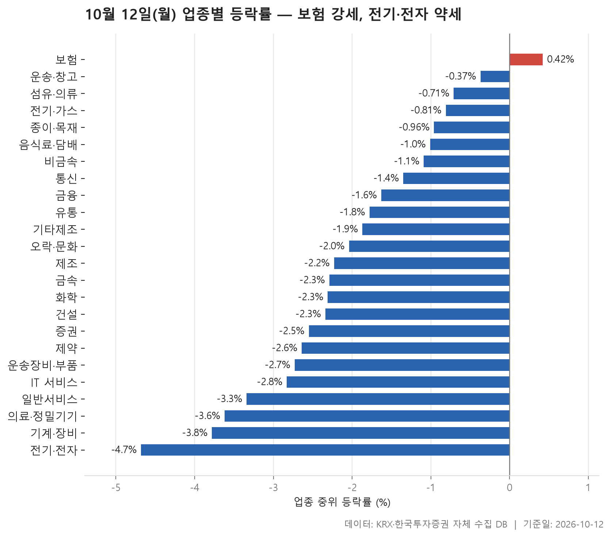
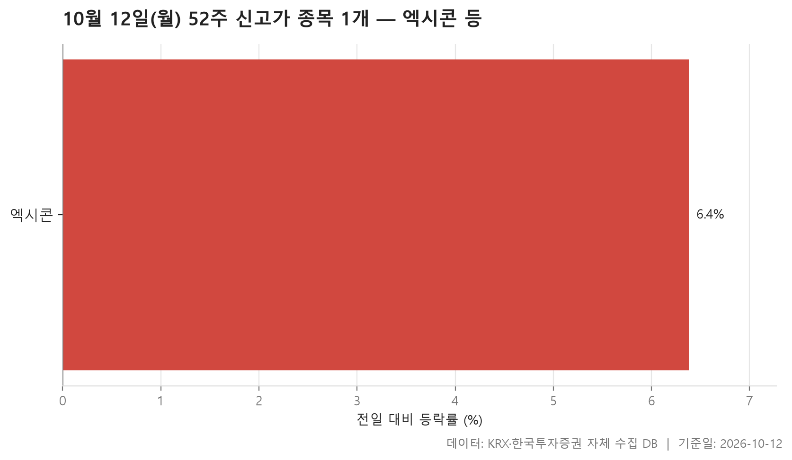
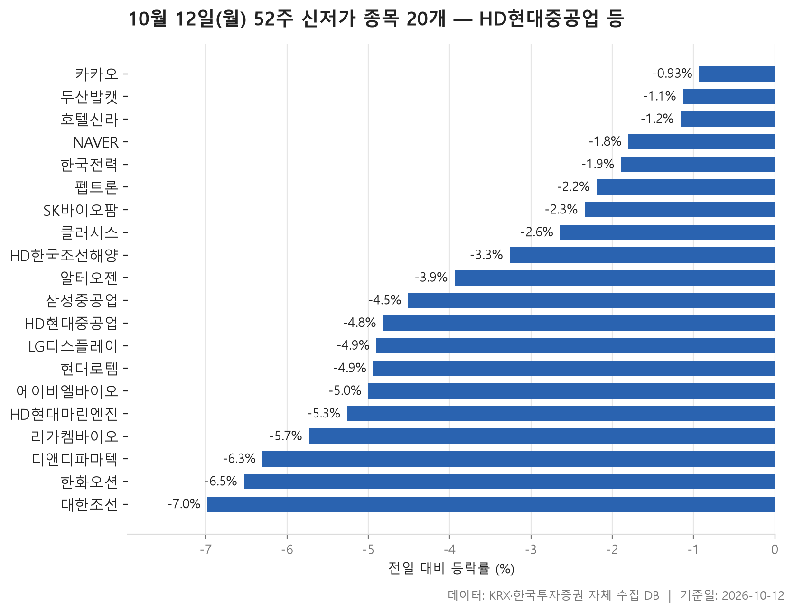
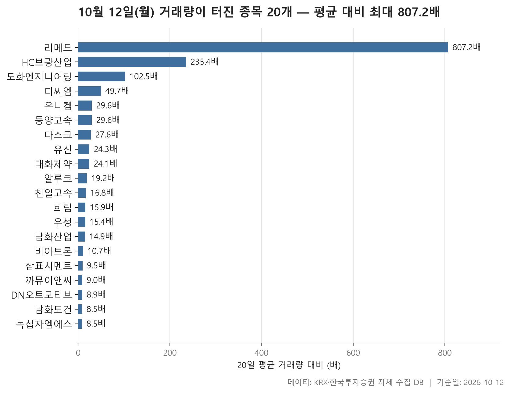

10월 12일 시장은 업종 표 한 장으로 분위기가 거의 정리됩니다. 24개 업종 가운데 종목 등락률의 중위값이 플러스로 끝난 곳은 보험 하나였고, 나머지 23개는 모두 마이너스였습니다. 업종별 중위 등락률을 한 줄로 세웠을 때 한가운데 놓이는 값이 -2.13%입니다. 몇몇 업종만 조금 밀린 하루가 아니었습니다. 대부분의 업종이 고르게, 꽤 큰 폭으로 내렸습니다. 비교 기준은 10월 8일 종가입니다.

52주 신고가와 신저가도 같은 쪽을 가리킵니다. 신고가를 쓴 종목은 하나뿐인데 신저가는 20개였습니다. 신저가 목록 위쪽에 시가총액이 큰 종목들이 줄지어 있다는 점도 눈여겨볼 만합니다.

마지막으로 거래량이 평소의 5배를 넘긴 종목 20개를 따로 모았습니다. 시장 전체는 약했는데 이 목록에서는 오른 종목이 더 많습니다. 시장과 다르게 움직인 종목들이 어떤 모습이었는지 함께 보겠습니다.

> 기준일: 2026-10-12 · 집계: 자체 수집 데이터베이스

## 업종 등락률 — 24개 중 23개 하락

맨 위의 보험은 중위 등락률이 +0.42%, 평균은 +0.26%입니다. 강세라고 부르기에는 조심스러운 폭이죠. 11개 종목 가운데 오른 곳이 54.50%로 절반을 겨우 넘었습니다. 재미있는 점은 이 업종에서 가장 크게 움직인 종목이 미래에셋생명(-4.02%)이었는데, 방향이 하락이었다는 것입니다. 그래도 순위는 중위값으로 매기기 때문에 한 종목이 크게 빠져도 업종이 1위를 지킬 수 있었습니다.

중위값과 평균이 서로 반대 방향을 가리킨 업종도 있습니다. 운송·창고는 중위값이 -0.37%인데 평균은 +0.54%입니다. 비금속도 중위값 -1.09%, 평균 +0.93%로 엇갈립니다. 비금속에서는 서산이 +30.00% 올라 혼자서 업종 평균을 0.86%p 끌어올렸습니다. 다만 평균과 중위값 사이의 간격은 그보다 넓습니다. 서산 외에 다른 종목 몇 개도 크게 올라 평균을 함께 밀어 올렸다고 봐야 합니다. 운송·창고에서 가장 크게 오른 STX그린로지스(+8.99%)가 보탠 몫도 0.32%p여서 사정이 비슷합니다.

가장 약한 업종은 -4.68%를 기록한 전기·전자였습니다. 366개 종목으로 표에서 가장 큰 업종이고, 거래대금도 147,349.10억원으로 다른 업종과 비교가 안 될 만큼 많습니다. 오른 종목은 9.30%로 열 곳에 한 곳이 채 안 됩니다. 이 업종의 금호전기는 +29.93% 급등했지만 업종 평균을 0.08%p밖에 움직이지 못했습니다. 종목이 많은 업종에서는 한 종목의 급등이 평균에 거의 드러나지 않는다는 것을 보여 주는 장면입니다. 기계·장비(-3.78%)와 의료·정밀기기(-3.62%)도 하위권이었습니다. 증권은 18개 종목 중 오른 곳이 하나도 없었고(0.00%), 표에서 이런 업종은 증권뿐입니다.

| 업종 | 종목수(개) | 중위등락률(%) | 평균등락률(%) | 상승비율(%) | 주도종목 | 주도종목등락률(%) | 평균기여도(%p) | 거래대금합계(억원) |
|---|---|---|---|---|---|---|---|---|
| 보험 | 11 | +0.42 | +0.26 | 54.50 | 미래에셋생명 | -4.02 | -0.37 | 2,195.20 |
| 운송·창고 | 28 | -0.37 | +0.54 | 39.30 | STX그린로지스 | +8.99 | 0.32 | 4,265.60 |
| 섬유·의류 | 46 | -0.71 | -0.63 | 23.90 | 형지I&C | +29.87 | 0.65 | 221.30 |
| 전기·가스 | 10 | -0.81 | -1.08 | 20.00 | SGC에너지 | -4.69 | -0.47 | 395.60 |
| 종이·목재 | 25 | -0.96 | -2.01 | 8.00 | 동화기업 | -8.38 | -0.34 | 36.10 |
| 음식료·담배 | 83 | -1.01 | -1.33 | 26.50 | 한탑 | -13.71 | -0.17 | 1,413.90 |
| 비금속 | 35 | -1.09 | +0.93 | 34.30 | 서산 | +30.00 | 0.86 | 2,158.60 |
| 통신 | 13 | -1.35 | -1.46 | 30.80 | SK텔레콤 | -5.23 | -0.40 | 1,385.30 |
| 금융 | 111 | -1.63 | -1.80 | 15.30 | 한화머시너리앤서비스홀딩스 | +24.01 | 0.22 | 21,302.20 |
| 유통 | 159 | -1.78 | -2.29 | 20.80 | 한창 | -30.77 | -0.19 | 3,820.90 |
| 기타제조 | 14 | -1.87 | -1.51 | 14.30 | 에이럭스 | -7.02 | -0.50 | 25.00 |
| 오락·문화 | 63 | -2.04 | -1.96 | 17.50 | 아센디오 | +15.67 | 0.25 | 818.40 |
| 제조 | 8 | -2.23 | -2.32 | 12.50 | 에넥스 | -4.75 | -0.59 | 6.50 |
| 금속 | 130 | -2.29 | -2.80 | 17.70 | 삼미금속 | -14.95 | -0.12 | 4,267.00 |
| 화학 | 221 | -2.31 | -2.37 | 17.60 | 예선테크 | +30.00 | 0.14 | 11,668.30 |
| 건설 | 51 | -2.34 | -2.04 | 11.80 | 금호건설 | +20.29 | 0.40 | 4,637.50 |
| 증권 | 18 | -2.55 | -2.41 | 0.00 | 미래에셋증권 | -4.86 | -0.27 | 1,141.50 |
| 제약 | 166 | -2.64 | -3.09 | 5.40 | HLB파나진 | -20.52 | -0.12 | 7,307.70 |
| 운송장비·부품 | 134 | -2.73 | -3.20 | 11.20 | 뉴인텍 | -26.75 | -0.20 | 13,277.00 |
| IT 서비스 | 244 | -2.83 | -3.26 | 12.70 | 카페24 | -17.75 | -0.07 | 7,540.40 |
| 일반서비스 | 167 | -3.34 | -3.19 | 15.00 | 바이오인프라 | +29.90 | 0.18 | 6,743.50 |
| 의료·정밀기기 | 101 | -3.62 | -3.32 | 16.80 | 리메드 | +15.31 | 0.15 | 3,110.80 |
| 기계·장비 | 206 | -3.78 | -4.13 | 7.30 | 유진로봇 | -14.04 | -0.07 | 24,515.50 |
| 전기·전자 | 366 | -4.68 | -4.35 | 9.30 | 금호전기 | +29.93 | 0.08 | 147,349.10 |

## 52주 신고가 1개 — 엑시콘 6.38%

52주 신고가는 엑시콘 한 종목입니다. 종가 56,700원으로 이전 52주 최고가 54,600원을 넘어섰고, 하루 등락률은 +6.38%였습니다. 시가총액 7,400억원, 거래대금 275.70억원의 코스닥 종목입니다.

흥미로운 건 이 종목이 속한 업종입니다. 엑시콘은 기계·장비로 분류되는데, 기계·장비는 중위 등락률 -3.78%로 24개 업종 중 아래에서 두 번째였습니다. 업종이 크게 밀린 날 혼자 신고가를 쓴 셈이지만, 왜 그랬는지는 이 자료만으로 알 수 없습니다. 신고가 하나에 신저가 20개라는 대비만으로도 이날 시장이 어느 쪽으로 기울었는지 충분히 드러납니다.

| 종목명 | 종목코드 | 시장 | 업종 | 종가(원) | 등락률(%) | 이전52주최고(원) | 거래대금(억원) | 시가총액(억원) |
|---|---|---|---|---|---|---|---|---|
| 엑시콘 | 092870 | KOSDAQ | 기계·장비 | 56,700 | +6.38 | 54,600 | 275.70 | 7,400 |

## 52주 신저가 20개 — 최저 대한조선 -6.98%

신저가 20개 중 14개가 코스피, 6개가 코스닥 종목입니다. 거래소 대형주가 많다는 것이 이 목록의 특징입니다. 시가총액이 가장 큰 HD현대중공업(383,633억원)은 -4.82% 내린 365,500원에 마감해 이전 최저가 383,000원 아래로 내려갔습니다. 그 뒤로 NAVER(274,530억원), 한화오션, HD한국조선해양, 한국전력이 이어집니다.

업종별로는 운송장비·부품이 5개로 가장 많습니다. HD현대중공업, 한화오션, 삼성중공업, 현대로템, 대한조선입니다. 업종 분류는 금융과 기계·장비로 따로 잡혀 있지만, 이름에 조선·마린이 들어간 HD한국조선해양과 HD현대마린엔진까지 보면 목록 위쪽에 이 계열 종목이 몰려 있습니다. 하락 폭도 큰 편입니다. 목록에서 가장 많이 내린 종목이 대한조선(-6.98%)이고 그다음이 한화오션(-6.53%)입니다. 또 하나 눈에 띄는 묶음은 일반서비스와 제약으로 분류된 알테오젠, 리가켐바이오, 디앤디파마텍, 에이비엘바이오, 펩트론, SK바이오팜입니다. 코스닥 신저가 종목은 클래시스 하나를 빼면 모두 이 묶음에 들어 있습니다.

20개 종목의 등락률 중위값은 -4.22%입니다. 하지만 모두 크게 무너진 것은 아닙니다. 카카오는 -0.93%만 내리고도 이전 최저가 32,200원을 밑도는 32,000원에 마감했습니다. 이전 저점 바로 위에 있던 종목이 작은 하락으로 선을 넘은 경우입니다. NAVER(-1.80%)와 두산밥캣(-1.13%)도 비슷한 경우로 볼 수 있습니다.

| 종목명 | 종목코드 | 시장 | 업종 | 종가(원) | 등락률(%) | 이전52주최저(원) | 거래대금(억원) | 시가총액(억원) |
|---|---|---|---|---|---|---|---|---|
| HD현대중공업 | 329180 | KOSPI | 운송장비·부품 | 365,500 | -4.82 | 383,000 | 1,172.90 | 383,633 |
| NAVER | 035420 | KOSPI | IT 서비스 | 180,500 | -1.80 | 181,100 | 1,021.00 | 274,530 |
| 한화오션 | 042660 | KOSPI | 운송장비·부품 | 67,300 | -6.53 | 71,300 | 788.40 | 206,216 |
| HD한국조선해양 | 009540 | KOSPI | 금융 | 282,000 | -3.26 | 291,500 | 941.80 | 199,580 |
| 한국전력 | 015760 | KOSPI | 전기·가스 | 28,550 | -1.89 | 29,000 | 311.40 | 183,281 |
| 알테오젠 | 196170 | KOSDAQ | 일반서비스 | 231,500 | -3.94 | 234,500 | 757.90 | 161,252 |
| 삼성중공업 | 010140 | KOSPI | 운송장비·부품 | 18,010 | -4.51 | 18,440 | 668.30 | 158,488 |
| 카카오 | 035720 | KOSPI | IT 서비스 | 32,000 | -0.93 | 32,200 | 522.10 | 141,760 |
| 현대로템 | 064350 | KOSPI | 운송장비·부품 | 100,000 | -4.94 | 103,600 | 432.80 | 109,142 |
| SK바이오팜 | 326030 | KOSPI | 일반서비스 | 71,000 | -2.34 | 72,700 | 58.60 | 55,602 |
| 두산밥캣 | 241560 | KOSPI | 기계·장비 | 52,600 | -1.13 | 53,000 | 76.10 | 50,420 |
| LG디스플레이 | 034220 | KOSPI | 전기·전자 | 7,760 | -4.90 | 8,090 | 320.00 | 38,800 |
| 리가켐바이오 | 141080 | KOSDAQ | 일반서비스 | 69,100 | -5.73 | 73,300 | 141.10 | 25,580 |
| 에이비엘바이오 | 298380 | KOSDAQ | 제약 | 45,600 | -5.00 | 47,350 | 132.70 | 25,530 |
| 펩트론 | 087010 | KOSDAQ | 제약 | 89,500 | -2.19 | 91,500 | 410.00 | 20,869 |
| 클래시스 | 214150 | KOSDAQ | 의료·정밀기기 | 29,550 | -2.64 | 29,700 | 34.70 | 19,277 |
| 디앤디파마텍 | 347850 | KOSDAQ | 일반서비스 | 40,150 | -6.30 | 40,500 | 225.00 | 18,467 |
| 대한조선 | 439260 | KOSPI | 운송장비·부품 | 41,950 | -6.98 | 42,100 | 29.90 | 15,978 |
| 호텔신라 | 008770 | KOSPI | 유통 | 38,250 | -1.16 | 38,650 | 35.80 | 15,012 |
| HD현대마린엔진 | 071970 | KOSPI | 기계·장비 | 40,550 | -5.26 | 42,550 | 87.10 | 13,755 |

## 거래량 급증 20개 — 최고 리메드 807.20배

거래량이 급증한 종목 목록은 시장 전체와 결이 다릅니다. 20개 가운데 내린 종목은 천일고속, 희림, 남화산업, DN오토모티브, 녹십자엠에스이고 나머지는 모두 올랐습니다. 업종 표에서 오른 종목이 드물었던 것과 대조됩니다.

맨 위의 리메드는 거래량이 20일 평균의 807.20배였습니다. 평소 20,064주 수준이던 거래량이 16,196,116주까지 늘었고, 주가는 +15.31% 올랐습니다. 업종 표에서 의료·정밀기기 업종 안에서 가장 크게 움직인 종목도 리메드였습니다. 하지만 업종 전체는 중위 등락률 -3.62%로 약했습니다. 두 번째인 HC보광산업(235.40배)부터는 배수가 빠르게 낮아지고, 20개 종목의 배수 중위값은 18배입니다. 리메드 하나만 유난히 튀어 나온 분포입니다.

종목 규모는 대체로 작습니다. 시가총액 천억 원 안팎이거나 그보다 작은 종목이 많습니다. 예외는 DN오토모티브입니다. 시가총액 22,907억원으로 목록에서 가장 큰데, 거래량이 평균의 8.90배로 늘면서 주가는 -20.43% 내렸습니다. 거래가 몰렸는데 주가가 크게 떨어진, 이 목록에서는 드문 경우입니다. 거래대금으로는 삼표시멘트(1,288.80억원)와 동양고속(1,047.00억원)이 컸습니다. 같은 운송·창고 업종인 동양고속(+8.68%)과 천일고속(-3.17%)은 둘 다 거래량이 급증했지만 주가는 반대로 움직였습니다.

| 종목명 | 종목코드 | 시장 | 업종 | 종가(원) | 등락률(%) | 거래량(주) | 평균거래량(주) | 배수(배) | 거래대금(억원) | 시가총액(억원) |
|---|---|---|---|---|---|---|---|---|---|---|
| 리메드 | 302550 | KOSDAQ | 의료·정밀기기 | 3,050 | +15.31 | 16,196,116 | 20,064 | 807.20 | 504.40 | 923 |
| HC보광산업 | 225530 | KOSDAQ | 비금속 | 2,465 | +13.07 | 2,417,055 | 10,267 | 235.40 | 61.00 | 896 |
| 도화엔지니어링 | 002150 | KOSPI | 일반서비스 | 5,570 | +13.91 | 3,058,625 | 29,850 | 102.50 | 175.20 | 1,878 |
| 디씨엠 | 024090 | KOSPI | 금속 | 12,080 | +6.15 | 98,932 | 1,991 | 49.70 | 12.20 | 1,377 |
| 유니켐 | 011330 | KOSPI | 운송장비·부품 | 5,000 | +14.16 | 3,253,464 | 109,854 | 29.60 | 169.90 | 501 |
| 동양고속 | 084670 | KOSPI | 운송·창고 | 41,300 | +8.68 | 2,454,074 | 82,772 | 29.60 | 1,047.00 | 1,196 |
| 다스코 | 058730 | KOSPI | 금속 | 3,375 | +8.52 | 10,047,490 | 363,949 | 27.60 | 357.20 | 683 |
| 유신 | 054930 | KOSDAQ | 일반서비스 | 22,650 | +29.87 | 432,426 | 17,790 | 24.30 | 93.20 | 680 |
| 대화제약 | 067080 | KOSDAQ | 제약 | 13,030 | +8.58 | 1,321,557 | 54,926 | 24.10 | 180.50 | 2,426 |
| 알루코 | 001780 | KOSPI | 금속 | 1,770 | +3.75 | 4,914,707 | 255,577 | 19.20 | 89.20 | 1,714 |
| 천일고속 | 000650 | KOSPI | 운송·창고 | 214,000 | -3.17 | 242,151 | 14,409 | 16.80 | 551.50 | 3,059 |
| 희림 | 037440 | KOSDAQ | 일반서비스 | 3,875 | -4.44 | 2,019,069 | 127,021 | 15.90 | 85.30 | 539 |
| 우성 | 006980 | KOSPI | 음식료·담배 | 16,500 | +3.64 | 46,940 | 3,040 | 15.40 | 8.20 | 510 |
| 남화산업 | 111710 | KOSDAQ | 오락·문화 | 3,175 | -0.94 | 688,109 | 46,096 | 14.90 | 23.20 | 654 |
| 비아트론 | 141000 | KOSDAQ | 기계·장비 | 14,430 | +4.26 | 2,898,024 | 271,581 | 10.70 | 411.10 | 1,748 |
| 삼표시멘트 | 038500 | KOSDAQ | 비금속 | 7,410 | +4.66 | 17,035,965 | 1,791,801 | 9.50 | 1,288.80 | 7,997 |
| 까뮤이앤씨 | 013700 | KOSPI | 건설 | 1,591 | +2.51 | 1,302,838 | 144,418 | 9.00 | 21.30 | 951 |
| DN오토모티브 | 007340 | KOSPI | 전기·전자 | 39,150 | -20.43 | 1,056,960 | 118,872 | 8.90 | 435.60 | 22,907 |
| 남화토건 | 091590 | KOSDAQ | 건설 | 6,270 | +13.18 | 2,309,244 | 270,346 | 8.50 | 150.20 | 736 |
| 녹십자엠에스 | 142280 | KOSDAQ | 제약 | 3,710 | -0.67 | 18,314,683 | 2,146,517 | 8.50 | 742.00 | 889 |

## 정리

정리하면 10월 12일은 보험을 뺀 모든 업종이 내리고 신저가가 신고가를 압도한 날이었습니다. 그 가운데 거래량이 터진 일부 소형 종목만 다르게 움직였습니다. 특히 시가총액이 큰 조선 계열 종목과 코스닥 대형 종목이 줄줄이 52주 저점을 새로 썼습니다.

이 글의 수치는 10월 8일 종가와 10월 12일 종가를 비교한 것이어서 그 사이 장중 흐름은 담겨 있지 않습니다. 왜 오르고 내렸는지도 이 데이터에는 없습니다. 업종 분류는 자체 기준이라 HD한국조선해양이 금융으로 잡히는 것처럼 흔히 생각하는 분류와 다를 수 있다는 점도 감안해 읽어 주시기 바랍니다.

## 집계 기준

**업종 등락률**

- **기준**: 2026-10-08 종가 → 2026-10-12 종가
- **순위**: 업종 내 종목 등락률의 중위값 (평균은 참고용으로 함께 표시)
- **주도종목**: 그 업종에서 등락률 절대값이 가장 큰 종목 (동점이면 거래대금이 큰 쪽)
- **평균기여도**: 그 종목 하나가 업종 평균을 움직인 폭 (등락률 ÷ 종목수). 중위값과 평균의 격차가 이 값에 가까우면 평균을 만든 것이 그 종목이고, 훨씬 크면 다른 종목들도 함께 움직인 것입니다
- **필터**: 업종 내 보통주 5종목 이상
- **전체업종중위등락률(%)**: -2.13

**52주 신고가**

- **기준**: 종가 > 직전 52주 최고가
- **관측구간**: 2025-09-23 ~ 2026-10-08 (252거래일)
- **필터**: 시가총액 500억 이상, 거래대금 3억 이상, 보통주

**52주 신저가**

- **기준**: 종가 < 직전 52주 최저가
- **관측구간**: 2025-09-23 ~ 2026-10-08 (252거래일)
- **필터**: 시가총액 500억 이상, 거래대금 3억 이상, 보통주

**거래량 급증**

- **기준**: 당일 거래량 ≥ 직전 20거래일 평균 × 5
- **관측구간**: 2026-09-08 ~ 2026-10-08 (20거래일)
- **필터**: 시가총액 500억 이상, 거래대금 3억 이상, 보통주

## 데이터 출처 및 유의사항

- **데이터출처**: 한국거래소(KRX) 공시 데이터와 한국투자증권 OpenAPI 를 직접 수집해 구축한 자체 데이터베이스
- **집계방식**: 수집·집계·차트 생성을 직접 구현한 파이프라인에서 자동 산출
- **작성고지**: 본문의 표·통계·차트는 자체 데이터베이스에서 계산된 값이며, 문장 작성 과정에 AI 도구를 활용했습니다.
- **면책**: 본 글은 정보 제공을 목적으로 하며 특정 종목의 매수·매도를 추천하지 않습니다. 제시된 수치는 과거 데이터이고 미래 수익을 보장하지 않습니다. 투자 판단과 그 결과에 대한 책임은 투자자 본인에게 있습니다.

