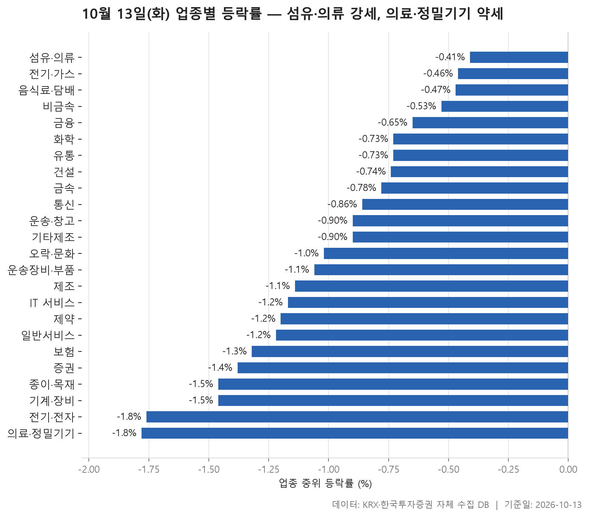
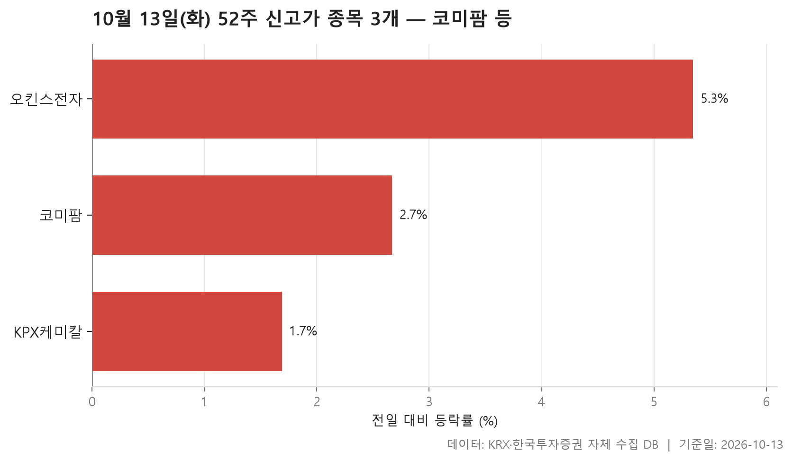
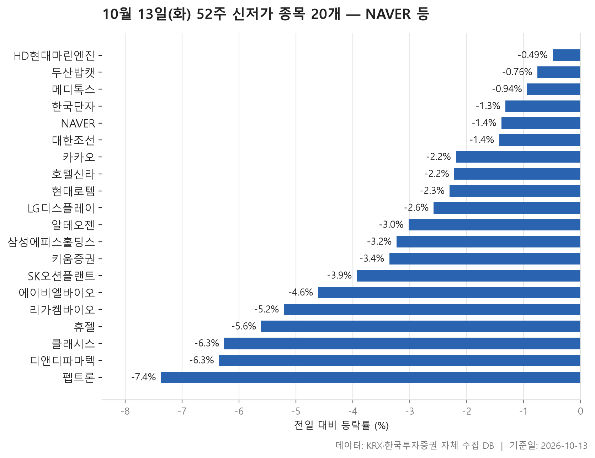
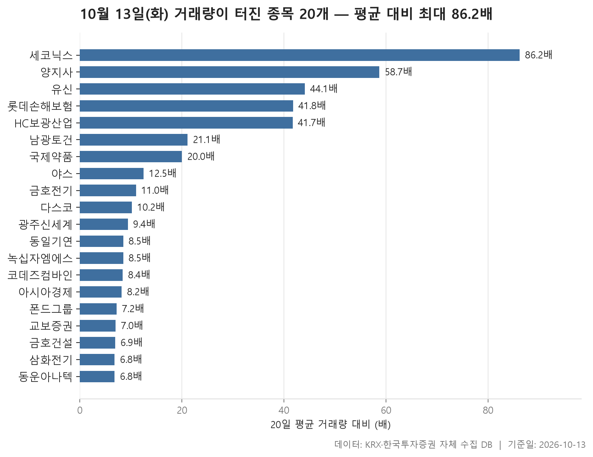

10월 13일 시장은 표 하나로 요약됩니다. 24개 업종의 중위 등락률을 줄 세우면 맨 위에 놓인 섬유·의류도 **-0.41%**입니다. 업종 안 종목을 한가운데서 잘랐을 때 오른 쪽에 서 있는 업종이 하나도 없었다는 뜻이죠. 덜 내린 업종과 더 내린 업종이 있었을 뿐입니다.

이 분위기는 52주 신고가·신저가 집계에도 그대로 나옵니다. 최근 52주 최고가를 넘어선 종목은 3개였고, 최저가를 밑돈 종목은 20개였습니다. 신저가 쪽에는 시가총액이 큰 이름이 여럿 들어 있습니다.

아래에서는 업종 흐름부터 보고, 신고가와 신저가를 차례로 살핀 뒤, 거래량이 평소보다 크게 늘어난 종목을 정리합니다. 거래량이 몰린 종목들은 지수 흐름과 따로 움직인 경우가 많아서 함께 보면 오늘 시장의 결이 좀 더 잘 보입니다.

> 기준일: 2026-10-13 · 집계: 자체 수집 데이터베이스

## 업종 등락률

업종별 중위 등락률은 위로는 섬유·의류 -0.41%, 아래로는 의료·정밀기기 -1.78% 사이에 놓여 있고, 24개 업종 가운데 한가운데 값은 **-0.96%**입니다. 업종 사이 간격이 넓지 않아서 특정 업종만 무너진 날이라기보다 시장 전반이 조금씩 밀린 날에 가깝습니다. 오른 종목 비율을 봐도 그렇습니다. 가장 높은 비금속이 36.10%, 섬유·의류가 34.80%로 셋 중 하나꼴에 그쳤고, 증권은 5.60%로 스무 곳에 한 곳꼴, 종이·목재도 7.70%에 머물렀습니다.

표에서 눈여겨볼 곳은 중위값과 평균이 서로 다른 방향을 가리키는 업종입니다. **비금속**은 중위값이 -0.53%인데 평균은 +0.64%입니다. 서산이 +29.88% 오르며 이 종목 하나가 업종 평균을 0.83%p 끌어올렸습니다. 종목이 8개뿐인 **제조**는 더 극단적입니다. 중위값은 -1.14%인데 평균은 +0.70%이고, 에넥스(+16.08%) 한 종목이 평균을 2.01%p 밀어 올렸습니다. 평균만 보면 오른 업종 같지만 실제로 오른 종목은 여덟 곳 중 한 곳꼴이었습니다.

반대 방향도 있습니다. **통신**은 중위값 -0.86%에 평균 -2.00%로, 프리티(-11.11%)가 평균을 0.85%p 끌어내렸습니다. **운송·창고**도 천일고속(-19.35%) 탓에 평균이 -2.23%까지 내려갔습니다. 유통에서는 한창이 -69.44%를 기록했지만 종목 수가 159개로 많아서 평균에 미친 영향은 -0.44%p에 그쳤습니다. 한 종목의 급등락이 평균을 얼마나 흔드는지는 업종 크기에 따라 크게 달라진다는 점을 보여 줍니다.

가장 무거운 업종은 **전기·전자**였습니다. 종목 수가 366개로 가장 많고 거래대금도 191,587.60억원으로 다른 업종과 단위가 다른데, 중위값은 -1.76%로 끝에서 두 번째입니다. 평균 -1.83%도 중위값과 거의 붙어 있어서, 일부 종목이 아니라 업종 전체가 고르게 약했다고 볼 수 있습니다. 맨 아래 의료·정밀기기는 프로티아가 -35.34%로 크게 빠졌지만, 중위값 자체가 -1.78%라서 그 한 종목만의 문제로 보기는 어렵습니다.

| 업종 | 종목수(개) | 중위등락률(%) | 평균등락률(%) | 상승비율(%) | 주도종목 | 주도종목등락률(%) | 평균기여도(%p) | 거래대금합계(억원) |
|---|---|---|---|---|---|---|---|---|
| 섬유·의류 | 46 | -0.41 | -0.09 | 34.80 | 형지I&C | +29.89 | 0.65 | 565.00 |
| 전기·가스 | 10 | -0.46 | -0.57 | 20.00 | SGC에너지 | -2.29 | -0.23 | 509.60 |
| 음식료·담배 | 83 | -0.47 | -0.75 | 30.10 | 마니커에프앤지 | +8.42 | 0.10 | 1,580.80 |
| 비금속 | 36 | -0.53 | +0.64 | 36.10 | 서산 | +29.88 | 0.83 | 2,481.00 |
| 금융 | 111 | -0.65 | -1.03 | 27.90 | SK스퀘어 | -12.91 | -0.12 | 23,386.40 |
| 화학 | 221 | -0.73 | -0.89 | 31.70 | 예선테크 | +29.97 | 0.14 | 13,620.00 |
| 유통 | 159 | -0.73 | -1.10 | 30.20 | 한창 | -69.44 | -0.44 | 5,083.80 |
| 건설 | 51 | -0.74 | -1.05 | 23.50 | 베노티앤알 | +9.85 | 0.19 | 4,827.30 |
| 금속 | 130 | -0.78 | -0.62 | 25.40 | 이렘 | +22.38 | 0.17 | 5,169.50 |
| 통신 | 13 | -0.86 | -2.00 | 15.40 | 프리티 | -11.11 | -0.85 | 928.90 |
| 운송·창고 | 28 | -0.90 | -2.23 | 28.60 | 천일고속 | -19.35 | -0.69 | 2,823.80 |
| 기타제조 | 14 | -0.90 | -0.79 | 14.30 | 브이씨 | -3.45 | -0.25 | 23.50 |
| 오락·문화 | 63 | -1.02 | -0.99 | 31.70 | YTN | -9.11 | -0.14 | 850.60 |
| 운송장비·부품 | 134 | -1.06 | -0.52 | 24.60 | 뉴인텍 | +29.78 | 0.22 | 12,403.60 |
| 제조 | 8 | -1.14 | +0.70 | 12.50 | 에넥스 | +16.08 | 2.01 | 10.80 |
| IT 서비스 | 242 | -1.17 | -1.22 | 25.20 | 모아데이타 | +20.81 | 0.09 | 10,336.80 |
| 제약 | 164 | -1.20 | -1.38 | 20.10 | 대화제약 | -17.11 | -0.10 | 9,170.60 |
| 일반서비스 | 167 | -1.22 | -1.32 | 26.30 | 바이오인프라 | +29.92 | 0.18 | 7,683.80 |
| 보험 | 11 | -1.32 | -0.64 | 27.30 | 롯데손해보험 | +7.94 | 0.72 | 2,960.80 |
| 증권 | 18 | -1.38 | -1.53 | 5.60 | 미래에셋증권 | -3.52 | -0.20 | 1,532.70 |
| 종이·목재 | 26 | -1.46 | -1.25 | 7.70 | 블루산업개발 | +11.46 | 0.44 | 44.00 |
| 기계·장비 | 206 | -1.46 | -1.19 | 23.80 | 야스 | +16.14 | 0.08 | 25,527.10 |
| 전기·전자 | 366 | -1.76 | -1.83 | 21.90 | 동일기연 | +17.43 | 0.05 | 191,587.60 |
| 의료·정밀기기 | 101 | -1.78 | -2.11 | 27.70 | 프로티아 | -35.34 | -0.35 | 2,739.10 |

## 52주 신고가 3개 — 최고 오킨스전자 5.35%

신고가 명단은 짧습니다. 시가총액 500억원 이상, 거래대금 3억원 이상이라는 조건을 통과한 보통주 가운데 종가가 직전 52주 최고가를 넘어선 종목은 코미팜, 오킨스전자, KPX케미칼 세 곳뿐입니다. 시장은 KOSDAQ 2개, KOSPI 1개였고 업종은 제약·전기·전자·화학으로 모두 달랐습니다. 공통된 흐름이 있었다고 말하기는 어렵습니다.

세 종목 모두 직전 고점을 크게 뚫었다기보다 겨우 넘어선 모습입니다. 코미팜은 종가 11,550원으로 이전 최고가 11,500원을 넘었고, 오킨스전자도 29,550원으로 이전 최고가 29,500원을 살짝 웃돌았습니다. 하루 오름폭은 오킨스전자가 +5.35%로 가장 컸고, 코미팜 +2.67%, KPX케미칼 +1.69% 순이었습니다.

거래대금은 오킨스전자가 232.60억원으로 두드러진 반면, KPX케미칼은 13.70억원으로 조용했습니다. 시가총액은 코미팜이 8,618억원으로 셋 중 가장 큽니다. 전기·전자 업종이 하루 종일 약했던 가운데 그 업종의 오킨스전자가 신고가를 썼다는 점은 업종 흐름과 다르게 움직인 사례로 볼 만합니다.

| 종목명 | 종목코드 | 시장 | 업종 | 종가(원) | 등락률(%) | 이전52주최고(원) | 거래대금(억원) | 시가총액(억원) |
|---|---|---|---|---|---|---|---|---|
| 코미팜 | 041960 | KOSDAQ | 제약 | 11,550 | +2.67 | 11,500 | 56.90 | 8,618 |
| 오킨스전자 | 080580 | KOSDAQ | 전기·전자 | 29,550 | +5.35 | 29,500 | 232.60 | 6,232 |
| KPX케미칼 | 025000 | KOSPI | 화학 | 60,100 | +1.69 | 59,400 | 13.70 | 2,492 |

## 52주 신저가 20개 — 최저 펩트론 -7.37%

신저가는 20개로 신고가보다 훨씬 많았고, 명단 맨 위에 있는 이름도 가볍지 않습니다. 시가총액 270,728억원의 NAVER를 비롯해 알테오젠, 카카오, 현대로템처럼 시가총액이 큰 종목들이 위쪽을 채우고 있습니다. 시장별로는 KOSPI 12개, KOSDAQ 8개로 유가증권시장 쪽이 더 많았습니다.

업종은 11개에 흩어져 있지만 **제약**이 4개로 가장 많습니다. 에이비엘바이오, 휴젤, 펩트론, 메디톡스가 여기에 해당하고, 이 가운데 펩트론은 -7.37%로 오늘 신저가 종목 중 가장 크게 내렸습니다. 제약 업종의 중위 등락률이 -1.20%였던 것과 비교하면 이 종목들의 하락폭은 업종 한가운데 값보다 깊었습니다. IT 서비스에서도 NAVER와 카카오가 나란히 이름을 올렸습니다.

하락폭을 보면 20개 종목의 중위값이 -2.80%이니, 급락해서 신저가로 떨어졌다기보다 이미 저점 근처에 있던 종목이 한 걸음 더 밀린 경우가 많아 보입니다. HD현대마린엔진은 -0.49%만 내렸는데도 종가 40,350원이 이전 최저가 40,400원 아래로 내려갔고, 두산밥캣(-0.76%)이나 메디톡스(-0.94%)도 비슷하게 작은 하락으로 저점을 새로 썼습니다. 반면 클래시스(-6.26%), 디앤디파마텍(-6.35%)처럼 하루 만에 크게 빠지면서 저점을 내준 종목도 섞여 있습니다.

| 종목명 | 종목코드 | 시장 | 업종 | 종가(원) | 등락률(%) | 이전52주최저(원) | 거래대금(억원) | 시가총액(억원) |
|---|---|---|---|---|---|---|---|---|
| NAVER | 035420 | KOSPI | IT 서비스 | 178,000 | -1.39 | 179,500 | 1,302.60 | 270,728 |
| 알테오젠 | 196170 | KOSDAQ | 일반서비스 | 224,500 | -3.02 | 230,000 | 850.10 | 156,376 |
| 카카오 | 035720 | KOSPI | IT 서비스 | 31,300 | -2.19 | 31,650 | 623.50 | 138,659 |
| 현대로템 | 064350 | KOSPI | 운송장비·부품 | 97,700 | -2.30 | 99,500 | 570.90 | 106,632 |
| 삼성에피스홀딩스 | 0126Z0 | KOSPI | 금융 | 314,500 | -3.23 | 324,500 | 162.60 | 78,257 |
| 키움증권 | 039490 | KOSPI | 증권 | 230,000 | -3.36 | 235,000 | 428.70 | 60,325 |
| 두산밥캣 | 241560 | KOSPI | 기계·장비 | 52,200 | -0.76 | 52,300 | 71.00 | 50,037 |
| LG디스플레이 | 034220 | KOSPI | 전기·전자 | 7,560 | -2.58 | 7,700 | 315.20 | 37,800 |
| 에이비엘바이오 | 298380 | KOSDAQ | 제약 | 43,500 | -4.61 | 45,350 | 169.90 | 24,355 |
| 리가켐바이오 | 141080 | KOSDAQ | 일반서비스 | 65,500 | -5.21 | 68,800 | 146.40 | 24,248 |
| 휴젤 | 145020 | KOSDAQ | 제약 | 169,900 | -5.61 | 175,500 | 113.80 | 21,263 |
| 펩트론 | 087010 | KOSDAQ | 제약 | 82,900 | -7.37 | 86,500 | 267.50 | 19,330 |
| 클래시스 | 214150 | KOSDAQ | 의료·정밀기기 | 27,700 | -6.26 | 29,350 | 73.10 | 18,070 |
| 디앤디파마텍 | 347850 | KOSDAQ | 일반서비스 | 37,600 | -6.35 | 39,850 | 257.80 | 17,295 |
| 대한조선 | 439260 | KOSPI | 운송장비·부품 | 41,350 | -1.43 | 41,950 | 24.80 | 15,750 |
| 호텔신라 | 008770 | KOSPI | 유통 | 37,400 | -2.22 | 38,150 | 79.40 | 14,679 |
| HD현대마린엔진 | 071970 | KOSPI | 기계·장비 | 40,350 | -0.49 | 40,400 | 100.20 | 13,687 |
| SK오션플랜트 | 100090 | KOSPI | 금속 | 10,990 | -3.93 | 11,010 | 48.00 | 6,866 |
| 한국단자 | 025540 | KOSPI | 전기·전자 | 52,400 | -1.32 | 53,100 | 10.80 | 5,300 |
| 메디톡스 | 086900 | KOSDAQ | 제약 | 63,500 | -0.94 | 64,100 | 12.90 | 4,635 |

## 거래량 급증 20개 — 최고 세코닉스 86.20배

거래량 급증 명단에는 오늘 거래량이 직전 20거래일 평균의 5배를 넘은 종목 20개가 담겼고, 배수의 중위값은 **9.80배**입니다. 맨 위 세코닉스는 86.20배로 다른 종목들과 차이가 큽니다. 평소 하루 30,650주 정도 거래되던 종목에서 이날 2,642,958주가 오갔고 주가는 +14.22% 올랐습니다. 시가총액이 547억원으로 명단에서 가장 작은 편이라는 점도 함께 봐야 합니다. 그 뒤로는 양지사(58.70배), 유신(44.10배), 롯데손해보험(41.80배), HC보광산업(41.70배)이 이어집니다.

업종 표와 겹치는 이름이 있다는 점이 흥미롭습니다. 롯데손해보험(+7.94%)은 보험 업종에서, 야스(+16.14%)는 기계·장비에서, 동일기연(+17.43%)은 전기·전자에서 각각 가장 크게 움직인 종목이었습니다. 업종 전체는 약했는데, 거래가 몰린 한두 종목이 업종 안에서 반대로 튀어 오른 모양입니다.

다만 거래량이 늘었다고 주가가 오른 것은 아닙니다. 금호건설은 6.90배 거래량에 -9.33%, 동운아나텍은 -8.50%, 유신은 -4.86%, 다스코는 -4.89%로 내렸습니다. 거래대금 규모로 보면 금호전기가 4,053.20억원으로 가장 컸고, 금호건설 2,002.20억원, 국제약품 1,419.10억원, 녹십자엠에스 1,045.70억원이 뒤를 이었습니다. 시가총액이 가장 큰 교보증권(10,485억원)은 7.00배 거래량에도 주가 변동이 -0.97%에 그쳐서 명단 안에서 가장 조용한 편이었습니다.

| 종목명 | 종목코드 | 시장 | 업종 | 종가(원) | 등락률(%) | 거래량(주) | 평균거래량(주) | 배수(배) | 거래대금(억원) | 시가총액(억원) |
|---|---|---|---|---|---|---|---|---|---|---|
| 세코닉스 | 053450 | KOSDAQ | 의료·정밀기기 | 3,695 | +14.22 | 2,642,958 | 30,650 | 86.20 | 95.80 | 547 |
| 양지사 | 030960 | KOSDAQ | 출판·매체복제 | 4,770 | +5.76 | 1,336,328 | 22,748 | 58.70 | 67.60 | 762 |
| 유신 | 054930 | KOSDAQ | 일반서비스 | 21,550 | -4.86 | 1,720,272 | 38,971 | 44.10 | 406.90 | 647 |
| 롯데손해보험 | 000400 | KOSPI | 보험 | 2,515 | +7.94 | 15,170,503 | 362,563 | 41.80 | 378.50 | 7,805 |
| HC보광산업 | 225530 | KOSDAQ | 비금속 | 2,770 | +12.37 | 5,443,686 | 130,601 | 41.70 | 159.30 | 1,007 |
| 남광토건 | 001260 | KOSPI | 건설 | 8,100 | -0.37 | 1,208,166 | 57,216 | 21.10 | 108.60 | 796 |
| 국제약품 | 002720 | KOSPI | 제약 | 4,495 | +15.40 | 31,938,761 | 1,598,496 | 20.00 | 1,419.10 | 951 |
| 야스 | 255440 | KOSDAQ | 기계·장비 | 10,290 | +16.14 | 916,086 | 73,356 | 12.50 | 88.20 | 1,344 |
| 금호전기 | 001210 | KOSPI | 전기·전자 | 11,500 | +3.88 | 32,851,929 | 2,982,902 | 11.00 | 4,053.20 | 1,452 |
| 다스코 | 058730 | KOSPI | 금속 | 3,210 | -4.89 | 7,780,508 | 760,771 | 10.20 | 273.60 | 650 |
| 광주신세계 | 037710 | KOSPI | 유통 | 35,350 | +1.29 | 195,573 | 20,811 | 9.40 | 69.90 | 2,696 |
| 동일기연 | 032960 | KOSDAQ | 전기·전자 | 2,930 | +17.43 | 338,682 | 39,690 | 8.50 | 9.70 | 515 |
| 녹십자엠에스 | 142280 | KOSDAQ | 제약 | 3,895 | +4.99 | 25,973,457 | 3,045,222 | 8.50 | 1,045.70 | 933 |
| 코데즈컴바인 | 047770 | KOSDAQ | 섬유·의류 | 3,340 | +0.60 | 7,334,665 | 868,266 | 8.40 | 259.60 | 1,264 |
| 아시아경제 | 127710 | KOSDAQ | IT 서비스 | 1,283 | +5.34 | 835,680 | 101,470 | 8.20 | 11.80 | 565 |
| 폰드그룹 | 472850 | KOSDAQ | 유통 | 4,455 | -3.36 | 207,907 | 28,900 | 7.20 | 9.20 | 2,565 |
| 교보증권 | 030610 | KOSPI | 증권 | 9,200 | -0.97 | 207,909 | 29,890 | 7.00 | 18.80 | 10,485 |
| 금호건설 | 002990 | KOSPI | 건설 | 12,150 | -9.33 | 14,592,741 | 2,105,174 | 6.90 | 2,002.20 | 4,527 |
| 삼화전기 | 009470 | KOSPI | 전기·전자 | 28,900 | +15.83 | 491,991 | 72,294 | 6.80 | 137.50 | 1,911 |
| 동운아나텍 | 094170 | KOSDAQ | 전기·전자 | 21,000 | -8.50 | 453,298 | 66,593 | 6.80 | 93.60 | 4,391 |

## 정리

10월 13일은 24개 업종 모두 중위 등락률이 마이너스였고, 신저가가 신고가보다 훨씬 많았으며, 그 와중에 거래가 몰린 몇몇 종목만 업종과 반대로 움직인 하루였습니다. 섬유·의류가 가장 덜 내린 업종으로 꼽혔지만 오른 종목은 셋 중 하나꼴이었다는 점을 함께 기억해 두시면 좋겠습니다.

이 글은 종가 기준 등락률과 거래량만으로 정리한 것이어서 왜 이렇게 움직였는지는 알려 주지 못합니다. 개별 종목의 급등락이나 거래량 급증의 배경은 이 자료에 담겨 있지 않습니다. 하루치 숫자이기도 하니, 흐름으로 판단하려면 며칠 동안의 표를 이어서 보시는 편이 낫습니다.

## 집계 기준

**업종 등락률**

- **기준**: 2026-10-12 종가 → 2026-10-13 종가
- **순위**: 업종 내 종목 등락률의 중위값 (평균은 참고용으로 함께 표시)
- **주도종목**: 그 업종에서 등락률 절대값이 가장 큰 종목 (동점이면 거래대금이 큰 쪽)
- **평균기여도**: 그 종목 하나가 업종 평균을 움직인 폭 (등락률 ÷ 종목수). 중위값과 평균의 격차가 이 값에 가까우면 평균을 만든 것이 그 종목이고, 훨씬 크면 다른 종목들도 함께 움직인 것입니다
- **필터**: 업종 내 보통주 5종목 이상
- **전체업종중위등락률(%)**: -0.96

**52주 신고가**

- **기준**: 종가 > 직전 52주 최고가
- **관측구간**: 2025-09-24 ~ 2026-10-12 (252거래일)
- **필터**: 시가총액 500억 이상, 거래대금 3억 이상, 보통주

**52주 신저가**

- **기준**: 종가 < 직전 52주 최저가
- **관측구간**: 2025-09-24 ~ 2026-10-12 (252거래일)
- **필터**: 시가총액 500억 이상, 거래대금 3억 이상, 보통주

**거래량 급증**

- **기준**: 당일 거래량 ≥ 직전 20거래일 평균 × 5
- **관측구간**: 2026-09-09 ~ 2026-10-12 (20거래일)
- **필터**: 시가총액 500억 이상, 거래대금 3억 이상, 보통주

## 데이터 출처 및 유의사항

- **데이터출처**: 한국거래소(KRX) 공시 데이터와 한국투자증권 OpenAPI 를 직접 수집해 구축한 자체 데이터베이스
- **집계방식**: 수집·집계·차트 생성을 직접 구현한 파이프라인에서 자동 산출
- **작성고지**: 본문의 표·통계·차트는 자체 데이터베이스에서 계산된 값이며, 문장 작성 과정에 AI 도구를 활용했습니다.
- **면책**: 본 글은 정보 제공을 목적으로 하며 특정 종목의 매수·매도를 추천하지 않습니다. 제시된 수치는 과거 데이터이고 미래 수익을 보장하지 않습니다. 투자 판단과 그 결과에 대한 책임은 투자자 본인에게 있습니다.

