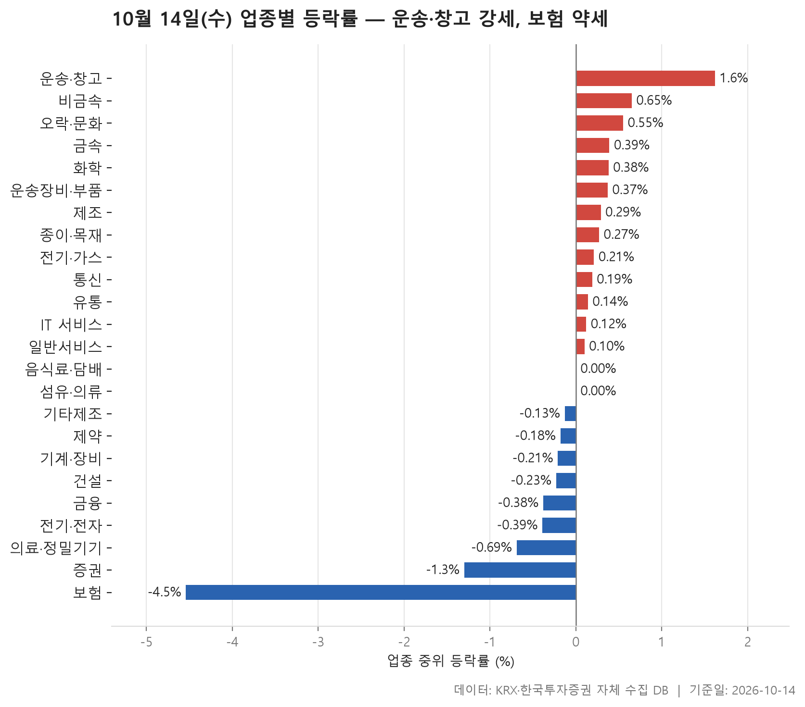
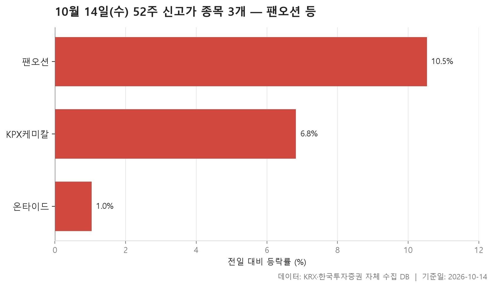
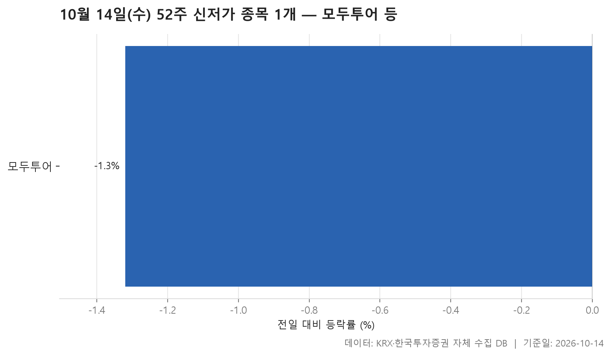
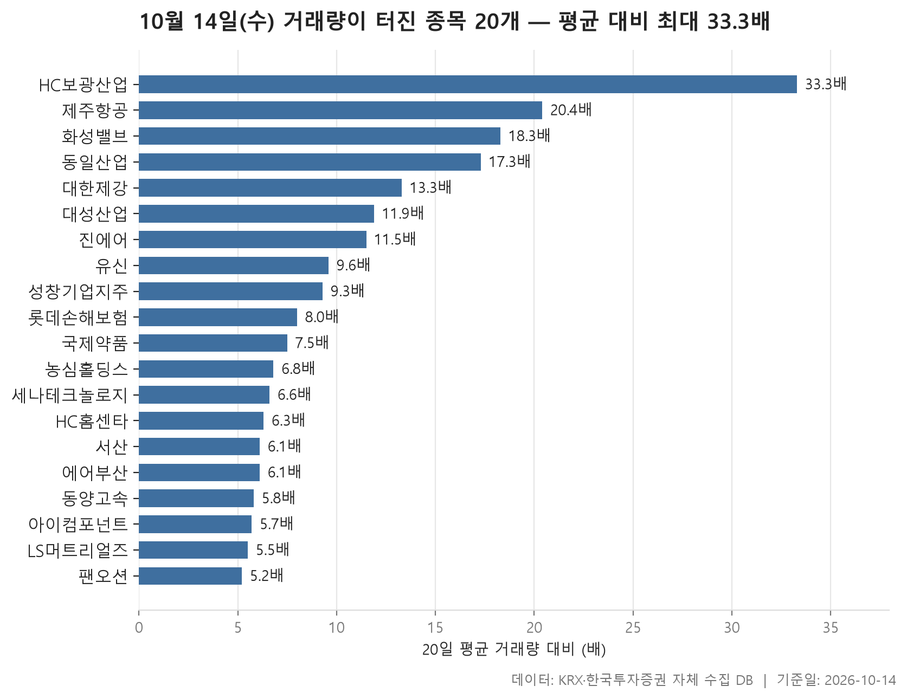

10월 14일 시장은 업종 전체로 보면 크게 기울지 않았습니다. 24개 업종의 중위 등락률을 한 줄로 세웠을 때 한가운데 놓인 값이 +0.11%였습니다. 13개 업종이 올랐고 9개가 내렸으며, 음식료·담배와 섬유·의류는 0.00%에서 멈췄습니다. 숫자만 보면 무난한 하루지만, 양 끝은 꽤 멀리 떨어져 있었습니다. 위쪽 끝은 운송·창고(+1.62%), 아래쪽 끝은 보험(-4.54%)입니다.

오늘 글은 네 갈래로 나눴습니다. 먼저 업종별 등락으로 시장 전체의 모양을 보고, 이어서 52주 신고가와 신저가를 새로 쓴 종목, 마지막으로 거래량이 평소의 몇 배로 늘어난 종목을 살핍니다. 이 네 표가 같은 이야기를 하는 대목이 있습니다. 운송·창고가 업종 순위 맨 위에 있고, 신고가 목록에도 있으며, 거래량 급증 목록에서도 가장 많은 자리를 차지합니다.

반대로 표끼리 어긋나는 대목도 있습니다. 업종은 약했는데 그 안의 한 종목만 거래가 몰리며 오른 경우, 업종 평균과 중위값이 서로 반대 방향을 가리키는 경우입니다. 그런 지점을 중심으로 읽어 보겠습니다.

> 기준일: 2026-10-14 · 집계: 자체 수집 데이터베이스

## 업종 등락률 — 24개 중 13개 상승

맨 위의 **운송·창고**는 종목 28개 중 82.10%가 올랐습니다. 열 곳 가운데 여덟 곳이 넘게 오른 셈이라, 오늘 업종 가운데 상승 폭이 가장 넓게 퍼진 곳입니다. 평균 등락률은 +4.64%로 중위값보다 훨씬 높게 나옵니다. 천일고속이 +29.78%로 가장 크게 움직였지만 이 종목 하나가 업종 평균을 끌어올린 몫은 1.06%p였습니다. 평균과 중위값의 간격이 그보다 훨씬 크다는 건 상한가 근처 종목 한 곳만이 아니라 다른 종목들도 함께 크게 올랐다는 뜻입니다.

표에서 가장 어긋나 보이는 곳은 **비금속**입니다. 중위 등락률은 +0.65%로 2위인데 평균은 -0.52%로 마이너스입니다. 오른 종목 비율이 63.90%이니 대부분은 올랐지만, 서산이 -16.86% 떨어지면서 혼자 평균을 0.47%p 끌어내렸습니다. 평균과 중위값이 벌어진 정도가 이 값과 비슷하니, 평균을 아래로 당긴 건 사실상 이 한 종목입니다. **기계·장비**는 반대 방향으로 흥미롭습니다. 가장 크게 움직인 종목인 화성밸브는 +18.09% 올랐는데 평균은 -1.06%로 중위값 -0.21%보다 한참 낮습니다. 눈에 띄는 상승 종목이 있었는데도 다른 종목들의 하락이 평균을 더 크게 끌어내렸다는 얘기입니다.

아래쪽은 금융 계열이 몰려 있습니다. **보험**은 11개 종목 중 오른 곳이 18.20%에 그쳤고 중위 등락률 -4.54%, 평균 -4.01%로 두 값이 함께 낮습니다. 현대해상이 -11.02%로 평균을 1.00%p 끌어내렸지만, 그것만으로 설명되는 하락은 아닙니다. **증권**은 중위값이 -1.30%로 폭은 보험보다 작지만, 18개 종목 가운데 오른 비율이 5.60%뿐이라 업종 전체가 한 방향으로 움직였습니다. 금융도 -0.38%로 음의 영역에 있습니다.

거래대금은 **전기·전자**가 139,544.40억원으로 다른 업종을 크게 앞섰습니다. 그런데도 중위 등락률은 -0.39%, 오른 종목 비율은 40.10%였습니다. 돈이 가장 많이 오간 업종이 오늘은 약한 쪽에 서 있었습니다.

| 업종 | 종목수(개) | 중위등락률(%) | 평균등락률(%) | 상승비율(%) | 주도종목 | 주도종목등락률(%) | 평균기여도(%p) | 거래대금합계(억원) |
|---|---|---|---|---|---|---|---|---|
| 운송·창고 | 28 | +1.62 | +4.64 | 82.10 | 천일고속 | +29.78 | 1.06 | 4,351.40 |
| 비금속 | 36 | +0.65 | -0.52 | 63.90 | 서산 | -16.86 | -0.47 | 2,346.90 |
| 오락·문화 | 63 | +0.55 | +0.62 | 65.10 | 아센디오 | -9.52 | -0.15 | 821.90 |
| 금속 | 130 | +0.39 | +1.23 | 62.30 | 한선엔지니어링 | +26.93 | 0.21 | 6,715.70 |
| 화학 | 220 | +0.38 | +0.39 | 57.70 | 이수스페셜티케미컬 | +10.13 | 0.05 | 11,887.00 |
| 운송장비·부품 | 134 | +0.37 | +1.05 | 59.00 | 유니켐 | +30.00 | 0.22 | 9,740.00 |
| 제조 | 8 | +0.29 | +0.87 | 62.50 | 에넥스 | +4.64 | 0.58 | 8.30 |
| 종이·목재 | 27 | +0.27 | +0.20 | 51.90 | 삼정펄프 | +2.03 | 0.08 | 30.50 |
| 전기·가스 | 10 | +0.21 | +0.25 | 50.00 | 대성에너지 | +1.44 | 0.14 | 365.30 |
| 통신 | 13 | +0.19 | -0.06 | 53.80 | 더즌 | -4.17 | -0.32 | 881.60 |
| 유통 | 159 | +0.14 | +0.34 | 50.90 | 하이퍼코퍼레이션 | +29.84 | 0.19 | 4,551.50 |
| IT 서비스 | 243 | +0.12 | +0.22 | 50.60 | 엔키AX | +11.60 | 0.05 | 6,336.20 |
| 일반서비스 | 167 | +0.10 | +0.04 | 50.30 | 바이오인프라 | +29.99 | 0.18 | 5,055.60 |
| 음식료·담배 | 83 | 0.00 | +0.39 | 49.40 | 프롬바이오 | +29.96 | 0.36 | 1,608.90 |
| 섬유·의류 | 47 | 0.00 | -0.12 | 46.80 | 크리스에프앤씨 | -3.74 | -0.08 | 321.00 |
| 기타제조 | 14 | -0.13 | -0.83 | 42.90 | 리튬포어스 | -6.47 | -0.46 | 12.20 |
| 제약 | 166 | -0.18 | -0.14 | 38.60 | 한미약품 | -10.71 | -0.06 | 7,287.00 |
| 기계·장비 | 205 | -0.21 | -1.06 | 41.50 | 화성밸브 | +18.09 | 0.09 | 20,843.60 |
| 건설 | 50 | -0.23 | -0.15 | 42.00 | 금호건설 | -9.30 | -0.19 | 2,060.40 |
| 금융 | 111 | -0.38 | -0.49 | 36.90 | 한미사이언스 | -12.05 | -0.11 | 17,841.10 |
| 전기·전자 | 367 | -0.39 | -0.40 | 40.10 | 에이엔피 | +29.78 | 0.08 | 139,544.40 |
| 의료·정밀기기 | 101 | -0.69 | -0.66 | 37.60 | 한국비티비 | +15.06 | 0.15 | 2,122.80 |
| 증권 | 18 | -1.30 | -1.26 | 5.60 | 상상인증권 | -2.82 | -0.16 | 935.40 |
| 보험 | 11 | -4.54 | -4.01 | 18.20 | 현대해상 | -11.02 | -1.00 | 2,732.30 |

## 52주 신고가 3개 — 최고 팬오션 10.53%

52주 신고가를 새로 쓴 보통주는 3개, 모두 KOSPI 종목이었습니다. 업종도 운송·창고, 화학, 유통으로 하나씩 갈렸습니다.

눈에 띄는 건 **팬오션**입니다. +10.53% 오르며 종가 7,240원으로 이전 52주 최고가 6,630원을 넘었습니다. 시가총액 38,703억원으로 세 종목 중 가장 크고, 거래대금도 1,193.10억원으로 압도적입니다. 업종 순위 1위였던 운송·창고의 흐름이 대형주의 신고가로도 나타난 셈입니다. 이 종목은 아래 거래량 급증 표에도 다시 나옵니다.

나머지 둘은 결이 다릅니다. KPX케미칼은 +6.82% 올라 64,200원으로 이전 최고 60,200원을 넘었지만 거래대금은 19.00억원으로 크지 않습니다. 온타이드는 +1.04% 상승으로 1,652원에 마감해 이전 최고 1,650원을 겨우 넘어섰습니다. 신고가라는 이름은 같아도, 크게 뛰어오른 경우와 고점을 살짝 넘긴 경우가 함께 섞여 있다는 점을 같이 봐 두면 좋겠습니다.

| 종목명 | 종목코드 | 시장 | 업종 | 종가(원) | 등락률(%) | 이전52주최고(원) | 거래대금(억원) | 시가총액(억원) |
|---|---|---|---|---|---|---|---|---|
| 팬오션 | 028670 | KOSPI | 운송·창고 | 7,240 | +10.53 | 6,630 | 1,193.10 | 38,703 |
| KPX케미칼 | 025000 | KOSPI | 화학 | 64,200 | +6.82 | 60,200 | 19.00 | 2,662 |
| 온타이드 | 005320 | KOSPI | 유통 | 1,652 | +1.04 | 1,650 | 4.80 | 565 |

## 52주 신저가 1개 — 모두투어 -1.32%

신저가 쪽은 KOSDAQ의 **모두투어** 한 종목뿐이었습니다. -1.32% 내린 7,460원으로 마감해 이전 52주 최저가 7,490원을 밑돌았습니다. 하루 낙폭이 크지 않았는데도, 이미 바닥 근처에 있던 주가가 그 선을 조금 넘어 내려간 경우입니다.

이 종목이 속한 일반서비스 업종은 중위 등락률 +0.10%로 오늘 보합권에서 소폭 위였습니다. 업종 전체가 밀린 날이 아니었는데 이 종목은 따로 저점을 낮춘 셈입니다. 거래대금도 5.10억원으로 많지 않았습니다. 신고가가 3개, 신저가가 1개라는 숫자도 오늘 시장이 어느 한쪽으로 크게 쏠리지 않았다는 앞의 그림과 맞아떨어집니다.

| 종목명 | 종목코드 | 시장 | 업종 | 종가(원) | 등락률(%) | 이전52주최저(원) | 거래대금(억원) | 시가총액(억원) |
|---|---|---|---|---|---|---|---|---|
| 모두투어 | 080160 | KOSDAQ | 일반서비스 | 7,460 | -1.32 | 7,490 | 5.10 | 1,410 |

## 거래량 급증 20개 — 최고 HC보광산업 33.30배

거래량이 직전 20거래일 평균의 5배를 넘은 종목은 20개였고, KOSPI 12개, KOSDAQ 8개로 나뉩니다. 업종으로는 **운송·창고**가 5개로 가장 많습니다. 제주항공이 +24.66% 오르며 평소의 20.40배가 거래됐고, 동양고속(+22.13%), 진에어(+7.38%), 에어부산(+3.76%), 팬오션(+10.53%)이 뒤를 잇습니다. 오른 폭은 제각각이지만 다섯 종목이 모두 올랐습니다. 업종 순위, 신고가, 거래량 세 표에 운송·창고가 함께 등장하는 이유가 여기서 드러납니다. 다만 왜 이 업종에 거래가 몰렸는지는 이 자료로 알 수 없습니다.

배수 1위는 HC보광산업의 33.30배인데, 주가는 +2.53% 오르는 데 그쳤습니다. 거래량이 크게 늘었다고 가격이 크게 움직이는 건 아니라는 걸 보여 줍니다. 동일산업은 17.30배로 상위권이지만 평소 거래량이 881주에 불과해, 거래대금은 5.30억원 수준입니다. 배수가 높을수록 평소 거래가 얼마나 적었는지도 함께 봐야 하는 이유입니다. 표 전체의 배수 중위값은 7.75배였습니다.

업종 흐름과 엇갈리는 종목도 있습니다. 보험 업종이 오늘 가장 약했는데, **롯데손해보험**은 평소의 8.00배가 거래되며 +4.17% 올랐습니다. 반대로 거래가 터지면서 크게 내린 곳도 있습니다. 세나테크놀로지는 -21.27%, 서산은 -16.86%였습니다. 서산은 앞에서 본 비금속 업종의 평균을 끌어내린 바로 그 종목입니다. 국제약품은 거래대금이 1,149.90억원에 달했지만 주가는 -0.67%로 거의 제자리였습니다. 거래량이 크게 늘었다는 사실만으로는 방향을 알 수 없다는 점이 이 표에서 잘 보입니다.

| 종목명 | 종목코드 | 시장 | 업종 | 종가(원) | 등락률(%) | 거래량(주) | 평균거래량(주) | 배수(배) | 거래대금(억원) | 시가총액(억원) |
|---|---|---|---|---|---|---|---|---|---|---|
| HC보광산업 | 225530 | KOSDAQ | 비금속 | 2,840 | +2.53 | 13,380,180 | 401,911 | 33.30 | 433.90 | 1,032 |
| 제주항공 | 089590 | KOSPI | 운송·창고 | 5,560 | +24.66 | 4,371,163 | 214,298 | 20.40 | 229.90 | 4,484 |
| 화성밸브 | 039610 | KOSDAQ | 기계·장비 | 7,050 | +18.09 | 4,387,232 | 239,246 | 18.30 | 324.40 | 734 |
| 동일산업 | 004890 | KOSPI | 금속 | 34,600 | +0.73 | 15,213 | 881 | 17.30 | 5.30 | 839 |
| 대한제강 | 084010 | KOSPI | 금속 | 10,000 | +13.77 | 2,659,689 | 199,454 | 13.30 | 285.20 | 3,437 |
| 대성산업 | 128820 | KOSPI | 유통 | 4,925 | +17.26 | 10,325,091 | 865,785 | 11.90 | 503.10 | 2,228 |
| 진에어 | 272450 | KOSPI | 운송·창고 | 6,110 | +7.38 | 780,372 | 67,620 | 11.50 | 48.60 | 3,189 |
| 유신 | 054930 | KOSDAQ | 일반서비스 | 23,900 | +10.90 | 1,196,248 | 124,523 | 9.60 | 282.10 | 717 |
| 성창기업지주 | 000180 | KOSPI | 일반서비스 | 4,900 | +4.48 | 96,090 | 10,370 | 9.30 | 4.60 | 684 |
| 롯데손해보험 | 000400 | KOSPI | 보험 | 2,620 | +4.17 | 8,874,430 | 1,104,150 | 8.00 | 234.00 | 8,131 |
| 국제약품 | 002720 | KOSPI | 제약 | 4,465 | -0.67 | 24,057,798 | 3,194,234 | 7.50 | 1,149.90 | 945 |
| 농심홀딩스 | 072710 | KOSPI | 금융 | 88,600 | -0.23 | 11,225 | 1,653 | 6.80 | 9.90 | 4,109 |
| 세나테크놀로지 | 061090 | KOSDAQ | 전기·전자 | 32,750 | -21.27 | 109,238 | 16,432 | 6.60 | 38.30 | 1,791 |
| HC홈센타 | 060560 | KOSDAQ | 유통 | 2,005 | +1.98 | 152,373 | 24,128 | 6.30 | 3.10 | 509 |
| 서산 | 079650 | KOSDAQ | 비금속 | 7,300 | -16.86 | 11,647,741 | 1,907,856 | 6.10 | 938.70 | 1,460 |
| 에어부산 | 298690 | KOSPI | 운송·창고 | 1,545 | +3.76 | 325,161 | 53,093 | 6.10 | 5.00 | 2,517 |
| 동양고속 | 084670 | KOSPI | 운송·창고 | 41,950 | +22.13 | 1,505,489 | 261,174 | 5.80 | 611.50 | 1,215 |
| 아이컴포넌트 | 059100 | KOSDAQ | 전기·전자 | 7,320 | +9.58 | 152,134 | 26,904 | 5.70 | 11.00 | 518 |
| LS머트리얼즈 | 417200 | KOSDAQ | 전기·전자 | 16,280 | +6.75 | 9,790,318 | 1,770,580 | 5.50 | 1,650.20 | 11,014 |
| 팬오션 | 028670 | KOSPI | 운송·창고 | 7,240 | +10.53 | 16,871,569 | 3,272,760 | 5.20 | 1,193.10 | 38,703 |

## 정리

정리하면 10월 14일은 업종 전체로는 보합권에 가까웠지만, 운송·창고가 넓은 상승과 거래량 급증, 신고가로 한쪽 끝을 잡고 보험과 증권이 반대쪽 끝에서 고르게 밀린 하루였습니다. 비금속이나 기계·장비처럼 평균과 중위값이 서로 다른 그림을 보여 준 업종은 숫자 하나만 보고 판단하기 어렵다는 점도 다시 확인됩니다.

이 글은 하루치 종가 데이터만으로 쓴 것입니다. 업종이 왜 오르고 내렸는지, 거래량이 왜 몰렸는지는 자료에 없어 다루지 않았습니다. 하루의 움직임이 이어질지도 이 표로는 알 수 없습니다. 특정 종목을 사거나 팔라는 뜻은 담겨 있지 않으니, 시장의 모양을 훑어보는 참고 자료로만 봐 주세요.

## 집계 기준

**업종 등락률**

- **기준**: 2026-10-13 종가 → 2026-10-14 종가
- **순위**: 업종 내 종목 등락률의 중위값 (평균은 참고용으로 함께 표시)
- **주도종목**: 그 업종에서 등락률 절대값이 가장 큰 종목 (동점이면 거래대금이 큰 쪽)
- **평균기여도**: 그 종목 하나가 업종 평균을 움직인 폭 (등락률 ÷ 종목수). 중위값과 평균의 격차가 이 값에 가까우면 평균을 만든 것이 그 종목이고, 훨씬 크면 다른 종목들도 함께 움직인 것입니다
- **필터**: 업종 내 보통주 5종목 이상
- **전체업종중위등락률(%)**: 0.11

**52주 신고가**

- **기준**: 종가 > 직전 52주 최고가
- **관측구간**: 2025-09-25 ~ 2026-10-13 (252거래일)
- **필터**: 시가총액 500억 이상, 거래대금 3억 이상, 보통주

**52주 신저가**

- **기준**: 종가 < 직전 52주 최저가
- **관측구간**: 2025-09-25 ~ 2026-10-13 (252거래일)
- **필터**: 시가총액 500억 이상, 거래대금 3억 이상, 보통주

**거래량 급증**

- **기준**: 당일 거래량 ≥ 직전 20거래일 평균 × 5
- **관측구간**: 2026-09-10 ~ 2026-10-13 (20거래일)
- **필터**: 시가총액 500억 이상, 거래대금 3억 이상, 보통주

## 데이터 출처 및 유의사항

- **데이터출처**: 한국거래소(KRX) 공시 데이터와 한국투자증권 OpenAPI 를 직접 수집해 구축한 자체 데이터베이스
- **집계방식**: 수집·집계·차트 생성을 직접 구현한 파이프라인에서 자동 산출
- **작성고지**: 본문의 표·통계·차트는 자체 데이터베이스에서 계산된 값이며, 문장 작성 과정에 AI 도구를 활용했습니다.
- **면책**: 본 글은 정보 제공을 목적으로 하며 특정 종목의 매수·매도를 추천하지 않습니다. 제시된 수치는 과거 데이터이고 미래 수익을 보장하지 않습니다. 투자 판단과 그 결과에 대한 책임은 투자자 본인에게 있습니다.

