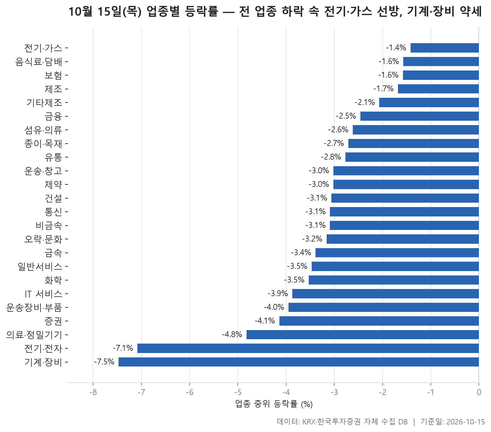
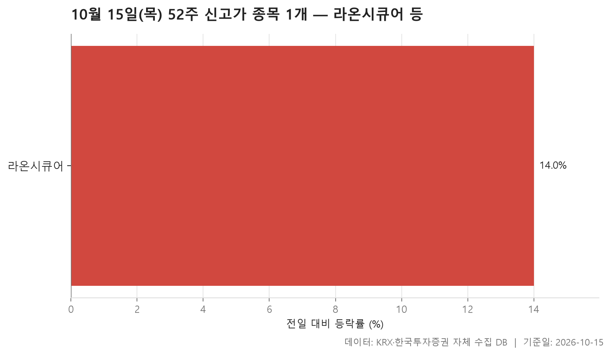
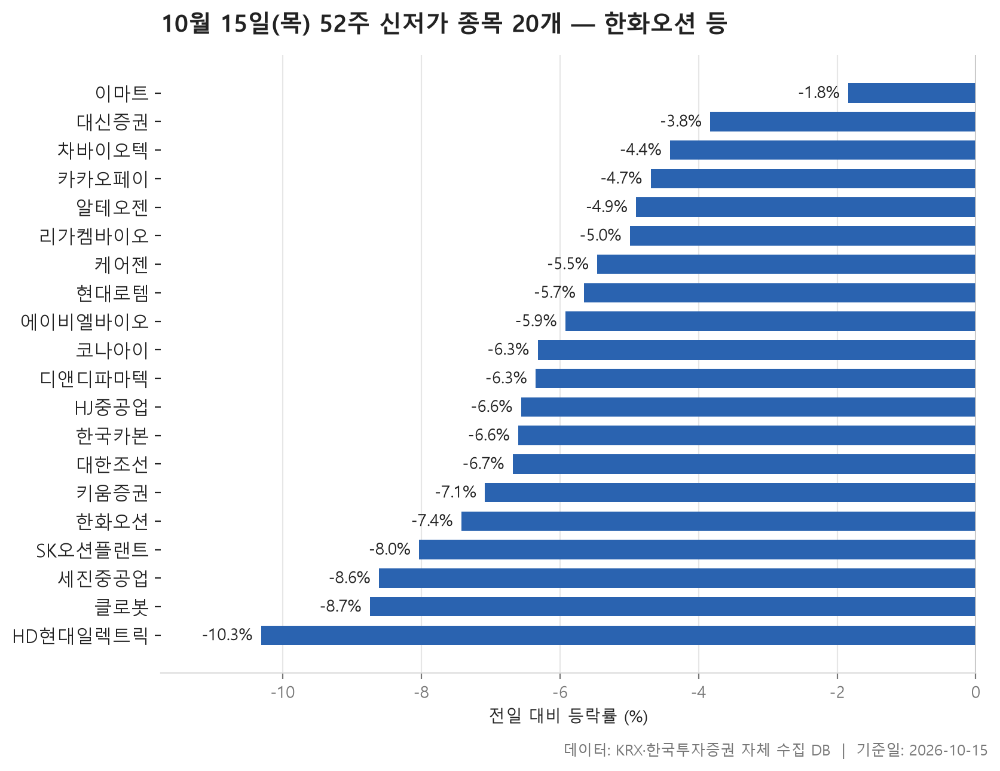
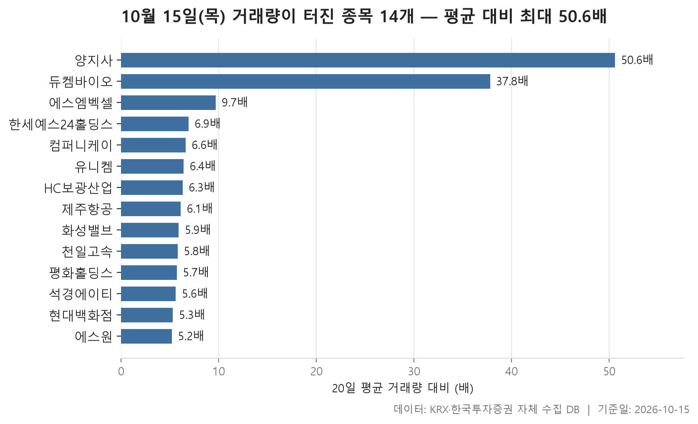

10월 15일 시장은 업종을 가리지 않고 내렸습니다. 24개 업종 가운데 종목 등락률의 중위값이 플러스인 곳이 하나도 없었고, 업종별 중위값을 줄 세웠을 때 한가운데 놓인 값이 -3.08%였습니다. 가장 덜 내린 전기·가스도 -1.42%였고, 가장 많이 내린 기계·장비는 -7.47%까지 밀렸습니다. 업종 사이 격차는 있었지만 어디로 가도 내림세를 피하기 어려운 하루였습니다.

오늘은 네 가지를 차례로 봅니다. 먼저 업종별 등락으로 하락이 얼마나 넓고 깊었는지 확인하고, 이어서 52주 신고가와 신저가 종목으로 넘어갑니다. 신고가는 단 1개, 신저가는 20개였습니다. 숫자 차이부터 오늘 장의 분위기를 보여 줍니다. 마지막으로 평소보다 거래량이 크게 불어난 종목 14개를 살펴봅니다.

표만 보면 놓치기 쉬운 대목이 있습니다. 상한가 종목이 끼어 있는데도 업종 전체는 내린 경우, 오른 종목이 비교적 많은데도 중위값은 깊이 빠진 업종, 시가총액 상위 종목이 신저가 목록 맨 위에 올라온 장면 같은 것들입니다. 이런 대목을 중심으로 정리했습니다.

> 기준일: 2026-10-15 · 집계: 자체 수집 데이터베이스

## 업종 등락률

상위권은 전기·가스(-1.42%), 음식료·담배(-1.57%), 보험(-1.58%) 순입니다. 덜 내린 쪽에 경기를 덜 타는 업종이 모였다는 점은 눈에 띕니다. 그렇다고 이 업종들이 버텼다고 보기는 어렵습니다. 전기·가스는 열 종목 중 두 종목만 올랐고, 음식료·담배와 보험도 오른 종목이 다섯 곳 중 하나가 채 안 됐습니다. 덜 빠졌을 뿐 내림세가 넓게 퍼져 있었다는 뜻입니다.

하위권의 무게는 훨씬 큽니다. 전기·전자는 366종목에 중위 등락률이 -7.08%였고, 오른 종목 비율은 3.30%에 그쳤습니다. 이 업종의 거래대금 합계는 192,627.80억원으로 다른 업종과 단위부터 다릅니다. 시장의 돈이 가장 많이 몰린 곳이 가장 크게 빠진 업종 중 하나였던 셈입니다. 기계·장비도 204종목에 -7.47%로, 두 업종 모두 평균과 중위값이 거의 붙어 있습니다. 몇몇 종목이 크게 빠져 평균을 끌어내린 것이 아니라 업종 전체가 고르게 밀렸다는 그림입니다. 증권은 더 극단적입니다. 18종목 중 오른 종목이 하나도 없었습니다.

어긋나 보이는 곳도 있습니다. 통신은 오른 종목 비율이 23.10%로 24개 업종 중 가장 높은데, 중위 등락률은 -3.09%로 중간쯤에 머뭅니다. 오른 종목이 있긴 했지만 내린 종목의 낙폭이 컸다는 얘기입니다. 금융은 중위값 -2.46%보다 평균 -3.27%가 더 낮습니다. 가장 크게 움직인 OCI홀딩스(-14.40%) 하나가 업종 평균을 끌어내린 폭은 -0.13%p에 불과하니, 다른 종목들도 함께 깊이 빠졌다고 읽어야 합니다. 화학(중위 -3.53%, 평균 -4.31%)도 마찬가지입니다.

상한가 근처까지 오른 종목도 업종 흐름을 바꾸지는 못했습니다. 제약의 듀켐바이오(+30.00%), 운송장비·부품의 뉴인텍(+30.00%), 전기·전자의 에이엔피(+29.79%)가 그런 예입니다. 제약은 이 영향으로 평균(-2.92%)이 중위값(-3.02%)보다 조금 위에 있지만 방향까지 바뀌지는 않았습니다. 순위를 중위값으로 매기는 이유가 바로 이것입니다.

| 업종 | 종목수(개) | 중위등락률(%) | 평균등락률(%) | 상승비율(%) | 주도종목 | 주도종목등락률(%) | 평균기여도(%p) | 거래대금합계(억원) |
|---|---|---|---|---|---|---|---|---|
| 전기·가스 | 10 | -1.42 | -1.65 | 20.00 | SGC에너지 | -6.15 | -0.62 | 432.90 |
| 음식료·담배 | 83 | -1.57 | -1.80 | 19.30 | 휴럼 | -15.17 | -0.18 | 2,113.20 |
| 보험 | 11 | -1.58 | -2.15 | 18.20 | 삼성생명 | -7.51 | -0.68 | 2,709.90 |
| 제조 | 8 | -1.68 | -1.82 | 12.50 | 코아스 | -4.90 | -0.61 | 8.90 |
| 기타제조 | 14 | -2.07 | -2.28 | 7.10 | 노바텍 | -4.60 | -0.33 | 17.50 |
| 금융 | 111 | -2.46 | -3.27 | 12.60 | OCI홀딩스 | -14.40 | -0.13 | 21,675.40 |
| 섬유·의류 | 48 | -2.62 | -3.38 | 6.30 | 씨싸이트 | -30.00 | -0.63 | 319.30 |
| 종이·목재 | 27 | -2.71 | -2.71 | 3.70 | 태림포장 | -7.75 | -0.29 | 41.50 |
| 유통 | 158 | -2.77 | -2.99 | 10.10 | 하이퍼코퍼레이션 | +29.82 | 0.19 | 5,288.10 |
| 운송·창고 | 28 | -3.02 | -3.05 | 10.70 | 한익스프레스 | -9.31 | -0.33 | 4,651.20 |
| 제약 | 166 | -3.02 | -2.92 | 9.00 | 듀켐바이오 | +30.00 | 0.18 | 8,762.60 |
| 건설 | 50 | -3.06 | -3.38 | 8.00 | 남화토건 | -10.33 | -0.21 | 2,847.50 |
| 통신 | 13 | -3.09 | -3.48 | 23.10 | 프리티 | -12.26 | -0.94 | 1,195.00 |
| 비금속 | 36 | -3.09 | -3.94 | 11.10 | 티씨케이 | -13.32 | -0.37 | 1,666.80 |
| 오락·문화 | 63 | -3.16 | -2.97 | 11.10 | 자이언트스텝 | -9.13 | -0.14 | 1,132.40 |
| 금속 | 130 | -3.39 | -3.92 | 11.50 | 세아베스틸지주 | -14.24 | -0.11 | 4,861.80 |
| 일반서비스 | 167 | -3.47 | -3.65 | 8.40 | 바이오인프라 | +29.98 | 0.18 | 5,976.50 |
| 화학 | 221 | -3.53 | -4.31 | 7.20 | 예선테크 | -29.89 | -0.14 | 11,152.00 |
| IT 서비스 | 243 | -3.87 | -4.01 | 9.50 | 빅웨이브로보틱스 | -17.45 | -0.07 | 9,202.70 |
| 운송장비·부품 | 134 | -3.95 | -3.93 | 6.70 | 뉴인텍 | +30.00 | 0.22 | 11,478.40 |
| 증권 | 18 | -4.14 | -4.49 | 0.00 | 미래에셋증권 | -9.06 | -0.50 | 1,221.90 |
| 의료·정밀기기 | 101 | -4.82 | -4.99 | 5.00 | 티에스이 | -14.76 | -0.15 | 2,168.20 |
| 전기·전자 | 366 | -7.08 | -6.89 | 3.30 | 에이엔피 | +29.79 | 0.08 | 192,627.80 |
| 기계·장비 | 204 | -7.47 | -7.42 | 4.40 | 브릴스 | -17.93 | -0.09 | 22,943.10 |

## 52주 신고가 1개 — 라온시큐어 14.01%

전 업종이 내린 날, 52주 최고가를 새로 쓴 종목은 KOSDAQ의 라온시큐어 하나뿐입니다. 종가 20,750원으로 직전 52주 최고가 19,930원을 넘어섰고, 하루 등락률은 +14.01%였습니다.

이 종목이 속한 IT 서비스 업종은 중위 등락률이 -3.87%였고, 오른 종목도 열 곳 중 한 곳이 안 됐습니다. 업종 흐름과 정반대로 움직인 셈입니다. 거래대금도 눈여겨볼 만합니다. 하루 거래대금이 2,581.50억원으로 시가총액 2,304억원보다 컸습니다. 하루에 회사 전체 가치보다 많은 금액이 오갔다는 뜻이라 손바뀜이 매우 활발했다고 볼 수 있습니다. 왜 이렇게 움직였는지는 자료만으로는 알 수 없습니다.

신고가가 단 한 종목이라는 사실이 오늘 시장을 요약합니다. 시가총액 500억 이상, 거래대금 3억 이상이라는 조건을 통과한 종목 가운데 1년 고점을 넘어선 것이 이 하나였습니다.

| 종목명 | 종목코드 | 시장 | 업종 | 종가(원) | 등락률(%) | 이전52주최고(원) | 거래대금(억원) | 시가총액(억원) |
|---|---|---|---|---|---|---|---|---|
| 라온시큐어 | 042510 | KOSDAQ | IT 서비스 | 20,750 | +14.01 | 19,930 | 2,581.50 | 2,304 |

## 52주 신저가 20개 — 최저 HD현대일렉트릭 -10.31%

신저가는 20개로 신고가와 대조적이고, KOSPI 12개, KOSDAQ 8개로 나뉩니다. 무엇보다 목록 맨 위의 덩치가 눈에 들어옵니다. 시가총액 191,202억원의 한화오션(-7.42%), 175,550억원의 HD현대일렉트릭(-10.31%), 148,714억원의 알테오젠(-4.90%)이 나란히 1년 최저가 아래로 내려갔습니다. 신저가가 주로 작은 종목에서 나오는 날과는 결이 다릅니다.

업종으로 보면 운송장비·부품이 4개로 가장 많습니다. 한화오션, 현대로템, 대한조선, 세진중공업입니다. 바이오 쪽 이름도 여럿 보입니다. 제약 업종의 에이비엘바이오, 케어젠, 차바이오텍과 일반서비스로 분류된 알테오젠, 리가켐바이오, 디앤디파마텍입니다. 증권에서는 키움증권과 대신증권이 들어 있어, 오른 종목이 하나도 없던 증권 업종의 흐름과 겹칩니다.

20종목의 등락률 중위값은 -6.33%입니다. 대부분 하루 사이 크게 빠지면서 바닥을 깼다는 뜻입니다. 예외는 이마트입니다. 등락률이 -1.84%로 목록에서 가장 작았는데도 종가 69,300원이 직전 최저가 69,600원을 밑돌았습니다. 하루 낙폭은 작았지만 이미 1년 최저 부근에 머물러 있었다는 점이 드러납니다. 가장 크게 빠진 종목은 HD현대일렉트릭으로, 종가 487,000원이 직전 최저 531,000원을 큰 차이로 밑돌았습니다.

| 종목명 | 종목코드 | 시장 | 업종 | 종가(원) | 등락률(%) | 이전52주최저(원) | 거래대금(억원) | 시가총액(억원) |
|---|---|---|---|---|---|---|---|---|
| 한화오션 | 042660 | KOSPI | 운송장비·부품 | 62,400 | -7.42 | 62,700 | 628.70 | 191,202 |
| HD현대일렉트릭 | 267260 | KOSPI | 전기·전자 | 487,000 | -10.31 | 531,000 | 1,430.40 | 175,550 |
| 알테오젠 | 196170 | KOSDAQ | 일반서비스 | 213,500 | -4.90 | 217,500 | 793.30 | 148,714 |
| 현대로템 | 064350 | KOSPI | 운송장비·부품 | 91,800 | -5.65 | 92,500 | 319.40 | 100,193 |
| 키움증권 | 039490 | KOSPI | 증권 | 210,000 | -7.08 | 221,000 | 302.40 | 55,079 |
| 카카오페이 | 377300 | KOSPI | 금융 | 34,550 | -4.69 | 35,700 | 65.60 | 46,749 |
| 리가켐바이오 | 141080 | KOSDAQ | 일반서비스 | 62,800 | -4.99 | 63,100 | 137.20 | 23,248 |
| 에이비엘바이오 | 298380 | KOSDAQ | 제약 | 40,550 | -5.92 | 41,700 | 160.20 | 22,703 |
| 케어젠 | 214370 | KOSDAQ | 제약 | 37,200 | -5.46 | 38,700 | 24.90 | 19,982 |
| 이마트 | 139480 | KOSPI | 유통 | 69,300 | -1.84 | 69,600 | 96.70 | 19,124 |
| 디앤디파마텍 | 347850 | KOSDAQ | 일반서비스 | 35,400 | -6.35 | 35,900 | 180.20 | 16,283 |
| 대한조선 | 439260 | KOSPI | 운송장비·부품 | 39,100 | -6.68 | 39,950 | 30.10 | 14,893 |
| HJ중공업 | 097230 | KOSPI | 건설 | 12,530 | -6.56 | 12,630 | 37.10 | 11,314 |
| 대신증권 | 003540 | KOSPI | 증권 | 22,600 | -3.83 | 22,750 | 15.40 | 10,421 |
| 한국카본 | 017960 | KOSPI | 금속 | 17,550 | -6.60 | 17,670 | 29.80 | 9,069 |
| 차바이오텍 | 085660 | KOSDAQ | 제약 | 7,370 | -4.41 | 7,400 | 24.90 | 6,852 |
| SK오션플랜트 | 100090 | KOSPI | 금속 | 10,200 | -8.03 | 10,720 | 54.90 | 6,373 |
| 클로봇 | 466100 | KOSDAQ | IT 서비스 | 18,480 | -8.74 | 19,240 | 52.40 | 5,720 |
| 코나아이 | 052400 | KOSDAQ | IT 서비스 | 31,850 | -6.32 | 32,650 | 19.90 | 4,638 |
| 세진중공업 | 075580 | KOSPI | 운송장비·부품 | 7,960 | -8.61 | 8,120 | 11.80 | 4,525 |

## 거래량 급증 14개 — 최고 양지사 50.60배

거래량이 직전 20거래일 평균의 5배를 넘은 종목은 14개입니다. 맨 앞의 두 종목이 나머지와 크게 떨어져 있습니다. 양지사는 평소의 50.60배가 거래되며 +29.89%, 듀켐바이오는 37.80배에 +30.00%를 기록했습니다. 그다음인 에스엠벡셀(+18.91%)은 9.70배로 한 단계 내려오고, 나머지는 중위값 6.20배 주변에 모여 있습니다.

거래가 터졌다고 모두 오른 것은 아닙니다. 위 세 종목과 제주항공(+3.96%), 에스원(+13.89%)을 빼면 나머지는 모두 내렸습니다. HC보광산업은 -12.85%로 가장 크게 빠졌고, 컴퍼니케이(-7.01%), 석경에이티(-7.06%), 화성밸브(-6.95%)도 낙폭이 작지 않습니다. 오늘 같은 장에서는 거래량 급증이 매수 쏠림만이 아니라 매도 쏠림의 흔적이기도 했다는 뜻입니다.

배수를 읽을 때 주의할 점이 있습니다. 한세예스24홀딩스의 거래대금은 3.00억원, 평화홀딩스는 3.60억원, 석경에이티는 3.70억원으로 필터 기준을 겨우 넘었습니다. 평소 거래가 워낙 적으면 조금만 늘어도 배수가 크게 나옵니다. 반대로 시가총액이 37,087억원으로 가장 큰 에스원은 배수가 5.20배로 가장 낮지만, 덩치를 생각하면 평소와 다른 움직임이 분명했습니다. 업종은 11개로 흩어져 있고 운송장비·부품이 3개로 가장 많습니다.

| 종목명 | 종목코드 | 시장 | 업종 | 종가(원) | 등락률(%) | 거래량(주) | 평균거래량(주) | 배수(배) | 거래대금(억원) | 시가총액(억원) |
|---|---|---|---|---|---|---|---|---|---|---|
| 양지사 | 030960 | KOSDAQ | 출판·매체복제 | 6,170 | +29.89 | 4,708,115 | 92,970 | 50.60 | 274.30 | 986 |
| 듀켐바이오 | 176750 | KOSDAQ | 제약 | 8,970 | +30.00 | 3,057,442 | 80,893 | 37.80 | 252.40 | 2,555 |
| 에스엠벡셀 | 010580 | KOSPI | 운송장비·부품 | 3,175 | +18.91 | 40,509,208 | 4,159,034 | 9.70 | 1,260.40 | 3,532 |
| 한세예스24홀딩스 | 016450 | KOSPI | 섬유·의류 | 4,215 | -2.88 | 72,708 | 10,497 | 6.90 | 3.00 | 1,686 |
| 컴퍼니케이 | 307930 | KOSDAQ | 금융 | 5,310 | -7.01 | 349,384 | 52,834 | 6.60 | 18.40 | 829 |
| 유니켐 | 011330 | KOSPI | 운송장비·부품 | 6,110 | -4.08 | 2,324,079 | 364,578 | 6.40 | 145.70 | 612 |
| HC보광산업 | 225530 | KOSDAQ | 비금속 | 2,475 | -12.85 | 6,773,577 | 1,070,666 | 6.30 | 200.90 | 899 |
| 제주항공 | 089590 | KOSPI | 운송·창고 | 5,780 | +3.96 | 2,608,139 | 424,327 | 6.10 | 148.80 | 4,661 |
| 화성밸브 | 039610 | KOSDAQ | 기계·장비 | 6,560 | -6.95 | 2,567,067 | 434,032 | 5.90 | 183.70 | 683 |
| 천일고속 | 000650 | KOSPI | 운송·창고 | 220,000 | -1.79 | 201,908 | 34,773 | 5.80 | 472.30 | 3,144 |
| 평화홀딩스 | 010770 | KOSPI | 운송장비·부품 | 3,465 | -2.39 | 101,894 | 17,834 | 5.70 | 3.60 | 507 |
| 석경에이티 | 357550 | KOSDAQ | 화학 | 28,950 | -7.06 | 12,784 | 2,270 | 5.60 | 3.70 | 1,579 |
| 현대백화점 | 069960 | KOSPI | 유통 | 76,600 | -5.78 | 539,439 | 101,027 | 5.30 | 407.30 | 16,519 |
| 에스원 | 012750 | KOSPI | 일반서비스 | 97,600 | +13.89 | 299,066 | 57,715 | 5.20 | 285.40 | 37,087 |

## 정리

정리하면, 10월 15일은 24개 업종이 모두 중위값 기준으로 내린 가운데 경기를 덜 타는 업종이 상대적으로 덜 빠졌고, 거래대금이 가장 큰 전기·전자와 기계·장비가 가장 깊이 밀린 하루였습니다. 신고가 1개와 신저가 20개라는 대비, 그리고 시가총액 상위 종목이 신저가 목록 맨 위를 차지한 장면이 하락의 폭과 무게를 함께 보여 줍니다.

이 글은 하루치 종가 데이터만 다룹니다. 업종 분류와 필터 조건에 따라 결과가 달라질 수 있고, 각 종목과 업종이 왜 그렇게 움직였는지는 자료에 담겨 있지 않습니다. 표에 드러난 흐름의 모양을 확인하는 정도로 읽어 주시기 바랍니다.

## 집계 기준

**업종 등락률**

- **기준**: 2026-10-14 종가 → 2026-10-15 종가
- **순위**: 업종 내 종목 등락률의 중위값 (평균은 참고용으로 함께 표시)
- **주도종목**: 그 업종에서 등락률 절대값이 가장 큰 종목 (동점이면 거래대금이 큰 쪽)
- **평균기여도**: 그 종목 하나가 업종 평균을 움직인 폭 (등락률 ÷ 종목수). 중위값과 평균의 격차가 이 값에 가까우면 평균을 만든 것이 그 종목이고, 훨씬 크면 다른 종목들도 함께 움직인 것입니다
- **필터**: 업종 내 보통주 5종목 이상
- **전체업종중위등락률(%)**: -3.08

**52주 신고가**

- **기준**: 종가 > 직전 52주 최고가
- **관측구간**: 2025-09-26 ~ 2026-10-14 (252거래일)
- **필터**: 시가총액 500억 이상, 거래대금 3억 이상, 보통주

**52주 신저가**

- **기준**: 종가 < 직전 52주 최저가
- **관측구간**: 2025-09-26 ~ 2026-10-14 (252거래일)
- **필터**: 시가총액 500억 이상, 거래대금 3억 이상, 보통주

**거래량 급증**

- **기준**: 당일 거래량 ≥ 직전 20거래일 평균 × 5
- **관측구간**: 2026-09-11 ~ 2026-10-14 (20거래일)
- **필터**: 시가총액 500억 이상, 거래대금 3억 이상, 보통주

## 데이터 출처 및 유의사항

- **데이터출처**: 한국거래소(KRX) 공시 데이터와 한국투자증권 OpenAPI 를 직접 수집해 구축한 자체 데이터베이스
- **집계방식**: 수집·집계·차트 생성을 직접 구현한 파이프라인에서 자동 산출
- **작성고지**: 본문의 표·통계·차트는 자체 데이터베이스에서 계산된 값이며, 문장 작성 과정에 AI 도구를 활용했습니다.
- **면책**: 본 글은 정보 제공을 목적으로 하며 특정 종목의 매수·매도를 추천하지 않습니다. 제시된 수치는 과거 데이터이고 미래 수익을 보장하지 않습니다. 투자 판단과 그 결과에 대한 책임은 투자자 본인에게 있습니다.

