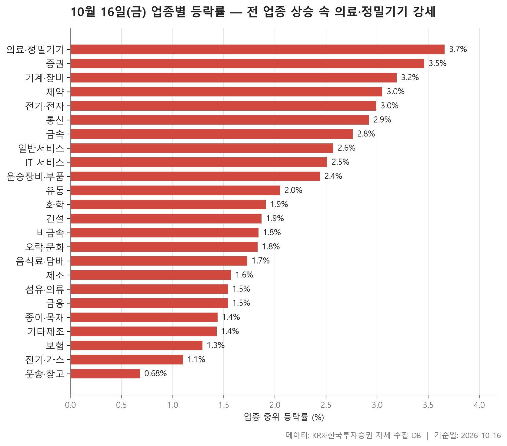
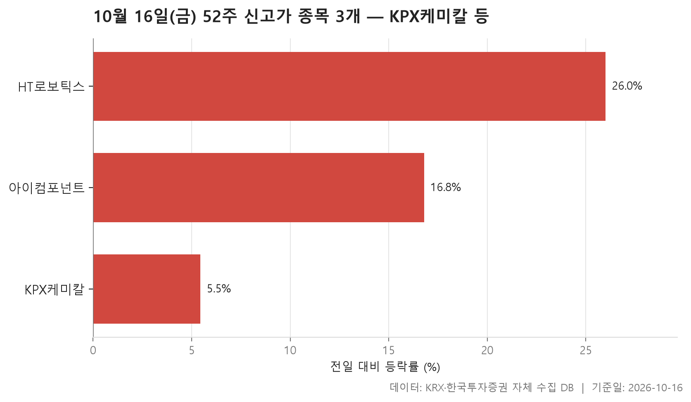
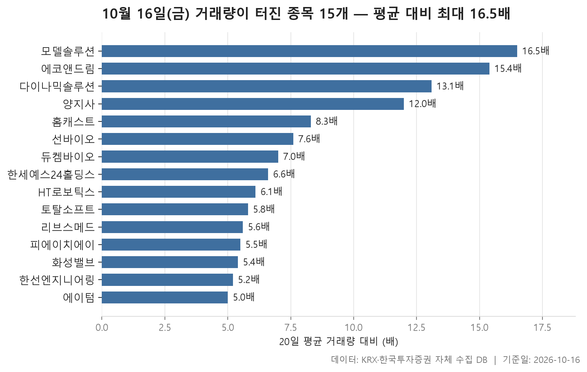

10월 16일 시장은 넓게 올랐습니다. 24개 업종을 업종 안 종목들의 등락률 중위값으로 줄 세웠더니 맨 아래 놓인 운송·창고조차 +0.68%로 플러스였습니다. 맨 위는 의료·정밀기기로 +3.66%였고, 24개 업종의 중위값을 늘어놓았을 때 한가운데 놓인 값은 +1.89%입니다. 어느 한 업종만 튄 장이 아니라, 업종 대부분이 고르게 플러스 쪽에 자리 잡은 하루였습니다.

다만 '전 업종 상승'은 중위값으로 따졌을 때 이야기입니다. 평균으로 보면 운송·창고 하나가 마이너스로 내려가 있고, 평균이 중위값보다 낮게 나온 업종도 몇 군데 보입니다. 한가운데 종목은 올랐어도 일부 종목이 크게 빠진 업종이 있었다는 뜻이고, 이런 어긋남은 표만 훑어서는 잘 보이지 않습니다.

오늘은 세 가지를 차례로 봅니다. 먼저 업종별 등락의 모양을 보고, 이어서 52주 신고가를 새로 쓴 종목, 마지막으로 거래량이 평소보다 몇 배씩 불어난 종목을 정리합니다.

> 기준일: 2026-10-16 · 집계: 자체 수집 데이터베이스

## 업종 등락률 — 24개 모두 상승

상위권에는 업종 네 곳이 비슷한 높이로 몰려 있습니다. 의료·정밀기기 +3.66%, 증권 +3.46%, 기계·장비 +3.19%, 제약 +3.05% 순입니다. 눈여겨볼 점은 오름세가 얼마나 넓게 퍼졌느냐입니다. 증권은 18개 종목이 **하나도 빠짐없이** 올라 오른 종목 비율이 100.00%였고, 205개 종목이 묶인 기계·장비도 93.20%가 올랐습니다. 의료·정밀기기는 평균이 +4.84%로 중위값보다 높게 나왔는데, 가장 크게 오른 한국비티비(+29.93%)가 업종 평균을 끌어올린 몫은 0.30%p에 그칩니다. 종목 하나가 평균을 만든 게 아니라 업종 전체가 함께 올랐다고 보는 편이 맞습니다. 이 업종에서도 열 곳 중 아홉 곳꼴로 올랐습니다.

중위값과 평균이 따로 노는 업종도 있습니다. 비금속은 중위값이 +1.84%인데 평균은 +3.53%로 훨씬 높습니다. 서산(+22.22%) 하나가 평균을 0.62%p 올렸지만 그것만으로는 차이가 다 설명되지 않습니다. 오른 종목 비율도 97.20%여서 다른 종목들도 상당히 올랐다고 읽힙니다. 반대 방향으로 어긋난 곳은 운송·창고입니다. 중위값은 +0.68%로 플러스인데 평균은 -0.35%입니다. 대한항공이 -10.53% 빠지면서 혼자 업종 평균을 0.38%p 끌어내렸고, 평균이 마이너스로 내려간 데는 이 종목 몫이 컸습니다. IT 서비스(중위 +2.51%, 평균 +2.37%)와 기타제조(중위 +1.43%, 평균 +1.10%)도 평균이 중위값보다 낮은데, 각각 모아데이타(-14.95%)와 엑스플러스(-4.76%)처럼 크게 내린 종목이 끼어 있습니다.

거래대금은 전기·전자가 137,863.20억원으로 다른 업종을 크게 앞섭니다. 두 번째인 기계·장비가 19,539.10억원이니 차이가 상당합니다. 366개 종목이 속한 덩치 큰 업종인데도 등락률 중위값이 +2.99%로 상위권에 들었습니다. 덩치가 큰 업종은 종목이 많은 만큼 중위값이 무난한 쪽으로 모이기 쉬운데, 그런 업종이 상위권에 올랐다는 점은 기억해 둘 만합니다.

아래쪽은 오름폭보다 오른 종목이 얼마나 되느냐가 먼저 눈에 띕니다. 종이·목재는 오른 종목이 63.00%, 운송·창고는 64.30%로 셋 중 둘에 조금 못 미칩니다. 대부분 업종에서 열 곳 중 여덟 곳 이상이 오른 것과 비교하면 이 두 곳의 온도는 확실히 낮았습니다. 전기·가스(+1.10%)와 보험(+1.29%)도 하위권에 있습니다.

| 업종 | 종목수(개) | 중위등락률(%) | 평균등락률(%) | 상승비율(%) | 주도종목 | 주도종목등락률(%) | 평균기여도(%p) | 거래대금합계(억원) |
|---|---|---|---|---|---|---|---|---|
| 의료·정밀기기 | 101 | +3.66 | +4.84 | 90.10 | 한국비티비 | +29.93 | 0.30 | 2,570.90 |
| 증권 | 18 | +3.46 | +3.58 | 100.00 | 키움증권 | +5.95 | 0.33 | 975.50 |
| 기계·장비 | 205 | +3.19 | +3.63 | 93.20 | 엑시콘 | +22.40 | 0.11 | 19,539.10 |
| 제약 | 166 | +3.05 | +3.56 | 88.00 | 한스바이오메드 | +25.36 | 0.15 | 9,785.40 |
| 전기·전자 | 366 | +2.99 | +3.42 | 84.70 | 에코앤드림 | +30.00 | 0.08 | 137,863.20 |
| 통신 | 13 | +2.92 | +2.89 | 84.60 | 더즌 | +7.42 | 0.57 | 943.10 |
| 금속 | 130 | +2.76 | +3.35 | 88.50 | 대양금속 | +29.99 | 0.23 | 7,800.80 |
| 일반서비스 | 166 | +2.57 | +3.24 | 86.70 | 인벤테라 | +12.71 | 0.08 | 6,213.90 |
| IT 서비스 | 243 | +2.51 | +2.37 | 83.10 | 모아데이타 | -14.95 | -0.06 | 6,697.80 |
| 운송장비·부품 | 134 | +2.44 | +2.54 | 84.30 | 네오티스 | +16.71 | 0.12 | 11,113.30 |
| 유통 | 158 | +2.05 | +2.23 | 80.40 | 하이퍼코퍼레이션 | -24.66 | -0.16 | 4,915.70 |
| 화학 | 222 | +1.91 | +2.53 | 80.60 | TS트릴리온 | +30.00 | 0.14 | 10,518.50 |
| 건설 | 50 | +1.87 | +1.88 | 90.00 | CNT85 | -7.78 | -0.16 | 2,073.40 |
| 비금속 | 36 | +1.84 | +3.53 | 97.20 | 서산 | +22.22 | 0.62 | 1,447.20 |
| 오락·문화 | 63 | +1.83 | +2.64 | 76.20 | 자이언트스텝 | +29.90 | 0.47 | 1,657.60 |
| 음식료·담배 | 83 | +1.73 | +2.38 | 85.50 | 프롬바이오 | +29.98 | 0.36 | 2,234.60 |
| 제조 | 8 | +1.57 | +1.62 | 87.50 | 에넥스 | +3.54 | 0.44 | 8.20 |
| 섬유·의류 | 48 | +1.54 | +1.92 | 70.80 | 씨싸이트 | +18.19 | 0.38 | 266.70 |
| 금융 | 111 | +1.54 | +1.91 | 85.60 | 삼성에피스홀딩스 | +8.69 | 0.08 | 15,673.40 |
| 종이·목재 | 27 | +1.44 | +1.49 | 63.00 | 이건홀딩스 | +7.50 | 0.28 | 29.60 |
| 기타제조 | 14 | +1.43 | +1.10 | 71.40 | 엑스플러스 | -4.76 | -0.34 | 9.00 |
| 보험 | 11 | +1.29 | +1.63 | 81.80 | 한화손해보험 | +5.48 | 0.50 | 2,036.50 |
| 전기·가스 | 10 | +1.10 | +0.86 | 70.00 | 삼천리 | +2.85 | 0.29 | 348.30 |
| 운송·창고 | 28 | +0.68 | -0.35 | 64.30 | 대한항공 | -10.53 | -0.38 | 4,082.90 |

## 52주 신고가 3개 — 최고 HT로보틱스 26.01%

업종 전반이 올랐는데도 52주 신고가 조건을 통과한 보통주는 세 종목뿐입니다. 시장별로는 KOSPI 1개, KOSDAQ 2개이고 업종도 화학·금속·전기·전자로 하나씩 갈립니다. 하루 오름세가 넓었다고 해서 52주 고점을 넘긴 종목까지 많았던 건 아니라는 얘기입니다. 그 이유가 무엇인지는 이 자료만으로는 알 수 없습니다.

세 종목은 고점을 넘어선 모양이 서로 다릅니다. KPX케미칼은 이전 최고가 64,500원을 65,800원으로 넘겼고 등락률은 +5.45%로 셋 중 가장 낮습니다. 시가총액은 2,729억원으로 가장 크지만 거래대금은 11.10억원에 그쳐 조용하게 고점을 넘긴 경우입니다. 아이컴포넌트도 비슷합니다. +16.81% 올랐는데 종가 8,200원이 이전 최고가 8,060원을 근소하게 넘었을 뿐이고, 거래대금은 13.70억원, 시가총액은 580억원으로 규모가 작습니다.

HT로보틱스는 전혀 다른 모습입니다. +26.01% 뛰면서 종가 9,010원으로 이전 최고가 8,070원을 크게 넘었고, 거래대금이 2,592.60억원이었습니다. 의료·정밀기기 업종 101개 종목의 거래대금을 모두 합친 2,570.90억원보다 이 종목 하나가 더 많았던 셈입니다. 이 종목은 아래 거래량 급증 표에도 다시 나옵니다.

| 종목명 | 종목코드 | 시장 | 업종 | 종가(원) | 등락률(%) | 이전52주최고(원) | 거래대금(억원) | 시가총액(억원) |
|---|---|---|---|---|---|---|---|---|
| KPX케미칼 | 025000 | KOSPI | 화학 | 65,800 | +5.45 | 64,500 | 11.10 | 2,729 |
| HT로보틱스 | 396300 | KOSDAQ | 금속 | 9,010 | +26.01 | 8,070 | 2,592.60 | 2,387 |
| 아이컴포넌트 | 059100 | KOSDAQ | 전기·전자 | 8,200 | +16.81 | 8,060 | 13.70 | 580 |

## 거래량 급증 15개 — 최고 모델솔루션 16.50배

거래량이 직전 20거래일 평균의 5배를 넘은 보통주는 15개이고, 그중 14개가 KOSDAQ 종목입니다. 배수의 중위값은 6.60배로, 대부분이 기준선에서 크게 벗어나지 않는 구간에 모여 있고 맨 위 몇 종목만 두드러지게 튀어 있습니다. 모델솔루션이 16.50배로 가장 높지만 거래대금은 18.60억원으로 크지 않습니다. 평소 거래가 워낙 적은 종목이라 배수가 크게 잡힌 것으로 읽는 게 자연스럽습니다. 그다음인 에코앤드림은 15.40배에 +30.00%로, 업종 표에서 전기·전자 안에서 가장 크게 움직인 종목으로 나왔던 그 종목입니다.

시장 전체가 오른 날이지만 거래량이 터진 종목이 모두 오른 것은 아닙니다. 열다섯 종목 가운데 네 종목이 내렸습니다. 특히 양지사는 12.00배의 거래량에 234.60억원이 오가면서 -7.46% 내렸습니다. 듀켐바이오(-4.12%), 홈캐스트(-2.73%), 한세예스24홀딩스(-0.36%)도 거래는 늘었는데 주가는 내렸습니다. 거래량이 늘었다고 해서 방향까지 정해지지는 않는다는 점을 이 대목이 보여 줍니다.

거래대금 규모로 보면 HT로보틱스(2,592.60억원)와 한선엔지니어링(1,346.40억원)이 두드러집니다. 둘 다 금속 업종이고 배수는 각각 6.10배, 5.20배로 중간이나 그 아래지만, 평소 거래량 자체가 많은 종목이라 실제로 오간 돈은 가장 컸습니다. 시가총액이 가장 큰 리브스메드(11,011억원)는 5.60배 거래량에 +28.24% 올랐습니다. 다이나믹솔루션(+17.09%, 13.10배)과 함께 의료·정밀기기 종목이 이 목록에 둘 들어 있는데, 오늘 이 업종이 가장 많이 오른 것과 같은 흐름입니다. 다만 둘 사이에 인과가 있는지는 이 자료로 판단할 수 없습니다.

| 종목명 | 종목코드 | 시장 | 업종 | 종가(원) | 등락률(%) | 거래량(주) | 평균거래량(주) | 배수(배) | 거래대금(억원) | 시가총액(억원) |
|---|---|---|---|---|---|---|---|---|---|---|
| 모델솔루션 | 417970 | KOSDAQ | 기계·장비 | 10,900 | +6.97 | 167,049 | 10,145 | 16.50 | 18.60 | 697 |
| 에코앤드림 | 101360 | KOSDAQ | 전기·전자 | 10,660 | +30.00 | 1,509,274 | 97,813 | 15.40 | 150.00 | 1,896 |
| 다이나믹솔루션 | 290660 | KOSDAQ | 의료·정밀기기 | 1,240 | +17.09 | 6,435,442 | 490,813 | 13.10 | 85.40 | 531 |
| 양지사 | 030960 | KOSDAQ | 출판·매체복제 | 5,710 | -7.46 | 3,909,714 | 325,841 | 12.00 | 234.60 | 912 |
| 홈캐스트 | 064240 | KOSDAQ | 유통 | 1,603 | -2.73 | 306,534 | 37,016 | 8.30 | 4.80 | 556 |
| 선바이오 | 067370 | KOSDAQ | 제약 | 5,670 | +4.04 | 57,220 | 7,574 | 7.60 | 3.20 | 693 |
| 듀켐바이오 | 176750 | KOSDAQ | 제약 | 8,600 | -4.12 | 1,634,944 | 233,164 | 7.00 | 149.00 | 2,450 |
| 한세예스24홀딩스 | 016450 | KOSPI | 섬유·의류 | 4,200 | -0.36 | 91,108 | 13,905 | 6.60 | 3.80 | 1,680 |
| HT로보틱스 | 396300 | KOSDAQ | 금속 | 9,010 | +26.01 | 30,299,071 | 4,982,546 | 6.10 | 2,592.60 | 2,387 |
| 토탈소프트 | 045340 | KOSDAQ | IT 서비스 | 7,230 | +5.70 | 96,274 | 16,662 | 5.80 | 6.80 | 619 |
| 리브스메드 | 491000 | KOSDAQ | 의료·정밀기기 | 43,600 | +28.24 | 1,097,528 | 195,052 | 5.60 | 458.20 | 11,011 |
| 피에이치에이 | 043370 | KOSDAQ | 운송장비·부품 | 11,840 | +12.87 | 89,349 | 16,219 | 5.50 | 10.30 | 2,486 |
| 화성밸브 | 039610 | KOSDAQ | 기계·장비 | 7,360 | +12.20 | 3,002,074 | 554,674 | 5.40 | 223.00 | 766 |
| 한선엔지니어링 | 452280 | KOSDAQ | 금속 | 16,870 | +15.00 | 7,979,336 | 1,530,882 | 5.20 | 1,346.40 | 3,247 |
| 에이텀 | 355690 | KOSDAQ | 전기·전자 | 8,040 | +18.76 | 554,851 | 110,809 | 5.00 | 42.10 | 769 |

## 정리

정리하면 10월 16일은 24개 업종이 중위값 기준으로 모두 오르고 의료·정밀기기·증권·기계·장비에서 오름세가 가장 넓었던 날이었지만, 52주 신고가는 세 종목에 그쳤고 거래량이 터진 종목 가운데서도 내린 곳이 섞여 있었습니다. 시장이 넓게 올랐다고 해서 고점 돌파나 거래 쏠림까지 함께 나타난 것은 아니었습니다.

이 글은 하루치 종가만 비교한 것이라 흐름이 이어질지는 알 수 없습니다. 왜 올랐고 왜 거래가 몰렸는지도 이 자료에는 나와 있지 않습니다. 업종 순위는 중위값으로 매겼기 때문에, 운송·창고처럼 평균이 마이너스인 업종도 '상승'으로 분류된 점은 감안하고 보시기 바랍니다.

## 집계 기준

**업종 등락률**

- **기준**: 2026-10-15 종가 → 2026-10-16 종가
- **순위**: 업종 내 종목 등락률의 중위값 (평균은 참고용으로 함께 표시)
- **주도종목**: 그 업종에서 등락률 절대값이 가장 큰 종목 (동점이면 거래대금이 큰 쪽)
- **평균기여도**: 그 종목 하나가 업종 평균을 움직인 폭 (등락률 ÷ 종목수). 중위값과 평균의 격차가 이 값에 가까우면 평균을 만든 것이 그 종목이고, 훨씬 크면 다른 종목들도 함께 움직인 것입니다
- **필터**: 업종 내 보통주 5종목 이상
- **전체업종중위등락률(%)**: 1.89

**52주 신고가**

- **기준**: 종가 > 직전 52주 최고가
- **관측구간**: 2025-09-29 ~ 2026-10-15 (252거래일)
- **필터**: 시가총액 500억 이상, 거래대금 3억 이상, 보통주

**거래량 급증**

- **기준**: 당일 거래량 ≥ 직전 20거래일 평균 × 5
- **관측구간**: 2026-09-14 ~ 2026-10-15 (20거래일)
- **필터**: 시가총액 500억 이상, 거래대금 3억 이상, 보통주

## 데이터 출처 및 유의사항

- **데이터출처**: 한국거래소(KRX) 공시 데이터와 한국투자증권 OpenAPI 를 직접 수집해 구축한 자체 데이터베이스
- **집계방식**: 수집·집계·차트 생성을 직접 구현한 파이프라인에서 자동 산출
- **작성고지**: 본문의 표·통계·차트는 자체 데이터베이스에서 계산된 값이며, 문장 작성 과정에 AI 도구를 활용했습니다.
- **면책**: 본 글은 정보 제공을 목적으로 하며 특정 종목의 매수·매도를 추천하지 않습니다. 제시된 수치는 과거 데이터이고 미래 수익을 보장하지 않습니다. 투자 판단과 그 결과에 대한 책임은 투자자 본인에게 있습니다.

