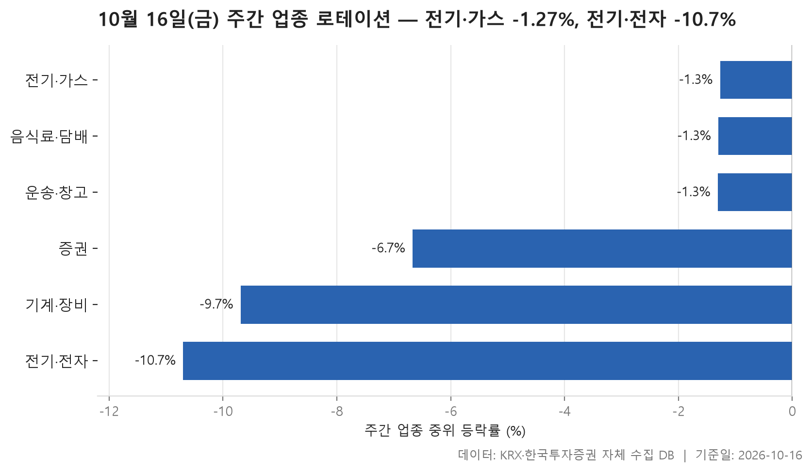
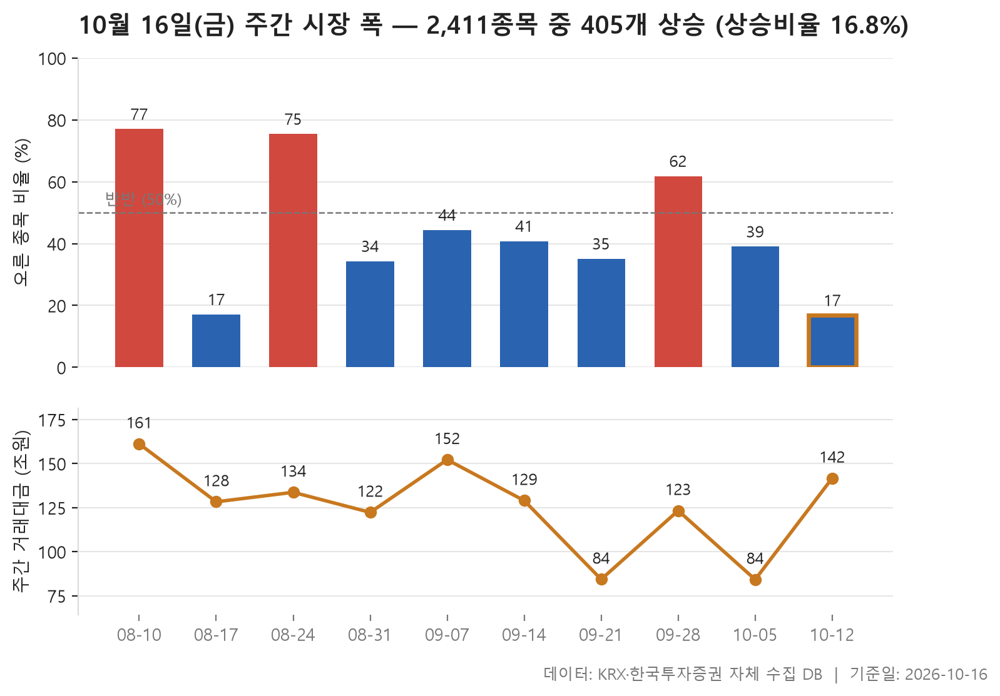
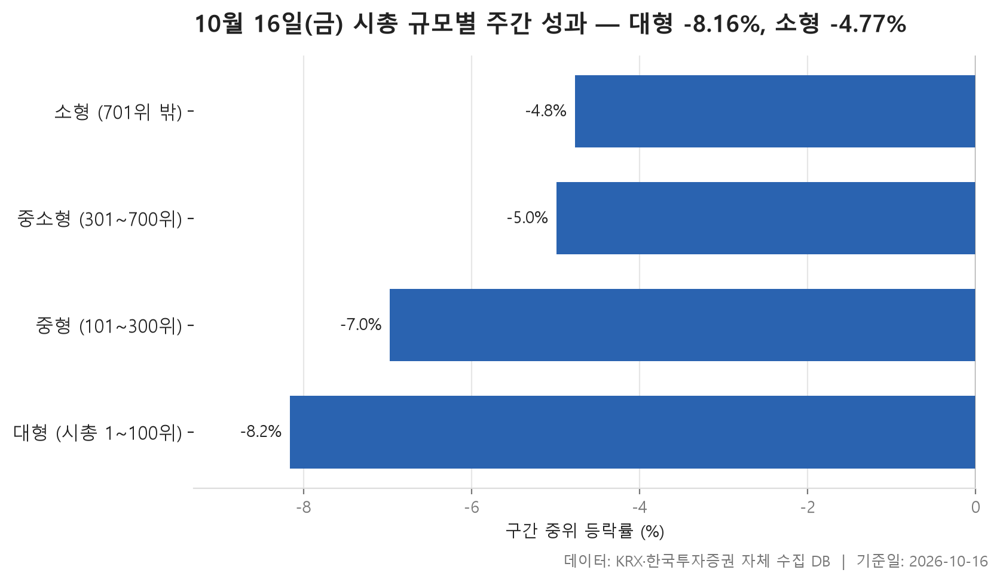

10월 12일부터 16일까지 닷새 거래일 동안의 시장을 정리합니다. 출발선은 직전 주 마지막 거래일인 10월 8일 종가입니다. 제목에 붙은 두 숫자가 이번 주의 성격을 보여 줍니다. 24개 업종 가운데 가장 잘 버틴 전기·가스도 중위 등락률이 -1.27%였고, 가장 약했던 전기·전자는 -10.70%까지 밀렸습니다. 순위로는 맨 위에 있는 업종도 마이너스였습니다.

오늘은 세 가지를 봅니다. 업종별로 어디가 덜 빠지고 어디가 많이 빠졌는지, 오른 종목이 전체에서 얼마나 됐는지를 지난 10주와 비교해 보고, 시가총액 크기에 따라 성적이 어떻게 갈렸는지도 살핍니다. 이번 주는 돈이 어디로 갔는지보다 **어디가 덜 잃었는지**를 보는 주에 가깝습니다.

> 기준일: 2026-10-16 · 집계: 자체 수집 데이터베이스

## 주간 업종 로테이션 — 6개 모두 하락

위쪽 세 업종은 중위 등락률이 -1.27%, -1.30%, -1.31%로 거의 같습니다. 순위는 매겼지만 사실상 같은 줄에 있다고 보는 편이 맞습니다. 하지만 업종 안을 들여다보면 모양이 서로 다릅니다. 전기·가스는 평균이 -2.18%로 중위값보다 낮습니다. SGC에너지 한 종목이 -12.10% 빠지면서 업종 평균을 -1.21%p 끌어내린 영향이 큽니다. 10종목뿐인 업종이라 한 종목의 무게가 그만큼 무겁습니다. 오른 종목은 다섯 곳 중 한 곳꼴이었습니다.

음식료·담배와 운송·창고는 반대로 평균이 중위값보다 높습니다. 프롬바이오가 +51.63%, 제주항공이 +23.97% 오르면서 각 업종 평균을 0.62%p, 0.86%p 끌어올렸습니다. 그래도 두 업종 모두 오른 종목 비율은 28.90%, 35.70%로 절반에 못 미칩니다. 업종 전체가 강했다기보다 일부 종목이 크게 오른 경우로 읽는 게 자연스럽습니다.

하위권은 훨씬 분명합니다. 증권은 18종목 가운데 오른 종목이 하나도 없었고, 미래에셋증권이 -14.07%로 가장 크게 움직였습니다. 기계·장비와 전기·전자는 종목 수가 204개, 364개인 큰 업종입니다. 그런데도 중위 등락률이 -9.69%, -10.70%까지 내려갔고, 오른 종목 비율은 7.40%, 10.40%에 그쳤습니다. 전기·전자에서 가장 크게 움직인 종목은 오히려 +71.89% 오른 에이엔피였습니다. 하지만 364종목 가운데 하나여서 업종 평균에 준 영향은 0.20%p에 그쳤습니다. 이 업종들이 왜 이렇게 빠졌는지는 이 자료만으로는 알 수 없습니다.

| 업종 | 종목수(개) | 주간중위등락률(%) | 주간평균등락률(%) | 상승비율(%) | 주도종목 | 주도종목등락률(%) | 평균기여도(%p) |
|---|---|---|---|---|---|---|---|
| 전기·가스 | 10 | -1.27 | -2.18 | 20.00 | SGC에너지 | -12.10 | -1.21 |
| 음식료·담배 | 83 | -1.30 | -1.13 | 28.90 | 프롬바이오 | +51.63 | 0.62 |
| 운송·창고 | 28 | -1.31 | -0.88 | 35.70 | 제주항공 | +23.97 | 0.86 |
| 증권 | 18 | -6.67 | -6.12 | 0.00 | 미래에셋증권 | -14.07 | -0.78 |
| 기계·장비 | 204 | -9.69 | -9.94 | 7.40 | 브릴스 | -33.70 | -0.17 |
| 전기·전자 | 364 | -10.70 | -9.90 | 10.40 | 에이엔피 | +71.89 | 0.20 |

## 주간 시장 폭 — 10주 중 이번 주는 2,411개 중 405개 상승

이번 주 오른 종목은 405개, 내린 종목은 1,988개였습니다. 상승 종목 수를 하락 종목 수로 나눈 값은 0.20배로 최근 10주 가운데 가장 낮습니다. 오른 종목이 여섯 곳 중 한 곳꼴(16.80%)이었다는 뜻입니다. 10주 전체의 중위값이 0.69배이니, 하락 종목이 더 많았던 다른 주들과 비교해도 한참 아래입니다.

비슷한 주가 8월 17일 주에 한 번 있었습니다. 그 주는 이 비율이 0.21배, 오른 종목 비율이 17.10%로 이번 주와 거의 같았습니다. 그 앞뒤 주를 보면 더 흥미롭습니다. 8월 10일 주(3.49배)와 8월 24일 주(3.22배)에는 오른 종목이 압도적으로 많았는데, 그 사이에 이런 급락 주가 끼어 있었습니다. 10주 동안 이 비율이 1을 넘긴 주는 8월 10일, 8월 24일, 9월 28일 주뿐이고, 나머지 주는 모두 내린 종목이 더 많았습니다. 고르게 오르는 주는 가끔 나오고, 그 사이를 약세가 채우는 모양입니다. 이런 흐름이 다음 주에도 이어질지는 표만으로는 알 수 없습니다.

거래대금도 짚어 볼 만합니다. 이번 주 총거래대금은 141.70조원으로, 거래일이 5일이었던 주들 가운데 8월 10일 주(161.20조원)와 9월 7일 주(152.20조원) 바로 다음입니다. 내린 종목이 압도적으로 많았던 주에도 거래는 줄지 않았습니다.

| 주 | 거래일수(일) | 종목수(개) | 상승(개) | 보합(개) | 하락(개) | 상승비율(%) | ADR(배) | 총거래대금(조원) |
|---|---|---|---|---|---|---|---|---|
| 2026-10-12 | 5 | 2,411 | 405 | 18 | 1,988 | 16.80 | 0.20 | 141.70 |
| 2026-10-05 | 3 | 2,416 | 942 | 39 | 1,435 | 39.00 | 0.66 | 84.20 |
| 2026-09-28 | 5 | 2,407 | 1,488 | 41 | 878 | 61.80 | 1.69 | 123.30 |
| 2026-09-21 | 3 | 2,411 | 846 | 47 | 1,518 | 35.10 | 0.56 | 84.30 |
| 2026-09-14 | 5 | 2,405 | 982 | 31 | 1,392 | 40.80 | 0.71 | 129.00 |
| 2026-09-07 | 5 | 2,404 | 1,067 | 40 | 1,297 | 44.40 | 0.82 | 152.20 |
| 2026-08-31 | 5 | 2,399 | 823 | 34 | 1,542 | 34.30 | 0.53 | 122.30 |
| 2026-08-24 | 5 | 2,384 | 1,798 | 28 | 558 | 75.40 | 3.22 | 133.70 |
| 2026-08-17 | 4 | 2,385 | 408 | 16 | 1,961 | 17.10 | 0.21 | 128.30 |
| 2026-08-10 | 5 | 2,384 | 1,836 | 22 | 526 | 77.00 | 3.49 | 161.20 |

## 시총 규모별 주간 성과 — 소형이 3.39%p 앞섬

시가총액 규모로 나눠 봐도 모든 구간이 마이너스입니다. 소형(701위 밖)이 -4.77%로 가장 덜 빠졌고, 대형(1~100위)이 -8.16%로 가장 많이 빠졌습니다. 대형에서 소형으로 갈수록 중위 등락률이 차례로 나아지는 모양입니다. 대형과 소형의 격차는 -3.39%p입니다. 이번 주에 '소형주가 앞섰다'는 말은 사실상 '덜 잃었다'는 뜻입니다.

눈여겨볼 대목은 오른 종목의 비율입니다. 중위값이 가장 나빴던 대형 구간이 오른 종목 비율은 21.00%로 가장 높습니다. 반대로 중위값이 가장 좋았던 소형 구간은 15.70%로 가장 낮습니다. 대형주는 오른 종목이 조금 더 많았지만 내린 종목의 낙폭이 컸고, 소형주는 대부분 내렸지만 낙폭이 상대적으로 얕았다고 읽을 수 있습니다. 중소형 구간은 중위값이 -4.99%인데 평균은 -6.51%로 평균이 더 낮습니다. 크게 빠진 일부 종목이 평균을 끌어내렸다는 뜻입니다.

구간마다 가장 크게 움직인 종목의 방향도 갈립니다. 대형의 LG이노텍(-28.93%)과 중형의 파두(-30.92%)는 크게 내렸고, 중소형의 에스엠벡셀(+33.48%)과 소형의 대양금속(+71.97%)은 크게 올랐습니다. 거래대금은 대형 구간에 101.40조원이 몰려 다른 구간을 크게 웃돌았습니다. 거래가 가장 많이 몰린 큰 종목들이 가장 많이 빠진 셈입니다.

| 구간 | 종목수(개) | 주간중위등락률(%) | 주간평균등락률(%) | 상승비율(%) | 주도종목 | 주도종목등락률(%) | 주간거래대금(조원) |
|---|---|---|---|---|---|---|---|
| 대형 (시총 1~100위) | 100 | -8.16 | -7.55 | 21.00 | LG이노텍 | -28.93 | 101.40 |
| 중형 (101~300위) | 200 | -6.97 | -7.25 | 19.50 | 파두 | -30.92 | 19.30 |
| 중소형 (301~700위) | 400 | -4.99 | -6.51 | 19.00 | 에스엠벡셀 | +33.48 | 9.60 |
| 소형 (701위 밖) | 1,711 | -4.77 | -4.97 | 15.70 | 대양금속 | +71.97 | 10.10 |

## 정리

정리하면, 이번 주는 업종과 규모를 가리지 않고 시장 전반이 내렸습니다. 전기·가스 같은 일부 업종과 소형주는 상대적으로 덜 빠졌을 뿐입니다. 오른 종목이 여섯 곳 중 한 곳꼴에 그친 것은 최근 10주 가운데 가장 낮은 수준입니다.

다만 이 글은 종가 기준 등락률과 종목 수만으로 정리했습니다. 하락의 원인이나 업종별 사정은 자료에 없어서 다루지 않았습니다. 또 중위값과 평균은 업종이나 구간에 어떤 종목이 들어 있느냐에 따라 크게 달라질 수 있습니다. 개별 종목을 판단하는 근거보다는 한 주 시장의 흐름을 훑어보는 참고 자료로 봐 주시기 바랍니다.

## 집계 기준

**주간 업종 로테이션**

- **기준**: 2026-10-08 종가 → 2026-10-16 종가
- **구간**: 2026-10-12 시작 주 — 직전 주 마지막 거래일 종가를 출발선으로 삼습니다
- **거래일수**: 5
- **순위**: 업종 내 종목 등락률의 중위값 (평균은 참고용으로 함께 표시)
- **선정**: 전체 24개 업종 중 상위 3개 · 하위 3개
- **주도종목**: 그 업종에서 같은 기간 등락률 절대값이 가장 큰 종목 (동점이면 거래대금이 큰 쪽)
- **평균기여도**: 그 종목 하나가 업종 평균을 움직인 폭 (등락률 ÷ 종목수)
- **필터**: 업종 내 보통주 5종목 이상

**주간 시장 폭**

- **기준**: 각 주의 마지막 거래일 종가를 직전 주 마지막 거래일 종가와 비교
- **주**: 그 주의 월요일 (달력 기준). 거래일 수는 연휴에 따라 다릅니다
- **ADR**: 상승 종목 수 ÷ 하락 종목 수. 1 이면 반반, 2 면 오른 종목이 두 배
- **총거래대금**: 그 주 거래일 전체의 거래대금 합계
- **모집단**: 거래가 있었던 보통주 (거래정지·액면 변경 종목 제외)

**시총 규모별 주간 성과**

- **기준**: 2026-10-08 종가 → 2026-10-16 종가
- **구간**: 기준일 시가총액 순위로 자릅니다 (금액으로 자르면 장이 오른 해에 전부 위 구간으로 올라가 해마다 다른 표가 됩니다)
- **순위**: 구간 내 종목 등락률의 중위값 (평균은 참고용으로 함께 표시)
- **주도종목**: 그 구간에서 같은 기간 등락률 절대값이 가장 큰 종목 (동점이면 거래대금이 큰 쪽)
- **대형소형격차**: -3.39
- **모집단**: 거래가 있었던 보통주 (거래정지·액면 변경 종목 제외)

## 데이터 출처 및 유의사항

- **데이터출처**: 한국거래소(KRX) 공시 데이터와 한국투자증권 OpenAPI 를 직접 수집해 구축한 자체 데이터베이스
- **집계방식**: 수집·집계·차트 생성을 직접 구현한 파이프라인에서 자동 산출
- **작성고지**: 본문의 표·통계·차트는 자체 데이터베이스에서 계산된 값이며, 문장 작성 과정에 AI 도구를 활용했습니다.
- **면책**: 본 글은 정보 제공을 목적으로 하며 특정 종목의 매수·매도를 추천하지 않습니다. 제시된 수치는 과거 데이터이고 미래 수익을 보장하지 않습니다. 투자 판단과 그 결과에 대한 책임은 투자자 본인에게 있습니다.

