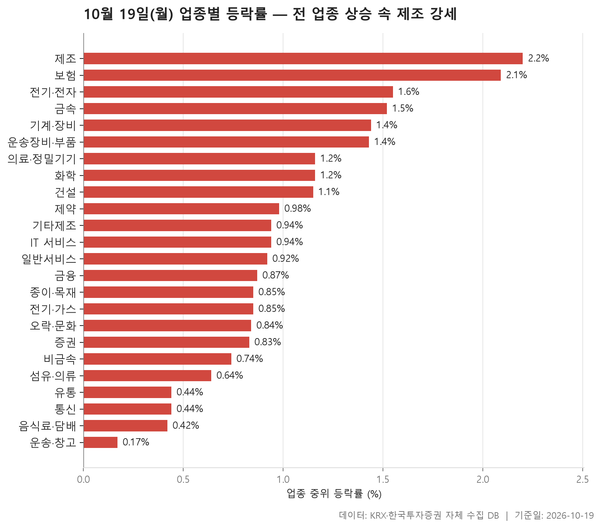
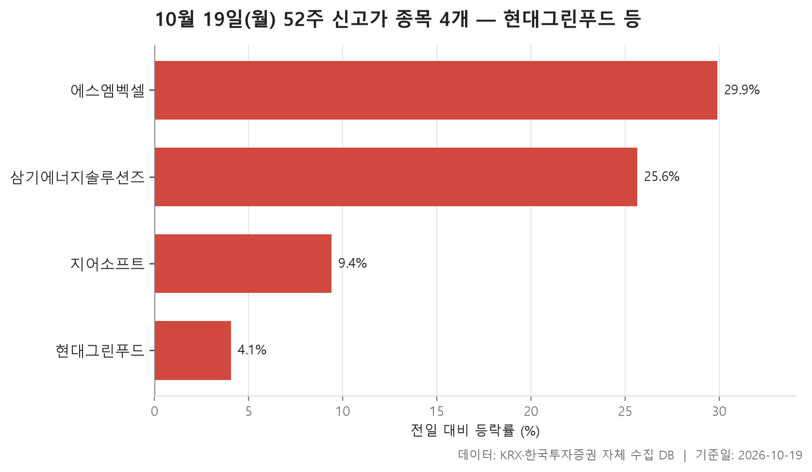
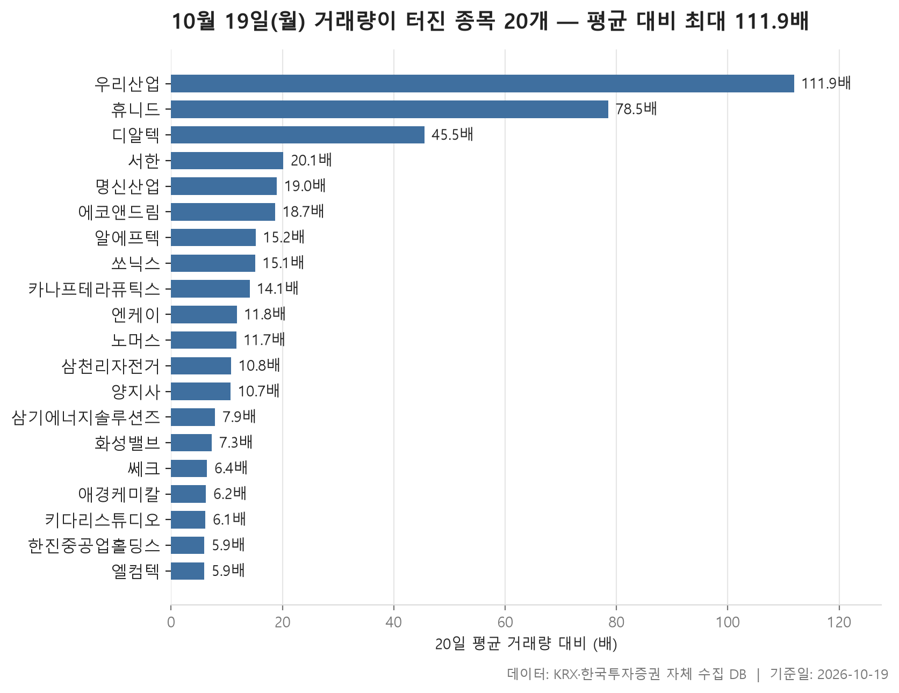

10월 19일 월요일 시장은 방향만큼은 분명했습니다. 보통주가 5종목 이상인 24개 업종을 업종 안 종목 등락률의 중위값으로 줄 세웠더니, 맨 아래에 놓인 운송·창고도 +0.17%로 플러스였습니다. 어느 업종이든 한가운데 있는 종목은 올랐다는 뜻입니다. 24개 업종의 이 값을 다시 한 줄로 세우면 한가운데가 +0.93%이고, 맨 위에는 제조가 +2.20%로 올라 있습니다.

다만 모두 올랐다고 해서 고르게 오른 것은 아닙니다. 업종마다 오른 종목의 비중이 다르고, 평균과 중위값이 크게 벌어진 곳도 있습니다. 상한가 근처까지 오른 종목과 하한가 근처까지 밀린 종목이 같은 업종 안에 섞여 있기도 했습니다.

오늘 글은 세 부분으로 나눴습니다. 먼저 업종별 흐름을 보고, 이어서 52주 신고가를 새로 쓴 종목 4개, 마지막으로 거래량이 평소보다 다섯 배 넘게 불어난 종목 20개를 살펴봅니다. 이 세 표에는 겹치는 이름도 있어서, 같은 종목이 어디에 또 나오는지 함께 짚어 보겠습니다.

> 기준일: 2026-10-19 · 집계: 자체 수집 데이터베이스

## 업종 등락률 — 24개 모두 상승

제목에 '제조 강세'라고 적었지만, 맨 위에 오른 제조 업종은 종목이 8개뿐이고 하루 거래대금을 다 합쳐도 6.00억원입니다. 거의 모든 종목이 올라 중위값이 +2.20%까지 나왔지만, 표본이 작다 보니 종목 한두 곳만 달라져도 순위가 바뀔 수 있습니다. 실제로 코아스(+8.56%) 한 종목이 업종 평균을 1.07%p 끌어올렸습니다. 그런데도 평균(+1.70%)이 중위값보다 낮다는 점이 눈에 띕니다. 가운데 종목들은 고르게 올랐어도 아래쪽에 덜 오르거나 내린 종목이 있었다는 얘기입니다. 바로 아래 보험(+2.09%)은 열 곳 중 아홉 곳꼴로 올라, 오른 종목의 비중으로는 24개 업종 가운데 가장 넓었습니다.

시장의 무게중심은 전기·전자입니다. 367개 종목에 거래대금이 121,153.40억원으로 다른 업종과 단위가 다를 만큼 큽니다. 이 업종의 중위값은 +1.55%로 세 번째인데, 가장 크게 움직인 종목은 오히려 -29.91% 밀린 에이엔피였습니다. 종목 수가 워낙 많아 이 한 종목이 업종 평균을 움직인 폭은 0.08%p에 그칩니다. 업종이 클수록 개별 종목의 급락이 평균에 거의 흔적을 남기지 않는다는 점을 보여 줍니다.

평균이 중위값보다 크게 높은 업종은 운송장비·부품과 금속입니다. 운송장비·부품은 중위값이 +1.43%인데 평균은 +2.68%로 24개 업종 중 가장 높습니다. 에스엠벡셀(+29.90%)이 상한가 근처까지 올랐어도 혼자 업종 평균을 끌어올린 폭은 0.22%p에 불과합니다. 평균과 중위값의 차이를 이 종목 하나로는 다 설명할 수 없으니, 크게 오른 종목이 여럿 함께 있었다고 봐야 합니다. 금속(중위 +1.52%, 평균 +2.45%)도 비슷합니다. KBI동양철관(+29.96%)이 끌어올린 폭은 0.23%p입니다.

반대 방향으로 어긋난 곳은 음식료·담배입니다. 중위값이 +0.42%인데 평균은 +0.17%로 더 낮습니다. MH에탄올이 -49.83% 급락하면서 혼자 업종 평균을 0.60%p 끌어내린 영향이 큽니다. 유통도 푸드나무(-30.00%)의 급락을 안고 +0.44%에 머물렀습니다. 하위권에서는 섬유·의류와 기타제조처럼 오른 종목이 겨우 절반을 넘긴 업종이 보입니다. 전 업종이 플러스였어도 아래쪽 업종의 체감은 보합에 가까웠다고 볼 수 있습니다.

| 업종 | 종목수(개) | 중위등락률(%) | 평균등락률(%) | 상승비율(%) | 주도종목 | 주도종목등락률(%) | 평균기여도(%p) | 거래대금합계(억원) |
|---|---|---|---|---|---|---|---|---|
| 제조 | 8 | +2.20 | +1.70 | 87.50 | 코아스 | +8.56 | 1.07 | 6.00 |
| 보험 | 11 | +2.09 | +1.99 | 90.90 | 미래에셋생명 | +4.37 | 0.40 | 1,630.20 |
| 전기·전자 | 367 | +1.55 | +1.97 | 73.30 | 에이엔피 | -29.91 | -0.08 | 121,153.40 |
| 금속 | 130 | +1.52 | +2.45 | 80.00 | KBI동양철관 | +29.96 | 0.23 | 6,826.50 |
| 기계·장비 | 205 | +1.44 | +1.82 | 71.70 | 필에너지 | +11.80 | 0.06 | 15,787.50 |
| 운송장비·부품 | 134 | +1.43 | +2.68 | 82.10 | 에스엠벡셀 | +29.90 | 0.22 | 11,904.50 |
| 의료·정밀기기 | 101 | +1.16 | +1.56 | 64.40 | 디알텍 | +13.53 | 0.13 | 2,052.40 |
| 화학 | 221 | +1.16 | +1.79 | 70.10 | CSA 코스믹 | +29.97 | 0.14 | 9,479.10 |
| 건설 | 50 | +1.15 | +1.30 | 80.00 | 대명에너지 | +4.40 | 0.09 | 1,543.50 |
| 제약 | 166 | +0.98 | +1.10 | 72.90 | 삼성바이오로직스 | +9.94 | 0.06 | 7,288.80 |
| 기타제조 | 14 | +0.94 | +1.27 | 57.10 | 엑스플러스 | +10.00 | 0.71 | 9.60 |
| IT 서비스 | 243 | +0.94 | +1.21 | 71.60 | 벨로크 | +16.81 | 0.07 | 4,514.20 |
| 일반서비스 | 167 | +0.92 | +1.51 | 72.50 | HLB바이오스텝 | +13.42 | 0.08 | 4,445.50 |
| 금융 | 110 | +0.87 | +1.10 | 72.70 | 에코프로 | +11.19 | 0.10 | 11,942.60 |
| 종이·목재 | 27 | +0.85 | +0.77 | 70.40 | 동화기업 | +8.45 | 0.31 | 27.20 |
| 전기·가스 | 10 | +0.85 | +0.90 | 70.00 | 지역난방공사 | +2.38 | 0.24 | 279.80 |
| 오락·문화 | 63 | +0.84 | +1.22 | 66.70 | 스튜디오미르 | +9.55 | 0.15 | 1,345.50 |
| 증권 | 18 | +0.83 | +0.98 | 77.80 | 상상인증권 | +3.17 | 0.18 | 646.10 |
| 비금속 | 36 | +0.74 | +0.52 | 58.30 | SG | +6.58 | 0.18 | 773.60 |
| 섬유·의류 | 48 | +0.64 | +0.52 | 56.30 | 씨싸이트 | -6.23 | -0.13 | 287.10 |
| 유통 | 157 | +0.44 | +0.86 | 65.00 | 푸드나무 | -30.00 | -0.19 | 3,718.00 |
| 통신 | 13 | +0.44 | +0.69 | 61.50 | 아이즈비전 | +4.44 | 0.34 | 881.50 |
| 음식료·담배 | 83 | +0.42 | +0.17 | 69.90 | MH에탄올 | -49.83 | -0.60 | 1,727.60 |
| 운송·창고 | 28 | +0.17 | +0.44 | 60.70 | STX그린로지스 | -4.61 | -0.16 | 2,105.30 |

## 52주 신고가 4개 — 최고 에스엠벡셀 29.90%

종가가 직전 52주 최고가를 넘어선 보통주는 4개뿐입니다. 시가총액 500억원 이상, 거래대금 3억원 이상 조건을 걸었기 때문이기도 하지만, 업종 대부분이 오른 날치고는 많지 않습니다. 시장은 KOSPI와 KOSDAQ이 2개씩 나눠 가졌고, 4개 중 2개가 운송장비·부품입니다. 앞에서 평균이 유독 높게 나왔던 그 업종입니다.

신고가의 성격은 두 갈래로 나뉩니다. 에스엠벡셀(+29.90%)과 삼기에너지솔루션즈(+25.64%)는 하루에 크게 뛰면서 직전 고점을 훌쩍 넘었습니다. 에스엠벡셀은 직전 고점 3,495원을 지나 4,040원에 마감했습니다. 거래대금도 에스엠벡셀이 995.80억원, 삼기에너지솔루션즈가 1,309.90억원으로 나머지 두 종목과는 비교가 되지 않을 만큼 컸습니다. 반면 현대그린푸드는 +4.07% 오르는 데 그쳤고, 종가 20,200원이 직전 고점 19,950원을 살짝 넘긴 정도입니다. 넷 중 시가총액은 6,559억원으로 가장 크지만 거래대금은 11.70억원으로 가장 적었습니다. 조용하게 고점을 넘어선 경우입니다.

지어소프트(+9.41%)는 그 중간쯤에 있습니다. 네 종목의 등락률 중위값이 +17.52%로 꽤 높게 나온 것은 크게 뛴 두 종목 때문입니다. 표본이 넷뿐이라 이 값으로 신고가 종목의 전형을 말하기는 어렵습니다.

| 종목명 | 종목코드 | 시장 | 업종 | 종가(원) | 등락률(%) | 이전52주최고(원) | 거래대금(억원) | 시가총액(억원) |
|---|---|---|---|---|---|---|---|---|
| 현대그린푸드 | 453340 | KOSPI | 유통 | 20,200 | +4.07 | 19,950 | 11.70 | 6,559 |
| 에스엠벡셀 | 010580 | KOSPI | 운송장비·부품 | 4,040 | +29.90 | 3,495 | 995.80 | 4,495 |
| 지어소프트 | 051160 | KOSDAQ | IT 서비스 | 14,770 | +9.41 | 14,340 | 35.60 | 1,991 |
| 삼기에너지솔루션즈 | 419050 | KOSDAQ | 운송장비·부품 | 2,695 | +25.64 | 2,465 | 1,309.90 | 1,541 |

## 거래량 급증 20개 — 최고 우리산업 111.90배

거래량이 직전 20거래일 평균의 다섯 배를 넘긴 종목은 20개이고, 이 가운데 14개가 KOSDAQ입니다. 시가총액도 대부분 수백억원대에 몰려 있어, 덩치가 작은 종목에 거래가 몰린 하루였다고 정리할 수 있습니다. 업종으로는 전기·전자가 5개로 가장 많습니다.

맨 위의 우리산업은 평소의 111.90배나 거래됐습니다. 다만 20일 평균 거래량이 10,257주에 불과했으니, 바탕이 얇은 종목이라 배수가 크게 나온 측면이 있습니다. 휴니드(78.50배, +17.07%)와 디알텍(45.50배, +13.53%)이 뒤를 잇고, 20개 종목 배수의 중위값은 11.75배입니다. 배수와 등락률은 비례하지 않습니다. 양지사는 평소의 10.70배가 거래됐지만 주가는 +0.53% 움직이는 데 그쳤습니다.

신고가 표에도 있던 삼기에너지솔루션즈는 여기서 배수가 7.90배로 중하위권입니다. 그런데 거래된 주식 수는 51,970,179주로 압도적이고, 거래대금 1,309.90억원도 20개 중 가장 큽니다. 원래 거래가 많던 종목이라 배수가 덜 튀었을 뿐, 실제 손바뀜의 규모는 이 종목이 가장 컸습니다. 시가총액이 가장 큰 애경케미칼(6,519억원)은 +14.53% 오르며 평소의 6.20배가 거래됐습니다.

거래가 터졌다고 다 오른 것도 아닙니다. 키다리스튜디오는 -15.06%, 알에프텍은 -9.02% 내린 채 거래가 불어났습니다. 알에프텍은 거래대금이 3.70억원으로 필터 기준을 겨우 넘긴 수준이라, 작은 매매에도 배수가 크게 잡혔을 수 있습니다.

| 종목명 | 종목코드 | 시장 | 업종 | 종가(원) | 등락률(%) | 거래량(주) | 평균거래량(주) | 배수(배) | 거래대금(억원) | 시가총액(억원) |
|---|---|---|---|---|---|---|---|---|---|---|
| 우리산업 | 215360 | KOSDAQ | 운송장비·부품 | 6,950 | +5.62 | 1,147,696 | 10,257 | 111.90 | 85.50 | 635 |
| 휴니드 | 005870 | KOSPI | 전기·전자 | 4,835 | +17.07 | 2,864,268 | 36,467 | 78.50 | 142.00 | 683 |
| 디알텍 | 214680 | KOSDAQ | 의료·정밀기기 | 3,735 | +13.53 | 2,109,392 | 46,360 | 45.50 | 87.10 | 623 |
| 서한 | 011370 | KOSDAQ | 건설 | 3,885 | +4.30 | 347,484 | 17,318 | 20.10 | 13.70 | 784 |
| 명신산업 | 009900 | KOSPI | 운송장비·부품 | 9,720 | +15.03 | 4,271,388 | 224,946 | 19.00 | 413.40 | 5,100 |
| 에코앤드림 | 101360 | KOSDAQ | 전기·전자 | 11,540 | +8.26 | 3,211,583 | 171,569 | 18.70 | 360.50 | 2,053 |
| 알에프텍 | 061040 | KOSDAQ | 전기·전자 | 6,250 | -9.02 | 59,255 | 3,909 | 15.20 | 3.70 | 566 |
| 쏘닉스 | 088280 | KOSDAQ | 전기·전자 | 4,585 | +19.40 | 2,458,184 | 162,553 | 15.10 | 110.40 | 794 |
| 카나프테라퓨틱스 | 0082N0 | KOSDAQ | 일반서비스 | 10,930 | +5.50 | 1,128,166 | 80,091 | 14.10 | 127.20 | 1,454 |
| 엔케이 | 085310 | KOSPI | 금속 | 9,430 | +8.52 | 129,962 | 11,006 | 11.80 | 12.10 | 700 |
| 노머스 | 473980 | KOSDAQ | 오락·문화 | 11,980 | +8.03 | 338,716 | 28,873 | 11.70 | 40.80 | 1,304 |
| 삼천리자전거 | 024950 | KOSDAQ | 유통 | 4,575 | +12.68 | 172,385 | 16,023 | 10.80 | 7.70 | 567 |
| 양지사 | 030960 | KOSDAQ | 출판·매체복제 | 5,740 | +0.53 | 5,561,721 | 519,978 | 10.70 | 348.40 | 917 |
| 삼기에너지솔루션즈 | 419050 | KOSDAQ | 운송장비·부품 | 2,695 | +25.64 | 51,970,179 | 6,573,051 | 7.90 | 1,309.90 | 1,541 |
| 화성밸브 | 039610 | KOSDAQ | 기계·장비 | 8,120 | +10.33 | 5,082,905 | 696,185 | 7.30 | 421.30 | 845 |
| 쎄크 | 081180 | KOSDAQ | 기계·장비 | 5,950 | +4.02 | 954,907 | 150,189 | 6.40 | 62.00 | 525 |
| 애경케미칼 | 161000 | KOSPI | 화학 | 13,400 | +14.53 | 1,705,249 | 276,612 | 6.20 | 216.50 | 6,519 |
| 키다리스튜디오 | 020120 | KOSPI | IT 서비스 | 5,190 | -15.06 | 3,408,251 | 555,643 | 6.10 | 177.60 | 1,924 |
| 한진중공업홀딩스 | 003480 | KOSPI | 전기·가스 | 4,540 | +1.00 | 154,282 | 26,040 | 5.90 | 6.90 | 1,341 |
| 엘컴텍 | 037950 | KOSDAQ | 전기·전자 | 3,075 | +5.31 | 191,213 | 32,435 | 5.90 | 5.70 | 519 |

## 정리

10월 19일을 한 문장으로 정리하면 이렇습니다. 24개 업종이 모두 중위값 기준으로 올랐지만, 크게 오른 쪽은 운송장비·부품과 금속처럼 소수 종목의 급등이 평균을 밀어 올린 업종이었고, 거래가 몰린 종목은 대부분 KOSDAQ의 작은 종목이었습니다. 순위 맨 위의 제조는 종목도 적고 거래도 가벼워서, '제조 강세'라는 말은 이날 하루의 숫자로만 받아들이는 편이 맞습니다.

이 글은 하루치 종가만 비교한 것입니다. 왜 올랐고 왜 거래가 터졌는지는 이 자료에 없기 때문에 다루지 않았습니다. 업종 순위는 중위값으로 매겨서 극단적인 종목 하나에 덜 흔들리게 했지만, 종목 수가 적은 업종은 여전히 몇 종목만으로 순위가 크게 달라질 수 있다는 점을 감안해 주세요.

## 집계 기준

**업종 등락률**

- **기준**: 2026-10-16 종가 → 2026-10-19 종가
- **순위**: 업종 내 종목 등락률의 중위값 (평균은 참고용으로 함께 표시)
- **주도종목**: 그 업종에서 등락률 절대값이 가장 큰 종목 (동점이면 거래대금이 큰 쪽)
- **평균기여도**: 그 종목 하나가 업종 평균을 움직인 폭 (등락률 ÷ 종목수). 중위값과 평균의 격차가 이 값에 가까우면 평균을 만든 것이 그 종목이고, 훨씬 크면 다른 종목들도 함께 움직인 것입니다
- **필터**: 업종 내 보통주 5종목 이상
- **전체업종중위등락률(%)**: 0.93

**52주 신고가**

- **기준**: 종가 > 직전 52주 최고가
- **관측구간**: 2025-09-30 ~ 2026-10-16 (252거래일)
- **필터**: 시가총액 500억 이상, 거래대금 3억 이상, 보통주

**거래량 급증**

- **기준**: 당일 거래량 ≥ 직전 20거래일 평균 × 5
- **관측구간**: 2026-09-15 ~ 2026-10-16 (20거래일)
- **필터**: 시가총액 500억 이상, 거래대금 3억 이상, 보통주

## 데이터 출처 및 유의사항

- **데이터출처**: 한국거래소(KRX) 공시 데이터와 한국투자증권 OpenAPI 를 직접 수집해 구축한 자체 데이터베이스
- **집계방식**: 수집·집계·차트 생성을 직접 구현한 파이프라인에서 자동 산출
- **작성고지**: 본문의 표·통계·차트는 자체 데이터베이스에서 계산된 값이며, 문장 작성 과정에 AI 도구를 활용했습니다.
- **면책**: 본 글은 정보 제공을 목적으로 하며 특정 종목의 매수·매도를 추천하지 않습니다. 제시된 수치는 과거 데이터이고 미래 수익을 보장하지 않습니다. 투자 판단과 그 결과에 대한 책임은 투자자 본인에게 있습니다.

