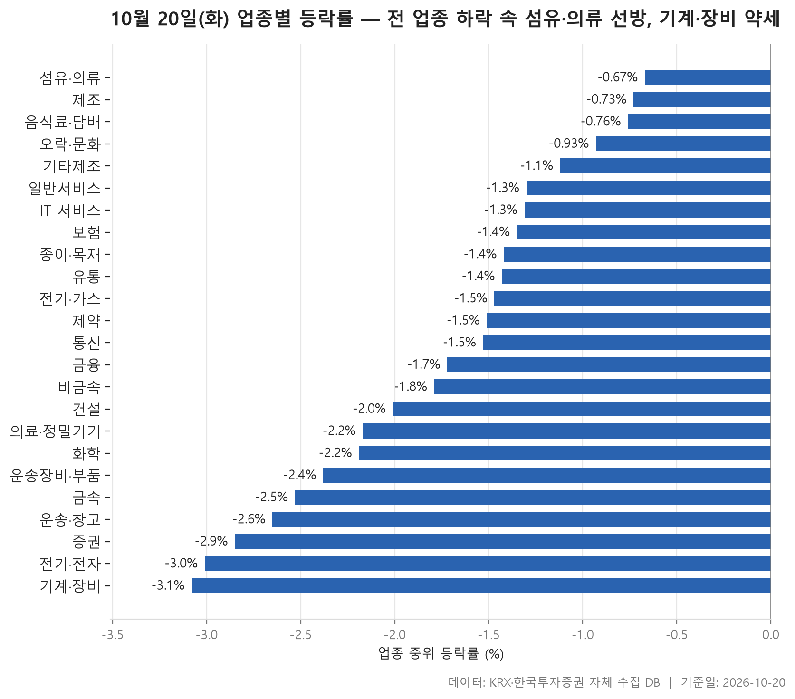
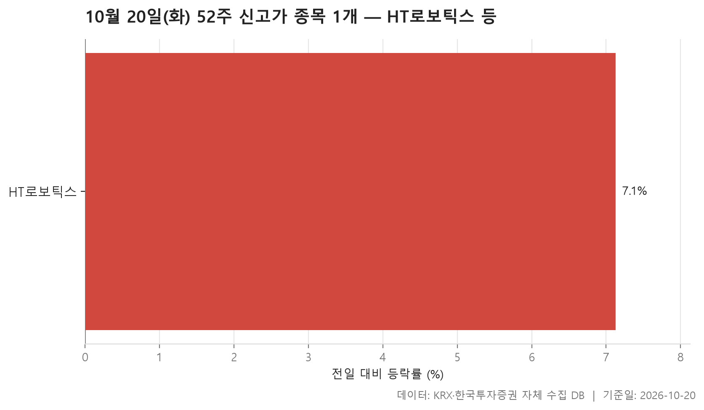
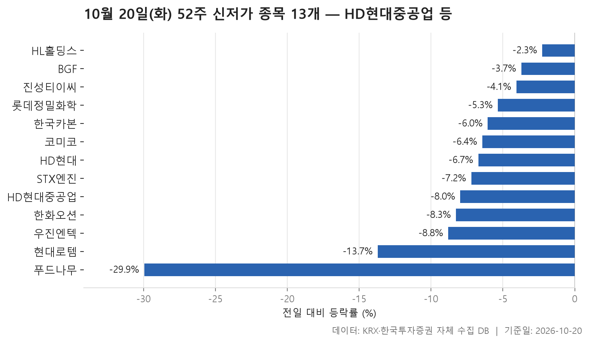
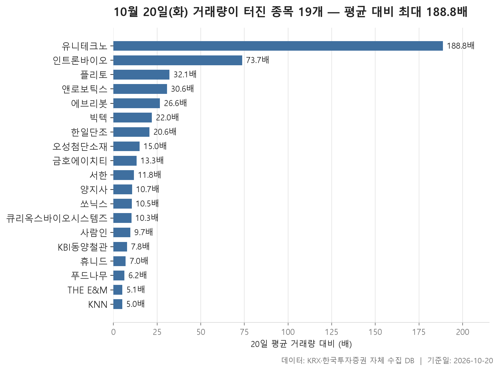

10월 20일 시장은 한쪽으로만 움직였습니다. 24개 업종 가운데 종목 등락률의 중위값이 플러스로 끝난 곳은 하나도 없었습니다. 업종별 중위값을 줄 세웠을 때 한가운데 놓인 값은 -1.52%였습니다. 가장 덜 내린 섬유·의류가 -0.67%, 가장 많이 내린 기계·장비가 -3.08%였으니, 어디가 올랐는지보다 어디가 덜 내렸는지를 따져야 하는 하루였습니다.

52주 범위로 넓혀 보면 기울기가 더 뚜렷합니다. 신고가를 쓴 종목은 HT로보틱스 1개뿐이었고, 신저가로 내려간 종목은 13개였습니다. 신저가 쪽에는 시가총액이 큰 대형주가 여럿 들어 있어 무게감도 달랐습니다.

거래량이 직전 20거래일 평균의 5배를 넘은 종목은 19개였습니다. 시장 전체 분위기와 달리 이 목록에서는 오른 종목이 조금 더 많았습니다. 아래에서 업종 흐름, 신고가·신저가, 거래량 순서로 살펴봅니다.

> 기준일: 2026-10-20 · 집계: 자체 수집 데이터베이스

## 업종 등락률 — 24개 모두 하락

표 전체가 마이너스입니다. 위쪽도 덜 내렸을 뿐이어서 섬유·의류, 제조, 음식료·담배가 -0.67%에서 -0.76% 사이에 촘촘히 붙어 있습니다. 아래쪽은 증권(-2.85%), 전기·전자(-3.01%), 기계·장비(-3.08%)가 차지했습니다. 업종마다 오른 종목이 얼마나 되는지 보면 분위기가 더 분명해집니다. 그 비중이 가장 높은 제조도 37.50%로 열 곳 중 네 곳이 채 안 됩니다. 그나마 제조는 8개 종목뿐인 작은 업종입니다. 전기·가스와 증권에서는 오른 종목이 하나도 없었습니다(0.00%).

1위인 섬유·의류는 한 번 뜯어볼 만합니다. 형지I&C가 +29.99%로 상한가 폭까지 올라 업종 평균을 0.62%p 끌어올렸습니다. 그런데도 평균(-0.99%)이 중위값(-0.67%)보다 오히려 낮습니다. 한 종목이 위로 당겼는데도 평균이 아래에 머물렀다면 나머지 가운데 크게 빠진 종목이 있었다는 뜻입니다. 오른 종목도 27.10%로 넷 중 하나꼴이었습니다. 순위가 맨 위라는 이유만으로 업종 전체가 탄탄했다고 읽기는 어렵습니다.

반대 모양은 오락·문화와 기타제조에서 보입니다. 오락·문화에서는 바른손이앤에이가 -29.99%로 평균을 0.48%p 끌어내렸습니다. 그런데도 평균(-0.51%)이 중위값(-0.93%)보다 위에 있습니다. 하한가 종목을 상쇄하고도 남을 만큼 크게 오른 종목이 따로 있었다는 이야기입니다. 기타제조는 14개 종목뿐인 업종입니다. 그래서 엑스플러스(+9.32%) 한 종목이 평균을 0.67%p 올렸고, 평균과 중위값 사이의 간격은 대부분 이 한 종목으로 설명됩니다.

거래대금은 전기·전자가 111,655.60억원으로 다른 업종과 자릿수가 다를 만큼 컸습니다. 367개 종목이 속한 가장 큰 업종이 하위권에서 마감한 셈입니다. 이 업종에서 가장 크게 움직인 케이아이이는 -53.62%로, 보통의 하루 등락에서는 보기 드문 값입니다. 다만 그 사정은 자료만으로 알 수 없습니다. 종목 수가 워낙 많아서 이 한 종목이 평균을 움직인 폭은 -0.15%p에 그쳤습니다. 평균(-3.07%)과 중위값이 거의 붙어 있는 것도 눈여겨볼 대목입니다. 특정 종목이 평균을 끌어내린 것이 아니라 업종 전반이 고르게 내렸다는 뜻이기 때문입니다.

| 업종 | 종목수(개) | 중위등락률(%) | 평균등락률(%) | 상승비율(%) | 주도종목 | 주도종목등락률(%) | 평균기여도(%p) | 거래대금합계(억원) |
|---|---|---|---|---|---|---|---|---|
| 섬유·의류 | 48 | -0.67 | -0.99 | 27.10 | 형지I&C | +29.99 | 0.62 | 256.40 |
| 제조 | 8 | -0.73 | -0.96 | 37.50 | 코아스 | -3.04 | -0.38 | 4.80 |
| 음식료·담배 | 83 | -0.76 | -1.00 | 21.70 | 한울앤제주 | -6.98 | -0.08 | 1,312.90 |
| 오락·문화 | 63 | -0.93 | -0.51 | 30.20 | 바른손이앤에이 | -29.99 | -0.48 | 1,076.70 |
| 기타제조 | 14 | -1.12 | -0.51 | 21.40 | 엑스플러스 | +9.32 | 0.67 | 14.50 |
| 일반서비스 | 168 | -1.30 | -1.45 | 20.20 | 에스팀 | +29.97 | 0.18 | 4,146.50 |
| IT 서비스 | 241 | -1.31 | -1.38 | 20.70 | 플리토 | +29.99 | 0.12 | 6,883.50 |
| 보험 | 11 | -1.35 | -1.73 | 18.20 | 미래에셋생명 | -5.59 | -0.51 | 1,525.90 |
| 종이·목재 | 27 | -1.42 | -1.36 | 14.80 | 동화기업 | -5.95 | -0.22 | 21.00 |
| 유통 | 158 | -1.43 | -1.83 | 12.70 | 푸드나무 | -29.95 | -0.19 | 3,082.20 |
| 전기·가스 | 10 | -1.47 | -1.87 | 0.00 | SGC에너지 | -4.98 | -0.50 | 321.40 |
| 제약 | 166 | -1.51 | -1.31 | 16.30 | 지투지바이오 | +14.91 | 0.09 | 7,866.90 |
| 통신 | 13 | -1.53 | -1.77 | 7.70 | 나이스정보통신 | -4.98 | -0.38 | 765.30 |
| 금융 | 110 | -1.72 | -2.29 | 11.80 | LS에코에너지 | -14.59 | -0.13 | 12,551.30 |
| 비금속 | 36 | -1.79 | -2.39 | 8.30 | 서산 | -9.84 | -0.27 | 554.10 |
| 건설 | 50 | -2.01 | -2.26 | 10.00 | LS마린솔루션 | -7.34 | -0.15 | 1,359.20 |
| 의료·정밀기기 | 101 | -2.17 | -2.65 | 13.90 | 큐리옥스바이오시스템즈 | -22.08 | -0.22 | 2,566.60 |
| 화학 | 221 | -2.19 | -2.55 | 15.80 | 오성첨단소재 | -15.45 | -0.07 | 9,056.60 |
| 운송장비·부품 | 134 | -2.38 | -2.43 | 14.20 | KR모터스 | +29.94 | 0.22 | 11,322.30 |
| 금속 | 130 | -2.53 | -2.70 | 14.60 | 씨에스윈드 | -13.62 | -0.10 | 7,108.60 |
| 운송·창고 | 28 | -2.65 | -2.72 | 3.60 | 동양고속 | -9.84 | -0.35 | 1,616.60 |
| 증권 | 18 | -2.85 | -2.92 | 0.00 | 미래에셋증권 | -5.50 | -0.31 | 748.20 |
| 전기·전자 | 367 | -3.01 | -3.07 | 11.70 | 케이아이이 | -53.62 | -0.15 | 111,655.60 |
| 기계·장비 | 204 | -3.08 | -3.11 | 10.30 | 멜콘 | -16.69 | -0.08 | 14,159.10 |

## 52주 신고가 1개 — HT로보틱스 7.13%

신고가 목록에는 한 종목만 있습니다. KOSDAQ의 HT로보틱스가 +7.13% 오른 9,770원에 마감해 직전 52주 최고가 9,500원을 넘어섰습니다. 시장 전체가 밀린 날 홀로 고점을 새로 쓴 셈입니다.

더 눈에 띄는 것은 거래 규모입니다. 이날 거래대금이 2,652.60억원으로 시가총액 2,588억원보다 컸습니다. 하루 동안 회사 덩치보다 많은 금액이 오갔으니 손바뀜이 무척 활발했던 날입니다. 이 종목이 속한 금속 업종은 중위 등락률이 -2.53%로 하위권이었습니다. 업종 흐름과는 따로 움직인 종목이었다는 점은 표에서 확인됩니다. 다만 무엇 때문에 이렇게 움직였는지는 자료에 나와 있지 않습니다.

| 종목명 | 종목코드 | 시장 | 업종 | 종가(원) | 등락률(%) | 이전52주최고(원) | 거래대금(억원) | 시가총액(억원) |
|---|---|---|---|---|---|---|---|---|
| HT로보틱스 | 396300 | KOSDAQ | 금속 | 9,770 | +7.13 | 9,500 | 2,652.60 | 2,588 |

## 52주 신저가 13개 — 최저 푸드나무 -29.95%

신저가는 13개로, 신고가 1개와 뚜렷하게 대조됩니다. KOSPI가 9개, KOSDAQ이 4개로 유가증권시장 쪽이 많습니다. 시가총액 상단도 무겁습니다. HD현대중공업(333,777억원), 한화오션(180,477억원), HD현대(117,463억원), 현대로템(94,845억원)이 나란히 이름을 올렸습니다. 이 네 종목은 하루에 -6.71%에서 -13.70% 사이로 빠져 낙폭도 작지 않았습니다. 업종별로는 운송장비·부품이 3개로 가장 많았습니다. HD현대는 이 데이터에서 금융 업종으로 분류돼 있습니다.

직전 최저가와 얼마나 떨어졌는지를 보면 결이 갈립니다. HD현대는 종가 148,700원으로 직전 최저 149,100원을 겨우 밑돌았습니다. 코미코도 23,300원으로 직전 최저 23,350원과 간발의 차였습니다. 반면 푸드나무는 1,520원으로 직전 최저 1,839원을 한참 아래로 뚫고 내려갔습니다. 하루 -29.95%로 이 표에서 가장 많이 내렸고, 유통 업종에서 가장 크게 움직인 종목이기도 합니다. 거래량 급증 목록에도 다시 나옵니다.

13개 종목의 등락률 중위값은 -6.71%이고, 가장 덜 내린 HL홀딩스도 -2.26%였습니다. 조금 밀려서 저점에 닿은 경우보다, 하루에 크게 밀리면서 바닥을 깬 종목이 더 많았다는 뜻입니다.

| 종목명 | 종목코드 | 시장 | 업종 | 종가(원) | 등락률(%) | 이전52주최저(원) | 거래대금(억원) | 시가총액(억원) |
|---|---|---|---|---|---|---|---|---|
| HD현대중공업 | 329180 | KOSPI | 운송장비·부품 | 318,000 | -7.96 | 333,000 | 1,481.20 | 333,777 |
| 한화오션 | 042660 | KOSPI | 운송장비·부품 | 58,900 | -8.26 | 61,200 | 725.90 | 180,477 |
| HD현대 | 267250 | KOSPI | 금융 | 148,700 | -6.71 | 149,100 | 272.70 | 117,463 |
| 현대로템 | 064350 | KOSPI | 운송장비·부품 | 86,900 | -13.70 | 89,800 | 1,080.40 | 94,845 |
| 코미코 | 183300 | KOSDAQ | 기계·장비 | 23,300 | -6.43 | 23,350 | 68.40 | 11,968 |
| 롯데정밀화학 | 004000 | KOSPI | 화학 | 38,900 | -5.35 | 39,500 | 21.00 | 10,036 |
| 한국카본 | 017960 | KOSPI | 금속 | 17,090 | -6.05 | 17,220 | 30.20 | 8,832 |
| STX엔진 | 077970 | KOSPI | 기계·장비 | 17,280 | -7.20 | 17,440 | 44.50 | 6,938 |
| BGF | 027410 | KOSPI | 금융 | 3,495 | -3.72 | 3,520 | 3.90 | 3,345 |
| HL홀딩스 | 060980 | KOSPI | 금융 | 34,600 | -2.26 | 35,000 | 11.90 | 3,099 |
| 진성티이씨 | 036890 | KOSDAQ | 기계·장비 | 9,220 | -4.06 | 9,320 | 6.20 | 2,031 |
| 우진엔텍 | 457550 | KOSDAQ | 일반서비스 | 9,640 | -8.80 | 9,900 | 28.50 | 898 |
| 푸드나무 | 290720 | KOSDAQ | 유통 | 1,520 | -29.95 | 1,839 | 12.20 | 580 |

## 거래량 급증 19개 — 최고 유니테크노 188.80배

거래량 급증 목록은 19개이고, 그중 KOSDAQ이 16개로 대부분입니다. 평소의 몇 배가 거래됐는지 늘어놓으면 중위값은 11.80배입니다. 맨 위의 유니테크노는 188.80배로 혼자 동떨어져 있습니다. 평소 하루 26,162주 남짓 거래되던 종목에 4,940,282주가 몰렸습니다. 두 번째인 인트론바이오(73.70배)부터는 배수가 빠르게 줄어듭니다. 맨 아래 KNN은 기준선인 5배에 딱 걸쳤습니다.

방향을 보면 시장 전체와 다른 그림이 나옵니다. 배수가 큰 위쪽은 유니테크노부터 한일단조까지 줄줄이 올랐습니다. 플리토는 +29.99%로 상한가 폭까지 올랐고, IT 서비스 업종에서 가장 크게 움직인 종목이기도 합니다. 업종 표에는 나오지 않는 출판·매체복제의 양지사도 +16.90%를 기록했습니다. 거래가 평소보다 크게 몰린 종목만 놓고 보면 오른 쪽이 조금 더 많았습니다.

하락 쪽에는 큰 낙폭이 모여 있습니다. 큐리옥스바이오시스템즈는 -22.08%로 의료·정밀기기 업종에서 가장 많이 내렸고, 시가총액도 9,301억원으로 이 목록에서 가장 큽니다. 오성첨단소재(-15.45%) 역시 화학 업종에서 가장 크게 움직인 종목입니다. 업종 표의 극단값이 거래량 급증 목록과 겹친다는 것은 크게 움직인 종목에 거래도 함께 몰렸다는 뜻으로 읽힙니다. 다만 서한처럼 거래량은 11.80배로 뛰었는데 가격은 -0.13%로 거의 움직이지 않은 경우도 있습니다. 거래량이 터졌다고 해서 늘 가격이 크게 움직이는 것은 아닙니다.

| 종목명 | 종목코드 | 시장 | 업종 | 종가(원) | 등락률(%) | 거래량(주) | 평균거래량(주) | 배수(배) | 거래대금(억원) | 시가총액(억원) |
|---|---|---|---|---|---|---|---|---|---|---|
| 유니테크노 | 241690 | KOSDAQ | 운송장비·부품 | 2,720 | +6.67 | 4,940,282 | 26,162 | 188.80 | 154.40 | 666 |
| 인트론바이오 | 048530 | KOSDAQ | 제약 | 3,000 | +6.76 | 5,713,513 | 77,533 | 73.70 | 183.10 | 927 |
| 플리토 | 300080 | KOSDAQ | IT 서비스 | 10,750 | +29.99 | 1,283,168 | 40,004 | 32.10 | 131.40 | 1,777 |
| 앤로보틱스 | 138360 | KOSDAQ | 기계·장비 | 1,376 | +6.58 | 19,763,605 | 645,694 | 30.60 | 297.40 | 1,211 |
| 에브리봇 | 270660 | KOSDAQ | 전기·전자 | 12,790 | +9.22 | 542,698 | 20,427 | 26.60 | 74.20 | 1,623 |
| 빅텍 | 065450 | KOSDAQ | 의료·정밀기기 | 3,235 | +10.98 | 21,521,538 | 977,398 | 22.00 | 698.60 | 954 |
| 한일단조 | 024740 | KOSDAQ | 운송장비·부품 | 2,200 | +4.02 | 2,142,885 | 103,860 | 20.60 | 47.60 | 724 |
| 오성첨단소재 | 052420 | KOSDAQ | 화학 | 7,280 | -15.45 | 284,753 | 19,017 | 15.00 | 20.50 | 709 |
| 금호에이치티 | 214330 | KOSPI | 운송장비·부품 | 7,050 | -11.21 | 828,498 | 62,218 | 13.30 | 52.80 | 737 |
| 서한 | 011370 | KOSDAQ | 건설 | 3,880 | -0.13 | 404,763 | 34,401 | 11.80 | 16.10 | 783 |
| 양지사 | 030960 | KOSDAQ | 출판·매체복제 | 6,710 | +16.90 | 8,567,755 | 797,242 | 10.70 | 571.70 | 1,072 |
| 쏘닉스 | 088280 | KOSDAQ | 전기·전자 | 4,835 | +5.45 | 2,965,417 | 281,344 | 10.50 | 152.80 | 837 |
| 큐리옥스바이오시스템즈 | 445680 | KOSDAQ | 의료·정밀기기 | 54,000 | -22.08 | 1,071,542 | 103,632 | 10.30 | 560.90 | 9,301 |
| 사람인 | 143240 | KOSDAQ | IT 서비스 | 16,500 | -5.23 | 102,475 | 10,602 | 9.70 | 17.00 | 1,771 |
| KBI동양철관 | 008970 | KOSPI | 금속 | 1,573 | -10.01 | 42,109,949 | 5,421,314 | 7.80 | 737.90 | 1,632 |
| 휴니드 | 005870 | KOSPI | 전기·전자 | 4,700 | -2.79 | 1,243,853 | 178,501 | 7.00 | 58.30 | 663 |
| 푸드나무 | 290720 | KOSDAQ | 유통 | 1,520 | -29.95 | 671,835 | 108,385 | 6.20 | 12.20 | 580 |
| THE E&M | 089230 | KOSDAQ | IT 서비스 | 2,785 | +10.30 | 1,950,515 | 383,645 | 5.10 | 51.00 | 1,098 |
| KNN | 058400 | KOSDAQ | 오락·문화 | 5,950 | +1.19 | 80,070 | 15,999 | 5.00 | 4.70 | 788 |

## 정리

정리하면 10월 20일은 24개 업종이 모두 중위 기준으로 내린 날이었습니다. 섬유·의류가 가장 덜 내렸고, 기계·장비와 전기·전자가 바닥을 이뤘습니다. 신고가 1개와 신저가 13개라는 대비가 이날 분위기를 그대로 보여줍니다.

다만 이 표들은 하루치 종가를 비교한 것일 뿐, 왜 그렇게 움직였는지는 담고 있지 않습니다. 업종 분류도 이 데이터의 기준을 따르므로 흔히 아는 분류와 다를 수 있습니다. 또 시가총액 500억 미만이거나 거래가 적은 종목은 신고가·신저가·거래량 목록에서 빠져 있습니다. 하루 시장의 모양을 훑어보는 자료로 읽어 주시기 바랍니다.

## 집계 기준

**업종 등락률**

- **기준**: 2026-10-19 종가 → 2026-10-20 종가
- **순위**: 업종 내 종목 등락률의 중위값 (평균은 참고용으로 함께 표시)
- **주도종목**: 그 업종에서 등락률 절대값이 가장 큰 종목 (동점이면 거래대금이 큰 쪽)
- **평균기여도**: 그 종목 하나가 업종 평균을 움직인 폭 (등락률 ÷ 종목수). 중위값과 평균의 격차가 이 값에 가까우면 평균을 만든 것이 그 종목이고, 훨씬 크면 다른 종목들도 함께 움직인 것입니다
- **필터**: 업종 내 보통주 5종목 이상
- **전체업종중위등락률(%)**: -1.52

**52주 신고가**

- **기준**: 종가 > 직전 52주 최고가
- **관측구간**: 2025-10-01 ~ 2026-10-19 (252거래일)
- **필터**: 시가총액 500억 이상, 거래대금 3억 이상, 보통주

**52주 신저가**

- **기준**: 종가 < 직전 52주 최저가
- **관측구간**: 2025-10-01 ~ 2026-10-19 (252거래일)
- **필터**: 시가총액 500억 이상, 거래대금 3억 이상, 보통주

**거래량 급증**

- **기준**: 당일 거래량 ≥ 직전 20거래일 평균 × 5
- **관측구간**: 2026-09-16 ~ 2026-10-19 (20거래일)
- **필터**: 시가총액 500억 이상, 거래대금 3억 이상, 보통주

## 데이터 출처 및 유의사항

- **데이터출처**: 한국거래소(KRX) 공시 데이터와 한국투자증권 OpenAPI 를 직접 수집해 구축한 자체 데이터베이스
- **집계방식**: 수집·집계·차트 생성을 직접 구현한 파이프라인에서 자동 산출
- **작성고지**: 본문의 표·통계·차트는 자체 데이터베이스에서 계산된 값이며, 문장 작성 과정에 AI 도구를 활용했습니다.
- **면책**: 본 글은 정보 제공을 목적으로 하며 특정 종목의 매수·매도를 추천하지 않습니다. 제시된 수치는 과거 데이터이고 미래 수익을 보장하지 않습니다. 투자 판단과 그 결과에 대한 책임은 투자자 본인에게 있습니다.

