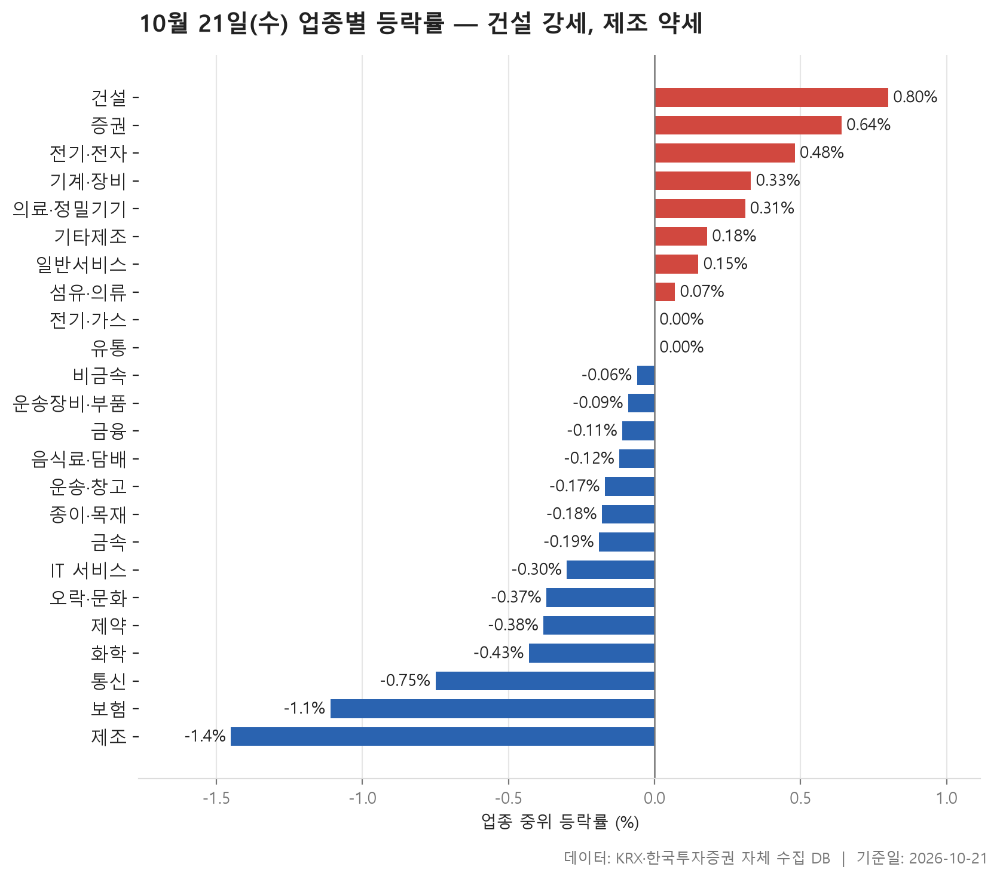
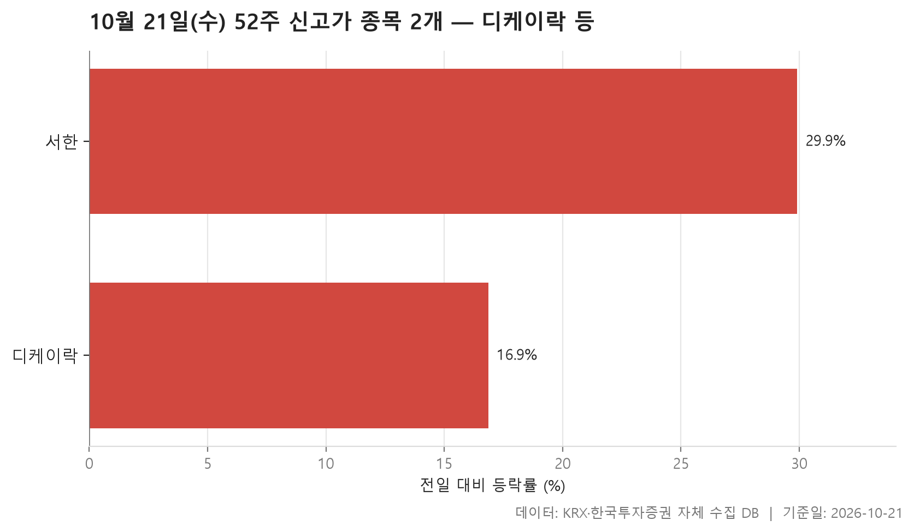
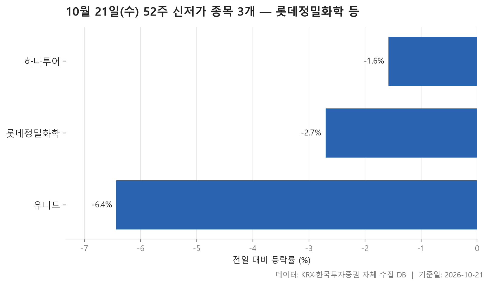
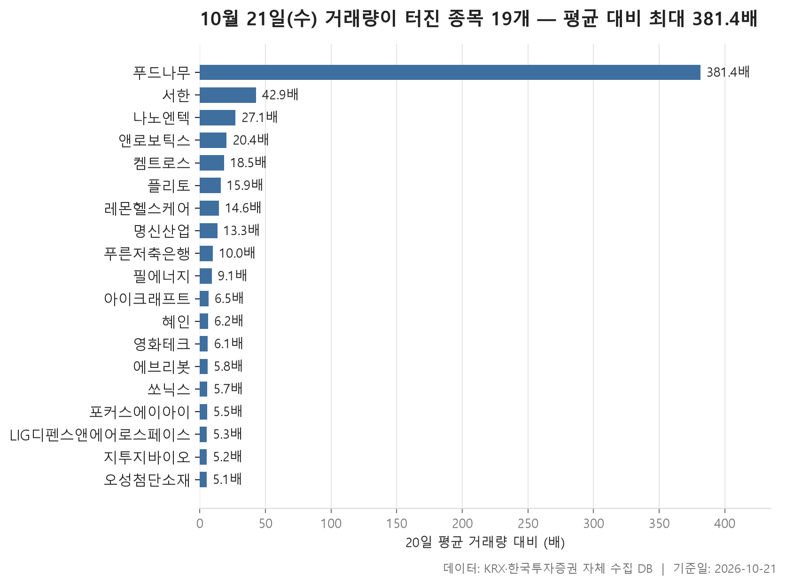

10월 21일 시장은 한쪽으로 쏠리지 않았습니다. 24개 업종의 중위 등락률을 줄 세웠을 때 한가운데 놓인 값이 -0.10%였고, 오른 업종이 8개, 내린 업종이 14개였습니다. 전기·가스와 유통은 0.00%로 제자리에 머물렀습니다. 크게 무너진 곳도, 크게 치고 나간 곳도 없이 대부분이 0 근처에 모여 있었다고 보면 됩니다.

그래도 들여다볼 대목은 있습니다. 업종 순위는 맨 위와 맨 아래만 보면 오해하기 쉽습니다. 1위 건설의 평균 등락률은 종목 하나에 크게 기대고 있고, 꼴찌 제조는 종목이 8개뿐인 작은 업종입니다. 오늘은 업종 흐름부터 훑고 52주 신고가·신저가 종목을 본 다음, 거래량이 평소의 몇 배씩 터진 종목으로 넘어가겠습니다.

> 기준일: 2026-10-21 · 집계: 자체 수집 데이터베이스

## 업종 등락률 — 24개 중 14개 하락

맨 위는 **건설**입니다. 중위 등락률 +0.80%, 오른 종목 비율 66.00%로 셋 중 둘꼴이 올랐습니다. 다만 평균 등락률은 +1.52%로 중위값보다 꽤 높습니다. 그 차이의 상당 부분은 서한에서 나옵니다. 서한은 +29.90% 올랐고, 이 종목 하나가 업종 평균을 0.60%p 끌어올린 셈입니다. 업종 전체가 고르게 강했다기보다는, 무난하게 오른 바탕 위에 한 종목이 크게 튄 그림입니다. 오른 종목 비율로만 따지면 오히려 **증권**이 72.20%로 가장 높았습니다.

표에서 가장 어긋나 보이는 곳은 **전기·전자**입니다. 이 업종에서 가장 크게 움직인 종목은 알파칩스인데 -49.78%로 반 토막이 났습니다. 그런데도 업종 중위값은 +0.48%, 평균은 +0.75%로 둘 다 플러스였습니다. 367개 종목이 모인 큰 업종이라 한 종목이 평균을 깎은 폭은 -0.14%p에 그쳤습니다. 거래대금도 123,243.40억원으로 다른 업종과 비교가 안 될 만큼 컸습니다. 반대 사례가 **기타제조**입니다. 종목이 14개뿐이어서 엑스플러스 하나(+20.17%)가 평균을 1.44%p나 밀어 올렸습니다. 중위값 +0.18%와 평균 +1.33%가 크게 벌어진 이유가 여기 있습니다.

아래쪽을 보면 꼴찌는 **제조**로 중위값이 -1.45%입니다. 다만 종목이 8개이고 거래대금은 6.30억원에 불과해서 시장 전체 분위기를 대표한다고 보기는 어렵습니다. 업종에서 가장 크게 움직인 에넥스는 오히려 +3.73% 올랐습니다. 하락의 고른 정도로 보면 **보험**이 더 눈에 띕니다. 오른 종목 비율이 9.10%로 열 곳 중 한 곳꼴만 올랐고, 한화생명이 -6.80% 빠지면서 혼자 평균을 -0.62%p 끌어내렸습니다. **통신**도 오른 종목 비율이 23.10%로 약세 쪽이었습니다.

| 업종 | 종목수(개) | 중위등락률(%) | 평균등락률(%) | 상승비율(%) | 주도종목 | 주도종목등락률(%) | 평균기여도(%p) | 거래대금합계(억원) |
|---|---|---|---|---|---|---|---|---|
| 건설 | 50 | +0.80 | +1.52 | 66.00 | 서한 | +29.90 | 0.60 | 1,543.30 |
| 증권 | 18 | +0.64 | +0.89 | 72.20 | 미래에셋증권 | +4.02 | 0.22 | 848.70 |
| 전기·전자 | 367 | +0.48 | +0.75 | 57.80 | 알파칩스 | -49.78 | -0.14 | 123,243.40 |
| 기계·장비 | 205 | +0.33 | +1.26 | 57.60 | 멜콘 | +24.01 | 0.12 | 14,451.10 |
| 의료·정밀기기 | 102 | +0.31 | +0.77 | 55.90 | 큐리옥스바이오시스템즈 | +17.04 | 0.17 | 2,455.20 |
| 기타제조 | 14 | +0.18 | +1.33 | 57.10 | 엑스플러스 | +20.17 | 1.44 | 18.20 |
| 일반서비스 | 168 | +0.15 | +0.53 | 51.20 | 드림씨아이에스 | +12.78 | 0.08 | 5,427.70 |
| 섬유·의류 | 49 | +0.07 | +0.50 | 51.00 | 형지엘리트 | +11.23 | 0.23 | 453.00 |
| 전기·가스 | 10 | 0.00 | +0.44 | 40.00 | SGC에너지 | +3.93 | 0.39 | 462.70 |
| 유통 | 158 | 0.00 | +0.19 | 46.80 | 혜인 | +29.98 | 0.19 | 4,241.50 |
| 비금속 | 36 | -0.06 | +0.35 | 44.40 | 원익QnC | +5.50 | 0.15 | 462.80 |
| 운송장비·부품 | 133 | -0.09 | +0.30 | 44.40 | 명신산업 | +17.80 | 0.13 | 9,191.00 |
| 금융 | 110 | -0.11 | +0.19 | 42.70 | 에이플러스에셋 | +13.89 | 0.13 | 14,676.50 |
| 음식료·담배 | 83 | -0.12 | -0.09 | 41.00 | 뉴온 | +8.02 | 0.10 | 1,443.80 |
| 운송·창고 | 28 | -0.17 | -0.46 | 39.30 | 동양고속 | -7.57 | -0.27 | 1,478.40 |
| 종이·목재 | 27 | -0.18 | -0.31 | 33.30 | 태림포장 | -3.49 | -0.13 | 28.40 |
| 금속 | 130 | -0.19 | -0.01 | 40.00 | HT로보틱스 | +14.02 | 0.11 | 8,560.50 |
| IT 서비스 | 242 | -0.30 | +0.10 | 36.40 | 엘리스 | +29.92 | 0.12 | 7,188.50 |
| 오락·문화 | 63 | -0.37 | -0.75 | 33.30 | 바른손이앤에이 | -18.35 | -0.29 | 924.70 |
| 제약 | 166 | -0.38 | -0.17 | 33.70 | 지투지바이오 | +13.78 | 0.08 | 6,526.60 |
| 화학 | 221 | -0.43 | -0.08 | 36.20 | 켐트로스 | +15.02 | 0.07 | 8,157.90 |
| 통신 | 13 | -0.75 | -1.03 | 23.10 | LG유플러스 | -3.39 | -0.26 | 865.60 |
| 보험 | 11 | -1.11 | -1.25 | 9.10 | 한화생명 | -6.80 | -0.62 | 1,722.50 |
| 제조 | 8 | -1.45 | -1.28 | 12.50 | 에넥스 | +3.73 | 0.47 | 6.30 |

## 52주 신고가 2개 — 최고 서한 29.90%

52주 신고가를 새로 쓴 보통주는 디케이락과 서한 두 종목뿐이고, 둘 다 KOSDAQ 종목입니다. 신고가 종목이 이 정도로 적다는 것은 시장 전반이 위로 뻗은 날이 아니었다는 업종 표의 인상과 맞아떨어집니다.

두 종목은 신고가를 넘은 방식이 서로 다릅니다. 디케이락은 종가 12,270원으로 직전 52주 최고가 12,240원을 간신히 넘었습니다. 하루 +16.86% 올랐지만, 고점 기준으로 보면 문턱을 막 넘은 정도입니다. 서한은 직전 최고가 4,285원을 훌쩍 넘어 5,040원에 마감했습니다. +29.90% 급등으로 단숨에 기존 고점 위로 올라선 경우입니다.

서한은 오늘 세 번 등장합니다. 건설 업종 평균을 끌어올린 종목이고, 신고가 종목이며, 뒤에 나올 거래량 급증 목록에서도 두 번째 자리에 있습니다. 왜 이렇게 움직였는지는 자료만으로 알 수 없습니다. 가격과 거래량이 동시에 평소 범위를 벗어났다는 것까지가 표가 말해 주는 내용입니다.

| 종목명 | 종목코드 | 시장 | 업종 | 종가(원) | 등락률(%) | 이전52주최고(원) | 거래대금(억원) | 시가총액(억원) |
|---|---|---|---|---|---|---|---|---|
| 디케이락 | 105740 | KOSDAQ | 기계·장비 | 12,270 | +16.86 | 12,240 | 218.20 | 1,248 |
| 서한 | 011370 | KOSDAQ | 건설 | 5,040 | +29.90 | 4,285 | 111.60 | 1,017 |

## 52주 신저가 3개 — 최저 유니드 -6.43%

52주 신저가 종목은 세 개이고, 신고가와 반대로 모두 KOSPI 종목입니다. 그중 롯데정밀화학과 유니드가 화학 업종입니다. 화학 업종은 오늘 중위값 -0.43%, 오른 종목 비율 36.20%로 약세 쪽에 있었습니다.

눈여겨볼 점은 하락 폭이 크지 않다는 것입니다. 하나투어는 -1.58%, 롯데정밀화학은 -2.70% 내렸고, 가장 많이 빠진 유니드도 -6.43%였습니다. 종가와 직전 52주 최저가의 차이도 좁습니다. 롯데정밀화학은 38,400원이던 저점이 37,850원으로, 하나투어는 28,250원이던 저점이 28,050원으로 내려왔습니다. 하루에 급락했다기보다 저점 부근까지 내려와 있던 주가가 선을 살짝 밑돈 모습입니다.

거래대금도 많지 않았습니다. 시가총액이 9,765억원으로 셋 중 가장 큰 롯데정밀화학의 거래대금이 20.10억원이었고, 하나투어는 8.60억원이었습니다. 매도가 몰려 저점이 뚫린 날로 읽을 근거는 표에 없습니다.

| 종목명 | 종목코드 | 시장 | 업종 | 종가(원) | 등락률(%) | 이전52주최저(원) | 거래대금(억원) | 시가총액(억원) |
|---|---|---|---|---|---|---|---|---|
| 롯데정밀화학 | 004000 | KOSPI | 화학 | 37,850 | -2.70 | 38,400 | 20.10 | 9,765 |
| 하나투어 | 039130 | KOSPI | 일반서비스 | 28,050 | -1.58 | 28,250 | 8.60 | 4,345 |
| 유니드 | 014830 | KOSPI | 화학 | 55,300 | -6.43 | 55,800 | 19.30 | 3,742 |

## 거래량 급증 19개 — 최고 푸드나무 381.40배

거래량이 직전 20거래일 평균의 5배를 넘은 종목은 19개이고, 그중 16개가 KOSDAQ입니다. 배수를 늘어놓았을 때 한가운데 값은 9.10배인데, 맨 위의 **푸드나무**는 381.40배로 나머지와 차원이 다릅니다. 평소 하루 141,266주 남짓 거래되던 종목에서 53,885,679주가 오갔습니다. 그런데 주가는 +5.92% 오르는 데 그쳤습니다. 거래량이 폭발한 것에 비하면 가격 움직임은 크지 않았습니다.

대부분은 거래량과 함께 주가도 올랐습니다. 서한(+29.90%), 레몬헬스케어(+29.88%), 혜인(+29.98%)은 하루 상승 폭이 거의 같은 수준까지 갔습니다. 업종 표의 주도종목과 겹치는 이름도 많습니다. 명신산업(+17.80%), 켐트로스(+15.02%), 지투지바이오(+13.78%), 혜인이 각자 업종에서 가장 크게 움직인 종목이었습니다. 업종별로는 IT 서비스가 3개로 가장 많았습니다.

흐름을 거스른 종목도 있습니다. 시가총액 109,670억원으로 목록에서 단연 큰 **LIG디펜스앤에어로스페이스**는 거래량이 5.30배로 늘면서 주가는 -9.03% 내렸고, 거래대금은 2,681.00억원으로 19개 종목 가운데 가장 컸습니다. 필에너지(-4.90%)와 쏘닉스(-0.93%)도 거래가 늘면서 내렸습니다. 푸른저축은행은 거래량이 10.00배로 뛰었지만 주가는 +1.32%에 그쳤고, 거래대금도 7.10억원에 불과했습니다. 평소 거래가 워낙 적은 종목이면 배수가 쉽게 커진다는 점도 함께 감안해야 합니다.

| 종목명 | 종목코드 | 시장 | 업종 | 종가(원) | 등락률(%) | 거래량(주) | 평균거래량(주) | 배수(배) | 거래대금(억원) | 시가총액(억원) |
|---|---|---|---|---|---|---|---|---|---|---|
| 푸드나무 | 290720 | KOSDAQ | 유통 | 1,610 | +5.92 | 53,885,679 | 141,266 | 381.40 | 831.50 | 614 |
| 서한 | 011370 | KOSDAQ | 건설 | 5,040 | +29.90 | 2,311,089 | 53,907 | 42.90 | 111.60 | 1,017 |
| 나노엔텍 | 039860 | KOSDAQ | 의료·정밀기기 | 4,590 | +8.13 | 7,859,022 | 290,481 | 27.10 | 373.00 | 1,748 |
| 앤로보틱스 | 138360 | KOSDAQ | 기계·장비 | 1,652 | +20.06 | 32,990,325 | 1,615,503 | 20.40 | 527.50 | 1,453 |
| 켐트로스 | 220260 | KOSDAQ | 화학 | 4,710 | +15.02 | 3,146,539 | 169,773 | 18.50 | 151.30 | 1,511 |
| 플리토 | 300080 | KOSDAQ | IT 서비스 | 11,550 | +7.44 | 1,632,964 | 102,742 | 15.90 | 187.20 | 1,909 |
| 레몬헬스케어 | 365660 | KOSDAQ | IT 서비스 | 3,825 | +29.88 | 6,247,001 | 427,014 | 14.60 | 222.70 | 515 |
| 명신산업 | 009900 | KOSPI | 운송장비·부품 | 10,190 | +17.80 | 7,026,577 | 529,431 | 13.30 | 679.90 | 5,347 |
| 푸른저축은행 | 007330 | KOSDAQ | 금융 | 10,010 | +1.32 | 72,104 | 7,221 | 10.00 | 7.10 | 1,510 |
| 필에너지 | 378340 | KOSDAQ | 기계·장비 | 12,230 | -4.90 | 443,489 | 48,664 | 9.10 | 57.50 | 2,650 |
| 아이크래프트 | 052460 | KOSDAQ | IT 서비스 | 7,590 | +23.62 | 1,012,510 | 156,969 | 6.50 | 73.60 | 1,109 |
| 혜인 | 003010 | KOSPI | 유통 | 10,450 | +29.98 | 2,498,150 | 402,383 | 6.20 | 233.30 | 1,328 |
| 영화테크 | 265560 | KOSDAQ | 운송장비·부품 | 5,780 | +1.94 | 80,263 | 13,228 | 6.10 | 4.70 | 618 |
| 에브리봇 | 270660 | KOSDAQ | 전기·전자 | 13,600 | +6.33 | 270,518 | 46,990 | 5.80 | 37.10 | 1,726 |
| 쏘닉스 | 088280 | KOSDAQ | 전기·전자 | 4,790 | -0.93 | 2,397,499 | 417,033 | 5.70 | 110.60 | 829 |
| 포커스에이아이 | 331380 | KOSDAQ | 전기·전자 | 2,215 | +3.26 | 190,861 | 34,808 | 5.50 | 4.20 | 819 |
| LIG디펜스앤에어로스페이스 | 079550 | KOSPI | 금속 | 498,500 | -9.03 | 556,419 | 105,859 | 5.30 | 2,681.00 | 109,670 |
| 지투지바이오 | 456160 | KOSDAQ | 제약 | 42,100 | +13.78 | 1,116,072 | 216,548 | 5.20 | 482.90 | 7,001 |
| 오성첨단소재 | 052420 | KOSDAQ | 화학 | 8,340 | +14.56 | 159,689 | 31,518 | 5.10 | 12.70 | 812 |

## 정리

오늘 시장을 한 문장으로 요약하면, 업종 대부분이 0 근처에 모인 가운데 몇몇 종목이 가격과 거래량에서 크게 튄 하루였습니다. 제목에는 건설 강세, 제조 약세라고 적었지만, 건설의 평균에는 서한 한 종목의 몫이 크고 제조는 종목 수가 적은 업종이라는 점을 함께 봐야 실제 모습에 가깝습니다.

이 글은 전일 종가와 당일 종가만 비교했기 때문에 장중 흐름은 담지 못했습니다. 개별 종목이 왜 움직였는지도 자료에 없어서 다루지 않았습니다. 표에 나온 종목은 조건에 맞아 걸러진 결과일 뿐, 어떤 판단을 권하려는 것이 아닙니다.

## 집계 기준

**업종 등락률**

- **기준**: 2026-10-20 종가 → 2026-10-21 종가
- **순위**: 업종 내 종목 등락률의 중위값 (평균은 참고용으로 함께 표시)
- **주도종목**: 그 업종에서 등락률 절대값이 가장 큰 종목 (동점이면 거래대금이 큰 쪽)
- **평균기여도**: 그 종목 하나가 업종 평균을 움직인 폭 (등락률 ÷ 종목수). 중위값과 평균의 격차가 이 값에 가까우면 평균을 만든 것이 그 종목이고, 훨씬 크면 다른 종목들도 함께 움직인 것입니다
- **필터**: 업종 내 보통주 5종목 이상
- **전체업종중위등락률(%)**: -0.1

**52주 신고가**

- **기준**: 종가 > 직전 52주 최고가
- **관측구간**: 2025-10-02 ~ 2026-10-20 (252거래일)
- **필터**: 시가총액 500억 이상, 거래대금 3억 이상, 보통주

**52주 신저가**

- **기준**: 종가 < 직전 52주 최저가
- **관측구간**: 2025-10-02 ~ 2026-10-20 (252거래일)
- **필터**: 시가총액 500억 이상, 거래대금 3억 이상, 보통주

**거래량 급증**

- **기준**: 당일 거래량 ≥ 직전 20거래일 평균 × 5
- **관측구간**: 2026-09-17 ~ 2026-10-20 (20거래일)
- **필터**: 시가총액 500억 이상, 거래대금 3억 이상, 보통주

## 데이터 출처 및 유의사항

- **데이터출처**: 한국거래소(KRX) 공시 데이터와 한국투자증권 OpenAPI 를 직접 수집해 구축한 자체 데이터베이스
- **집계방식**: 수집·집계·차트 생성을 직접 구현한 파이프라인에서 자동 산출
- **작성고지**: 본문의 표·통계·차트는 자체 데이터베이스에서 계산된 값이며, 문장 작성 과정에 AI 도구를 활용했습니다.
- **면책**: 본 글은 정보 제공을 목적으로 하며 특정 종목의 매수·매도를 추천하지 않습니다. 제시된 수치는 과거 데이터이고 미래 수익을 보장하지 않습니다. 투자 판단과 그 결과에 대한 책임은 투자자 본인에게 있습니다.

