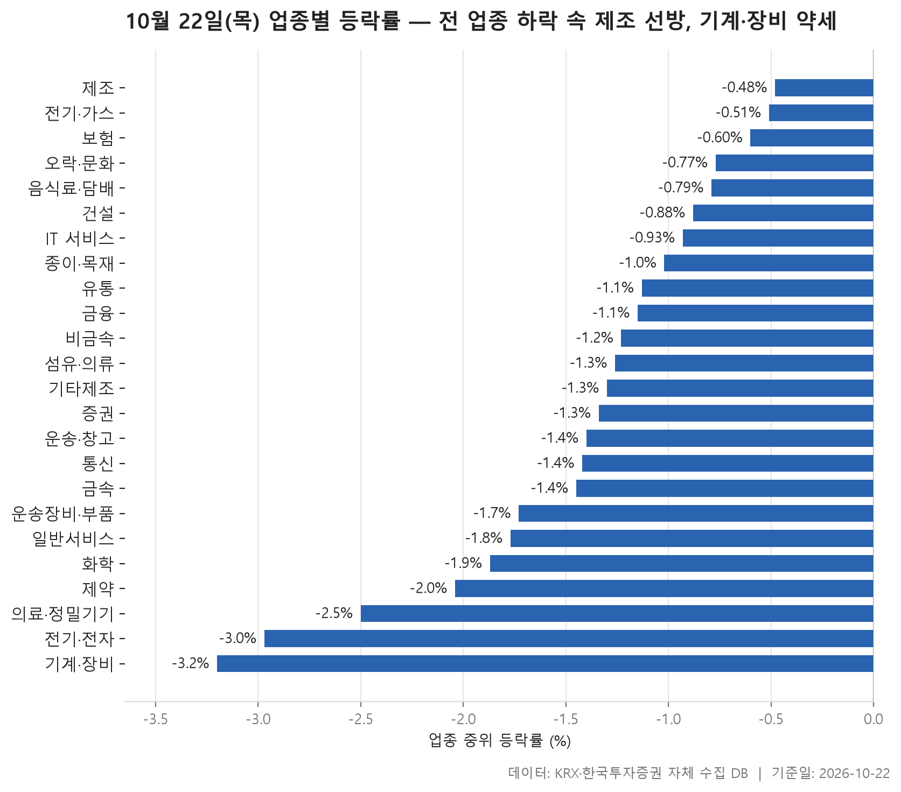
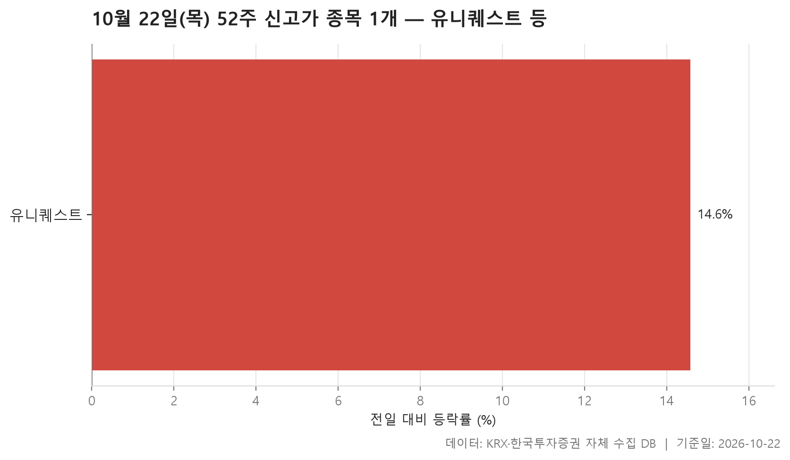
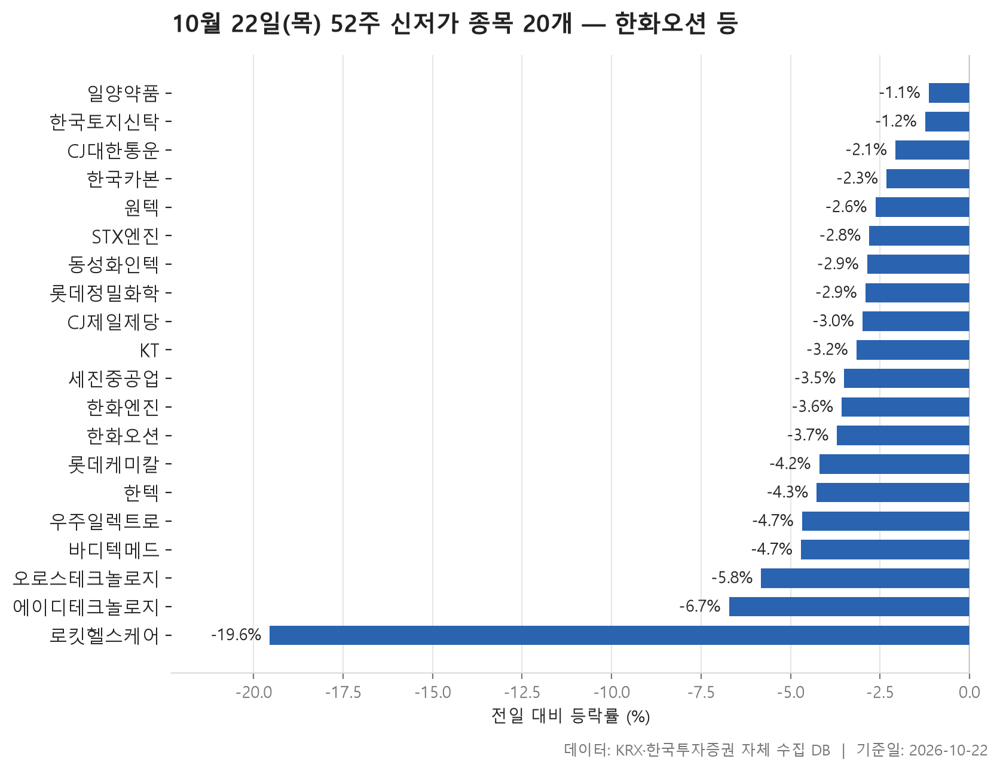
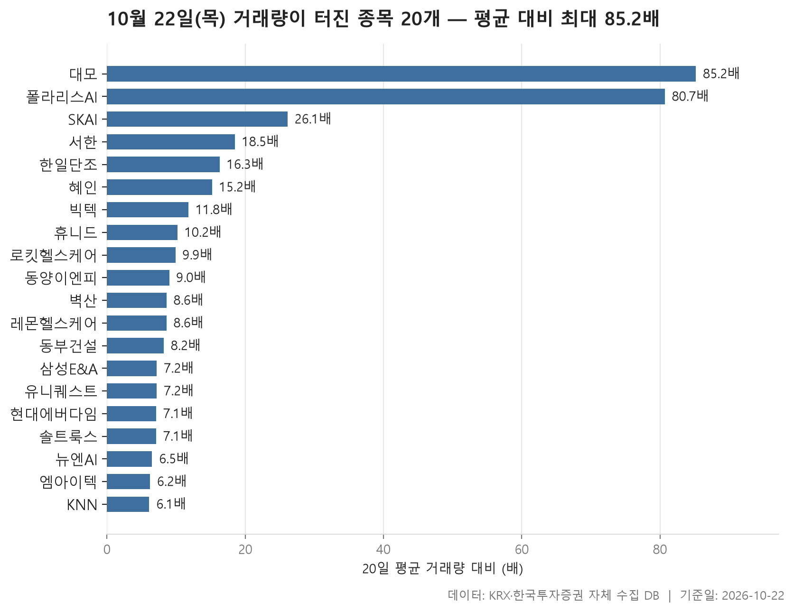

10월 22일 시장은 업종으로 묶어 보면 빠짐없이 밀린 하루였습니다. 24개 업종 가운데 종목 등락률의 중위값이 플러스로 올라선 곳은 한 곳도 없었습니다. 업종별 중위값을 줄 세웠을 때 한가운데 놓인 값이 -1.28%입니다. 가장 덜 내린 업종은 제조(-0.48%), 가장 많이 내린 업종은 기계·장비(-3.20%)였습니다.

이런 날은 신고가·신저가 명단을 보면 분위기가 더 또렷해집니다. 52주 신고가를 새로 쓴 종목은 단 한 곳이었고, 52주 신저가로 내려앉은 종목은 20개였습니다. 여기에 거래량이 평소의 다섯 배를 넘긴 20개 종목을 더해 보면, 시장 전체가 밀리는 동안 거래가 어디로 몰렸고 그 종목들이 어느 쪽으로 움직였는지 확인할 수 있습니다. 오늘 글은 이 세 가지를 차례로 살펴봅니다.

> 기준일: 2026-10-22 · 집계: 자체 수집 데이터베이스

## 업종 등락률 — 24개 모두 하락

표의 위쪽과 아래쪽은 업종 규모부터 다릅니다. 가장 덜 내린 제조는 종목이 8개, 거래대금이 5.40억원뿐인 작은 업종입니다. 그 아래 전기·가스와 보험도 종목 수가 열 개 안팎에 불과합니다. 반면 바닥에 있는 전기·전자는 368개, 기계·장비는 206개 종목을 거느린 큰 업종입니다. 특히 전기·전자는 하루 거래대금이 92,323.50억원으로 다른 업종을 크게 앞서는데, 중위 등락률이 -2.97%로 끝에서 두 번째였습니다. 이날 돈이 가장 많이 오간 업종이 가장 크게 밀린 축에 속했습니다.

제조는 평균(-0.10%)이 중위값보다 꽤 위에 떠 있습니다. 이월드가 +2.50% 오르면서 혼자 업종 평균을 0.31%p 끌어올렸습니다. 평균이 덜 나빠 보이는 건 상당 부분 이 한 종목 덕분입니다. 오른 종목이 가장 많았던 업종은 오히려 보험입니다. 45.50%가 올라 절반에 조금 못 미쳤습니다. 한화생명이 -4.52%로 크게 밀렸는데도 중위값이 -0.60%에 머문 것은 나머지 종목들이 버텨 줬기 때문입니다.

어긋나 보이는 대목도 있습니다. 기계·장비에서 가장 크게 움직인 종목은 오히려 크게 오른 아이비젼웍스(+19.14%)였지만, 업종 전체로는 꼴찌였습니다. 이 업종에서 오른 종목은 12.10%로 여덟 곳 중 한 곳꼴에 그쳐, 한 종목이 급등해도 업종의 흐름은 바뀌지 않았습니다. 의료·정밀기기의 빅텍(+21.36%), IT 서비스의 SKAI(+29.99%), 유통의 윙스풋(+30.00%)도 같은 경우입니다. 섬유·의류는 반대 모양입니다. 평균(-1.99%)이 중위값(-1.26%)보다 한참 아래에 있고 오른 종목은 6.10%뿐이어서, 인디에프(-9.68%) 같은 낙폭 큰 종목들이 평균을 끌어내렸습니다. 건설은 서한이 -16.57%로 급락했는데도 평균(-0.55%)이 중위값(-0.88%)보다 높습니다. 거래량 표에 나오는 동부건설(+6.78%)처럼 크게 오른 종목이 있어서 서한의 급락을 상쇄했습니다. 오른 종목이 가장 드물었던 곳은 증권으로, 5.90%에 그쳤습니다.

| 업종 | 종목수(개) | 중위등락률(%) | 평균등락률(%) | 상승비율(%) | 주도종목 | 주도종목등락률(%) | 평균기여도(%p) | 거래대금합계(억원) |
|---|---|---|---|---|---|---|---|---|
| 제조 | 8 | -0.48 | -0.10 | 37.50 | 이월드 | +2.50 | 0.31 | 5.40 |
| 전기·가스 | 10 | -0.51 | -0.75 | 10.00 | SGC에너지 | -4.66 | -0.47 | 326.90 |
| 보험 | 11 | -0.60 | -0.59 | 45.50 | 한화생명 | -4.52 | -0.41 | 1,510.70 |
| 오락·문화 | 63 | -0.77 | -0.88 | 23.80 | 아이스크림에듀 | -15.14 | -0.24 | 896.00 |
| 음식료·담배 | 83 | -0.79 | -1.19 | 24.10 | MH에탄올 | +6.38 | 0.08 | 1,346.80 |
| 건설 | 50 | -0.88 | -0.55 | 34.00 | 서한 | -16.57 | -0.33 | 2,089.00 |
| IT 서비스 | 242 | -0.93 | -0.96 | 21.10 | SKAI | +29.99 | 0.12 | 16,922.20 |
| 종이·목재 | 27 | -1.02 | -1.55 | 7.40 | 리더스코스메틱 | -4.72 | -0.17 | 22.70 |
| 유통 | 158 | -1.13 | -1.15 | 22.80 | 윙스풋 | +30.00 | 0.19 | 4,428.80 |
| 금융 | 110 | -1.15 | -1.24 | 19.10 | LS에코에너지 | +9.96 | 0.09 | 11,203.60 |
| 비금속 | 36 | -1.23 | -1.08 | 27.80 | 국영지앤엠 | +13.38 | 0.37 | 417.90 |
| 섬유·의류 | 49 | -1.26 | -1.99 | 6.10 | 인디에프 | -9.68 | -0.20 | 397.10 |
| 기타제조 | 14 | -1.30 | -1.69 | 7.10 | 피코그램 | -4.94 | -0.35 | 17.20 |
| 증권 | 17 | -1.34 | -1.57 | 5.90 | 미래에셋증권 | -3.86 | -0.23 | 622.00 |
| 운송·창고 | 28 | -1.40 | -1.42 | 10.70 | 한익스프레스 | -5.56 | -0.20 | 1,295.20 |
| 통신 | 13 | -1.42 | -1.87 | 7.70 | 더즌 | -6.12 | -0.47 | 577.90 |
| 금속 | 130 | -1.45 | -1.61 | 21.50 | 대양금속 | -11.15 | -0.09 | 4,919.10 |
| 운송장비·부품 | 134 | -1.73 | -2.14 | 16.40 | 뉴인텍 | -29.99 | -0.22 | 6,867.20 |
| 일반서비스 | 168 | -1.77 | -2.24 | 17.30 | 랩지노믹스 | -28.98 | -0.17 | 9,574.80 |
| 화학 | 221 | -1.87 | -2.46 | 13.10 | 예선테크 | -16.03 | -0.07 | 7,074.70 |
| 제약 | 166 | -2.04 | -2.39 | 7.80 | 로킷헬스케어 | -19.55 | -0.12 | 5,346.80 |
| 의료·정밀기기 | 102 | -2.50 | -2.33 | 12.70 | 빅텍 | +21.36 | 0.21 | 2,499.90 |
| 전기·전자 | 368 | -2.97 | -2.90 | 12.80 | 아이앤씨 | -15.10 | -0.04 | 92,323.50 |
| 기계·장비 | 206 | -3.20 | -2.92 | 12.10 | 아이비젼웍스 | +19.14 | 0.09 | 15,529.60 |

## 52주 신고가 1개 — 유니퀘스트 14.58%

신고가 명단은 유니퀘스트 한 줄이 전부입니다. KOSPI 유통 업종 종목으로, +14.58% 올라 11,790원에 마감하면서 직전 52주 최고가 10,850원을 넘어섰습니다. 시가총액은 2,547억원, 거래대금은 364억원이었습니다.

이 종목은 거래량 급증 명단에도 올라 있습니다. 직전 20거래일 평균보다 7.20배 많은 거래가 붙으면서 고점을 뚫었습니다. 유통 업종의 중위 등락률은 -1.13%로 시장 한가운데쯤이었으니, 업종 흐름과는 따로 움직인 개별 종목으로 보는 편이 자연스럽습니다. 왜 올랐는지는 자료에 없어 여기서는 다루지 않습니다. 다만 신고가 종목이 하나뿐이었다는 사실이 이날 시장의 온도를 잘 보여 줍니다.

| 종목명 | 종목코드 | 시장 | 업종 | 종가(원) | 등락률(%) | 이전52주최고(원) | 거래대금(억원) | 시가총액(억원) |
|---|---|---|---|---|---|---|---|---|
| 유니퀘스트 | 077500 | KOSPI | 유통 | 11,790 | +14.58 | 10,850 | 364 | 2,547 |

## 52주 신저가 20개 — 최저 로킷헬스케어 -19.55%

신저가는 20개로, KOSPI가 12개, KOSDAQ이 8개입니다. 시가총액이 큰 종목이 위쪽을 차지한 것이 눈에 띕니다. 한화오션(175,268억원)과 KT(119,836억원)가 맨 위에 있고, 한화엔진, CJ제일제당, 롯데케미칼, CJ대한통운처럼 이름이 익숙한 KOSPI 종목들이 뒤를 잇습니다. 업종은 11개로 흩어졌습니다. 기계·장비가 3개(한화엔진, STX엔진, 오로스테크놀로지)로 가장 많은 축이고, 업종 표에서 꼴찌였던 흐름과도 맞아떨어집니다. 화학과 제약에서도 세 곳씩 나왔습니다.

하루 낙폭은 대체로 크지 않았습니다. 등락률 중위값이 -3.33%이고, 가장 덜 내린 일양약품은 -1.14%였습니다. 급락했다기보다 조금씩 밀리다가 경계를 넘은 경우가 많았습니다. 한국카본은 16,820원으로 직전 최저가 16,830원을 겨우 밑돌았고, 한국토지신탁(1,038원 대 1,039원)과 원텍(3,895원 대 3,900원)도 직전 최저가 바로 아래에서 마감했습니다.

예외는 로킷헬스케어입니다. -19.55%로 명단에서 가장 크게 떨어졌고, 제약 업종 전체에서도 가장 크게 움직인 종목이었습니다. 거래량도 평소의 9.90배로 불어나 거래량 급증 명단에 함께 올랐습니다. 다른 신저가 종목들이 조용히 밀린 것과 달리, 이 종목은 거래가 크게 붙으면서 바닥을 뚫었습니다.

| 종목명 | 종목코드 | 시장 | 업종 | 종가(원) | 등락률(%) | 이전52주최저(원) | 거래대금(억원) | 시가총액(억원) |
|---|---|---|---|---|---|---|---|---|
| 한화오션 | 042660 | KOSPI | 운송장비·부품 | 57,200 | -3.70 | 57,900 | 335.40 | 175,268 |
| KT | 030200 | KOSPI | 통신 | 47,550 | -3.16 | 48,100 | 226.40 | 119,836 |
| 한화엔진 | 082740 | KOSPI | 기계·장비 | 33,800 | -3.57 | 34,100 | 184.80 | 28,205 |
| CJ제일제당 | 097950 | KOSPI | 음식료·담배 | 171,800 | -2.99 | 172,600 | 104.80 | 25,863 |
| 롯데케미칼 | 011170 | KOSPI | 화학 | 50,200 | -4.20 | 51,800 | 54.10 | 21,473 |
| CJ대한통운 | 000120 | KOSPI | 운송·창고 | 66,300 | -2.07 | 67,500 | 31.00 | 15,125 |
| 롯데정밀화학 | 004000 | KOSPI | 화학 | 36,750 | -2.91 | 37,200 | 18.30 | 9,482 |
| 한국카본 | 017960 | KOSPI | 금속 | 16,820 | -2.32 | 16,830 | 21.30 | 8,692 |
| STX엔진 | 077970 | KOSPI | 기계·장비 | 17,000 | -2.80 | 17,140 | 25.80 | 6,825 |
| 세진중공업 | 075580 | KOSPI | 운송장비·부품 | 7,720 | -3.50 | 7,830 | 6.00 | 4,389 |
| 동성화인텍 | 033500 | KOSDAQ | 화학 | 13,270 | -2.86 | 13,540 | 11.30 | 3,980 |
| 원텍 | 336570 | KOSDAQ | 의료·정밀기기 | 3,895 | -2.63 | 3,900 | 15.00 | 3,477 |
| 로킷헬스케어 | 376900 | KOSDAQ | 제약 | 18,020 | -19.55 | 19,800 | 199.50 | 3,152 |
| 한국토지신탁 | 034830 | KOSPI | 금융 | 1,038 | -1.24 | 1,039 | 7.00 | 2,621 |
| 에이디테크놀로지 | 200710 | KOSDAQ | 전기·전자 | 18,750 | -6.72 | 20,000 | 33.80 | 2,524 |
| 한텍 | 098070 | KOSDAQ | 금속 | 18,390 | -4.27 | 19,110 | 5.70 | 2,045 |
| 바디텍메드 | 206640 | KOSDAQ | 제약 | 8,500 | -4.71 | 8,870 | 5.50 | 1,862 |
| 우주일렉트로 | 065680 | KOSDAQ | 전기·전자 | 17,500 | -4.68 | 18,200 | 3.10 | 1,582 |
| 일양약품 | 007570 | KOSPI | 제약 | 6,960 | -1.14 | 6,990 | 4.20 | 1,328 |
| 오로스테크놀로지 | 322310 | KOSDAQ | 기계·장비 | 10,200 | -5.82 | 10,610 | 11.80 | 955 |

## 거래량 급증 20개 — 최고 대모 85.20배

거래량이 평소의 다섯 배를 넘긴 종목은 20개로, KOSDAQ이 14개, KOSPI가 6개입니다. 배수를 보면 위쪽 두 종목만 유난히 높습니다. 대모가 85.20배, 폴라리스AI가 80.70배였고, 세 번째인 SKAI는 26.10배로 뚝 떨어집니다. 명단의 중위값은 8.80배, 가장 낮은 KNN은 6.10배입니다. 대모와 폴라리스AI는 평소 거래량이 각각 62,137주, 60,253주에 그쳤던 종목이라 거래가 조금만 몰려도 배수가 크게 튀었습니다.

방향을 보면 업종 표와 반대 그림이 나옵니다. 모든 업종이 밀린 날인데 이 명단은 대부분 올랐습니다. SKAI(+29.99%), 빅텍(+21.36%), 폴라리스AI(+20.00%)가 앞에 서 있습니다. 내린 종목은 로킷헬스케어(-19.55%), 서한(-16.57%), 엠아이텍(-7.55%) 등 몇 곳뿐입니다. 거래대금으로 보면 삼성E&A가 단연 큽니다. 시가총액 108,584억원으로 명단에서 가장 큰 종목이 +16.14% 오르며 하루 6,342.70억원어치가 거래됐습니다. 이 종목이 속한 일반서비스 업종의 중위 등락률은 -1.77%였습니다.

업종별로는 IT 서비스가 5개로 가장 많습니다. 다만 방향은 엇갈렸습니다. SKAI와 솔트룩스(+7.67%)는 올랐고, 레몬헬스케어(-2.88%)와 뉴엔AI(-0.17%)는 내렸습니다. 같은 업종에서 거래가 한꺼번에 몰렸다고 해서 같은 방향으로 움직였다고 볼 수는 없습니다.

| 종목명 | 종목코드 | 시장 | 업종 | 종가(원) | 등락률(%) | 거래량(주) | 평균거래량(주) | 배수(배) | 거래대금(억원) | 시가총액(억원) |
|---|---|---|---|---|---|---|---|---|---|---|
| 대모 | 317850 | KOSDAQ | 기계·장비 | 6,500 | +9.80 | 5,296,882 | 62,137 | 85.20 | 363.00 | 541 |
| 폴라리스AI | 039980 | KOSDAQ | IT 서비스 | 5,400 | +20.00 | 4,864,481 | 60,253 | 80.70 | 262.30 | 777 |
| SKAI | 357880 | KOSDAQ | IT 서비스 | 1,851 | +29.99 | 16,114,474 | 617,654 | 26.10 | 286.70 | 1,026 |
| 서한 | 011370 | KOSDAQ | 건설 | 4,205 | -16.57 | 3,113,603 | 168,417 | 18.50 | 139.10 | 849 |
| 한일단조 | 024740 | KOSDAQ | 운송장비·부품 | 2,295 | +4.56 | 3,596,568 | 220,070 | 16.30 | 83.70 | 755 |
| 혜인 | 003010 | KOSPI | 유통 | 10,860 | +3.92 | 7,459,105 | 490,388 | 15.20 | 877.50 | 1,381 |
| 빅텍 | 065450 | KOSDAQ | 의료·정밀기기 | 3,750 | +21.36 | 25,703,059 | 2,175,430 | 11.80 | 923.80 | 1,106 |
| 휴니드 | 005870 | KOSPI | 전기·전자 | 4,895 | +6.30 | 2,558,392 | 251,225 | 10.20 | 127.90 | 691 |
| 로킷헬스케어 | 376900 | KOSDAQ | 제약 | 18,020 | -19.55 | 1,109,833 | 112,444 | 9.90 | 199.50 | 3,152 |
| 동양이엔피 | 079960 | KOSDAQ | 전기·전자 | 16,340 | +4.48 | 191,135 | 21,243 | 9.00 | 32.30 | 1,234 |
| 벽산 | 007210 | KOSPI | 비금속 | 1,374 | -2.69 | 626,981 | 73,075 | 8.60 | 8.70 | 898 |
| 레몬헬스케어 | 365660 | KOSDAQ | IT 서비스 | 3,715 | -2.88 | 6,198,027 | 719,904 | 8.60 | 241.60 | 500 |
| 동부건설 | 005960 | KOSPI | 건설 | 8,350 | +6.78 | 315,573 | 38,356 | 8.20 | 26.60 | 1,916 |
| 삼성E&A | 028050 | KOSPI | 일반서비스 | 55,400 | +16.14 | 11,532,886 | 1,597,161 | 7.20 | 6,342.70 | 108,584 |
| 유니퀘스트 | 077500 | KOSPI | 유통 | 11,790 | +14.58 | 3,033,382 | 422,688 | 7.20 | 364.00 | 2,547 |
| 현대에버다임 | 041440 | KOSDAQ | 기계·장비 | 6,060 | +1.68 | 327,729 | 46,301 | 7.10 | 20.40 | 1,081 |
| 솔트룩스 | 304100 | KOSDAQ | IT 서비스 | 13,470 | +7.67 | 389,311 | 54,802 | 7.10 | 54.00 | 1,696 |
| 뉴엔AI | 463020 | KOSDAQ | IT 서비스 | 5,860 | -0.17 | 441,494 | 68,304 | 6.50 | 27.80 | 527 |
| 엠아이텍 | 179290 | KOSDAQ | 의료·정밀기기 | 4,225 | -7.55 | 269,575 | 43,415 | 6.20 | 11.60 | 1,367 |
| KNN | 058400 | KOSDAQ | 오락·문화 | 6,240 | +4.87 | 127,633 | 21,038 | 6.10 | 7.80 | 826 |

## 정리

정리하면 10월 22일은 업종 전체가 빠짐없이 밀렸고 신저가 종목이 신고가 종목을 크게 웃돈 날이었습니다. 거래가 한꺼번에 몰린 일부 종목만 시장과 반대로 올랐습니다. 업종 순위는 작은 업종이 위, 큰 업종이 아래로 갈렸고, 그 바닥에는 거래대금이 가장 큰 전기·전자와 신저가가 가장 많이 나온 축인 기계·장비가 있었습니다.

이 글에는 한계가 있습니다. 전날 종가와 당일 종가만 비교한 하루치 기록이고, 왜 그렇게 움직였는지는 자료에 담겨 있지 않습니다. 신고가·신저가와 거래량 명단은 시가총액 500억원, 거래대금 3억원 이상인 보통주만 걸러 낸 것이라 그보다 작은 종목의 움직임은 빠져 있습니다. 업종 분류도 자체 기준을 따랐습니다. 이 글은 시장 흐름을 설명하려는 것이며, 특정 종목의 매매를 권하지 않습니다.

## 집계 기준

**업종 등락률**

- **기준**: 2026-10-21 종가 → 2026-10-22 종가
- **순위**: 업종 내 종목 등락률의 중위값 (평균은 참고용으로 함께 표시)
- **주도종목**: 그 업종에서 등락률 절대값이 가장 큰 종목 (동점이면 거래대금이 큰 쪽)
- **평균기여도**: 그 종목 하나가 업종 평균을 움직인 폭 (등락률 ÷ 종목수). 중위값과 평균의 격차가 이 값에 가까우면 평균을 만든 것이 그 종목이고, 훨씬 크면 다른 종목들도 함께 움직인 것입니다
- **필터**: 업종 내 보통주 5종목 이상
- **전체업종중위등락률(%)**: -1.28

**52주 신고가**

- **기준**: 종가 > 직전 52주 최고가
- **관측구간**: 2025-10-10 ~ 2026-10-21 (252거래일)
- **필터**: 시가총액 500억 이상, 거래대금 3억 이상, 보통주

**52주 신저가**

- **기준**: 종가 < 직전 52주 최저가
- **관측구간**: 2025-10-10 ~ 2026-10-21 (252거래일)
- **필터**: 시가총액 500억 이상, 거래대금 3억 이상, 보통주

**거래량 급증**

- **기준**: 당일 거래량 ≥ 직전 20거래일 평균 × 5
- **관측구간**: 2026-09-18 ~ 2026-10-21 (20거래일)
- **필터**: 시가총액 500억 이상, 거래대금 3억 이상, 보통주

## 데이터 출처 및 유의사항

- **데이터출처**: 한국거래소(KRX) 공시 데이터와 한국투자증권 OpenAPI 를 직접 수집해 구축한 자체 데이터베이스
- **집계방식**: 수집·집계·차트 생성을 직접 구현한 파이프라인에서 자동 산출
- **작성고지**: 본문의 표·통계·차트는 자체 데이터베이스에서 계산된 값이며, 문장 작성 과정에 AI 도구를 활용했습니다.
- **면책**: 본 글은 정보 제공을 목적으로 하며 특정 종목의 매수·매도를 추천하지 않습니다. 제시된 수치는 과거 데이터이고 미래 수익을 보장하지 않습니다. 투자 판단과 그 결과에 대한 책임은 투자자 본인에게 있습니다.

