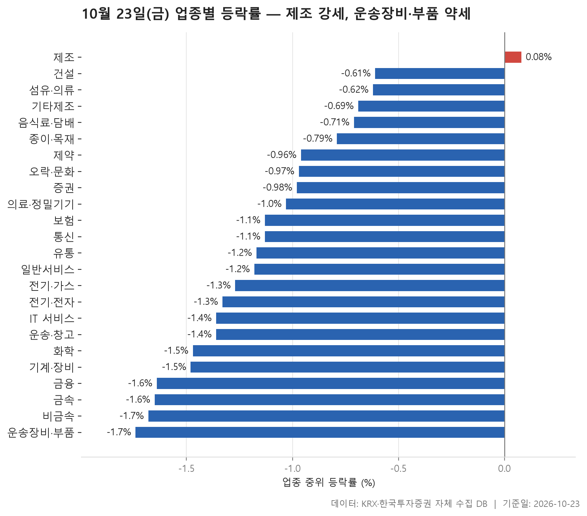
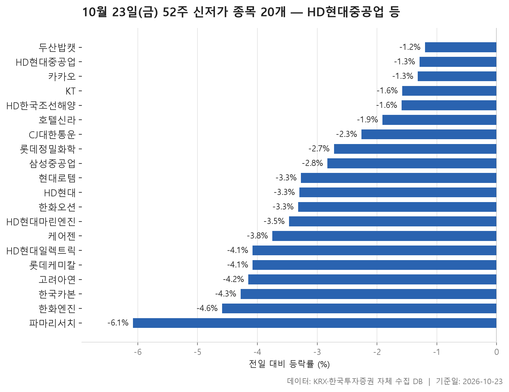
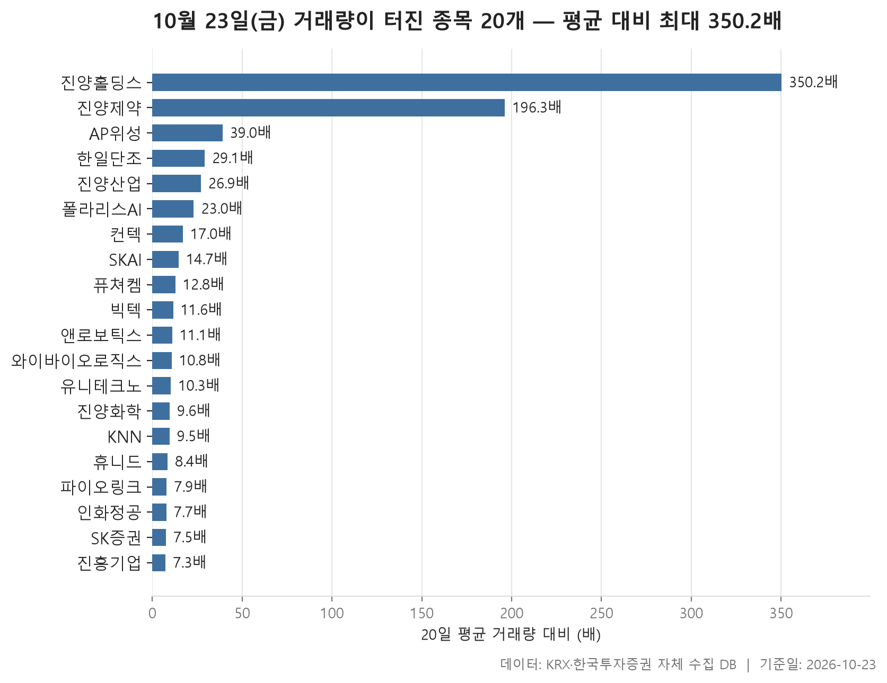

10월 23일 금요일 시장은 한쪽으로 크게 기운 하루였습니다. 업종 24개 가운데 중위 등락률이 플러스로 끝난 곳은 **제조** 하나뿐이고, 나머지 23개는 모두 마이너스였습니다. 그 하나도 +0.08%로 겨우 0을 넘긴 수준이어서, '제조 강세'라는 제목보다는 '거의 모든 업종이 밀렸다'는 쪽이 오늘을 더 정확하게 요약합니다.

오늘 글은 세 갈래로 나눴습니다. 먼저 업종별 등락을 보면서 하락이 얼마나 넓게 퍼졌는지 확인하고, 이어 52주 신저가를 새로 쓴 종목들을 봅니다. 마지막으로 거래량이 평소보다 몇 배씩 불어난 종목들을 정리했습니다. 세 표를 나란히 놓으면 흐름이 갈립니다. 시가총액이 큰 종목들은 조용히 바닥을 낮췄고, 작은 종목 몇 곳에서는 거래가 터졌습니다.

> 기준일: 2026-10-23 · 집계: 자체 수집 데이터베이스

## 업종 등락률 — 24개 중 23개 하락

24개 업종의 중위 등락률을 한 줄로 늘어놓으면 한가운데가 -1.15%입니다. 맨 위 제조가 +0.08%, 맨 아래 운송장비·부품이 -1.74%여서 업종 간 차이는 크지 않았습니다. 특정 업종이 무너졌다기보다 대부분이 비슷한 폭으로 함께 내린 모양입니다. 업종 안에서 오른 종목의 비중을 봐도 같은 그림입니다. 제조가 50.00%로 가장 높았고 열에 두 곳 남짓에 머문 업종이 많았으며, 전기·가스는 10.00%로 열 곳 중 한 곳만 올랐습니다.

표에서 눈여겨볼 곳은 중위값과 평균이 엇갈리는 업종입니다. 섬유·의류는 중위값이 -0.62%로 상위권인데 평균은 -1.65%까지 내려가 있습니다. 형지I&C가 -23.80% 빠지면서 혼자 업종 평균을 -0.49%p 끌어내렸지만, 그것만으로 설명되는 폭은 아닙니다. 다른 종목들도 평균 쪽으로 함께 밀렸다고 봐야 합니다. 반대 방향으로는 보험이 있습니다. 중위값 -1.13%에 평균 -0.58%로 평균이 위에 있는데, 서울보증보험의 +3.01%가 평균을 0.27%p 끌어올렸습니다. 종목이 11개뿐인 업종이라 한 종목의 무게가 큽니다. 제약도 비슷합니다. 퓨쳐켐 +29.91%의 영향으로 평균(-0.61%)이 중위값(-0.96%)보다 높게 나왔습니다.

가장 약했던 운송장비·부품에서는 업종에서 가장 크게 움직인 종목이 오히려 +11.02% 오른 인화정공이었습니다. 그런데도 업종 전체는 바닥으로 밀렸으니, 개별 종목의 상승이 업종 흐름을 바꾸지는 못한 셈입니다. 이렇게 업종은 내렸는데 가장 크게 움직인 종목은 급등한 경우가 오늘 표에 많습니다. 의료·정밀기기의 노을과 유통의 윙스풋이 +29.96%, 기계·장비의 스페코가 +29.98%를 기록했지만 세 업종 모두 중위값은 마이너스였습니다. 거래대금은 전기·전자가 112,552.20억원으로 다른 업종과 단위가 다를 만큼 컸고, 이 업종의 중위값은 -1.33%였습니다.

| 업종 | 종목수(개) | 중위등락률(%) | 평균등락률(%) | 상승비율(%) | 주도종목 | 주도종목등락률(%) | 평균기여도(%p) | 거래대금합계(억원) |
|---|---|---|---|---|---|---|---|---|
| 제조 | 8 | +0.08 | -0.08 | 50.00 | 지누스 | -3.51 | -0.44 | 6.50 |
| 건설 | 50 | -0.61 | -0.64 | 34.00 | 서한 | -6.66 | -0.13 | 1,864.30 |
| 섬유·의류 | 49 | -0.62 | -1.65 | 24.50 | 형지I&C | -23.80 | -0.49 | 268.10 |
| 기타제조 | 14 | -0.69 | -0.99 | 28.60 | 엑스플러스 | -7.69 | -0.55 | 19.30 |
| 음식료·담배 | 83 | -0.71 | -0.61 | 20.50 | MH에탄올 | +12.63 | 0.15 | 1,633.60 |
| 종이·목재 | 27 | -0.79 | -1.28 | 11.10 | 한국제지 | -9.50 | -0.35 | 22.00 |
| 제약 | 166 | -0.96 | -0.61 | 24.10 | 퓨쳐켐 | +29.91 | 0.18 | 6,417.40 |
| 오락·문화 | 61 | -0.97 | -1.34 | 24.60 | KNN | -15.71 | -0.26 | 1,015.60 |
| 증권 | 18 | -0.98 | -0.64 | 33.30 | 교보증권 | -6.63 | -0.37 | 943.50 |
| 의료·정밀기기 | 103 | -1.03 | -0.99 | 28.20 | 노을 | +29.96 | 0.29 | 4,930.90 |
| 보험 | 11 | -1.13 | -0.58 | 27.30 | 서울보증보험 | +3.01 | 0.27 | 1,515.10 |
| 통신 | 13 | -1.13 | -0.78 | 23.10 | 현대퓨처넷 | -2.60 | -0.20 | 780.80 |
| 유통 | 157 | -1.17 | -1.33 | 21.00 | 윙스풋 | +29.96 | 0.19 | 2,981.00 |
| 일반서비스 | 168 | -1.18 | -1.10 | 24.40 | 와이바이오로직스 | +16.10 | 0.10 | 10,887.70 |
| 전기·가스 | 10 | -1.27 | -1.73 | 10.00 | SGC에너지 | -8.85 | -0.89 | 492.10 |
| 전기·전자 | 369 | -1.33 | -1.38 | 22.00 | AP위성 | +18.71 | 0.05 | 112,552.20 |
| IT 서비스 | 242 | -1.36 | -1.30 | 20.70 | 컨텍 | +29.87 | 0.12 | 10,861.00 |
| 운송·창고 | 28 | -1.36 | -1.49 | 14.30 | STX그린로지스 | -5.87 | -0.21 | 1,552.10 |
| 화학 | 220 | -1.47 | -1.17 | 17.30 | 아이패밀리에스씨 | +29.93 | 0.14 | 7,645.30 |
| 기계·장비 | 206 | -1.48 | -1.11 | 24.30 | 스페코 | +29.98 | 0.15 | 15,006.90 |
| 금융 | 110 | -1.64 | -1.83 | 12.70 | SBI인베스트먼트 | -19.95 | -0.18 | 14,085.10 |
| 금속 | 130 | -1.65 | -1.76 | 15.40 | 포메탈 | +9.57 | 0.07 | 3,544.40 |
| 비금속 | 36 | -1.68 | -1.79 | 11.10 | 국영지앤엠 | -11.49 | -0.32 | 509.70 |
| 운송장비·부품 | 132 | -1.74 | -1.47 | 20.50 | 인화정공 | +11.02 | 0.08 | 8,153.00 |

## 52주 신저가 20개 — 최저 파마리서치 -6.08%

52주 신저가 명단은 거의 대형주로 채워졌습니다. 20개 가운데 KOSPI가 18개, KOSDAQ이 2개이고, 맨 위의 HD현대중공업은 시가총액이 320,132억원입니다. 고려아연, HD한국조선해양, 한화오션, HD현대일렉트릭처럼 시장에서 덩치가 큰 이름이 명단 위쪽에 줄지어 있습니다. 업종별로는 운송장비·부품이 4개로 가장 많았는데, 앞 표에서 중위 등락률이 가장 낮았던 업종과 겹칩니다.

이름을 보면 HD현대 계열이 여럿 눈에 띕니다. 한화오션과 한화엔진, 삼성중공업, 현대로템도 함께 들어 있습니다. 하나 짚어 둘 점이 있습니다. HD한국조선해양과 HD현대는 이 데이터의 업종 분류상 금융으로 잡혀 있습니다. 업종별 개수를 셀 때 이 둘은 운송장비·부품에 들어가지 않았다는 뜻입니다.

하락 폭 자체는 크지 않았습니다. 가장 덜 내린 두산밥캣이 -1.20%, 가장 많이 내린 파마리서치가 -6.08%였고 중위값은 -3.29%입니다. 기존 저점을 크게 깨고 내려간 경우보다 살짝 밑돈 경우가 많습니다. HD현대중공업은 종가 305,000원으로 이전 저점 306,500원을 조금 밑돌았고, 케어젠은 35,900원으로 이전 저점 36,000원과 거의 붙어 있습니다. 급락이라기보다 바닥이 한 칸씩 낮아진 모습에 가깝습니다. 거래대금은 HD현대중공업이 989.10억원으로 가장 많았습니다.

| 종목명 | 종목코드 | 시장 | 업종 | 종가(원) | 등락률(%) | 이전52주최저(원) | 거래대금(억원) | 시가총액(억원) |
|---|---|---|---|---|---|---|---|---|
| HD현대중공업 | 329180 | KOSPI | 운송장비·부품 | 305,000 | -1.29 | 306,500 | 989.10 | 320,132 |
| 고려아연 | 010130 | KOSPI | 금속 | 854,000 | -4.15 | 877,000 | 174.70 | 178,255 |
| HD한국조선해양 | 009540 | KOSPI | 금융 | 248,000 | -1.59 | 250,000 | 487.20 | 175,517 |
| 한화오션 | 042660 | KOSPI | 운송장비·부품 | 55,300 | -3.32 | 56,900 | 563.30 | 169,447 |
| HD현대일렉트릭 | 267260 | KOSPI | 전기·전자 | 470,000 | -4.08 | 473,500 | 756.60 | 169,422 |
| 삼성중공업 | 010140 | KOSPI | 운송장비·부품 | 16,830 | -2.83 | 17,170 | 462.50 | 148,104 |
| 카카오 | 035720 | KOSPI | IT 서비스 | 29,950 | -1.32 | 30,200 | 403.90 | 132,679 |
| KT | 030200 | KOSPI | 통신 | 46,800 | -1.58 | 47,100 | 161.90 | 117,946 |
| HD현대 | 267250 | KOSPI | 금융 | 137,800 | -3.30 | 142,300 | 232.00 | 108,852 |
| 현대로템 | 064350 | KOSPI | 운송장비·부품 | 82,700 | -3.27 | 84,800 | 431.20 | 90,261 |
| 두산밥캣 | 241560 | KOSPI | 기계·장비 | 49,400 | -1.20 | 49,800 | 62.20 | 47,353 |
| 한화엔진 | 082740 | KOSPI | 기계·장비 | 32,250 | -4.59 | 33,550 | 175.80 | 26,912 |
| 파마리서치 | 214450 | KOSDAQ | 제약 | 239,500 | -6.08 | 251,500 | 326.00 | 24,883 |
| 롯데케미칼 | 011170 | KOSPI | 화학 | 48,150 | -4.08 | 50,100 | 55.20 | 20,596 |
| 케어젠 | 214370 | KOSDAQ | 제약 | 35,900 | -3.75 | 36,000 | 16.90 | 19,284 |
| CJ대한통운 | 000120 | KOSPI | 운송·창고 | 64,800 | -2.26 | 66,050 | 22.40 | 14,782 |
| 호텔신라 | 008770 | KOSPI | 유통 | 35,900 | -1.91 | 36,300 | 30.00 | 14,090 |
| HD현대마린엔진 | 071970 | KOSPI | 기계·장비 | 36,150 | -3.47 | 37,050 | 59.80 | 12,263 |
| 롯데정밀화학 | 004000 | KOSPI | 화학 | 35,750 | -2.72 | 36,450 | 16.80 | 9,224 |
| 한국카본 | 017960 | KOSPI | 금속 | 16,100 | -4.28 | 16,760 | 58.00 | 8,320 |

## 거래량 급증 20개 — 최고 진양홀딩스 350.20배

거래량 급증 명단은 신저가 명단과 정반대 모습입니다. 시가총액이 가장 큰 SK증권이 4,857억원이고 나머지는 대부분 그보다 훨씬 작은 종목들이며, 시장별로는 KOSDAQ이 14개로 KOSPI 6개보다 많습니다. 평소 대비 몇 배가 거래됐는지를 놓고 보면 중위값이 11.35배, 가장 낮은 진흥기업도 7.30배였습니다.

가장 먼저 눈에 들어오는 것은 '진양'이라는 이름입니다. 진양홀딩스가 평소의 350.20배로 1위였고, 진양제약이 196.30배로 뒤를 이었습니다. 진양산업(+29.79%)과 진양화학(+29.81%)도 명단에 있습니다. 같은 이름을 단 종목이 한꺼번에 움직였지만 왜 그랬는지는 이 자료로 알 수 없습니다. 방향도 같지 않았습니다. 진양홀딩스는 +3.64%에 그쳤고 진양제약은 오히려 -4.35% 내렸습니다.

거래량이 터졌다고 해서 모두 오른 것은 아닙니다. SKAI는 -9.13%, KNN은 -15.71%로 거래가 몰리면서 내렸습니다. 거래대금 기준으로는 빅텍이 1,672.60억원으로 가장 컸는데, 주가는 +1.60% 오르는 데 그쳤습니다. 손바뀜은 많았지만 가격은 크게 움직이지 않은 경우입니다. AP위성, 컨텍, 퓨쳐켐, 인화정공처럼 앞의 업종 표에서 업종 내 가장 크게 움직인 종목으로 나온 이름이 이 명단에도 다시 보입니다. 업종 전체가 밀리는 날, 개별 종목의 움직임은 대부분 이런 작은 종목들에서 나왔습니다.

| 종목명 | 종목코드 | 시장 | 업종 | 종가(원) | 등락률(%) | 거래량(주) | 평균거래량(주) | 배수(배) | 거래대금(억원) | 시가총액(억원) |
|---|---|---|---|---|---|---|---|---|---|---|
| 진양홀딩스 | 100250 | KOSPI | 화학 | 3,130 | +3.64 | 12,562,607 | 35,873 | 350.20 | 430.80 | 2,000 |
| 진양제약 | 007370 | KOSDAQ | 제약 | 3,630 | -4.35 | 1,814,970 | 9,246 | 196.30 | 77.10 | 513 |
| AP위성 | 211270 | KOSDAQ | 전기·전자 | 8,310 | +18.71 | 4,088,612 | 104,857 | 39.00 | 339.40 | 1,253 |
| 한일단조 | 024740 | KOSDAQ | 운송장비·부품 | 2,340 | +1.96 | 11,525,603 | 396,110 | 29.10 | 288.80 | 770 |
| 진양산업 | 003780 | KOSPI | 화학 | 5,490 | +29.79 | 4,556,477 | 169,436 | 26.90 | 224.00 | 714 |
| 폴라리스AI | 039980 | KOSDAQ | IT 서비스 | 5,720 | +5.93 | 6,866,779 | 298,717 | 23.00 | 411.90 | 823 |
| 컨텍 | 451760 | KOSDAQ | IT 서비스 | 8,130 | +29.87 | 2,303,904 | 135,315 | 17.00 | 177.60 | 1,342 |
| SKAI | 357880 | KOSDAQ | IT 서비스 | 1,682 | -9.13 | 20,556,192 | 1,397,095 | 14.70 | 385.30 | 933 |
| 퓨쳐켐 | 220100 | KOSDAQ | 제약 | 8,990 | +29.91 | 1,192,517 | 92,827 | 12.80 | 94.50 | 2,785 |
| 빅텍 | 065450 | KOSDAQ | 의료·정밀기기 | 3,810 | +1.60 | 39,977,405 | 3,446,747 | 11.60 | 1,672.60 | 1,124 |
| 앤로보틱스 | 138360 | KOSDAQ | 기계·장비 | 1,944 | +18.90 | 45,644,016 | 4,107,307 | 11.10 | 840.70 | 1,710 |
| 와이바이오로직스 | 338840 | KOSDAQ | 일반서비스 | 10,240 | +16.10 | 381,536 | 35,343 | 10.80 | 36.20 | 1,577 |
| 유니테크노 | 241690 | KOSDAQ | 운송장비·부품 | 2,760 | +9.09 | 3,327,290 | 324,026 | 10.30 | 95.80 | 675 |
| 진양화학 | 051630 | KOSPI | 화학 | 2,360 | +29.81 | 3,375,414 | 351,772 | 9.60 | 69.50 | 500 |
| KNN | 058400 | KOSDAQ | 오락·문화 | 5,260 | -15.71 | 257,422 | 27,014 | 9.50 | 14.80 | 697 |
| 휴니드 | 005870 | KOSPI | 전기·전자 | 4,935 | +0.82 | 3,178,340 | 377,990 | 8.40 | 166.80 | 697 |
| 파이오링크 | 170790 | KOSDAQ | 전기·전자 | 8,000 | -0.25 | 193,202 | 24,347 | 7.90 | 16.20 | 512 |
| 인화정공 | 101930 | KOSDAQ | 운송장비·부품 | 6,450 | +11.02 | 282,027 | 36,577 | 7.70 | 17.50 | 2,947 |
| SK증권 | 001510 | KOSPI | 증권 | 2,100 | +5.63 | 11,788,744 | 1,582,233 | 7.50 | 244.50 | 4,857 |
| 진흥기업 | 002780 | KOSPI | 건설 | 6,140 | +2.33 | 332,745 | 45,626 | 7.30 | 21.20 | 893 |

## 정리

정리하면 10월 23일은 24개 업종 중 23개가 내린 날이었습니다. 시가총액이 큰 종목들은 52주 저점을 조금씩 낮췄고, 거래가 터진 곳은 주로 KOSDAQ의 작은 종목들이었습니다. 제목에 나온 '제조 강세'는 종목 8개짜리 업종이 +0.08%로 겨우 0을 넘긴 것이어서, 강세라고 부르기에는 무게가 가볍습니다.

이 글은 하루치 종가만 비교한 결과입니다. 왜 내렸는지, 진양 계열에 왜 거래가 몰렸는지는 자료에 없어서 다루지 않았습니다. 업종 분류는 이 데이터베이스의 기준을 따랐기 때문에 지주회사가 금융으로 잡히는 것처럼 일반적인 인식과 다를 수 있습니다. 하루의 움직임만으로 흐름을 단정하기는 어려운 만큼, 다음 거래일 표와 함께 보시길 권합니다.

## 집계 기준

**업종 등락률**

- **기준**: 2026-10-22 종가 → 2026-10-23 종가
- **순위**: 업종 내 종목 등락률의 중위값 (평균은 참고용으로 함께 표시)
- **주도종목**: 그 업종에서 등락률 절대값이 가장 큰 종목 (동점이면 거래대금이 큰 쪽)
- **평균기여도**: 그 종목 하나가 업종 평균을 움직인 폭 (등락률 ÷ 종목수). 중위값과 평균의 격차가 이 값에 가까우면 평균을 만든 것이 그 종목이고, 훨씬 크면 다른 종목들도 함께 움직인 것입니다
- **필터**: 업종 내 보통주 5종목 이상
- **전체업종중위등락률(%)**: -1.15

**52주 신저가**

- **기준**: 종가 < 직전 52주 최저가
- **관측구간**: 2025-10-13 ~ 2026-10-22 (252거래일)
- **필터**: 시가총액 500억 이상, 거래대금 3억 이상, 보통주

**거래량 급증**

- **기준**: 당일 거래량 ≥ 직전 20거래일 평균 × 5
- **관측구간**: 2026-09-21 ~ 2026-10-22 (20거래일)
- **필터**: 시가총액 500억 이상, 거래대금 3억 이상, 보통주

## 데이터 출처 및 유의사항

- **데이터출처**: 한국거래소(KRX) 공시 데이터와 한국투자증권 OpenAPI 를 직접 수집해 구축한 자체 데이터베이스
- **집계방식**: 수집·집계·차트 생성을 직접 구현한 파이프라인에서 자동 산출
- **작성고지**: 본문의 표·통계·차트는 자체 데이터베이스에서 계산된 값이며, 문장 작성 과정에 AI 도구를 활용했습니다.
- **면책**: 본 글은 정보 제공을 목적으로 하며 특정 종목의 매수·매도를 추천하지 않습니다. 제시된 수치는 과거 데이터이고 미래 수익을 보장하지 않습니다. 투자 판단과 그 결과에 대한 책임은 투자자 본인에게 있습니다.

