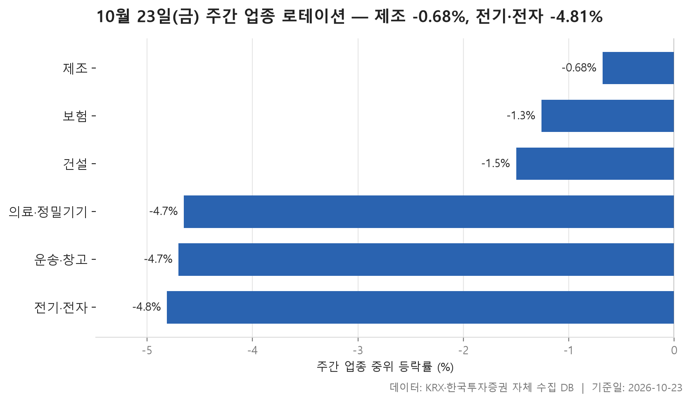
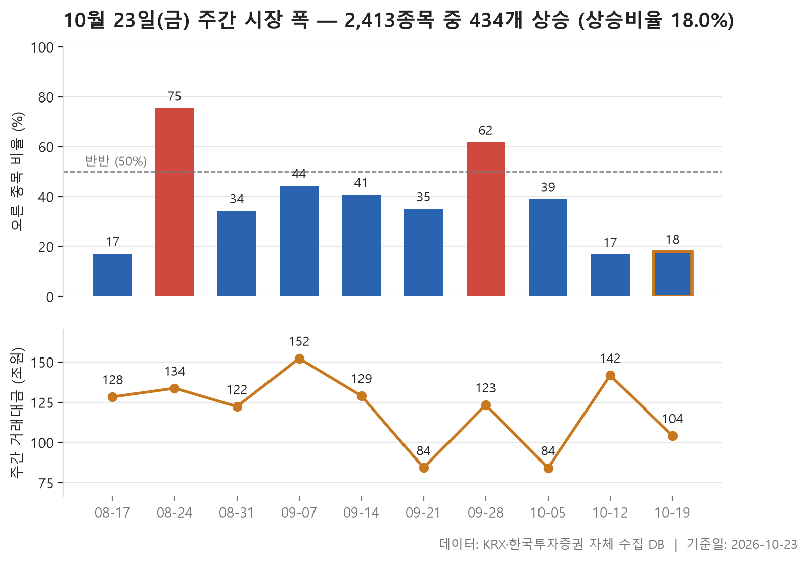
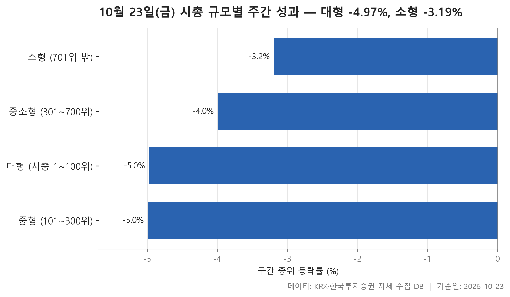

10월 19일부터 23일까지 닷새 동안의 시장을 세 장의 표로 정리합니다. 어느 업종이 버티고 어느 업종이 밀렸는지, 오른 종목이 얼마나 됐는지, 큰 종목과 작은 종목 중 어느 쪽이 나았는지를 차례로 봅니다.

결론부터 말하면 한 주 내내 내림세였습니다. 24개 업종 가운데 중위 등락률이 가장 높은 제조도 -0.68%였고, 가장 낮은 전기·전자는 -4.81%까지 내려갔습니다. 업종 순위표 맨 윗줄까지 마이너스였다는 것만으로도 이번 주 분위기를 짐작할 수 있습니다.

이런 주에는 무엇이 올랐는지 묻기 어렵습니다. 그보다 어디가 덜 빠졌는지, 그리고 평균과 중위값이 어디서 갈라졌는지를 보는 편이 시장의 모양을 더 잘 보여 줍니다. 종목 하나가 업종 전체 숫자를 얼마나 비틀었는지도 함께 짚어 보겠습니다.

> 기준일: 2026-10-23 · 집계: 자체 수집 데이터베이스

## 주간 업종 로테이션 — 6개 모두 하락

상위 세 업종을 '강했다'고 부르기도 어색합니다. 1위 제조의 중위값이 -0.68%이니 24개 업종 모두 한가운데 놓인 종목이 내린 채로 한 주를 마쳤다는 뜻입니다. 제조는 8종목짜리 작은 업종이어서 몇 종목만 움직여도 순위가 크게 바뀔 수 있습니다. 실제로 이 업종에서도 오른 종목은 37.5%로, 열 곳 가운데 네 곳이 채 안 됐습니다.

눈여겨볼 곳은 평균과 중위값이 엇갈린 업종입니다. 건설은 중위값이 -1.50%인데 평균은 -0.78%로 덜 나쁩니다. 계룡건설이 한 주 동안 +23.15% 오르면서 이 종목 하나가 업종 평균을 0.46%p 끌어올린 영향입니다. 보험은 방향이 반대입니다. 중위값 -1.26%보다 평균 -2.14%가 더 낮은데, 한화생명이 -15.17% 빠지면서 업종 평균을 -1.38%p 움직였습니다. 종목이 11개뿐인 업종이라 한 종목이 평균에 미치는 무게가 그만큼 큽니다.

하위권에서는 운송·창고가 가장 극단적입니다. 28개 종목 중 한 주 동안 오른 종목이 하나도 없었습니다. 의료·정밀기기는 빅텍이 +32.29% 오르는 동안에도 중위값이 -4.65%였고 오른 종목은 18.8%에 머물렀습니다. 종목 하나가 크게 올라도 업종 전체의 흐름은 바꾸지 못했습니다.

꼴찌인 전기·전자는 367종목으로 가장 큰 업종입니다. 에이엔피가 -60.05% 급락했지만 종목 수가 워낙 많아 업종 평균에 준 영향은 -0.16%p에 그칩니다. 결국 이 업종의 약세는 한두 종목 탓이 아니라 업종 전반에 고르게 퍼진 하락이었다고 봐야 합니다. 이 업종에서 오른 종목이 18.0%였는데, 이는 시장 전체에서 오른 종목의 비율과 같은 값입니다.

| 업종 | 종목수(개) | 주간중위등락률(%) | 주간평균등락률(%) | 상승비율(%) | 주도종목 | 주도종목등락률(%) | 평균기여도(%p) |
|---|---|---|---|---|---|---|---|
| 제조 | 8 | -0.68 | -0.86 | 37.50 | 이월드 | +4.92 | 0.61 |
| 보험 | 11 | -1.26 | -2.14 | 36.40 | 한화생명 | -15.17 | -1.38 |
| 건설 | 50 | -1.50 | -0.78 | 32.00 | 계룡건설 | +23.15 | 0.46 |
| 의료·정밀기기 | 101 | -4.65 | -3.38 | 18.80 | 빅텍 | +32.29 | 0.32 |
| 운송·창고 | 28 | -4.70 | -5.56 | 0.00 | STX그린로지스 | -15.57 | -0.56 |
| 전기·전자 | 367 | -4.81 | -4.61 | 18.00 | 에이엔피 | -60.05 | -0.16 |

## 주간 시장 폭 — 10주 중 이번 주는 2,413개 중 434개 상승

이번 주에 오른 종목은 434개, 내린 종목은 1,955개였습니다. 오른 종목이 다섯 중 하나꼴도 되지 않았고, 오른 종목 수를 내린 종목 수로 나눈 값은 0.22배였습니다. 바로 전주가 0.20배로 최근 10주 중 가장 낮았으니 하락 우위가 두 주 연속 이어진 셈입니다. 10주 동안의 중간값이 0.61배라는 점과 비교하면 최근 두 주가 얼마나 한쪽으로 쏠렸는지 드러납니다.

10주를 통틀어 오른 종목이 내린 종목보다 많았던 주는 두 번뿐입니다. 8월 24일 주가 3.22배로 가장 높았고, 9월 28일 주가 1.69배였습니다. 나머지 여덟 주는 모두 내린 종목이 더 많았습니다. 8월 17일 주에 0.21배까지 떨어졌다가 바로 다음 주 3.22배로 크게 뒤집힌 적이 있긴 합니다. 다만 그런 일이 이번에도 되풀이될지는 이 표만으로는 알 수 없습니다.

거래대금도 같이 보면 좋습니다. 이번 주와 전주는 둘 다 거래일이 5일로 같은데, 총거래대금은 전주 141.70조 원에서 이번 주 104.20조 원으로 줄었습니다. 내린 종목 비중은 비슷하게 높았지만 매매의 열기는 한풀 꺾인 모습입니다. 그 이유가 무엇인지는 자료에 나와 있지 않습니다.

| 주 | 거래일수(일) | 종목수(개) | 상승(개) | 보합(개) | 하락(개) | 상승비율(%) | ADR(배) | 총거래대금(조원) |
|---|---|---|---|---|---|---|---|---|
| 2026-10-19 | 5 | 2,413 | 434 | 24 | 1,955 | 18.00 | 0.22 | 104.20 |
| 2026-10-12 | 5 | 2,411 | 405 | 18 | 1,988 | 16.80 | 0.20 | 141.70 |
| 2026-10-05 | 3 | 2,414 | 942 | 39 | 1,433 | 39.00 | 0.66 | 84.20 |
| 2026-09-28 | 5 | 2,407 | 1,488 | 41 | 878 | 61.80 | 1.69 | 123.30 |
| 2026-09-21 | 3 | 2,411 | 846 | 47 | 1,518 | 35.10 | 0.56 | 84.30 |
| 2026-09-14 | 5 | 2,405 | 982 | 31 | 1,392 | 40.80 | 0.71 | 129.00 |
| 2026-09-07 | 5 | 2,404 | 1,067 | 40 | 1,297 | 44.40 | 0.82 | 152.20 |
| 2026-08-31 | 5 | 2,399 | 823 | 34 | 1,542 | 34.30 | 0.53 | 122.30 |
| 2026-08-24 | 5 | 2,384 | 1,798 | 28 | 558 | 75.40 | 3.22 | 133.70 |
| 2026-08-17 | 4 | 2,385 | 408 | 16 | 1,961 | 17.10 | 0.21 | 128.30 |

## 시총 규모별 주간 성과 — 소형이 1.78%p 앞섬

시가총액 순위로 네 구간을 나눠 봐도 모두 마이너스입니다. 소형주가 앞섰다는 말은 덜 빠졌다는 뜻으로 읽어야 합니다. 소형 구간의 중위값이 -3.19%로 가장 나았고, 중소형이 -3.99%로 뒤를 이었습니다. 대형 -4.97%와 중형 -4.99%는 거의 붙어 있습니다. 대형과 소형의 중위값 차이는 -1.78%p로, 작은 종목일수록 덜 내린 계단 모양이 보입니다.

오른 종목의 비율은 네 구간이 15.5%에서 18.8% 사이에 좁게 모여 있습니다. 규모와 상관없이 모든 구간에서 오른 종목이 다섯 중 하나에 못 미쳤습니다. 구간 사이 차이는 오른 종목의 수보다 내린 종목이 얼마나 깊게 빠졌는지에서 났다고 보는 편이 맞습니다.

평균과 중위값을 나란히 놓으면 구간마다 성격이 갈립니다. 대형 구간은 평균이 -4.49%로 중위값보다 덜 나쁜데, 삼성E&A가 +37.16% 오른 효과로 보입니다. 중형 구간은 반대로 평균이 -5.38%로 더 낮고, 이 구간에서 가장 크게 움직인 종목도 -17.92% 내린 파두였습니다. 소형의 윙스풋 +63.50%, 중소형의 지투지바이오 +59.55%처럼 아래 구간에서는 개별 종목의 큰 상승이 나왔지만, 종목 수가 많아 구간 전체 숫자를 바꾸지는 못했습니다.

거래대금은 정반대 그림입니다. 100종목뿐인 대형 구간에 71.40조 원이 몰렸고, 1,713종목이 있는 소형 구간은 8.80조 원이었습니다. 돈은 큰 종목 쪽에서 주로 오갔는데 하락폭은 작은 종목 쪽이 더 얕았던 것입니다. 이 두 가지가 왜 엇갈렸는지는 이 표가 설명해 주지 않습니다.

| 구간 | 종목수(개) | 주간중위등락률(%) | 주간평균등락률(%) | 상승비율(%) | 주도종목 | 주도종목등락률(%) | 주간거래대금(조원) |
|---|---|---|---|---|---|---|---|
| 대형 (시총 1~100위) | 100 | -4.97 | -4.49 | 16.00 | 삼성E&A | +37.16 | 71.40 |
| 중형 (101~300위) | 200 | -4.99 | -5.38 | 15.50 | 파두 | -17.92 | 13.30 |
| 중소형 (301~700위) | 400 | -3.99 | -3.76 | 16.30 | 지투지바이오 | +59.55 | 7.10 |
| 소형 (701위 밖) | 1,713 | -3.19 | -3.05 | 18.80 | 윙스풋 | +63.50 | 8.80 |

## 정리

이번 주는 업종, 종목 수, 규모 어느 쪽으로 잘라 봐도 내린 종목이 많았던 한 주였습니다. 그 와중에 덜 빠진 쪽은 작은 업종과 작은 종목이었고, 전기·전자처럼 큰 업종은 하락이 넓게 퍼져 있었습니다.

몇 가지 한계는 짚어 둡니다. 모든 순위는 중위값 기준이라 종목 수가 적은 업종은 몇 종목만 움직여도 자리가 바뀝니다. 한 주치 등락이라 이 흐름이 이어질지는 알 수 없습니다. 무엇보다 이 자료에는 하락의 원인이 담겨 있지 않습니다. 오늘 글은 시장이 어떤 모양으로 움직였는지를 보여 줄 뿐, 왜 그렇게 움직였는지는 설명하지 못합니다.

## 집계 기준

**주간 업종 로테이션**

- **기준**: 2026-10-16 종가 → 2026-10-23 종가
- **구간**: 2026-10-19 시작 주 — 직전 주 마지막 거래일 종가를 출발선으로 삼습니다
- **거래일수**: 5
- **순위**: 업종 내 종목 등락률의 중위값 (평균은 참고용으로 함께 표시)
- **선정**: 전체 24개 업종 중 상위 3개 · 하위 3개
- **주도종목**: 그 업종에서 같은 기간 등락률 절대값이 가장 큰 종목 (동점이면 거래대금이 큰 쪽)
- **평균기여도**: 그 종목 하나가 업종 평균을 움직인 폭 (등락률 ÷ 종목수)
- **필터**: 업종 내 보통주 5종목 이상

**주간 시장 폭**

- **기준**: 각 주의 마지막 거래일 종가를 직전 주 마지막 거래일 종가와 비교
- **주**: 그 주의 월요일 (달력 기준). 거래일 수는 연휴에 따라 다릅니다
- **ADR**: 상승 종목 수 ÷ 하락 종목 수. 1 이면 반반, 2 면 오른 종목이 두 배
- **총거래대금**: 그 주 거래일 전체의 거래대금 합계
- **모집단**: 거래가 있었던 보통주 (거래정지·액면 변경 종목 제외)

**시총 규모별 주간 성과**

- **기준**: 2026-10-16 종가 → 2026-10-23 종가
- **구간**: 기준일 시가총액 순위로 자릅니다 (금액으로 자르면 장이 오른 해에 전부 위 구간으로 올라가 해마다 다른 표가 됩니다)
- **순위**: 구간 내 종목 등락률의 중위값 (평균은 참고용으로 함께 표시)
- **주도종목**: 그 구간에서 같은 기간 등락률 절대값이 가장 큰 종목 (동점이면 거래대금이 큰 쪽)
- **대형소형격차**: -1.78
- **모집단**: 거래가 있었던 보통주 (거래정지·액면 변경 종목 제외)

## 데이터 출처 및 유의사항

- **데이터출처**: 한국거래소(KRX) 공시 데이터와 한국투자증권 OpenAPI 를 직접 수집해 구축한 자체 데이터베이스
- **집계방식**: 수집·집계·차트 생성을 직접 구현한 파이프라인에서 자동 산출
- **작성고지**: 본문의 표·통계·차트는 자체 데이터베이스에서 계산된 값이며, 문장 작성 과정에 AI 도구를 활용했습니다.
- **면책**: 본 글은 정보 제공을 목적으로 하며 특정 종목의 매수·매도를 추천하지 않습니다. 제시된 수치는 과거 데이터이고 미래 수익을 보장하지 않습니다. 투자 판단과 그 결과에 대한 책임은 투자자 본인에게 있습니다.

