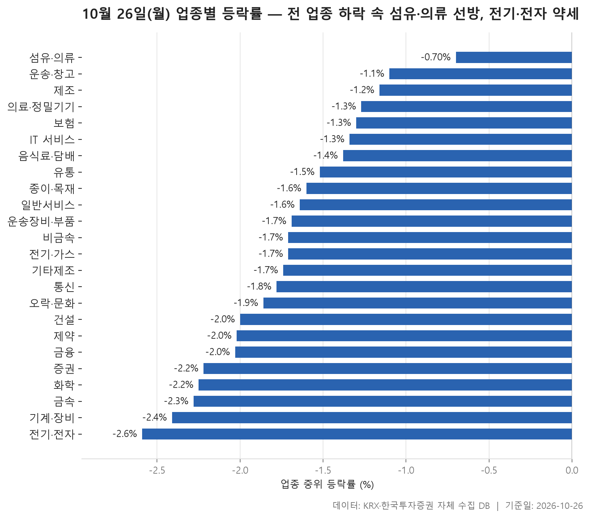
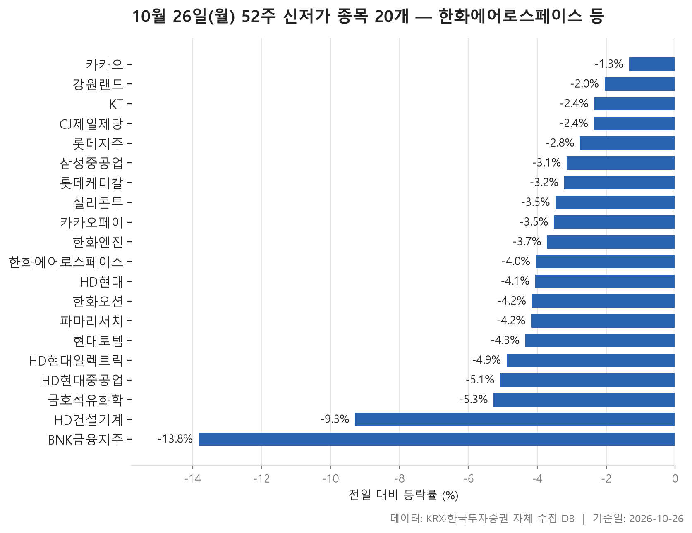
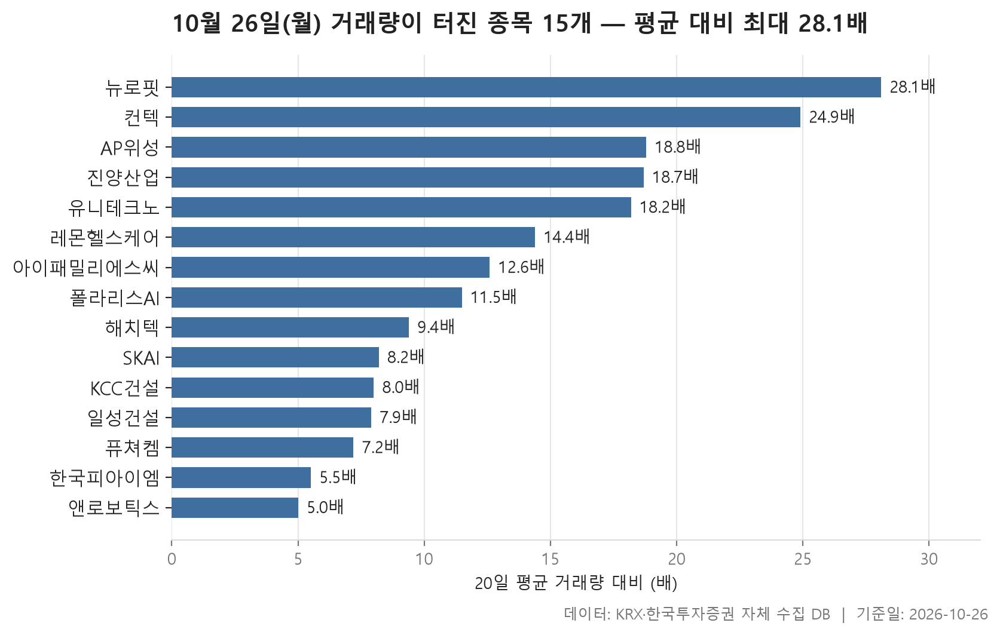

10월 26일 시장은 업종 표 하나로 성격이 드러납니다. 24개 업종 모두 업종 안 종목들의 한가운데 등락률이 마이너스였습니다. 가장 덜 내린 섬유·의류도 -0.70%였고, 가장 많이 내린 전기·전자는 -2.59%였습니다. 24개 업종의 값을 줄 세웠을 때 한가운데 놓이는 값은 -1.71%입니다. 몇몇 업종만 빠진 날이 아니라 시장 전체가 한쪽으로 기운 하루였다는 뜻입니다.

오늘은 세 가지를 차례로 봅니다. 먼저 업종별 등락에서 평균과 중위값이 어긋난 곳을 짚고, 이어서 52주 최저가를 새로 쓴 종목 20개, 마지막으로 거래량이 평소의 다섯 배를 넘긴 종목 15개를 살펴봅니다. 두 목록은 결이 전혀 다릅니다. 신저가 쪽에는 시가총액 수십조 원대 대형주가 늘어서 있고, 거래량 급증 쪽에는 시가총액 수천억 원 이하 종목이 대부분이면서 상당수가 크게 올랐습니다.

자료에는 등락의 원인이 담겨 있지 않습니다. 그래서 이 글은 왜 그랬는지가 아니라 숫자가 어떤 모양으로 놓였는지를 설명하는 데서 멈춥니다.

> 기준일: 2026-10-26 · 집계: 자체 수집 데이터베이스

## 업종 등락률 — 24개 모두 하락

순위는 위에서 아래까지 완만하게 내려갑니다. 섬유·의류(-0.70%)와 운송·창고(-1.10%)가 그나마 덜 내렸고, 중간 무리는 전체 한가운데 값인 -1.71% 언저리에 촘촘히 모여 있습니다. 아래쪽은 화학(-2.25%), 금속(-2.28%), 기계·장비(-2.41%)가 차례로 늘어섰고, 맨 끝이 전기·전자(-2.59%)입니다. 가장 선방한 섬유·의류에서도 오른 종목은 28.60%에 그쳐 열 곳 중 세 곳이 채 안 됐습니다. 오른 종목 비중이 가장 높은 곳은 제조(37.50%)였지만 8종목짜리 작은 업종이라 크게 무게를 두기 어렵습니다. 전기·가스와 증권은 오른 종목이 한 곳도 없었고, 금융도 7.30%로 거의 전 종목이 내렸습니다.

가장 많이 내린 업종이 가장 큰 업종이라는 점도 눈에 띕니다. 전기·전자는 368종목으로 업종 가운데 종목 수가 가장 많고, 거래대금도 78,015.50억원으로 2위인 기계·장비(14,312.90억원)를 크게 앞섭니다. 이 업종에서 가장 크게 움직인 아이씨에이치는 +29.98%로 거의 상한가였는데, 종목이 워낙 많다 보니 업종 평균을 0.08%p 올리는 데 그쳤습니다. 업종 평균(-2.34%)이 중위값보다 조금 높은 정도의 차이는 이 한 종목만으로 설명되지 않습니다. 아래쪽 꼬리보다 위쪽으로 튄 종목이 여럿 있었다고 보는 편이 맞습니다.

평균과 중위값이 가장 크게 벌어진 곳은 전기·가스입니다. 중위값은 -1.71%로 중간 순위였지만 평균은 -2.44%까지 내려갔습니다. 이 업종은 10종목뿐이고, SGC에너지가 -10.14% 빠지면서 혼자 업종 평균을 1.01%p 끌어내렸습니다. 평균만 보면 하위권 업종처럼 보이지만, 그 상당 부분이 한 종목에서 나왔다는 이야기입니다. 제약은 반대로 엘앤씨바이오가 -58.50%라는 극단적인 값을 냈는데도 166종목에 묻혀 평균을 0.35%p 끌어내리는 데 그쳤습니다.

IT 서비스는 방향이 반대입니다. 중위값은 -1.34%인데 평균은 -0.60%로 훨씬 높습니다. 루닛이 +30.00%로 상한가에 닿았지만 업종 평균을 0.12%p 올렸을 뿐이니, 나머지 차이는 다른 종목 여럿이 위로 튀면서 만든 것입니다. 이 업종 종목들이 뒤의 거래량 급증 표에 다섯 개나 올라 있다는 점과 함께 보면 그림이 맞아떨어집니다. 의료·정밀기기도 노을(+29.94%) 덕에 평균(-0.88%)이 중위값(-1.27%)보다 위에 있습니다.

| 업종 | 종목수(개) | 중위등락률(%) | 평균등락률(%) | 상승비율(%) | 주도종목 | 주도종목등락률(%) | 평균기여도(%p) | 거래대금합계(억원) |
|---|---|---|---|---|---|---|---|---|
| 섬유·의류 | 49 | -0.70 | -0.73 | 28.60 | 인디에프 | +13.26 | 0.27 | 412.90 |
| 운송·창고 | 28 | -1.10 | -0.93 | 28.60 | 동양고속 | +6.58 | 0.24 | 1,165.60 |
| 제조 | 8 | -1.16 | -1.33 | 37.50 | 코아스 | -7.82 | -0.98 | 5.20 |
| 의료·정밀기기 | 103 | -1.27 | -0.88 | 28.20 | 노을 | +29.94 | 0.29 | 3,562.30 |
| 보험 | 11 | -1.30 | -1.26 | 18.20 | 롯데손해보험 | -4.39 | -0.40 | 1,306.10 |
| IT 서비스 | 241 | -1.34 | -0.60 | 27.80 | 루닛 | +30.00 | 0.12 | 11,925.50 |
| 음식료·담배 | 83 | -1.38 | -1.51 | 19.30 | 에스앤디 | -10.26 | -0.12 | 1,416.10 |
| 유통 | 157 | -1.52 | -1.72 | 21.70 | 혜인 | -21.28 | -0.14 | 2,956.90 |
| 종이·목재 | 27 | -1.60 | -1.66 | 11.10 | 신대양제지 | -4.87 | -0.18 | 26.40 |
| 일반서비스 | 168 | -1.64 | -1.82 | 16.70 | 모아라이프플러스 | -16.00 | -0.10 | 6,970.70 |
| 운송장비·부품 | 132 | -1.69 | -1.46 | 17.40 | 유니테크노 | +20.65 | 0.16 | 7,842.50 |
| 비금속 | 36 | -1.71 | -1.69 | 11.10 | 에스엠씨지 | -8.90 | -0.25 | 330.20 |
| 전기·가스 | 10 | -1.71 | -2.44 | 0.00 | SGC에너지 | -10.14 | -1.01 | 379.80 |
| 기타제조 | 14 | -1.74 | -1.32 | 21.40 | 리튬포어스 | -4.39 | -0.31 | 13.20 |
| 통신 | 13 | -1.78 | -1.96 | 15.40 | 와이어블 | -6.58 | -0.51 | 893.80 |
| 오락·문화 | 61 | -1.86 | -1.72 | 19.70 | 아티스트스튜디오 | -11.62 | -0.19 | 560.70 |
| 건설 | 50 | -2.00 | -1.94 | 10.00 | DL이앤씨 | -5.68 | -0.11 | 1,480.70 |
| 제약 | 166 | -2.02 | -2.54 | 15.10 | 엘앤씨바이오 | -58.50 | -0.35 | 3,993.00 |
| 금융 | 110 | -2.03 | -2.32 | 7.30 | BNK금융지주 | -13.83 | -0.13 | 11,140.50 |
| 증권 | 18 | -2.22 | -2.37 | 0.00 | SK증권 | -5.48 | -0.30 | 691.70 |
| 화학 | 220 | -2.25 | -2.34 | 14.10 | 에이블씨엔씨 | -15.20 | -0.07 | 6,823.60 |
| 금속 | 130 | -2.28 | -2.46 | 15.40 | 알멕 | -22.03 | -0.17 | 4,164.80 |
| 기계·장비 | 207 | -2.41 | -2.79 | 12.10 | 스페코 | -22.00 | -0.11 | 14,312.90 |
| 전기·전자 | 368 | -2.59 | -2.34 | 16.80 | 아이씨에이치 | +29.98 | 0.08 | 78,015.50 |

## 52주 신저가 20개 — 최저 BNK금융지주 -13.83%

52주 신저가 목록은 이름만 봐도 무게감이 다릅니다. 시가총액이 가장 큰 종목은 391,882억원의 한화에어로스페이스이고, HD현대중공업, 한화오션, HD현대일렉트릭, 삼성중공업이 그 뒤를 잇습니다. 20개 가운데 18개가 KOSPI 종목이고 KOSDAQ은 2개뿐입니다. 업종은 11개로 흩어져 있지만 운송장비·부품이 5개로 가장 많습니다. 운송장비·부품 업종 전체의 중위 등락률은 -1.69%로 중간 정도였는데, 이 업종의 대형 종목들은 나란히 1년 최저 구간으로 내려왔습니다. 업종 순위만 봐서는 보이지 않는 부분입니다.

같은 계열 이름이 겹친다는 점도 눈에 띕니다. HD현대 계열에서는 HD현대중공업, HD현대일렉트릭, HD현대, HD건설기계가, 한화 계열에서는 한화에어로스페이스, 한화오션, 한화엔진이 함께 목록에 올랐습니다. 롯데지주와 롯데케미칼, 카카오와 카카오페이도 짝을 이룹니다. 다만 자료는 이들이 함께 내린 이유까지는 알려 주지 않습니다.

신저가를 깬 깊이는 종목마다 크게 다릅니다. 20개 종목 등락률의 중위값은 -3.88%입니다. 카카오는 -1.34%로 가장 덜 내렸는데, 종가 29,550원이 이전 최저가 29,700원을 살짝 밑돈 정도입니다. 강원랜드(13,870원 대 13,920원)나 CJ제일제당(169,900원 대 170,000원)도 경계선을 겨우 넘은 쪽입니다. 반면 BNK금융지주는 -13.83% 급락하며 11,780원으로 마감해 이전 최저가 13,300원을 큰 폭으로 밑돌았습니다. 금융 업종 표에서 가장 크게 움직인 종목으로 꼽힌 것도 이 종목입니다. HD건설기계(-9.29%)도 이전 최저가와의 간격이 넓은 편입니다.

| 종목명 | 종목코드 | 시장 | 업종 | 종가(원) | 등락률(%) | 이전52주최저(원) | 거래대금(억원) | 시가총액(억원) |
|---|---|---|---|---|---|---|---|---|
| 한화에어로스페이스 | 012450 | KOSPI | 운송장비·부품 | 760,000 | -4.04 | 763,000 | 1,180.40 | 391,882 |
| HD현대중공업 | 329180 | KOSPI | 운송장비·부품 | 289,500 | -5.08 | 293,000 | 971.50 | 303,863 |
| 한화오션 | 042660 | KOSPI | 운송장비·부품 | 53,000 | -4.16 | 53,500 | 373.20 | 162,399 |
| HD현대일렉트릭 | 267260 | KOSPI | 전기·전자 | 447,000 | -4.89 | 448,500 | 599.20 | 161,131 |
| 삼성중공업 | 010140 | KOSPI | 운송장비·부품 | 16,300 | -3.15 | 16,450 | 365.10 | 143,440 |
| 카카오 | 035720 | KOSPI | IT 서비스 | 29,550 | -1.34 | 29,700 | 327.60 | 130,907 |
| KT | 030200 | KOSPI | 통신 | 45,700 | -2.35 | 46,600 | 209.60 | 115,174 |
| HD현대 | 267250 | KOSPI | 금융 | 132,200 | -4.06 | 134,600 | 236.00 | 104,429 |
| 현대로템 | 064350 | KOSPI | 운송장비·부품 | 79,100 | -4.35 | 80,400 | 335.00 | 86,332 |
| 카카오페이 | 377300 | KOSPI | 금융 | 32,850 | -3.52 | 33,700 | 29.20 | 44,449 |
| HD건설기계 | 267270 | KOSPI | 기계·장비 | 81,000 | -9.29 | 85,800 | 333.90 | 38,473 |
| BNK금융지주 | 138930 | KOSPI | 금융 | 11,780 | -13.83 | 13,300 | 314.90 | 36,146 |
| 강원랜드 | 035250 | KOSPI | 오락·문화 | 13,870 | -2.05 | 13,920 | 36.60 | 29,674 |
| 한화엔진 | 082740 | KOSPI | 기계·장비 | 31,050 | -3.72 | 31,350 | 185.10 | 25,910 |
| CJ제일제당 | 097950 | KOSPI | 음식료·담배 | 169,900 | -2.36 | 170,000 | 54.70 | 25,577 |
| 금호석유화학 | 011780 | KOSPI | 화학 | 102,500 | -5.27 | 106,200 | 58.80 | 25,543 |
| 파마리서치 | 214450 | KOSDAQ | 제약 | 229,500 | -4.18 | 232,500 | 128.60 | 23,844 |
| 롯데지주 | 004990 | KOSPI | 금융 | 21,100 | -2.76 | 21,150 | 17.00 | 21,029 |
| 롯데케미칼 | 011170 | KOSPI | 화학 | 46,600 | -3.22 | 47,600 | 44.60 | 19,933 |
| 실리콘투 | 257720 | KOSDAQ | 유통 | 29,200 | -3.47 | 29,850 | 130.70 | 19,148 |

## 거래량 급증 15개 — 최고 뉴로핏 28.10배

거래량 급증 목록은 신저가 목록과 거의 정반대의 모습입니다. 15개 가운데 13개가 KOSDAQ 종목이고, 시가총액이 가장 큰 한국피아이엠도 2,834억원입니다. 대부분 수백억에서 천억 원대의 작은 종목입니다. 그리고 시장 전체가 내린 날인데도 아이패밀리에스씨(-4.11%)와 퓨쳐켐(-0.44%)을 빼면 모두 올랐습니다. 거래가 몰린 곳이 오르는 쪽이었다는 점이 오늘 시장의 또 다른 면입니다.

배수로 보면 뉴로핏이 28.10배로 가장 높고 +15.96% 올랐습니다. 컨텍은 24.90배에 +29.89%로 상한가 근처까지 갔습니다. 15개 종목 배수의 중위값은 11.50배이니, 목록의 절반은 평소 거래량의 열 배를 훌쩍 넘었습니다. 업종은 7개로 나뉘는데 IT 서비스가 5개로 가장 많습니다. 앞에서 본 IT 서비스 업종의 평균이 중위값보다 높았던 것과 같은 흐름입니다. 운송장비·부품 업종에서 가장 크게 움직인 유니테크노(+20.65%)도 18.20배로 이 목록에 들어 있습니다.

배수와 거래 규모는 따로 봐야 합니다. KCC건설은 8.00배로 배수만 보면 상위권이지만 거래대금이 4.70억원에 불과합니다. 평소 거래가 워낙 적어 조금만 늘어도 배수가 커진 경우입니다. 반대로 앤로보틱스는 배수가 5배로 목록에서 가장 낮지만 거래대금은 697.70억원으로 가장 큽니다. 평소에도 하루 6,361,937주가 오가던 종목이라 다섯 배만으로도 규모가 압도적입니다. 진양산업은 18.70배로 거래가 몰렸는데도 +1.28%에 그쳐, 거래량과 주가가 따로 움직인 사례로 볼 수 있습니다.

| 종목명 | 종목코드 | 시장 | 업종 | 종가(원) | 등락률(%) | 거래량(주) | 평균거래량(주) | 배수(배) | 거래대금(억원) | 시가총액(억원) |
|---|---|---|---|---|---|---|---|---|---|---|
| 뉴로핏 | 380550 | KOSDAQ | IT 서비스 | 6,540 | +15.96 | 4,049,051 | 144,284 | 28.10 | 284.30 | 798 |
| 컨텍 | 451760 | KOSDAQ | IT 서비스 | 10,560 | +29.89 | 6,080,723 | 243,993 | 24.90 | 595.60 | 1,743 |
| AP위성 | 211270 | KOSDAQ | 전기·전자 | 9,130 | +9.87 | 5,736,772 | 304,720 | 18.80 | 535.20 | 1,377 |
| 진양산업 | 003780 | KOSPI | 화학 | 5,560 | +1.28 | 7,349,380 | 393,682 | 18.70 | 435.70 | 723 |
| 유니테크노 | 241690 | KOSDAQ | 운송장비·부품 | 3,330 | +20.65 | 8,903,668 | 489,448 | 18.20 | 283.30 | 815 |
| 레몬헬스케어 | 365660 | KOSDAQ | IT 서비스 | 4,040 | +12.53 | 16,032,630 | 1,111,355 | 14.40 | 660.70 | 544 |
| 아이패밀리에스씨 | 114840 | KOSDAQ | 화학 | 10,490 | -4.11 | 338,136 | 26,789 | 12.60 | 36.40 | 1,750 |
| 폴라리스AI | 039980 | KOSDAQ | IT 서비스 | 6,190 | +8.22 | 7,340,672 | 639,643 | 11.50 | 460.30 | 890 |
| 해치텍 | 0155E0 | KOSDAQ | 전기·전자 | 9,200 | +14.57 | 2,375,488 | 251,977 | 9.40 | 218.10 | 505 |
| SKAI | 357880 | KOSDAQ | IT 서비스 | 1,957 | +16.35 | 19,508,580 | 2,367,082 | 8.20 | 380.90 | 1,085 |
| KCC건설 | 021320 | KOSDAQ | 건설 | 5,300 | +5.58 | 86,747 | 10,896 | 8.00 | 4.70 | 1,134 |
| 일성건설 | 013360 | KOSPI | 건설 | 1,298 | +0.70 | 963,906 | 122,242 | 7.90 | 13.00 | 701 |
| 퓨쳐켐 | 220100 | KOSDAQ | 제약 | 8,950 | -0.44 | 1,062,141 | 148,213 | 7.20 | 100.40 | 2,773 |
| 한국피아이엠 | 448900 | KOSDAQ | 운송장비·부품 | 46,650 | +17.06 | 212,685 | 38,845 | 5.50 | 98.00 | 2,834 |
| 앤로보틱스 | 138360 | KOSDAQ | 기계·장비 | 2,035 | +4.68 | 32,010,916 | 6,361,937 | 5.00 | 697.70 | 1,790 |

## 정리

정리하면 10월 26일은 24개 업종이 모두 내린 가운데, 대형주 다수가 52주 최저가 아래로 내려가고 작은 KOSDAQ 종목 일부에만 거래와 상승이 몰린 하루였습니다. 업종 평균이 중위값보다 높았던 IT 서비스와 의료·정밀기기는 이런 소수 종목의 급등이 평균을 끌어올린 경우로 읽힙니다.

다만 이 표들은 하루치 종가 비교라서 흐름이 이어질지는 알려 주지 않습니다. 신저가 목록에 계열사가 겹치거나 특정 업종에 거래가 몰린 이유도 자료 밖의 일입니다. 여기서는 숫자가 보여 주는 모양까지만 전했습니다.

## 집계 기준

**업종 등락률**

- **기준**: 2026-10-23 종가 → 2026-10-26 종가
- **순위**: 업종 내 종목 등락률의 중위값 (평균은 참고용으로 함께 표시)
- **주도종목**: 그 업종에서 등락률 절대값이 가장 큰 종목 (동점이면 거래대금이 큰 쪽)
- **평균기여도**: 그 종목 하나가 업종 평균을 움직인 폭 (등락률 ÷ 종목수). 중위값과 평균의 격차가 이 값에 가까우면 평균을 만든 것이 그 종목이고, 훨씬 크면 다른 종목들도 함께 움직인 것입니다
- **필터**: 업종 내 보통주 5종목 이상
- **전체업종중위등락률(%)**: -1.71

**52주 신저가**

- **기준**: 종가 < 직전 52주 최저가
- **관측구간**: 2025-10-14 ~ 2026-10-23 (252거래일)
- **필터**: 시가총액 500억 이상, 거래대금 3억 이상, 보통주

**거래량 급증**

- **기준**: 당일 거래량 ≥ 직전 20거래일 평균 × 5
- **관측구간**: 2026-09-22 ~ 2026-10-23 (20거래일)
- **필터**: 시가총액 500억 이상, 거래대금 3억 이상, 보통주

## 데이터 출처 및 유의사항

- **데이터출처**: 한국거래소(KRX) 공시 데이터와 한국투자증권 OpenAPI 를 직접 수집해 구축한 자체 데이터베이스
- **집계방식**: 수집·집계·차트 생성을 직접 구현한 파이프라인에서 자동 산출
- **작성고지**: 본문의 표·통계·차트는 자체 데이터베이스에서 계산된 값이며, 문장 작성 과정에 AI 도구를 활용했습니다.
- **면책**: 본 글은 정보 제공을 목적으로 하며 특정 종목의 매수·매도를 추천하지 않습니다. 제시된 수치는 과거 데이터이고 미래 수익을 보장하지 않습니다. 투자 판단과 그 결과에 대한 책임은 투자자 본인에게 있습니다.

