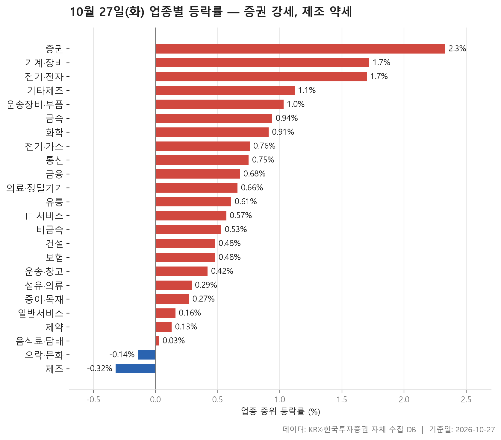
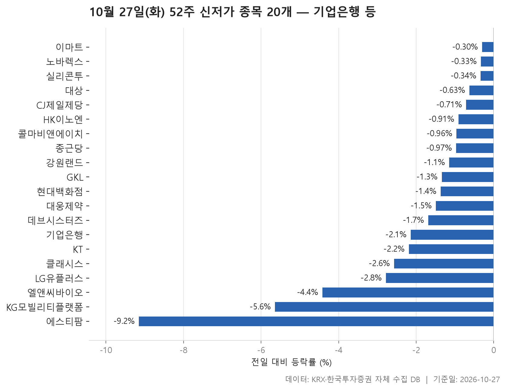
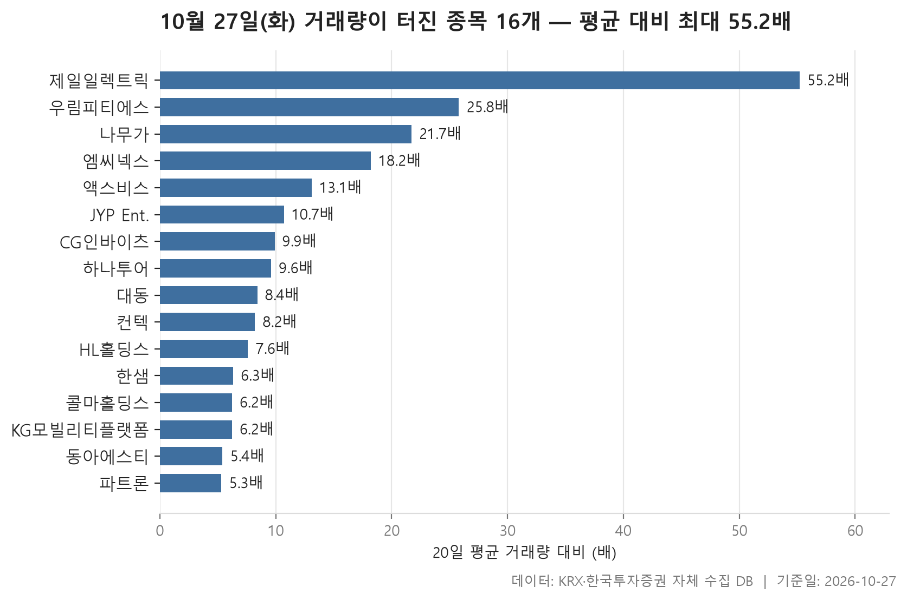

10월 27일 시장은 넓게 오르되 폭은 얕은 하루였습니다. 24개 업종 가운데 22개 업종의 중위 등락률이 플러스였고, 마이너스로 끝난 곳은 2개뿐입니다. 업종별 중위 등락률을 한 줄로 세웠을 때 한가운데 놓인 값은 +0.59%였습니다. 몇몇 업종이 크게 치고 나간 장이라기보다, 대부분 업종에서 오른 종목이 조금씩 더 많았던 날로 읽힙니다.

제목에는 '증권 강세, 제조 약세'라고 적었습니다. 다만 약세 쪽은 폭이 크지 않습니다. 가장 약한 제조의 중위 등락률이 -0.32%였으니까요. 오늘 표에서 더 눈여겨볼 것은 강한 업종이 **어떤 모양으로** 올랐느냐입니다.

이렇게 대체로 오른 날에도 52주 신저가로 밀려난 종목이 20개, 거래량이 평소의 다섯 배를 넘긴 종목이 16개 나왔습니다. 업종 평균 뒤에서 어떤 종목들이 따로 움직였는지 차례로 살펴보겠습니다.

> 기준일: 2026-10-27 · 집계: 자체 수집 데이터베이스

## 업종 등락률 — 24개 중 22개 상승

맨 위의 증권은 18개 종목이 **하나도 빠짐없이** 올랐습니다. 중위 등락률이 +2.33%, 평균이 +2.36%로 두 값이 거의 붙어 있습니다. 가장 많이 오른 SK증권도 +5.04%에 머물렀습니다. 한두 종목이 끌어올린 결과가 아니라 업종 전체가 비슷한 폭으로 함께 움직였다는 뜻입니다. 오늘 표에서 가장 고르게 오른 업종이 증권이었습니다.

그 아래 기계·장비(+1.72%)와 전기·전자(+1.70%)는 종목이 각각 207개, 367개나 되는 큰 업종인데도 넷 중 셋꼴로 올랐습니다. 두 업종 모두 평균(+2.47%, +2.54%)이 중위값보다 높습니다. 기계·장비에서 상한가 근처까지 간 멜콘(+29.97%)조차 업종 평균을 0.14%p 올리는 데 그쳤습니다. 평균을 끌어올린 건 한 종목이 아니라 크게 오른 여러 종목이었던 셈입니다. 전기·전자는 반대로, 가장 크게 움직인 다보링크가 -29.97%로 급락했습니다. 그래도 업종 전체는 강했습니다. 이 업종의 거래대금은 106,755.90억원으로 다른 업종과 비교가 안 될 만큼 많았습니다.

중위값과 평균이 서로 반대 방향을 가리킨 업종도 있습니다. 기타제조는 중위값이 +1.12%인데 평균은 -0.11%입니다. 14개 종목뿐인 업종에서 엑스플러스(-9.94%) 하나가 평균을 0.71%p 끌어내렸습니다. 오락·문화는 그 반대입니다. 중위값이 -0.14%로 마이너스인 두 업종 가운데 하나지만, 스튜디오미르(+17.71%)가 평균을 0.29%p 밀어 올려 평균은 +0.41%가 됐습니다. 음식료·담배도 중위값은 +0.03%로 보합에 가까운데, 한울앤제주(-25.73%) 때문에 평균은 -0.37%까지 내려갔습니다.

맨 아래 제조는 종목이 8개뿐입니다. 오른 종목이 열 곳 중 넷이 채 안 됐고, 평균은 -0.86%였습니다. 코아스(-4.84%) 하나가 평균을 0.61%p 끌어내렸으니, 표본이 작은 업종이 한 종목에 얼마나 흔들리는지 보여 줍니다. 그래서 '약세'라는 말은 가볍게 받아들이는 편이 맞습니다. 오히려 제약이 중위값과 평균 모두 +0.13%로 하위권에 머문 점이 다음 표와 이어집니다.

| 업종 | 종목수(개) | 중위등락률(%) | 평균등락률(%) | 상승비율(%) | 주도종목 | 주도종목등락률(%) | 평균기여도(%p) | 거래대금합계(억원) |
|---|---|---|---|---|---|---|---|---|
| 증권 | 18 | +2.33 | +2.36 | 100.00 | SK증권 | +5.04 | 0.28 | 762.40 |
| 기계·장비 | 207 | +1.72 | +2.47 | 74.90 | 멜콘 | +29.97 | 0.14 | 16,820.90 |
| 전기·전자 | 367 | +1.70 | +2.54 | 75.50 | 다보링크 | -29.97 | -0.08 | 106,755.90 |
| 기타제조 | 14 | +1.12 | -0.11 | 71.40 | 엑스플러스 | -9.94 | -0.71 | 16.10 |
| 운송장비·부품 | 132 | +1.03 | +1.32 | 81.80 | 네오티스 | +10.84 | 0.08 | 8,412.10 |
| 금속 | 130 | +0.94 | +1.10 | 70.00 | 광진실업 | +23.41 | 0.18 | 3,373.10 |
| 화학 | 220 | +0.91 | +1.22 | 63.20 | 보원케미칼 | +16.58 | 0.08 | 6,530.40 |
| 전기·가스 | 10 | +0.76 | +1.13 | 70.00 | SGC에너지 | +4.35 | 0.44 | 547.20 |
| 통신 | 13 | +0.75 | +0.32 | 53.80 | 와이어블 | +5.78 | 0.44 | 1,056.00 |
| 금융 | 110 | +0.68 | +0.85 | 64.50 | SK스퀘어 | +7.67 | 0.07 | 17,048.50 |
| 의료·정밀기기 | 103 | +0.66 | +0.94 | 64.10 | 케이씨 | +10.23 | 0.10 | 4,673.10 |
| 유통 | 157 | +0.61 | +0.97 | 60.50 | 조이웍스앤코 | +12.38 | 0.08 | 3,613.00 |
| IT 서비스 | 242 | +0.57 | +0.81 | 62.40 | 샌즈랩 | +23.87 | 0.10 | 12,347.40 |
| 비금속 | 35 | +0.53 | +1.01 | 65.70 | 서산 | +8.82 | 0.25 | 376.50 |
| 건설 | 50 | +0.48 | +0.76 | 66.00 | 대원 | +13.38 | 0.27 | 1,670.30 |
| 보험 | 11 | +0.48 | +0.63 | 63.60 | 삼성생명 | +3.45 | 0.31 | 1,777.50 |
| 운송·창고 | 28 | +0.42 | +0.60 | 67.90 | 삼일 | +10.92 | 0.39 | 989.50 |
| 섬유·의류 | 49 | +0.29 | +0.98 | 53.10 | 좋은사람들 | +21.75 | 0.44 | 333.10 |
| 종이·목재 | 27 | +0.27 | +0.17 | 51.90 | 삼보판지 | +5.01 | 0.19 | 27.90 |
| 일반서비스 | 168 | +0.16 | +0.37 | 51.20 | 페니트리움바이오 | +14.41 | 0.09 | 6,370.00 |
| 제약 | 166 | +0.13 | +0.13 | 51.80 | 지투지바이오 | -13.38 | -0.08 | 5,272.40 |
| 음식료·담배 | 84 | +0.03 | -0.37 | 50.00 | 한울앤제주 | -25.73 | -0.31 | 1,284.20 |
| 오락·문화 | 61 | -0.14 | +0.41 | 39.30 | 스튜디오미르 | +17.71 | 0.29 | 1,430.00 |
| 제조 | 8 | -0.32 | -0.86 | 37.50 | 코아스 | -4.84 | -0.61 | 6.40 |

## 52주 신저가 20개 — 최저 에스티팜 -9.15%

신저가 명단 20개 종목 가운데 KOSPI가 12개, KOSDAQ가 8개입니다. 이름이 큰 종목이 꽤 들어 있습니다. 시가총액이 가장 큰 기업은행(149,358억원)에 이어 KT, LG유플러스가 차례로 놓여 있습니다. 통신 업종의 중위 등락률이 +0.75%였던 날, 이 업종의 덩치 큰 두 종목은 52주 최저가를 새로 쓴 것입니다. 업종 전체의 분위기와 대형주의 흐름이 따로 놀았다는 점이 눈에 띕니다.

업종을 보면 제약이 6개로 가장 많습니다. 이마트·현대백화점·실리콘투·KG모빌리티플랫폼 같은 유통 종목, CJ제일제당·대상·노바렉스 같은 음식료 종목, 강원랜드·GKL 같은 오락·문화 종목이 그 뒤를 잇습니다. 앞 표에서 하위권에 있던 업종들과 상당 부분 겹칩니다. 왜 이 업종들에 신저가가 몰렸는지는 이 자료로는 알 수 없습니다.

밀린 폭은 대체로 작았습니다. 20개 종목 등락률의 중위값이 -1.35%이고, 가장 덜 내린 이마트는 -0.30%였습니다. 직전 최저가를 겨우 밑돈 종목도 많습니다. CJ제일제당은 직전 최저가 169,000원 바로 아래인 168,700원에, 클래시스는 26,550원 아래인 26,500원에 마감했습니다. 급락했다기보다 바닥을 조금 더 낮춘 모습입니다. 예외는 에스티팜입니다. 하루 -9.15%로 명단에서 가장 크게 빠졌고, 거래대금도 208.40억원으로 많은 편이었습니다.

| 종목명 | 종목코드 | 시장 | 업종 | 종가(원) | 등락률(%) | 이전52주최저(원) | 거래대금(억원) | 시가총액(억원) |
|---|---|---|---|---|---|---|---|---|
| 기업은행 | 024110 | KOSPI | 금융 | 18,730 | -2.14 | 18,800 | 219.70 | 149,358 |
| KT | 030200 | KOSPI | 통신 | 44,700 | -2.19 | 45,700 | 181.30 | 112,654 |
| LG유플러스 | 032640 | KOSPI | 통신 | 13,640 | -2.78 | 13,810 | 138.90 | 57,892 |
| 강원랜드 | 035250 | KOSPI | 오락·문화 | 13,710 | -1.15 | 13,870 | 41.10 | 29,331 |
| CJ제일제당 | 097950 | KOSPI | 음식료·담배 | 168,700 | -0.71 | 169,000 | 69.10 | 25,396 |
| 실리콘투 | 257720 | KOSDAQ | 유통 | 29,100 | -0.34 | 29,200 | 120.70 | 19,083 |
| 이마트 | 139480 | KOSPI | 유통 | 66,400 | -0.30 | 66,600 | 56.60 | 18,324 |
| 클래시스 | 214150 | KOSDAQ | 의료·정밀기기 | 26,500 | -2.57 | 26,550 | 50.80 | 17,287 |
| 에스티팜 | 237690 | KOSDAQ | 제약 | 80,400 | -9.15 | 82,100 | 208.40 | 16,785 |
| 현대백화점 | 069960 | KOSPI | 유통 | 72,100 | -1.37 | 73,000 | 66.00 | 15,548 |
| 대웅제약 | 069620 | KOSPI | 제약 | 99,100 | -1.49 | 100,600 | 22.00 | 11,482 |
| HK이노엔 | 195940 | KOSDAQ | 제약 | 32,750 | -0.91 | 33,050 | 28.20 | 9,278 |
| 종근당 | 185750 | KOSPI | 제약 | 61,300 | -0.97 | 61,700 | 14.70 | 8,461 |
| 엘앤씨바이오 | 290650 | KOSDAQ | 제약 | 23,800 | -4.42 | 24,900 | 87.40 | 6,419 |
| 대상 | 001680 | KOSPI | 음식료·담배 | 15,850 | -0.63 | 15,880 | 22.50 | 5,492 |
| GKL | 114090 | KOSPI | 오락·문화 | 8,100 | -1.34 | 8,170 | 18.70 | 5,010 |
| KG모빌리티플랫폼 | 381970 | KOSPI | 유통 | 5,860 | -5.64 | 5,900 | 20.50 | 2,861 |
| 콜마비앤에이치 | 200130 | KOSDAQ | 제약 | 7,220 | -0.96 | 7,290 | 5.40 | 2,078 |
| 노바렉스 | 194700 | KOSDAQ | 음식료·담배 | 9,070 | -0.33 | 9,100 | 5.30 | 1,656 |
| 데브시스터즈 | 194480 | KOSDAQ | IT 서비스 | 11,630 | -1.69 | 11,830 | 8.70 | 1,415 |

## 거래량 급증 16개 — 최고 제일일렉트릭 55.20배

거래량이 터진 16개 종목은 KOSPI와 KOSDAQ가 8개씩입니다. 배수의 중위값은 9배입니다. 맨 위의 제일일렉트릭은 평소 하루 91,746주 거래되던 종목인데 이날 5,065,379주가 거래돼 55.20배를 기록했고, 주가는 +14.57% 올랐습니다. 상위권에는 전기·전자가 몰려 있습니다. 나무가(+29.96%), 액스비스(+29.88%), 엠씨넥스(+22.22%)가 모두 큰 폭으로 올랐고, 업종으로 따지면 전기·전자가 5개로 가장 많습니다. 앞에서 본 전기·전자의 고른 상승과 같은 방향입니다. 다만 같은 업종의 파트론은 배수가 5.30배로 가장 낮았고, 주가도 -1.78%로 내렸습니다.

거래량이 늘었다고 주가가 크게 움직인 것은 아닙니다. 하나투어는 평소의 9.60배가 거래됐는데 등락률은 +0.18%에 그쳤습니다. 대동(+0.29%)과 HL홀딩스(+0.30%)도 사실상 제자리였습니다. 내린 종목도 있습니다. 컨텍은 4,440,483주, 475.20억원어치가 거래되는 동안 -1.99% 내렸습니다. KG모빌리티플랫폼은 -5.64%로 신저가 명단과 이 명단에 **동시에** 올랐습니다. 평소의 6.20배가 거래되면서 52주 최저가를 밑돈 경우입니다.

시가총액이 가장 큰 JYP Ent.(13,662억원)는 이 표에서 거래대금도 774.70억원으로 가장 많았습니다. 평소의 10.70배가 거래됐고 주가는 +6.81% 올랐습니다. 속한 오락·문화 업종의 중위 등락률이 마이너스였던 날이라, 업종 흐름과는 반대로 움직인 셈입니다.

| 종목명 | 종목코드 | 시장 | 업종 | 종가(원) | 등락률(%) | 거래량(주) | 평균거래량(주) | 배수(배) | 거래대금(억원) | 시가총액(억원) |
|---|---|---|---|---|---|---|---|---|---|---|
| 제일일렉트릭 | 199820 | KOSDAQ | 전기·전자 | 6,840 | +14.57 | 5,065,379 | 91,746 | 55.20 | 353.80 | 1,520 |
| 우림피티에스 | 101170 | KOSDAQ | 기계·장비 | 8,470 | +16.99 | 1,524,990 | 59,039 | 25.80 | 129.30 | 1,143 |
| 나무가 | 190510 | KOSDAQ | 전기·전자 | 17,090 | +29.96 | 1,123,384 | 51,722 | 21.70 | 187.80 | 2,407 |
| 엠씨넥스 | 097520 | KOSPI | 전기·전자 | 21,450 | +22.22 | 591,206 | 32,395 | 18.20 | 122.90 | 3,733 |
| 액스비스 | 0011A0 | KOSDAQ | 전기·전자 | 9,650 | +29.88 | 2,339,637 | 179,242 | 13.10 | 214.40 | 901 |
| JYP Ent. | 035900 | KOSDAQ | 오락·문화 | 38,450 | +6.81 | 1,989,484 | 185,596 | 10.70 | 774.70 | 13,662 |
| CG인바이츠 | 083790 | KOSDAQ | 일반서비스 | 997 | +6.75 | 860,287 | 87,067 | 9.90 | 8.50 | 767 |
| 하나투어 | 039130 | KOSPI | 일반서비스 | 27,100 | +0.18 | 175,923 | 18,398 | 9.60 | 47.70 | 4,198 |
| 대동 | 000490 | KOSPI | 기계·장비 | 6,960 | +0.29 | 689,572 | 82,206 | 8.40 | 49.10 | 2,006 |
| 컨텍 | 451760 | KOSDAQ | IT 서비스 | 10,350 | -1.99 | 4,440,483 | 543,760 | 8.20 | 475.20 | 1,709 |
| HL홀딩스 | 060980 | KOSPI | 금융 | 33,950 | +0.30 | 121,319 | 15,913 | 7.60 | 41.20 | 3,041 |
| 한샘 | 009240 | KOSPI | 유통 | 37,950 | +1.07 | 193,929 | 30,984 | 6.30 | 73.70 | 8,931 |
| 콜마홀딩스 | 024720 | KOSPI | 금융 | 8,320 | +3.23 | 167,367 | 27,203 | 6.20 | 13.80 | 2,853 |
| KG모빌리티플랫폼 | 381970 | KOSPI | 유통 | 5,860 | -5.64 | 346,036 | 56,042 | 6.20 | 20.50 | 2,861 |
| 동아에스티 | 170900 | KOSPI | 제약 | 34,900 | +2.95 | 33,122 | 6,131 | 5.40 | 11.50 | 3,395 |
| 파트론 | 091700 | KOSDAQ | 전기·전자 | 4,700 | -1.78 | 716,867 | 134,487 | 5.30 | 33.80 | 2,350 |

## 정리

정리하면 10월 27일은 증권이 한 종목도 빠짐없이 오르고 전기·전자와 기계·장비가 넷 중 셋꼴로 오른 날이었습니다. 그 한편에서는 통신 대형주와 제약·유통·음식료 종목들이 52주 신저가로 조금씩 밀려났습니다. 넓게 올랐지만 모든 종목이 같이 오른 하루는 아니었습니다.

이 글은 전일 종가와 당일 종가 하루치만 비교한 것입니다. 왜 이렇게 움직였는지는 자료에 없어 다루지 않았습니다. 업종 순위는 중위값 기준이고, 제조처럼 종목이 적은 업종은 한두 종목에 크게 흔들립니다. 신저가와 거래량 급증 명단은 시가총액 500억, 거래대금 3억 이상인 보통주만 걸러 낸 것이라, 이보다 작은 종목의 움직임은 빠져 있습니다.

## 집계 기준

**업종 등락률**

- **기준**: 2026-10-26 종가 → 2026-10-27 종가
- **순위**: 업종 내 종목 등락률의 중위값 (평균은 참고용으로 함께 표시)
- **주도종목**: 그 업종에서 등락률 절대값이 가장 큰 종목 (동점이면 거래대금이 큰 쪽)
- **평균기여도**: 그 종목 하나가 업종 평균을 움직인 폭 (등락률 ÷ 종목수). 중위값과 평균의 격차가 이 값에 가까우면 평균을 만든 것이 그 종목이고, 훨씬 크면 다른 종목들도 함께 움직인 것입니다
- **필터**: 업종 내 보통주 5종목 이상
- **전체업종중위등락률(%)**: 0.59

**52주 신저가**

- **기준**: 종가 < 직전 52주 최저가
- **관측구간**: 2025-10-15 ~ 2026-10-26 (252거래일)
- **필터**: 시가총액 500억 이상, 거래대금 3억 이상, 보통주

**거래량 급증**

- **기준**: 당일 거래량 ≥ 직전 20거래일 평균 × 5
- **관측구간**: 2026-09-23 ~ 2026-10-26 (20거래일)
- **필터**: 시가총액 500억 이상, 거래대금 3억 이상, 보통주

## 데이터 출처 및 유의사항

- **데이터출처**: 한국거래소(KRX) 공시 데이터와 한국투자증권 OpenAPI 를 직접 수집해 구축한 자체 데이터베이스
- **집계방식**: 수집·집계·차트 생성을 직접 구현한 파이프라인에서 자동 산출
- **작성고지**: 본문의 표·통계·차트는 자체 데이터베이스에서 계산된 값이며, 문장 작성 과정에 AI 도구를 활용했습니다.
- **면책**: 본 글은 정보 제공을 목적으로 하며 특정 종목의 매수·매도를 추천하지 않습니다. 제시된 수치는 과거 데이터이고 미래 수익을 보장하지 않습니다. 투자 판단과 그 결과에 대한 책임은 투자자 본인에게 있습니다.

