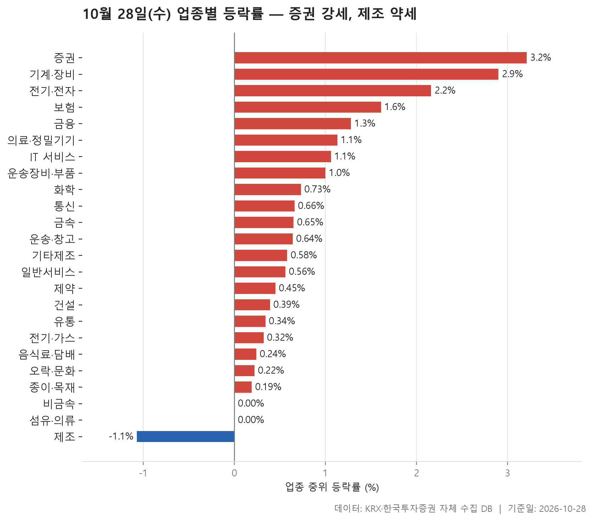
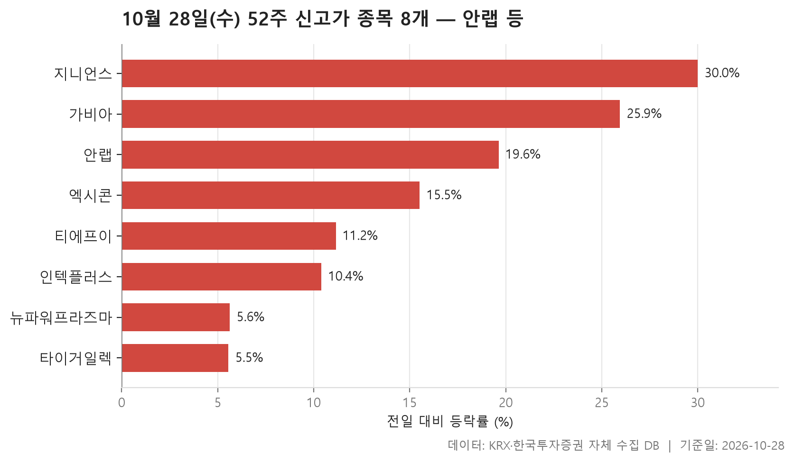
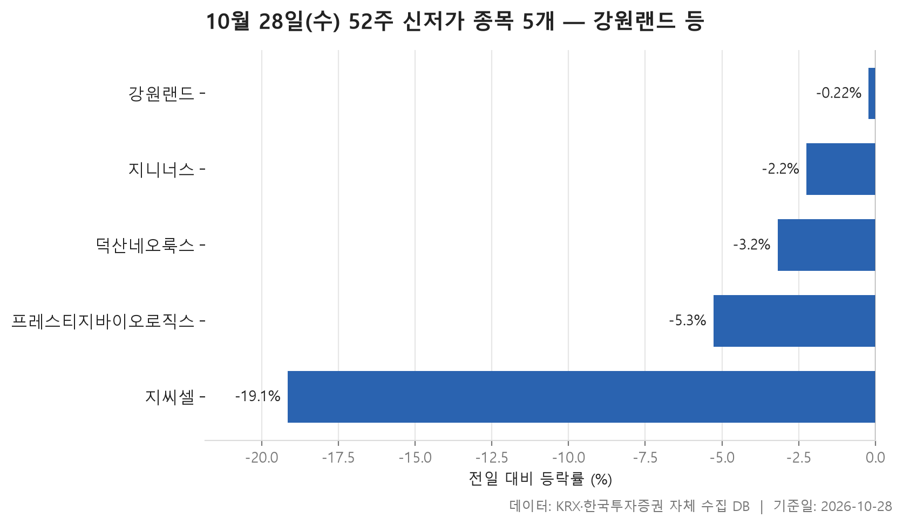
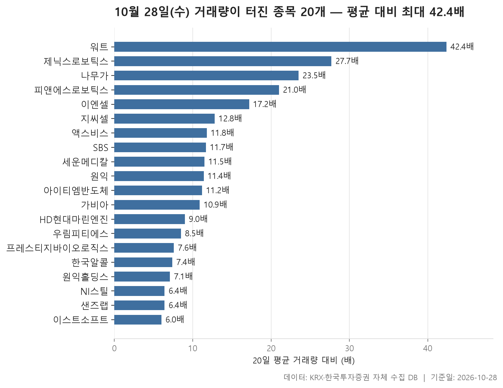

10월 28일 시장은 오른 업종이 넓게 퍼진 하루였습니다. 24개 업종 가운데 21개 업종은 종목들의 한가운데 값이 플러스였고, 마이너스로 끝난 업종은 제조 하나뿐입니다. 업종마다 구한 중위 등락률을 다시 한 줄로 세우면 가운데 값이 +0.61%입니다. 크게 뛴 장이라기보다는 대부분의 업종이 조금씩 오른 장이었다고 보는 편이 맞습니다. 맨 위는 증권(+3.21%), 맨 아래는 제조(-1.07%)였습니다.

글은 네 갈래로 이어집니다. 업종 흐름을 먼저 보고, 이어서 52주 신고가와 신저가, 마지막으로 거래량이 평소의 5배를 넘긴 종목을 봅니다. 여러 표에 겹쳐 나오는 종목이 몇 있습니다. 그 겹침에 오늘 장의 결이 드러나서 함께 짚어 보겠습니다.

> 기준일: 2026-10-28 · 집계: 자체 수집 데이터베이스

## 업종 등락률 — 24개 중 21개 상승

맨 위에 선 증권은 18개 종목 가운데 94.40%가 올랐습니다. 업종 전체가 거의 한 방향으로 움직였다는 뜻입니다. 중위값 +3.21%와 평균 +3.30%가 거의 붙어 있는 것도 그래서입니다. 가장 크게 오른 미래에셋증권(+8.01%)도 업종 평균을 0.44%p 올리는 데 그쳤습니다. 몇몇 종목이 끌어올린 강세가 아니었다는 뜻이죠. 기계·장비도 비슷한 모양입니다. 207개 종목으로 덩치가 훨씬 큰데도 열 곳 중 여덟 곳 넘게 올랐고, 중위값은 +2.90%였습니다. 전기·전자는 368개 종목에 거래대금 144,364.90억원으로 오늘 돈이 가장 많이 몰린 업종입니다. 중위값 +2.16%로 세 번째 자리에 섰지만, 이 업종에서 가장 크게 움직인 종목은 오히려 -29.95% 빠진 다보링크였습니다.

표에서 어긋나 보이는 곳은 **보험**입니다. 중위값은 +1.61%인데 평균은 +3.35%로 증권보다도 높습니다. 11개 종목뿐인 작은 업종이라 미래에셋생명(+12.01%) 하나가 업종 평균을 1.09%p 끌어올렸습니다. 그렇다고 한 종목만 오른 업종도 아닙니다. 오른 종목 비중이 90.90%라 나머지도 대부분 함께 올랐습니다. 음식료·담배는 중위값 +0.24%에 평균 +1.00%로, 평균이 위로 떠 있습니다. 한울앤제주(+29.85%)가 평균에 0.36%p를 보탠 영향입니다. 통신은 거꾸로입니다. SK텔레콤이 +6.12% 올랐는데도 평균(+0.41%)이 중위값(+0.66%)보다 낮습니다. 크게 내린 종목이 따로 있었다는 얘기지만, 어느 종목인지는 이 표만으로 알 수 없습니다.

아래쪽에서는 비금속과 섬유·의류의 중위값이 0.00%로 정확히 제자리였습니다. 섬유·의류는 오른 종목이 절반에 못 미쳤습니다(44.90%). 제조는 8개 종목 가운데 오른 비중이 12.50%, 여덟 곳 중 한 곳만 오른 셈입니다. 에넥스(-4.90%)가 평균을 -0.61%p 끌어내렸습니다. 다만 거래대금이 16.30억원에 불과한 작은 묶음이라, 이 업종을 시장 전체 약세의 신호로 읽기는 어렵습니다.

| 업종 | 종목수(개) | 중위등락률(%) | 평균등락률(%) | 상승비율(%) | 주도종목 | 주도종목등락률(%) | 평균기여도(%p) | 거래대금합계(억원) |
|---|---|---|---|---|---|---|---|---|
| 증권 | 18 | +3.21 | +3.30 | 94.40 | 미래에셋증권 | +8.01 | 0.44 | 1,163.50 |
| 기계·장비 | 207 | +2.90 | +3.43 | 85.50 | 멜콘 | +21.35 | 0.10 | 23,186.60 |
| 전기·전자 | 368 | +2.16 | +2.40 | 72.60 | 다보링크 | -29.95 | -0.08 | 144,364.90 |
| 보험 | 11 | +1.61 | +3.35 | 90.90 | 미래에셋생명 | +12.01 | 1.09 | 2,214.50 |
| 금융 | 110 | +1.28 | +1.63 | 77.30 | SK스퀘어 | +11.23 | 0.10 | 18,918.80 |
| 의료·정밀기기 | 103 | +1.13 | +1.60 | 64.10 | 피앤에스로보틱스 | +29.95 | 0.29 | 3,726.60 |
| IT 서비스 | 242 | +1.06 | +1.84 | 68.60 | 지니언스 | +30.00 | 0.12 | 14,748.70 |
| 운송장비·부품 | 132 | +1.00 | +1.46 | 68.90 | 휴림에이텍 | +17.80 | 0.13 | 10,661.20 |
| 화학 | 220 | +0.73 | +1.25 | 65.90 | 엘티씨 | +21.58 | 0.10 | 10,120.30 |
| 통신 | 13 | +0.66 | +0.41 | 61.50 | SK텔레콤 | +6.12 | 0.47 | 1,201.70 |
| 금속 | 130 | +0.65 | +0.73 | 62.30 | 알멕 | -16.21 | -0.12 | 3,057.50 |
| 운송·창고 | 28 | +0.64 | +0.63 | 71.40 | 제주항공 | +5.65 | 0.20 | 1,378.90 |
| 기타제조 | 14 | +0.58 | +0.82 | 64.30 | 엑스플러스 | +9.79 | 0.70 | 11.10 |
| 일반서비스 | 168 | +0.56 | +0.58 | 63.10 | 모아라이프플러스 | -29.78 | -0.18 | 6,442.90 |
| 제약 | 167 | +0.45 | +0.49 | 59.30 | 이엔셀 | +9.59 | 0.06 | 5,365.10 |
| 건설 | 50 | +0.39 | +0.68 | 56.00 | KCC건설 | +5.37 | 0.11 | 1,895.90 |
| 유통 | 157 | +0.34 | +0.62 | 54.80 | 윙스풋 | -11.98 | -0.08 | 3,773.90 |
| 전기·가스 | 10 | +0.32 | +0.73 | 60.00 | SGC에너지 | +2.94 | 0.29 | 388.10 |
| 음식료·담배 | 84 | +0.24 | +1.00 | 57.10 | 한울앤제주 | +29.85 | 0.36 | 1,250.10 |
| 오락·문화 | 60 | +0.22 | +0.17 | 51.70 | 스튜디오미르 | -17.38 | -0.29 | 962.80 |
| 종이·목재 | 27 | +0.19 | +0.09 | 55.60 | 리더스코스메틱 | +5.91 | 0.22 | 23.80 |
| 비금속 | 35 | 0.00 | +0.42 | 48.60 | 원익QnC | +7.09 | 0.20 | 409.00 |
| 섬유·의류 | 49 | 0.00 | -0.46 | 44.90 | 우성머티리얼스 | -8.82 | -0.18 | 229.90 |
| 제조 | 8 | -1.07 | -1.56 | 12.50 | 에넥스 | -4.90 | -0.61 | 16.30 |

## 52주 신고가 8개 — 최고 지니언스 30%

52주 신고가를 새로 쓴 종목은 8개이고 모두 KOSDAQ입니다. 업종으로 보면 IT 서비스(안랩·가비아·지니언스)와 기계·장비(엑시콘·인텍플러스·뉴파워프라즈마)가 셋씩이고, 나머지 둘이 전기·전자입니다. 업종 표에서 위쪽에 있던 업종들과 그대로 겹칩니다. 오른 폭의 중위값이 +13.34%라는 점도 볼 만합니다. 고점 근처에서 조금씩 밀어 올렸다기보다 하루에 크게 뛰면서 고점을 넘어선 경우가 많았습니다.

크기와 오른 폭이 따로 놉니다. 가장 많이 오른 지니언스(+30.00%)는 시가총액이 2,478.70억원으로 여덟 종목 중 가장 작습니다. IT 서비스 업종에서 가장 크게 움직인 종목도 지니언스였습니다. 시가총액이 가장 큰 안랩(12,339.30억원)도 +19.63% 올랐고, 거래대금은 1,294.20억원으로 이 표에서 가장 많았습니다. 가비아는 +25.94% 뛰었는데 거래대금은 79.10억원에 그쳐, 적은 거래로 가격이 크게 움직였습니다.

반대로 간신히 선을 넘은 종목도 있습니다. 타이거일렉은 +5.55% 올라 종가 100,800원을 찍었는데, 직전 52주 최고가가 100,300원이었습니다. 인텍플러스(63,700원, 직전 최고 62,600원)와 뉴파워프라즈마(15,400원, 직전 최고 14,860원)도 종가가 직전 고점과 그리 멀지 않습니다. 같은 신고가라도 고점을 크게 뚫은 종목과 막 넘어선 종목이 섞여 있습니다.

| 종목명 | 종목코드 | 시장 | 업종 | 종가(원) | 등락률(%) | 이전52주최고(원) | 거래대금(억원) | 시가총액(억원) |
|---|---|---|---|---|---|---|---|---|
| 안랩 | 053800 | KOSDAQ | IT 서비스 | 110,900 | +19.63 | 94,800 | 1,294.20 | 12,339.30 |
| 티에프이 | 425420 | KOSDAQ | 전기·전자 | 84,700 | +11.15 | 77,900 | 487.20 | 10,458.10 |
| 엑시콘 | 092870 | KOSDAQ | 기계·장비 | 67,000 | +15.52 | 59,600 | 521.90 | 8,744.00 |
| 인텍플러스 | 064290 | KOSDAQ | 기계·장비 | 63,700 | +10.40 | 62,600 | 329.80 | 8,280.00 |
| 가비아 | 079940 | KOSDAQ | IT 서비스 | 50,500 | +25.94 | 47,900 | 79.10 | 6,777.40 |
| 뉴파워프라즈마 | 144960 | KOSDAQ | 기계·장비 | 15,400 | +5.62 | 14,860 | 443.00 | 6,728.70 |
| 타이거일렉 | 219130 | KOSDAQ | 전기·전자 | 100,800 | +5.55 | 100,300 | 75.70 | 6,364.80 |
| 지니언스 | 263860 | KOSDAQ | IT 서비스 | 27,300 | +30.00 | 26,500 | 374.90 | 2,478.70 |

## 52주 신저가 5개 — 최저 지씨셀 -19.15%

52주 신저가로 밀려난 종목은 5개로, 신고가 8개보다 적습니다. 업종 대부분이 오른 날의 모습과 맞아떨어집니다. 이 가운데 KOSPI 종목은 강원랜드 하나뿐인데, 시가총액이 29,267.10억원으로 오늘 신고가·신저가 두 표를 통틀어 가장 큽니다. 하루 낙폭은 -0.22%로 작았습니다. 직전 최저가 13,700원을 13,680원으로 겨우 밑돌았습니다. 하루에 무너졌다기보다 오랫동안 밀려 온 끝에 선을 살짝 넘은 모양입니다.

이와 대조되는 종목이 지씨셀입니다. 하루에 -19.15% 빠지며 직전 최저가 11,610원을 한참 밑도는 10,470원에 마감했습니다. 거래량도 평소의 12.80배로 불어나 다음 표에 다시 나옵니다. 프레스티지바이오로직스(-5.28%)도 신저가와 거래량 급증 두 표에 함께 이름이 있습니다. 덕산네오룩스(-3.19%)는 소속 업종인 전기·전자가 +2.16% 오른 날 신저가를 기록했습니다. 업종 흐름과 개별 종목이 따로 간 사례입니다. 지니너스와 프레스티지바이오로직스는 거래대금이 각각 6.40억원, 7.00억원으로 적어서, 많지 않은 거래로 가격이 정해졌다는 점도 함께 봐 두면 좋겠습니다.

| 종목명 | 종목코드 | 시장 | 업종 | 종가(원) | 등락률(%) | 이전52주최저(원) | 거래대금(억원) | 시가총액(억원) |
|---|---|---|---|---|---|---|---|---|
| 강원랜드 | 035250 | KOSPI | 오락·문화 | 13,680 | -0.22 | 13,700 | 48.40 | 29,267.10 |
| 덕산네오룩스 | 213420 | KOSDAQ | 전기·전자 | 24,300 | -3.19 | 24,500 | 40.10 | 6,034.00 |
| 지씨셀 | 144510 | KOSDAQ | 일반서비스 | 10,470 | -19.15 | 11,610 | 34.00 | 1,654.30 |
| 프레스티지바이오로직스 | 334970 | KOSDAQ | 제약 | 1,166 | -5.28 | 1,200 | 7.00 | 906.60 |
| 지니너스 | 389030 | KOSDAQ | 일반서비스 | 1,305 | -2.25 | 1,322 | 6.40 | 514.10 |

## 거래량 급증 20개 — 최고 워트 42.40배

거래량이 직전 20거래일 평균의 5배를 넘긴 종목은 20개이고, KOSPI 3개에 KOSDAQ 17개입니다. 한가운데 종목은 평소의 11.30배였습니다. 가장 두드러진 워트는 평소의 42.40배가 거래되면서 +6.95% 올랐습니다. 업종으로는 기계·장비가 4개로 가장 많아, 업종 표와 신고가 표에서 본 흐름이 거래량에서도 되풀이됩니다. 20개 가운데 내린 종목은 지씨셀, 세운메디칼, 프레스티지바이오로직스 세 곳뿐입니다. 대체로 거래가 늘면서 가격도 함께 오른 하루였습니다.

규모로 보면 원익홀딩스가 눈에 띕니다. 시가총액 21,626.60억원으로 이 표에서 가장 크고, 거래대금 1,812.80억원에 +17.89% 올랐습니다. KOSPI에서는 HD현대마린엔진이 평소의 9.00배 거래되며 +14.49% 뛰었습니다. 샌즈랩은 하루 거래량이 14,315,188주로 압도적인데 배수는 6.40배에 그칩니다. 평소에도 거래가 워낙 많은 종목이라서입니다. 반대로 SBS는 11.70배인데 거래대금이 6.80억원에 불과합니다. 평소 거래가 적은 종목은 배수가 쉽게 커 보입니다.

거래만 늘고 가격은 거의 움직이지 않은 종목도 있습니다. 우림피티에스는 8.50배 거래됐지만 +0.47%, 이스트소프트는 6.00배에 +0.30%였습니다. 거래가 터졌다고 늘 가격이 함께 움직이는 건 아니라는 점을 보여 줍니다. 피앤에스로보틱스(+29.95%)와 이엔셀(+9.59%)은 각각 의료·정밀기기와 제약 업종에서 가장 크게 움직인 종목인데, 거래량 표에도 나란히 올라 있습니다.

| 종목명 | 종목코드 | 시장 | 업종 | 종가(원) | 등락률(%) | 거래량(주) | 평균거래량(주) | 배수(배) | 거래대금(억원) | 시가총액(억원) |
|---|---|---|---|---|---|---|---|---|---|---|
| 워트 | 396470 | KOSDAQ | 기계·장비 | 6,460 | +6.95 | 4,646,475 | 109,561 | 42.40 | 326.50 | 1,041.40 |
| 제닉스로보틱스 | 381620 | KOSDAQ | 기계·장비 | 5,620 | +18.19 | 1,121,363 | 40,461 | 27.70 | 65.60 | 737.20 |
| 나무가 | 190510 | KOSDAQ | 전기·전자 | 18,310 | +7.14 | 2,485,483 | 105,594 | 23.50 | 476.10 | 2,579.00 |
| 피앤에스로보틱스 | 460940 | KOSDAQ | 의료·정밀기기 | 5,120 | +29.95 | 757,606 | 35,991 | 21.00 | 37.70 | 688.90 |
| 이엔셀 | 456070 | KOSDAQ | 제약 | 5,030 | +9.59 | 940,783 | 54,757 | 17.20 | 50.80 | 554.80 |
| 지씨셀 | 144510 | KOSDAQ | 일반서비스 | 10,470 | -19.15 | 311,124 | 24,342 | 12.80 | 34.00 | 1,654.30 |
| 액스비스 | 0011A0 | KOSDAQ | 전기·전자 | 10,200 | +5.70 | 3,395,455 | 288,443 | 11.80 | 357.90 | 952.00 |
| SBS | 034120 | KOSPI | 오락·문화 | 11,250 | +3.31 | 59,429 | 5,091 | 11.70 | 6.80 | 2,087.00 |
| 세운메디칼 | 100700 | KOSDAQ | 제약 | 2,285 | -0.87 | 439,826 | 38,340 | 11.50 | 10.40 | 1,000.80 |
| 원익 | 032940 | KOSDAQ | 유통 | 7,550 | +8.17 | 1,911,795 | 168,384 | 11.40 | 150.00 | 1,373.60 |
| 아이티엠반도체 | 084850 | KOSDAQ | 전기·전자 | 6,290 | +8.64 | 179,860 | 16,114 | 11.20 | 11.20 | 1,426.80 |
| 가비아 | 079940 | KOSDAQ | IT 서비스 | 50,500 | +25.94 | 156,339 | 14,312 | 10.90 | 79.10 | 6,777.40 |
| HD현대마린엔진 | 071970 | KOSPI | 기계·장비 | 40,700 | +14.49 | 1,628,755 | 180,738 | 9.00 | 679.20 | 13,806.00 |
| 우림피티에스 | 101170 | KOSDAQ | 기계·장비 | 8,510 | +0.47 | 1,133,870 | 134,141 | 8.50 | 98.20 | 1,148.80 |
| 프레스티지바이오로직스 | 334970 | KOSDAQ | 제약 | 1,166 | -5.28 | 619,320 | 81,826 | 7.60 | 7.00 | 906.60 |
| 한국알콜 | 017890 | KOSDAQ | 화학 | 16,140 | +13.82 | 711,758 | 95,762 | 7.40 | 113.90 | 3,336.70 |
| 원익홀딩스 | 030530 | KOSDAQ | 화학 | 28,000 | +17.89 | 6,408,247 | 896,377 | 7.10 | 1,812.80 | 21,626.60 |
| NI스틸 | 008260 | KOSPI | 금속 | 3,295 | +9.29 | 284,478 | 44,190 | 6.40 | 9.20 | 942.40 |
| 샌즈랩 | 411080 | KOSDAQ | IT 서비스 | 8,750 | +6.71 | 14,315,188 | 2,242,192 | 6.40 | 1,277.30 | 1,335.90 |
| 이스트소프트 | 047560 | KOSDAQ | IT 서비스 | 6,660 | +0.30 | 233,730 | 38,747 | 6.00 | 16.80 | 782.80 |

## 정리

정리하면 10월 28일은 오른 업종이 넓게 퍼진 가운데, 신고가와 거래량 급증이 KOSDAQ의 IT 서비스와 기계·장비 쪽에 몰린 하루였습니다. 신저가 종목은 적었습니다. 강원랜드처럼 겨우 선을 넘은 경우도 있고, 지씨셀처럼 거래가 몰리며 크게 빠진 경우도 있어 같은 신저가라도 모양이 달랐습니다.

한계도 밝혀 둡니다. 이 글은 하루 종가를 전날 종가와 비교한 결과일 뿐, 왜 그렇게 움직였는지는 자료에 담겨 있지 않습니다. 종목 수가 적은 업종은 한두 종목에 따라 순위가 크게 바뀌고, 시가총액 500억원 미만이거나 거래가 적은 종목은 신고가·신저가·거래량 표에서 빠져 있습니다. 투자 판단의 근거가 아니라 시장을 훑어보는 참고 자료로 읽어 주시기 바랍니다.

## 집계 기준

**업종 등락률**

- **기준**: 2026-10-27 종가 → 2026-10-28 종가
- **순위**: 업종 내 종목 등락률의 중위값 (평균은 참고용으로 함께 표시)
- **주도종목**: 그 업종에서 등락률 절대값이 가장 큰 종목 (동점이면 거래대금이 큰 쪽)
- **평균기여도**: 그 종목 하나가 업종 평균을 움직인 폭 (등락률 ÷ 종목수). 중위값과 평균의 격차가 이 값에 가까우면 평균을 만든 것이 그 종목이고, 훨씬 크면 다른 종목들도 함께 움직인 것입니다
- **필터**: 업종 내 보통주 5종목 이상
- **전체업종중위등락률(%)**: 0.61

**52주 신고가**

- **기준**: 종가 > 직전 52주 최고가
- **관측구간**: 2025-10-16 ~ 2026-10-27 (252거래일)
- **필터**: 시가총액 500억 이상, 거래대금 3억 이상, 보통주

**52주 신저가**

- **기준**: 종가 < 직전 52주 최저가
- **관측구간**: 2025-10-16 ~ 2026-10-27 (252거래일)
- **필터**: 시가총액 500억 이상, 거래대금 3억 이상, 보통주

**거래량 급증**

- **기준**: 당일 거래량 ≥ 직전 20거래일 평균 × 5
- **관측구간**: 2026-09-28 ~ 2026-10-27 (20거래일)
- **필터**: 시가총액 500억 이상, 거래대금 3억 이상, 보통주

## 데이터 출처 및 유의사항

- **데이터출처**: 한국거래소(KRX) 공시 데이터와 한국투자증권 OpenAPI 를 직접 수집해 구축한 자체 데이터베이스
- **집계방식**: 수집·집계·차트 생성을 직접 구현한 파이프라인에서 자동 산출
- **작성고지**: 본문의 표·통계·차트는 자체 데이터베이스에서 계산된 값이며, 문장 작성 과정에 AI 도구를 활용했습니다.
- **면책**: 본 글은 정보 제공을 목적으로 하며 특정 종목의 매수·매도를 추천하지 않습니다. 제시된 수치는 과거 데이터이고 미래 수익을 보장하지 않습니다. 투자 판단과 그 결과에 대한 책임은 투자자 본인에게 있습니다.

