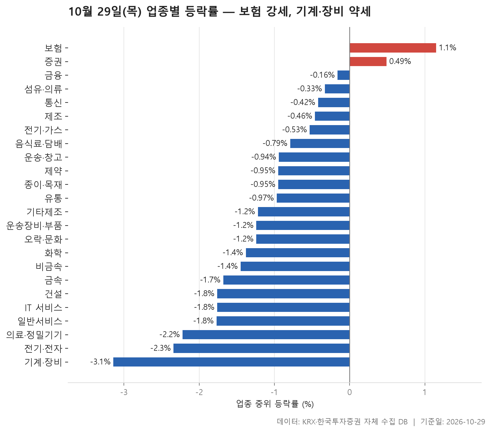
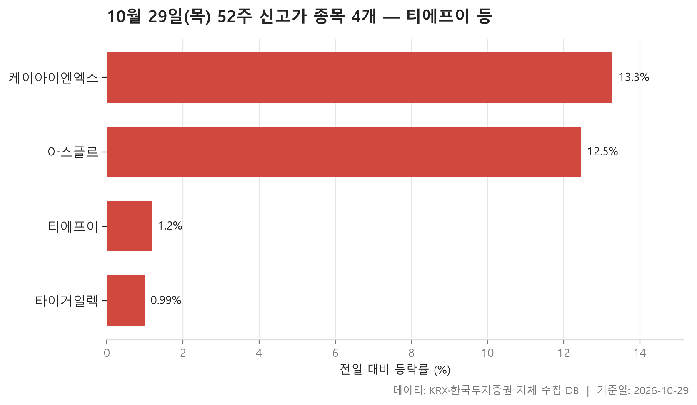
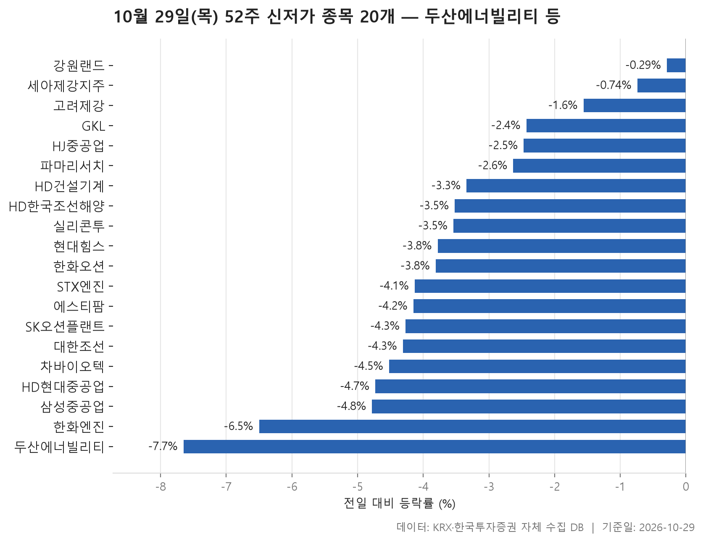
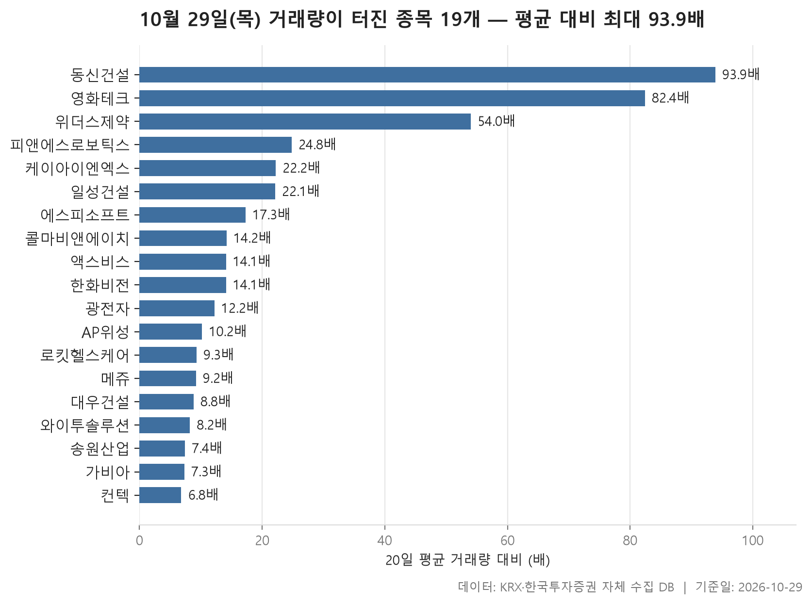

10월 29일 시장은 한쪽으로 크게 기운 하루였습니다. 24개 업종 가운데 중위 등락률이 플러스로 끝난 곳은 2개뿐이고 나머지 22개는 마이너스였습니다. 업종별 중위 등락률을 한 줄로 세웠을 때 한가운데 놓인 값이 -1.09%입니다. 중간쯤에 있는 업종도 분명하게 밀렸다는 뜻입니다. 맨 위는 보험(+1.15%), 맨 아래는 기계·장비(-3.14%)였습니다.

오늘은 네 가지를 차례로 봅니다. 먼저 업종 흐름을 보고, 이어서 52주 신고가와 신저가 종목, 마지막으로 거래량이 평소보다 크게 늘어난 종목을 정리합니다. 신고가는 4개에 그친 반면 신저가는 20개였다는 점부터가 오늘 분위기를 잘 보여 줍니다.

표만 봐서는 잘 안 보이는 부분, 그러니까 업종 평균과 중위값이 벌어진 곳이나 신저가 목록 위쪽에 몰린 대형주 같은 대목을 중심으로 짚어 보겠습니다.

> 기준일: 2026-10-29 · 집계: 자체 수집 데이터베이스

## 업종 등락률 — 24개 중 22개 하락

맨 위의 보험은 내용이 탄탄합니다. 11개 종목 가운데 오른 종목 비중이 90.90%로 거의 전부가 올랐고, 중위값(+1.15%)과 평균(+1.10%)도 거의 붙어 있습니다. 가장 크게 움직인 현대해상(+2.85%)이 업종 평균을 0.26%p 끌어올렸지만 업종 전체가 함께 오른 흐름이었습니다. 2위 증권(+0.49%)은 결이 조금 다릅니다. 오른 종목이 절반을 겨우 넘었고, 가장 크게 움직인 SK증권은 오히려 -3.38% 빠졌습니다. 업종은 올랐는데 가장 눈에 띈 종목은 반대로 움직인 셈입니다.

바닥 쪽은 더 고르게 약했습니다. 기계·장비는 207개 종목 중 오른 비중이 7.70%로, 열 곳 가운데 한 곳도 오르지 못했습니다. 중위값 -3.14%와 평균 -3.16%가 거의 같다는 것은 특정 종목 몇 개가 아니라 업종 전체가 함께 밀렸다는 뜻입니다. 종목 수가 369개로 가장 많고 거래대금이 178,927.80억원으로 다른 업종을 크게 앞서는 전기·전자도 -2.34%로 아래에서 두 번째였습니다. 이 업종에서 가장 크게 움직인 서울바이오시스는 +30.00%로 상한가까지 갔지만, 업종 평균에 보탠 몫은 0.08%p에 그쳤습니다. 종목이 많은 업종에서는 한 종목이 아무리 튀어도 전체 그림은 거의 바뀌지 않습니다.

중위값과 평균이 벌어진 업종도 볼 만합니다. 제조는 중위값 -0.46%에 평균 -1.78%인데, 코아스(-12.21%) 하나가 평균을 -1.53%p 끌어내렸습니다. 평균을 낮춘 건 사실상 이 종목 하나였습니다. 섬유·의류는 중위값 -0.33%, 평균 -1.49%로 비슷하게 벌어져 있지만 형지I&C(-16.52%)의 몫은 -0.34%p에 불과합니다. 격차가 이 종목 몫보다 훨씬 크니 다른 종목들도 크게 빠졌다는 뜻입니다. 거꾸로 음식료·담배는 평균(-0.25%)이 중위값(-0.79%)보다 높았는데, 한울앤제주(+15.59%) 같은 급등주가 평균을 위로 당겼습니다.

| 업종 | 종목수(개) | 중위등락률(%) | 평균등락률(%) | 상승비율(%) | 주도종목 | 주도종목등락률(%) | 평균기여도(%p) | 거래대금합계(억원) |
|---|---|---|---|---|---|---|---|---|
| 보험 | 11 | +1.15 | +1.10 | 90.90 | 현대해상 | +2.85 | 0.26 | 2,673.00 |
| 증권 | 18 | +0.49 | +0.30 | 55.60 | SK증권 | -3.38 | -0.19 | 928.80 |
| 금융 | 110 | -0.16 | -0.24 | 43.60 | 스틱인베스트먼트 | +7.55 | 0.07 | 18,621.90 |
| 섬유·의류 | 49 | -0.33 | -1.49 | 30.60 | 형지I&C | -16.52 | -0.34 | 192.10 |
| 통신 | 13 | -0.42 | -1.41 | 46.20 | 프리티 | -6.89 | -0.53 | 668.20 |
| 제조 | 8 | -0.46 | -1.78 | 37.50 | 코아스 | -12.21 | -1.53 | 4.70 |
| 전기·가스 | 10 | -0.53 | -0.77 | 20.00 | SGC에너지 | -4.50 | -0.45 | 418.10 |
| 음식료·담배 | 84 | -0.79 | -0.25 | 32.10 | 한울앤제주 | +15.59 | 0.19 | 1,572.90 |
| 운송·창고 | 28 | -0.94 | -0.82 | 32.10 | 트리니티항공 | -4.18 | -0.15 | 1,237.50 |
| 제약 | 166 | -0.95 | -1.12 | 22.30 | 로킷헬스케어 | +21.79 | 0.13 | 5,431.20 |
| 종이·목재 | 27 | -0.95 | -0.81 | 29.60 | 동화기업 | -3.78 | -0.14 | 22.10 |
| 유통 | 156 | -0.97 | -1.33 | 31.40 | 하이퍼코퍼레이션 | -18.63 | -0.12 | 3,779.10 |
| 기타제조 | 14 | -1.22 | -0.99 | 14.30 | 엑스플러스 | +12.71 | 0.91 | 11.80 |
| 운송장비·부품 | 132 | -1.24 | -1.64 | 22.00 | 씨티알모빌리티 | +29.86 | 0.23 | 10,439.90 |
| 오락·문화 | 61 | -1.24 | -1.28 | 19.70 | 아센디오 | +15.89 | 0.26 | 1,364.80 |
| 화학 | 220 | -1.38 | -1.62 | 21.80 | 진양화학 | +15.84 | 0.07 | 10,428.30 |
| 비금속 | 35 | -1.45 | -0.94 | 28.60 | 서산 | +6.04 | 0.17 | 1,482.60 |
| 금속 | 129 | -1.68 | -1.76 | 17.80 | 대호특수강 | -11.36 | -0.09 | 3,148.80 |
| 건설 | 50 | -1.76 | -1.23 | 22.00 | 상지건설 | +30.00 | 0.60 | 6,518.40 |
| IT 서비스 | 242 | -1.76 | -2.55 | 19.40 | 코나아이 | -39.32 | -0.16 | 10,002.60 |
| 일반서비스 | 168 | -1.77 | -2.26 | 17.90 | 바이오인프라 | -16.95 | -0.10 | 5,658.30 |
| 의료·정밀기기 | 103 | -2.22 | -2.38 | 20.40 | 엠에스바이오 | -17.40 | -0.17 | 2,646.60 |
| 전기·전자 | 369 | -2.34 | -2.29 | 19.00 | 서울바이오시스 | +30.00 | 0.08 | 178,927.80 |
| 기계·장비 | 207 | -3.14 | -3.16 | 7.70 | 디티에스 | -17.10 | -0.08 | 18,035.40 |

## 52주 신고가 4개 — 최고 케이아이엔엑스 13.28%

52주 신고가는 4개뿐이고 모두 KOSDAQ 종목입니다. 시장 전반이 밀린 날이라 신고가 자체가 드물었습니다.

네 종목이 신고가를 넘은 방식도 둘로 나뉩니다. 시가총액이 10,581.50억원으로 가장 큰 티에프이는 +1.18%, 타이거일렉은 +0.99% 오르는 데 그쳤고 종가가 이전 고점을 살짝 넘긴 정도였습니다. 반면 케이아이엔엑스(+13.28%)와 아스플로(+12.46%)는 하루에 크게 뛰어 고점을 넘었습니다. 등락률 중위값이 6.82%로 나온 것도 이렇게 두 무리로 갈렸기 때문입니다.

눈에 띄는 건 아스플로의 업종입니다. 오늘 가장 약했던 기계·장비 소속인데, 오른 종목이 열에 하나도 안 되는 업종에서 신고가가 나왔습니다. 케이아이엔엑스는 뒤에 나오는 거래량 급증 목록에도 다시 등장합니다.

| 종목명 | 종목코드 | 시장 | 업종 | 종가(원) | 등락률(%) | 이전52주최고(원) | 거래대금(억원) | 시가총액(억원) |
|---|---|---|---|---|---|---|---|---|
| 티에프이 | 425420 | KOSDAQ | 전기·전자 | 85,700 | +1.18 | 85,300 | 317.40 | 10,581.50 |
| 케이아이엔엑스 | 093320 | KOSDAQ | IT 서비스 | 177,400 | +13.28 | 163,700 | 292.50 | 8,657.10 |
| 타이거일렉 | 219130 | KOSDAQ | 전기·전자 | 101,800 | +0.99 | 101,500 | 50.30 | 6,427.90 |
| 아스플로 | 159010 | KOSDAQ | 기계·장비 | 35,650 | +12.46 | 35,550 | 149.30 | 4,753.80 |

## 52주 신저가 20개 — 최저 두산에너빌리티 -7.65%

신저가는 20개로 신고가보다 훨씬 많았고, KOSPI가 15개로 대부분을 차지했습니다. 신고가가 KOSDAQ 중소형주였던 것과 정반대 모습입니다.

목록 위쪽에 대형주가 몰려 있다는 점이 가장 먼저 보입니다. 시가총액이 가장 큰 두산에너빌리티(363,198.20억원)가 -7.65%로 신저가 종목 중 낙폭도 가장 컸고, HD현대중공업(-4.73%), HD한국조선해양(-3.52%), 한화오션(-3.81%), 삼성중공업(-4.78%)이 뒤를 잇습니다. 업종으로 보면 운송장비·부품이 5개로 가장 많고, 기계·장비 종목도 여럿입니다. 참고로 HD한국조선해양과 세아제강지주는 이 분류에서 금융으로 잡혀 있습니다.

등락률 중위값은 -3.79%입니다. 다만 모든 종목이 크게 빠진 건 아닙니다. 강원랜드는 -0.29%, 세아제강지주는 -0.74%로 소폭 내렸을 뿐인데, 이전 저점 바로 위에 있다가 조금 밀리면서 신저가가 됐습니다. 신저가 목록에는 급락한 종목과 오래 미끄러지다 저점을 살짝 깬 종목이 섞여 있다는 점을 같이 보셔야 합니다.

| 종목명 | 종목코드 | 시장 | 업종 | 종가(원) | 등락률(%) | 이전52주최저(원) | 거래대금(억원) | 시가총액(억원) |
|---|---|---|---|---|---|---|---|---|
| 두산에너빌리티 | 034020 | KOSPI | 기계·장비 | 56,700 | -7.65 | 57,000 | 4,372.40 | 363,198.20 |
| HD현대중공업 | 329180 | KOSPI | 운송장비·부품 | 272,000 | -4.73 | 284,000 | 1,272.90 | 285,494.50 |
| HD한국조선해양 | 009540 | KOSPI | 금융 | 233,000 | -3.52 | 236,500 | 557.20 | 164,901.40 |
| 한화오션 | 042660 | KOSPI | 운송장비·부품 | 50,500 | -3.81 | 51,200 | 589.70 | 154,738.80 |
| 삼성중공업 | 010140 | KOSPI | 운송장비·부품 | 15,720 | -4.78 | 16,270 | 840.90 | 138,336.00 |
| HD건설기계 | 267270 | KOSPI | 기계·장비 | 78,200 | -3.34 | 80,000 | 283.80 | 37,143.00 |
| 강원랜드 | 035250 | KOSPI | 오락·문화 | 13,640 | -0.29 | 13,670 | 41.60 | 29,181.50 |
| 한화엔진 | 082740 | KOSPI | 기계·장비 | 30,950 | -6.50 | 31,000 | 247.30 | 25,826.90 |
| 파마리서치 | 214450 | KOSDAQ | 제약 | 222,500 | -2.63 | 225,500 | 204.10 | 23,117.00 |
| 실리콘투 | 257720 | KOSDAQ | 유통 | 28,650 | -3.54 | 28,900 | 178.70 | 18,787.60 |
| 에스티팜 | 237690 | KOSDAQ | 제약 | 74,000 | -4.15 | 76,200 | 88.00 | 15,448.70 |
| 대한조선 | 439260 | KOSPI | 운송장비·부품 | 35,550 | -4.31 | 36,000 | 22.70 | 13,540.50 |
| HJ중공업 | 097230 | KOSPI | 건설 | 11,840 | -2.47 | 11,950 | 24.20 | 10,691.00 |
| STX엔진 | 077970 | KOSPI | 기계·장비 | 15,770 | -4.13 | 15,830 | 30.40 | 6,331.30 |
| 차바이오텍 | 085660 | KOSDAQ | 제약 | 6,760 | -4.52 | 7,000 | 22.80 | 6,285.00 |
| SK오션플랜트 | 100090 | KOSPI | 금속 | 9,190 | -4.27 | 9,530 | 32.90 | 5,741.70 |
| GKL | 114090 | KOSPI | 오락·문화 | 8,020 | -2.43 | 8,090 | 6.70 | 4,960.80 |
| 고려제강 | 002240 | KOSPI | 금속 | 14,470 | -1.56 | 14,560 | 4.70 | 3,906.90 |
| 세아제강지주 | 003030 | KOSPI | 금융 | 94,000 | -0.74 | 94,200 | 13.90 | 3,893.20 |
| 현대힘스 | 460930 | KOSDAQ | 운송장비·부품 | 9,920 | -3.78 | 10,040 | 7.00 | 3,522.70 |

## 거래량 급증 19개 — 최고 동신건설 93.90배

거래량이 직전 20거래일 평균의 5배를 넘은 종목은 19개이고, 이 가운데 13개가 KOSDAQ입니다. 배수 중위값은 14.10배입니다. 맨 위 동신건설은 평소 하루 16,197주 거래되던 종목이 1,521,126주가 오가며 93.90배를 기록했습니다. 영화테크(82.40배)와 위더스제약(54.00배)까지가 돋보이고, 그 아래로는 수십 배에서 열 배 안팎으로 내려옵니다.

거래량이 터졌다고 다 오른 건 아닙니다. 한화비전(+22.14%), 로킷헬스케어(+21.79%), 광전자(+18.15%)처럼 크게 오른 종목이 많지만, 대우건설(-18.57%)과 와이투솔루션(-19.93%)은 거래량이 크게 늘면서 급락했습니다. 대우건설은 이 목록에서 시가총액이 가장 크고(47,744.90억원) 거래대금도 3,655.90억원으로 가장 많았습니다. 업종으로는 전기·전자가 5개로 가장 많습니다. 업종 전체는 약했지만 그 안에서 개별 종목 몇 곳에 매매가 크게 몰린 것입니다.

건설도 흥미롭습니다. 동신건설(+10.61%)과 일성건설(+1.24%)은 올랐고 대우건설은 급락했습니다. 같은 업종 안에서 거래량이 몰린 종목들이 정반대로 움직였는데, 그 이유는 이 자료로는 알 수 없습니다.

| 종목명 | 종목코드 | 시장 | 업종 | 종가(원) | 등락률(%) | 거래량(주) | 평균거래량(주) | 배수(배) | 거래대금(억원) | 시가총액(억원) |
|---|---|---|---|---|---|---|---|---|---|---|
| 동신건설 | 025950 | KOSDAQ | 건설 | 9,900 | +10.61 | 1,521,126 | 16,197 | 93.90 | 157.20 | 831.60 |
| 영화테크 | 265560 | KOSDAQ | 운송장비·부품 | 5,900 | +2.79 | 1,554,797 | 18,879 | 82.40 | 98.20 | 630.70 |
| 위더스제약 | 330350 | KOSDAQ | 제약 | 6,360 | -1.40 | 2,316,596 | 42,920 | 54.00 | 165.70 | 839.50 |
| 피앤에스로보틱스 | 460940 | KOSDAQ | 의료·정밀기기 | 4,725 | -7.71 | 1,790,952 | 72,298 | 24.80 | 88.80 | 635.80 |
| 케이아이엔엑스 | 093320 | KOSDAQ | IT 서비스 | 177,400 | +13.28 | 164,292 | 7,411 | 22.20 | 292.50 | 8,657.10 |
| 일성건설 | 013360 | KOSPI | 건설 | 1,302 | +1.24 | 3,791,888 | 171,725 | 22.10 | 52.60 | 703.40 |
| 에스피소프트 | 443670 | KOSDAQ | IT 서비스 | 5,020 | +3.72 | 11,165,632 | 646,743 | 17.30 | 561.50 | 1,205.30 |
| 콜마비앤에이치 | 200130 | KOSDAQ | 제약 | 7,830 | +7.26 | 488,361 | 34,427 | 14.20 | 38.90 | 2,253.10 |
| 액스비스 | 0011A0 | KOSDAQ | 전기·전자 | 11,390 | +11.67 | 6,335,512 | 450,807 | 14.10 | 728.30 | 1,063.10 |
| 한화비전 | 489790 | KOSPI | 전기·전자 | 49,100 | +22.14 | 2,410,388 | 170,558 | 14.10 | 1,104.20 | 24,789.80 |
| 광전자 | 017900 | KOSPI | 전기·전자 | 9,440 | +18.15 | 15,148,206 | 1,240,717 | 12.20 | 1,455.90 | 5,469.90 |
| AP위성 | 211270 | KOSDAQ | 전기·전자 | 9,000 | +4.53 | 6,562,578 | 643,569 | 10.20 | 611.90 | 1,357.40 |
| 로킷헬스케어 | 376900 | KOSDAQ | 제약 | 19,450 | +21.79 | 1,682,343 | 180,418 | 9.30 | 321.20 | 3,402.40 |
| 메쥬 | 0088M0 | KOSDAQ | 의료·정밀기기 | 14,700 | +12.21 | 983,224 | 106,814 | 9.20 | 145.00 | 1,452.60 |
| 대우건설 | 047040 | KOSPI | 건설 | 11,620 | -18.57 | 31,226,219 | 3,537,106 | 8.80 | 3,655.90 | 47,744.90 |
| 와이투솔루션 | 011690 | KOSPI | 전기·전자 | 3,215 | -19.93 | 2,472,087 | 301,964 | 8.20 | 90.80 | 1,179.90 |
| 송원산업 | 004430 | KOSPI | 화학 | 10,600 | +2.32 | 612,145 | 83,271 | 7.40 | 65.40 | 2,544.00 |
| 가비아 | 079940 | KOSDAQ | IT 서비스 | 50,300 | -0.40 | 144,113 | 19,761 | 7.30 | 72.50 | 6,750.60 |
| 컨텍 | 451760 | KOSDAQ | IT 서비스 | 11,510 | +8.79 | 5,846,136 | 861,067 | 6.80 | 712.40 | 1,900.00 |

## 정리

정리하면 10월 29일은 보험과 증권 정도만 버티고 나머지 업종은 대체로 밀린 날이었습니다. 특히 기계·장비와 전기·전자처럼 종목이 많은 업종이 고르게 약했고, 신저가 목록 위쪽에는 KOSPI 대형주가 몰렸습니다. 신고가와 거래량 급증은 몇몇 개별 종목의 움직임에 가까웠습니다.

다만 이 글은 하루치 종가만 비교한 것이고, 왜 그렇게 움직였는지는 자료에 담겨 있지 않습니다. 업종 분류도 자체 기준이어서 일반적인 인식과 다르게 묶인 종목이 있습니다. 표는 흐름을 훑어보는 데 쓰시고, 개별 종목은 따로 확인하시기 바랍니다.

## 집계 기준

**업종 등락률**

- **기준**: 2026-10-28 종가 → 2026-10-29 종가
- **순위**: 업종 내 종목 등락률의 중위값 (평균은 참고용으로 함께 표시)
- **주도종목**: 그 업종에서 등락률 절대값이 가장 큰 종목 (동점이면 거래대금이 큰 쪽)
- **평균기여도**: 그 종목 하나가 업종 평균을 움직인 폭 (등락률 ÷ 종목수). 중위값과 평균의 격차가 이 값에 가까우면 평균을 만든 것이 그 종목이고, 훨씬 크면 다른 종목들도 함께 움직인 것입니다
- **필터**: 업종 내 보통주 5종목 이상
- **전체업종중위등락률(%)**: -1.09

**52주 신고가**

- **기준**: 종가 > 직전 52주 최고가
- **관측구간**: 2025-10-17 ~ 2026-10-28 (252거래일)
- **필터**: 시가총액 500억 이상, 거래대금 3억 이상, 보통주

**52주 신저가**

- **기준**: 종가 < 직전 52주 최저가
- **관측구간**: 2025-10-17 ~ 2026-10-28 (252거래일)
- **필터**: 시가총액 500억 이상, 거래대금 3억 이상, 보통주

**거래량 급증**

- **기준**: 당일 거래량 ≥ 직전 20거래일 평균 × 5
- **관측구간**: 2026-09-29 ~ 2026-10-28 (20거래일)
- **필터**: 시가총액 500억 이상, 거래대금 3억 이상, 보통주

## 데이터 출처 및 유의사항

- **데이터출처**: 한국거래소(KRX) 공시 데이터와 한국투자증권 OpenAPI 를 직접 수집해 구축한 자체 데이터베이스
- **집계방식**: 수집·집계·차트 생성을 직접 구현한 파이프라인에서 자동 산출
- **작성고지**: 본문의 표·통계·차트는 자체 데이터베이스에서 계산된 값이며, 문장 작성 과정에 AI 도구를 활용했습니다.
- **면책**: 본 글은 정보 제공을 목적으로 하며 특정 종목의 매수·매도를 추천하지 않습니다. 제시된 수치는 과거 데이터이고 미래 수익을 보장하지 않습니다. 투자 판단과 그 결과에 대한 책임은 투자자 본인에게 있습니다.

