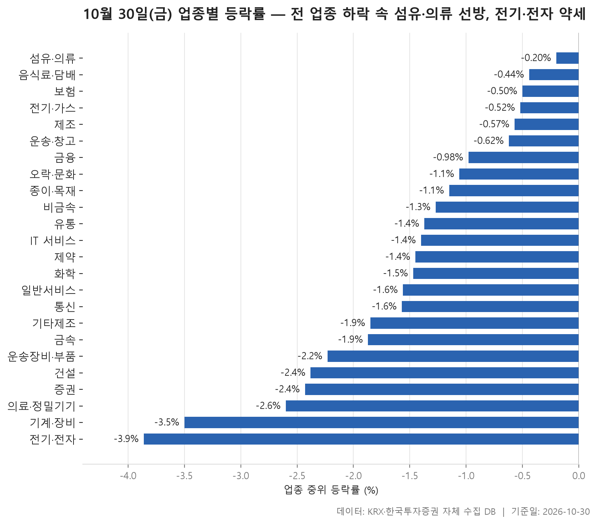
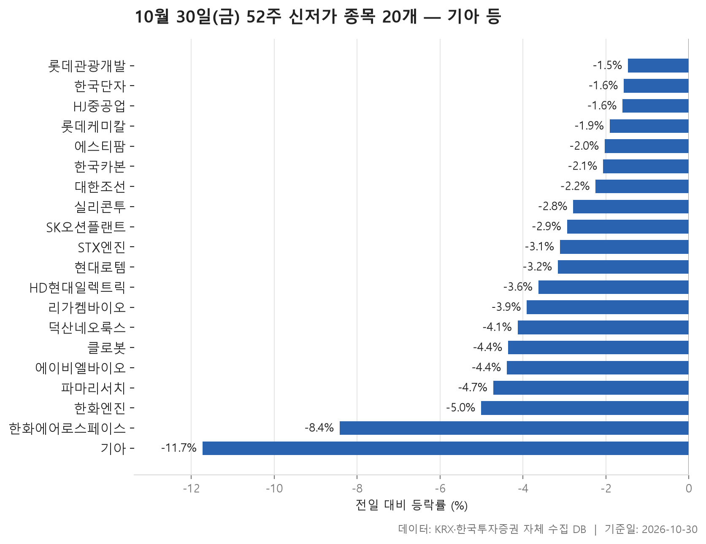
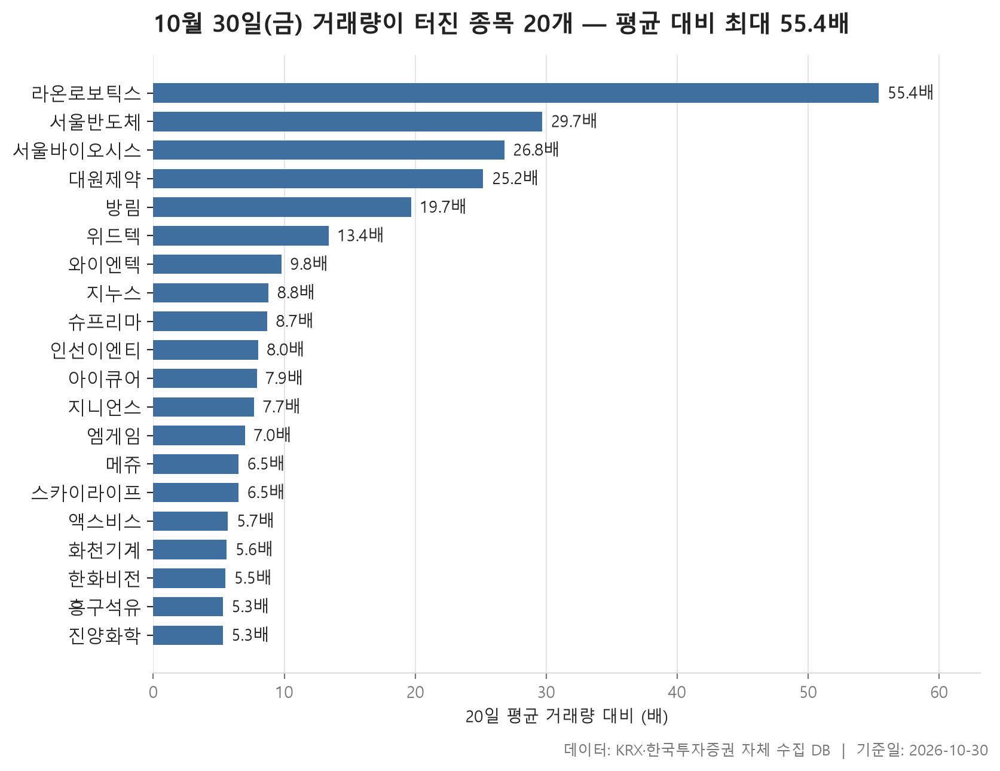

10월 30일 금요일 시장은 업종을 가리지 않고 밀렸습니다. 업종마다 소속 종목의 등락률을 한 줄로 세워 가운데 값을 뽑아 보면 24개 업종 모두 마이너스입니다. 가장 덜 내린 섬유·의류도 -0.20%였고, 반대편 끝의 전기·전자는 -3.86%까지 내려갔습니다. 24개 업종의 가운데 값을 다시 늘어놓으면 한가운데가 -1.43%입니다. 특정 업종 몇 곳만 부진했던 날이 아니라 시장 전체가 한쪽으로 기운 날이었습니다.

오늘은 세 가지를 차례로 봅니다. 업종별 등락의 모양, 종가가 지난 52주 최저가 아래로 내려간 종목 20개, 거래량이 평소의 다섯 배를 넘긴 종목 20개입니다. 이런 날은 평균 하나만 봐서는 놓치는 것이 많습니다. 업종 평균을 혼자 끌어올린 종목이 있고, 신저가 명단에 이름을 올린 대형주가 있고, 하락장 한복판에서 거래가 몰린 소형주도 있습니다. 표만 봐서는 지나치기 쉬운 이런 대목을 중심으로 정리했습니다.

> 기준일: 2026-10-30 · 집계: 자체 수집 데이터베이스

## 업종 등락률 — 24개 모두 하락

표 윗부분부터 보면 이상한 점이 하나 있습니다. 섬유·의류는 가운데 값이 -0.20%인데 평균은 오히려 **+0.89%**입니다. 형지엘리트가 +29.94% 오르면서 이 종목 하나가 업종 평균을 0.61%p 끌어올린 셈입니다. 이 업종은 오른 종목 비율도 42.90%로 24개 업종 가운데 가장 높았습니다. 시장 전체가 내린 날 열 곳 가운데 네 곳가량이 올랐으니, 덜 내린 것이 한 종목 덕만은 아니었다고 볼 수 있습니다. 제조 업종도 평균이 +0.31%로 플러스지만 사정이 다릅니다. 종목이 7개뿐이라 에넥스(+9.45%) 하나가 평균을 1.35%p 밀어 올렸습니다. 종목 수가 적은 업종에서는 한 종목이 평균의 부호까지 바꿔 놓을 수 있다는 점을 보여 줍니다.

아래쪽은 분위기가 확연히 다릅니다. 전기·전자는 368개 종목에 거래대금이 133,853.40억원으로, 오늘 시장에서 덩치가 가장 큰 업종이 가장 많이 내렸습니다. 오른 종목은 9.00%로 열에 하나도 되지 않았습니다. 이 업종에서 가장 크게 움직인 벡트로보틱스가 -29.90% 급락했는데도 업종 평균에 미친 영향은 -0.08%p에 그칩니다. 가운데 값 -3.86%와 평균 -4.04%가 바짝 붙어 있다는 점까지 함께 보면, 특정 종목이 무너졌다기보다 업종 전체가 고르게 밀린 하루였습니다.

기계·장비(-3.50%)도 같은 흐름입니다. 오른 종목이 6.70%에 불과했는데 그 안에서 라온로보틱스가 +24.19% 올라 거꾸로 움직였습니다. 증권은 더 극단적입니다. 18개 종목 가운데 오른 종목이 하나도 없었고(0.00%), 건설도 오른 종목이 8.00%에 그쳤습니다. 중간쯤의 금융(-0.98%)은 거래대금이 14,563.20억원으로 전기·전자 다음으로 컸지만 낙폭은 상대적으로 작았습니다.

| 업종 | 종목수(개) | 중위등락률(%) | 평균등락률(%) | 상승비율(%) | 주도종목 | 주도종목등락률(%) | 평균기여도(%p) | 거래대금합계(억원) |
|---|---|---|---|---|---|---|---|---|
| 섬유·의류 | 49 | -0.20 | +0.89 | 42.90 | 형지엘리트 | +29.94 | 0.61 | 317.40 |
| 음식료·담배 | 84 | -0.44 | -0.57 | 35.70 | 한울앤제주 | +14.86 | 0.18 | 1,399.40 |
| 보험 | 11 | -0.50 | -0.44 | 27.30 | 삼성생명 | -2.70 | -0.25 | 2,362.50 |
| 전기·가스 | 10 | -0.52 | -0.93 | 40.00 | SGC에너지 | -4.25 | -0.42 | 348.50 |
| 제조 | 7 | -0.57 | +0.31 | 28.60 | 에넥스 | +9.45 | 1.35 | 15.00 |
| 운송·창고 | 28 | -0.62 | -0.54 | 35.70 | 천일고속 | -5.77 | -0.21 | 1,655.20 |
| 금융 | 110 | -0.98 | -1.51 | 29.10 | 한화머시너리앤서비스홀딩스 | -11.42 | -0.10 | 14,563.20 |
| 오락·문화 | 61 | -1.06 | -1.54 | 21.30 | 노머스 | -8.22 | -0.13 | 753.50 |
| 종이·목재 | 27 | -1.15 | -1.86 | 18.50 | 리더스코스메틱 | -12.35 | -0.46 | 21.00 |
| 비금속 | 35 | -1.27 | -1.54 | 14.30 | 티웨이홀딩스 | +9.27 | 0.26 | 547.00 |
| 유통 | 156 | -1.37 | -1.71 | 21.80 | 푸드나무 | -9.92 | -0.06 | 3,354.30 |
| IT 서비스 | 242 | -1.40 | -1.33 | 26.40 | SGA솔루션즈 | +29.98 | 0.12 | 10,363.40 |
| 제약 | 167 | -1.45 | -1.57 | 17.40 | 로킷헬스케어 | -13.57 | -0.08 | 5,861.30 |
| 화학 | 220 | -1.47 | -1.35 | 25.00 | 진양화학 | +30.00 | 0.14 | 11,477.70 |
| 일반서비스 | 168 | -1.56 | -1.80 | 23.80 | 에스팀 | -16.55 | -0.10 | 4,842.60 |
| 통신 | 13 | -1.57 | -1.62 | 23.10 | 프리티 | -8.55 | -0.66 | 658.10 |
| 기타제조 | 14 | -1.85 | -1.66 | 28.60 | 피코그램 | -4.04 | -0.29 | 12.90 |
| 금속 | 129 | -1.87 | -2.21 | 10.90 | 알멕 | -15.00 | -0.12 | 2,568.40 |
| 운송장비·부품 | 132 | -2.23 | -2.38 | 13.60 | KR모터스 | +13.01 | 0.10 | 11,233.70 |
| 건설 | 50 | -2.38 | -2.54 | 8.00 | GS건설 | -11.56 | -0.23 | 2,716.10 |
| 증권 | 18 | -2.43 | -2.59 | 0.00 | 키움증권 | -7.19 | -0.40 | 897.60 |
| 의료·정밀기기 | 103 | -2.60 | -2.78 | 21.40 | 큐리옥스바이오시스템즈 | -18.48 | -0.18 | 2,362.70 |
| 기계·장비 | 208 | -3.50 | -3.80 | 6.70 | 라온로보틱스 | +24.19 | 0.12 | 13,676.90 |
| 전기·전자 | 368 | -3.86 | -4.04 | 9.00 | 벡트로보틱스 | -29.90 | -0.08 | 133,853.40 |

## 52주 신저가 20개 — 최저 기아 -11.73%

신저가 명단 맨 위에는 시가총액이 가장 큰 기아(373,235억원)가 있고, 하루 낙폭도 -11.73%로 명단에서 가장 컸습니다. 직전 52주 최저가가 102,600원이었는데 종가가 95,600원이었으니 경계선을 아슬아슬하게 넘은 것이 아니라 크게 뚫고 내려갔습니다. 시가총액 358,881억원인 한화에어로스페이스도 -8.42% 내리며 이름을 올렸습니다. 두 종목의 거래대금(2,084.90억원, 2,741.80억원)은 명단에서 가장 큰 축입니다. 업종으로는 운송장비·부품이 현대로템, 대한조선까지 4개로 가장 많아, 이 업종이 -2.23% 내린 흐름과 맞물립니다.

그러나 명단의 상당수는 이렇게 크게 무너진 경우가 아닙니다. 리가켐바이오는 종가 61,500원으로 직전 최저가 61,600원을 겨우 밑돌았고, HJ중공업도 11,650원으로 직전 최저가 11,660원 바로 아래에서 마감했습니다. 롯데관광개발은 -1.47%만 내렸는데도 신저가가 됐습니다. 명단 전체의 하루 등락률 가운데 값이 -3.13%인 것을 보면, 큰 폭으로 급락한 종목보다 이미 저점 근처에 머물던 종목이 하루 약세에 경계선을 살짝 넘어간 경우가 더 흔했다고 읽을 수 있습니다.

시장별로는 KOSPI 13개, KOSDAQ 7개로 대형주 시장 쪽이 더 많았고, 업종은 10개로 흩어져 있습니다. 파마리서치(-4.72%), 에이비엘바이오(-4.39%), 에스티팜(-2.03%) 같은 제약 업종 종목이 여럿 끼어 있는 점도 눈에 띕니다. 다만 이들이 왜 저점을 깼는지는 이 자료로는 알 수 없습니다.

| 종목명 | 종목코드 | 시장 | 업종 | 종가(원) | 등락률(%) | 이전52주최저(원) | 거래대금(억원) | 시가총액(억원) |
|---|---|---|---|---|---|---|---|---|
| 기아 | 000270 | KOSPI | 운송장비·부품 | 95,600 | -11.73 | 102,600 | 2,084.90 | 373,235 |
| 한화에어로스페이스 | 012450 | KOSPI | 운송장비·부품 | 696,000 | -8.42 | 732,000 | 2,741.80 | 358,881 |
| HD현대일렉트릭 | 267260 | KOSPI | 전기·전자 | 424,500 | -3.63 | 432,000 | 734.80 | 153,020 |
| 현대로템 | 064350 | KOSPI | 운송장비·부품 | 76,500 | -3.16 | 77,000 | 344.10 | 83,494 |
| 한화엔진 | 082740 | KOSPI | 기계·장비 | 29,400 | -5.01 | 30,250 | 175.10 | 24,533 |
| 리가켐바이오 | 141080 | KOSDAQ | 일반서비스 | 61,500 | -3.91 | 61,600 | 83.60 | 22,767 |
| 파마리서치 | 214450 | KOSDAQ | 제약 | 212,000 | -4.72 | 220,500 | 167.90 | 22,026 |
| 에이비엘바이오 | 298380 | KOSDAQ | 제약 | 39,200 | -4.39 | 39,700 | 103.70 | 21,947 |
| 롯데케미칼 | 011170 | KOSPI | 화학 | 46,100 | -1.91 | 46,300 | 39.10 | 19,719 |
| 실리콘투 | 257720 | KOSDAQ | 유통 | 27,850 | -2.79 | 28,200 | 352.40 | 18,263 |
| 에스티팜 | 237690 | KOSDAQ | 제약 | 72,500 | -2.03 | 73,500 | 82.00 | 15,136 |
| 대한조선 | 439260 | KOSPI | 운송장비·부품 | 34,750 | -2.25 | 35,500 | 14.80 | 13,236 |
| HJ중공업 | 097230 | KOSPI | 건설 | 11,650 | -1.60 | 11,660 | 23.80 | 10,519 |
| 롯데관광개발 | 032350 | KOSPI | 일반서비스 | 10,040 | -1.47 | 10,100 | 35.40 | 8,004 |
| 한국카본 | 017960 | KOSPI | 금속 | 15,170 | -2.07 | 15,260 | 32.70 | 7,839 |
| STX엔진 | 077970 | KOSPI | 기계·장비 | 15,280 | -3.11 | 15,470 | 18.70 | 6,135 |
| 덕산네오룩스 | 213420 | KOSDAQ | 전기·전자 | 23,200 | -4.13 | 23,700 | 33.60 | 5,761 |
| 클로봇 | 466100 | KOSDAQ | IT 서비스 | 17,980 | -4.36 | 18,030 | 33.20 | 5,606 |
| SK오션플랜트 | 100090 | KOSPI | 금속 | 8,920 | -2.94 | 9,080 | 28.90 | 5,573 |
| 한국단자 | 025540 | KOSPI | 전기·전자 | 50,200 | -1.57 | 50,700 | 8.90 | 5,078 |

## 거래량 급증 20개 — 최고 라온로보틱스 55.40배

거래량 급증 명단은 시장 전체와 결이 조금 다릅니다. 시장은 고르게 내렸지만 이 명단에서는 오른 종목이 내린 종목보다 많습니다. 맨 위의 라온로보틱스는 거래량이 5,322,414주로 평소(96,049주)의 55.40배에 이르렀고 주가는 +24.19% 올랐습니다. 업종 표에서 기계·장비가 -3.50% 밀린 날 홀로 크게 오른 바로 그 종목입니다. 명단의 거래량 배수 가운데 값이 7.95배이니, 이 종목은 다른 종목들과 비교해도 유난히 튀었습니다.

같은 날 거래가 함께 불어났는데 방향이 갈린 경우도 있습니다. 서울반도체는 29.70배에 +3.93%, 서울바이오시스는 26.80배에 -2.68%였습니다. 전기·전자는 이 명단에서도 5개로 가장 많은데, 그 안에서도 오른 쪽과 내린 쪽이 섞여 있습니다. 시가총액이 가장 큰 한화비전(25,901억원)은 업종이 크게 밀린 날 +4.48% 올랐고, 슈프리마는 -16.85% 급락하며 거래량이 평소의 8.70배로 늘었습니다. 거래가 늘었다는 사실만으로는 방향을 알 수 없다는 점을 보여 주는 대목입니다.

진양화학은 순위와 등락률이 엇갈립니다. 상한가 수준인 +30.00% 올랐지만 거래량 배수는 5.30배로 명단에서 가장 낮습니다. 평소 거래량이 969,512주로 이미 많았던 탓에 배수로는 덜 두드러졌을 뿐입니다. 거래대금으로는 지니언스(+11.00%)가 1,014.10억원으로 가장 컸습니다. 시장별로는 KOSDAQ 13개, KOSPI 7개이고, 한화비전을 빼면 대부분 시가총액이 작은 종목입니다. 섬유·의류의 방림(+5.79%, 19.70배)처럼 업종 표에서 덜 내린 쪽과 이어지는 이름도 있습니다.

| 종목명 | 종목코드 | 시장 | 업종 | 종가(원) | 등락률(%) | 거래량(주) | 평균거래량(주) | 배수(배) | 거래대금(억원) | 시가총액(억원) |
|---|---|---|---|---|---|---|---|---|---|---|
| 라온로보틱스 | 232680 | KOSDAQ | 기계·장비 | 11,550 | +24.19 | 5,322,414 | 96,049 | 55.40 | 561.50 | 1,531 |
| 서울반도체 | 046890 | KOSDAQ | 전기·전자 | 11,640 | +3.93 | 5,320,695 | 179,226 | 29.70 | 663.00 | 6,787 |
| 서울바이오시스 | 092190 | KOSDAQ | 전기·전자 | 8,350 | -2.68 | 3,396,106 | 126,858 | 26.80 | 314.30 | 3,830 |
| 대원제약 | 003220 | KOSPI | 제약 | 8,680 | +12.73 | 1,316,160 | 52,289 | 25.20 | 116.60 | 1,947 |
| 방림 | 003610 | KOSPI | 섬유·의류 | 5,850 | +5.79 | 790,626 | 40,234 | 19.70 | 45.90 | 1,878 |
| 위드텍 | 348350 | KOSDAQ | 의료·정밀기기 | 8,510 | -3.51 | 189,166 | 14,131 | 13.40 | 17.20 | 832 |
| 와이엔텍 | 067900 | KOSDAQ | 일반서비스 | 6,070 | +3.76 | 174,867 | 17,860 | 9.80 | 10.50 | 1,105 |
| 지누스 | 013890 | KOSPI | 제조 | 5,920 | -2.95 | 128,424 | 14,668 | 8.80 | 7.90 | 1,298 |
| 슈프리마 | 236200 | KOSDAQ | 전기·전자 | 45,650 | -16.85 | 242,342 | 27,937 | 8.70 | 109.50 | 3,184 |
| 인선이엔티 | 060150 | KOSDAQ | 일반서비스 | 2,585 | -7.01 | 239,366 | 30,054 | 8.00 | 6.20 | 1,178 |
| 아이큐어 | 175250 | KOSDAQ | 화학 | 1,530 | +11.60 | 860,245 | 108,243 | 7.90 | 13.30 | 945 |
| 지니언스 | 263860 | KOSDAQ | IT 서비스 | 27,750 | +11.00 | 3,621,748 | 469,877 | 7.70 | 1,014.10 | 2,520 |
| 엠게임 | 058630 | KOSDAQ | IT 서비스 | 3,680 | +5.90 | 214,333 | 30,533 | 7.00 | 7.70 | 691 |
| 메쥬 | 0088M0 | KOSDAQ | 의료·정밀기기 | 15,660 | +6.53 | 963,273 | 148,122 | 6.50 | 152.70 | 1,547 |
| 스카이라이프 | 053210 | KOSPI | 오락·문화 | 3,665 | -4.18 | 191,592 | 29,529 | 6.50 | 7.10 | 1,742 |
| 액스비스 | 0011A0 | KOSDAQ | 전기·전자 | 10,890 | -4.39 | 4,327,264 | 757,640 | 5.70 | 510.40 | 1,016 |
| 화천기계 | 010660 | KOSPI | 기계·장비 | 3,160 | +9.53 | 357,388 | 63,789 | 5.60 | 11.00 | 695 |
| 한화비전 | 489790 | KOSPI | 전기·전자 | 51,300 | +4.48 | 1,531,084 | 280,609 | 5.50 | 775.80 | 25,901 |
| 흥구석유 | 024060 | KOSDAQ | 유통 | 11,580 | +3.86 | 3,376,365 | 635,568 | 5.30 | 398.40 | 1,737 |
| 진양화학 | 051630 | KOSPI | 화학 | 3,185 | +30.00 | 5,096,220 | 969,512 | 5.30 | 145.90 | 675 |

## 정리

정리하면, 10월 30일은 섬유·의류가 가장 덜 내리고 전기·전자가 가장 많이 내린 가운데 모든 업종이 고르게 밀린 하루였습니다. 그 와중에 기아·한화에어로스페이스 같은 대형주가 52주 신저가를 새로 썼고, 거래가 폭증한 종목은 주로 소형주에서 나왔습니다. 업종 평균이 플러스로 나온 섬유·의류와 제조도 가운데 값으로 보면 하락이었다는 점은 기억해 둘 만합니다.

이 글은 하루치 종가와 거래량만으로 만든 기록입니다. 왜 이런 움직임이 나왔는지는 자료에 담겨 있지 않아 다루지 않았고, 하루의 모양이 다음 날까지 이어진다는 보장도 없습니다. 오늘의 표는 흐름을 훑어보는 참고 자료로만 봐 주시기 바랍니다.

## 집계 기준

**업종 등락률**

- **기준**: 2026-10-29 종가 → 2026-10-30 종가
- **순위**: 업종 내 종목 등락률의 중위값 (평균은 참고용으로 함께 표시)
- **주도종목**: 그 업종에서 등락률 절대값이 가장 큰 종목 (동점이면 거래대금이 큰 쪽)
- **평균기여도**: 그 종목 하나가 업종 평균을 움직인 폭 (등락률 ÷ 종목수). 중위값과 평균의 격차가 이 값에 가까우면 평균을 만든 것이 그 종목이고, 훨씬 크면 다른 종목들도 함께 움직인 것입니다
- **필터**: 업종 내 보통주 5종목 이상
- **전체업종중위등락률(%)**: -1.42

**52주 신저가**

- **기준**: 종가 < 직전 52주 최저가
- **관측구간**: 2025-10-20 ~ 2026-10-29 (252거래일)
- **필터**: 시가총액 500억 이상, 거래대금 3억 이상, 보통주

**거래량 급증**

- **기준**: 당일 거래량 ≥ 직전 20거래일 평균 × 5
- **관측구간**: 2026-09-30 ~ 2026-10-29 (20거래일)
- **필터**: 시가총액 500억 이상, 거래대금 3억 이상, 보통주

## 데이터 출처 및 유의사항

- **데이터출처**: 한국거래소(KRX) 공시 데이터와 한국투자증권 OpenAPI 를 직접 수집해 구축한 자체 데이터베이스
- **집계방식**: 수집·집계·차트 생성을 직접 구현한 파이프라인에서 자동 산출
- **작성고지**: 본문의 표·통계·차트는 자체 데이터베이스에서 계산된 값이며, 문장 작성 과정에 AI 도구를 활용했습니다.
- **면책**: 본 글은 정보 제공을 목적으로 하며 특정 종목의 매수·매도를 추천하지 않습니다. 제시된 수치는 과거 데이터이고 미래 수익을 보장하지 않습니다. 투자 판단과 그 결과에 대한 책임은 투자자 본인에게 있습니다.

