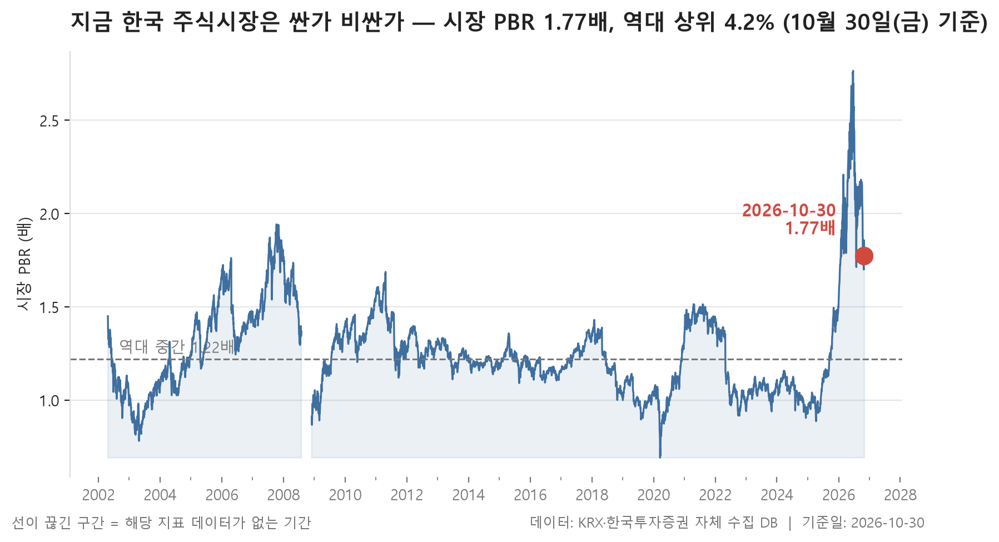
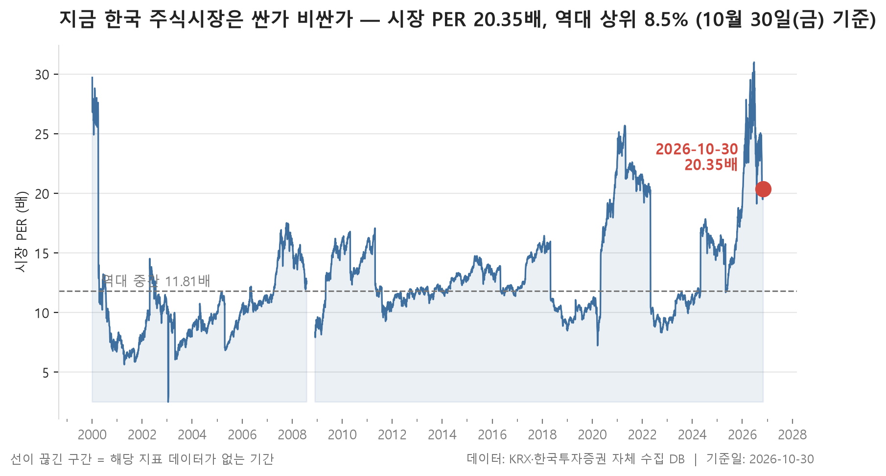
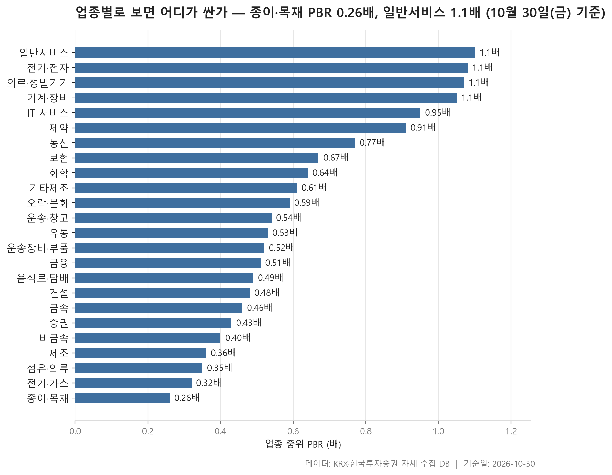
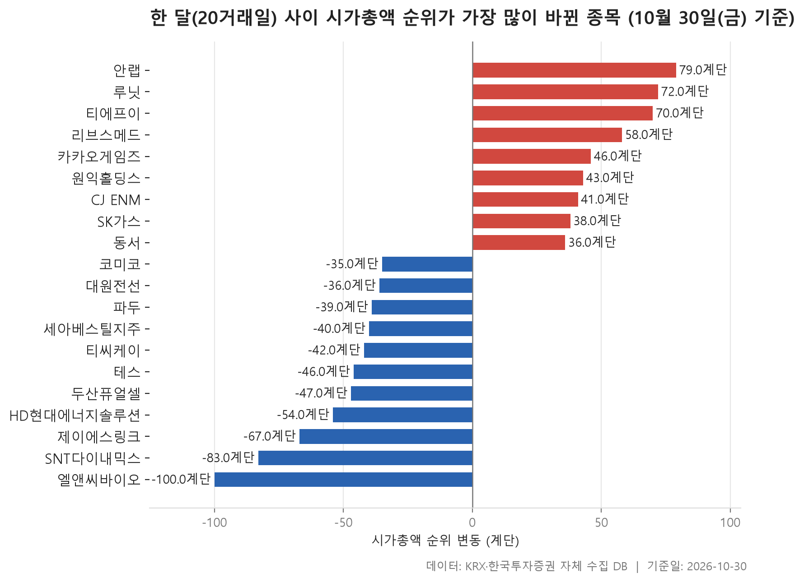

10월 마지막 기준일인 2026-10-30의 시장 전체 밸류에이션을 역대 기록과 비교했습니다. 시장 PBR은 1.77배로, 2002-04-23 이후 5,960거래일 가운데 상위 4.2%에 해당합니다. 장부가치 대비로 지금보다 비쌌던 날이 스무 날 중 하루도 되지 않았다는 뜻입니다.

이 글에서는 세 가지를 차례로 봅니다. 먼저 시장 전체가 역사적으로 어디쯤에 있는지 확인하고, 이어서 그 높이를 어느 업종이 받치고 있는지 살핍니다. 마지막으로 지난 한 달 동안 시가총액 순위에서 크게 움직인 종목을 봅니다. 시장 전체 숫자만 보면 '비싸다'는 말로 끝나지만, 업종 단위로 내려가면 그림이 꽤 달라집니다.

> 기준일: 2026-10-30 · 집계: 자체 수집 데이터베이스

## 시장 밸류에이션 백분위 — PER 역대 상위 8.5%, PBR 역대 상위 4.2%

PER과 PBR 두 지표는 같은 방향을 가리키지만 정도가 다릅니다. 시장 PER은 20.35배로 역대 상위 8.5%이고, PBR은 1.77배로 상위 4.2%입니다. 둘 다 역대 중간값인 PER 11.98배, PBR 1.22배를 크게 웃돕니다. 특히 PBR은 극단값을 걸러 낸 범위의 위쪽 끝인 2.19배 쪽으로 더 치우쳐 있습니다. 아래쪽 끝인 0.87배까지 함께 놓고 보면 지금 위치가 범위 안에서 얼마나 위쪽인지 알 수 있습니다.

PER은 상대적으로 덜 극단적입니다. 20.35배는 위쪽 끝인 25.92배와 아직 거리가 있습니다. 이익과 비교한 값은 '높지만 꼭대기는 아닌' 수준이고, 장부가치와 비교한 값은 '꼭대기에 가까운' 수준입니다. 이 차이가 왜 생겼는지는 이 자료만으로 알 수 없습니다.

읽을 때 주의할 점이 두 가지 있습니다. 첫째, 집계 종목 수가 관측 초기 약 800개에서 지금 2,380개로 늘었습니다. 그래서 상위 4.2%라는 숫자는 같은 시장의 과거와 비교한 값이라기보다, 시기마다 구성이 달랐던 시장 전체와 비교한 값으로 읽는 편이 정확합니다. 둘째, 이 값은 시가총액으로 가중해 계산하므로 덩치 큰 종목이 전체 숫자를 크게 좌우합니다. 이 점은 다음 표에서 바로 드러납니다.

| 지표 | 현재값 | 백분위(%) | 하위1% | 역대중간 | 상위1% | 단위 |
|---|---|---|---|---|---|---|
| 시장 PER | 20.35 | 91.50 | 7.07 | 11.98 | 25.92 | 배 |
| 시장 PBR | 1.77 | 95.80 | 0.87 | 1.22 | 2.19 | 배 |

## 업종별 밸류에이션 — 가장 싼 종이·목재 0.26배, 가장 비싼 일반서비스 1.1배

24개 업종의 중위 PBR을 낮은 순으로 늘어놓으면 종이·목재가 0.26배로 가장 낮고, 일반서비스가 1.10배로 가장 높습니다. 한가운데 놓인 값은 0.54배입니다. 여기서 눈에 띄는 점이 있습니다. 시장 전체 PBR은 1.77배인데, 업종별 중위값은 가장 높은 곳도 1.10배에 그칩니다. 대부분 업종에서 중간쯤에 있는 종목은 장부가치 근처나 그보다 낮은 가격에 거래되고 있다는 뜻입니다. 따라서 시장 전체 숫자를 끌어올리는 쪽은 업종의 보통 종목이 아니라 시가총액이 큰 일부 종목이라고 보는 것이 표와 맞는 해석입니다.

그 무게가 어디에 있는지는 시가총액 비중에서 보입니다. 전기·전자 한 업종이 표 전체 시가총액의 57.78%를 차지합니다. 그런데 이 업종의 중위 PBR은 1.08배로, 상위권이기는 해도 의료·정밀기기나 일반서비스와 큰 차이가 없습니다. 347개 종목의 중간값은 평범한데 업종 전체 무게는 절반을 넘습니다. 그렇다면 업종 안에서도 일부 대형 종목에 가치가 몰려 있다고 추정할 수 있습니다. 다만 이 표에는 개별 종목의 수치가 없어서 그 정도까지는 확인할 수 없습니다. 비중이 두 번째로 큰 금융은 10.20%를 차지하지만, 중위 PBR은 0.51배로 업종 전체의 중간보다 약간 아래에 있습니다.

PER은 따로 읽어야 합니다. 흑자 종목만으로 계산했기 때문에 흑자 기업이 적은 업종은 소수 종목의 값이 곧 대표값이 됩니다. 종이·목재는 27개 중 흑자가 11개, 제조는 7개 중 3개, 기타제조는 11개 중 4개뿐입니다. 종이·목재의 중위 PER이 14.37배로 PBR 순위와 다르게 높게 나오는 것도 이런 구성과 관련이 있어 보입니다. 반면 전기·가스는 10개 중 9개가 흑자이고 중위 PER이 4.29배로 표에서 가장 낮습니다. 업종마다 자산 구조와 이익의 성격이 달라서, 이 숫자로 업종 사이에 어느 쪽이 싸고 비싼지 가릴 수는 없습니다.

| 업종 | 종목수(개) | 중위PBR(배) | 중위PER(배) | 흑자종목수(개) | 시총비중(%) |
|---|---|---|---|---|---|
| 종이·목재 | 27 | 0.26 | 14.37 | 11 | 0.05 |
| 전기·가스 | 10 | 0.32 | 4.29 | 9 | 0.49 |
| 섬유·의류 | 48 | 0.35 | 6.53 | 29 | 0.15 |
| 제조 | 7 | 0.36 | 7.71 | 3 | 0.01 |
| 비금속 | 33 | 0.40 | 15.06 | 17 | 0.17 |
| 증권 | 18 | 0.43 | 8.33 | 17 | 0.90 |
| 금속 | 114 | 0.46 | 13.66 | 67 | 1.51 |
| 건설 | 48 | 0.48 | 6.82 | 39 | 0.61 |
| 음식료·담배 | 83 | 0.49 | 9.04 | 56 | 1.04 |
| 금융 | 103 | 0.51 | 8.01 | 88 | 10.20 |
| 운송장비·부품 | 126 | 0.52 | 6.65 | 95 | 5.26 |
| 유통 | 150 | 0.53 | 11.34 | 94 | 2.17 |
| 운송·창고 | 28 | 0.54 | 6.46 | 20 | 1.14 |
| 오락·문화 | 60 | 0.59 | 9.97 | 30 | 0.42 |
| 기타제조 | 11 | 0.61 | 6.38 | 4 | 0.02 |
| 화학 | 207 | 0.64 | 12.51 | 151 | 3.30 |
| 보험 | 10 | 0.67 | 7.88 | 10 | 2.28 |
| 통신 | 12 | 0.77 | 11.78 | 11 | 0.72 |
| 제약 | 151 | 0.91 | 14.89 | 86 | 3.69 |
| IT 서비스 | 228 | 0.95 | 12.39 | 137 | 2.50 |
| 기계·장비 | 199 | 1.05 | 15.21 | 119 | 3.16 |
| 의료·정밀기기 | 99 | 1.07 | 19.79 | 58 | 0.44 |
| 전기·전자 | 347 | 1.08 | 15.41 | 205 | 57.78 |
| 일반서비스 | 155 | 1.10 | 11.47 | 85 | 1.98 |

## 시총 순위 변동 20개 — 최고 안랩 79계단

2026-09-30부터 10월 30일까지 한 달 동안 시가총액 300위 안팎에서 순위가 크게 움직인 20개 종목입니다. 오른 종목이 9개, 내린 종목이 11개로 수는 비슷하지만, 가장 크게 움직인 폭은 내린 쪽이 더 깁니다. 엘앤씨바이오는 264위에서 364위로 100계단 밀렸고 시가총액이 -53.77% 줄었습니다. 오른 쪽 맨 위는 안랩으로, 331위에서 252위로 79계단 올랐고 시가총액은 +56.63% 늘었습니다. 루닛과 티에프이도 70계단 이상 올랐습니다.

같은 비율로 시가총액이 변해도 출발 위치에 따라 순위 변동 폭은 크게 다릅니다. 파두는 시가총액이 -43.51% 줄었지만 123위에서 162위로 39계단 내려가는 데 그쳤습니다. 반면 SNT다이내믹스는 -40.10%로 파두보다 덜 줄었는데도 296위에서 379위로 83계단 밀렸습니다. 300위 근처는 시가총액이 비슷한 종목이 몰려 있어 순위가 쉽게 흔들립니다. 오른 쪽에서도 비슷한 모습이 보입니다. SK가스는 +6.89%, 동서는 +12.23% 늘어난 것만으로 각각 38계단, 36계단 올라섰습니다. 순위 변동 폭만 보고 주가가 얼마나 움직였는지 짐작하면 틀리기 쉽습니다.

시장별로는 KOSDAQ 종목이 13개로 많고, 업종은 12개로 흩어져 있습니다. 가장 많이 나온 전기·전자 5개 종목은 티에프이 하나를 빼면 모두 순위가 내려갔습니다. 앞 섹션에서 시가총액의 절반 넘게를 차지한 업종이지만, 300위 언저리의 종목들 사이에서는 방향이 엇갈렸습니다. IT 서비스는 안랩·루닛·카카오게임즈 3개 종목이 모두 올라 대조를 이룹니다. 왜 이렇게 움직였는지는 이 자료에 담겨 있지 않습니다.

| 종목명 | 종목코드 | 시장 | 업종 | 현재순위(위) | 과거순위(위) | 순위변동(계단) | 시총증감률(%) | 시가총액(억원) |
|---|---|---|---|---|---|---|---|---|
| 엘앤씨바이오 | 290650 | KOSDAQ | 제약 | 364 | 264 | -100 | -53.77 | 6,459 |
| SNT다이내믹스 | 003570 | KOSPI | 운송장비·부품 | 379 | 296 | -83 | -40.10 | 6,155 |
| 안랩 | 053800 | KOSDAQ | IT 서비스 | 252 | 331 | 79 | +56.63 | 13,140 |
| 루닛 | 328130 | KOSDAQ | IT 서비스 | 266 | 338 | 72 | +44.07 | 11,682 |
| 티에프이 | 425420 | KOSDAQ | 전기·전자 | 274 | 344 | 70 | +38.19 | 10,903 |
| 제이에스링크 | 127120 | KOSDAQ | 일반서비스 | 352 | 285 | -67 | -39.76 | 6,822 |
| 리브스메드 | 491000 | KOSDAQ | 의료·정밀기기 | 288 | 346 | 58 | +28.55 | 9,951 |
| HD현대에너지솔루션 | 322000 | KOSPI | 전기·전자 | 314 | 260 | -54 | -42.17 | 8,310 |
| 두산퓨얼셀 | 336260 | KOSPI | 전기·전자 | 200 | 153 | -47 | -36.44 | 18,960 |
| 테스 | 095610 | KOSDAQ | 기계·장비 | 184 | 138 | -46 | -35.30 | 21,006 |
| 카카오게임즈 | 293490 | KOSDAQ | IT 서비스 | 256 | 302 | 46 | +28.99 | 12,681 |
| 원익홀딩스 | 030530 | KOSDAQ | 화학 | 165 | 208 | 43 | +11.74 | 22,785 |
| 티씨케이 | 064760 | KOSDAQ | 비금속 | 179 | 137 | -42 | -36.42 | 21,643 |
| CJ ENM | 035760 | KOSDAQ | 오락·문화 | 298 | 339 | 41 | +15.49 | 9,320 |
| 세아베스틸지주 | 001430 | KOSPI | 금속 | 285 | 245 | -40 | -36.82 | 10,185 |
| 파두 | 440110 | KOSDAQ | 전기·전자 | 162 | 123 | -39 | -43.51 | 23,126 |
| SK가스 | 018670 | KOSPI | 유통 | 157 | 195 | 38 | +6.89 | 23,729 |
| 동서 | 026960 | KOSPI | 유통 | 139 | 175 | 36 | +12.23 | 28,365 |
| 대원전선 | 006340 | KOSPI | 전기·전자 | 334 | 298 | -36 | -27.10 | 7,426 |
| 코미코 | 183300 | KOSDAQ | 기계·장비 | 268 | 233 | -35 | -33.34 | 11,659 |

## 정리

정리하면, 10월 말 시장은 장부가치 기준으로 역대 상위 4.2%에 있습니다. 하지만 그 높이는 업종의 보통 종목이 아니라 시가총액이 큰 전기·전자 쪽 무게가 만든 것으로 보입니다. 업종 중위 PBR은 대부분 1배를 밑돌았습니다. 한 달 동안의 시가총액 순위에서는 같은 업종 안에서도 방향이 갈렸습니다.

이 자료에는 한계가 있습니다. 역대 비교는 집계 종목 수가 크게 달라진 기간을 하나로 묶어 비교한 결과입니다. 업종별 PBR·PER은 업종마다 성격이 달라 높고 낮음만으로 싸다, 비싸다를 판단할 수 없습니다. 순위 변동은 결과만 보여 줄 뿐 이유는 알려 주지 않습니다. 이 글은 시장의 현재 위치를 기록한 것이며, 특정 종목이나 업종에 대한 판단을 권하려는 것이 아닙니다.

## 집계 기준

**시장 밸류에이션 백분위**

- **기준**: 시가총액 가중 — 시장 PER = Σ시가총액 / Σ(시가총액÷PER)
- **관측구간**: 2002-04-23 ~ 2026-11-02 (5,960거래일)
- **모집단**: KOSPI·KOSDAQ 보통주
- **백분위해석**: 백분위 30 = 역대 기록 중 30% 만이 현재보다 낮았다는 뜻
- **표본제외**: 집계 종목이 100개 미만인 0일은 모집단에서 제외 (전체 5,960일 중)
- **범위표시**: 절대 최소·최대는 하루치 오류 데이터에 흔들리므로 1~99 분위로 표시
- **표본변화**: 집계 종목 수는 관측 초기 약 800개에서 현재 2,380개로 늘어났습니다. 시점 간 비교 시 참고가 필요합니다.

**업종별 밸류에이션**

- **기준**: 2026-10-30 종가와 같은 날 재무 지표
- **순위**: 업종 내 종목 PBR 의 중위값 (낮은 순)
- **중위PER**: 흑자 종목(PER > 0)만으로 계산합니다. 적자 종목은 PER 이 음수라 순위에 섞으면 가장 싼 업종이 뒤집힙니다
- **시총비중**: 표에 실린 업종 전체를 100 으로 본 비중
- **필터**: PBR 이 있는 보통주 5종목 이상인 업종
- **주의**: PBR·PER 은 업종마다 성격이 달라 서로 다른 업종을 같은 잣대로 비교하기 어렵습니다. 낮다고 싼 것도, 높다고 비싼 것도 아닙니다

**시총 순위 변동**

- **기준**: 2026-09-30 대비 2026-10-30 시가총액 순위 변동 (양수 = 순위 상승)
- **모집단**: 양쪽 날짜 중 한 번이라도 시총 300위 이내였던 보통주

## 데이터 출처 및 유의사항

- **데이터출처**: 한국거래소(KRX) 공시 데이터와 한국투자증권 OpenAPI 를 직접 수집해 구축한 자체 데이터베이스
- **집계방식**: 수집·집계·차트 생성을 직접 구현한 파이프라인에서 자동 산출
- **작성고지**: 본문의 표·통계·차트는 자체 데이터베이스에서 계산된 값이며, 문장 작성 과정에 AI 도구를 활용했습니다.
- **면책**: 본 글은 정보 제공을 목적으로 하며 특정 종목의 매수·매도를 추천하지 않습니다. 제시된 수치는 과거 데이터이고 미래 수익을 보장하지 않습니다. 투자 판단과 그 결과에 대한 책임은 투자자 본인에게 있습니다.

