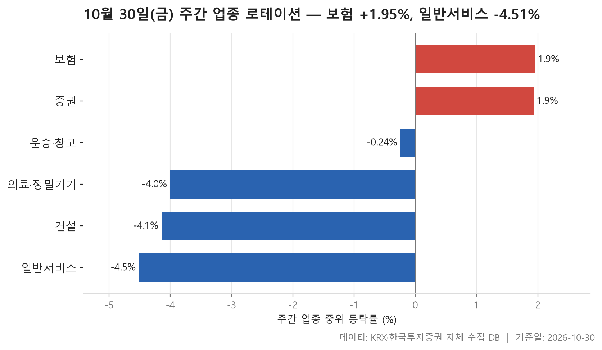
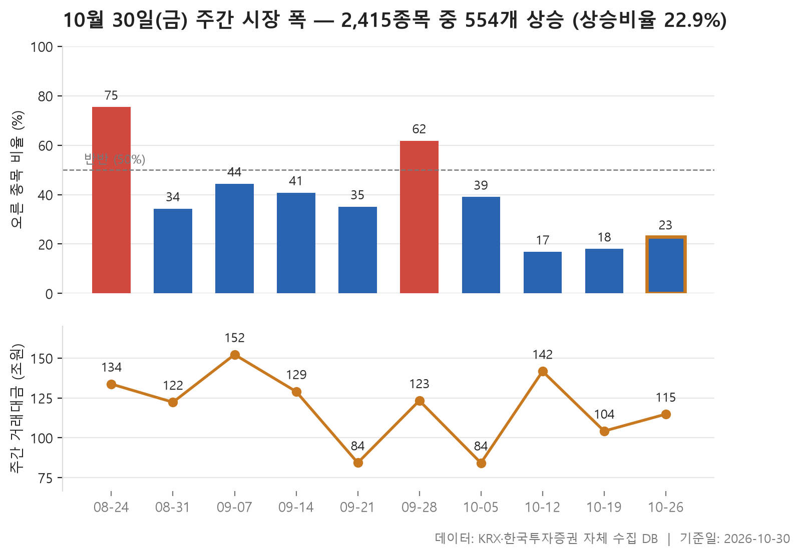
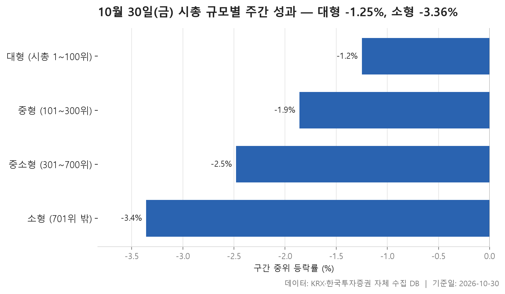

10월 마지막 주(10월 26일~30일) 거래일 5일을 정리합니다. 한마디로 하면 **내린 종목이 훨씬 많은 한 주**였습니다. 다만 그 안에서도 덜 내린 쪽과 많이 내린 쪽이 꽤 뚜렷하게 갈렸습니다. 오늘은 그 갈림을 세 가지 각도에서 봅니다.

첫째는 업종입니다. 24개 업종을 업종 안 종목들의 중위 등락률로 줄 세우고 맨 위 세 곳과 맨 아래 세 곳을 뽑았습니다. 둘째는 시장 전체의 폭입니다. 오른 종목과 내린 종목의 수를 최근 10주와 나란히 놓으면 이번 주가 어디쯤인지 보입니다. 셋째는 덩치입니다. 시가총액 순위로 네 구간을 나누어 큰 종목과 작은 종목 가운데 어느 쪽이 버텼는지 확인합니다.

세 표를 겹쳐 보면 흐름의 모양이 비슷합니다. 오른 업종은 손에 꼽을 만큼 적었고, 시장 전체로는 하락 우위가 몇 주째 이어졌으며, 작은 종목일수록 더 크게 밀렸습니다. 아래에서 하나씩 짚어 보겠습니다.

> 기준일: 2026-10-30 · 집계: 자체 수집 데이터베이스

## 주간 업종 로테이션 — 6개 중 4개 하락

맨 위는 보험입니다. 업종 안 종목들의 등락률 한가운데 값이 +1.95%였고, 11개 종목 가운데 72.70%가 올랐습니다. 열 곳 중 일곱 곳 남짓이 오른 셈이니, 특정 종목 하나에 기댄 상승은 아니었다고 볼 수 있습니다. 다만 평균은 +3.44%로 중위값보다 꽤 높습니다. 그 차이는 미래에셋생명 쪽에서 왔습니다. 이 종목이 한 주 동안 +17.75% 올랐고, 종목 수가 적은 업종이라 이 하나가 업종 평균을 1.61%p 끌어올렸습니다. 고르게 오른 바탕 위에 큰 종목 하나가 평균을 더 들어 올린 모양입니다.

2위 증권은 반대 방향으로 어긋나 있습니다. 중위값은 +1.93%로 보험과 거의 같고 오른 종목 비중도 72.20%로 비슷합니다. 그런데 평균은 +0.84%에 그쳤습니다. 업종에서 가장 크게 움직인 SK증권이 -8.43% 내리면서 평균을 0.47%p 깎아 먹었기 때문입니다. 대부분은 올랐는데 한 종목이 평균을 끌어내린 경우라, 평균만 보면 업종 분위기를 낮게 읽게 됩니다. 3위 운송·창고는 중위값이 벌써 -0.24%입니다. 상위 세 업종 가운데 셋째부터 마이너스였다는 점이 이번 주 업종 지형을 잘 보여 줍니다. 이 업종은 오른 종목과 내린 종목이 정확히 반반(50.00%)이었고, 트리니티항공이 -13.55%로 가장 크게 움직였습니다.

아래쪽 세 업종은 모두 -4% 언저리에 모여 있습니다. 의료·정밀기기 -4.00%, 건설 -4.14%, 일반서비스 -4.51% 순입니다. 눈여겨볼 대목은 이 업종들에서 가장 크게 움직인 종목이 업종 전체와 반대로 갔거나, 혼자 훨씬 크게 움직였다는 점입니다. 건설에서는 상지건설이 +42.05% 올랐지만 업종 평균에 보탠 폭은 0.84%p에 그쳤고, 오른 종목은 12.00%뿐이었습니다. 중위값 -4.14%와 평균 -4.15%가 거의 같은 것도 업종 전반이 고르게 내렸다는 뜻입니다. 의료·정밀기기에서도 메쥬가 +23.50% 올랐지만 103개 종목 속에서는 평균을 0.23%p 움직이는 데 그쳤습니다.

맨 아래 일반서비스는 168개로 종목 수가 가장 많은 업종입니다. 모아라이프플러스가 -56.00%로 한 주 만에 절반 넘게 빠졌는데도, 이 종목이 업종 평균을 끌어내린 폭은 -0.33%p에 불과합니다. 결국 이 업종이 꼴찌가 된 건 한 종목 탓이라기보다, 오른 종목이 19.60%로 다섯 곳 중 한 곳꼴에 그칠 만큼 업종 전체가 함께 밀렸기 때문으로 읽힙니다.

| 업종 | 종목수(개) | 주간중위등락률(%) | 주간평균등락률(%) | 상승비율(%) | 주도종목 | 주도종목등락률(%) | 평균기여도(%p) |
|---|---|---|---|---|---|---|---|
| 보험 | 11 | +1.95 | +3.44 | 72.70 | 미래에셋생명 | +17.75 | 1.61 |
| 증권 | 18 | +1.93 | +0.84 | 72.20 | SK증권 | -8.43 | -0.47 |
| 운송·창고 | 28 | -0.24 | -1.04 | 50.00 | 트리니티항공 | -13.55 | -0.48 |
| 의료·정밀기기 | 103 | -4.00 | -3.75 | 22.30 | 메쥬 | +23.50 | 0.23 |
| 건설 | 50 | -4.14 | -4.15 | 12.00 | 상지건설 | +42.05 | 0.84 |
| 일반서비스 | 168 | -4.51 | -4.78 | 19.60 | 모아라이프플러스 | -56.00 | -0.33 |

## 주간 시장 폭 — 10주 중 이번 주는 2,415개 중 554개 상승

이번 주에는 2,415개 종목 가운데 554개가 오르고 1,844개가 내렸습니다. 오른 종목은 22.90%이고, 오른 종목 수를 내린 종목 수로 나눈 값은 0.30배입니다. 내린 종목이 오른 종목보다 몇 곱절 많았다는 뜻입니다.

이번 주만 놓고 보면 안 보이는 흐름이 10주를 늘어놓으면 보입니다. 10월 12일 주가 0.20배로 10주 중 가장 낮았고, 이어 10월 19일 주가 0.22배, 이번 주가 0.30배입니다. 바닥에서 조금씩 올라오고는 있지만, 세 주 연속 오른 종목이 열에 두 곳 안팎인 상태가 이어졌습니다. 10주 전체의 중간값이 0.61배라는 점도 함께 볼 만합니다. 이 기간에는 평범한 주조차 내린 종목이 더 많았다는 뜻이고, 이번 주는 그 평범한 수준에도 한참 못 미칩니다.

오른 종목이 더 많았던 주는 10주 가운데 8월 24일 주(3.22배)와 9월 28일 주(1.69배) 두 번뿐입니다. 특히 8월 24일 주에는 오른 종목이 75.40%였으니, 이번 주와는 거의 거울에 비춘 듯 반대입니다.

거래대금도 함께 보겠습니다. 이번 주 합계는 114.80조원으로 직전 주의 104.20조원보다 늘었습니다. 다만 가장 크게 밀렸던 10월 12일 주의 141.70조원에는 못 미칩니다. 10월 5일 주(84.20조원)와 9월 21일 주(84.30조원)는 거래일이 3일뿐이라 거래대금이 낮게 나왔으니, 주별로 비교할 때는 거래일 수를 같이 봐야 합니다.

| 주 | 거래일수(일) | 종목수(개) | 상승(개) | 보합(개) | 하락(개) | 상승비율(%) | ADR(배) | 총거래대금(조원) |
|---|---|---|---|---|---|---|---|---|
| 2026-10-26 | 5 | 2,415 | 554 | 17 | 1,844 | 22.90 | 0.30 | 114.80 |
| 2026-10-19 | 5 | 2,413 | 434 | 24 | 1,955 | 18.00 | 0.22 | 104.20 |
| 2026-10-12 | 5 | 2,411 | 405 | 18 | 1,988 | 16.80 | 0.20 | 141.70 |
| 2026-10-05 | 3 | 2,414 | 942 | 39 | 1,433 | 39.00 | 0.66 | 84.20 |
| 2026-09-28 | 5 | 2,407 | 1,488 | 41 | 878 | 61.80 | 1.69 | 123.30 |
| 2026-09-21 | 3 | 2,410 | 846 | 47 | 1,517 | 35.10 | 0.56 | 84.30 |
| 2026-09-14 | 5 | 2,404 | 981 | 31 | 1,392 | 40.80 | 0.70 | 129.00 |
| 2026-09-07 | 5 | 2,403 | 1,066 | 40 | 1,297 | 44.40 | 0.82 | 152.20 |
| 2026-08-31 | 5 | 2,398 | 822 | 34 | 1,542 | 34.30 | 0.53 | 122.30 |
| 2026-08-24 | 5 | 2,383 | 1,797 | 28 | 558 | 75.40 | 3.22 | 133.70 |

## 시총 규모별 주간 성과 — 대형이 2.11%p 앞섬

시가총액 구간별로 나누면 모양이 아주 가지런합니다. 1~100위 대형주의 중위 등락률이 -1.25%로 가장 덜 내렸고, 중형 -1.86%, 중소형 -2.48%, 701위 밖 소형 -3.36% 순으로 작아질수록 낙폭이 커집니다. 평균으로 봐도 -1.77%, -2.05%, -2.71%, -3.64%로 순서가 그대로이고, 오른 종목 비중도 40.00%에서 20.20%까지 계단처럼 내려갑니다. 대형과 소형의 중위값 차이는 2.11%p였습니다. 어느 지표로 재도 순서가 뒤집히지 않으니, 이번 주 '큰 종목이 덜 내렸다'는 말은 꽤 단단한 관찰입니다.

물론 대형주도 이번 주에 오른 것은 아닙니다. 네 구간 모두 중위값이 마이너스이고, 네 값의 한가운데는 -2.17%입니다. 상대적으로 덜 밀렸다는 것이지 버텨 냈다고 하기는 어렵습니다. 대형주 안에서도 한화솔루션은 -20.56% 내려 이 구간에서 가장 크게 움직였습니다.

흥미로운 건 극단값이 오히려 중간 구간에서 나왔다는 점입니다. 중형에서는 안랩이 +50.64% 올랐고, 중소형에서는 엘앤씨바이오가 -60.08% 빠졌습니다. 소형에서 가장 크게 움직인 종목은 업종 표에도 나왔던 모아라이프플러스(-56.00%)입니다. 구간 전체가 고르게 밀리는 가운데 개별 종목은 위아래로 크게 튄 셈입니다.

거래대금 쏠림도 짚어 둘 만합니다. 대형 100개 종목에 79.90조원이 몰렸고, 200개인 중형은 14.80조원이었습니다. 1,715개 종목이 있는 소형(9.40조원)이 400개인 중소형(8.80조원)보다 조금 많긴 하지만, 종목 수를 생각하면 돈은 압도적으로 큰 종목 쪽에 머물렀습니다.

| 구간 | 종목수(개) | 주간중위등락률(%) | 주간평균등락률(%) | 상승비율(%) | 주도종목 | 주도종목등락률(%) | 주간거래대금(조원) |
|---|---|---|---|---|---|---|---|
| 대형 (시총 1~100위) | 100 | -1.25 | -1.77 | 40.00 | 한화솔루션 | -20.56 | 79.90 |
| 중형 (101~300위) | 200 | -1.86 | -2.05 | 31.00 | 안랩 | +50.64 | 14.80 |
| 중소형 (301~700위) | 400 | -2.48 | -2.71 | 26.50 | 엘앤씨바이오 | -60.08 | 8.80 |
| 소형 (701위 밖) | 1,715 | -3.36 | -3.64 | 20.20 | 모아라이프플러스 | -56.00 | 9.40 |

## 정리

정리하면 이번 주는 **오른 업종이 손에 꼽히고 내린 종목이 오른 종목을 크게 웃돈 가운데, 작은 종목일수록 더 크게 밀린 한 주**였습니다. 보험과 증권은 열 곳 중 일곱 곳 남짓이 오르며 버텼고, 아래쪽 업종들은 한두 종목이 크게 튀었어도 업종 전체가 고르게 내려앉았습니다. 오른 종목과 내린 종목의 비율은 10월 12일 주의 바닥에서 조금씩 올라오고 있지만, 아직 10주 중간값에도 미치지 못합니다.

이 글은 종가 기준 등락률의 중위값과 종목 수만으로 쓴 것이라, 왜 이런 흐름이 나왔는지는 자료가 말해 주지 않습니다. 업종과 시가총액 구간도 한 주짜리 단면이므로, 다음 주에 같은 모양이 이어지는지 함께 지켜보면서 읽어 주시기 바랍니다.

## 집계 기준

**주간 업종 로테이션**

- **기준**: 2026-10-23 종가 → 2026-10-30 종가
- **구간**: 2026-10-26 시작 주 — 직전 주 마지막 거래일 종가를 출발선으로 삼습니다
- **거래일수**: 5
- **순위**: 업종 내 종목 등락률의 중위값 (평균은 참고용으로 함께 표시)
- **선정**: 전체 24개 업종 중 상위 3개 · 하위 3개
- **주도종목**: 그 업종에서 같은 기간 등락률 절대값이 가장 큰 종목 (동점이면 거래대금이 큰 쪽)
- **평균기여도**: 그 종목 하나가 업종 평균을 움직인 폭 (등락률 ÷ 종목수)
- **필터**: 업종 내 보통주 5종목 이상

**주간 시장 폭**

- **기준**: 각 주의 마지막 거래일 종가를 직전 주 마지막 거래일 종가와 비교
- **주**: 그 주의 월요일 (달력 기준). 거래일 수는 연휴에 따라 다릅니다
- **ADR**: 상승 종목 수 ÷ 하락 종목 수. 1 이면 반반, 2 면 오른 종목이 두 배
- **총거래대금**: 그 주 거래일 전체의 거래대금 합계
- **모집단**: 거래가 있었던 보통주 (거래정지·액면 변경 종목 제외)

**시총 규모별 주간 성과**

- **기준**: 2026-10-23 종가 → 2026-10-30 종가
- **구간**: 기준일 시가총액 순위로 자릅니다 (금액으로 자르면 장이 오른 해에 전부 위 구간으로 올라가 해마다 다른 표가 됩니다)
- **순위**: 구간 내 종목 등락률의 중위값 (평균은 참고용으로 함께 표시)
- **주도종목**: 그 구간에서 같은 기간 등락률 절대값이 가장 큰 종목 (동점이면 거래대금이 큰 쪽)
- **대형소형격차**: 2.11
- **모집단**: 거래가 있었던 보통주 (거래정지·액면 변경 종목 제외)

## 데이터 출처 및 유의사항

- **데이터출처**: 한국거래소(KRX) 공시 데이터와 한국투자증권 OpenAPI 를 직접 수집해 구축한 자체 데이터베이스
- **집계방식**: 수집·집계·차트 생성을 직접 구현한 파이프라인에서 자동 산출
- **작성고지**: 본문의 표·통계·차트는 자체 데이터베이스에서 계산된 값이며, 문장 작성 과정에 AI 도구를 활용했습니다.
- **면책**: 본 글은 정보 제공을 목적으로 하며 특정 종목의 매수·매도를 추천하지 않습니다. 제시된 수치는 과거 데이터이고 미래 수익을 보장하지 않습니다. 투자 판단과 그 결과에 대한 책임은 투자자 본인에게 있습니다.

