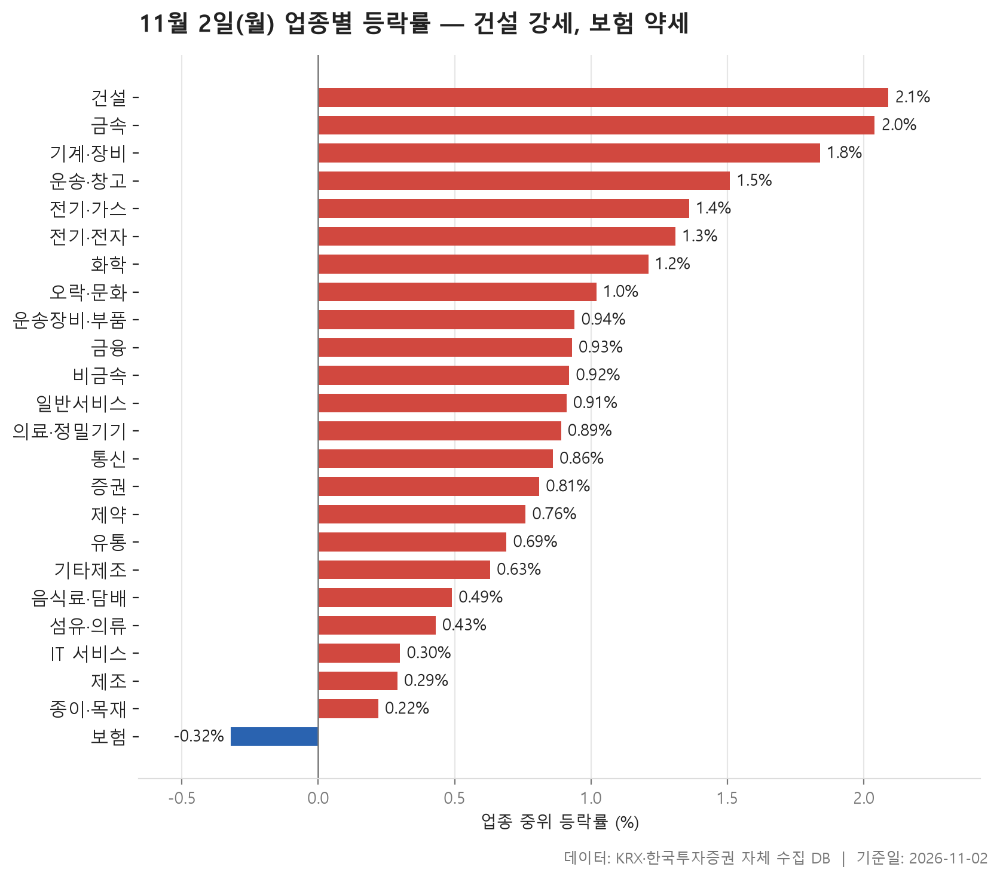
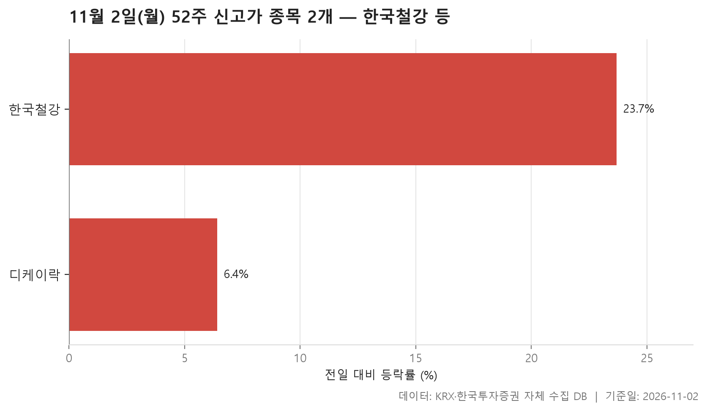
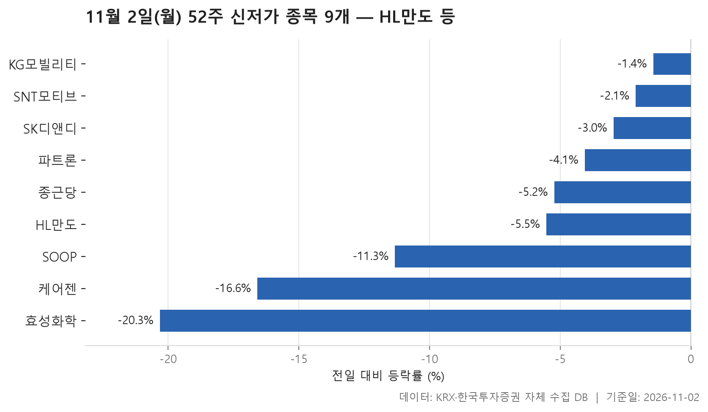
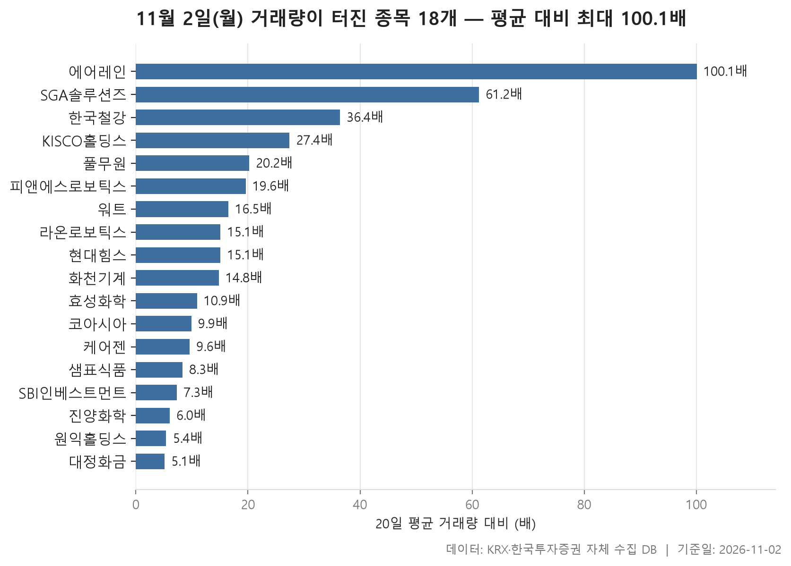

11월 2일 시장은 업종 대부분이 같은 방향을 가리킨 하루였습니다. 24개 업종 가운데 23개 업종에서 종목 등락률의 중위값이 플러스였고, 마이너스로 끝난 곳은 보험 하나뿐입니다. 업종별 중위값을 줄 세웠을 때 한가운데 놓인 값이 +0.90%였습니다. 크게 뛴 날은 아니어도 고르게 오른 날로 읽힙니다.

맨 위에는 건설(+2.09%), 맨 아래에는 보험(-0.32%)이 자리했습니다. 그런데 업종 표만 보고 '다 좋았다'고 정리하기엔 걸리는 대목이 있습니다. 52주 신고가를 새로 쓴 종목은 2개에 그쳤고, 신저가로 밀려난 종목은 9개였습니다. 거래량이 평소보다 몇 배, 많게는 100.10배까지 불어난 종목도 18개 나왔습니다.

오늘 글은 업종 흐름부터 보고, 이어서 신고가·신저가, 거래량 급증 종목을 차례로 짚습니다. 업종 전체가 오른 날에 종목 단위에서는 어떤 일이 있었는지가 오늘 볼 부분입니다.

> 기준일: 2026-11-02 · 집계: 자체 수집 데이터베이스

## 업종 등락률 — 24개 중 23개 상승

상위권에서는 건설(+2.09%)과 금속(+2.04%)이 나란히 앞섰고 기계·장비(+1.84%)가 뒤를 이었습니다. 건설은 오른 폭보다 넓게 오른 점이 더 눈에 띕니다. 50개 종목 중 오른 종목 비율이 86.00%로 열 곳 중 여덟 곳 넘게 올랐습니다. 운송·창고(85.70%)와 통신(84.60%)도 이와 비슷하게 고른 상승을 보였습니다.

표에서 어긋나 보이는 곳은 중위값과 평균이 벌어진 업종입니다. 운송·창고는 중위값이 +1.51%인데 평균은 +2.91%로 한참 위에 있습니다. 가장 크게 움직인 현대글로비스(+11.26%) 하나가 업종 평균을 0.40%p 끌어올린 셈이라, 평균이 높게 나온 데에는 이 종목의 몫이 큽니다. 금융은 사정이 조금 다릅니다. 평균(+1.86%)이 중위값(+0.93%)보다 꽤 높은데, 샘표(+29.91%)가 평균을 올린 폭은 0.27%p에 그칩니다. 이 종목 하나만으로는 차이가 다 설명되지 않으니, 다른 종목들도 함께 평균을 끌어올렸다고 봐야 합니다.

방향이 반대인 곳은 기타제조입니다. 오른 종목 비율이 73.30%이고 중위값도 +0.63%인데 평균은 -0.23%로 마이너스입니다. 크리에이츠(-17.20%) 하나가 평균을 1.15%p 끌어내렸기 때문입니다. 종목 수가 15개로 적어 한 종목의 급락이 평균을 뒤집은 경우입니다. 화학도 비슷한 모습입니다. 가장 크게 움직인 종목은 효성화학(-20.32%)이었지만, 업종 중위값은 +1.21%였고 오른 종목이 넷 중 셋꼴이었습니다. 한 종목의 급락과 업종 분위기가 따로 놀았습니다.

유일하게 내린 보험은 11개 종목 중 오른 비율이 36.40%로, 셋 중 하나꼴만 올랐습니다. DB손해보험(-4.93%)이 업종 평균을 0.45%p 끌어내렸습니다. 거래대금으로는 전기·전자가 97,423.10억원으로 다른 업종과 비교가 안 될 만큼 컸습니다. 이 업종의 중위값은 +1.31%로 중상위권에 올랐습니다.

| 업종 | 종목수(개) | 중위등락률(%) | 평균등락률(%) | 상승비율(%) | 주도종목 | 주도종목등락률(%) | 평균기여도(%p) | 거래대금합계(억원) |
|---|---|---|---|---|---|---|---|---|
| 건설 | 50 | +2.09 | +2.55 | 86.00 | GS건설 | +10.00 | 0.20 | 2,073.10 |
| 금속 | 129 | +2.04 | +2.32 | 79.10 | 한국철강 | +23.68 | 0.18 | 3,100.20 |
| 기계·장비 | 208 | +1.84 | +2.41 | 73.60 | 워트 | +29.92 | 0.14 | 14,279.00 |
| 운송·창고 | 28 | +1.51 | +2.91 | 85.70 | 현대글로비스 | +11.26 | 0.40 | 2,403.00 |
| 전기·가스 | 10 | +1.36 | +1.12 | 80.00 | SGC에너지 | +2.46 | 0.25 | 346.50 |
| 전기·전자 | 368 | +1.31 | +1.47 | 69.30 | 코아시아 | +16.57 | 0.05 | 97,423.10 |
| 화학 | 220 | +1.21 | +1.16 | 75.90 | 효성화학 | -20.32 | -0.09 | 9,359.80 |
| 오락·문화 | 62 | +1.02 | +1.69 | 71.00 | 아티스트컴퍼니 | +19.27 | 0.31 | 912.20 |
| 운송장비·부품 | 132 | +0.94 | +1.25 | 64.40 | 태양금속 | +11.05 | 0.08 | 10,104.20 |
| 금융 | 110 | +0.93 | +1.86 | 72.70 | 샘표 | +29.91 | 0.27 | 12,509.70 |
| 비금속 | 35 | +0.92 | +1.09 | 68.60 | KCC글라스 | +4.47 | 0.13 | 484.00 |
| 일반서비스 | 168 | +0.91 | +1.05 | 68.50 | HLB바이오스텝 | +29.87 | 0.18 | 3,965.20 |
| 의료·정밀기기 | 103 | +0.89 | +1.62 | 68.00 | 피앤에스로보틱스 | +29.86 | 0.29 | 1,955.40 |
| 통신 | 13 | +0.86 | +1.17 | 84.60 | 프리티 | +3.16 | 0.24 | 624.60 |
| 증권 | 18 | +0.81 | +0.79 | 77.80 | 키움증권 | -6.38 | -0.35 | 906.30 |
| 제약 | 167 | +0.76 | +0.68 | 62.90 | 케어젠 | -16.59 | -0.10 | 3,868.00 |
| 유통 | 157 | +0.69 | +0.99 | 63.10 | HLB테라퓨틱스 | +10.42 | 0.07 | 2,657.10 |
| 기타제조 | 15 | +0.63 | -0.23 | 73.30 | 크리에이츠 | -17.20 | -1.15 | 245.90 |
| 음식료·담배 | 83 | +0.49 | +0.95 | 66.30 | 샘표식품 | +29.86 | 0.36 | 1,300.80 |
| 섬유·의류 | 49 | +0.43 | +0.07 | 59.20 | 형지엘리트 | -17.72 | -0.36 | 269.70 |
| IT 서비스 | 243 | +0.30 | +0.27 | 54.70 | SGA솔루션즈 | +29.90 | 0.12 | 8,980.80 |
| 제조 | 7 | +0.29 | +0.62 | 71.40 | 지누스 | +2.87 | 0.41 | 4.40 |
| 종이·목재 | 27 | +0.22 | +0.62 | 55.60 | 이건산업 | +3.55 | 0.13 | 22.10 |
| 보험 | 11 | -0.32 | -0.38 | 36.40 | DB손해보험 | -4.93 | -0.45 | 1,562.10 |

## 52주 신고가 2개 — 최고 한국철강 23.68%

23개 업종이 오른 날치고 52주 신고가 종목은 한국철강과 디케이락 두 곳뿐이었습니다. 시장 전체가 고르게 올랐어도 1년 가까이의 고점을 넘어설 만큼 오른 종목은 드물었다는 뜻입니다.

한국철강은 하루 동안 +23.68% 올라 종가 12,900원을 기록했습니다. 직전 52주 최고가 11,720원을 크게 넘어선 값입니다. 이 종목은 아래 거래량 급증 표에도 36.40배로 올라 있습니다. 가격과 거래량이 같은 날 함께 터졌다는 뜻입니다. 금속 업종에서 가장 크게 움직인 종목도 한국철강이었습니다. 금속이 업종 순위 2위에 오른 것과 함께 놓고 볼 만합니다.

디케이락은 +6.40% 올라 13,300원으로 마감했고, 이전 고점 12,790원을 넘었습니다. 두 종목 모두 오늘 상위권 업종(금속, 기계·장비) 소속입니다. 다만 왜 이날 고점을 넘었는지는 자료에 나오지 않습니다.

| 종목명 | 종목코드 | 시장 | 업종 | 종가(원) | 등락률(%) | 이전52주최고(원) | 거래대금(억원) | 시가총액(억원) |
|---|---|---|---|---|---|---|---|---|
| 한국철강 | 104700 | KOSPI | 금속 | 12,900 | +23.68 | 11,720 | 140.60 | 4,702 |
| 디케이락 | 105740 | KOSDAQ | 기계·장비 | 13,300 | +6.40 | 12,790 | 163.30 | 1,352 |

## 52주 신저가 9개 — 최저 효성화학 -20.32%

신저가 종목은 9개로 신고가보다 많았습니다. 시장별로는 KOSPI 6개, KOSDAQ 3개입니다. 등락률 중위값은 -5.23%였는데, 낙폭의 크기는 종목마다 크게 달랐습니다.

운송장비·부품이 3개로 가장 많았습니다. HL만도(-5.53%), SNT모티브(-2.11%), KG모빌리티(-1.44%)입니다. 이 세 종목은 크게 무너졌다기보다 이전 저점을 살짝 밑돈 쪽에 가깝습니다. KG모빌리티는 종가 2,400원으로 직전 저점 2,410원을 아주 조금 밑돌았고, HL만도도 35,000원으로 직전 저점 35,400원을 크게 벗어나지 않았습니다. 운송장비·부품 업종의 중위값은 +0.94%였습니다. 업종이 오르는 와중에 일부 종목만 바닥을 새로 쓴 셈입니다. 오늘 신저가 종목 중 시가총액이 가장 큰 곳도 HL만도(16,435억원)였습니다.

반대로 낙폭이 큰 종목도 있었습니다. 효성화학(-20.32%)과 케어젠(-16.59%)은 이전 저점을 크게 밑돌았고, 두 종목 모두 거래량 급증 표에도 올라 있습니다. 거래가 크게 붙은 상태에서 가격이 밀렸다는 뜻입니다. 제약 업종에서는 케어젠에 이어 종근당(-5.23%)도 신저가에 들어 2개가 나왔습니다. SOOP(-11.32%)도 두 자릿수 하락으로 저점을 새로 썼습니다.

| 종목명 | 종목코드 | 시장 | 업종 | 종가(원) | 등락률(%) | 이전52주최저(원) | 거래대금(억원) | 시가총액(억원) |
|---|---|---|---|---|---|---|---|---|
| HL만도 | 204320 | KOSPI | 운송장비·부품 | 35,000 | -5.53 | 35,400 | 180.20 | 16,435 |
| 케어젠 | 214370 | KOSDAQ | 제약 | 27,650 | -16.59 | 32,050 | 160.30 | 14,852 |
| 종근당 | 185750 | KOSPI | 제약 | 59,800 | -5.23 | 61,000 | 21.90 | 8,254 |
| SNT모티브 | 064960 | KOSPI | 운송장비·부품 | 23,200 | -2.11 | 23,350 | 12.50 | 5,530 |
| KG모빌리티 | 003620 | KOSPI | 운송장비·부품 | 2,400 | -1.44 | 2,410 | 9.50 | 4,857 |
| SOOP | 067160 | KOSDAQ | IT 서비스 | 32,900 | -11.32 | 35,450 | 52.70 | 3,681 |
| 파트론 | 091700 | KOSDAQ | 전기·전자 | 4,490 | -4.06 | 4,610 | 13.00 | 2,245 |
| 효성화학 | 298000 | KOSPI | 화학 | 37,050 | -20.32 | 40,050 | 50.40 | 1,405 |
| SK디앤디 | 210980 | KOSPI | 부동산 | 2,130 | -2.96 | 2,145 | 4.90 | 1,348 |

## 거래량 급증 18개 — 최고 에어레인 100.10배

거래량이 직전 20거래일 평균의 5배를 넘은 종목은 18개였습니다. KOSDAQ이 11개, KOSPI가 7개입니다. 배수의 중위값은 14.95배였으니, 표에 오른 종목의 절반은 평소의 열다섯 배 가까이 거래됐다는 이야기입니다.

가장 두드러진 곳은 에어레인입니다. 평소 하루 39,418주 거래되던 종목이 이날 3,944,900주가 손바뀜하며 100.10배를 기록했고, 주가는 +26.07% 올랐습니다. SGA솔루션즈(61.20배, +29.90%)가 뒤를 이었습니다. 18개 중 내린 종목은 효성화학과 케어젠 두 곳뿐이고 나머지는 모두 올랐습니다. 워트(+29.92%), 피앤에스로보틱스(+29.86%), 샘표식품(+29.86%)처럼 하루 상승폭이 아주 큰 종목도 여럿 섞여 있습니다. 업종 표의 금융 칸에 오른 샘표(+29.91%)와 이름이 겹치는 샘표식품이 같은 날 함께 크게 올랐다는 점은 눈에 띄지만, 그 이유는 자료로 확인할 수 없습니다.

업종으로는 기계·장비가 4개로 가장 많았습니다(에어레인, 워트, 라온로보틱스, 화천기계). 기계·장비가 업종 순위 3위에 오른 것과 맞아떨어집니다. 화학도 진양화학, 원익홀딩스, 대정화금, 효성화학이 들어 같은 수를 채웠습니다. 원익홀딩스는 배수가 5.40배로 표 하단에 있지만, 시가총액이 24,986억원으로 가장 크고 거래대금도 2,483.50억원으로 압도적입니다. 배수가 높은 종목은 대개 평소 거래가 적은 소형주였습니다. 실제로 돈이 많이 몰린 곳을 보려면 배수 순서와 거래대금을 나란히 놓고 봐야 합니다.

| 종목명 | 종목코드 | 시장 | 업종 | 종가(원) | 등락률(%) | 거래량(주) | 평균거래량(주) | 배수(배) | 거래대금(억원) | 시가총액(억원) |
|---|---|---|---|---|---|---|---|---|---|---|
| 에어레인 | 163280 | KOSDAQ | 기계·장비 | 4,545 | +26.07 | 3,944,900 | 39,418 | 100.10 | 173.50 | 618 |
| SGA솔루션즈 | 184230 | KOSDAQ | IT 서비스 | 3,345 | +29.90 | 11,648,506 | 190,202 | 61.20 | 346.40 | 630 |
| 한국철강 | 104700 | KOSPI | 금속 | 12,900 | +23.68 | 1,089,218 | 29,911 | 36.40 | 140.60 | 4,702 |
| KISCO홀딩스 | 001940 | KOSPI | 금속 | 28,300 | +19.92 | 112,201 | 4,102 | 27.40 | 32.10 | 4,012 |
| 풀무원 | 017810 | KOSPI | 음식료·담배 | 8,570 | +6.59 | 283,787 | 14,063 | 20.20 | 24.70 | 3,267 |
| 피앤에스로보틱스 | 460940 | KOSDAQ | 의료·정밀기기 | 5,480 | +29.86 | 3,710,699 | 189,367 | 19.60 | 195.80 | 737 |
| 워트 | 396470 | KOSDAQ | 기계·장비 | 7,860 | +29.92 | 5,810,680 | 353,108 | 16.50 | 423.70 | 1,267 |
| 라온로보틱스 | 232680 | KOSDAQ | 기계·장비 | 13,500 | +16.88 | 5,405,267 | 357,504 | 15.10 | 716.60 | 1,790 |
| 현대힘스 | 460930 | KOSDAQ | 운송장비·부품 | 10,770 | +11.03 | 1,030,926 | 68,063 | 15.10 | 111.20 | 3,824 |
| 화천기계 | 010660 | KOSPI | 기계·장비 | 3,450 | +9.18 | 1,179,866 | 79,644 | 14.80 | 40.80 | 759 |
| 효성화학 | 298000 | KOSPI | 화학 | 37,050 | -20.32 | 134,525 | 12,383 | 10.90 | 50.40 | 1,405 |
| 코아시아 | 045970 | KOSDAQ | 전기·전자 | 3,835 | +16.57 | 578,457 | 58,627 | 9.90 | 21.60 | 1,009 |
| 케어젠 | 214370 | KOSDAQ | 제약 | 27,650 | -16.59 | 602,283 | 62,882 | 9.60 | 160.30 | 14,852 |
| 샘표식품 | 248170 | KOSPI | 음식료·담배 | 27,400 | +29.86 | 123,072 | 14,853 | 8.30 | 33.70 | 1,251 |
| SBI인베스트먼트 | 019550 | KOSDAQ | 금융 | 643 | +9.17 | 2,465,999 | 339,988 | 7.30 | 15.90 | 518 |
| 진양화학 | 051630 | KOSPI | 화학 | 3,380 | +6.12 | 7,321,022 | 1,221,958 | 6.00 | 248.00 | 717 |
| 원익홀딩스 | 030530 | KOSDAQ | 화학 | 32,350 | +9.66 | 7,812,713 | 1,444,514 | 5.40 | 2,483.50 | 24,986 |
| 대정화금 | 120240 | KOSDAQ | 화학 | 14,890 | +4.86 | 34,791 | 6,871 | 5.10 | 5.10 | 1,071 |

## 정리

정리하면 11월 2일은 업종 단위로는 넓게 오른 날이었지만, 신저가 9개와 큰 폭으로 오르내린 개별 종목들을 보면 종목 단위에서는 흐름이 갈린 하루였습니다. 업종 평균 하나만 보면 기타제조나 운송·창고처럼 한 종목에 끌려간 숫자를 업종 전체의 움직임으로 잘못 읽기 쉽습니다.

이 글은 하루치 종가 데이터만으로 만든 것입니다. 왜 올랐고 왜 내렸는지는 자료에 담겨 있지 않습니다. 업종 분류와 필터 기준(시가총액 500억 이상, 보통주 등)에 따라 표에 들어가는 종목이 달라질 수 있다는 점도 함께 감안해 주세요.

## 집계 기준

**업종 등락률**

- **기준**: 2026-10-30 종가 → 2026-11-02 종가
- **순위**: 업종 내 종목 등락률의 중위값 (평균은 참고용으로 함께 표시)
- **주도종목**: 그 업종에서 등락률 절대값이 가장 큰 종목 (동점이면 거래대금이 큰 쪽)
- **평균기여도**: 그 종목 하나가 업종 평균을 움직인 폭 (등락률 ÷ 종목수). 중위값과 평균의 격차가 이 값에 가까우면 평균을 만든 것이 그 종목이고, 훨씬 크면 다른 종목들도 함께 움직인 것입니다
- **필터**: 업종 내 보통주 5종목 이상
- **전체업종중위등락률(%)**: 0.9

**52주 신고가**

- **기준**: 종가 > 직전 52주 최고가
- **관측구간**: 2025-10-21 ~ 2026-10-30 (252거래일)
- **필터**: 시가총액 500억 이상, 거래대금 3억 이상, 보통주

**52주 신저가**

- **기준**: 종가 < 직전 52주 최저가
- **관측구간**: 2025-10-21 ~ 2026-10-30 (252거래일)
- **필터**: 시가총액 500억 이상, 거래대금 3억 이상, 보통주

**거래량 급증**

- **기준**: 당일 거래량 ≥ 직전 20거래일 평균 × 5
- **관측구간**: 2026-10-01 ~ 2026-10-30 (20거래일)
- **필터**: 시가총액 500억 이상, 거래대금 3억 이상, 보통주

## 데이터 출처 및 유의사항

- **데이터출처**: 한국거래소(KRX) 공시 데이터와 한국투자증권 OpenAPI 를 직접 수집해 구축한 자체 데이터베이스
- **집계방식**: 수집·집계·차트 생성을 직접 구현한 파이프라인에서 자동 산출
- **작성고지**: 본문의 표·통계·차트는 자체 데이터베이스에서 계산된 값이며, 문장 작성 과정에 AI 도구를 활용했습니다.
- **면책**: 본 글은 정보 제공을 목적으로 하며 특정 종목의 매수·매도를 추천하지 않습니다. 제시된 수치는 과거 데이터이고 미래 수익을 보장하지 않습니다. 투자 판단과 그 결과에 대한 책임은 투자자 본인에게 있습니다.

