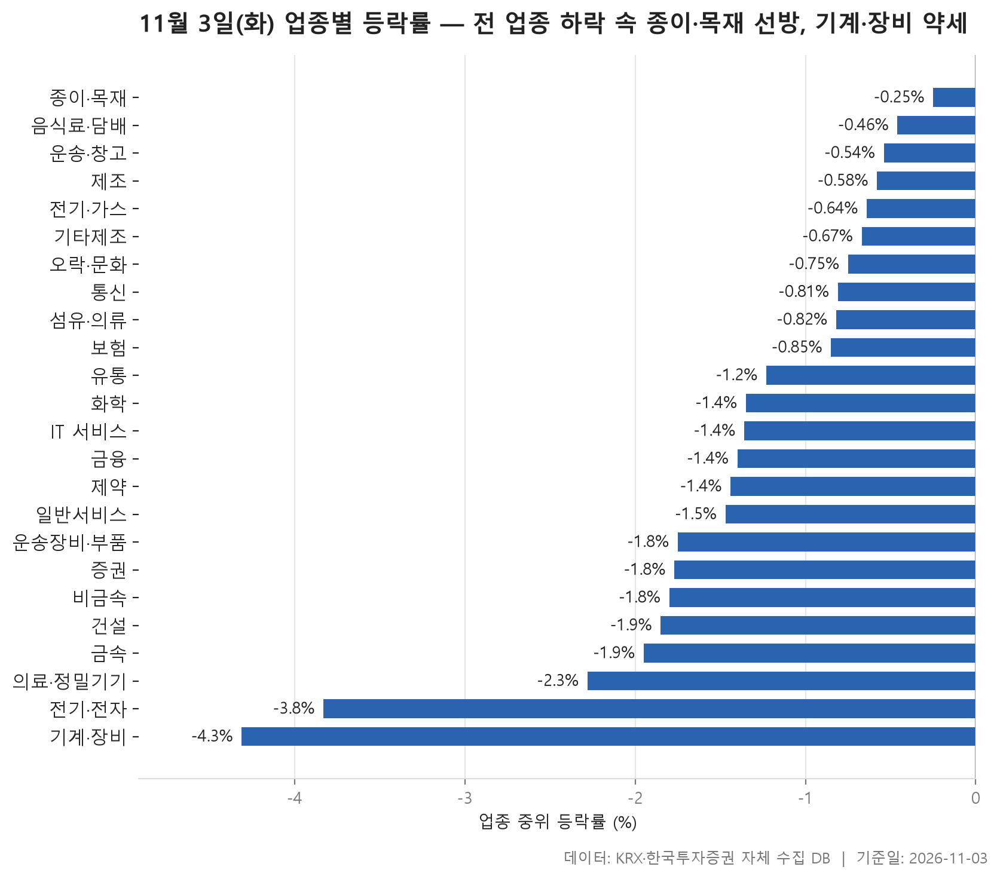
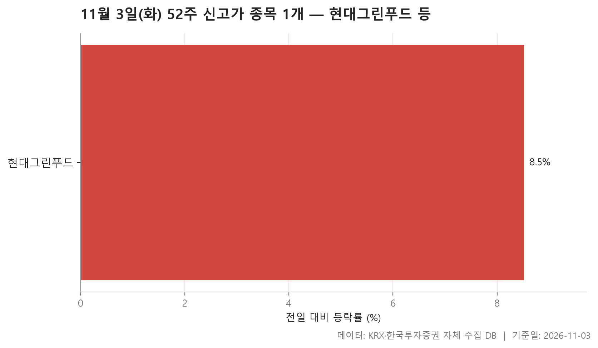
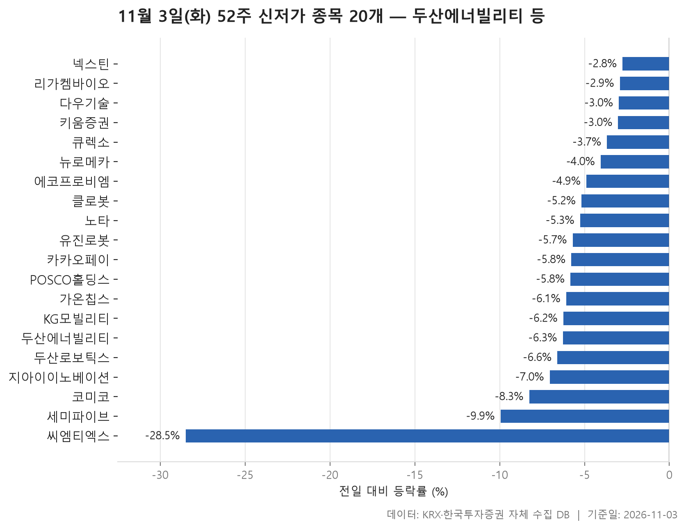
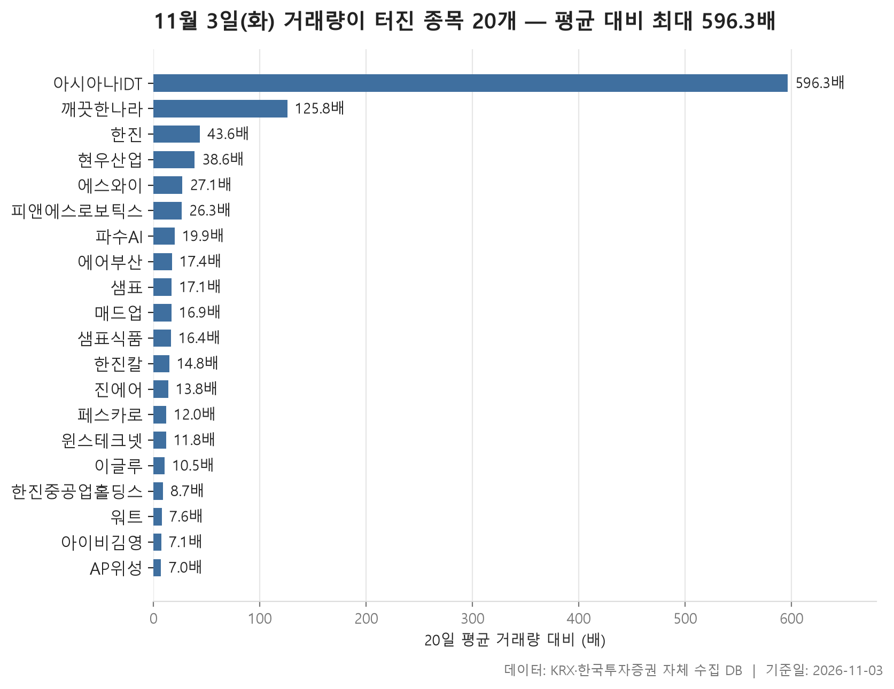

11월 3일 시장은 한쪽으로 크게 기운 하루였습니다. 업종마다 종목 등락률을 한 줄로 세워 한가운데 값을 뽑으면, 24개 업종 모두 그 값이 마이너스입니다. 24개 업종의 중위 등락률을 다시 늘어놓으면 한가운데 값이 -1.35%입니다. 덜 내린 업종과 많이 내린 업종의 차이는 있었지만 오른 업종은 없었습니다.

오늘은 네 가지를 차례로 봅니다. 먼저 업종별 등락으로 하락이 어디에 몰렸는지 확인합니다. 다음으로 52주 신고가와 신저가 종목 수를 비교해 봅니다. 신고가는 한 종목뿐이고 신저가는 20개입니다. 마지막으로 거래량이 평소보다 크게 늘어난 종목을 봅니다. 시장 전체가 내린 날에도 따로 움직인 종목이 있었고, 그런 종목은 대체로 거래량 쪽에서 드러났습니다.

> 기준일: 2026-11-03 · 집계: 자체 수집 데이터베이스

## 업종 등락률 — 24개 모두 하락

가장 덜 내린 업종은 종이·목재로 중위 등락률이 -0.25%입니다. 가장 많이 내린 기계·장비는 -4.31%입니다. 업종 순위의 아래쪽에 큰 업종이 몰려 있다는 점이 눈에 띕니다. 전기·전자는 368개 종목으로 표에서 가장 큰 업종인데 중위 등락률이 -3.83%였고, 오른 종목은 열 곳 중 한 곳꼴인 10.90%에 그쳤습니다. 이 업종의 거래대금은 93,121.30억원으로 다른 업종보다 훨씬 많습니다. 돈이 가장 많이 오간 업종이 가장 크게 내린 업종에 속했다는 뜻입니다. 기계·장비는 208개 종목 가운데 오른 종목이 7.70%뿐이고, 평균도 -4.40%로 중위값과 거의 같습니다. 일부 종목만 크게 빠진 게 아니라 업종 전체가 비슷하게 내렸다고 봐야 합니다.

표 위쪽은 사정이 다릅니다. 종이·목재는 중위값이 마이너스인데 평균은 +0.88%로 플러스입니다. 깨끗한나라가 +29.95% 오르면서 혼자 업종 평균을 1.15%p 끌어올렸습니다. 이 기여분이 평균 상승폭보다 크기 때문에, 평균이 플러스가 된 건 이 한 종목 덕분이라고 볼 수 있습니다. 그래도 오른 종목 비율이 42.30%로 24개 업종 가운데 가장 높았으니 업종 전체도 버틴 편입니다. 운송·창고도 비슷하게 한진의 +23.08%가 평균을 중위값 위로 올려놓았습니다.

반대로 기타제조는 중위값이 -0.67%로 상위권인데 평균은 -2.57%입니다. 크리에이츠가 -16.52% 빠지면서 평균을 -1.10%p 끌어내렸고, 오른 종목도 13.30%로 적었습니다. 증권은 더 극단적입니다. 18개 종목 중 오른 종목이 하나도 없었습니다. 낙폭은 -1.77%로 중간 정도였지만 반등한 종목은 없었습니다. 전기·전자의 AP위성처럼 상한가 수준까지 오른 종목이 있어도, 종목 수가 많은 업종에서는 평균에 미친 영향이 0.08%p에 그쳤습니다.

| 업종 | 종목수(개) | 중위등락률(%) | 평균등락률(%) | 상승비율(%) | 주도종목 | 주도종목등락률(%) | 평균기여도(%p) | 거래대금합계(억원) |
|---|---|---|---|---|---|---|---|---|
| 종이·목재 | 26 | -0.25 | +0.88 | 42.30 | 깨끗한나라 | +29.95 | 1.15 | 83.60 |
| 음식료·담배 | 83 | -0.46 | -0.62 | 36.10 | 한울앤제주 | +29.99 | 0.36 | 1,277.80 |
| 운송·창고 | 28 | -0.54 | -0.30 | 28.60 | 한진 | +23.08 | 0.82 | 3,156.20 |
| 제조 | 8 | -0.58 | -0.17 | 37.50 | 시디즈 | +6.20 | 0.78 | 4.70 |
| 전기·가스 | 10 | -0.64 | -0.93 | 30.00 | SGC에너지 | -3.69 | -0.37 | 497.40 |
| 기타제조 | 15 | -0.67 | -2.57 | 13.30 | 크리에이츠 | -16.52 | -1.10 | 158.70 |
| 오락·문화 | 62 | -0.75 | -1.44 | 27.40 | 아티스트스튜디오 | -11.88 | -0.19 | 655.10 |
| 통신 | 13 | -0.81 | -1.60 | 15.40 | 프리티 | -12.38 | -0.95 | 593.40 |
| 섬유·의류 | 49 | -0.82 | -1.15 | 18.40 | 인디에프 | -9.02 | -0.18 | 229.10 |
| 보험 | 11 | -0.85 | -0.84 | 27.30 | 삼성생명 | -3.86 | -0.35 | 1,679.20 |
| 유통 | 157 | -1.23 | -1.31 | 22.30 | 엑시온그룹 | +10.98 | 0.07 | 2,564.70 |
| 화학 | 220 | -1.35 | -1.67 | 21.40 | 진양폴리 | +20.31 | 0.09 | 9,481.20 |
| IT 서비스 | 244 | -1.36 | -1.09 | 25.80 | 한싹 | +29.96 | 0.12 | 15,170.20 |
| 금융 | 110 | -1.40 | -1.51 | 20.90 | 한진칼 | +29.97 | 0.27 | 13,637.20 |
| 제약 | 167 | -1.44 | -1.64 | 16.20 | 로킷헬스케어 | +18.44 | 0.11 | 4,008.80 |
| 일반서비스 | 168 | -1.47 | -1.93 | 24.40 | YBM넷 | -28.56 | -0.17 | 5,073.80 |
| 운송장비·부품 | 132 | -1.75 | -1.91 | 22.00 | 에코캡 | -16.77 | -0.13 | 8,007.60 |
| 증권 | 18 | -1.77 | -1.86 | 0.00 | SK증권 | -3.98 | -0.22 | 716.40 |
| 비금속 | 35 | -1.80 | -1.79 | 22.90 | 티씨케이 | -7.64 | -0.22 | 295.20 |
| 건설 | 50 | -1.85 | -2.23 | 16.00 | 상지건설 | -16.77 | -0.34 | 1,895.40 |
| 금속 | 130 | -1.95 | -2.51 | 14.60 | 영광 | -27.30 | -0.21 | 3,970.50 |
| 의료·정밀기기 | 103 | -2.28 | -2.43 | 20.40 | 디아이 | -12.68 | -0.12 | 2,417.10 |
| 전기·전자 | 368 | -3.83 | -3.55 | 10.90 | AP위성 | +29.98 | 0.08 | 93,121.30 |
| 기계·장비 | 208 | -4.31 | -4.40 | 7.70 | 디티에스 | -19.60 | -0.09 | 12,601.10 |

## 52주 신고가 1개 — 현대그린푸드 8.52%

52주 신고가는 현대그린푸드 한 종목입니다. 종가 20,900원으로 직전 52주 최고가 20,800원을 아주 조금 넘었고, 이날 +8.52% 올랐습니다. 업종은 유통이고 시장은 KOSPI입니다.

이날 시장 분위기를 생각하면 신고가가 한 종목뿐이라는 것 자체가 하나의 정보입니다. 시가총액 500억원 이상, 거래대금 3억원 이상이라는 조건을 통과한 종목 가운데 최고가를 새로 쓴 곳이 이것뿐입니다. 거래대금은 22.70억원으로 크지 않았습니다. 이 종목이 왜 올랐는지는 자료에 나오지 않습니다. 확인할 수 있는 건 전 업종이 내린 날에 신고가를 냈다는 사실까지입니다.

| 종목명 | 종목코드 | 시장 | 업종 | 종가(원) | 등락률(%) | 이전52주최고(원) | 거래대금(억원) | 시가총액(억원) |
|---|---|---|---|---|---|---|---|---|
| 현대그린푸드 | 453340 | KOSPI | 유통 | 20,900 | +8.52 | 20,800 | 22.70 | 6,787 |

## 52주 신저가 20개 — 최저 씨엠티엑스 -28.50%

신저가 쪽에는 20개 종목이 있습니다. KOSPI 7개, KOSDAQ 13개입니다. 등락률 중위값은 -5.74%로, 신저가 종목들이 이날 시장 전체보다 훨씬 크게 내렸습니다. 업종은 9개로 나뉘는데 기계·장비가 6개로 가장 많습니다. 업종 표에서 가장 많이 내린 업종이 신저가 목록에서도 가장 많이 나온 셈입니다.

규모가 큰 종목도 들어 있습니다. 시가총액이 가장 큰 두산에너빌리티는 -6.28%, POSCO홀딩스는 -5.83% 내리며 52주 최저가 아래로 내려갔습니다. 키움증권도 -3.02%로 신저가 목록에 들었는데, 증권 업종에서 오른 종목이 없었던 것과 같은 흐름입니다. 종목 이름을 보면 두산로보틱스, 뉴로메카, 유진로봇, 클로봇처럼 로봇 관련 이름이 여럿 있습니다. 다만 이 종목들이 함께 내린 이유는 자료로 알 수 없습니다.

가장 크게 벗어난 종목은 씨엠티엑스입니다. 하루에 -28.50% 빠졌고, 종가 42,400원은 직전 최저가 56,500원보다 한참 아래입니다. 다른 종목은 대부분 직전 최저가를 조금 밑돈 정도라서 이 종목만 따로 떨어져 보입니다. 가장 적게 내린 넥스틴은 -2.76%였습니다.

| 종목명 | 종목코드 | 시장 | 업종 | 종가(원) | 등락률(%) | 이전52주최저(원) | 거래대금(억원) | 시가총액(억원) |
|---|---|---|---|---|---|---|---|---|
| 두산에너빌리티 | 034020 | KOSPI | 기계·장비 | 52,200 | -6.28 | 52,500 | 1,420.50 | 334,373 |
| POSCO홀딩스 | 005490 | KOSPI | 금속 | 266,500 | -5.83 | 268,000 | 900.80 | 211,179 |
| 에코프로비엠 | 247540 | KOSDAQ | 전기·전자 | 87,600 | -4.89 | 88,300 | 396.10 | 85,699 |
| 키움증권 | 039490 | KOSPI | 증권 | 199,300 | -3.02 | 205,000 | 188.10 | 52,273 |
| 카카오페이 | 377300 | KOSPI | 금융 | 31,800 | -5.78 | 32,400 | 75.60 | 43,028 |
| 두산로보틱스 | 454910 | KOSPI | 기계·장비 | 52,400 | -6.60 | 52,700 | 165.60 | 33,966 |
| 리가켐바이오 | 141080 | KOSDAQ | 일반서비스 | 59,900 | -2.92 | 60,400 | 81.80 | 22,183 |
| 다우기술 | 023590 | KOSPI | IT 서비스 | 30,900 | -2.98 | 31,200 | 14.50 | 13,376 |
| 코미코 | 183300 | KOSDAQ | 기계·장비 | 21,100 | -8.26 | 21,900 | 52.60 | 10,838 |
| 클로봇 | 466100 | KOSDAQ | IT 서비스 | 17,560 | -5.18 | 17,580 | 21.80 | 5,475 |
| KG모빌리티 | 003620 | KOSPI | 운송장비·부품 | 2,250 | -6.25 | 2,390 | 17.10 | 4,553 |
| 씨엠티엑스 | 388210 | KOSDAQ | 전기·전자 | 42,400 | -28.50 | 56,500 | 195.30 | 4,094 |
| 지아이이노베이션 | 358570 | KOSDAQ | 일반서비스 | 6,330 | -7.05 | 6,470 | 32.90 | 4,084 |
| 세미파이브 | 490470 | KOSDAQ | 일반서비스 | 11,310 | -9.95 | 12,060 | 42.70 | 3,848 |
| 가온칩스 | 399720 | KOSDAQ | 전기·전자 | 31,650 | -6.08 | 31,950 | 8.60 | 3,753 |
| 뉴로메카 | 348340 | KOSDAQ | 기계·장비 | 15,640 | -4.05 | 15,810 | 23.20 | 3,661 |
| 유진로봇 | 056080 | KOSDAQ | 기계·장비 | 8,930 | -5.70 | 9,060 | 22.00 | 3,414 |
| 큐렉소 | 060280 | KOSDAQ | 유통 | 6,800 | -3.68 | 6,900 | 11.10 | 2,806 |
| 노타 | 486990 | KOSDAQ | IT 서비스 | 12,620 | -5.26 | 12,690 | 12.30 | 2,700 |
| 넥스틴 | 348210 | KOSDAQ | 기계·장비 | 24,700 | -2.76 | 24,800 | 12.20 | 2,588 |

## 거래량 급증 20개 — 최고 아시아나IDT 596.30배

거래량이 직전 20거래일 평균의 5배를 넘은 종목은 20개이고, 배수의 중위값은 16.65배입니다. 아시아나IDT는 평소 하루 5,798주 정도 거래되던 종목인데 이날 3,457,804주가 거래돼 배수가 596.30배였습니다. 주가도 +17.67% 올랐습니다. 그다음은 깨끗한나라로 125.80배입니다. 업종 표에서 종이·목재 평균을 끌어올린 그 종목입니다.

종목 이름을 묶어 보면 눈에 띄는 점이 있습니다. 한진(+23.08%)과 한진칼(+29.97%)이 함께 들어 있고, 운송·창고 업종의 에어부산과 진에어도 있습니다. 다만 에어부산은 0.00%, 진에어는 +0.54%로 주가는 거의 움직이지 않았습니다. 같은 날 거래량이 늘었다는 것까지만 확인되고, 서로 어떤 관계인지는 자료에 없습니다. 한진칼은 시가총액이 116,968억원으로 이 목록에서 가장 크고, 거래대금도 1,721.70억원으로 가장 많았습니다.

거래량이 늘었다고 모두 오른 건 아닙니다. 샘표(-17.09%)와 샘표식품(-15.69%)은 이름이 비슷한 두 종목이 함께 크게 내리면서 거래량이 늘었습니다. 워트도 -7.00%였습니다. 반대로 AP위성은 배수가 7.00배로 가장 낮았지만 +29.98% 올랐고 거래대금은 675.80억원이었습니다. 평소에도 거래가 많던 종목이라 배수가 낮게 나온 것입니다.

| 종목명 | 종목코드 | 시장 | 업종 | 종가(원) | 등락률(%) | 거래량(주) | 평균거래량(주) | 배수(배) | 거래대금(억원) | 시가총액(억원) |
|---|---|---|---|---|---|---|---|---|---|---|
| 아시아나IDT | 267850 | KOSPI | IT 서비스 | 10,590 | +17.67 | 3,457,804 | 5,798 | 596.30 | 361.30 | 1,175 |
| 깨끗한나라 | 004540 | KOSPI | 종이·목재 | 1,397 | +29.95 | 2,886,432 | 22,938 | 125.80 | 39.20 | 520 |
| 한진 | 002320 | KOSPI | 운송·창고 | 20,800 | +23.08 | 1,558,288 | 35,772 | 43.60 | 313.40 | 3,228 |
| 현우산업 | 092300 | KOSDAQ | 전기·전자 | 2,790 | +16.25 | 2,196,700 | 56,958 | 38.60 | 61.30 | 562 |
| 에스와이 | 109610 | KOSDAQ | 금속 | 1,657 | -0.24 | 1,835,149 | 67,624 | 27.10 | 33.40 | 810 |
| 피앤에스로보틱스 | 460940 | KOSDAQ | 의료·정밀기기 | 5,700 | +4.01 | 9,781,816 | 372,593 | 26.30 | 591.70 | 767 |
| 파수AI | 150900 | KOSDAQ | IT 서비스 | 5,330 | +20.05 | 9,247,836 | 464,095 | 19.90 | 499.70 | 624 |
| 에어부산 | 298690 | KOSPI | 운송·창고 | 1,457 | 0.00 | 1,277,008 | 73,380 | 17.40 | 19.90 | 2,374 |
| 샘표 | 007540 | KOSPI | 금융 | 46,100 | -17.09 | 175,907 | 10,302 | 17.10 | 91.40 | 929 |
| 매드업 | 0039P0 | KOSDAQ | 일반서비스 | 5,870 | +7.71 | 5,487,384 | 323,960 | 16.90 | 346.00 | 1,105 |
| 샘표식품 | 248170 | KOSPI | 음식료·담배 | 23,100 | -15.69 | 330,681 | 20,184 | 16.40 | 80.20 | 1,055 |
| 한진칼 | 180640 | KOSPI | 금융 | 175,200 | +29.97 | 1,070,329 | 72,165 | 14.80 | 1,721.70 | 116,968 |
| 진에어 | 272450 | KOSPI | 운송·창고 | 5,600 | +0.54 | 1,481,897 | 107,308 | 13.80 | 89.30 | 2,923 |
| 페스카로 | 0015S0 | KOSDAQ | 일반서비스 | 6,350 | +8.55 | 498,767 | 41,511 | 12.00 | 33.90 | 627 |
| 윈스테크넷 | 136540 | KOSDAQ | IT 서비스 | 12,100 | +6.80 | 268,984 | 22,762 | 11.80 | 32.50 | 1,486 |
| 이글루 | 067920 | KOSDAQ | IT 서비스 | 6,520 | +6.54 | 1,921,276 | 182,284 | 10.50 | 131.40 | 717 |
| 한진중공업홀딩스 | 003480 | KOSPI | 전기·가스 | 4,150 | -3.15 | 327,699 | 37,831 | 8.70 | 14.20 | 1,225 |
| 워트 | 396470 | KOSDAQ | 기계·장비 | 7,310 | -7.00 | 4,853,398 | 637,051 | 7.60 | 380.80 | 1,178 |
| 아이비김영 | 339950 | KOSDAQ | 일반서비스 | 2,175 | -1.36 | 293,629 | 41,513 | 7.10 | 6.50 | 978 |
| AP위성 | 211270 | KOSDAQ | 전기·전자 | 10,450 | +29.98 | 6,981,940 | 1,002,550 | 7.00 | 675.80 | 1,576 |

## 정리

정리하면 11월 3일은 24개 업종 모두 내린 날이었습니다. 기계·장비와 전기·전자처럼 큰 업종이 하락을 이끌었고, 52주 신고가는 한 종목, 신저가는 20개 종목이 나왔습니다. 오른 종목은 업종보다 거래량이 갑자기 늘어난 몇몇 종목에서 주로 나왔습니다.

이 글은 하루치 종가만 비교한 것입니다. 왜 올랐고 왜 내렸는지는 자료에 없어서 적지 않았습니다. 업종 순위는 중위값 기준이라, 평균만 보면 순서가 달라질 수 있습니다. 개별 종목의 등락은 이날 하루의 기록일 뿐이고, 앞으로의 방향을 말해 주지 않습니다.

## 집계 기준

**업종 등락률**

- **기준**: 2026-11-02 종가 → 2026-11-03 종가
- **순위**: 업종 내 종목 등락률의 중위값 (평균은 참고용으로 함께 표시)
- **주도종목**: 그 업종에서 등락률 절대값이 가장 큰 종목 (동점이면 거래대금이 큰 쪽)
- **평균기여도**: 그 종목 하나가 업종 평균을 움직인 폭 (등락률 ÷ 종목수). 중위값과 평균의 격차가 이 값에 가까우면 평균을 만든 것이 그 종목이고, 훨씬 크면 다른 종목들도 함께 움직인 것입니다
- **필터**: 업종 내 보통주 5종목 이상
- **전체업종중위등락률(%)**: -1.35

**52주 신고가**

- **기준**: 종가 > 직전 52주 최고가
- **관측구간**: 2025-10-22 ~ 2026-11-02 (252거래일)
- **필터**: 시가총액 500억 이상, 거래대금 3억 이상, 보통주

**52주 신저가**

- **기준**: 종가 < 직전 52주 최저가
- **관측구간**: 2025-10-22 ~ 2026-11-02 (252거래일)
- **필터**: 시가총액 500억 이상, 거래대금 3억 이상, 보통주

**거래량 급증**

- **기준**: 당일 거래량 ≥ 직전 20거래일 평균 × 5
- **관측구간**: 2026-10-02 ~ 2026-11-02 (20거래일)
- **필터**: 시가총액 500억 이상, 거래대금 3억 이상, 보통주

## 데이터 출처 및 유의사항

- **데이터출처**: 한국거래소(KRX) 공시 데이터와 한국투자증권 OpenAPI 를 직접 수집해 구축한 자체 데이터베이스
- **집계방식**: 수집·집계·차트 생성을 직접 구현한 파이프라인에서 자동 산출
- **작성고지**: 본문의 표·통계·차트는 자체 데이터베이스에서 계산된 값이며, 문장 작성 과정에 AI 도구를 활용했습니다.
- **면책**: 본 글은 정보 제공을 목적으로 하며 특정 종목의 매수·매도를 추천하지 않습니다. 제시된 수치는 과거 데이터이고 미래 수익을 보장하지 않습니다. 투자 판단과 그 결과에 대한 책임은 투자자 본인에게 있습니다.

