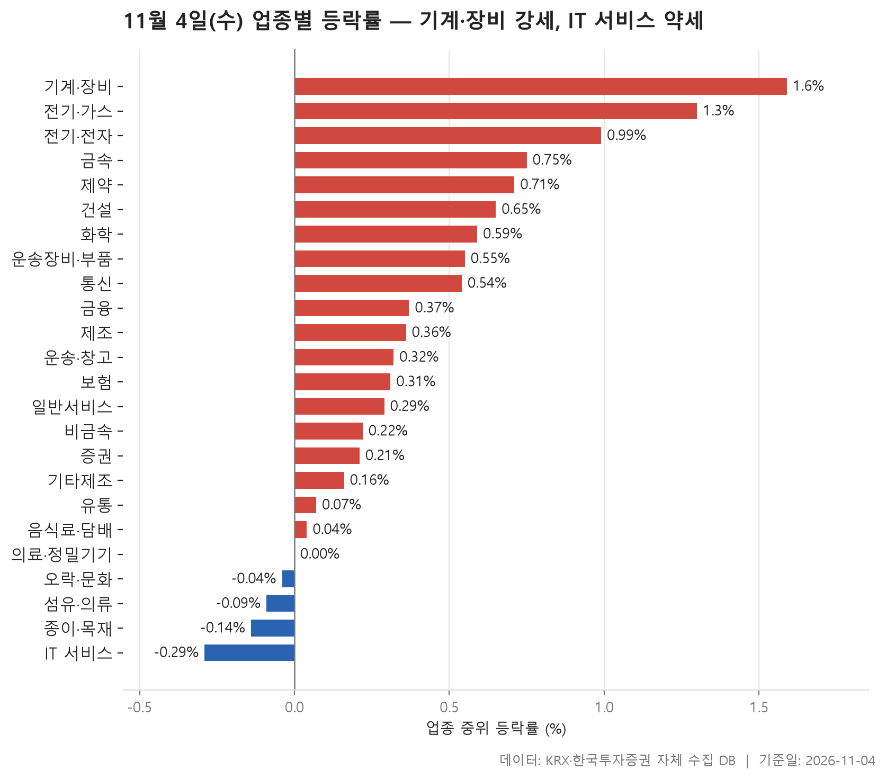
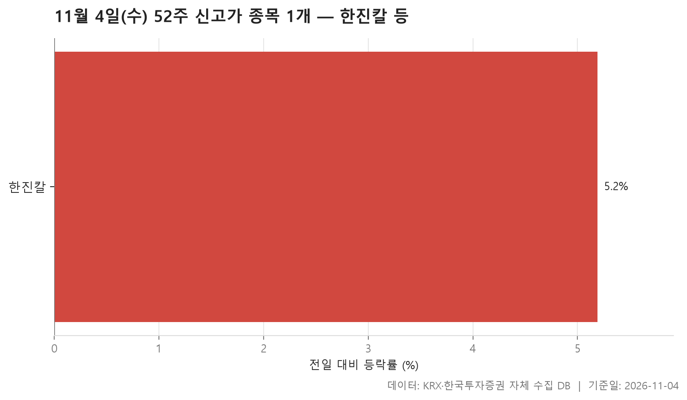
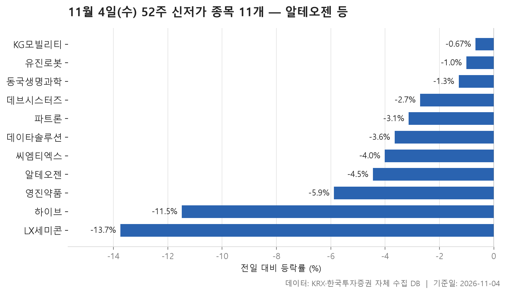
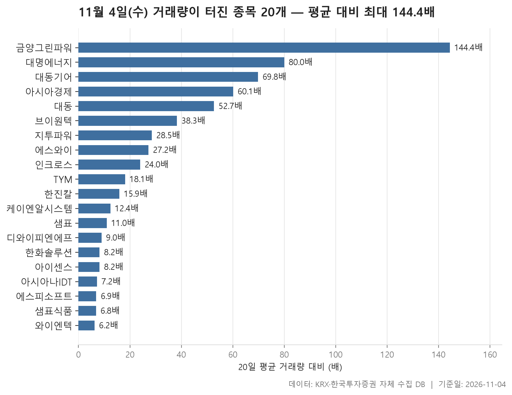

11월 4일 시장은 크게 흔들리지 않은 채 위쪽으로 조금 기운 하루였습니다. 24개 업종 가운데 19개가 올랐고 4개가 내렸습니다. 업종마다 중위 등락률을 구해 늘어놓으면 한가운데 값이 +0.32%입니다. 맨 위에는 기계·장비(+1.59%), 맨 아래에는 IT 서비스(-0.29%)가 있습니다. 위아래 폭이 넓지 않으니 어느 쪽으로든 쏠림이 강했다고 하기는 어렵습니다.

그래도 표를 겹쳐 보면 눈에 걸리는 대목이 있습니다. 대부분의 업종이 올랐는데 52주 신고가는 한 종목뿐이고 신저가는 11개였습니다. 몇몇 업종은 평균과 중위값의 방향이 서로 반대이기도 합니다. 오늘은 업종 흐름, 신고가와 신저가, 거래량이 갑자기 늘어난 종목을 차례로 보면서 이런 어긋남이 어디서 생겼는지 짚어 봅니다.

> 기준일: 2026-11-04 · 집계: 자체 수집 데이터베이스

## 업종 등락률 — 24개 중 19개 상승

의료·정밀기기는 0.00%로 보합에 멈췄습니다. 이 업종을 빼면 다섯 곳 중 네 곳꼴로 업종이 올랐습니다. 다만 오른 폭은 대체로 크지 않았습니다. 맨 위의 기계·장비(+1.59%)는 208개 종목이 들어 있는 큰 업종인데 그중 76.40%가 올랐습니다. 이 업종에서 가장 크게 오른 씨메스로보틱스(+20.23%)도 업종 평균을 0.10%p 올리는 데 그쳤습니다. 한두 종목이 끌어올린 게 아니라 업종 전체가 함께 오른 모양입니다. 종목이 10개인 전기·가스(+1.30%)는 80.00%가 올라, 오른 종목의 비중으로는 가장 높았습니다.

평균과 중위값이 벌어진 업종은 따로 볼 필요가 있습니다. 전기·전자는 중위값이 +0.99%인데 평균은 +1.83%로 훨씬 높습니다. 그런데 이 업종에서 가장 크게 오른 아리바이오홀딩스(+29.98%)는 평균을 0.08%p밖에 올리지 않았습니다. 그러니 이 종목 하나가 아니라 크게 오른 종목 여럿이 함께 평균을 끌어올렸다고 읽힙니다. 이 업종의 거래대금은 155,796.00억원으로 다른 업종을 크게 앞섭니다.

반대 경우도 있습니다. 운송·창고는 오른 종목이 75.00%인데 평균은 -0.09%로 마이너스입니다. 한진(-17.88%) 한 종목이 평균을 0.64%p 끌어내렸기 때문입니다. 기타제조에서도 크리에이츠(-10.51%)가 평균을 0.70%p 끌어내려 같은 모양이 나왔습니다. 종목이 8개뿐인 제조는 코아스(+8.47%) 하나가 평균을 1.06%p 올려 놓았습니다. 그래서 평균 +1.67%를 업종 전체의 분위기로 받아들이기는 어렵습니다.

맨 아래 IT 서비스(-0.29%)는 245개 종목 가운데 41.20%만 올랐습니다. 다섯 곳 중 두 곳 남짓입니다. 오른 종목의 비중이 가장 낮은 곳은 섬유·의류로 36.70%였습니다. HLB라는 이름이 붙은 종목들도 눈에 띕니다. 제약의 HLB(-17.69%), 일반서비스의 HLB바이오스텝(-22.68%), 유통의 HLB글로벌(-11.05%)이 각자의 업종에서 가장 크게 움직인 종목으로 올라 있습니다. 왜 그렇게 움직였는지는 이 자료로 알 수 없습니다.

| 업종 | 종목수(개) | 중위등락률(%) | 평균등락률(%) | 상승비율(%) | 주도종목 | 주도종목등락률(%) | 평균기여도(%p) | 거래대금합계(억원) |
|---|---|---|---|---|---|---|---|---|
| 기계·장비 | 208 | +1.59 | +1.94 | 76.40 | 씨메스로보틱스 | +20.23 | 0.10 | 15,676.60 |
| 전기·가스 | 10 | +1.30 | +1.59 | 80.00 | 한국전력 | +4.82 | 0.48 | 845.30 |
| 전기·전자 | 368 | +0.99 | +1.83 | 68.50 | 아리바이오홀딩스 | +29.98 | 0.08 | 155,796.00 |
| 금속 | 130 | +0.75 | +1.66 | 68.50 | 대동금속 | +29.85 | 0.23 | 4,782.30 |
| 제약 | 167 | +0.71 | +0.49 | 65.30 | HLB | -17.69 | -0.11 | 7,013.30 |
| 건설 | 50 | +0.65 | +1.72 | 66.00 | 대명에너지 | +29.96 | 0.60 | 3,226.60 |
| 화학 | 220 | +0.59 | +1.06 | 59.10 | CSA 코스믹 | -22.10 | -0.10 | 14,934.70 |
| 운송장비·부품 | 132 | +0.55 | +0.64 | 62.10 | 에코캡 | -27.38 | -0.21 | 9,848.10 |
| 통신 | 13 | +0.54 | +1.32 | 53.80 | LG유플러스 | +7.11 | 0.55 | 1,419.10 |
| 금융 | 110 | +0.37 | +0.90 | 61.80 | 세아제강지주 | +13.32 | 0.12 | 21,117.50 |
| 제조 | 8 | +0.36 | +1.67 | 62.50 | 코아스 | +8.47 | 1.06 | 7.40 |
| 운송·창고 | 28 | +0.32 | -0.09 | 75.00 | 한진 | -17.88 | -0.64 | 1,797.40 |
| 보험 | 11 | +0.31 | +0.32 | 72.70 | 현대해상 | +1.52 | 0.14 | 1,745.60 |
| 일반서비스 | 168 | +0.29 | +0.43 | 53.60 | HLB바이오스텝 | -22.68 | -0.13 | 7,778.10 |
| 비금속 | 35 | +0.22 | +0.30 | 57.10 | SG | +4.79 | 0.14 | 353.90 |
| 증권 | 18 | +0.21 | +0.12 | 61.10 | 부국증권 | +2.10 | 0.12 | 883.50 |
| 기타제조 | 15 | +0.16 | -0.29 | 53.30 | 크리에이츠 | -10.51 | -0.70 | 83.40 |
| 유통 | 157 | +0.07 | +0.02 | 50.30 | HLB글로벌 | -11.05 | -0.07 | 3,406.60 |
| 음식료·담배 | 84 | +0.04 | +0.15 | 50.00 | 아미코젠 | +15.13 | 0.18 | 1,423.10 |
| 의료·정밀기기 | 103 | 0.00 | +0.02 | 48.50 | 케이엔알시스템 | +29.98 | 0.29 | 1,979.40 |
| 오락·문화 | 62 | -0.04 | -0.37 | 43.50 | 하이브 | -11.48 | -0.19 | 1,710.00 |
| 섬유·의류 | 49 | -0.09 | -0.02 | 36.70 | 대한방직 | +7.21 | 0.15 | 133.40 |
| 종이·목재 | 27 | -0.14 | -0.55 | 44.40 | 깨끗한나라 | -14.39 | -0.53 | 63.20 |
| IT 서비스 | 245 | -0.29 | -0.65 | 41.20 | 인텔리빅스 | -19.46 | -0.08 | 10,949.40 |

## 52주 신고가 1개 — 한진칼 5.19%

52주 신고가를 쓴 종목은 한진칼 하나입니다. 종가 184,300원으로 직전 52주 최고가 175,900원을 넘어섰고, 하루 동안 +5.19% 올랐습니다. 시가총액이 123,043억원인 대형주이고 거래대금은 3,601.90억원입니다. 아래 거래량 급증 표에도 이 종목이 있습니다. 평소의 15.90배나 되는 거래가 몰린 날 신고가를 새로 쓴 셈입니다.

같은 날 운송·창고 업종의 한진은 -17.88%로 업종 평균을 크게 끌어내렸습니다. 이름이 비슷한 두 종목이 정반대로 움직인 것은 표에서 확인되는 사실입니다. 다만 둘 사이에 무슨 관계가 있는지는 이 자료가 말해 주지 않습니다.

19개 업종이 오른 날 신고가가 한 종목뿐이라는 점도 눈여겨볼 만합니다. 업종 대부분이 조금씩만 올랐으니, 1년 고점을 넘을 만큼 강하게 오른 종목은 드물었던 날로 볼 수 있습니다.

| 종목명 | 종목코드 | 시장 | 업종 | 종가(원) | 등락률(%) | 이전52주최고(원) | 거래대금(억원) | 시가총액(억원) |
|---|---|---|---|---|---|---|---|---|
| 한진칼 | 180640 | KOSPI | 금융 | 184,300 | +5.19 | 175,900 | 3,601.90 | 123,043 |

## 52주 신저가 11개 — 최저 LX세미콘 -13.74%

신저가는 11개로 신고가보다 훨씬 많습니다. KOSPI 4개, KOSDAQ 7개이고 업종은 8개에 흩어져 있어 어느 한 업종에 몰렸다고 보기는 어렵습니다. 그중 가장 많은 곳은 전기·전자로 3개입니다. 전기·전자는 업종 전체로 보면 +0.99%로 강했던 곳입니다. 그런데도 LX세미콘(-13.74%), 씨엠티엑스(-4.01%), 파트론(-3.13%)이 1년 저점을 새로 썼습니다. 같은 업종 안에서도 종목마다 사정이 크게 달랐다는 뜻입니다. LX세미콘은 신저가 종목 가운데 가장 크게 내렸습니다.

덩치로 보면 알테오젠이 눈에 띕니다. 시가총액 142,096억원으로 오늘 신고가를 쓴 한진칼보다도 큰 종목입니다. -4.45% 내린 204,000원에 마감해 직전 저점 206,500원 아래로 내려갔습니다. 하이브는 -11.48%로, 오락·문화 업종에서 가장 크게 움직인 종목이기도 합니다.

11개 종목의 하루 등락률 중위값은 -3.65%입니다. 그런데 모든 종목이 크게 빠지며 저점을 깬 것은 아닙니다. KG모빌리티(-0.67%)와 유진로봇(-1.01%)은 조금만 내리고도 직전 저점 바로 아래에서 마감했습니다. 특히 유진로봇은 오늘 가장 강했던 기계·장비 업종에 속한 종목입니다. 업종이 강했다고 해서 그 안의 모든 종목이 같이 오른 것은 아니었습니다.

| 종목명 | 종목코드 | 시장 | 업종 | 종가(원) | 등락률(%) | 이전52주최저(원) | 거래대금(억원) | 시가총액(억원) |
|---|---|---|---|---|---|---|---|---|
| 알테오젠 | 196170 | KOSDAQ | 일반서비스 | 204,000 | -4.45 | 206,500 | 1,450.50 | 142,096 |
| 하이브 | 352820 | KOSPI | 오락·문화 | 138,000 | -11.48 | 144,700 | 1,197.90 | 59,487 |
| KG모빌리티 | 003620 | KOSPI | 운송장비·부품 | 2,235 | -0.67 | 2,245 | 16.90 | 4,523 |
| LX세미콘 | 108320 | KOSPI | 전기·전자 | 25,750 | -13.74 | 29,500 | 78.70 | 4,188 |
| 씨엠티엑스 | 388210 | KOSDAQ | 전기·전자 | 40,700 | -4.01 | 41,950 | 147.10 | 3,929 |
| 유진로봇 | 056080 | KOSDAQ | 기계·장비 | 8,840 | -1.01 | 8,850 | 23.60 | 3,380 |
| 파트론 | 091700 | KOSDAQ | 전기·전자 | 4,175 | -3.13 | 4,280 | 13.90 | 2,088 |
| 영진약품 | 003520 | KOSPI | 제약 | 880 | -5.88 | 907 | 10.60 | 1,609 |
| 데브시스터즈 | 194480 | KOSDAQ | IT 서비스 | 11,130 | -2.71 | 11,260 | 16.40 | 1,354 |
| 동국생명과학 | 303810 | KOSDAQ | 제약 | 1,989 | -1.29 | 2,005 | 5.40 | 636 |
| 데이타솔루션 | 263800 | KOSDAQ | 유통 | 3,825 | -3.65 | 3,930 | 4.60 | 621 |

## 거래량 급증 20개 — 최고 금양그린파워 144.40배

거래량이 직전 20거래일 평균의 5배를 넘긴 종목은 20개입니다. KOSDAQ이 13개, KOSPI가 7개입니다. 평소의 몇 배인지를 늘어놓으면 가운데 값이 17배입니다. 가장 높은 금양그린파워는 144.40배, 가장 낮은 와이엔텍은 6.20배입니다. 금양그린파워는 평소 하루 12,300주쯤 거래되던 종목인데 이날 1,775,717주가 거래됐고 주가는 +19.91% 올랐습니다.

업종별로는 기계·장비가 5개로 가장 많습니다. 첫 번째 표에서 기계·장비가 가장 강했던 것과 맞아떨어집니다. 대동기어(+18.93%)와 대동(+5.66%)은 각각 평소의 69.80배, 52.70배가 거래됐습니다. TYM(+12.36%), 디와이피엔에프(+15.56%), 브이원텍(+3.02%)도 거래가 크게 늘면서 올랐습니다. 건설의 대명에너지(+29.96%)는 평소의 80.00배가 거래됐고, 혼자서 건설 업종 평균을 0.60%p 끌어올린 종목이기도 합니다.

덩치로 보면 한화솔루션이 따로 눈에 띕니다. 시가총액 62,970억원에 거래대금 5,923.70억원으로 이 표에서 거래대금이 가장 많고, 주가는 +18.64% 올랐습니다. 평소의 8.20배로 배율은 중간보다 낮습니다. 원래 하루 평균 2,774,639주가 오가던 종목이라 배율이 크게 나오지 않았을 뿐입니다.

표에 오른 종목은 대부분 상승했고, 내린 종목은 아이센스(-7.79%), 아시아나IDT(-8.78%), 와이엔텍(-2.69%)뿐입니다. 약세 업종인 IT 서비스에서도 아시아경제(+9.47%)와 에스피소프트(+14.48%)는 거래가 몰리며 올랐습니다. 같은 업종의 아시아나IDT는 반대로 내렸고요.

| 종목명 | 종목코드 | 시장 | 업종 | 종가(원) | 등락률(%) | 거래량(주) | 평균거래량(주) | 배수(배) | 거래대금(억원) | 시가총액(억원) |
|---|---|---|---|---|---|---|---|---|---|---|
| 금양그린파워 | 282720 | KOSDAQ | 건설 | 7,770 | +19.91 | 1,775,717 | 12,300 | 144.40 | 139.20 | 942 |
| 대명에너지 | 389260 | KOSDAQ | 건설 | 13,750 | +29.96 | 5,105,940 | 63,846 | 80.00 | 669.60 | 2,463 |
| 대동기어 | 008830 | KOSDAQ | 기계·장비 | 6,220 | +18.93 | 12,817,881 | 183,768 | 69.80 | 819.20 | 1,193 |
| 아시아경제 | 127710 | KOSDAQ | IT 서비스 | 1,191 | +9.47 | 4,409,720 | 73,406 | 60.10 | 57.20 | 525 |
| 대동 | 000490 | KOSPI | 기계·장비 | 6,910 | +5.66 | 6,488,037 | 123,100 | 52.70 | 484.60 | 1,992 |
| 브이원텍 | 251630 | KOSDAQ | 기계·장비 | 3,415 | +3.02 | 552,118 | 14,433 | 38.30 | 20.90 | 544 |
| 지투파워 | 388050 | KOSDAQ | 전기·전자 | 7,840 | +11.68 | 6,816,518 | 239,446 | 28.50 | 548.50 | 1,467 |
| 에스와이 | 109610 | KOSDAQ | 금속 | 1,772 | +6.94 | 4,280,312 | 157,195 | 27.20 | 78.70 | 867 |
| 인크로스 | 216050 | KOSDAQ | 일반서비스 | 5,270 | +7.11 | 263,704 | 10,965 | 24.00 | 13.80 | 643 |
| TYM | 002900 | KOSPI | 기계·장비 | 6,180 | +12.36 | 1,829,181 | 101,257 | 18.10 | 113.20 | 2,559 |
| 한진칼 | 180640 | KOSPI | 금융 | 184,300 | +5.19 | 1,953,635 | 123,072 | 15.90 | 3,601.90 | 123,043 |
| 케이엔알시스템 | 199430 | KOSDAQ | 의료·정밀기기 | 15,610 | +29.98 | 515,072 | 41,672 | 12.40 | 75.50 | 1,751 |
| 샘표 | 007540 | KOSPI | 금융 | 47,900 | +3.90 | 206,900 | 18,761 | 11.00 | 104.20 | 965 |
| 디와이피엔에프 | 104460 | KOSDAQ | 기계·장비 | 6,610 | +15.56 | 103,807 | 11,559 | 9.00 | 6.80 | 695 |
| 한화솔루션 | 009830 | KOSPI | 화학 | 28,000 | +18.64 | 22,649,683 | 2,774,639 | 8.20 | 5,923.70 | 62,970 |
| 아이센스 | 099190 | KOSDAQ | 의료·정밀기기 | 16,220 | -7.79 | 278,819 | 34,067 | 8.20 | 45.10 | 4,797 |
| 아시아나IDT | 267850 | KOSPI | IT 서비스 | 9,660 | -8.78 | 1,276,710 | 178,558 | 7.20 | 130.80 | 1,072 |
| 에스피소프트 | 443670 | KOSDAQ | IT 서비스 | 5,180 | +14.48 | 12,548,136 | 1,810,105 | 6.90 | 663.80 | 1,244 |
| 샘표식품 | 248170 | KOSPI | 음식료·담배 | 23,200 | +0.43 | 246,081 | 35,975 | 6.80 | 58.50 | 1,059 |
| 와이엔텍 | 067900 | KOSDAQ | 일반서비스 | 6,160 | -2.69 | 235,349 | 37,685 | 6.20 | 15.00 | 1,121 |

## 정리

정리하면 이날은 업종 대부분이 조금씩 오르고 기계·장비가 업종 전체로 고르게 강했던 날입니다. 그런데 1년 범위를 벗어난 종목만 보면 신고가 1개, 신저가 11개로 아래쪽이 훨씬 많았습니다. 업종 평균이 몇몇 종목 때문에 중위값과 반대 방향으로 나온 곳도 있었습니다. 업종 숫자 하나만 보고 판단하기보다 그 안의 종목 분포를 함께 보는 편이 좋겠습니다.

몇 가지 한계도 밝혀 둡니다. 이 글은 전날 종가와 당일 종가만 비교한 하루치 기록입니다. 업종은 자체 분류 기준을 따랐습니다. 신고가·신저가와 거래량 급증 표에는 시가총액 500억 이상의 보통주만 넣었습니다. 종목이 왜 그렇게 움직였는지는 자료에 없으므로 이 글에서도 추측하지 않았습니다.

## 집계 기준

**업종 등락률**

- **기준**: 2026-11-03 종가 → 2026-11-04 종가
- **순위**: 업종 내 종목 등락률의 중위값 (평균은 참고용으로 함께 표시)
- **주도종목**: 그 업종에서 등락률 절대값이 가장 큰 종목 (동점이면 거래대금이 큰 쪽)
- **평균기여도**: 그 종목 하나가 업종 평균을 움직인 폭 (등락률 ÷ 종목수). 중위값과 평균의 격차가 이 값에 가까우면 평균을 만든 것이 그 종목이고, 훨씬 크면 다른 종목들도 함께 움직인 것입니다
- **필터**: 업종 내 보통주 5종목 이상
- **전체업종중위등락률(%)**: 0.32

**52주 신고가**

- **기준**: 종가 > 직전 52주 최고가
- **관측구간**: 2025-10-23 ~ 2026-11-03 (252거래일)
- **필터**: 시가총액 500억 이상, 거래대금 3억 이상, 보통주

**52주 신저가**

- **기준**: 종가 < 직전 52주 최저가
- **관측구간**: 2025-10-23 ~ 2026-11-03 (252거래일)
- **필터**: 시가총액 500억 이상, 거래대금 3억 이상, 보통주

**거래량 급증**

- **기준**: 당일 거래량 ≥ 직전 20거래일 평균 × 5
- **관측구간**: 2026-10-06 ~ 2026-11-03 (20거래일)
- **필터**: 시가총액 500억 이상, 거래대금 3억 이상, 보통주

## 데이터 출처 및 유의사항

- **데이터출처**: 한국거래소(KRX) 공시 데이터와 한국투자증권 OpenAPI 를 직접 수집해 구축한 자체 데이터베이스
- **집계방식**: 수집·집계·차트 생성을 직접 구현한 파이프라인에서 자동 산출
- **작성고지**: 본문의 표·통계·차트는 자체 데이터베이스에서 계산된 값이며, 문장 작성 과정에 AI 도구를 활용했습니다.
- **면책**: 본 글은 정보 제공을 목적으로 하며 특정 종목의 매수·매도를 추천하지 않습니다. 제시된 수치는 과거 데이터이고 미래 수익을 보장하지 않습니다. 투자 판단과 그 결과에 대한 책임은 투자자 본인에게 있습니다.

