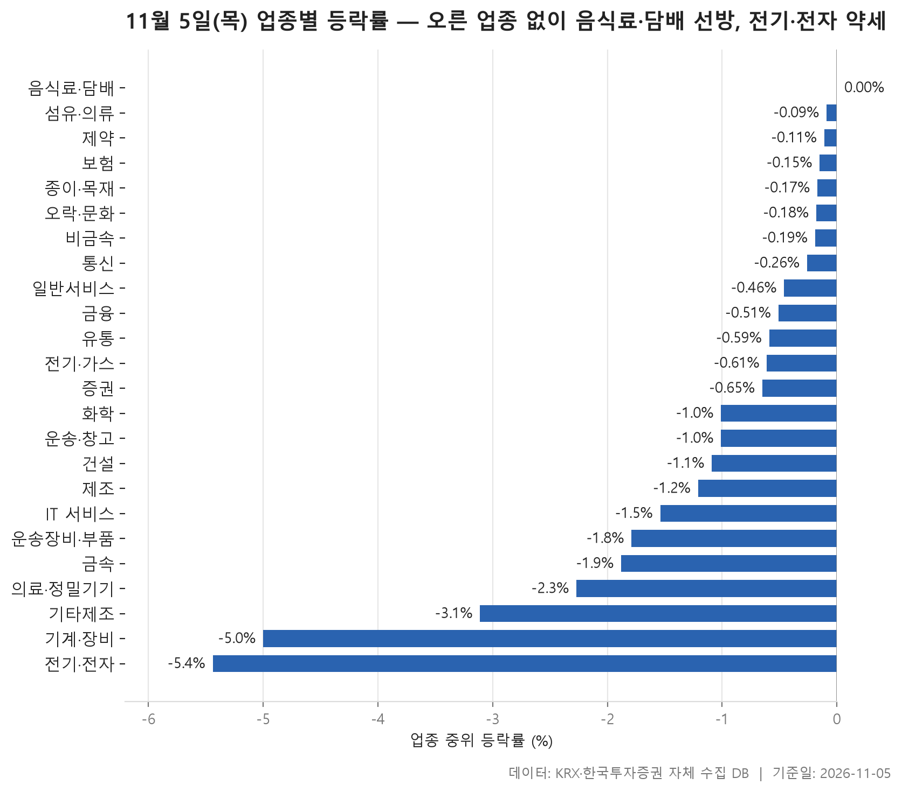
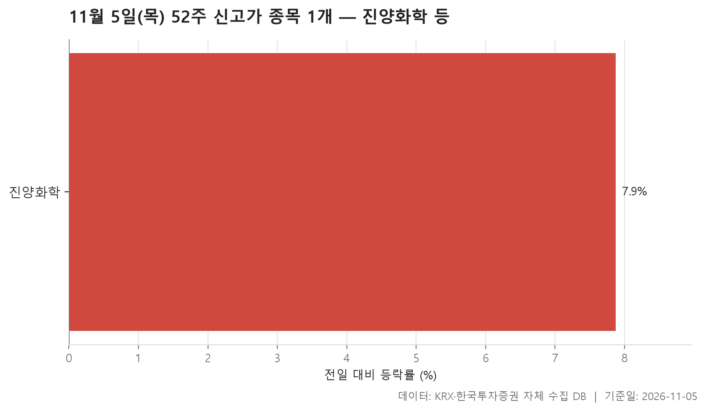
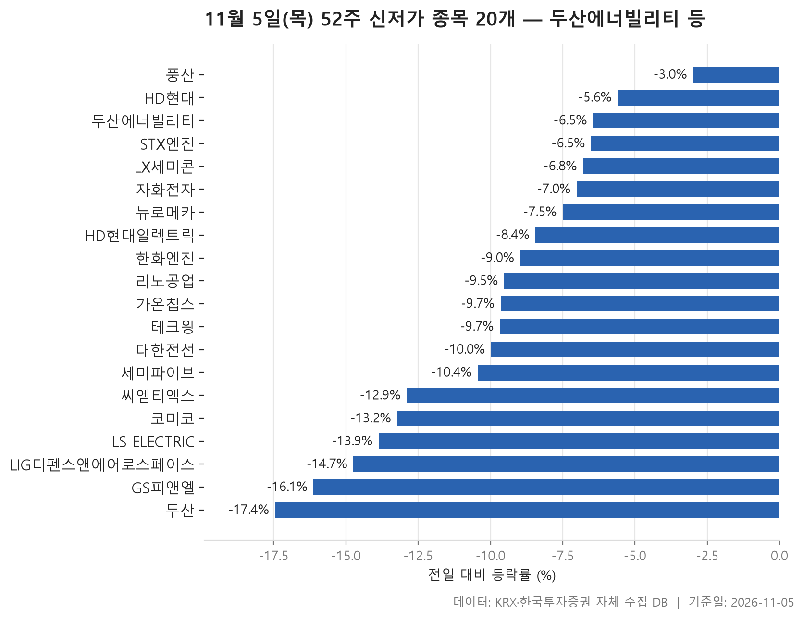
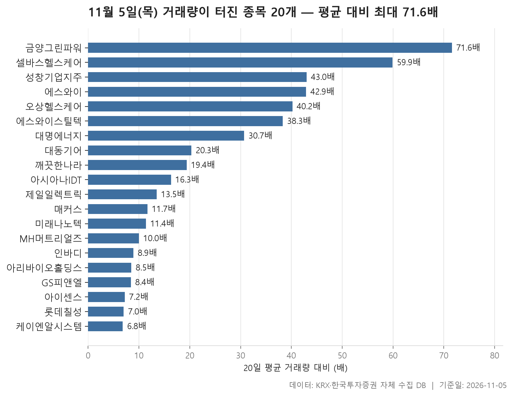

11월 5일 시장은 업종 표 한 장으로 분위기가 드러났습니다. 24개 업종을 종목 등락률의 중위값으로 줄 세웠더니 맨 위에 선 음식료·담배가 0.00%였습니다. 내리지 않은 업종이 하나 있었을 뿐, 중위값이 플러스인 업종은 없었다는 뜻이죠. 맨 아래 전기·전자는 -5.44%였고, 24개 업종의 중위 등락률을 늘어놓았을 때 한가운데 놓인 값은 -0.63%였습니다.

52주 기록도 같은 쪽을 가리킵니다. 신고가를 새로 쓴 종목은 진양화학 하나였고, 신저가로 내려앉은 종목은 20개였습니다. 반면 거래량이 평소의 5배를 넘긴 종목 20개는 대부분 올랐습니다. 대형주가 바닥을 낮추는 사이 소형주 일부에만 거래가 몰린 이 대비가 오늘 표에서 눈여겨볼 대목입니다.

> 기준일: 2026-11-05 · 집계: 자체 수집 데이터베이스

## 업종 등락률 — 오른 업종 없음

표는 아래쪽부터 보는 편이 이해가 빠릅니다. 전기·전자와 기계·장비가 각각 -5.44%, -5.00%로 나머지 업종과 뚝 떨어져 있습니다. 바로 위 기타제조가 -3.11%이고, 그 위로는 간격이 촘촘해집니다. 오늘의 약세는 이 두 업종에 몰려 있었다고 보는 게 맞습니다. 전기·전자는 367개 종목 가운데 오른 곳이 9.00%로 열 곳에 한 곳도 안 됐고, 업종 거래대금을 모두 합하면 149,990.40억원으로 다른 업종을 압도합니다. 가장 크고 가장 활발히 거래된 업종이 가장 많이 내린 날이었습니다.

위쪽은 '선방'이라는 말이 정확합니다. 음식료·담배는 중위값 0.00%, 평균 +0.14%에 오른 종목 비중이 46.40%였습니다. 절반에 조금 못 미치지만 오늘 기준으로는 가장 높은 편입니다. 섬유·의류(-0.09%), 제약(-0.11%)까지 위쪽 업종들은 거의 보합권에 머물렀습니다.

어긋나는 곳은 중위값과 평균의 부호가 반대인 업종입니다. 종이·목재는 중위값이 -0.17%인데 평균은 +0.68%입니다. 깨끗한나라가 +29.93% 오르면서 혼자 업종 평균을 1.11%p 밀어 올렸으니, 평균이 플러스로 나온 건 사실상 이 한 종목 덕분입니다. 정작 오른 종목은 37.00%에 그쳤습니다. 통신(중위 -0.26%, 평균 +0.25%)도 같은 구조로, 나이스정보통신 하나가 평균을 0.47%p 끌어올렸습니다. 운송·창고는 중위값 -1.01%와 평균 -0.08%의 간격이 크고, 제주항공 한 종목이 평균을 0.49%p 끌어올린 영향이 큽니다.

반대 방향으로 벌어진 곳은 비금속입니다. 중위값은 -0.19%로 위쪽이지만 평균은 -1.54%이고, 오른 종목도 45.70%로 적지 않았습니다. 가장 크게 움직인 티씨케이(-14.40%)가 평균을 깎은 폭은 -0.41%p라서 이 간격을 다 설명하지 못합니다. 몇몇 종목이 함께 크게 내리며 평균을 끌어내린 것으로 읽힙니다. 또 하나, 유통·금속·의료·정밀기기처럼 중위값이 마이너스인 업종에서도 가장 크게 움직인 종목은 윙스풋·엠에스바이오(+30.00%), 대동금속(+29.90%) 같은 급등주였습니다. 업종 전체는 밀렸어도 개별 종목의 움직임은 제각각이었던 셈입니다.

| 업종 | 종목수(개) | 중위등락률(%) | 평균등락률(%) | 상승비율(%) | 주도종목 | 주도종목등락률(%) | 평균기여도(%p) | 거래대금합계(억원) |
|---|---|---|---|---|---|---|---|---|
| 음식료·담배 | 84 | 0.00 | +0.14 | 46.40 | 한울앤제주 | +13.41 | 0.16 | 2,419.10 |
| 섬유·의류 | 49 | -0.09 | -0.47 | 40.80 | 씨싸이트 | +14.39 | 0.29 | 175.90 |
| 제약 | 167 | -0.11 | -0.07 | 42.50 | 애드바이오텍 | -21.00 | -0.13 | 10,566.80 |
| 보험 | 11 | -0.15 | -0.49 | 27.30 | 삼성생명 | -5.96 | -0.54 | 1,566.90 |
| 종이·목재 | 27 | -0.17 | +0.68 | 37.00 | 깨끗한나라 | +29.93 | 1.11 | 115.20 |
| 오락·문화 | 62 | -0.18 | +0.41 | 41.90 | 에스엠 | +11.72 | 0.19 | 1,294.50 |
| 비금속 | 35 | -0.19 | -1.54 | 45.70 | 티씨케이 | -14.40 | -0.41 | 443.70 |
| 통신 | 13 | -0.26 | +0.25 | 30.80 | 나이스정보통신 | +6.07 | 0.47 | 1,106.40 |
| 일반서비스 | 168 | -0.46 | -0.50 | 36.30 | 엔젠바이오 | +29.89 | 0.18 | 7,447.80 |
| 금융 | 110 | -0.51 | -0.99 | 39.10 | GS피앤엘 | -16.12 | -0.15 | 19,571.30 |
| 유통 | 157 | -0.59 | -1.22 | 34.40 | 윙스풋 | +30.00 | 0.19 | 3,649.80 |
| 전기·가스 | 10 | -0.61 | -0.08 | 40.00 | 한국전력 | +2.96 | 0.30 | 960.90 |
| 증권 | 18 | -0.65 | -0.80 | 16.70 | SK증권 | -3.17 | -0.18 | 687.60 |
| 화학 | 220 | -1.01 | -1.76 | 28.60 | 엘티씨 | -18.39 | -0.08 | 13,698.90 |
| 운송·창고 | 28 | -1.01 | -0.08 | 32.10 | 제주항공 | +13.75 | 0.49 | 2,269.80 |
| 건설 | 50 | -1.09 | -1.10 | 22.00 | 금양그린파워 | +12.48 | 0.25 | 4,334.60 |
| 제조 | 8 | -1.21 | -0.86 | 25.00 | 지누스 | +5.69 | 0.71 | 7.60 |
| IT 서비스 | 247 | -1.54 | -1.91 | 27.10 | 래블업 | -28.89 | -0.12 | 10,898.00 |
| 운송장비·부품 | 132 | -1.79 | -2.15 | 21.20 | 에코캡 | +29.87 | 0.23 | 10,586.20 |
| 금속 | 130 | -1.88 | -2.29 | 17.70 | 대동금속 | +29.90 | 0.23 | 5,376.40 |
| 의료·정밀기기 | 102 | -2.27 | -2.32 | 23.50 | 엠에스바이오 | +30.00 | 0.29 | 3,473.40 |
| 기타제조 | 15 | -3.11 | -2.12 | 13.30 | 엔바이오니아 | -5.17 | -0.34 | 295.70 |
| 기계·장비 | 210 | -5.00 | -5.89 | 13.30 | 이에스티 | -23.66 | -0.11 | 16,347.20 |
| 전기·전자 | 367 | -5.44 | -6.01 | 9.00 | 티엘비 | -20.95 | -0.06 | 149,990.40 |

## 52주 신고가 1개 — 진양화학 7.87%

신고가 표는 한 줄뿐입니다. KOSPI 상장사 진양화학이 +7.87% 오른 4,045원에 마감하며 직전 52주 최고가 3,950원을 넘어섰습니다. 시가총액은 858억원, 거래대금은 67.90억원으로 규모가 큰 종목은 아닙니다.

눈길이 가는 건 이 종목이 속한 업종입니다. 화학은 220개 종목의 중위 등락률이 -1.01%였고, 오른 종목은 열 곳 가운데 세 곳가량에 그쳤습니다. 업종 흐름과 상관없이 혼자 고점을 뚫은 경우라, 이 한 종목으로 업종이나 시장의 방향을 짐작하기는 어렵습니다. 왜 올랐는지는 자료에 나와 있지 않습니다.

| 종목명 | 종목코드 | 시장 | 업종 | 종가(원) | 등락률(%) | 이전52주최고(원) | 거래대금(억원) | 시가총액(억원) |
|---|---|---|---|---|---|---|---|---|
| 진양화학 | 051630 | KOSPI | 화학 | 4,045 | +7.87 | 3,950 | 67.90 | 858 |

## 52주 신저가 20개 — 최저 두산 -17.45%

신저가 쪽은 종목 수도, 면면도 무게가 다릅니다. 20개 종목 가운데 KOSPI가 13개, KOSDAQ이 7개입니다. 업종은 5개로 나뉘는데 전기·전자가 9개로 가장 많고, 기계·장비 종목도 여럿입니다. 업종 표 맨 아래 두 칸과 그대로 겹치는 구성입니다.

시가총액을 보면 더 분명해집니다. 두산에너빌리티가 315,797억원으로 가장 크고, LS ELECTRIC(194,700억원)과 HD현대일렉트릭(144,729억원), HD현대, 두산까지 시가총액 상위권 종목들이 줄줄이 이름을 올렸습니다. 소형주 몇 개가 밀린 날이 아니었다는 얘기입니다.

하루 낙폭도 컸습니다. 20개 종목 등락률의 중위값이 -9.59%이고, 두산이 -17.45%로 가장 많이 내렸습니다. LIG디펜스앤에어로스페이스(-14.74%)와 LS ELECTRIC(-13.87%)도 두 자릿수 하락입니다. 가장 덜 내린 풍산은 -2.99%였는데, 종가 55,100원이 직전 최저가 55,200원을 겨우 밑돈 정도라 경계선에 걸친 경우입니다. 반면 LS ELECTRIC은 종가 129,800원이 직전 최저가 143,000원보다 한참 아래여서, 하루 만에 바닥을 크게 낮췄습니다.

GS피앤엘(-16.12%)은 금융 업종에서 가장 크게 움직인 종목이면서, 다음 섹션의 거래량 급증 목록에도 올라 있습니다. 많이 내리면서 거래도 함께 늘어난 사례입니다.

| 종목명 | 종목코드 | 시장 | 업종 | 종가(원) | 등락률(%) | 이전52주최저(원) | 거래대금(억원) | 시가총액(억원) |
|---|---|---|---|---|---|---|---|---|
| 두산에너빌리티 | 034020 | KOSPI | 기계·장비 | 49,300 | -6.45 | 49,850 | 1,357.30 | 315,797 |
| LS ELECTRIC | 010120 | KOSPI | 전기·전자 | 129,800 | -13.87 | 143,000 | 1,718.90 | 194,700 |
| HD현대일렉트릭 | 267260 | KOSPI | 전기·전자 | 401,500 | -8.44 | 403,500 | 864.70 | 144,729 |
| HD현대 | 267250 | KOSPI | 금융 | 129,900 | -5.60 | 132,100 | 276.10 | 102,612 |
| 두산 | 000150 | KOSPI | 전기·전자 | 719,000 | -17.45 | 734,000 | 1,120.10 | 102,367 |
| LIG디펜스앤에어로스페이스 | 079550 | KOSPI | 금속 | 358,500 | -14.74 | 360,000 | 757.60 | 78,870 |
| 리노공업 | 058470 | KOSDAQ | 전기·전자 | 50,300 | -9.53 | 53,000 | 445.00 | 38,335 |
| 대한전선 | 001440 | KOSPI | 전기·전자 | 18,050 | -9.98 | 18,320 | 388.10 | 35,377 |
| 한화엔진 | 082740 | KOSPI | 기계·장비 | 28,400 | -8.97 | 28,700 | 144.00 | 23,699 |
| 풍산 | 103140 | KOSPI | 금속 | 55,100 | -2.99 | 55,200 | 59.00 | 15,441 |
| 테크윙 | 089030 | KOSDAQ | 기계·장비 | 31,250 | -9.68 | 31,625 | 146.50 | 11,579 |
| 코미코 | 183300 | KOSDAQ | 기계·장비 | 18,700 | -13.23 | 20,650 | 69.30 | 9,605 |
| STX엔진 | 077970 | KOSPI | 기계·장비 | 14,770 | -6.52 | 14,940 | 22.10 | 5,930 |
| GS피앤엘 | 499790 | KOSPI | 금융 | 28,100 | -16.12 | 31,250 | 93.60 | 5,572 |
| LX세미콘 | 108320 | KOSPI | 전기·전자 | 24,000 | -6.80 | 24,200 | 36.00 | 3,903 |
| 세미파이브 | 490470 | KOSDAQ | 일반서비스 | 10,550 | -10.44 | 11,150 | 41.20 | 3,590 |
| 자화전자 | 033240 | KOSPI | 전기·전자 | 16,430 | -7.02 | 16,600 | 22.10 | 3,550 |
| 가온칩스 | 399720 | KOSDAQ | 전기·전자 | 29,500 | -9.65 | 30,800 | 18.70 | 3,498 |
| 뉴로메카 | 348340 | KOSDAQ | 기계·장비 | 14,800 | -7.50 | 15,050 | 30.00 | 3,464 |
| 씨엠티엑스 | 388210 | KOSDAQ | 전기·전자 | 35,450 | -12.90 | 38,800 | 105.70 | 3,423 |

## 거래량 급증 20개 — 최고 금양그린파워 71.60배

거래량 표는 분위기가 반대입니다. 20개 종목 가운데 내린 곳은 제일일렉트릭(-0.48%), 매커스(-2.94%), GS피앤엘(-16.12%), 아이센스(-12.76%) 네 곳뿐이고 나머지는 모두 올랐습니다. 거래량이 평소의 몇 배였는지를 줄 세운 중위값은 14.90배입니다. 가장 두드러진 금양그린파워는 71.60배로, 20거래일 평균 100,487주이던 거래량이 7,190,437주로 불어났고 주가는 +12.48% 올랐습니다. 건설 업종에서 가장 크게 움직인 종목도 이 회사였습니다. 셀바스헬스케어(59.90배, +17.02%)가 뒤를 잇습니다.

종목 성격을 보면 KOSDAQ이 14개, KOSPI가 6개입니다. 가장 큰 롯데칠성도 시가총액이 10,374억원이어서, 신저가 표의 대형주들과 비교하면 몸집이 훨씬 작습니다. 업종은 12개로 흩어졌고 의료·정밀기기가 5개로 가장 많습니다. 이 업종 전체의 중위 등락률이 -2.27%였으니, 업종이 밀린 날 일부 종목에만 거래가 쏠린 모습입니다. 같은 업종인데도 인바디는 +23.89%, 아이센스는 -12.76%로 방향이 갈렸습니다.

업종 표와 이어지는 이름도 있습니다. 롯데칠성(+7.50%)은 오늘 유일하게 내리지 않은 업종인 음식료·담배 소속이고, 깨끗한나라(+29.93%)는 종이·목재 평균을 혼자 끌어올린 바로 그 종목입니다. 거래대금으로는 대명에너지가 1,440.10억원으로 가장 많았습니다. 다만 거래가 왜 몰렸는지는 자료로 알 수 없습니다.

| 종목명 | 종목코드 | 시장 | 업종 | 종가(원) | 등락률(%) | 거래량(주) | 평균거래량(주) | 배수(배) | 거래대금(억원) | 시가총액(억원) |
|---|---|---|---|---|---|---|---|---|---|---|
| 금양그린파워 | 282720 | KOSDAQ | 건설 | 8,740 | +12.48 | 7,190,437 | 100,487 | 71.60 | 669.20 | 1,059 |
| 셀바스헬스케어 | 208370 | KOSDAQ | 의료·정밀기기 | 2,475 | +17.02 | 8,775,797 | 146,616 | 59.90 | 222.20 | 637 |
| 성창기업지주 | 000180 | KOSPI | 일반서비스 | 6,350 | +29.86 | 840,049 | 19,535 | 43.00 | 51.20 | 886 |
| 에스와이 | 109610 | KOSDAQ | 금속 | 2,135 | +20.49 | 15,792,764 | 368,080 | 42.90 | 335.80 | 1,044 |
| 오상헬스케어 | 036220 | KOSDAQ | 의료·정밀기기 | 5,260 | +3.34 | 1,336,312 | 33,203 | 40.20 | 81.20 | 753 |
| 에스와이스틸텍 | 365330 | KOSDAQ | 금속 | 1,586 | +5.95 | 12,542,952 | 327,875 | 38.30 | 209.00 | 796 |
| 대명에너지 | 389260 | KOSDAQ | 건설 | 14,140 | +2.84 | 9,562,067 | 311,674 | 30.70 | 1,440.10 | 2,533 |
| 대동기어 | 008830 | KOSDAQ | 기계·장비 | 6,600 | +6.11 | 16,530,406 | 814,406 | 20.30 | 1,154.60 | 1,266 |
| 깨끗한나라 | 004540 | KOSPI | 종이·목재 | 1,554 | +29.93 | 6,086,212 | 313,109 | 19.40 | 91.40 | 579 |
| 아시아나IDT | 267850 | KOSPI | IT 서비스 | 10,570 | +9.42 | 3,951,928 | 242,353 | 16.30 | 432.50 | 1,173 |
| 제일일렉트릭 | 199820 | KOSDAQ | 전기·전자 | 6,200 | -0.48 | 5,491,362 | 408,110 | 13.50 | 376.70 | 1,378 |
| 매커스 | 093520 | KOSDAQ | 유통 | 23,150 | -2.94 | 171,734 | 14,647 | 11.70 | 39.20 | 2,755 |
| 미래나노텍 | 095500 | KOSDAQ | 화학 | 6,270 | +8.10 | 919,438 | 80,974 | 11.40 | 60.30 | 1,944 |
| MH머트리얼즈 | 001080 | KOSPI | 금속 | 4,330 | +12.03 | 279,924 | 28,127 | 10.00 | 11.70 | 1,520 |
| 인바디 | 041830 | KOSDAQ | 의료·정밀기기 | 57,300 | +23.89 | 459,113 | 51,428 | 8.90 | 249.40 | 7,725 |
| 아리바이오홀딩스 | 290690 | KOSDAQ | 전기·전자 | 3,735 | +3.18 | 5,197,334 | 612,268 | 8.50 | 191.80 | 1,982 |
| GS피앤엘 | 499790 | KOSPI | 금융 | 28,100 | -16.12 | 325,889 | 38,921 | 8.40 | 93.60 | 5,572 |
| 아이센스 | 099190 | KOSDAQ | 의료·정밀기기 | 14,150 | -12.76 | 333,567 | 46,401 | 7.20 | 48.80 | 4,185 |
| 롯데칠성 | 005300 | KOSPI | 음식료·담배 | 111,800 | +7.50 | 106,576 | 15,141 | 7.00 | 118.90 | 10,374 |
| 케이엔알시스템 | 199430 | KOSDAQ | 의료·정밀기기 | 16,250 | +4.10 | 430,160 | 63,610 | 6.80 | 68.70 | 1,823 |

## 정리

정리하면 11월 5일은 전기·전자와 기계·장비의 대형주들이 시장을 끌어내리는 동안, 거래가 몰린 일부 중소형주만 따로 오른 하루였습니다. 신고가 하나에 신저가 스물이라는 숫자가 그 기울기를 그대로 보여 줍니다.

몇 가지는 감안하고 읽어 주세요. 이 글은 전일 종가와 당일 종가를 비교한 하루치 기록이고, 업종 순위는 중위값 기준이라 평균으로 보면 순서가 달라질 수 있습니다. 하락이나 거래 급증의 원인은 데이터에 없어 다루지 않았습니다. 시가총액 500억 미만 종목 등 필터에 걸리지 않은 종목은 신고가·신저가·거래량 표에서 빠져 있습니다.

## 집계 기준

**업종 등락률**

- **기준**: 2026-11-04 종가 → 2026-11-05 종가
- **순위**: 업종 내 종목 등락률의 중위값 (평균은 참고용으로 함께 표시)
- **주도종목**: 그 업종에서 등락률 절대값이 가장 큰 종목 (동점이면 거래대금이 큰 쪽)
- **평균기여도**: 그 종목 하나가 업종 평균을 움직인 폭 (등락률 ÷ 종목수). 중위값과 평균의 격차가 이 값에 가까우면 평균을 만든 것이 그 종목이고, 훨씬 크면 다른 종목들도 함께 움직인 것입니다
- **필터**: 업종 내 보통주 5종목 이상
- **전체업종중위등락률(%)**: -0.63

**52주 신고가**

- **기준**: 종가 > 직전 52주 최고가
- **관측구간**: 2025-10-24 ~ 2026-11-04 (252거래일)
- **필터**: 시가총액 500억 이상, 거래대금 3억 이상, 보통주

**52주 신저가**

- **기준**: 종가 < 직전 52주 최저가
- **관측구간**: 2025-10-24 ~ 2026-11-04 (252거래일)
- **필터**: 시가총액 500억 이상, 거래대금 3억 이상, 보통주

**거래량 급증**

- **기준**: 당일 거래량 ≥ 직전 20거래일 평균 × 5
- **관측구간**: 2026-10-07 ~ 2026-11-04 (20거래일)
- **필터**: 시가총액 500억 이상, 거래대금 3억 이상, 보통주

## 데이터 출처 및 유의사항

- **데이터출처**: 한국거래소(KRX) 공시 데이터와 한국투자증권 OpenAPI 를 직접 수집해 구축한 자체 데이터베이스
- **집계방식**: 수집·집계·차트 생성을 직접 구현한 파이프라인에서 자동 산출
- **작성고지**: 본문의 표·통계·차트는 자체 데이터베이스에서 계산된 값이며, 문장 작성 과정에 AI 도구를 활용했습니다.
- **면책**: 본 글은 정보 제공을 목적으로 하며 특정 종목의 매수·매도를 추천하지 않습니다. 제시된 수치는 과거 데이터이고 미래 수익을 보장하지 않습니다. 투자 판단과 그 결과에 대한 책임은 투자자 본인에게 있습니다.

