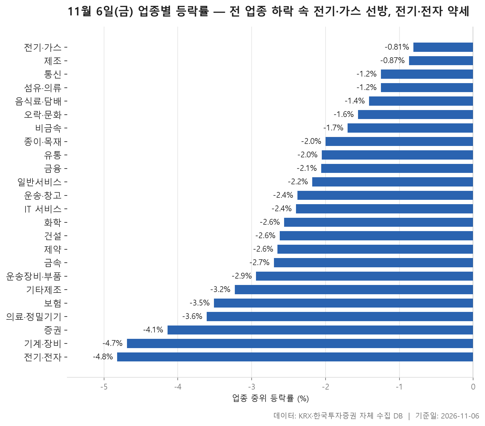
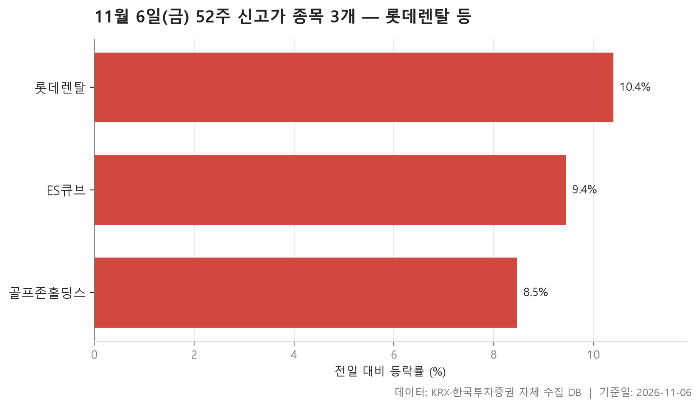
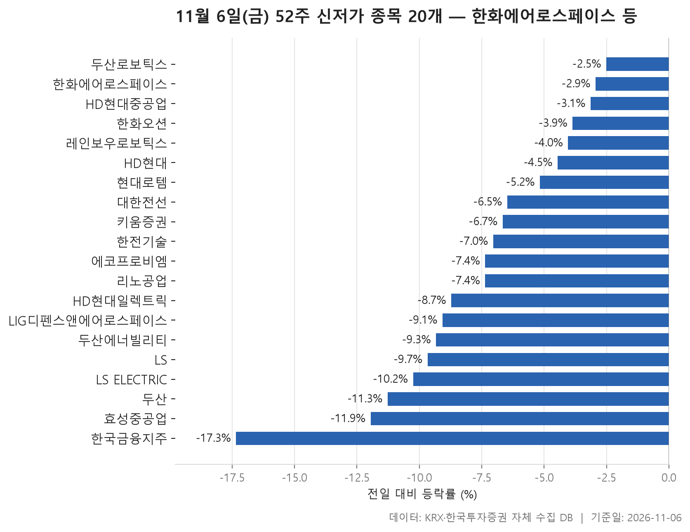
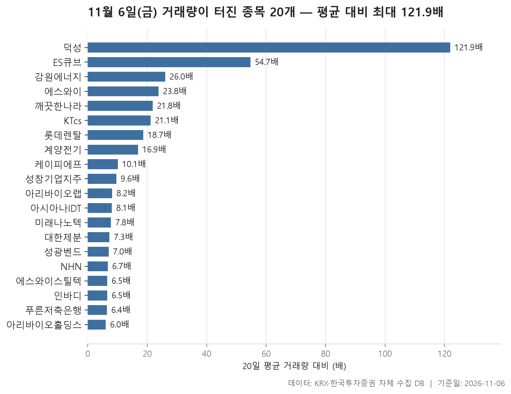

11월 6일 금요일 시장은 방향만 놓고 보면 단순했습니다. 집계에 들어간 24개 업종 가운데 중위 등락률이 플러스로 끝난 곳이 하나도 없었습니다. 가장 덜 내린 전기·가스가 -0.81%, 가장 많이 내린 전기·전자가 -4.82%였고, 24개 업종의 중위 등락률을 줄 세웠을 때 한가운데 놓이는 값은 -2.39%입니다. 어느 업종이 올랐는지가 아니라 어느 업종이 덜 빠졌는지를 비교하게 되는 하루였습니다.

오늘 글은 네 갈래로 나눴습니다. 업종 등락을 먼저 보고, 52주 신고가와 신저가 목록을 차례로 확인한 뒤, 거래량이 평소보다 크게 불어난 종목을 살핍니다. 신고가는 3개에 그쳤지만 신저가는 20개였고, 신저가 목록에는 시가총액이 큰 종목들이 줄지어 있습니다. 두 목록의 무게가 이렇게 차이 난다는 점이 오늘 시장의 분위기를 가장 잘 보여 줍니다.

> 기준일: 2026-11-06 · 집계: 자체 수집 데이터베이스

## 업종 등락률 — 24개 모두 하락

하락의 무게가 어디에 실렸는지는 표 맨 아래를 보면 드러납니다. 가장 크게 내린 두 업종이 종목 210개를 거느린 기계·장비(-4.69%)와 367개를 거느린 전기·전자(-4.82%)입니다. 전기·전자의 거래대금은 194,820.70억원으로 다른 업종과는 자릿수부터 달랐습니다. 거래가 가장 많이 몰린 업종의 중위 종목이 이만큼 밀렸다면 시장의 중심부가 크게 흔들렸다고 볼 수 있습니다. 이 업종에서 오른 종목은 열 곳 중 한 곳도 채 되지 않았습니다(9.50%).

맨 위의 전기·가스는 조금 따져 볼 필요가 있습니다. 10개 종목 중 오른 것은 하나뿐이었고, 그 종목이 SGC에너지(+10.32%)입니다. 이 종목 하나가 업종 평균을 1.03%p 끌어올렸기 때문에 평균(-0.45%)이 중위값(-0.81%)보다 덜 내려온 것으로 보입니다. 업종 전체가 강했다기보다는 나머지 종목들의 낙폭이 상대적으로 작았고, 거기에 한 종목의 급등이 더해진 모양입니다. 증권은 더 극단적입니다. 18개 종목 가운데 오른 곳이 하나도 없었고, 운송·창고도 오른 종목 비율이 3.60%에 그쳤습니다. 오른 종목 비율이 가장 높았던 통신(38.50%)과 제조(37.50%)도 셋 중 하나 남짓이 올랐을 뿐입니다.

중위값과 평균이 벌어진 업종도 짚어 둘 만합니다. 섬유·의류는 중위값이 -1.25%인데 평균은 -2.00%로 더 깊습니다. 씨싸이트(-26.75%) 하나가 평균을 0.55%p 끌어내린 몫이 큽니다. 의료·정밀기기는 중위값 -3.61%, 평균 -4.54%로 차이가 더 큰데도 씨어스(-29.95%)가 끌어내린 폭은 0.29%p에 그칩니다. 한 종목만이 아니라 여러 종목이 함께 크게 빠졌다고 읽는 게 맞습니다. 반대로 윙스풋(+29.97%), 에코캡(+29.85%), 덕성(+27.32%)처럼 급등한 종목도 있었습니다. 다만 모두 종목 수가 많은 업종에 속해 있어서 업종 평균을 끌어올린 폭은 각각 0.19%p, 0.23%p, 0.12%p에 머물렀습니다.

| 업종 | 종목수(개) | 중위등락률(%) | 평균등락률(%) | 상승비율(%) | 주도종목 | 주도종목등락률(%) | 평균기여도(%p) | 거래대금합계(억원) |
|---|---|---|---|---|---|---|---|---|
| 전기·가스 | 10 | -0.81 | -0.45 | 10.00 | SGC에너지 | +10.32 | 1.03 | 739.00 |
| 제조 | 8 | -0.87 | -1.19 | 37.50 | 코아스 | -3.96 | -0.49 | 7.50 |
| 통신 | 13 | -1.25 | -0.84 | 38.50 | 더즌 | -5.71 | -0.44 | 2,394.50 |
| 섬유·의류 | 49 | -1.25 | -2.00 | 18.40 | 씨싸이트 | -26.75 | -0.55 | 201.30 |
| 음식료·담배 | 84 | -1.41 | -1.57 | 16.70 | 우듬지팜 | -10.49 | -0.12 | 2,460.70 |
| 오락·문화 | 62 | -1.56 | -1.46 | 21.00 | 더핑크퐁컴퍼니 | -9.49 | -0.15 | 959.10 |
| 비금속 | 35 | -1.70 | -2.03 | 14.30 | 티씨케이 | -11.41 | -0.33 | 431.00 |
| 종이·목재 | 27 | -2.00 | -1.30 | 11.10 | 깨끗한나라 | +11.07 | 0.41 | 288.10 |
| 유통 | 157 | -2.05 | -1.71 | 17.20 | 윙스풋 | +29.97 | 0.19 | 3,906.90 |
| 금융 | 110 | -2.06 | -2.54 | 15.50 | 한국금융지주 | -17.34 | -0.16 | 21,600.30 |
| 일반서비스 | 169 | -2.18 | -2.57 | 18.90 | 올릭스 | -13.82 | -0.08 | 7,924.30 |
| 운송·창고 | 28 | -2.38 | -2.54 | 3.60 | 팬오션 | -10.02 | -0.36 | 1,927.60 |
| IT 서비스 | 248 | -2.40 | -2.33 | 18.10 | 엘리스 | +18.91 | 0.08 | 13,618.10 |
| 화학 | 220 | -2.56 | -2.90 | 16.80 | 덕성 | +27.32 | 0.12 | 11,083.00 |
| 건설 | 50 | -2.62 | -2.89 | 8.00 | 금양그린파워 | -9.84 | -0.20 | 3,286.10 |
| 제약 | 167 | -2.65 | -2.58 | 10.80 | 앱클론 | -11.02 | -0.07 | 8,463.50 |
| 금속 | 130 | -2.70 | -3.08 | 11.50 | 성광벤드 | -24.30 | -0.19 | 5,290.50 |
| 운송장비·부품 | 131 | -2.94 | -2.74 | 9.90 | 에코캡 | +29.85 | 0.23 | 8,789.30 |
| 기타제조 | 15 | -3.23 | -3.79 | 6.70 | 크리에이츠 | -10.53 | -0.70 | 56.30 |
| 보험 | 11 | -3.51 | -3.06 | 9.10 | 삼성화재 | -7.36 | -0.67 | 2,751.70 |
| 의료·정밀기기 | 103 | -3.61 | -4.54 | 10.70 | 씨어스 | -29.95 | -0.29 | 2,918.20 |
| 증권 | 18 | -4.14 | -4.39 | 0.00 | 미래에셋증권 | -7.90 | -0.44 | 1,253.00 |
| 기계·장비 | 210 | -4.69 | -4.83 | 8.60 | 티앤이코리아 | -17.55 | -0.08 | 16,825.20 |
| 전기·전자 | 367 | -4.82 | -4.66 | 9.50 | 탑런토탈솔루션 | -16.97 | -0.05 | 194,820.70 |

## 52주 신고가 3개 — 최고 롯데렌탈 10.40%

신고가 목록에는 3종목뿐입니다. 전 업종이 내린 날이니 목록이 짧은 것은 이상하지 않습니다. 눈에 띄는 건 세 종목이 모두 크게 올랐다는 점입니다. 가장 덜 오른 골프존홀딩스도 +8.47%였고, 세 종목 등락률의 중위값은 +9.45%입니다.

규모로 보면 롯데렌탈이 단연 두드러집니다. 시가총액 21,204.70억원, 거래대금 1,401.50억원으로 나머지 두 종목과는 체급이 다릅니다. 이날 +10.40% 올라 종가 58,400원을 기록하며 이전 52주 최고가 54,100원을 넘어섰고, 아래 거래량 급증 표에도 다시 등장합니다.

나머지 두 종목은 KOSDAQ 유통 업종의 소형주입니다. ES큐브는 종가 3,765원으로 이전 최고가 3,750원을 간신히 넘겼고, 거래대금은 11.30억원이었습니다. 골프존홀딩스의 거래대금도 10.10억원으로 크지 않습니다. 거래가 얇은 종목은 많지 않은 주문에도 가격이 크게 움직일 수 있으니, 신고가라는 이름표가 붙었더라도 그 점을 함께 감안해서 볼 필요가 있습니다.

| 종목명 | 종목코드 | 시장 | 업종 | 종가(원) | 등락률(%) | 이전52주최고(원) | 거래대금(억원) | 시가총액(억원) |
|---|---|---|---|---|---|---|---|---|
| 롯데렌탈 | 089860 | KOSPI | 일반서비스 | 58,400 | +10.40 | 54,100 | 1,401.50 | 21,204.70 |
| 골프존홀딩스 | 121440 | KOSDAQ | 유통 | 8,840 | +8.47 | 8,440 | 10.10 | 3,786.80 |
| ES큐브 | 050120 | KOSDAQ | 유통 | 3,765 | +9.45 | 3,750 | 11.30 | 510.70 |

## 52주 신저가 20개 — 최저 한국금융지주 -17.34%

신저가는 20종목으로 신고가보다 훨씬 많고, 종목의 무게도 다릅니다. 시가총액 맨 위의 한화에어로스페이스가 340,318.40억원이고, 그 아래로 두산에너빌리티, HD현대중공업, LS ELECTRIC, 효성중공업 같은 대형주가 이어집니다. 시장별로는 KOSPI가 17개, KOSDAQ이 3개라 무게중심이 확실히 KOSPI 대형주 쪽에 있습니다.

업종별로는 전기·전자가 7개로 가장 많습니다. 효성중공업(-11.95%), 두산(-11.27%), LS ELECTRIC(-10.25%), HD현대일렉트릭(-8.72%), 대한전선(-6.48%) 등 낙폭이 큰 편입니다. 섹션 1에서 전기·전자가 가장 많이 내린 업종이었던 것과 맞아떨어집니다. 운송장비·부품에서는 한화에어로스페이스(-2.94%), HD현대중공업(-3.14%), 한화오션(-3.86%), 현대로템(-5.17%)이 목록에 올랐는데, 하루 낙폭은 상대적으로 작았습니다. 크게 빠지지 않았는데도 신저가에 걸렸다는 건 직전까지 가격이 이미 52주 최저가 근처에 있었다는 뜻입니다. 한화에어로스페이스는 종가 660,000원으로 이전 최저 662,000원을 살짝 밑돌았고, 낙폭이 가장 작았던 두산로보틱스(-2.51%)도 50,400원으로 이전 최저 50,500원에 바짝 붙어 있습니다.

반대쪽 끝에는 한국금융지주(-17.34%)가 있습니다. 금융 업종에서 가장 크게 움직인 종목이기도 한데, 이전 최저 140,600원보다 한참 아래인 121,600원에 마감했습니다. 키움증권(-6.66%)도 목록에 올라 있어, 오른 종목이 하나도 없던 증권 업종의 흐름과 겹칩니다. 20종목 등락률의 중위값은 -7.20%입니다.

| 종목명 | 종목코드 | 시장 | 업종 | 종가(원) | 등락률(%) | 이전52주최저(원) | 거래대금(억원) | 시가총액(억원) |
|---|---|---|---|---|---|---|---|---|
| 한화에어로스페이스 | 012450 | KOSPI | 운송장비·부품 | 660,000 | -2.94 | 662,000 | 1,158.30 | 340,318.40 |
| 두산에너빌리티 | 034020 | KOSPI | 기계·장비 | 44,700 | -9.33 | 48,700 | 1,951.30 | 286,330.80 |
| HD현대중공업 | 329180 | KOSPI | 운송장비·부품 | 262,500 | -3.14 | 263,500 | 822.90 | 275,523.20 |
| LS ELECTRIC | 010120 | KOSPI | 전기·전자 | 116,500 | -10.25 | 127,150 | 1,480.30 | 174,750.00 |
| 효성중공업 | 298040 | KOSPI | 전기·전자 | 1,577,000 | -11.95 | 1,731,000 | 2,021.90 | 147,048.10 |
| 한화오션 | 042660 | KOSPI | 운송장비·부품 | 47,350 | -3.86 | 48,600 | 532.90 | 145,086.70 |
| HD현대일렉트릭 | 267260 | KOSPI | 전기·전자 | 366,500 | -8.72 | 393,500 | 887.30 | 132,112.70 |
| HD현대 | 267250 | KOSPI | 금융 | 124,100 | -4.46 | 127,300 | 269.60 | 98,030.40 |
| 두산 | 000150 | KOSPI | 전기·전자 | 638,000 | -11.27 | 710,000 | 1,332.90 | 90,834.70 |
| 에코프로비엠 | 247540 | KOSDAQ | 전기·전자 | 83,100 | -7.36 | 84,300 | 556.40 | 89,524.80 |
| 현대로템 | 064350 | KOSPI | 운송장비·부품 | 71,500 | -5.17 | 74,100 | 273.70 | 78,036.70 |
| LIG디펜스앤에어로스페이스 | 079550 | KOSPI | 금속 | 326,000 | -9.07 | 351,500 | 546.20 | 71,720.00 |
| 한국금융지주 | 071050 | KOSPI | 금융 | 121,600 | -17.34 | 140,600 | 925.00 | 67,762.80 |
| 레인보우로보틱스 | 277810 | KOSDAQ | 기계·장비 | 321,000 | -4.04 | 325,500 | 359.40 | 62,273.50 |
| LS | 006260 | KOSPI | 금융 | 171,800 | -9.67 | 172,100 | 341.20 | 53,601.60 |
| 키움증권 | 039490 | KOSPI | 증권 | 186,400 | -6.66 | 191,100 | 350.80 | 48,889.60 |
| 리노공업 | 058470 | KOSDAQ | 전기·전자 | 46,600 | -7.36 | 49,500 | 366.00 | 35,514.70 |
| 대한전선 | 001440 | KOSPI | 전기·전자 | 16,880 | -6.48 | 17,880 | 364.50 | 33,083.60 |
| 두산로보틱스 | 454910 | KOSPI | 기계·장비 | 50,400 | -2.51 | 50,500 | 161.30 | 32,669.30 |
| 한전기술 | 052690 | KOSPI | 일반서비스 | 73,900 | -7.04 | 77,100 | 122.30 | 28,244.60 |

## 거래량 급증 20개 — 최고 덕성 121.90배

거래량이 직전 20거래일 평균의 5배를 넘은 종목은 20개이고, 배수의 중위값은 8.90배입니다. 맨 위의 덕성은 121.90배로 다른 종목들과 차이가 큽니다. 평소 하루 43,119주 수준이던 거래량이 5,255,709주로 불어났고, 주가는 +27.32% 올랐습니다. 2위 ES큐브(54.70배)는 신고가 표에 있던 종목이고, 롯데렌탈(18.70배)도 마찬가지입니다. 신고가 3종목 중 둘이 거래량 급증과 함께 나온 셈입니다.

눈여겨볼 점은 방향이 한쪽으로 쏠리지 않았다는 것입니다. NHN(+15.63%), 아리바이오랩(+11.69%), 깨끗한나라(+11.07%)처럼 크게 오른 종목이 있는가 하면, 인바디(-26.61%), 성광벤드(-24.30%), 케이피에프(-15.02%), 성창기업지주(-13.07%)처럼 크게 내린 종목도 있습니다. 에스와이는 거래량이 23.80배로 불었는데도 등락률 0.00%로 제자리였고, 푸른저축은행도 0.00%였습니다. 거래량이 터졌다는 사실만으로는 가격의 방향을 알 수 없다는 걸 표가 그대로 보여 줍니다.

업종으로는 금속이 4개로 가장 많지만, 에스와이·케이피에프·성광벤드·에스와이스틸텍의 등락 방향이 제각각이라 업종 전체의 흐름으로 묶기는 어렵습니다. 시장별로는 KOSDAQ 11개, KOSPI 9개로 비교적 고르게 나뉘었습니다. 롯데렌탈(21,204.70억원)과 NHN(19,138.70억원)을 빼면 대부분 시가총액이 수천억원 이하인 중소형주입니다. 가장 낮은 배수는 아리바이오홀딩스의 6.00배였습니다.

| 종목명 | 종목코드 | 시장 | 업종 | 종가(원) | 등락률(%) | 거래량(주) | 평균거래량(주) | 배수(배) | 거래대금(억원) | 시가총액(억원) |
|---|---|---|---|---|---|---|---|---|---|---|
| 덕성 | 004830 | KOSPI | 화학 | 3,635 | +27.32 | 5,255,709 | 43,119 | 121.90 | 186.00 | 570.00 |
| ES큐브 | 050120 | KOSDAQ | 유통 | 3,765 | +9.45 | 293,347 | 5,364 | 54.70 | 11.30 | 510.70 |
| 강원에너지 | 114190 | KOSDAQ | 전기·전자 | 8,400 | +9.95 | 2,469,752 | 94,966 | 26.00 | 212.90 | 2,194.30 |
| 에스와이 | 109610 | KOSDAQ | 금속 | 2,135 | 0.00 | 27,442,839 | 1,153,540 | 23.80 | 652.70 | 1,044.20 |
| 깨끗한나라 | 004540 | KOSPI | 종이·목재 | 1,726 | +11.07 | 13,446,758 | 616,742 | 21.80 | 252.90 | 642.80 |
| KTcs | 058850 | KOSPI | IT 서비스 | 2,040 | +0.99 | 1,080,515 | 51,324 | 21.10 | 22.10 | 844.70 |
| 롯데렌탈 | 089860 | KOSPI | 일반서비스 | 58,400 | +10.40 | 2,399,432 | 128,115 | 18.70 | 1,401.50 | 21,204.70 |
| 계양전기 | 012200 | KOSPI | 기계·장비 | 2,375 | -1.25 | 3,285,461 | 194,825 | 16.90 | 87.10 | 841.30 |
| 케이피에프 | 024880 | KOSDAQ | 금속 | 2,970 | -15.02 | 400,860 | 39,815 | 10.10 | 12.10 | 592.30 |
| 성창기업지주 | 000180 | KOSPI | 일반서비스 | 5,520 | -13.07 | 589,876 | 61,180 | 9.60 | 32.80 | 770.10 |
| 아리바이오랩 | 261780 | KOSDAQ | 일반서비스 | 4,300 | +11.69 | 3,193,364 | 389,783 | 8.20 | 138.10 | 1,245.10 |
| 아시아나IDT | 267850 | KOSPI | IT 서비스 | 10,870 | +2.84 | 3,549,063 | 439,626 | 8.10 | 403.10 | 1,206.60 |
| 미래나노텍 | 095500 | KOSDAQ | 화학 | 6,050 | -3.51 | 955,626 | 122,908 | 7.80 | 59.60 | 1,876.10 |
| 대한제분 | 001130 | KOSPI | 음식료·담배 | 10,600 | -1.40 | 81,517 | 11,205 | 7.30 | 8.50 | 1,791.40 |
| 성광벤드 | 014620 | KOSDAQ | 금속 | 21,500 | -24.30 | 867,337 | 124,432 | 7.00 | 188.20 | 5,709.80 |
| NHN | 181710 | KOSPI | IT 서비스 | 59,200 | +15.63 | 730,223 | 109,360 | 6.70 | 439.00 | 19,138.70 |
| 에스와이스틸텍 | 365330 | KOSDAQ | 금속 | 1,602 | +1.01 | 6,066,143 | 937,232 | 6.50 | 99.30 | 803.70 |
| 인바디 | 041830 | KOSDAQ | 의료·정밀기기 | 42,050 | -26.61 | 456,756 | 70,738 | 6.50 | 199.70 | 5,668.70 |
| 푸른저축은행 | 007330 | KOSDAQ | 금융 | 10,000 | 0.00 | 61,861 | 9,687 | 6.40 | 6.10 | 1,508.30 |
| 아리바이오홀딩스 | 290690 | KOSDAQ | 전기·전자 | 3,805 | +1.87 | 5,081,270 | 842,942 | 6.00 | 203.30 | 2,019.40 |

## 정리

정리하면 11월 6일은 24개 업종이 중위값 기준으로 모두 내린 가운데, 종목이 많고 거래가 몰린 전기·전자와 기계·장비가 가장 크게 밀렸고, 그 흔적이 KOSPI 대형주 중심의 신저가 20종목으로 남은 날이었습니다. 신고가는 3종목에 그쳤고, 그중 둘은 거래량 급증을 함께 동반했습니다.

다만 이 표들은 전일 종가와 당일 종가를 비교한 하루치 기록일 뿐입니다. 왜 이렇게 움직였는지는 자료에 담겨 있지 않고, 하루 숫자만으로 추세를 판단하기도 어렵습니다. 업종 표는 보통주가 5종목 이상인 업종만, 신고가·신저가와 거래량 표는 시가총액 500억 이상·거래대금 3억 이상인 종목만 추렸기 때문에, 그보다 작은 종목들의 움직임은 오늘 글에 빠져 있습니다.

## 집계 기준

**업종 등락률**

- **기준**: 2026-11-05 종가 → 2026-11-06 종가
- **순위**: 업종 내 종목 등락률의 중위값 (평균은 참고용으로 함께 표시)
- **주도종목**: 그 업종에서 등락률 절대값이 가장 큰 종목 (동점이면 거래대금이 큰 쪽)
- **평균기여도**: 그 종목 하나가 업종 평균을 움직인 폭 (등락률 ÷ 종목수). 중위값과 평균의 격차가 이 값에 가까우면 평균을 만든 것이 그 종목이고, 훨씬 크면 다른 종목들도 함께 움직인 것입니다
- **필터**: 업종 내 보통주 5종목 이상
- **전체업종중위등락률(%)**: -2.39

**52주 신고가**

- **기준**: 종가 > 직전 52주 최고가
- **관측구간**: 2025-10-27 ~ 2026-11-05 (252거래일)
- **필터**: 시가총액 500억 이상, 거래대금 3억 이상, 보통주

**52주 신저가**

- **기준**: 종가 < 직전 52주 최저가
- **관측구간**: 2025-10-27 ~ 2026-11-05 (252거래일)
- **필터**: 시가총액 500억 이상, 거래대금 3억 이상, 보통주

**거래량 급증**

- **기준**: 당일 거래량 ≥ 직전 20거래일 평균 × 5
- **관측구간**: 2026-10-08 ~ 2026-11-05 (20거래일)
- **필터**: 시가총액 500억 이상, 거래대금 3억 이상, 보통주

## 데이터 출처 및 유의사항

- **데이터출처**: 한국거래소(KRX) 공시 데이터와 한국투자증권 OpenAPI 를 직접 수집해 구축한 자체 데이터베이스
- **집계방식**: 수집·집계·차트 생성을 직접 구현한 파이프라인에서 자동 산출
- **작성고지**: 본문의 표·통계·차트는 자체 데이터베이스에서 계산된 값이며, 문장 작성 과정에 AI 도구를 활용했습니다.
- **면책**: 본 글은 정보 제공을 목적으로 하며 특정 종목의 매수·매도를 추천하지 않습니다. 제시된 수치는 과거 데이터이고 미래 수익을 보장하지 않습니다. 투자 판단과 그 결과에 대한 책임은 투자자 본인에게 있습니다.

