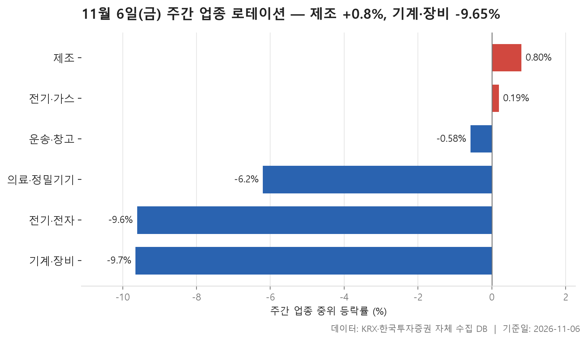
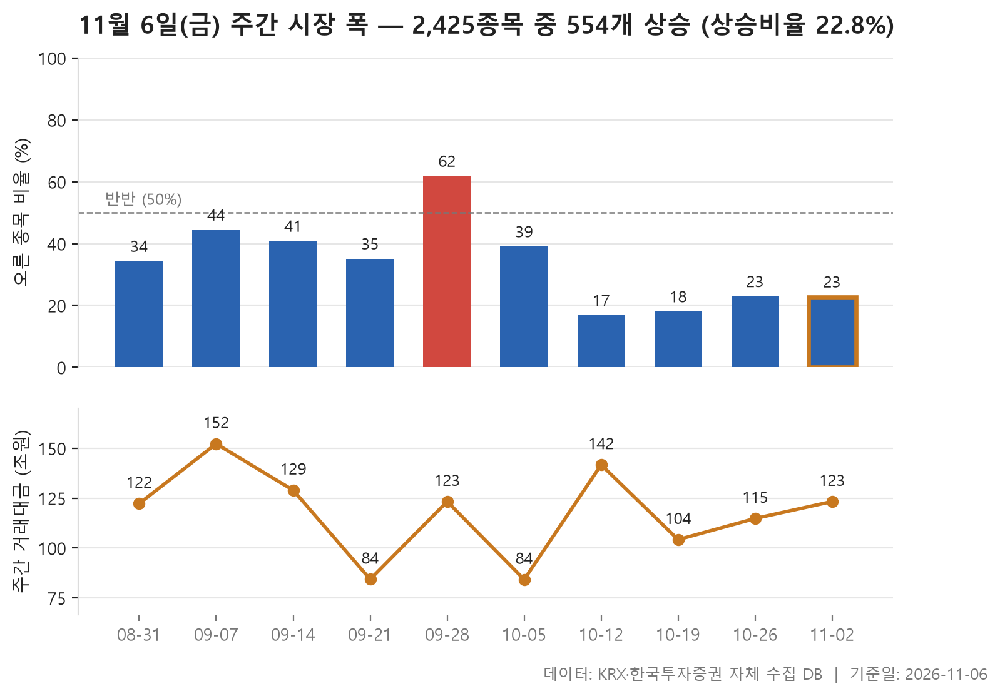
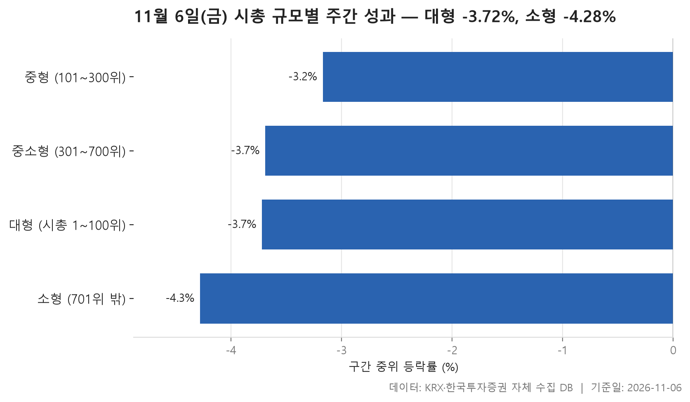

11월 첫 주(11월 2일~6일) 시장을 표 세 장으로 훑어봅니다. 어느 업종이 버티고 어느 업종이 밀렸는지, 오른 종목이 얼마나 됐는지, 시가총액이 큰 종목과 작은 종목 가운데 어느 쪽이 덜 다쳤는지를 차례로 살핍니다.

결론에 가까운 그림부터 말하면, 이번 주는 **넓게 내린 한 주**였습니다. 거래가 있었던 보통주 2,425개 가운데 오른 종목은 554개에 그쳤고 내린 종목은 1,853개였습니다. 24개 업종 중 가장 강했던 제조도 중위 등락률이 +0.80%에 머물렀습니다. 가장 약했던 기계·장비는 -9.65%까지 내려갔습니다.

이런 주에는 지수 한 줄보다 얼마나 많은 종목이 같은 방향으로 움직였는지를 보는 편이 체감에 더 가깝습니다. 표마다 중위값과 평균이 어떻게 갈리는지를 눈여겨보면서 읽어 보시기 바랍니다.

> 기준일: 2026-11-06 · 집계: 자체 수집 데이터베이스

## 주간 업종 로테이션 — 6개 중 4개 하락

위쪽 세 업종에는 공통점이 있습니다. 모두 종목 수가 적습니다. 제조는 7종목, 전기·가스는 10종목, 운송·창고는 28종목입니다. 종목이 적은 업종은 한두 종목만 크게 움직여도 순위가 흔들립니다. 제조의 중위값은 +0.80%인데 평균은 +0.06%로 거의 제자리입니다. 지누스가 +10.64% 올라 혼자서 업종 평균을 1.52%p 끌어올렸으니, 이 종목을 빼고 보면 나머지 종목들은 오히려 아래쪽에 있었다고 읽을 수 있습니다.

전기·가스는 반대 모양입니다. 중위값은 +0.19%로 겨우 플러스인데 평균은 +1.22%로 더 높습니다. SGC에너지가 +12.32% 오른 영향이 크고, 오른 종목과 내린 종목이 딱 반반이었습니다. 운송·창고는 중위값이 -0.58%로 이미 마이너스인데도 상위 3위 안에 들었습니다. 제주항공이 +18.15% 올랐지만 28종목에 나뉘다 보니 업종 평균을 움직인 폭은 0.65%p였습니다. 그러니 이번 주 상위권은 '강했다'기보다 '덜 빠졌다'에 가깝습니다.

아래쪽은 거꾸로 덩치가 큰 업종들입니다. 전기·전자 368종목, 기계·장비 208종목, 의료·정밀기기 102종목입니다. 종목이 이만큼 많은데도 중위값이 -9.61%, -9.65%까지 내려갔다면 몇몇 종목의 일이 아니라 업종 전체가 함께 밀린 것입니다. 전기·전자에서 오른 종목은 8.70%로 열에 하나도 안 됐고, 기계·장비도 13.00%에 그쳤습니다. 평균으로 줄을 세우면 순서가 바뀝니다. 전기·전자가 -10.57%로 기계·장비의 -10.28%보다 낮습니다.

가장 어긋나 보이는 곳은 전기·전자입니다. 이 업종에서 한 주간 가장 크게 움직인 종목은 +45.23% 오른 아리바이오홀딩스로, 업종 흐름과 정반대 방향이었습니다. 하지만 368종목에 나뉘면서 평균에 보탠 몫은 0.12%p에 불과합니다. 기계·장비의 대성하이텍(-37.31%), 의료·정밀기기의 케이씨텍(-39.66%)은 업종과 같은 방향으로 크게 빠진 경우입니다. 이들 종목이 왜 움직였는지는 이 표로는 알 수 없습니다.

| 업종 | 종목수(개) | 주간중위등락률(%) | 주간평균등락률(%) | 상승비율(%) | 주도종목 | 주도종목등락률(%) | 평균기여도(%p) |
|---|---|---|---|---|---|---|---|
| 제조 | 7 | +0.80 | +0.06 | 57.10 | 지누스 | +10.64 | 1.52 |
| 전기·가스 | 10 | +0.19 | +1.22 | 50.00 | SGC에너지 | +12.32 | 1.23 |
| 운송·창고 | 28 | -0.58 | -0.19 | 46.40 | 제주항공 | +18.15 | 0.65 |
| 의료·정밀기기 | 102 | -6.20 | -7.51 | 17.60 | 케이씨텍 | -39.66 | -0.39 |
| 전기·전자 | 368 | -9.61 | -10.57 | 8.70 | 아리바이오홀딩스 | +45.23 | 0.12 |
| 기계·장비 | 208 | -9.65 | -10.28 | 13.00 | 대성하이텍 | -37.31 | -0.18 |

## 주간 시장 폭 — 10주 중 이번 주는 2,425개 중 554개 상승

이번 주에는 오른 종목이 554개, 내린 종목이 1,853개였습니다. 오른 종목 수를 내린 종목 수로 나누면 0.30배입니다. 오른 종목은 22.80%로 다섯 곳 중 한 곳 남짓이었습니다. 직전 주와 거의 판박이라는 점이 흥미롭습니다. 10월 26일 주에도 오른 종목이 똑같이 554개였고 비율도 0.30배였으며, 오른 종목 비중은 22.90%였습니다.

열 주를 길게 놓으면 흐름이 뚜렷합니다. 오른 종목이 더 많았던 주는 9월 28일 주 하나뿐입니다. 이 주에 1,488개가 올라 비율이 1.69배였습니다. 연휴로 3거래일뿐이던 10월 5일 주에 0.66배로 꺾였고, 10월 12일 주에는 0.20배까지 내려앉았습니다. 그 뒤로 0.22배, 0.30배, 0.30배로 아주 조금씩 올라오고는 있습니다. 그래도 열 주 중위값 0.55배와 비교하면 최근 네 주는 모두 그 아래입니다. 내린 종목이 압도적으로 많은 상태가 한 달 가까이 이어졌습니다.

거래대금도 함께 볼 만합니다. 이번 주는 123.30조원으로 직전 주 114.80조원보다 늘었고, 9월 28일 주와 같은 금액입니다. 거래 규모는 같은데 그 주는 오른 종목이 훨씬 많았고 이번 주는 내린 종목이 훨씬 많았습니다. 오른 종목이 가장 드물었던 10월 12일 주의 거래대금이 141.70조원으로 최근 다섯 주 중 가장 컸다는 점도 기억해 둘 만합니다. 열 주 전체로 보면 9월 7일 주의 152.20조원이 가장 많았습니다. 3거래일짜리 주(84.20조원, 84.30조원)는 거래일 수가 달라 다른 주와 그대로 견주기 어렵습니다.

| 주 | 거래일수(일) | 종목수(개) | 상승(개) | 보합(개) | 하락(개) | 상승비율(%) | ADR(배) | 총거래대금(조원) |
|---|---|---|---|---|---|---|---|---|
| 2026-11-02 | 5 | 2,425 | 554 | 18 | 1,853 | 22.80 | 0.30 | 123.30 |
| 2026-10-26 | 5 | 2,415 | 554 | 17 | 1,844 | 22.90 | 0.30 | 114.80 |
| 2026-10-19 | 5 | 2,413 | 434 | 24 | 1,955 | 18.00 | 0.22 | 104.20 |
| 2026-10-12 | 5 | 2,411 | 405 | 18 | 1,988 | 16.80 | 0.20 | 141.70 |
| 2026-10-05 | 3 | 2,414 | 942 | 39 | 1,433 | 39.00 | 0.66 | 84.20 |
| 2026-09-28 | 5 | 2,407 | 1,488 | 41 | 878 | 61.80 | 1.69 | 123.30 |
| 2026-09-21 | 3 | 2,410 | 846 | 47 | 1,517 | 35.10 | 0.56 | 84.30 |
| 2026-09-14 | 5 | 2,404 | 981 | 31 | 1,392 | 40.80 | 0.70 | 129.00 |
| 2026-09-07 | 5 | 2,403 | 1,066 | 40 | 1,297 | 44.40 | 0.82 | 152.20 |
| 2026-08-31 | 5 | 2,398 | 822 | 34 | 1,542 | 34.30 | 0.53 | 122.30 |

## 시총 규모별 주간 성과 — 대형이 0.56%p 앞섬

시가총액 순위로 나눈 네 구간 모두 중위 등락률이 마이너스였습니다. 가장 덜 빠진 구간은 중형(101~300위)으로 -3.17%, 가장 많이 빠진 구간은 소형(701위 밖)으로 -4.28%였습니다. 네 값의 한가운데는 -3.71%입니다. 중위값만 보면 구간끼리 차이가 크지 않고, 대형과 소형의 차이도 0.56%p입니다.

평균을 보면 그림이 달라집니다. 대형(1~100위)은 중위값 -3.72%보다 평균 -3.25%가 높은데, 네 구간 중 이런 곳은 대형뿐입니다. 나머지 세 구간은 평균이 중위값보다 낮습니다. 중형은 -4.92%, 중소형은 -6.39%, 소형은 -5.19%로, 크게 빠진 종목들이 평균을 아래로 끌어내렸다는 뜻입니다. 중형의 대덕전자(-40.37%)와 중소형의 씨엠티엑스(-45.09%)가 그런 꼬리의 예입니다. 대형에서는 반대로 한진칼이 +58.27% 오르며 위쪽 꼬리를 만들었습니다. 소형의 대동금속은 +90.77%로 표 전체에서 가장 크게 움직였지만, 1,725종목이 모인 구간의 중위값을 바꿀 정도는 아니었습니다.

오른 종목 비중으로 보면 규모가 작아질수록 상황이 나빠집니다. 중형이 39.50%, 대형이 36.00%로 셋 중 하나 이상이 올랐습니다. 반면 중소형은 28.30%, 소형은 18.90%까지 떨어집니다. 그러니 '대형주 쪽이 앞섰다'는 말은 큰 종목과 작은 종목을 양 끝에서 견줄 때, 특히 평균과 오른 종목 비중에서 잘 드러납니다. 거래대금은 대형 100종목에 89.30조원이 몰렸습니다. 종목 수로는 대부분을 차지하는 소형 구간이 8.00조원에 그친 것과 대비됩니다.

| 구간 | 종목수(개) | 주간중위등락률(%) | 주간평균등락률(%) | 상승비율(%) | 주도종목 | 주도종목등락률(%) | 주간거래대금(조원) |
|---|---|---|---|---|---|---|---|
| 대형 (시총 1~100위) | 100 | -3.72 | -3.25 | 36.00 | 한진칼 | +58.27 | 89.30 |
| 중형 (101~300위) | 200 | -3.17 | -4.92 | 39.50 | 대덕전자 | -40.37 | 15.80 |
| 중소형 (301~700위) | 400 | -3.69 | -6.39 | 28.30 | 씨엠티엑스 | -45.09 | 7.20 |
| 소형 (701위 밖) | 1,725 | -4.28 | -5.19 | 18.90 | 대동금속 | +90.77 | 8.00 |

## 정리

정리하면 이번 주는 업종도 규모도 가리지 않고 넓게 내린 한 주였습니다. 그중에서도 종목 수가 많은 전기·전자와 기계·장비가 깊게 밀렸고, 작은 종목일수록 오른 곳이 드물었습니다. 오른 종목 수가 내린 종목 수에 크게 못 미치는 흐름은 한 달 가까이 이어지고 있습니다.

한계도 밝혀 둡니다. 이 표들은 등락이 어떻게 퍼져 있는지를 보여 줄 뿐, 왜 그렇게 움직였는지는 담고 있지 않습니다. 종목 수가 적은 업종의 순위는 한두 종목에 쉽게 흔들립니다. 3거래일짜리 주를 다른 주와 나란히 놓기도 어렵습니다. 개별 종목이 크게 움직인 이유도 이 자료로는 판단할 수 없으니, 표가 보여 주는 흐름을 읽는 데까지만 참고해 주시기 바랍니다.

## 집계 기준

**주간 업종 로테이션**

- **기준**: 2026-10-30 종가 → 2026-11-06 종가
- **구간**: 2026-11-02 시작 주 — 직전 주 마지막 거래일 종가를 출발선으로 삼습니다
- **거래일수**: 5
- **순위**: 업종 내 종목 등락률의 중위값 (평균은 참고용으로 함께 표시)
- **선정**: 전체 24개 업종 중 상위 3개 · 하위 3개
- **주도종목**: 그 업종에서 같은 기간 등락률 절대값이 가장 큰 종목 (동점이면 거래대금이 큰 쪽)
- **평균기여도**: 그 종목 하나가 업종 평균을 움직인 폭 (등락률 ÷ 종목수)
- **필터**: 업종 내 보통주 5종목 이상

**주간 시장 폭**

- **기준**: 각 주의 마지막 거래일 종가를 직전 주 마지막 거래일 종가와 비교
- **주**: 그 주의 월요일 (달력 기준). 거래일 수는 연휴에 따라 다릅니다
- **ADR**: 상승 종목 수 ÷ 하락 종목 수. 1 이면 반반, 2 면 오른 종목이 두 배
- **총거래대금**: 그 주 거래일 전체의 거래대금 합계
- **모집단**: 거래가 있었던 보통주 (거래정지·액면 변경 종목 제외)

**시총 규모별 주간 성과**

- **기준**: 2026-10-30 종가 → 2026-11-06 종가
- **구간**: 기준일 시가총액 순위로 자릅니다 (금액으로 자르면 장이 오른 해에 전부 위 구간으로 올라가 해마다 다른 표가 됩니다)
- **순위**: 구간 내 종목 등락률의 중위값 (평균은 참고용으로 함께 표시)
- **주도종목**: 그 구간에서 같은 기간 등락률 절대값이 가장 큰 종목 (동점이면 거래대금이 큰 쪽)
- **대형소형격차**: 0.56
- **모집단**: 거래가 있었던 보통주 (거래정지·액면 변경 종목 제외)

## 데이터 출처 및 유의사항

- **데이터출처**: 한국거래소(KRX) 공시 데이터와 한국투자증권 OpenAPI 를 직접 수집해 구축한 자체 데이터베이스
- **집계방식**: 수집·집계·차트 생성을 직접 구현한 파이프라인에서 자동 산출
- **작성고지**: 본문의 표·통계·차트는 자체 데이터베이스에서 계산된 값이며, 문장 작성 과정에 AI 도구를 활용했습니다.
- **면책**: 본 글은 정보 제공을 목적으로 하며 특정 종목의 매수·매도를 추천하지 않습니다. 제시된 수치는 과거 데이터이고 미래 수익을 보장하지 않습니다. 투자 판단과 그 결과에 대한 책임은 투자자 본인에게 있습니다.

