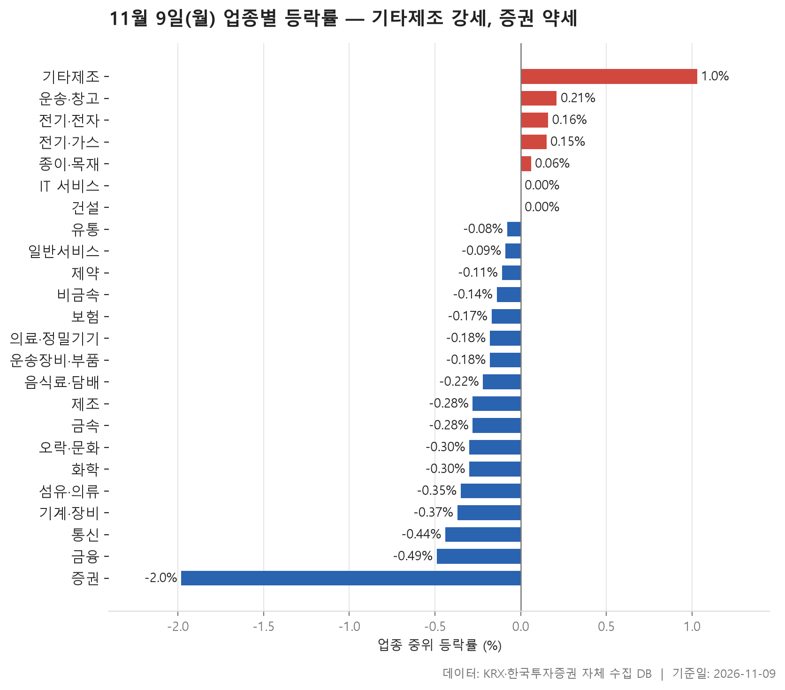
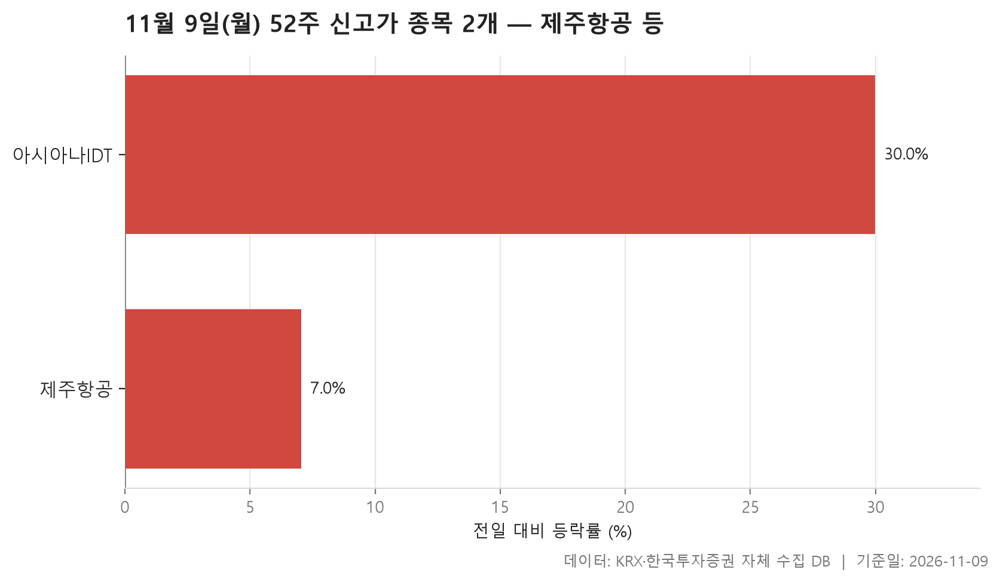
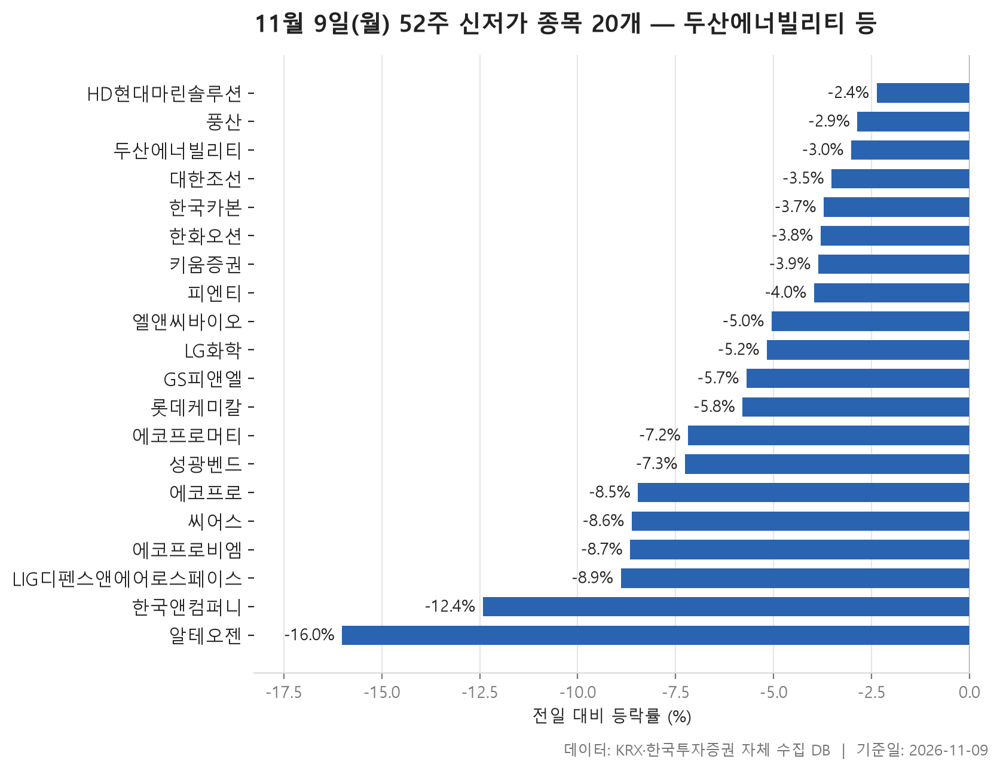
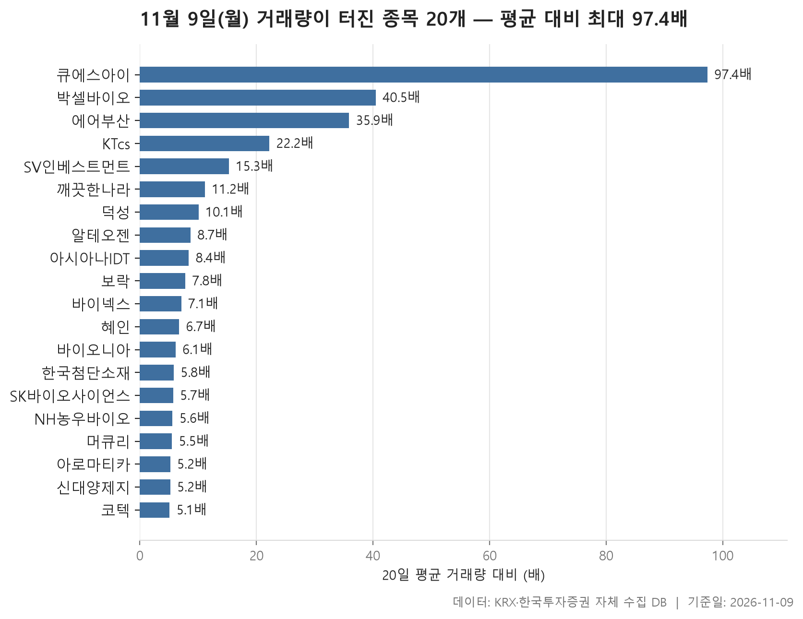

11월 9일 시장은 한쪽으로 크게 쏠리지 않았습니다. 그래도 하나씩 따져 보면 내린 쪽이 더 많았던 하루였습니다. 24개 업종을 업종 안 종목 등락률의 중위값으로 줄 세웠더니 플러스로 끝난 업종이 5개, 마이너스로 끝난 업종이 17개였습니다. 한가운데 놓인 값은 -0.17%였습니다. 맨 위에는 기타제조(+1.03%), 맨 아래에는 증권(-1.98%)이 있습니다. 위아래 끝이 이 정도라면 업종 단위로는 크게 움직인 날이 아니었다고 봐도 됩니다.

52주 기록 쪽은 사정이 다릅니다. 신고가를 쓴 종목은 2개뿐인데 신저가는 20개가 나왔고, 신저가 명단 위쪽에는 시가총액이 큰 대형주가 줄지어 있습니다. 거래량이 평소의 5배를 넘긴 종목도 20개였는데, 이쪽은 대부분 덩치가 작은 종목입니다. 업종 표만 보면 잔잔했지만 개별 종목에서는 꽤 큰 움직임이 있었습니다.

순서는 업종 등락, 신고가, 신저가, 거래량 급증입니다. 표마다 숫자가 서로 맞지 않는 대목을 중심으로 봅니다. 중위값과 평균이 따로 움직인 업종이 있고, 여러 표에 겹쳐 나오는 종목이 있습니다.

> 기준일: 2026-11-09 · 집계: 자체 수집 데이터베이스

## 업종 등락률 — 24개 중 17개 하락

순위를 중위값으로 매겼기 때문에 위아래 모두 폭이 좁습니다. 1위 기타제조는 15개 종목 가운데 60.00%가 올라 열 곳 중 여섯 곳이 플러스였습니다. 중위값이 평균(+0.48%)보다 높으니 한두 종목이 끌어올린 게 아니라 여러 종목이 고르게 오른 모양입니다. 다만 거래대금이 74.90억원으로 표에서 가장 작아 시장 전체를 대표한다고 보기는 어렵습니다. 덩치로는 전기·전자가 369개 종목, 거래대금 115,371.70억원으로 압도적입니다. 그런데 이 업종의 중위값은 +0.16%로 겨우 플러스였고, 오른 종목과 내린 종목이 거의 반반이었습니다.

가장 눈에 띄는 업종은 **증권**입니다. 18개 종목 가운데 오른 종목이 하나도 없었습니다. 중위값 -1.98%와 평균 -2.41%가 크게 벌어지지 않았고, 가장 많이 내린 미래에셋증권(-5.19%)이 업종 평균을 끌어내린 폭도 0.29%p에 그칩니다. 한 종목이 급락해서가 아니라 업종 전체가 함께 밀렸다는 뜻입니다. 금융(30.90%)과 통신(30.80%)도 오른 종목이 셋 중 하나가 안 됐습니다.

중위값과 평균이 따로 움직인 업종도 있습니다. 제조는 중위값이 -0.28%인데 평균은 -2.04%입니다. 종목이 8개뿐인 업종에서 코아스 하나가 -20.61% 내렸고, 이 종목이 평균을 2.58%p 끌어내렸습니다. 평균 하락의 대부분이 이 한 종목에서 나왔다고 봐야 합니다. 의료·정밀기기는 반대입니다. 중위값은 -0.18%로 마이너스인데 평균은 +0.68%입니다. 노을(+29.96%)이 평균을 0.29%p 끌어올렸지만 중위값과 평균의 간격은 그보다 넓습니다. 노을 말고도 크게 오른 종목이 더 있었다는 얘기입니다. IT 서비스도 중위값 0.00%, 평균 +0.70%로 비슷한 모양입니다. 통신은 오른 종목이 30.80%뿐인데도 평균은 +0.32%였습니다. 아이즈비전(+9.67%) 한 종목이 평균을 0.74%p 끌어올렸고, 종목 하나가 업종 평균을 움직인 폭으로는 표에서 가장 큽니다.

| 업종 | 종목수(개) | 중위등락률(%) | 평균등락률(%) | 상승비율(%) | 주도종목 | 주도종목등락률(%) | 평균기여도(%p) | 거래대금합계(억원) |
|---|---|---|---|---|---|---|---|---|
| 기타제조 | 15 | +1.03 | +0.48 | 60.00 | 크리에이츠 | +5.88 | 0.39 | 74.90 |
| 운송·창고 | 28 | +0.21 | +0.43 | 53.60 | 트리니티항공 | +8.76 | 0.31 | 1,499.90 |
| 전기·전자 | 369 | +0.16 | +0.52 | 50.90 | 머큐리 | +29.99 | 0.08 | 115,371.70 |
| 전기·가스 | 10 | +0.15 | +0.35 | 50.00 | 지역난방공사 | +2.13 | 0.21 | 491.30 |
| 종이·목재 | 27 | +0.06 | +0.36 | 51.90 | 신대양제지 | +9.57 | 0.35 | 298.30 |
| IT 서비스 | 248 | 0.00 | +0.70 | 49.20 | 아시아나IDT | +29.99 | 0.12 | 11,843.10 |
| 건설 | 50 | 0.00 | +0.23 | 48.00 | 상지건설 | +15.32 | 0.31 | 2,272.40 |
| 유통 | 156 | -0.08 | +0.30 | 44.20 | 유니퀘스트 | +16.05 | 0.10 | 3,908.60 |
| 일반서비스 | 169 | -0.09 | +0.23 | 43.80 | 박셀바이오 | +29.97 | 0.18 | 9,509.40 |
| 제약 | 167 | -0.11 | -0.51 | 44.90 | 애드바이오텍 | -29.94 | -0.18 | 6,036.80 |
| 비금속 | 35 | -0.14 | -0.03 | 37.10 | 티씨케이 | +9.53 | 0.27 | 349.40 |
| 보험 | 11 | -0.17 | -0.43 | 36.40 | 미래에셋생명 | -3.88 | -0.35 | 2,020.30 |
| 의료·정밀기기 | 103 | -0.18 | +0.68 | 45.60 | 노을 | +29.96 | 0.29 | 1,935.10 |
| 운송장비·부품 | 131 | -0.18 | +0.05 | 40.50 | 에코캡 | +29.90 | 0.23 | 6,816.40 |
| 음식료·담배 | 84 | -0.22 | -0.14 | 44.00 | 한울앤제주 | -13.64 | -0.16 | 2,579.80 |
| 제조 | 8 | -0.28 | -2.04 | 37.50 | 코아스 | -20.61 | -2.58 | 11.70 |
| 금속 | 129 | -0.28 | -0.24 | 40.30 | 이렘 | +11.01 | 0.09 | 3,854.50 |
| 오락·문화 | 62 | -0.30 | -0.18 | 40.30 | 티엔엔터테인먼트 | +10.53 | 0.17 | 769.20 |
| 화학 | 220 | -0.30 | -0.69 | 41.80 | 아로마티카 | -23.13 | -0.11 | 7,726.90 |
| 섬유·의류 | 49 | -0.35 | +0.03 | 40.80 | 셀바이오휴먼텍 | -12.23 | -0.25 | 137.60 |
| 기계·장비 | 211 | -0.37 | -0.06 | 44.10 | 비엠티 | +13.51 | 0.06 | 12,852.40 |
| 통신 | 13 | -0.44 | +0.32 | 30.80 | 아이즈비전 | +9.67 | 0.74 | 1,367.70 |
| 금융 | 110 | -0.49 | -0.62 | 30.90 | 한국앤컴퍼니 | -12.42 | -0.11 | 17,135.00 |
| 증권 | 18 | -1.98 | -2.41 | 0.00 | 미래에셋증권 | -5.19 | -0.29 | 795.90 |

## 52주 신고가 2개 — 최고 아시아나IDT 29.99%

신고가는 2개뿐이고 둘 다 코스피 종목입니다. 같은 신고가라도 두 종목의 모습은 꽤 다릅니다. 아시아나IDT는 하루 만에 +29.99% 올라 제한폭 끝까지 갔습니다. 이전 52주 최고가 12,880원을 훌쩍 넘겨 14,130원에 마감했고, 거래대금도 651.80억원으로 적지 않았습니다. 업종 표에서 IT 서비스를 가장 크게 움직인 종목이 이 종목이었고, 뒤의 거래량 급증 표에도 이름이 있습니다. 세 표에 모두 나오는 셈입니다.

제주항공은 +7.05% 올라 6,830원에 마감했습니다. 이전 최고가가 6,800원이었으니 신고가 선을 아슬아슬하게 넘었습니다. 시가총액은 5,508억원으로 두 종목 중 더 큽니다. 제주항공이 속한 운송·창고는 업종 중위값 +0.21%로 두 번째로 강했습니다. 업종 안에서 가장 크게 움직인 종목은 트리니티항공(+8.76%)이었고, 에어부산도 거래량 급증 명단에 올랐습니다. 이날 항공 관련 종목 여러 개가 여러 표에 함께 나온 것입니다. 다만 이유는 자료에 없어서 여기서는 함께 나왔다는 사실만 적어 둡니다.

| 종목명 | 종목코드 | 시장 | 업종 | 종가(원) | 등락률(%) | 이전52주최고(원) | 거래대금(억원) | 시가총액(억원) |
|---|---|---|---|---|---|---|---|---|
| 제주항공 | 089590 | KOSPI | 운송·창고 | 6,830 | +7.05 | 6,800 | 113.00 | 5,508 |
| 아시아나IDT | 267850 | KOSPI | IT 서비스 | 14,130 | +29.99 | 12,880 | 651.80 | 1,568 |

## 52주 신저가 20개 — 최저 알테오젠 -16.01%

신저가는 20개로 신고가보다 훨씬 많습니다. 코스피 13개, 코스닥 7개이고 업종은 10개로 흩어져 있습니다. 이 20개 종목의 하루 등락률 중위값은 -5.43%입니다. 신저가 근처에서 조금 밀린 정도가 아니라, 이날 하루에만 꽤 크게 빠진 종목이 많았다는 뜻입니다.

명단의 무게중심이 위쪽에 있습니다. 시가총액 277,683억원의 두산에너빌리티(-3.02%)를 맨 위로 LG화학(-5.17%), 한화오션(-3.80%), 알테오젠(-16.01%)까지 대형주가 이어집니다. 그중에서도 알테오젠은 다른 종목들과 다릅니다. 이전 52주 최저가 193,100원보다 한참 낮은 168,400원에 마감했고, 거래대금도 4,584.90억원으로 표에서 가장 큽니다. 거래량 급증 표에도 이름이 있습니다. 비슷한 이름의 종목이 묶여서 나온 것도 보입니다. 에코프로(-8.46%), 에코프로비엠(-8.66%), 에코프로머티(-7.18%) 세 종목이 모두 들어 있고, 한화오션·대한조선·HD현대마린솔루션도 함께 이름을 올렸습니다. 업종으로는 금속이 4개로 가장 많은데, LIG디펜스앤에어로스페이스(-8.90%)가 그중 가장 크게 내렸습니다. 증권 업종의 약세와 겹쳐 키움증권(-3.86%)도 신저가를 썼습니다. 금융 업종에서 가장 크게 움직인 한국앤컴퍼니(-12.42%)도 이 명단에 있습니다.

반대로 신저가 선을 겨우 넘어간 종목도 있습니다. 하락폭이 가장 작은 HD현대마린솔루션(-2.37%)은 156,700원으로 이전 최저가 157,000원을 살짝 밑돌았습니다. 풍산(50,900원, 이전 최저 51,000원)과 피엔티(22,950원, 이전 최저 23,000원)도 마찬가지입니다. 같은 신저가라도 알테오젠처럼 크게 무너진 경우와 선을 간신히 넘은 경우가 섞여 있습니다.

| 종목명 | 종목코드 | 시장 | 업종 | 종가(원) | 등락률(%) | 이전52주최저(원) | 거래대금(억원) | 시가총액(억원) |
|---|---|---|---|---|---|---|---|---|
| 두산에너빌리티 | 034020 | KOSPI | 기계·장비 | 43,350 | -3.02 | 43,700 | 1,565.90 | 277,683 |
| LG화학 | 051910 | KOSPI | 화학 | 220,000 | -5.17 | 221,000 | 422.00 | 155,303 |
| 한화오션 | 042660 | KOSPI | 운송장비·부품 | 45,550 | -3.80 | 45,750 | 391.60 | 139,571 |
| 알테오젠 | 196170 | KOSDAQ | 일반서비스 | 168,400 | -16.01 | 193,100 | 4,584.90 | 117,299 |
| 에코프로 | 086520 | KOSDAQ | 금융 | 60,600 | -8.46 | 63,400 | 755.50 | 82,280 |
| 에코프로비엠 | 247540 | KOSDAQ | 전기·전자 | 75,900 | -8.66 | 80,400 | 500.20 | 81,768 |
| HD현대마린솔루션 | 443060 | KOSPI | 일반서비스 | 156,700 | -2.37 | 157,000 | 121.40 | 70,254 |
| LIG디펜스앤에어로스페이스 | 079550 | KOSPI | 금속 | 297,000 | -8.90 | 313,000 | 882.50 | 65,340 |
| 키움증권 | 039490 | KOSPI | 증권 | 179,200 | -3.86 | 182,000 | 153.70 | 47,001 |
| 한국앤컴퍼니 | 000240 | KOSPI | 금융 | 21,500 | -12.42 | 22,000 | 25.70 | 20,411 |
| 롯데케미칼 | 011170 | KOSPI | 화학 | 43,900 | -5.79 | 45,350 | 87.90 | 18,778 |
| 에코프로머티 | 450080 | KOSPI | 전기·전자 | 24,550 | -7.18 | 25,550 | 96.00 | 17,385 |
| 풍산 | 103140 | KOSPI | 금속 | 50,900 | -2.86 | 51,000 | 45.30 | 14,264 |
| 대한조선 | 439260 | KOSPI | 운송장비·부품 | 32,850 | -3.52 | 33,300 | 11.60 | 12,512 |
| 한국카본 | 017960 | KOSPI | 금속 | 13,720 | -3.72 | 13,900 | 37.60 | 7,090 |
| 엘앤씨바이오 | 290650 | KOSDAQ | 제약 | 22,550 | -5.05 | 22,800 | 198.50 | 6,916 |
| 피엔티 | 137400 | KOSDAQ | 기계·장비 | 22,950 | -3.97 | 23,000 | 34.50 | 5,437 |
| 성광벤드 | 014620 | KOSDAQ | 금속 | 19,940 | -7.26 | 20,000 | 85.80 | 5,296 |
| 씨어스 | 458870 | KOSDAQ | 의료·정밀기기 | 13,250 | -8.62 | 14,500 | 160.90 | 5,081 |
| GS피앤엘 | 499790 | KOSPI | 금융 | 24,050 | -5.69 | 25,450 | 48.50 | 4,769 |

## 거래량 급증 20개 — 최고 큐에스아이 97.40배

거래량이 직전 20거래일 평균의 5배를 넘긴 종목은 20개이고, 그 배수의 중위값은 7.45배입니다. 맨 위의 큐에스아이는 97.40배로 다른 종목들과 격차가 큽니다. 평소 하루 42,643주 남짓 거래되던 종목에서 4,151,837주가 거래됐고, 주가는 +16.72% 올랐습니다. 시가총액은 699억원입니다. 그 뒤로 박셀바이오(40.50배, +29.97%)와 에어부산(35.90배, +3.68%)이 이어지고, 아래로 갈수록 배수가 빠르게 줄어 5배대에서 끝납니다.

대부분 오른 종목이고 내린 종목은 몇 개 안 됩니다. 시가총액도 대체로 수백억에서 수천억원대의 작은 종목들입니다. 큰 종목은 알테오젠(117,299억원)과 SK바이오사이언스(31,696억원) 정도뿐이고, 둘의 방향도 반대였습니다. 알테오젠은 -16.01%, SK바이오사이언스는 +5.21%였습니다. 거래가 많았다고 주가가 크게 움직인 것도 아닙니다. 깨끗한나라는 14,471,241주가 거래됐는데 주가는 +0.06%로 거의 그대로였습니다.

이 표에는 업종 표에서 각 업종을 가장 크게 움직인 종목이 여럿 다시 나옵니다. 전기·전자의 머큐리(+29.99%), 일반서비스의 박셀바이오, 화학의 아로마티카(-23.13%), 종이·목재의 신대양제지(+9.57%)가 그렇습니다. 업종 안에서 눈에 띄게 움직인 종목은 대개 평소보다 거래가 몇 배 많았다는 뜻입니다. 다만 신대양제지의 거래대금은 4.10억원에 그쳐, 거래량 배수가 같아도 실제로 오간 돈의 규모는 종목마다 크게 다릅니다. 업종별로는 전기·전자가 4개로 가장 많습니다.

| 종목명 | 종목코드 | 시장 | 업종 | 종가(원) | 등락률(%) | 거래량(주) | 평균거래량(주) | 배수(배) | 거래대금(억원) | 시가총액(억원) |
|---|---|---|---|---|---|---|---|---|---|---|
| 큐에스아이 | 066310 | KOSDAQ | 전기·전자 | 7,540 | +16.72 | 4,151,837 | 42,643 | 97.40 | 336.10 | 699 |
| 박셀바이오 | 323990 | KOSDAQ | 일반서비스 | 4,835 | +29.97 | 2,870,001 | 70,813 | 40.50 | 136.20 | 1,124 |
| 에어부산 | 298690 | KOSPI | 운송·창고 | 1,606 | +3.68 | 6,225,963 | 173,427 | 35.90 | 106.10 | 2,616 |
| KTcs | 058850 | KOSPI | IT 서비스 | 2,220 | +8.82 | 2,297,151 | 103,259 | 22.20 | 51.50 | 919 |
| SV인베스트먼트 | 289080 | KOSDAQ | 금융 | 2,055 | -5.30 | 7,542,650 | 493,218 | 15.30 | 176.50 | 1,236 |
| 깨끗한나라 | 004540 | KOSPI | 종이·목재 | 1,727 | +0.06 | 14,471,241 | 1,288,081 | 11.20 | 276.20 | 643 |
| 덕성 | 004830 | KOSPI | 화학 | 3,350 | -7.84 | 3,050,230 | 303,033 | 10.10 | 108.10 | 525 |
| 알테오젠 | 196170 | KOSDAQ | 일반서비스 | 168,400 | -16.01 | 2,711,302 | 313,442 | 8.70 | 4,584.90 | 117,299 |
| 아시아나IDT | 267850 | KOSPI | IT 서비스 | 14,130 | +29.99 | 5,176,362 | 616,948 | 8.40 | 651.80 | 1,568 |
| 보락 | 002760 | KOSPI | 화학 | 1,038 | +5.81 | 690,031 | 88,687 | 7.80 | 7.10 | 622 |
| 바이넥스 | 053030 | KOSDAQ | 제약 | 6,140 | +3.89 | 525,310 | 73,581 | 7.10 | 33.10 | 2,007 |
| 혜인 | 003010 | KOSPI | 유통 | 8,760 | +7.62 | 7,308,160 | 1,088,289 | 6.70 | 653.90 | 1,114 |
| 바이오니아 | 064550 | KOSDAQ | 제약 | 6,620 | +4.25 | 878,519 | 144,529 | 6.10 | 59.80 | 1,709 |
| 한국첨단소재 | 062970 | KOSDAQ | 전기·전자 | 2,160 | +13.62 | 3,963,294 | 681,877 | 5.80 | 88.40 | 651 |
| SK바이오사이언스 | 302440 | KOSPI | 제약 | 40,400 | +5.21 | 501,421 | 87,777 | 5.70 | 208.50 | 31,696 |
| NH농우바이오 | 054050 | KOSDAQ | - | 6,290 | -2.63 | 90,651 | 16,193 | 5.60 | 5.80 | 1,008 |
| 머큐리 | 100590 | KOSDAQ | 전기·전자 | 4,400 | +29.99 | 2,435,237 | 446,251 | 5.50 | 101.70 | 754 |
| 아로마티카 | 0015N0 | KOSDAQ | 화학 | 6,180 | -23.13 | 887,614 | 171,571 | 5.20 | 58.10 | 777 |
| 신대양제지 | 016590 | KOSPI | 종이·목재 | 8,700 | +9.57 | 48,415 | 9,281 | 5.20 | 4.10 | 3,506 |
| 코텍 | 052330 | KOSDAQ | 전기·전자 | 8,780 | -5.89 | 71,266 | 14,071 | 5.10 | 6.30 | 1,559 |

## 정리

정리하면 11월 9일은 업종 단위로는 조금씩 밀린 날이었습니다. 다만 신저가 명단에는 대형주가 줄지어 있었고, 거래량이 터진 종목은 소형주가 대부분이었습니다. 증권 업종처럼 업종 전체가 함께 내린 경우가 있었고, 제조나 통신처럼 한 종목이 평균을 만든 경우도 있었습니다.

이 글은 하루치 종가만 비교한 것이고, 오르거나 내린 이유는 자료에 없어 다루지 않았습니다. 업종 순위는 중위값 기준이라 평균으로 매기면 순서가 달라질 수 있습니다. 신고가·신저가·거래량 표는 시가총액 500억원, 거래대금 3억원 이상인 보통주만 담았습니다. 업종 분류도 자체 데이터베이스 기준이라 일반적인 분류와 다를 수 있습니다. 예를 들어 에코프로는 금융으로, 알테오젠은 일반서비스로 분류돼 있고 NH농우바이오는 업종이 비어 있습니다.

## 집계 기준

**업종 등락률**

- **기준**: 2026-11-06 종가 → 2026-11-09 종가
- **순위**: 업종 내 종목 등락률의 중위값 (평균은 참고용으로 함께 표시)
- **주도종목**: 그 업종에서 등락률 절대값이 가장 큰 종목 (동점이면 거래대금이 큰 쪽)
- **평균기여도**: 그 종목 하나가 업종 평균을 움직인 폭 (등락률 ÷ 종목수). 중위값과 평균의 격차가 이 값에 가까우면 평균을 만든 것이 그 종목이고, 훨씬 크면 다른 종목들도 함께 움직인 것입니다
- **필터**: 업종 내 보통주 5종목 이상
- **전체업종중위등락률(%)**: -0.17

**52주 신고가**

- **기준**: 종가 > 직전 52주 최고가
- **관측구간**: 2025-10-28 ~ 2026-11-06 (252거래일)
- **필터**: 시가총액 500억 이상, 거래대금 3억 이상, 보통주

**52주 신저가**

- **기준**: 종가 < 직전 52주 최저가
- **관측구간**: 2025-10-28 ~ 2026-11-06 (252거래일)
- **필터**: 시가총액 500억 이상, 거래대금 3억 이상, 보통주

**거래량 급증**

- **기준**: 당일 거래량 ≥ 직전 20거래일 평균 × 5
- **관측구간**: 2026-10-12 ~ 2026-11-06 (20거래일)
- **필터**: 시가총액 500억 이상, 거래대금 3억 이상, 보통주

## 데이터 출처 및 유의사항

- **데이터출처**: 한국거래소(KRX) 공시 데이터와 한국투자증권 OpenAPI 를 직접 수집해 구축한 자체 데이터베이스
- **집계방식**: 수집·집계·차트 생성을 직접 구현한 파이프라인에서 자동 산출
- **작성고지**: 본문의 표·통계·차트는 자체 데이터베이스에서 계산된 값이며, 문장 작성 과정에 AI 도구를 활용했습니다.
- **면책**: 본 글은 정보 제공을 목적으로 하며 특정 종목의 매수·매도를 추천하지 않습니다. 제시된 수치는 과거 데이터이고 미래 수익을 보장하지 않습니다. 투자 판단과 그 결과에 대한 책임은 투자자 본인에게 있습니다.

