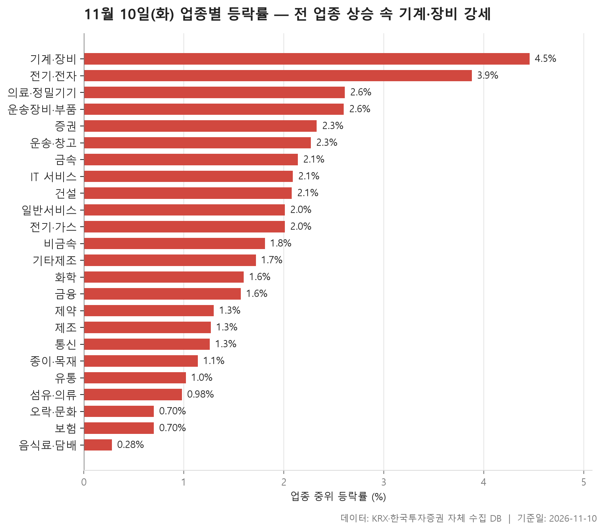
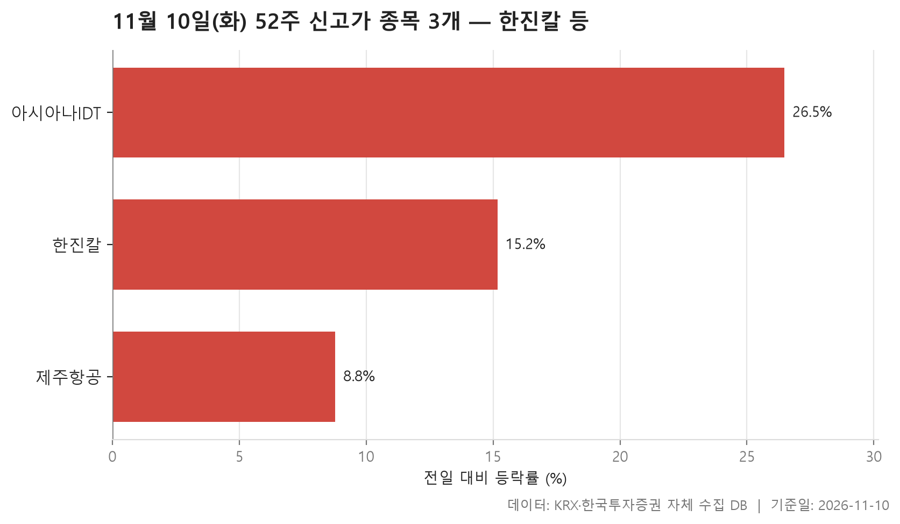
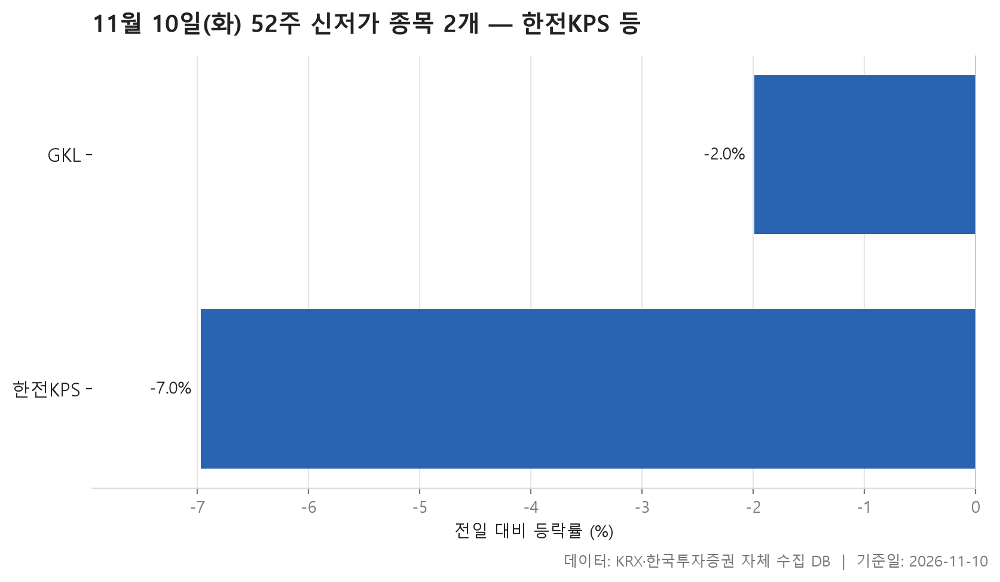
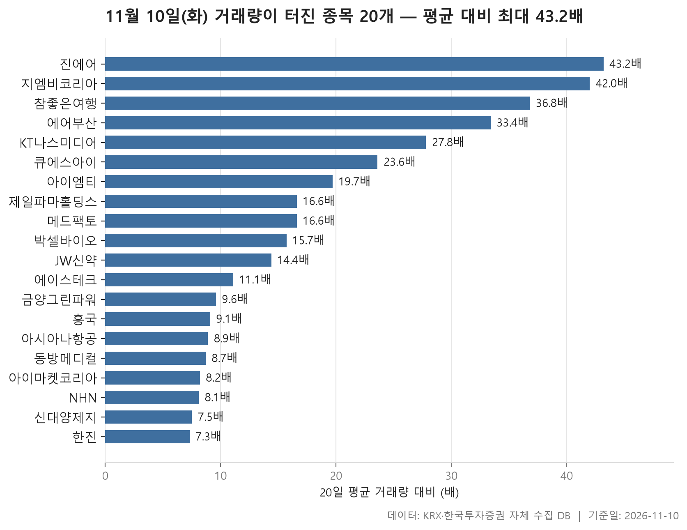

11월 10일 시장은 방향이 한쪽으로 분명했습니다. 24개 업종을 종목 등락률의 중위값으로 줄 세웠더니 맨 아래 업종까지 플러스였습니다. 가장 덜 오른 음식료·담배가 +0.28%, 맨 위의 기계·장비가 +4.46%였고, 업종별 중위값을 늘어놓았을 때 한가운데 놓인 값은 +1.76%였습니다. 오른 업종이 몇 곳이었는지보다 **얼마나 고르게, 얼마나 크게** 올랐는지가 업종마다 달랐던 하루로 보는 편이 맞습니다.

순서는 이렇습니다. 업종 흐름을 먼저 보고, 52주 신고가와 신저가, 거래량이 평소의 5배를 넘긴 종목을 차례로 살핍니다. 신고가는 3개, 신저가는 2개로 양쪽 모두 손에 꼽을 정도였습니다. 반면 거래량 급증 목록에는 20개가 올랐습니다.

세 표를 나란히 놓으면 눈에 걸리는 점이 하나 있습니다. 같은 계열로 보이는 이름이 표마다 되풀이해 나온다는 것입니다. 그 대목은 뒤에서 따로 짚겠습니다.

> 기준일: 2026-11-10 · 집계: 자체 수집 데이터베이스

## 업종 등락률 — 24개 모두 상승

상위권은 기계·장비와 전기·전자가 확실히 앞섰습니다. 기계·장비는 211개 종목 가운데 89.60%가 올랐고, 전기·전자도 88.60%로 거의 같았습니다. 열 곳 중 아홉 곳꼴로 오른 셈입니다. 두 업종 모두 중위값과 평균이 붙어 있다는 점이 중요합니다. 급등주 몇 개가 숫자를 끌어올린 것이 아니라 업종 전체가 고르게 움직였다는 뜻이기 때문입니다. 전기·전자에서 오간 거래대금은 100,015.30억원으로 다른 업종을 크게 따돌렸습니다. 오른 종목이 가장 많았던 곳은 의외로 건설입니다. 오른 종목 비율은 90.00%로 가장 높았지만 중위값은 +2.08%에 그쳤습니다. 많이 오르기보다 넓게 오른 업종이었습니다.

어긋나 보이는 곳은 운송·창고와 제조입니다. 운송·창고는 중위값이 +2.27%인데 평균은 +4.58%로 두 배 가까이 높습니다. 진에어가 +29.92% 오르며 혼자 업종 평균을 1.07%p 밀어 올렸습니다. 그래도 벌어진 폭을 이 한 종목으로 다 설명하지는 못합니다. 다른 종목들도 함께 크게 올랐다는 이야기입니다. 종목이 8개뿐인 제조는 사정이 다릅니다. 중위값 +1.27%, 평균 +4.29%로 벌어졌는데, 코아스(+29.96%) 하나가 평균을 3.75%p 끌어올렸으니 격차의 대부분이 이 종목에서 나왔습니다. 이 업종은 오른 종목 비율도 62.50%로 낮은 편이었습니다.

반대로 평균이 중위값보다 낮은 업종도 있습니다. 증권(중위 +2.33%, 평균 +1.90%)과 전기·가스, 오락·문화가 그렇습니다. 오락·문화에서는 CJ ENM이 -13.35% 밀리며 업종 평균을 0.22%p 끌어내렸습니다. 운송장비·부품의 에코캡(-11.41%)과 유통의 윙스풋(-17.12%)도 업종 전체가 오르는 사이 거꾸로 크게 움직였습니다.

하위권인 음식료·담배, 보험, 오락·문화는 오른 종목 비율이 각각 61.40%, 63.60%, 64.50%였습니다. 열 곳 중 여섯 곳 남짓이 오른 셈이라, 상위권과는 결이 확연히 달랐습니다.

| 업종 | 종목수(개) | 중위등락률(%) | 평균등락률(%) | 상승비율(%) | 주도종목 | 주도종목등락률(%) | 평균기여도(%p) | 거래대금합계(억원) |
|---|---|---|---|---|---|---|---|---|
| 기계·장비 | 211 | +4.46 | +4.74 | 89.60 | 티앤이코리아 | +29.98 | 0.14 | 12,689.70 |
| 전기·전자 | 369 | +3.88 | +4.06 | 88.60 | RFHIC | +19.20 | 0.05 | 100,015.30 |
| 의료·정밀기기 | 103 | +2.61 | +2.89 | 83.50 | 디알텍 | +15.81 | 0.15 | 2,003.10 |
| 운송장비·부품 | 132 | +2.60 | +2.67 | 84.10 | 에코캡 | -11.41 | -0.09 | 7,184.10 |
| 증권 | 18 | +2.33 | +1.90 | 83.30 | NH투자증권 | +4.58 | 0.25 | 632.80 |
| 운송·창고 | 28 | +2.27 | +4.58 | 82.10 | 진에어 | +29.92 | 1.07 | 5,201.20 |
| 금속 | 129 | +2.14 | +2.55 | 80.60 | 삼미금속 | +14.29 | 0.11 | 2,981.10 |
| IT 서비스 | 248 | +2.09 | +2.67 | 81.00 | 핑거스토리 | +29.92 | 0.12 | 12,657.20 |
| 건설 | 50 | +2.08 | +2.85 | 90.00 | 동아지질 | +14.53 | 0.29 | 3,167.10 |
| 일반서비스 | 169 | +2.01 | +2.92 | 77.50 | 바이오인프라 | +29.92 | 0.18 | 5,822.30 |
| 전기·가스 | 10 | +2.01 | +1.69 | 80.00 | SGC에너지 | +7.60 | 0.76 | 759.60 |
| 비금속 | 35 | +1.81 | +2.76 | 88.60 | 원익QnC | +10.87 | 0.31 | 552.70 |
| 기타제조 | 15 | +1.72 | +1.85 | 80.00 | 에이럭스 | +4.75 | 0.32 | 29.90 |
| 화학 | 220 | +1.60 | +2.34 | 76.40 | 예선테크 | +30.00 | 0.14 | 7,772.60 |
| 금융 | 110 | +1.57 | +2.31 | 83.60 | 한진칼 | +15.18 | 0.14 | 16,273.20 |
| 제약 | 167 | +1.30 | +2.18 | 83.20 | 삼익제약 | +29.95 | 0.18 | 7,102.90 |
| 제조 | 8 | +1.27 | +4.29 | 62.50 | 코아스 | +29.96 | 3.75 | 8.00 |
| 통신 | 13 | +1.26 | +2.46 | 84.60 | 아이즈비전 | +9.90 | 0.76 | 1,677.10 |
| 종이·목재 | 27 | +1.14 | +1.40 | 74.10 | 신대양제지 | +9.20 | 0.34 | 99.30 |
| 유통 | 157 | +1.02 | +1.34 | 70.10 | 윙스풋 | -17.12 | -0.11 | 3,080.70 |
| 섬유·의류 | 49 | +0.98 | +1.29 | 71.40 | 메타랩스 | +29.96 | 0.61 | 140.40 |
| 오락·문화 | 62 | +0.70 | +0.47 | 64.50 | CJ ENM | -13.35 | -0.22 | 763.60 |
| 보험 | 11 | +0.70 | +0.75 | 63.60 | 미래에셋생명 | +5.77 | 0.52 | 1,946.70 |
| 음식료·담배 | 83 | +0.28 | +0.59 | 61.40 | 오에스피 | +15.74 | 0.19 | 1,909.30 |

## 52주 신고가 3개 — 최고 아시아나IDT 26.47%

52주 신고가를 새로 쓴 보통주는 3개, 모두 코스피 종목입니다. 세 종목 모두 업종 평균을 훌쩍 넘는 폭으로 올랐습니다. 가장 무게감 있는 이름은 한진칼입니다. 시가총액이 159,562억원인 대형주가 하루에 +15.18% 올라 이전 최고가 223,500원을 넘어선 239,000원에 마감했습니다. 거래대금도 2,820.00억원으로 컸고, 금융 업종에서 가장 크게 움직인 종목이기도 합니다.

상승 폭으로는 아시아나IDT가 +26.47%로 가장 컸습니다. 이전 최고가 14,130원을 단숨에 넘어 17,870원에 닫았습니다. 제주항공은 +8.78%로 셋 중 가장 작게 올랐지만, 7,050원이던 이전 고점을 넘어 7,430원에 마감했습니다.

세 이름을 놓고 보면 항공과 엮인 회사들이 모여 있습니다. 아래 거래량 급증 표에도 진에어, 에어부산, 아시아나항공, 한진이 등장합니다. 이 묶음이 왜 같은 날 함께 움직였는지는 자료에 나오지 않습니다. 표가 말해 주는 것은 같은 날 같은 방향으로 크게 움직였다는 사실까지입니다.

| 종목명 | 종목코드 | 시장 | 업종 | 종가(원) | 등락률(%) | 이전52주최고(원) | 거래대금(억원) | 시가총액(억원) |
|---|---|---|---|---|---|---|---|---|
| 한진칼 | 180640 | KOSPI | 금융 | 239,000 | +15.18 | 223,500 | 2,820.00 | 159,562 |
| 제주항공 | 089590 | KOSPI | 운송·창고 | 7,430 | +8.78 | 7,050 | 187.50 | 5,992 |
| 아시아나IDT | 267850 | KOSPI | IT 서비스 | 17,870 | +26.47 | 14,130 | 799.80 | 1,984 |

## 52주 신저가 2개 — 최저 한전KPS -6.97%

52주 신저가로 내려간 보통주는 2개, 역시 모두 코스피입니다. 시장 전체가 오른 날이니 숫자가 적은 것은 자연스럽습니다. 눈여겨볼 점은 두 종목 모두 자기 업종 흐름과 반대로 움직였다는 것입니다.

한전KPS는 건설 업종으로 분류됩니다. 건설은 오른 종목 비율이 90.00%로 24개 업종 중 가장 넓게 오른 곳이었습니다. 그런 업종 안에서 이 종목은 -6.97% 내려 이전 최저가 39,850원 아래인 37,400원에 마감했습니다. 시가총액 16,830억원으로 두 종목 중 큰 쪽입니다.

GKL은 -1.99%로 내린 폭이 크지 않았습니다. 이전 최저가가 7,920원이었고 이날 종가가 7,900원이었으니 저점을 아주 근소하게 밑돈 정도입니다. 거래대금은 9.60억원으로 가벼웠습니다. 다만 GKL이 속한 오락·문화 업종이 이날 하위권이었다는 점은 함께 볼 만합니다.

| 종목명 | 종목코드 | 시장 | 업종 | 종가(원) | 등락률(%) | 이전52주최저(원) | 거래대금(억원) | 시가총액(억원) |
|---|---|---|---|---|---|---|---|---|
| 한전KPS | 051600 | KOSPI | 건설 | 37,400 | -6.97 | 39,850 | 156.70 | 16,830 |
| GKL | 114090 | KOSPI | 오락·문화 | 7,900 | -1.99 | 7,920 | 9.60 | 4,887 |

## 거래량 급증 20개 — 최고 진에어 43.20배

거래량이 직전 20거래일 평균의 5배를 넘은 종목은 20개였습니다. 배수의 중위값이 15.05배이니, 이 목록의 한가운데 종목조차 평소의 열다섯 배쯤 거래됐다는 뜻입니다. 맨 위는 진에어로 43.20배였습니다. 10,434,521주가 거래되며 주가는 +29.92% 올랐습니다. 에어부산(33.40배, +17.19%), 아시아나항공(8.90배, +11.68%), 한진(7.30배, +7.11%)까지 운송·창고 종목이 목록 곳곳에 자리합니다. 앞의 신고가 표와 겹쳐 보이는 대목입니다.

거래량이 터졌다고 모두 오른 것은 아닙니다. 아이엠티는 기계·장비가 가장 강했던 날 오히려 -12.47% 내렸습니다. 큐에스아이도 -5.57% 내렸는데 거래대금이 488.80억원에 달했습니다. 박셀바이오(-3.83%)와 제일파마홀딩스(-3.77%)도 내린 쪽입니다. 대부분이 오르는 날 거래가 몰리면서 내렸다는 점에서 따로 표시해 둘 만한 종목들입니다.

배수만 보고 판단하기 어려운 경우도 있습니다. 지엠비코리아는 42.00배로 두 번째였지만 주가는 +1.78% 오르는 데 그쳤고 거래대금도 34.10억원이었습니다. 평소 하루 거래량이 20,254주로 적은 종목이라 배수가 크게 잡힌 측면이 있습니다. 반대로 NHN은 배수가 8.10배로 목록 아래쪽이었지만, 시가총액 25,023억원으로 목록에서 가장 크고 +29.87% 오르며 거래대금 1,010.00억원으로도 가장 컸습니다.

시장별로는 코스닥 11개, 코스피 9개로 비슷하게 나뉘었습니다. 업종은 일반서비스가 5개로 가장 많았습니다.

| 종목명 | 종목코드 | 시장 | 업종 | 종가(원) | 등락률(%) | 거래량(주) | 평균거래량(주) | 배수(배) | 거래대금(억원) | 시가총액(억원) |
|---|---|---|---|---|---|---|---|---|---|---|
| 진에어 | 272450 | KOSPI | 운송·창고 | 7,990 | +29.92 | 10,434,521 | 241,663 | 43.20 | 791.80 | 4,171 |
| 지엠비코리아 | 013870 | KOSPI | 운송장비·부품 | 3,725 | +1.78 | 850,558 | 20,254 | 42.00 | 34.10 | 710 |
| 참좋은여행 | 094850 | KOSDAQ | 일반서비스 | 3,875 | +6.75 | 584,941 | 15,875 | 36.80 | 23.50 | 543 |
| 에어부산 | 298690 | KOSPI | 운송·창고 | 1,882 | +17.19 | 16,124,274 | 482,799 | 33.40 | 299.30 | 3,066 |
| KT나스미디어 | 089600 | KOSDAQ | 일반서비스 | 12,580 | +3.80 | 314,600 | 11,304 | 27.80 | 40.60 | 1,435 |
| 큐에스아이 | 066310 | KOSDAQ | 전기·전자 | 7,120 | -5.57 | 5,835,724 | 247,244 | 23.60 | 488.80 | 660 |
| 아이엠티 | 451220 | KOSDAQ | 기계·장비 | 7,720 | -12.47 | 859,726 | 43,664 | 19.70 | 77.70 | 608 |
| 제일파마홀딩스 | 002620 | KOSPI | 일반서비스 | 6,640 | -3.77 | 58,318 | 3,507 | 16.60 | 4.10 | 1,061 |
| 메드팩토 | 235980 | KOSDAQ | 일반서비스 | 3,585 | +0.99 | 2,322,245 | 139,837 | 16.60 | 91.00 | 1,229 |
| 박셀바이오 | 323990 | KOSDAQ | 일반서비스 | 4,650 | -3.83 | 3,307,968 | 210,305 | 15.70 | 159.10 | 1,081 |
| JW신약 | 067290 | KOSDAQ | 제약 | 2,455 | +16.35 | 25,943,930 | 1,806,009 | 14.40 | 630.20 | 1,376 |
| 에이스테크 | 088800 | KOSDAQ | 전기·전자 | 1,725 | +5.25 | 1,208,171 | 108,595 | 11.10 | 23.10 | 1,302 |
| 금양그린파워 | 282720 | KOSDAQ | 건설 | 9,340 | +13.76 | 6,006,040 | 628,167 | 9.60 | 558.70 | 1,132 |
| 흥국 | 010240 | KOSDAQ | 기계·장비 | 4,915 | +2.08 | 93,660 | 10,264 | 9.10 | 4.70 | 575 |
| 아시아나항공 | 020560 | KOSPI | 운송·창고 | 8,700 | +11.68 | 805,014 | 90,598 | 8.90 | 69.40 | 17,921 |
| 동방메디컬 | 240550 | KOSDAQ | 의료·정밀기기 | 5,680 | +1.43 | 650,687 | 75,076 | 8.70 | 37.90 | 1,189 |
| 아이마켓코리아 | 122900 | KOSPI | 유통 | 8,380 | +5.54 | 497,457 | 60,307 | 8.20 | 41.70 | 2,801 |
| NHN | 181710 | KOSPI | IT 서비스 | 77,400 | +29.87 | 1,328,915 | 163,779 | 8.10 | 1,010.00 | 25,023 |
| 신대양제지 | 016590 | KOSPI | 종이·목재 | 9,500 | +9.20 | 82,293 | 10,960 | 7.50 | 7.80 | 3,828 |
| 한진 | 002320 | KOSPI | 운송·창고 | 18,380 | +7.11 | 1,180,025 | 162,191 | 7.30 | 220.80 | 2,852 |

## 정리

한 문장으로 묶으면, 24개 업종이 모두 오른 가운데 기계·장비와 전기·전자가 오른 폭과 고르기 모두에서 앞섰고, 항공과 엮인 이름들이 신고가와 거래량 표에 겹쳐 나온 하루였습니다. 신저가 두 종목은 오히려 업종 흐름을 거스른 경우였습니다.

몇 가지 한계를 밝혀 둡니다. 이 글은 하루치 종가를 비교한 것이라 추세를 말해 주지 않습니다. 시가총액 500억 이상 같은 기준에 걸러진 소형주는 표에서 빠져 있습니다. 무엇보다 오르고 내린 이유는 자료에 없습니다. 위의 해석은 표가 보여 주는 모양에 대한 설명일 뿐, 특정 종목을 사거나 팔라는 뜻이 아닙니다.

## 집계 기준

**업종 등락률**

- **기준**: 2026-11-09 종가 → 2026-11-10 종가
- **순위**: 업종 내 종목 등락률의 중위값 (평균은 참고용으로 함께 표시)
- **주도종목**: 그 업종에서 등락률 절대값이 가장 큰 종목 (동점이면 거래대금이 큰 쪽)
- **평균기여도**: 그 종목 하나가 업종 평균을 움직인 폭 (등락률 ÷ 종목수). 중위값과 평균의 격차가 이 값에 가까우면 평균을 만든 것이 그 종목이고, 훨씬 크면 다른 종목들도 함께 움직인 것입니다
- **필터**: 업종 내 보통주 5종목 이상
- **전체업종중위등락률(%)**: 1.77

**52주 신고가**

- **기준**: 종가 > 직전 52주 최고가
- **관측구간**: 2025-10-29 ~ 2026-11-09 (252거래일)
- **필터**: 시가총액 500억 이상, 거래대금 3억 이상, 보통주

**52주 신저가**

- **기준**: 종가 < 직전 52주 최저가
- **관측구간**: 2025-10-29 ~ 2026-11-09 (252거래일)
- **필터**: 시가총액 500억 이상, 거래대금 3억 이상, 보통주

**거래량 급증**

- **기준**: 당일 거래량 ≥ 직전 20거래일 평균 × 5
- **관측구간**: 2026-10-13 ~ 2026-11-09 (20거래일)
- **필터**: 시가총액 500억 이상, 거래대금 3억 이상, 보통주

## 데이터 출처 및 유의사항

- **데이터출처**: 한국거래소(KRX) 공시 데이터와 한국투자증권 OpenAPI 를 직접 수집해 구축한 자체 데이터베이스
- **집계방식**: 수집·집계·차트 생성을 직접 구현한 파이프라인에서 자동 산출
- **작성고지**: 본문의 표·통계·차트는 자체 데이터베이스에서 계산된 값이며, 문장 작성 과정에 AI 도구를 활용했습니다.
- **면책**: 본 글은 정보 제공을 목적으로 하며 특정 종목의 매수·매도를 추천하지 않습니다. 제시된 수치는 과거 데이터이고 미래 수익을 보장하지 않습니다. 투자 판단과 그 결과에 대한 책임은 투자자 본인에게 있습니다.

