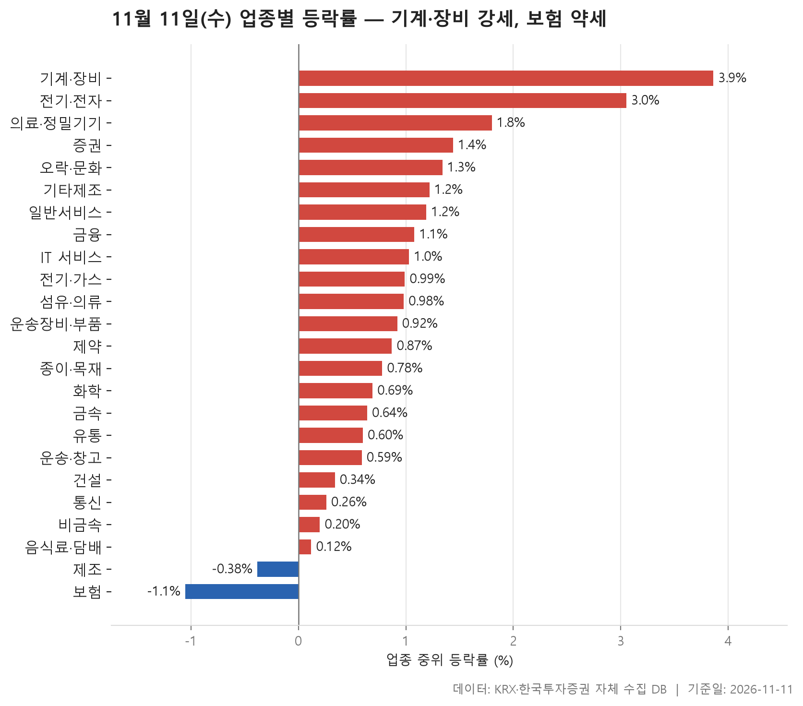
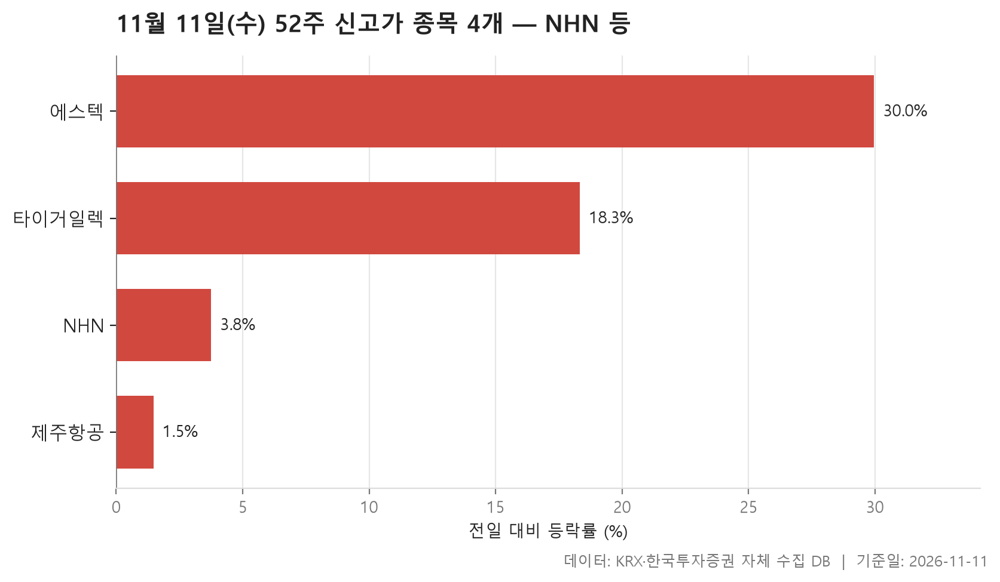
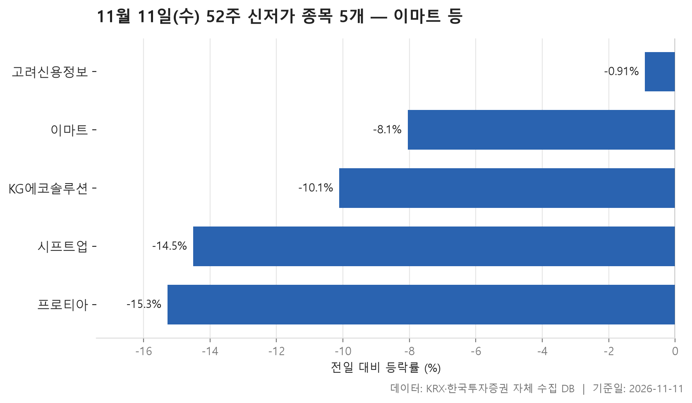
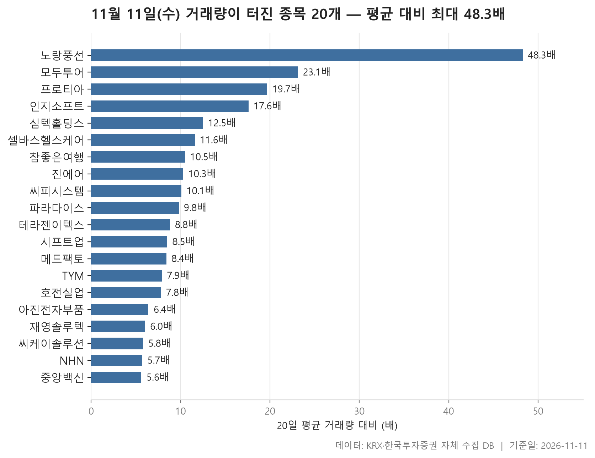

11월 11일 시장은 업종 대부분이 함께 오른 하루였습니다. 24개 업종 가운데 22개가 올랐고 내린 업종은 2개뿐입니다. 업종별 중위 등락률을 한 줄로 세웠을 때 한가운데 놓인 값이 0.90%로, 평범한 업종도 소폭 올랐다는 뜻입니다. 맨 위에는 기계·장비(+3.86%)가, 맨 아래에는 보험(-1.05%)이 있습니다.

오늘 글은 네 갈래로 정리했습니다. 먼저 업종별 등락을 보고, 52주 신고가와 신저가를 차례로 살핀 뒤, 거래량이 평소보다 크게 늘어난 종목으로 마무리합니다. 표만 봐서는 지나치기 쉬운 대목을 짚는 데 무게를 두었습니다. 평균과 중위값이 따로 노는 업종, 하루 종일 오르는 장에서도 신저가로 밀린 종목, 여러 표에 겹쳐 나오는 이름 같은 것들입니다.

미리 말씀드리면, 이 자료에는 왜 올랐고 왜 내렸는지에 관한 정보가 없습니다. 그래서 이 글도 표가 보여 주는 모양까지만 다룹니다.

> 기준일: 2026-11-11 · 집계: 자체 수집 데이터베이스

## 업종 등락률 — 24개 중 22개 상승

상위 두 업종은 폭과 넓이가 모두 남달랐습니다. 기계·장비는 211개 종목의 중위 등락률이 +3.86%였고, 오른 종목 비율도 85.30%에 이릅니다. 전기·전자는 +3.05%로 그 뒤를 이었는데, 369개 종목 가운데 85.60%가 올랐습니다. 열 곳 중 여덟 곳 넘게 오른 셈이니 몇몇 종목만 튄 날은 아니었습니다. 전기·전자의 거래대금 합계는 102,895.10억원으로 다른 업종과 비교가 안 될 만큼 큽니다. 오늘 시장의 돈이 어디에 몰렸는지는 이 숫자 하나로도 짐작할 수 있습니다.

평균과 중위값이 벌어진 업종도 눈여겨볼 만합니다. 의료·정밀기기는 중위값이 +1.80%인데 평균은 +3.15%까지 올라갑니다. 라메디텍(+29.95%) 한 종목이 업종 평균을 0.29%p 끌어올렸지만, 평균과 중위값의 격차는 그보다 훨씬 큽니다. 이 종목 말고도 크게 오른 종목이 여럿 있었다는 뜻입니다. 화학도 비슷합니다. 중위값은 +0.69%에 그쳤는데 평균은 +1.98%입니다. 예선테크(+30.00%)가 평균에 보탠 몫은 0.14%p뿐이어서, 이 경우에도 위쪽 꼬리가 길게 뻗어 있다고 봐야 합니다.

아래쪽에서는 보험의 모양이 독특합니다. 중위값은 -1.05%로 꼴찌지만 평균은 -0.07%로 거의 보합입니다. 11개 종목 가운데 오른 곳은 36.40%로 셋 중 하나꼴인데, 미래에셋생명(+8.11%) 한 종목이 평균을 0.74%p 들어 올렸습니다. 평균만 보면 잘 버틴 업종처럼 보이지만, 정작 대부분의 종목은 약했던 셈입니다. 제조는 8개 종목 중 오른 종목이 하나도 없었고, 평균 -1.32%가 중위값 -0.38%보다 더 낮습니다.

주도종목이 업종 방향과 반대로 움직인 경우도 있습니다. 금융은 오른 종목이 77.50%였는데 가장 크게 움직인 종목은 한진칼(-14.64%)이었습니다. IT 서비스도 아시아나IDT(-21.71%)가 크게 밀렸지만 업종 중위값은 +1.03%를 지켰습니다. 개별 종목의 급락이 업종 전체로 번지지는 않은 모습입니다.

| 업종 | 종목수(개) | 중위등락률(%) | 평균등락률(%) | 상승비율(%) | 주도종목 | 주도종목등락률(%) | 평균기여도(%p) | 거래대금합계(억원) |
|---|---|---|---|---|---|---|---|---|
| 기계·장비 | 211 | +3.86 | +5.04 | 85.30 | 씨케이솔루션 | +29.92 | 0.14 | 18,939.50 |
| 전기·전자 | 369 | +3.05 | +3.96 | 85.60 | 에스텍 | +29.97 | 0.08 | 102,895.10 |
| 의료·정밀기기 | 103 | +1.80 | +3.15 | 73.80 | 라메디텍 | +29.95 | 0.29 | 2,814.20 |
| 증권 | 18 | +1.44 | +1.39 | 72.20 | 신영증권 | +6.37 | 0.35 | 704.90 |
| 오락·문화 | 62 | +1.34 | +2.16 | 77.40 | 에프엔씨엔터 | +13.56 | 0.22 | 1,105.50 |
| 기타제조 | 15 | +1.22 | +1.11 | 66.70 | 크리에이츠 | -7.63 | -0.51 | 34.10 |
| 일반서비스 | 169 | +1.19 | +2.28 | 67.50 | 메드팩토 | +29.99 | 0.18 | 7,178.30 |
| 금융 | 111 | +1.08 | +1.22 | 77.50 | 한진칼 | -14.64 | -0.13 | 16,358.10 |
| IT 서비스 | 248 | +1.03 | +1.03 | 68.50 | 아시아나IDT | -21.71 | -0.09 | 13,731.40 |
| 전기·가스 | 10 | +0.99 | +0.76 | 70.00 | 한진중공업홀딩스 | +2.01 | 0.20 | 621.20 |
| 섬유·의류 | 49 | +0.98 | +1.46 | 69.40 | 메타랩스 | +29.95 | 0.61 | 254.20 |
| 운송장비·부품 | 132 | +0.92 | +1.55 | 71.20 | 에코캡 | +29.91 | 0.23 | 7,630.60 |
| 제약 | 167 | +0.87 | +1.32 | 69.50 | 코아스템켐온 | -14.28 | -0.09 | 7,103.20 |
| 종이·목재 | 27 | +0.78 | +0.40 | 70.40 | 깨끗한나라 | -13.32 | -0.49 | 57.70 |
| 화학 | 221 | +0.69 | +1.98 | 67.00 | 예선테크 | +30.00 | 0.14 | 8,599.10 |
| 금속 | 129 | +0.64 | +0.85 | 65.10 | 광진실업 | -29.88 | -0.23 | 2,983.80 |
| 유통 | 157 | +0.60 | +1.04 | 65.00 | 유니퀘스트 | +14.85 | 0.09 | 2,998.40 |
| 운송·창고 | 28 | +0.59 | +1.17 | 60.70 | 한진 | +15.61 | 0.56 | 3,105.70 |
| 건설 | 50 | +0.34 | +0.67 | 56.00 | 엑사이엔씨 | +5.90 | 0.12 | 2,423.40 |
| 통신 | 13 | +0.26 | +0.28 | 53.80 | 더즌 | +4.88 | 0.38 | 1,170.10 |
| 비금속 | 35 | +0.20 | +0.97 | 57.10 | 티씨케이 | +13.39 | 0.38 | 433.80 |
| 음식료·담배 | 84 | +0.12 | +0.29 | 51.20 | 오에스피 | +7.54 | 0.09 | 1,421.90 |
| 제조 | 8 | -0.38 | -1.32 | 0.00 | 코아스 | -4.82 | -0.60 | 8.00 |
| 보험 | 11 | -1.05 | -0.07 | 36.40 | 미래에셋생명 | +8.11 | 0.74 | 2,624.00 |

## 52주 신고가 4개 — 최고 에스텍 29.97%

52주 신고가 종목은 4개로 많지 않습니다. 업종이 대체로 오른 날인데도 1년 고점을 새로 쓴 종목은 손에 꼽을 정도였다는 점이 오히려 눈에 띕니다. 시장은 KOSPI와 KOSDAQ이 2개씩 나눠 가졌고, 업종으로는 전기·전자가 2개로 가장 많습니다. 이 업종이 오늘 등락률 2위였다는 점과 들어맞습니다.

덩치가 가장 큰 종목은 NHN으로, 시가총액이 25,960억원입니다. 등락률은 +3.75%로 크지 않았지만 이전 52주 최고가 78,200원을 넘어 80,300원에 마감했습니다. 거래대금도 1,064.30억원으로 이 표에서 압도적입니다. 반면 에스텍은 +29.97%로 가장 크게 올랐지만 거래대금은 12.10억원에 그쳤습니다. 오른 폭과 거래의 무게가 정반대로 엇갈리는 두 종목이 한 표에 나란히 있는 셈입니다. 에스텍은 전기·전자 업종에서 가장 크게 움직인 종목이기도 합니다.

제주항공은 +1.48%로 이 표에서 가장 적게 올랐고, 종가 7,540원은 이전 최고가 7,530원을 아주 근소하게 넘은 수준입니다. 신고가라는 이름은 같아도 고점을 넘어선 폭은 종목마다 크게 다릅니다. 네 종목의 등락률 중위값은 +11.04%였습니다.

| 종목명 | 종목코드 | 시장 | 업종 | 종가(원) | 등락률(%) | 이전52주최고(원) | 거래대금(억원) | 시가총액(억원) |
|---|---|---|---|---|---|---|---|---|
| NHN | 181710 | KOSPI | IT 서비스 | 80,300 | +3.75 | 78,200 | 1,064.30 | 25,960 |
| 타이거일렉 | 219130 | KOSDAQ | 전기·전자 | 107,100 | +18.34 | 102,900 | 81.40 | 6,763 |
| 제주항공 | 089590 | KOSPI | 운송·창고 | 7,540 | +1.48 | 7,530 | 128.00 | 6,080 |
| 에스텍 | 069510 | KOSDAQ | 전기·전자 | 19,820 | +29.97 | 16,670 | 12.10 | 2,162 |

## 52주 신저가 5개 — 최저 프로티아 -15.28%

신저가 종목은 5개로 신고가보다 하나 많습니다. 다섯 종목의 업종이 모두 달라서, 특정 업종이 무더기로 밀렸다기보다 개별 종목 단위의 약세로 보입니다. 시장은 KOSPI 2개, KOSDAQ 3개입니다.

시가총액이 가장 큰 종목은 이마트(17,589억원)로, -8.05% 내리며 이전 52주 최저가 66,200원 아래인 65,100원에 마감했습니다. 유통 업종 전체로는 중위 등락률이 +0.60%였으니, 업종 흐름과 따로 움직였습니다. 시프트업(-14.51%)과 프로티아(-15.28%)도 마찬가지입니다. 두 종목이 속한 IT 서비스와 의료·정밀기기는 모두 업종 중위값이 플러스였습니다. 특히 의료·정밀기기는 오늘 상위권 업종이었는데도 프로티아는 이 표에서 가장 크게 내렸습니다.

고려신용정보는 결이 조금 다릅니다. 하락폭은 -0.91%로 작았고 종가 8,680원은 이전 최저가 8,700원을 겨우 밑돌았습니다. 거래대금도 3.10억원이어서 이 표의 거래대금 기준선에 거의 붙어 있습니다. 다섯 종목의 등락률 중위값은 -10.11%로, 대부분은 하루 사이에 크게 밀리며 저점을 깼습니다.

| 종목명 | 종목코드 | 시장 | 업종 | 종가(원) | 등락률(%) | 이전52주최저(원) | 거래대금(억원) | 시가총액(억원) |
|---|---|---|---|---|---|---|---|---|
| 이마트 | 139480 | KOSPI | 유통 | 65,100 | -8.05 | 66,200 | 353.50 | 17,589 |
| 시프트업 | 462870 | KOSPI | IT 서비스 | 26,800 | -14.51 | 27,500 | 100.00 | 15,743 |
| KG에코솔루션 | 151860 | KOSDAQ | 운송장비·부품 | 4,225 | -10.11 | 4,475 | 14.70 | 2,011 |
| 고려신용정보 | 049720 | KOSDAQ | 일반서비스 | 8,680 | -0.91 | 8,700 | 3.10 | 1,241 |
| 프로티아 | 303360 | KOSDAQ | 의료·정밀기기 | 2,745 | -15.28 | 3,025 | 13.20 | 530 |

## 거래량 급증 20개 — 최고 노랑풍선 48.30배

직전 20거래일 평균의 5배를 넘는 거래량이 터진 종목은 20개입니다. 배수 중위값이 9.30배이니, 평소의 열 배 가까운 손바뀜이 흔했던 하루입니다. 맨 위의 노랑풍선은 48.30배로, 평소 하루 193,667주 수준이던 거래량이 9,360,368주로 불어났고 주가는 +10.44% 올랐습니다. 같은 일반서비스 업종의 모두투어(23.10배, +6.41%)와 참좋은여행(10.50배, +2.45%)도 표에 함께 올랐습니다. 운송·창고의 진에어(10.30배)까지 더하면 여행·항공 쪽 이름이 여럿 겹칩니다. 다만 이 종목들이 왜 같은 날 움직였는지는 자료에 없습니다.

거래량이 늘었다고 모두 오른 것은 아닙니다. 프로티아(19.70배, -15.28%)와 시프트업(8.50배, -14.51%)은 신저가 표에도 이름을 올린 종목으로, 많은 거래 속에 1년 저점을 깼습니다. 중앙백신은 5.60배로 배수가 가장 낮았고 등락률도 -0.67%로 거의 움직이지 않았습니다.

다른 표와 겹치는 이름도 보입니다. NHN은 거래량이 5.70배로 늘며 신고가를 썼고, 이 표에서 시가총액(25,960억원)과 거래대금(1,064.30억원)이 모두 가장 큽니다. 씨케이솔루션(+29.92%)과 메드팩토(+29.99%)는 각각 기계·장비와 일반서비스 업종에서 가장 크게 움직인 종목입니다. 시장별로는 KOSDAQ이 12개로 KOSPI 8개보다 많았고, 업종은 10개로 흩어졌습니다.

| 종목명 | 종목코드 | 시장 | 업종 | 종가(원) | 등락률(%) | 거래량(주) | 평균거래량(주) | 배수(배) | 거래대금(억원) | 시가총액(억원) |
|---|---|---|---|---|---|---|---|---|---|---|
| 노랑풍선 | 104620 | KOSDAQ | 일반서비스 | 3,280 | +10.44 | 9,360,368 | 193,667 | 48.30 | 324.20 | 551 |
| 모두투어 | 080160 | KOSDAQ | 일반서비스 | 9,790 | +6.41 | 2,031,082 | 87,848 | 23.10 | 207.00 | 1,850 |
| 프로티아 | 303360 | KOSDAQ | 의료·정밀기기 | 2,745 | -15.28 | 466,013 | 23,662 | 19.70 | 13.20 | 530 |
| 인지소프트 | 100030 | KOSDAQ | IT 서비스 | 20,950 | +7.82 | 75,988 | 4,318 | 17.60 | 15.80 | 688 |
| 심텍홀딩스 | 036710 | KOSDAQ | 일반서비스 | 5,050 | +29.82 | 5,857,525 | 468,432 | 12.50 | 282.70 | 2,668 |
| 셀바스헬스케어 | 208370 | KOSDAQ | 의료·정밀기기 | 2,490 | +9.93 | 9,044,137 | 781,063 | 11.60 | 232.40 | 641 |
| 참좋은여행 | 094850 | KOSDAQ | 일반서비스 | 3,970 | +2.45 | 440,604 | 41,996 | 10.50 | 18.10 | 556 |
| 진에어 | 272450 | KOSPI | 운송·창고 | 8,180 | +2.38 | 7,793,943 | 759,972 | 10.30 | 632.50 | 4,270 |
| 씨피시스템 | 413630 | KOSDAQ | 화학 | 3,020 | +6.71 | 2,854,756 | 281,630 | 10.10 | 89.10 | 1,100 |
| 파라다이스 | 034230 | KOSPI | 오락·문화 | 10,710 | +7.96 | 2,811,761 | 287,757 | 9.80 | 305.80 | 9,921 |
| 테라젠이텍스 | 066700 | KOSDAQ | 제약 | 2,190 | +7.88 | 419,753 | 47,551 | 8.80 | 9.10 | 803 |
| 시프트업 | 462870 | KOSPI | IT 서비스 | 26,800 | -14.51 | 364,291 | 42,775 | 8.50 | 100.00 | 15,743 |
| 메드팩토 | 235980 | KOSDAQ | 일반서비스 | 4,660 | +29.99 | 2,108,723 | 251,932 | 8.40 | 93.70 | 1,597 |
| TYM | 002900 | KOSPI | 기계·장비 | 7,440 | +14.46 | 1,641,416 | 207,554 | 7.90 | 117.50 | 3,080 |
| 호전실업 | 111110 | KOSPI | 섬유·의류 | 6,350 | +3.08 | 86,589 | 11,083 | 7.80 | 5.50 | 576 |
| 아진전자부품 | 009320 | KOSPI | 운송장비·부품 | 1,035 | +3.60 | 336,993 | 52,340 | 6.40 | 3.40 | 510 |
| 재영솔루텍 | 049630 | KOSDAQ | 의료·정밀기기 | 5,560 | +8.59 | 661,901 | 110,362 | 6.00 | 37.50 | 1,299 |
| 씨케이솔루션 | 480370 | KOSPI | 기계·장비 | 2,080 | +29.92 | 837,035 | 144,560 | 5.80 | 17.40 | 676 |
| NHN | 181710 | KOSPI | IT 서비스 | 80,300 | +3.75 | 1,270,701 | 223,922 | 5.70 | 1,064.30 | 25,960 |
| 중앙백신 | 072020 | KOSDAQ | 제약 | 8,950 | -0.67 | 46,679 | 8,400 | 5.60 | 4.10 | 828 |

## 정리

정리하면 11월 11일은 기계·장비와 전기·전자를 중심으로 업종 대부분이 넓게 오른 날이었습니다. 다만 그 안에서도 보험처럼 평균에 가려진 약세가 있었고, 이마트·시프트업·프로티아처럼 업종 흐름을 거슬러 1년 저점을 깬 종목도 있었습니다.

이 글은 하루치 종가 자료만으로 쓴 것이라 흐름이 이어질지는 알 수 없습니다. 등락과 거래량의 원인도 자료에 담겨 있지 않습니다. 신고가·신저가와 거래량 표는 시가총액과 거래대금 기준을 통과한 보통주만 대상으로 했으므로, 기준선 아래의 작은 종목들은 빠져 있습니다.

## 집계 기준

**업종 등락률**

- **기준**: 2026-11-10 종가 → 2026-11-11 종가
- **순위**: 업종 내 종목 등락률의 중위값 (평균은 참고용으로 함께 표시)
- **주도종목**: 그 업종에서 등락률 절대값이 가장 큰 종목 (동점이면 거래대금이 큰 쪽)
- **평균기여도**: 그 종목 하나가 업종 평균을 움직인 폭 (등락률 ÷ 종목수). 중위값과 평균의 격차가 이 값에 가까우면 평균을 만든 것이 그 종목이고, 훨씬 크면 다른 종목들도 함께 움직인 것입니다
- **필터**: 업종 내 보통주 5종목 이상
- **전체업종중위등락률(%)**: 0.9

**52주 신고가**

- **기준**: 종가 > 직전 52주 최고가
- **관측구간**: 2025-10-30 ~ 2026-11-10 (252거래일)
- **필터**: 시가총액 500억 이상, 거래대금 3억 이상, 보통주

**52주 신저가**

- **기준**: 종가 < 직전 52주 최저가
- **관측구간**: 2025-10-30 ~ 2026-11-10 (252거래일)
- **필터**: 시가총액 500억 이상, 거래대금 3억 이상, 보통주

**거래량 급증**

- **기준**: 당일 거래량 ≥ 직전 20거래일 평균 × 5
- **관측구간**: 2026-10-14 ~ 2026-11-10 (20거래일)
- **필터**: 시가총액 500억 이상, 거래대금 3억 이상, 보통주

## 데이터 출처 및 유의사항

- **데이터출처**: 한국거래소(KRX) 공시 데이터와 한국투자증권 OpenAPI 를 직접 수집해 구축한 자체 데이터베이스
- **집계방식**: 수집·집계·차트 생성을 직접 구현한 파이프라인에서 자동 산출
- **작성고지**: 본문의 표·통계·차트는 자체 데이터베이스에서 계산된 값이며, 문장 작성 과정에 AI 도구를 활용했습니다.
- **면책**: 본 글은 정보 제공을 목적으로 하며 특정 종목의 매수·매도를 추천하지 않습니다. 제시된 수치는 과거 데이터이고 미래 수익을 보장하지 않습니다. 투자 판단과 그 결과에 대한 책임은 투자자 본인에게 있습니다.

