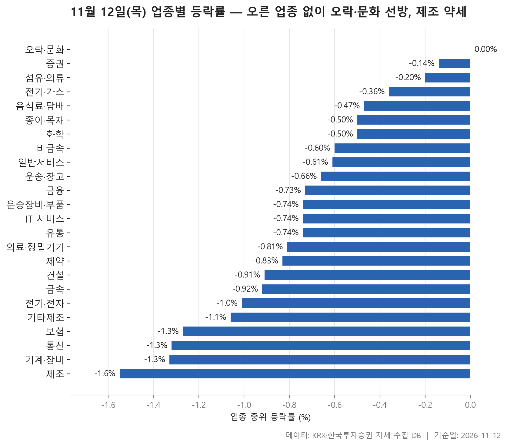
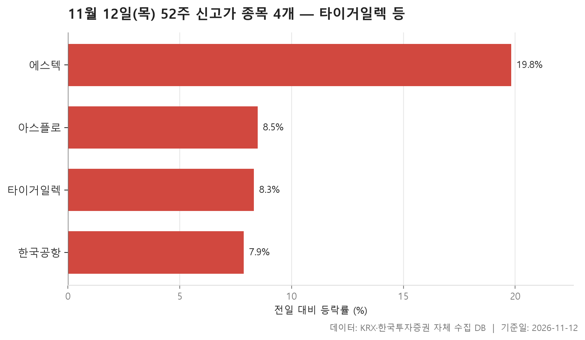
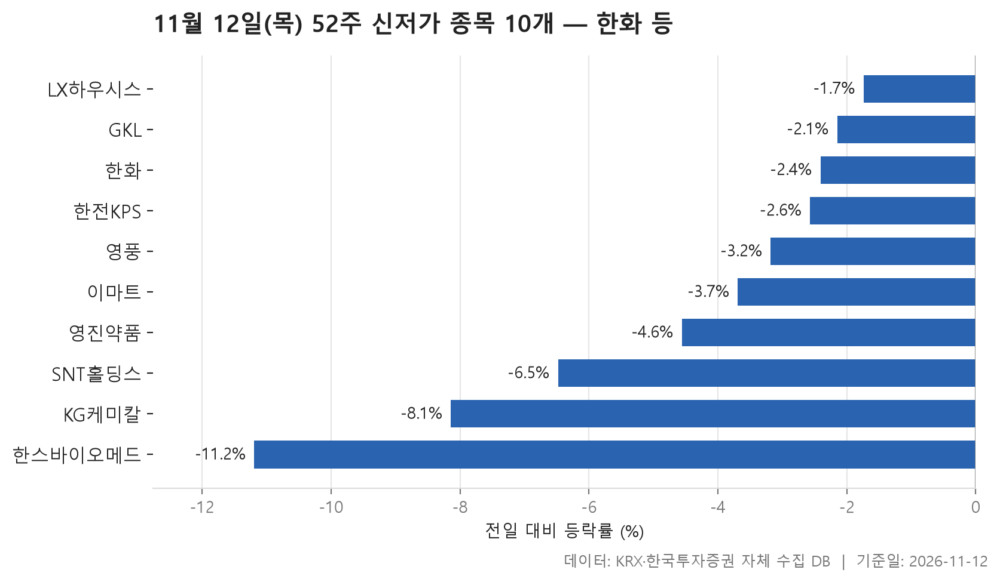
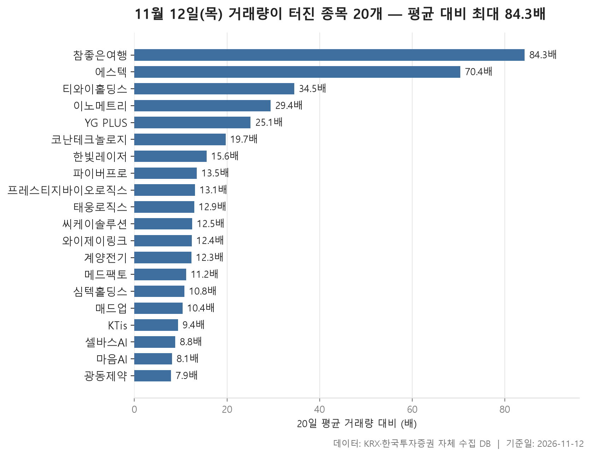

11월 12일 시장은 업종 단위로 보면 꽤 단조로웠습니다. 24개 업종 가운데 중위 등락률이 플러스로 올라선 곳이 하나도 없었고, 가장 잘 버틴 오락·문화가 0.00%로 겨우 제자리를 지켰습니다. 반대쪽 끝에는 제조가 -1.55%로 있었고, 24개 업종의 중위 등락률을 줄 세웠을 때 한가운데 값은 -0.74%였습니다. 크게 무너진 날이라기보다는 대부분의 업종이 조금씩 밀린 날에 가깝습니다.

52주 신고가와 신저가 숫자도 같은 쪽을 가리킵니다. 신고가를 새로 쓴 종목은 4개, 신저가로 내려간 종목은 10개였습니다. 그런데 거래량이 평소의 다섯 배를 넘긴 종목은 20개나 됐고, 그중 상당수가 큰 폭으로 올랐습니다. 업종 평균의 바깥에서는 개별 종목의 움직임이 꽤 활발했다는 뜻입니다.

아래에서는 업종 표에서 중위값과 평균이 어긋나는 곳, 신고가·신저가 명단의 구성, 거래량이 터진 종목들의 가격 반응을 차례로 짚어 봅니다.

> 기준일: 2026-11-12 · 집계: 자체 수집 데이터베이스

## 업종 등락률 — 오른 업종 없음

표를 위에서부터 훑으면 업종별 중위 등락률이 0.00%에서 -1.55% 사이의 좁은 범위에 촘촘히 붙어 있습니다. 업종 사이의 차이보다 '전반적으로 조금 밀렸다'는 공통점이 더 큰 날이었죠. 오른 종목의 비율도 대부분 업종에서 셋 중 하나 안팎에 머물렀고, 증권만 18종목 가운데 절반(50.00%)이 올라 체면을 지켰습니다. 그래도 증권의 중위값은 -0.14%여서, 오른 종목과 내린 종목이 팽팽했다는 정도로 읽힙니다.

맨 위의 오락·문화는 중위값이 0.00%인데 평균은 +0.21%로 살짝 위에 떠 있습니다. 둘 사이의 차이가 JYP Ent.(+16.54%) 한 종목이 업종 평균을 끌어올린 0.27%p와 비슷해서, 평균을 플러스로 만든 건 사실상 이 종목 하나라고 봐도 됩니다. 오른 종목 비율이 38.70%에 그친 걸 보면, 업종 전체가 강했다기보다 한 종목이 숫자를 받쳐 준 모양입니다.

반대로 평균이 중위값보다 훨씬 아래로 처진 업종도 있습니다. 보험은 중위값 -1.27%에 평균 -2.71%였고, 오른 종목 비율은 9.10%에 불과했습니다. 미래에셋생명(-8.43%) 하나가 평균을 -0.77%p 끌어내렸지만 중위값과 평균의 차이는 그보다 커서, 다른 보험주들도 함께 크게 밀렸다고 보는 편이 맞습니다. 섬유·의류도 비슷합니다. 중위값은 -0.20%로 상위권인데 평균은 -1.36%까지 내려가 있고, 인디에프(-12.77%)의 몫인 -0.26%p로는 그 차이가 다 설명되지 않습니다. 가운데 종목들은 버텼지만 아래쪽으로 크게 빠진 종목이 여럿이었던 업종입니다.

IT 서비스는 반대 방향입니다. 중위값 -0.74%에 평균 -0.23%로 평균이 더 높고, 그 차이가 코난테크놀로지(+29.95%)의 기여분 0.12%p보다 큽니다. 크게 오른 종목이 여럿 섞여 있었다는 뜻이고, 이 흐름은 뒤의 거래량 급증 표로 이어집니다. 거래대금은 전기·전자 한 곳에 134,390.10억원이 몰려 다른 업종과 단위부터 달랐는데, 이 업종의 중위값은 -1.01%로 하위권이었습니다. 꼴찌인 제조는 8종목 중 오른 곳이 없었지만 거래대금이 3.60억원에 그쳐, 시장 전체 분위기를 대표한다고 보기는 어렵습니다.

| 업종 | 종목수(개) | 중위등락률(%) | 평균등락률(%) | 상승비율(%) | 주도종목 | 주도종목등락률(%) | 평균기여도(%p) | 거래대금합계(억원) |
|---|---|---|---|---|---|---|---|---|
| 오락·문화 | 62 | 0.00 | +0.21 | 38.70 | JYP Ent. | +16.54 | 0.27 | 2,506.00 |
| 증권 | 18 | -0.14 | -0.22 | 50.00 | 신영증권 | -3.29 | -0.18 | 1,235.40 |
| 섬유·의류 | 49 | -0.20 | -1.36 | 34.70 | 인디에프 | -12.77 | -0.26 | 156.90 |
| 전기·가스 | 10 | -0.36 | -0.18 | 40.00 | SGC에너지 | -4.57 | -0.46 | 919.40 |
| 음식료·담배 | 84 | -0.47 | -0.60 | 33.30 | 롯데웰푸드 | +8.98 | 0.11 | 2,595.00 |
| 종이·목재 | 27 | -0.50 | -0.30 | 33.30 | 무림SP | +7.19 | 0.27 | 38.90 |
| 화학 | 220 | -0.50 | -0.71 | 32.30 | 베셀 | +30.00 | 0.14 | 10,048.00 |
| 비금속 | 35 | -0.60 | -0.97 | 31.40 | 티웨이홀딩스 | -5.90 | -0.17 | 394.20 |
| 일반서비스 | 169 | -0.61 | -0.68 | 34.90 | 모아라이프플러스 | +30.00 | 0.18 | 6,359.10 |
| 운송·창고 | 28 | -0.66 | -0.68 | 28.60 | 한국공항 | +7.86 | 0.28 | 2,554.90 |
| 금융 | 111 | -0.73 | -0.81 | 29.70 | 메리츠금융지주 | -13.05 | -0.12 | 20,211.40 |
| 운송장비·부품 | 132 | -0.74 | -0.89 | 28.00 | 한라캐스트 | +7.96 | 0.06 | 8,879.50 |
| IT 서비스 | 250 | -0.74 | -0.23 | 36.00 | 코난테크놀로지 | +29.95 | 0.12 | 16,025.40 |
| 유통 | 157 | -0.74 | -0.98 | 31.80 | 대원미디어 | +11.99 | 0.08 | 3,978.30 |
| 의료·정밀기기 | 103 | -0.81 | -0.79 | 36.90 | 파이버프로 | +16.76 | 0.16 | 2,215.20 |
| 제약 | 166 | -0.83 | -1.12 | 29.50 | 한스바이오메드 | -11.19 | -0.07 | 6,941.70 |
| 건설 | 50 | -0.91 | -0.70 | 36.00 | SK이터닉스 | -6.27 | -0.13 | 2,645.70 |
| 금속 | 128 | -0.92 | -1.16 | 21.90 | 이렘 | +19.95 | 0.16 | 3,768.80 |
| 전기·전자 | 368 | -1.01 | -0.83 | 29.30 | DGI | +29.87 | 0.08 | 134,390.10 |
| 기타제조 | 15 | -1.06 | -0.71 | 46.70 | 리튬포어스 | +10.99 | 0.73 | 44.10 |
| 보험 | 11 | -1.27 | -2.71 | 9.10 | 미래에셋생명 | -8.43 | -0.77 | 3,971.20 |
| 통신 | 13 | -1.32 | -1.18 | 30.80 | 더즌 | -4.60 | -0.35 | 1,331.30 |
| 기계·장비 | 212 | -1.33 | -0.95 | 26.90 | 와이제이링크 | +29.85 | 0.14 | 17,176.40 |
| 제조 | 8 | -1.55 | -1.44 | 0.00 | 지누스 | -2.35 | -0.29 | 3.60 |

## 52주 신고가 4개 — 최고 에스텍 19.83%

신고가 명단은 4개로 짧습니다. KOSDAQ이 3개, KOSPI가 1개이고 업종으로는 전기·전자에서 2개가 나왔습니다. 등락률 중위값이 +8.39%여서, 신고가 종목들은 대체로 하루 사이 크게 뛰면서 직전 고점을 넘어섰습니다.

가장 눈에 띄는 종목은 에스텍입니다. +19.83%로 이 명단에서 가장 크게 올랐고, 직전 52주 최고가 19,820원을 단번에 넘어 23,750원에 마감했습니다. 에스텍은 뒤의 거래량 급증 표에도 70.40배로 다시 등장합니다. 평소보다 훨씬 많은 거래가 실린 채 고점을 갈아치운 경우입니다.

시가총액이 가장 큰 타이거일렉(7,325억원)은 +8.31% 올라 직전 고점 107,900원을 넘어선 116,000원에 마감했습니다. 아스플로는 종가 36,450원으로 직전 고점 36,250원을 근소하게 넘긴 정도라, 신고가라는 이름에 비하면 돌파 폭은 작습니다. KOSPI에서 혼자 이름을 올린 한국공항(+7.86%)은 운송·창고 업종에서 가장 크게 움직인 종목이기도 했습니다. 업종 중위값이 -0.66%로 밀린 가운데 홀로 고점을 넘긴 셈입니다.

| 종목명 | 종목코드 | 시장 | 업종 | 종가(원) | 등락률(%) | 이전52주최고(원) | 거래대금(억원) | 시가총액(억원) |
|---|---|---|---|---|---|---|---|---|
| 타이거일렉 | 219130 | KOSDAQ | 전기·전자 | 116,000 | +8.31 | 107,900 | 103.90 | 7,325 |
| 아스플로 | 159010 | KOSDAQ | 기계·장비 | 36,450 | +8.48 | 36,250 | 126.40 | 4,861 |
| 한국공항 | 005430 | KOSPI | 운송·창고 | 105,700 | +7.86 | 102,600 | 48.60 | 3,347 |
| 에스텍 | 069510 | KOSDAQ | 전기·전자 | 23,750 | +19.83 | 19,820 | 301.60 | 2,591 |

## 52주 신저가 10개 — 최저 한스바이오메드 -11.19%

신저가는 10개로 신고가보다 훨씬 많습니다. 시장 구성은 KOSPI 9개, KOSDAQ 1개로 신고가 쪽과 정반대입니다. 업종은 7개로 흩어졌는데 화학이 3개로 가장 많았습니다.

등락률을 보면 폭락보다는 꾸준히 밀리던 종목이 경계선을 살짝 넘은 경우가 많아 보입니다. 하락률 중위값이 -3.44%이고, 가장 덜 내린 LX하우시스는 -1.74%였습니다. 한화는 종가 76,900원으로 직전 최저 77,200원을 조금 밑돈 정도였고, 영풍의 종가 28,900원도 직전 최저 29,000원과 거의 붙어 있습니다. 다만 한화의 시가총액은 41,010억원으로, 오늘 신고가·신저가 명단을 통틀어 가장 큰 종목입니다. 이마트(16,941억원), 한전KPS(16,178억원)까지 규모가 큰 종목들이 신저가 쪽에 몰렸다는 점이 신고가 명단과 대비됩니다.

가장 크게 빠진 종목은 한스바이오메드(-11.19%)로, 제약 업종에서 가장 크게 움직인 종목이기도 합니다. 흥미로운 이름은 GKL입니다. 오늘 가장 잘 버틴 오락·문화 업종에 속하는데도 -2.15% 내려 신저가 명단에 들었습니다. 업종 중위값이 제자리였다고 업종 안 모든 종목이 버틴 건 아니라는 예입니다. LX하우시스(4.70억원), 영진약품(5.50억원)처럼 거래대금이 적은 종목도 섞여 있어, 거래가 얇은 상태에서 밀린 경우도 함께 있다는 점은 감안할 필요가 있습니다.

| 종목명 | 종목코드 | 시장 | 업종 | 종가(원) | 등락률(%) | 이전52주최저(원) | 거래대금(억원) | 시가총액(억원) |
|---|---|---|---|---|---|---|---|---|
| 한화 | 000880 | KOSPI | 화학 | 76,900 | -2.41 | 77,200 | 109.70 | 41,010 |
| 이마트 | 139480 | KOSPI | 유통 | 62,700 | -3.69 | 63,700 | 422.20 | 16,941 |
| 한전KPS | 051600 | KOSPI | 건설 | 35,950 | -2.57 | 36,350 | 105.20 | 16,178 |
| SNT홀딩스 | 036530 | KOSPI | 금융 | 38,250 | -6.48 | 40,100 | 9.00 | 5,698 |
| 영풍 | 000670 | KOSPI | 금속 | 28,900 | -3.18 | 29,000 | 22.30 | 5,321 |
| GKL | 114090 | KOSPI | 오락·문화 | 7,750 | -2.15 | 7,780 | 9.50 | 4,794 |
| LX하우시스 | 108670 | KOSPI | 화학 | 25,350 | -1.74 | 25,450 | 4.70 | 2,273 |
| KG케미칼 | 001390 | KOSPI | 화학 | 3,215 | -8.14 | 3,410 | 20.10 | 2,135 |
| 한스바이오메드 | 042520 | KOSDAQ | 제약 | 13,570 | -11.19 | 14,620 | 20.20 | 1,935 |
| 영진약품 | 003520 | KOSPI | 제약 | 774 | -4.56 | 798 | 5.50 | 1,416 |

## 거래량 급증 20개 — 최고 참좋은여행 84.30배

거래량이 직전 20거래일 평균의 다섯 배를 넘긴 종목은 20개였고, 그중 14개가 KOSDAQ입니다. 배수의 중위값이 12.70배여서 기준선을 한참 웃돈 종목이 많았습니다. 업종으로는 기계·장비가 5개로 가장 많았고 IT 서비스도 같은 수만큼 이름을 올렸습니다. 업종 표에서 하위권(-1.33%)이던 기계·장비에서 거래가 몰린 종목이 여럿 나왔다는 점이 눈길을 끕니다.

배수 1위 참좋은여행은 84.30배로 거래량이 압도적이었지만 주가는 +2.14% 오르는 데 그쳤습니다. 거래가 터졌다고 가격이 꼭 크게 움직이지는 않는다는 걸 보여 줍니다. 2위 에스텍(70.40배, +19.83%)이 거래와 가격이 함께 움직여 신고가까지 간 것과 대조적입니다.

가격 쪽에서는 코난테크놀로지(+29.95%), 매드업(+29.87%), 와이제이링크(+29.85%)가 나란히 가장 큰 폭으로 올랐습니다. 이 가운데 코난테크놀로지와 와이제이링크는 각각 IT 서비스와 기계·장비에서 가장 크게 움직인 종목이기도 했습니다. 모든 종목이 오른 건 아닙니다. 씨케이솔루션(-8.70%), 메드팩토(-8.58%), 광동제약(-5.52%), 계양전기(-1.00%)는 거래가 몰린 가운데 내렸습니다.

거래대금은 심텍홀딩스가 454.50억원으로 가장 컸고, 시가총액은 파이버프로(3,548억원, +16.76%)가 가장 컸습니다. 명단 대부분이 시가총액 수백억~수천억원대의 중소형주라는 점도 함께 볼 만합니다.

| 종목명 | 종목코드 | 시장 | 업종 | 종가(원) | 등락률(%) | 거래량(주) | 평균거래량(주) | 배수(배) | 거래대금(억원) | 시가총액(억원) |
|---|---|---|---|---|---|---|---|---|---|---|
| 참좋은여행 | 094850 | KOSDAQ | 일반서비스 | 4,055 | +2.14 | 5,366,617 | 63,641 | 84.30 | 245.70 | 568 |
| 에스텍 | 069510 | KOSDAQ | 전기·전자 | 23,750 | +19.83 | 1,269,479 | 18,036 | 70.40 | 301.60 | 2,591 |
| 티와이홀딩스 | 363280 | KOSPI | 금융 | 2,000 | +8.87 | 493,255 | 14,313 | 34.50 | 10.20 | 910 |
| 이노메트리 | 302430 | KOSDAQ | 기계·장비 | 6,280 | +23.14 | 945,002 | 32,111 | 29.40 | 58.80 | 616 |
| YG PLUS | 037270 | KOSPI | IT 서비스 | 3,340 | +15.57 | 4,872,630 | 194,147 | 25.10 | 157.40 | 2,126 |
| 코난테크놀로지 | 402030 | KOSDAQ | IT 서비스 | 12,930 | +29.95 | 196,012 | 9,926 | 19.70 | 25.20 | 1,619 |
| 한빛레이저 | 452190 | KOSDAQ | 기계·장비 | 4,225 | +7.64 | 5,903,231 | 379,611 | 15.60 | 269.00 | 1,011 |
| 파이버프로 | 368770 | KOSDAQ | 의료·정밀기기 | 10,800 | +16.76 | 1,702,264 | 126,071 | 13.50 | 188.90 | 3,548 |
| 프레스티지바이오로직스 | 334970 | KOSDAQ | 제약 | 1,184 | +6.86 | 3,142,629 | 239,998 | 13.10 | 38.70 | 921 |
| 태웅로직스 | 124560 | KOSDAQ | 운송·창고 | 1,865 | +0.92 | 307,465 | 23,855 | 12.90 | 5.90 | 722 |
| 씨케이솔루션 | 480370 | KOSPI | 기계·장비 | 1,899 | -8.70 | 2,196,804 | 175,759 | 12.50 | 44.80 | 617 |
| 와이제이링크 | 209640 | KOSDAQ | 기계·장비 | 3,915 | +29.85 | 2,549,738 | 206,256 | 12.40 | 92.00 | 1,114 |
| 계양전기 | 012200 | KOSPI | 기계·장비 | 2,485 | -1.00 | 4,551,726 | 369,585 | 12.30 | 124.70 | 880 |
| 메드팩토 | 235980 | KOSDAQ | 일반서비스 | 4,260 | -8.58 | 3,966,447 | 354,239 | 11.20 | 180.70 | 1,460 |
| 심텍홀딩스 | 036710 | KOSDAQ | 일반서비스 | 5,680 | +12.48 | 8,089,112 | 745,942 | 10.80 | 454.50 | 3,001 |
| 매드업 | 0039P0 | KOSDAQ | 일반서비스 | 6,740 | +29.87 | 5,634,103 | 543,152 | 10.40 | 349.10 | 1,268 |
| KTis | 058860 | KOSPI | IT 서비스 | 2,675 | +5.31 | 380,443 | 40,460 | 9.40 | 10.10 | 931 |
| 셀바스AI | 108860 | KOSDAQ | IT 서비스 | 7,810 | +11.25 | 1,295,120 | 147,014 | 8.80 | 103.30 | 2,102 |
| 마음AI | 377480 | KOSDAQ | IT 서비스 | 8,310 | +2.97 | 217,215 | 26,817 | 8.10 | 19.40 | 591 |
| 광동제약 | 009290 | KOSPI | 제약 | 6,330 | -5.52 | 1,144,258 | 144,042 | 7.90 | 76.30 | 3,152 |

## 정리

정리하면 11월 12일은 업종 대부분이 조금씩 밀리는 가운데, 개별 종목 쪽에서는 거래가 몰리며 크게 오른 종목이 적지 않았던 날입니다. 업종 중위값은 모두 0.00% 이하였고 신저가가 신고가보다 많았지만, 거래량 급증 종목 20개 가운데 다수는 오름세로 마감했습니다.

다만 이 표들은 하루치 종가를 비교한 것일 뿐입니다. 왜 이런 움직임이 나왔는지는 자료에 담겨 있지 않고, 업종 순위도 중위값 기준이어서 몇몇 종목의 큰 움직임은 평균 쪽에서 따로 확인해야 합니다. 하루의 쏠림이 이어질지는 이후 데이터로 다시 확인할 부분입니다.

## 집계 기준

**업종 등락률**

- **기준**: 2026-11-11 종가 → 2026-11-12 종가
- **순위**: 업종 내 종목 등락률의 중위값 (평균은 참고용으로 함께 표시)
- **주도종목**: 그 업종에서 등락률 절대값이 가장 큰 종목 (동점이면 거래대금이 큰 쪽)
- **평균기여도**: 그 종목 하나가 업종 평균을 움직인 폭 (등락률 ÷ 종목수). 중위값과 평균의 격차가 이 값에 가까우면 평균을 만든 것이 그 종목이고, 훨씬 크면 다른 종목들도 함께 움직인 것입니다
- **필터**: 업종 내 보통주 5종목 이상
- **전체업종중위등락률(%)**: -0.74

**52주 신고가**

- **기준**: 종가 > 직전 52주 최고가
- **관측구간**: 2025-10-31 ~ 2026-11-11 (252거래일)
- **필터**: 시가총액 500억 이상, 거래대금 3억 이상, 보통주

**52주 신저가**

- **기준**: 종가 < 직전 52주 최저가
- **관측구간**: 2025-10-31 ~ 2026-11-11 (252거래일)
- **필터**: 시가총액 500억 이상, 거래대금 3억 이상, 보통주

**거래량 급증**

- **기준**: 당일 거래량 ≥ 직전 20거래일 평균 × 5
- **관측구간**: 2026-10-15 ~ 2026-11-11 (20거래일)
- **필터**: 시가총액 500억 이상, 거래대금 3억 이상, 보통주

## 데이터 출처 및 유의사항

- **데이터출처**: 한국거래소(KRX) 공시 데이터와 한국투자증권 OpenAPI 를 직접 수집해 구축한 자체 데이터베이스
- **집계방식**: 수집·집계·차트 생성을 직접 구현한 파이프라인에서 자동 산출
- **작성고지**: 본문의 표·통계·차트는 자체 데이터베이스에서 계산된 값이며, 문장 작성 과정에 AI 도구를 활용했습니다.
- **면책**: 본 글은 정보 제공을 목적으로 하며 특정 종목의 매수·매도를 추천하지 않습니다. 제시된 수치는 과거 데이터이고 미래 수익을 보장하지 않습니다. 투자 판단과 그 결과에 대한 책임은 투자자 본인에게 있습니다.

