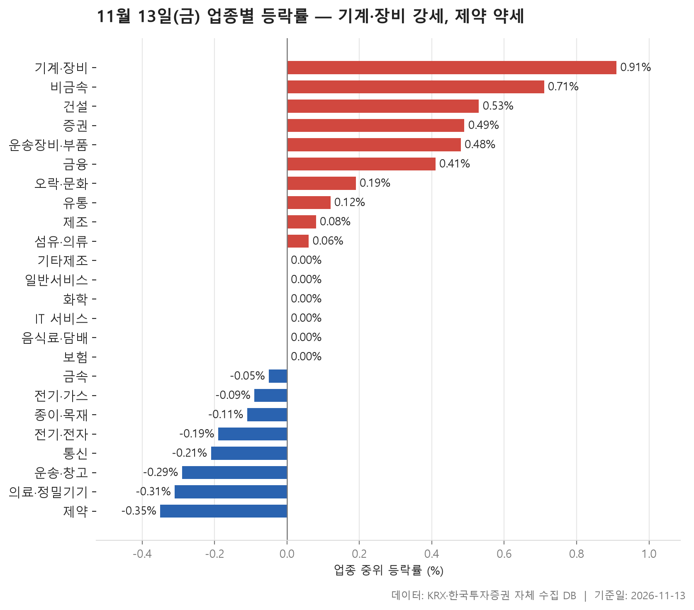
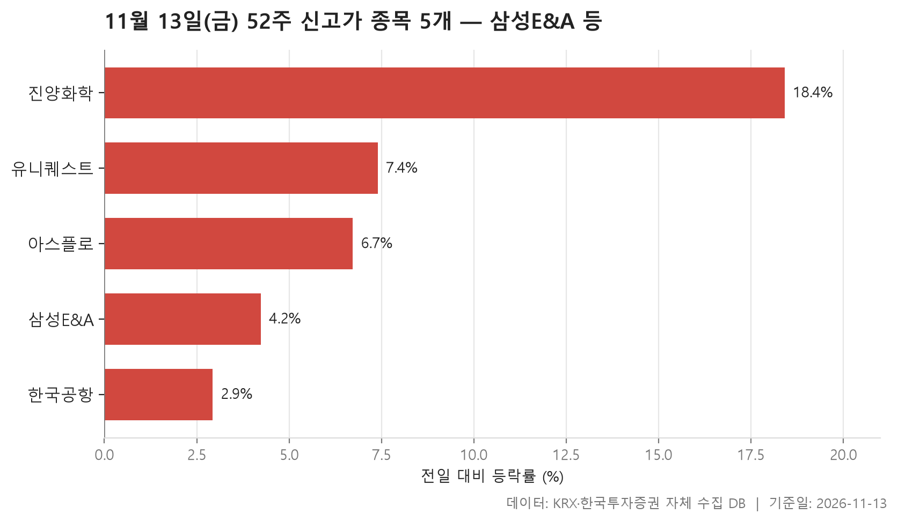
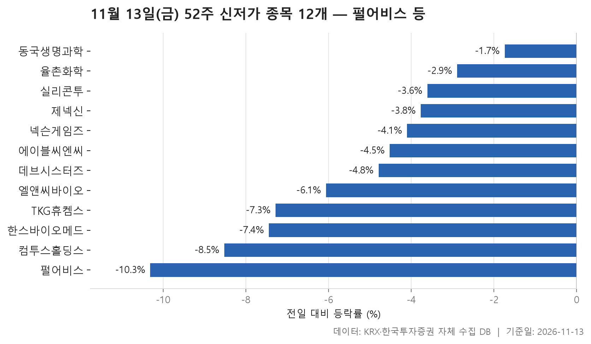
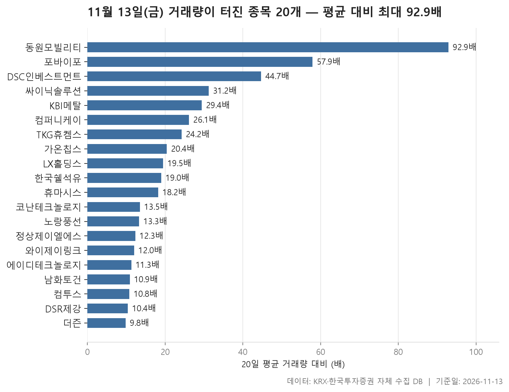

11월 13일 금요일 시장을 업종 단위로 보면 조용한 하루에 가깝습니다. 24개 업종마다 종목 등락률의 중위값을 구해 한 줄로 세우면 한가운데 값이 0%입니다. 가장 강했던 기계·장비가 +0.91%, 가장 약했던 제약이 -0.35%로, 맨 위와 맨 아래가 모두 보합 근처에 있습니다. 오른 업종이 10개, 내린 업종이 8개여서 방향도 한쪽으로 쏠리지 않았습니다.

표를 한 줄씩 들여다보면 사정이 조금 다릅니다. 잔잔한 수면 아래에서 개별 종목은 크게 움직였습니다. 여러 업종에서 가장 크게 움직인 종목이 가격제한폭 가까이 오르거나 두 자릿수로 빠졌고, 거래량이 평소의 다섯 배를 넘긴 종목도 20개가 나왔습니다.

오늘 글은 업종 흐름을 먼저 보고 52주 신고가와 신저가, 거래량이 터진 종목 순서로 이어 갑니다. 신고가는 5개, 신저가는 12개로 아래쪽이 더 붐볐다는 점도 함께 짚겠습니다.

> 기준일: 2026-11-13 · 집계: 자체 수집 데이터베이스

## 업종 등락률 — 24개 중 10개 상승

1위 기계·장비는 오른 모양새가 눈여겨볼 만합니다. 212개 종목 가운데 60.40%가 올랐고, 평균이 +0.87%로 중위값과 거의 같습니다. 한두 종목이 끌어올린 게 아니라 업종 전반이 고르게 올랐다는 뜻입니다. 정작 이 업종에서 가장 크게 움직인 한울반도체는 -22.27%로 급락했지만, 종목이 워낙 많다 보니 업종 평균을 0.11%p 끌어내리는 데 그쳤습니다. 상위권에서는 증권도 눈에 띕니다. 18개 종목 중 72.20%가 올라, 오른 종목 비율로는 24개 업종 가운데 가장 높았습니다.

중위값과 평균이 크게 벌어진 업종은 따로 볼 필요가 있습니다. 제조는 중위값이 +0.08%인데 평균은 +1.78%입니다. 종목이 8개뿐인 업종에서 에넥스가 +14.16% 오르며 혼자 평균을 1.77%p 끌어올렸으니, 평균이 높게 나온 건 사실상 이 한 종목 때문입니다. 보험과 전기·가스는 반대 방향입니다. 보험은 중위값이 0.00%인데 평균은 -1.42%로, 미래에셋생명(-10.33%) 하나가 평균을 0.94%p 끌어내렸습니다. 전기·가스도 한국전력(-9.79%)이 평균을 0.98%p 낮췄으니, 업종 평균 -0.95%는 거의 이 종목 몫입니다.

전기·전자는 결이 다릅니다. 중위값은 -0.19%로 하위권인데 평균은 +0.60%입니다. 가장 크게 오른 가온칩스(+29.92%)도 369개 종목으로 나누면 평균을 0.08%p 올리는 데 그칩니다. 중위값과 평균 사이가 그보다 훨씬 넓다는 건, 강하게 오른 종목 여럿이 함께 평균을 밀어 올렸다는 얘기입니다. 오른 종목이 45.00%로 절반이 안 되는데도 그렇습니다. 이 업종의 거래대금은 100,414억원으로 다른 업종과 단위가 다를 만큼 컸습니다.

맨 아래 제약은 167개 종목 중 35.30%만 올라, 셋 중 하나꼴로 오른 셈입니다. 가장 크게 움직인 티앤엘은 오히려 +12.61% 올랐지만 업종 전체는 밀렸습니다. 바로 위에 의료·정밀기기(-0.31%)가 붙어 있어, 의약·의료 쪽이 함께 약한 하루였습니다.

| 업종 | 종목수(개) | 중위등락률(%) | 평균등락률(%) | 상승비율(%) | 주도종목 | 주도종목등락률(%) | 평균기여도(%p) | 거래대금합계(억원) |
|---|---|---|---|---|---|---|---|---|
| 기계·장비 | 212 | +0.91 | +0.87 | 60.40 | 한울반도체 | -22.27 | -0.11 | 18,608.50 |
| 비금속 | 35 | +0.71 | +1.40 | 68.60 | 원익QnC | +17.41 | 0.50 | 1,222.80 |
| 건설 | 50 | +0.53 | +1.67 | 62.00 | 금호건설 | +29.90 | 0.60 | 3,047.30 |
| 증권 | 18 | +0.49 | +0.98 | 72.20 | 키움증권 | +4.62 | 0.26 | 1,483.70 |
| 운송장비·부품 | 132 | +0.48 | +0.83 | 59.10 | 디와이에이 | +30.00 | 0.23 | 9,068.30 |
| 금융 | 111 | +0.41 | +1.06 | 57.70 | DSC인베스트먼트 | +29.92 | 0.27 | 15,570.50 |
| 오락·문화 | 62 | +0.19 | +0.72 | 53.20 | 포바이포 | +22.39 | 0.36 | 1,043.90 |
| 유통 | 157 | +0.12 | +0.39 | 51.00 | 윙스풋 | +29.86 | 0.19 | 3,606.10 |
| 제조 | 8 | +0.08 | +1.78 | 50.00 | 에넥스 | +14.16 | 1.77 | 10.60 |
| 섬유·의류 | 49 | +0.06 | -0.01 | 51.00 | 메타랩스 | -16.64 | -0.34 | 116.20 |
| 기타제조 | 15 | 0.00 | +0.20 | 46.70 | 크리에이츠 | -4.94 | -0.33 | 23.80 |
| 일반서비스 | 169 | 0.00 | +0.08 | 47.30 | 노랑풍선 | +15.73 | 0.09 | 7,651.20 |
| 화학 | 220 | 0.00 | +0.01 | 47.70 | 진양화학 | +18.42 | 0.08 | 8,498.40 |
| IT 서비스 | 249 | 0.00 | -0.24 | 45.80 | 바이브컴퍼니 | +29.95 | 0.12 | 13,384.20 |
| 음식료·담배 | 84 | 0.00 | -0.26 | 48.80 | 선진 | -10.84 | -0.13 | 1,603.40 |
| 보험 | 11 | 0.00 | -1.42 | 36.40 | 미래에셋생명 | -10.33 | -0.94 | 3,121.60 |
| 금속 | 128 | -0.05 | +0.17 | 46.90 | KBI메탈 | +24.66 | 0.19 | 3,683.60 |
| 전기·가스 | 10 | -0.09 | -0.95 | 40.00 | 한국전력 | -9.79 | -0.98 | 1,540.20 |
| 종이·목재 | 27 | -0.11 | -0.37 | 40.70 | 깨끗한나라 | -9.01 | -0.33 | 30.00 |
| 전기·전자 | 369 | -0.19 | +0.60 | 45.00 | 가온칩스 | +29.92 | 0.08 | 100,414.00 |
| 통신 | 13 | -0.21 | +0.30 | 46.20 | 아이즈비전 | -3.25 | -0.25 | 1,185.20 |
| 운송·창고 | 28 | -0.29 | -0.44 | 46.40 | 제주항공 | -7.93 | -0.28 | 1,595.10 |
| 의료·정밀기기 | 103 | -0.31 | -0.98 | 40.80 | 큐리옥스바이오시스템즈 | -21.75 | -0.21 | 2,050.80 |
| 제약 | 167 | -0.35 | -0.54 | 35.30 | 티앤엘 | +12.61 | 0.08 | 4,944.80 |

## 52주 신고가 5개 — 최고 진양화학 18.42%

52주 신고가는 5개로 많지 않습니다. 다섯 종목이 서로 다른 업종에 하나씩 흩어져 있어서, 특정 업종이 한꺼번에 고점을 뚫은 모양은 아닙니다. 시장별로는 KOSPI가 4개, KOSDAQ이 1개입니다.

덩치로는 삼성E&A가 압도적입니다. 시가총액이 134,848억원으로 나머지 네 종목과 자릿수부터 다릅니다. +4.24% 올라 68,800원에 마감하며 직전 고점 67,700원을 넘었고, 거래대금도 2,101.50억원으로 이 표에서 혼자 천억 단위입니다. 이 종목이 속한 일반서비스 업종의 중위값은 0.00%였으니 업종 흐름과는 따로 움직인 셈입니다.

가장 크게 오른 종목은 진양화학입니다. +18.42% 올라 4,950원으로 직전 고점 4,270원을 크게 넘어섰고, 화학 업종 안에서도 가장 크게 움직인 종목이었습니다. 반대편 끝의 한국공항은 +2.93% 올라 108,800원에 마감했는데, 직전 고점이 108,000원이었으니 간신히 넘긴 경우입니다. 다섯 종목 등락률의 중위값은 +6.72%였습니다.

| 종목명 | 종목코드 | 시장 | 업종 | 종가(원) | 등락률(%) | 이전52주최고(원) | 거래대금(억원) | 시가총액(억원) |
|---|---|---|---|---|---|---|---|---|
| 삼성E&A | 028050 | KOSPI | 일반서비스 | 68,800 | +4.24 | 67,700 | 2,101.50 | 134,848 |
| 아스플로 | 159010 | KOSDAQ | 기계·장비 | 38,900 | +6.72 | 37,300 | 112.60 | 5,187 |
| 한국공항 | 005430 | KOSPI | 운송·창고 | 108,800 | +2.93 | 108,000 | 25.30 | 3,445 |
| 유니퀘스트 | 077500 | KOSPI | 유통 | 13,500 | +7.40 | 13,080 | 87.80 | 2,916 |
| 진양화학 | 051630 | KOSPI | 화학 | 4,950 | +18.42 | 4,270 | 70.90 | 1,049 |

## 52주 신저가 12개 — 최저 펄어비스 -10.31%

신저가는 12개로 신고가보다 훨씬 많았습니다. KOSDAQ이 9개, KOSPI가 3개로 코스닥 쪽에 몰렸고, 열두 종목 등락률의 중위값이 -4.66%여서 저점을 깬 날의 하락 폭도 작지 않았습니다.

업종으로 묶으면 IT 서비스가 4개로 가장 많습니다. 펄어비스, 넥슨게임즈, 데브시스터즈, 컴투스홀딩스입니다. 이 가운데 펄어비스는 -10.31%로 표에서 가장 크게 빠졌고, 시가총액도 17,219억원으로 가장 큽니다. 제약도 엘앤씨바이오, 한스바이오메드, 동국생명과학 세 곳이 올라 있습니다. 업종 순위 맨 아래였던 제약의 흐름과 겹치는 대목입니다. 화학 역시 TKG휴켐스, 율촌화학, 에이블씨엔씨 세 곳이 이름을 올렸습니다.

같은 신저가라도 깬 정도는 제각각입니다. 컴투스홀딩스는 10,090원으로 직전 저점 10,100원을, 율촌화학은 11,090원으로 11,140원을 근소하게 밑돌았습니다. 동국생명과학은 -1.74%로 하락 폭이 가장 작았습니다. 반면 TKG휴켐스는 -7.28% 빠진 13,620원으로 직전 저점 14,300원 아래까지 내려갔고, 거래량 급증 표에도 함께 올라 있습니다. 제넥신(3.40억원)과 동국생명과학(3.20억원)은 거래대금이 걸러내는 기준인 3억원에 가까워, 거래가 얇은 상태에서 저점을 깬 경우라는 점도 감안할 만합니다.

| 종목명 | 종목코드 | 시장 | 업종 | 종가(원) | 등락률(%) | 이전52주최저(원) | 거래대금(억원) | 시가총액(억원) |
|---|---|---|---|---|---|---|---|---|
| 펄어비스 | 263750 | KOSDAQ | IT 서비스 | 27,400 | -10.31 | 29,450 | 193.60 | 17,219 |
| 실리콘투 | 257720 | KOSDAQ | 유통 | 24,000 | -3.61 | 24,100 | 225.30 | 15,738 |
| 엘앤씨바이오 | 290650 | KOSDAQ | 제약 | 20,150 | -6.06 | 20,800 | 101.10 | 12,313 |
| TKG휴켐스 | 069260 | KOSPI | 화학 | 13,620 | -7.28 | 14,300 | 169.10 | 5,568 |
| 넥슨게임즈 | 225570 | KOSDAQ | IT 서비스 | 7,710 | -4.10 | 7,860 | 15.90 | 5,078 |
| 율촌화학 | 008730 | KOSPI | 화학 | 11,090 | -2.89 | 11,140 | 6.70 | 2,750 |
| 에이블씨엔씨 | 078520 | KOSPI | 화학 | 8,450 | -4.52 | 8,650 | 6.60 | 2,109 |
| 한스바이오메드 | 042520 | KOSDAQ | 제약 | 12,560 | -7.44 | 13,400 | 57.10 | 1,791 |
| 데브시스터즈 | 194480 | KOSDAQ | IT 서비스 | 10,340 | -4.79 | 10,720 | 10.50 | 1,258 |
| 제넥신 | 095700 | KOSDAQ | 일반서비스 | 1,963 | -3.77 | 1,983 | 3.40 | 894 |
| 컴투스홀딩스 | 063080 | KOSDAQ | IT 서비스 | 10,090 | -8.52 | 10,100 | 8.00 | 665 |
| 동국생명과학 | 303810 | KOSDAQ | 제약 | 1,754 | -1.74 | 1,769 | 3.20 | 561 |

## 거래량 급증 20개 — 최고 동원모빌리티 92.90배

거래량이 직전 20거래일 평균의 다섯 배를 넘긴 종목은 20개입니다. 배수 중위값이 18.60배로, 대부분이 기준선을 한참 넘겼습니다. KOSDAQ이 15개로 표의 대부분을 차지합니다.

맨 위의 동원모빌리티는 거래량이 평소의 92.90배였습니다. 하루 평균 30,035주 오가던 종목에서 2,791,803주가 거래됐고 주가는 +9.21% 올랐습니다. 다만 시가총액 615억원, 거래대금 39.30억원으로 몸집이 작아서 배수가 크게 나오기 쉬운 조건이기도 합니다.

이 표는 업종 표에서 가장 크게 움직였던 종목들과 많이 겹칩니다. DSC인베스트먼트(+29.92%), 가온칩스(+29.92%), KBI메탈(+24.66%), 포바이포(+22.39%), 노랑풍선(+15.73%)은 각자 소속 업종에서 가장 크게 움직인 종목이었고, 모두 거래량이 함께 터졌습니다. 그중 KBI메탈은 거래대금이 866.30억원으로 이 표에서 가장 컸습니다.

거래량이 늘었다고 해서 모두 오른 건 아닙니다. 컴투스(-19.61%), 한국쉘석유(-9.06%), 와이제이링크(-7.54%)는 하락하는 와중에 거래가 몰렸습니다. 표에서 시가총액이 가장 큰 한국쉘석유(6,065억원)가 내린 쪽에 있고, 컴투스와 이름이 겹치는 컴투스홀딩스는 신저가 표에 올라 있습니다. 업종은 12개로 흩어졌고, 그중 금융이 3개로 가장 많았습니다.

| 종목명 | 종목코드 | 시장 | 업종 | 종가(원) | 등락률(%) | 거래량(주) | 평균거래량(주) | 배수(배) | 거래대금(억원) | 시가총액(억원) |
|---|---|---|---|---|---|---|---|---|---|---|
| 동원모빌리티 | 018500 | KOSPI | 운송장비·부품 | 1,316 | +9.21 | 2,791,803 | 30,035 | 92.90 | 39.30 | 615 |
| 포바이포 | 389140 | KOSDAQ | 오락·문화 | 4,920 | +22.39 | 1,820,978 | 31,442 | 57.90 | 89.40 | 702 |
| DSC인베스트먼트 | 241520 | KOSDAQ | 금융 | 8,120 | +29.92 | 3,907,948 | 87,405 | 44.70 | 307.10 | 2,160 |
| 싸이닉솔루션 | 234030 | KOSDAQ | 전기·전자 | 2,765 | +10.16 | 1,677,051 | 53,724 | 31.20 | 50.10 | 653 |
| KBI메탈 | 024840 | KOSDAQ | 금속 | 4,550 | +24.66 | 19,984,092 | 679,996 | 29.40 | 866.30 | 1,987 |
| 컴퍼니케이 | 307930 | KOSDAQ | 금융 | 4,880 | +5.40 | 1,836,478 | 70,294 | 26.10 | 95.40 | 762 |
| TKG휴켐스 | 069260 | KOSPI | 화학 | 13,620 | -7.28 | 1,222,836 | 50,528 | 24.20 | 169.10 | 5,568 |
| 가온칩스 | 399720 | KOSDAQ | 전기·전자 | 38,650 | +29.92 | 836,056 | 41,078 | 20.40 | 316.60 | 4,583 |
| LX홀딩스 | 383800 | KOSPI | 금융 | 7,160 | -2.19 | 1,391,623 | 71,203 | 19.50 | 99.80 | 5,462 |
| 한국쉘석유 | 002960 | KOSPI | 화학 | 466,500 | -9.06 | 38,308 | 2,018 | 19.00 | 181.80 | 6,065 |
| 휴마시스 | 205470 | KOSDAQ | 제약 | 2,520 | +8.86 | 701,675 | 38,586 | 18.20 | 19.10 | 622 |
| 코난테크놀로지 | 402030 | KOSDAQ | IT 서비스 | 13,100 | +1.31 | 256,953 | 19,088 | 13.50 | 34.20 | 1,640 |
| 노랑풍선 | 104620 | KOSDAQ | 일반서비스 | 3,605 | +15.73 | 10,845,238 | 814,357 | 13.30 | 388.70 | 606 |
| 정상제이엘에스 | 040420 | KOSDAQ | 일반서비스 | 5,750 | +0.17 | 111,423 | 9,046 | 12.30 | 6.50 | 901 |
| 와이제이링크 | 209640 | KOSDAQ | 기계·장비 | 3,620 | -7.54 | 3,747,232 | 313,159 | 12.00 | 148.60 | 1,030 |
| 에이디테크놀로지 | 200710 | KOSDAQ | 전기·전자 | 20,350 | +20.92 | 1,105,322 | 98,052 | 11.30 | 222.30 | 2,740 |
| 남화토건 | 091590 | KOSDAQ | 건설 | 4,820 | +10.05 | 1,155,124 | 105,884 | 10.90 | 58.00 | 566 |
| 컴투스 | 078340 | KOSDAQ | IT 서비스 | 27,050 | -19.61 | 458,687 | 42,621 | 10.80 | 131.60 | 3,271 |
| DSR제강 | 069730 | KOSPI | 금속 | 4,760 | -6.30 | 229,827 | 22,126 | 10.40 | 11.20 | 685 |
| 더즌 | 462860 | KOSDAQ | 통신 | 1,904 | -1.19 | 3,731,345 | 381,228 | 9.80 | 78.20 | 1,366 |

## 정리

정리하면 11월 13일은 업종 중위값으로는 거의 제자리였지만, 종목 단위로는 위아래로 크게 출렁인 하루였습니다. 기계·장비처럼 고르게 오른 업종이 있었던 반면 제조·보험·전기·가스처럼 한 종목이 업종 평균을 좌우한 곳도 있었고, 신고가보다 신저가가 많았습니다.

이 글에는 한계가 있습니다. 하루치 종가만 비교했고, 각 종목이 왜 움직였는지는 이 데이터에 담겨 있지 않습니다. 신고가·신저가·거래량 표는 시가총액 500억원 이상 종목만 다뤄서 작은 종목의 움직임은 빠져 있고, 업종 분류도 자체 기준을 따랐습니다. 시장 분위기를 훑는 참고 자료로 읽어 주시고, 투자 판단의 근거로 삼지는 말아 주세요.

## 집계 기준

**업종 등락률**

- **기준**: 2026-11-12 종가 → 2026-11-13 종가
- **순위**: 업종 내 종목 등락률의 중위값 (평균은 참고용으로 함께 표시)
- **주도종목**: 그 업종에서 등락률 절대값이 가장 큰 종목 (동점이면 거래대금이 큰 쪽)
- **평균기여도**: 그 종목 하나가 업종 평균을 움직인 폭 (등락률 ÷ 종목수). 중위값과 평균의 격차가 이 값에 가까우면 평균을 만든 것이 그 종목이고, 훨씬 크면 다른 종목들도 함께 움직인 것입니다
- **필터**: 업종 내 보통주 5종목 이상
- **전체업종중위등락률(%)**: 0.0

**52주 신고가**

- **기준**: 종가 > 직전 52주 최고가
- **관측구간**: 2025-11-03 ~ 2026-11-12 (252거래일)
- **필터**: 시가총액 500억 이상, 거래대금 3억 이상, 보통주

**52주 신저가**

- **기준**: 종가 < 직전 52주 최저가
- **관측구간**: 2025-11-03 ~ 2026-11-12 (252거래일)
- **필터**: 시가총액 500억 이상, 거래대금 3억 이상, 보통주

**거래량 급증**

- **기준**: 당일 거래량 ≥ 직전 20거래일 평균 × 5
- **관측구간**: 2026-10-16 ~ 2026-11-12 (20거래일)
- **필터**: 시가총액 500억 이상, 거래대금 3억 이상, 보통주

## 데이터 출처 및 유의사항

- **데이터출처**: 한국거래소(KRX) 공시 데이터와 한국투자증권 OpenAPI 를 직접 수집해 구축한 자체 데이터베이스
- **집계방식**: 수집·집계·차트 생성을 직접 구현한 파이프라인에서 자동 산출
- **작성고지**: 본문의 표·통계·차트는 자체 데이터베이스에서 계산된 값이며, 문장 작성 과정에 AI 도구를 활용했습니다.
- **면책**: 본 글은 정보 제공을 목적으로 하며 특정 종목의 매수·매도를 추천하지 않습니다. 제시된 수치는 과거 데이터이고 미래 수익을 보장하지 않습니다. 투자 판단과 그 결과에 대한 책임은 투자자 본인에게 있습니다.

