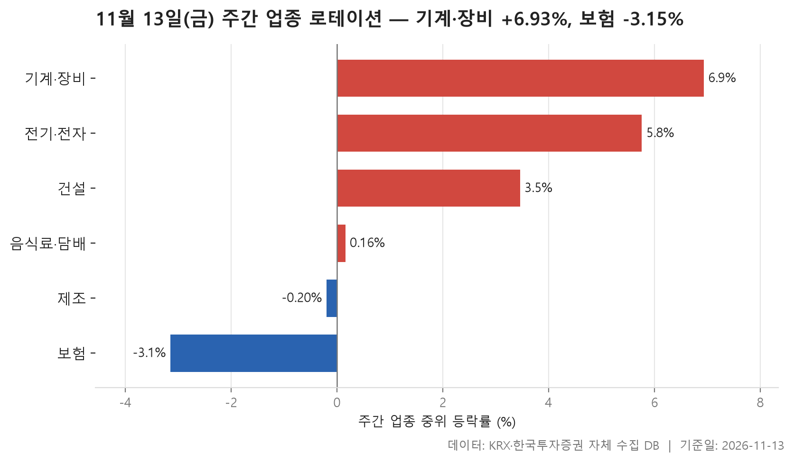
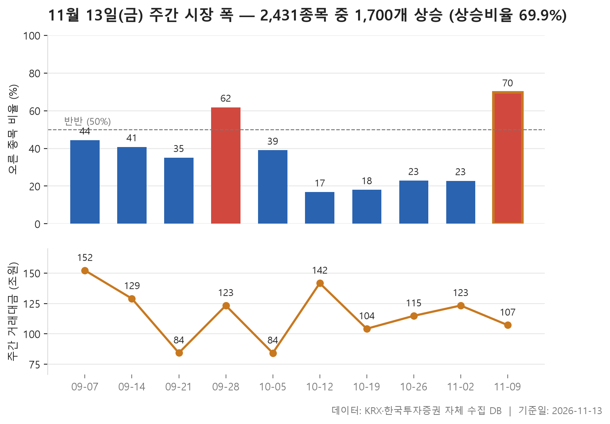
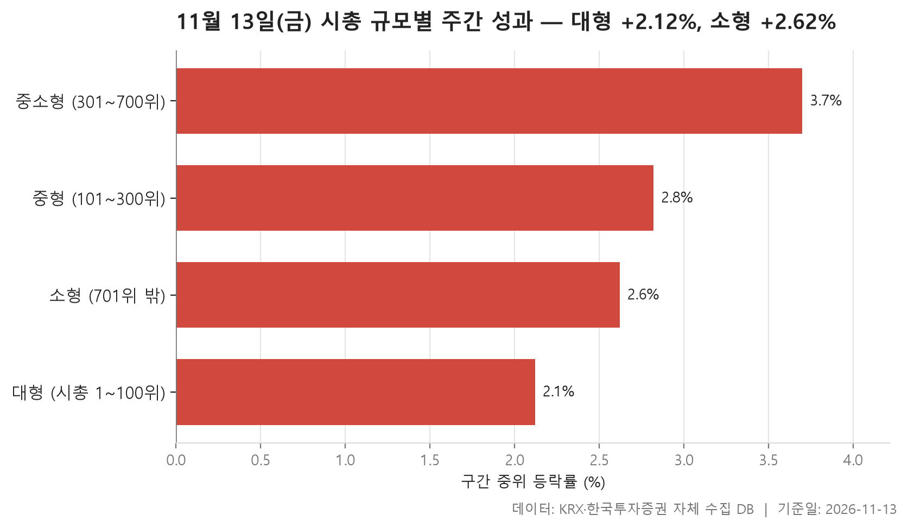

11월 9일부터 13일까지 다섯 거래일을 묶어 봅니다. 출발선은 11월 6일 종가, 도착점은 11월 13일 종가입니다. 이번 주는 무엇보다 **넓게 오른 주**였습니다. 거래가 있었던 보통주 2,431개 가운데 1,700개가 올랐고, 내린 종목은 701개였습니다. 오른 종목 수를 내린 종목 수로 나누면 2.43배가 나오는데, 최근 10주 가운데 가장 높은 값입니다. 직전 네 주 동안에는 오른 종목이 매주 넷 중 하나에도 못 미쳤으니 분위기가 뚜렷하게 바뀐 셈입니다.

오늘은 세 가지를 차례로 봅니다. 먼저 24개 업종 중 어디가 가장 강했고 어디가 가장 약했는지 살펴봅니다. 업종 안 종목 등락률의 중위값으로 순위를 매기면 기계·장비가 +6.93%로 맨 위, 보험이 -3.15%로 맨 아래에 놓였습니다. 이어서 10주 동안 오른 종목과 내린 종목의 수가 어떻게 바뀌어 왔는지 보고, 마지막으로 시가총액 크기별로 큰 종목과 작은 종목 중 어느 쪽이 앞섰는지 확인합니다.

> 기준일: 2026-11-13 · 집계: 자체 수집 데이터베이스

## 주간 업종 로테이션 — 6개 중 4개 상승

위쪽 세 업종은 모양이 비슷합니다. 기계·장비(+6.93%), 전기·전자(+5.76%), 건설(+3.46%) 모두 오른 종목이 열에 여덟 안팎이었습니다. 몇몇 종목만 끌고 올라간 게 아니라 업종 전반이 함께 오른 모양입니다. 다만 평균이 중위값보다 꽤 높습니다. 기계·장비 평균은 +10.22%, 전기·전자 평균은 +8.65%로, 한가운데 종목보다 훨씬 크게 뛴 종목들이 위쪽 꼬리를 길게 끌어올렸다는 뜻입니다.

가장 크게 움직인 종목을 보면 이 점이 잘 드러납니다. 기계·장비에서는 아스플로가 +63.45%, 전기·전자에서는 에스텍이 +65.62% 올랐습니다. 하지만 두 종목이 각 업종 평균을 끌어올린 폭은 0.30%p, 0.18%p에 그칩니다. 종목이 210개, 368개나 되는 큰 업종이라 종목 하나의 영향이 그만큼 희석됩니다. 반대로 종목이 50개인 건설에서는 금호건설(+41.36%) 한 종목이 평균을 0.83%p 움직였습니다.

아래쪽은 성격이 제각각입니다. 하위 셋에 든 음식료·담배는 중위값이 +0.16%로 오히려 플러스였고 평균은 -0.08%였습니다. 오른 종목도 51.8%로 반반에 가깝습니다. 한울앤제주가 -31.82% 빠지면서 평균을 -0.38%p 끌어내렸고, 중위값과 평균의 방향이 갈린 데는 이 영향이 컸을 것입니다. 순위를 중위값으로 매겼으니, 24개 업종 가운데 중위값이 마이너스로 끝난 곳은 제조와 보험 두 곳뿐이었다는 이야기도 됩니다.

제조는 8개 종목뿐인 작은 업종입니다. 중위값은 -0.20%인데 평균은 +0.41%로 부호가 반대입니다. 오른 종목은 넷 중 하나꼴이었지만 에넥스가 +11.33% 오르며 평균을 혼자 1.42%p 끌어올렸습니다. 종목 수가 적은 업종에서는 평균이 종목 하나에 쉽게 흔들립니다. 가장 약했던 보험은 중위값 -3.15%, 평균 -3.87%로 두 값이 같은 쪽을 가리킵니다. 11개 종목 가운데 오른 종목은 18.2%였고, 현대해상(-13.40%)이 평균을 -1.22%p 끌어내렸습니다. 시장 전체가 넓게 오른 주에 종목 대부분이 내렸으니, 이번 주 흐름에서 가장 동떨어진 업종이었습니다.

| 업종 | 종목수(개) | 주간중위등락률(%) | 주간평균등락률(%) | 상승비율(%) | 주도종목 | 주도종목등락률(%) | 평균기여도(%p) |
|---|---|---|---|---|---|---|---|
| 기계·장비 | 210 | +6.93 | +10.22 | 82.40 | 아스플로 | +63.45 | 0.30 |
| 전기·전자 | 368 | +5.76 | +8.65 | 79.90 | 에스텍 | +65.62 | 0.18 |
| 건설 | 50 | +3.46 | +4.74 | 80.00 | 금호건설 | +41.36 | 0.83 |
| 음식료·담배 | 83 | +0.16 | -0.08 | 51.80 | 한울앤제주 | -31.82 | -0.38 |
| 제조 | 8 | -0.20 | +0.41 | 25.00 | 에넥스 | +11.33 | 1.42 |
| 보험 | 11 | -3.15 | -3.87 | 18.20 | 현대해상 | -13.40 | -1.22 |

## 주간 시장 폭 — 10주 중 이번 주는 2,431개 중 1,700개 상승

이번 주 결과를 10주 흐름에 놓고 보면 방향이 얼마나 크게 바뀌었는지가 분명해집니다. 11월 9일 주에는 오른 종목이 1,700개, 내린 종목이 701개로 오른 쪽이 69.9%를 차지했습니다. 오른 종목 수를 내린 종목 수로 나눈 값은 2.43배로 10주 중 가장 높습니다.

바로 앞 네 주는 정반대였습니다. 10월 12일 주부터 11월 2일 주까지 이 값은 0.20배에서 0.30배 사이에 머물렀고, 오른 종목은 매주 넷 중 하나에도 못 미쳤습니다. 바닥은 10월 12일 주의 0.20배로, 2,411개 중 1,988개가 내렸습니다. 10주 전체의 중위값이 0.61배이니 이 기간에는 원래 내린 종목이 더 많은 주가 흔했습니다. 이 값이 1을 넘은 주는 이번 주를 빼면 9월 28일 주(1.69배) 한 번뿐입니다.

거래대금은 조금 다른 이야기를 합니다. 이번 주 거래대금은 107.2조원으로 직전 주의 123.3조원보다 적었고, 하락 종목이 가장 많았던 10월 12일 주의 141.7조원에도 못 미쳤습니다. 10주 가운데 거래대금이 가장 많았던 주는 9월 7일 주의 152.2조원입니다. 오른 종목은 크게 늘었지만 거래가 특별히 몰린 주는 아니었다는 뜻입니다. 거래일이 3일뿐이던 10월 5일 주와 9월 21일 주는 각각 84.2조원, 84.3조원으로 낮은데, 연휴로 거래일이 짧았던 탓이라 다른 주와 그대로 견주기는 어렵습니다.

| 주 | 거래일수(일) | 종목수(개) | 상승(개) | 보합(개) | 하락(개) | 상승비율(%) | ADR(배) | 총거래대금(조원) |
|---|---|---|---|---|---|---|---|---|
| 2026-11-09 | 5 | 2,431 | 1,700 | 30 | 701 | 69.90 | 2.43 | 107.20 |
| 2026-11-02 | 5 | 2,425 | 554 | 18 | 1,853 | 22.80 | 0.30 | 123.30 |
| 2026-10-26 | 5 | 2,415 | 554 | 17 | 1,844 | 22.90 | 0.30 | 114.80 |
| 2026-10-19 | 5 | 2,413 | 434 | 24 | 1,955 | 18.00 | 0.22 | 104.20 |
| 2026-10-12 | 5 | 2,411 | 405 | 18 | 1,988 | 16.80 | 0.20 | 141.70 |
| 2026-10-05 | 3 | 2,414 | 942 | 39 | 1,433 | 39.00 | 0.66 | 84.20 |
| 2026-09-28 | 5 | 2,407 | 1,488 | 41 | 878 | 61.80 | 1.69 | 123.30 |
| 2026-09-21 | 3 | 2,410 | 846 | 47 | 1,517 | 35.10 | 0.56 | 84.30 |
| 2026-09-14 | 5 | 2,404 | 981 | 31 | 1,392 | 40.80 | 0.70 | 129.00 |
| 2026-09-07 | 5 | 2,403 | 1,066 | 40 | 1,297 | 44.40 | 0.82 | 152.20 |

## 시총 규모별 주간 성과 — 소형이 0.5%p 앞섬

시가총액 순위로 네 구간을 나눠 보니 네 구간 모두 중위값이 플러스였습니다. 가장 앞선 곳은 301~700위인 중소형 구간으로 +3.70%, 가장 뒤처진 곳은 상위 100개 대형 구간으로 +2.12%였습니다. 중형(+2.82%)과 소형(+2.62%)이 그 사이에 있고, 네 값의 한가운데는 +2.72%입니다. 대형 구간의 중위값이 소형 구간보다 0.5%p 낮았으니 작은 종목 쪽이 조금 더 나았던 주입니다. 다만 격차 자체는 크지 않습니다.

차이는 오른 종목의 비중에서 더 뚜렷합니다. 대형 구간은 58.0%, 중형은 62.5%였던 반면 중소형과 소형은 71.0%, 71.2%였습니다. 시장 전체로 오른 종목이 많아진 것은 주로 아래쪽 구간에서 오른 종목이 늘어난 결과로 읽힙니다. 소형 구간은 조금 눈여겨볼 만합니다. 오른 종목 비중은 네 구간 중 가장 높은데 중위값은 중소형보다 낮습니다. 오른 종목은 많았지만 대부분 소폭 상승에 그쳤다는 뜻입니다.

평균과 중위값 사이는 중형과 중소형에서 가장 벌어집니다. 중형 평균은 +6.41%, 중소형 평균은 +7.17%로 중위값을 크게 웃돌았습니다. 티엘비(+64.15%), 심텍홀딩스(+66.57%)처럼 크게 뛴 종목들이 평균을 위로 끌어올린 모양입니다. 소형 구간의 바이브컴퍼니도 +65.38% 올랐지만 종목이 1,731개나 되다 보니 평균은 +3.80%에 머물렀습니다. 대형 구간에서 가장 크게 움직인 종목은 이수페타시스(+42.51%)였습니다.

거래대금의 무게는 여전히 대형 구간에 실려 있습니다. 대형 구간의 한 주 거래대금은 76.0조원이었고, 종목 수가 훨씬 많은 소형 구간은 6.9조원이었습니다. 오른 종목은 작은 쪽에서 더 많이 늘었지만, 거래는 여전히 큰 종목에 몰렸습니다.

| 구간 | 종목수(개) | 주간중위등락률(%) | 주간평균등락률(%) | 상승비율(%) | 주도종목 | 주도종목등락률(%) | 주간거래대금(조원) |
|---|---|---|---|---|---|---|---|
| 대형 (시총 1~100위) | 100 | +2.12 | +3.13 | 58.00 | 이수페타시스 | +42.51 | 76.00 |
| 중형 (101~300위) | 200 | +2.82 | +6.41 | 62.50 | 티엘비 | +64.15 | 15.20 |
| 중소형 (301~700위) | 400 | +3.70 | +7.17 | 71.00 | 심텍홀딩스 | +66.57 | 7.70 |
| 소형 (701위 밖) | 1,731 | +2.62 | +3.80 | 71.20 | 바이브컴퍼니 | +65.38 | 6.90 |

## 정리

정리하면, 이번 주는 기계·장비와 전기·전자를 중심으로 오른 종목이 크게 늘어난 한 주였습니다. 오른 종목은 대형주보다 중소형·소형 구간에서 더 많았습니다. 오른 종목이 적은 주가 네 주 연속 이어진 뒤에 나온 반전이라는 점에서도 눈에 띕니다.

다만 이 자료로는 알 수 없는 것이 많습니다. 두 시점의 종가를 비교한 집계일 뿐이라 왜 특정 업종이 올랐는지, 이 흐름이 다음 주에도 이어질지는 알려 주지 않습니다. 거래대금이 직전 주보다 적었다는 점과 종목 수가 적은 업종이나 구간의 평균이 소수 종목에 크게 흔들린다는 점도 함께 감안해 읽어 주시기 바랍니다.

## 집계 기준

**주간 업종 로테이션**

- **기준**: 2026-11-06 종가 → 2026-11-13 종가
- **구간**: 2026-11-09 시작 주 — 직전 주 마지막 거래일 종가를 출발선으로 삼습니다
- **거래일수**: 5
- **순위**: 업종 내 종목 등락률의 중위값 (평균은 참고용으로 함께 표시)
- **선정**: 전체 24개 업종 중 상위 3개 · 하위 3개
- **주도종목**: 그 업종에서 같은 기간 등락률 절대값이 가장 큰 종목 (동점이면 거래대금이 큰 쪽)
- **평균기여도**: 그 종목 하나가 업종 평균을 움직인 폭 (등락률 ÷ 종목수)
- **필터**: 업종 내 보통주 5종목 이상

**주간 시장 폭**

- **기준**: 각 주의 마지막 거래일 종가를 직전 주 마지막 거래일 종가와 비교
- **주**: 그 주의 월요일 (달력 기준). 거래일 수는 연휴에 따라 다릅니다
- **ADR**: 상승 종목 수 ÷ 하락 종목 수. 1 이면 반반, 2 면 오른 종목이 두 배
- **총거래대금**: 그 주 거래일 전체의 거래대금 합계
- **모집단**: 거래가 있었던 보통주 (거래정지·액면 변경 종목 제외)

**시총 규모별 주간 성과**

- **기준**: 2026-11-06 종가 → 2026-11-13 종가
- **구간**: 기준일 시가총액 순위로 자릅니다 (금액으로 자르면 장이 오른 해에 전부 위 구간으로 올라가 해마다 다른 표가 됩니다)
- **순위**: 구간 내 종목 등락률의 중위값 (평균은 참고용으로 함께 표시)
- **주도종목**: 그 구간에서 같은 기간 등락률 절대값이 가장 큰 종목 (동점이면 거래대금이 큰 쪽)
- **대형소형격차**: -0.5
- **모집단**: 거래가 있었던 보통주 (거래정지·액면 변경 종목 제외)

## 데이터 출처 및 유의사항

- **데이터출처**: 한국거래소(KRX) 공시 데이터와 한국투자증권 OpenAPI 를 직접 수집해 구축한 자체 데이터베이스
- **집계방식**: 수집·집계·차트 생성을 직접 구현한 파이프라인에서 자동 산출
- **작성고지**: 본문의 표·통계·차트는 자체 데이터베이스에서 계산된 값이며, 문장 작성 과정에 AI 도구를 활용했습니다.
- **면책**: 본 글은 정보 제공을 목적으로 하며 특정 종목의 매수·매도를 추천하지 않습니다. 제시된 수치는 과거 데이터이고 미래 수익을 보장하지 않습니다. 투자 판단과 그 결과에 대한 책임은 투자자 본인에게 있습니다.

