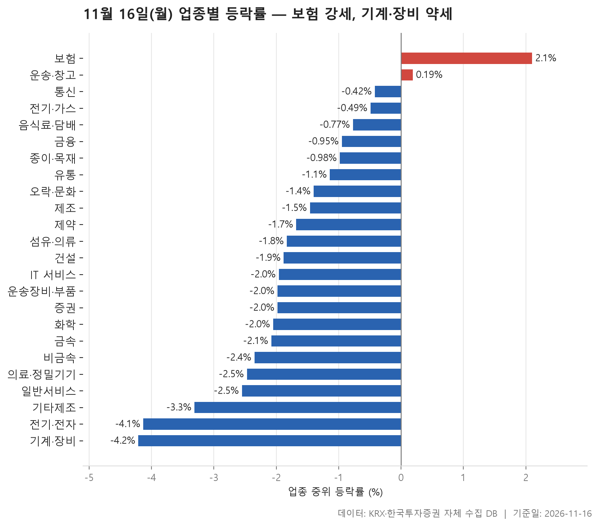
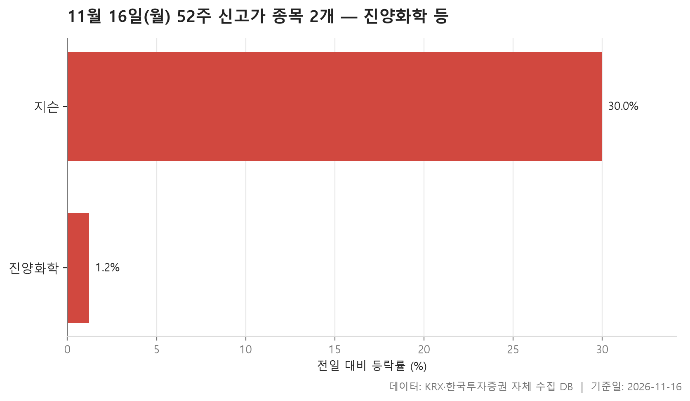
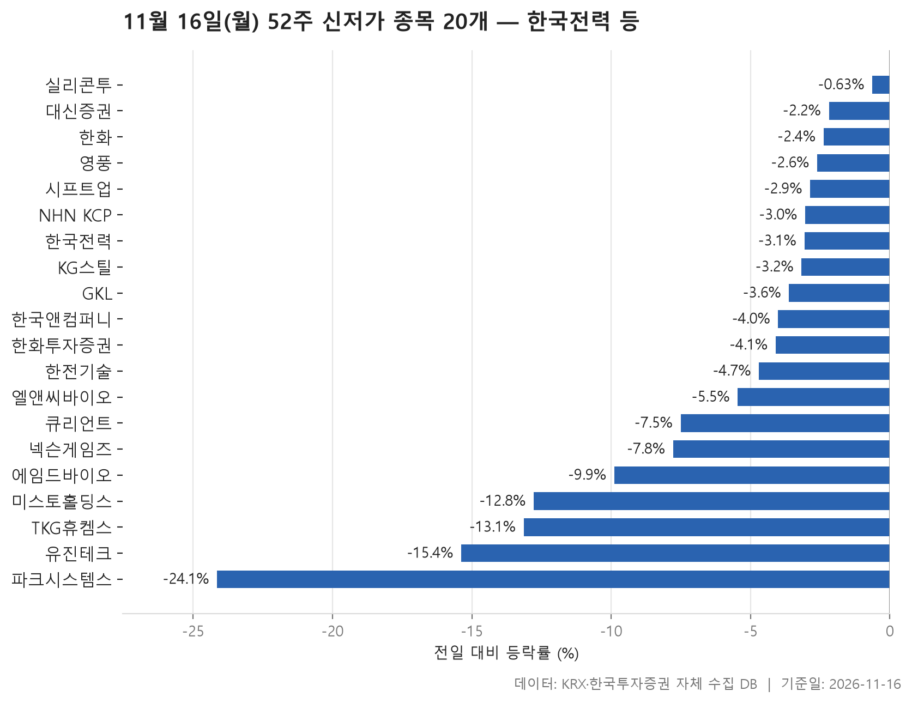
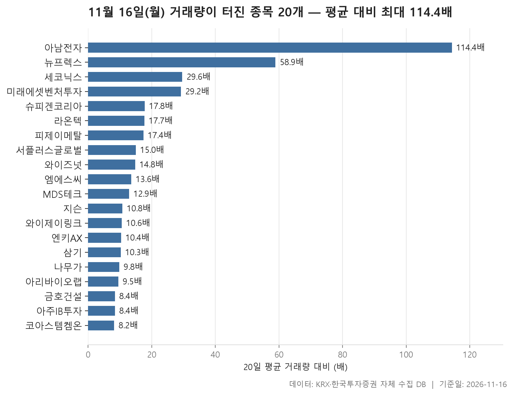

11월 16일 월요일 시장은 한쪽으로 크게 기울었습니다. 업종 24개 가운데 중위 등락률이 플러스로 끝난 곳은 2개뿐이고 나머지 22개는 마이너스였습니다. 업종별 중위 등락률을 줄 세웠을 때 한가운데 놓인 값이 -1.85%입니다. 업종 하나하나가 조금씩 밀렸다기보다, 시장 전체가 아래로 끌려 내려간 하루에 가깝습니다.

오늘은 네 가지를 차례로 봅니다. 먼저 업종별 등락으로 하락이 어디에 몰렸는지 확인하고, 이어서 52주 신고가와 신저가 목록으로 가격대 끝단에서 무슨 일이 있었는지 봅니다. 마지막으로 평소보다 거래량이 몇 배씩 불어난 종목들을 정리합니다. 신고가는 2개, 신저가는 20개로 숫자 차이부터 크게 납니다. 하지만 거래량 급증 목록은 오른 종목이 대부분이라서 지수와는 다른 결을 보여 줍니다.

> 기준일: 2026-11-16 · 집계: 자체 수집 데이터베이스

## 업종 등락률 — 24개 중 22개 하락

맨 위는 보험입니다. 중위 등락률이 +2.10%, 평균이 +1.80%이고 업종 안 종목 열 곳 중 일곱 곳가량이 올랐습니다. 가장 크게 움직인 DB손해보험(+7.33%)이 업종 평균을 0.67%p 끌어올리긴 했지만, 중위값도 평균만큼 높습니다. 한 종목이 끌고 간 상승이라기보다 업종 전체가 함께 오른 쪽으로 읽힙니다. 두 번째 운송·창고는 모양이 다릅니다. 중위값은 +0.19%로 겨우 플러스인데 평균은 -0.93%로 내려가 있고, 오른 종목과 내린 종목이 반반이었습니다. 유성티엔에스(-11.40%) 한 종목이 평균을 0.41%p 끌어내린 몫이 커서, 평균만 봤다면 하락 업종으로 분류됐을 겁니다.

바닥 쪽은 기계·장비(-4.21%)와 전기·전자(-4.13%)가 나란히 차지했습니다. 두 업종 모두 오른 종목이 열 곳 중 한 곳꼴에 그쳤고, 평균도 중위값과 거의 같은 자리에 있습니다. 특정 종목이 무너졌다기보다 업종 전반이 고르게 밀렸다는 뜻입니다. 전기·전자는 종목 수가 369개로 가장 많고, 거래대금도 110,089.20억원으로 다른 업종과 단위가 다를 만큼 큽니다. 오늘 시장의 무게중심이 이 업종에 있었다는 점을 감안하면 하루 전체의 분위기가 여기서 결정됐다고 봐도 무리가 없습니다.

어긋나 보이는 곳도 있습니다. 기타제조는 중위값이 -3.31%로 하위권인데 평균은 -1.80%로 한참 위에 있습니다. 슈피겐코리아(+13.81%) 한 종목이 평균을 0.92%p 끌어올린 영향인데, 종목 수가 15개로 적다 보니 한 종목의 무게가 그만큼 큽니다. 의료·정밀기기도 지슨(+29.97%) 같은 급등주가 섞이면서 평균(-1.98%)이 중위값(-2.47%)보다 높게 나왔습니다. 제약, IT 서비스, 전기·전자처럼 +30.00%까지 오른 종목을 품은 업종이 여럿이지만, 종목 수가 많은 업종에서는 이런 급등이 평균을 거의 움직이지 못했습니다.

| 업종 | 종목수(개) | 중위등락률(%) | 평균등락률(%) | 상승비율(%) | 주도종목 | 주도종목등락률(%) | 평균기여도(%p) | 거래대금합계(억원) |
|---|---|---|---|---|---|---|---|---|
| 보험 | 11 | +2.10 | +1.80 | 72.70 | DB손해보험 | +7.33 | 0.67 | 2,177.20 |
| 운송·창고 | 28 | +0.19 | -0.93 | 50.00 | 유성티엔에스 | -11.40 | -0.41 | 1,471.30 |
| 통신 | 13 | -0.42 | -0.70 | 30.80 | 더즌 | -3.41 | -0.26 | 1,209.40 |
| 전기·가스 | 10 | -0.49 | -1.15 | 50.00 | SGC에너지 | -6.20 | -0.62 | 564.40 |
| 음식료·담배 | 84 | -0.77 | -0.98 | 32.10 | 뉴온 | +11.88 | 0.14 | 1,905.30 |
| 금융 | 111 | -0.95 | -1.14 | 35.10 | 미래에셋벤처투자 | +17.13 | 0.15 | 16,007.90 |
| 종이·목재 | 27 | -0.98 | -2.12 | 25.90 | 한솔홈데코 | -17.88 | -0.66 | 31.40 |
| 유통 | 157 | -1.14 | -1.98 | 25.50 | HLB테라퓨틱스 | -29.98 | -0.19 | 2,450.70 |
| 오락·문화 | 61 | -1.40 | -1.18 | 19.70 | M83 | +29.88 | 0.49 | 758.90 |
| 제조 | 8 | -1.46 | -1.81 | 25.00 | 코아스 | -6.56 | -0.82 | 5.70 |
| 제약 | 167 | -1.68 | -1.97 | 22.80 | 코아스템켐온 | +30.00 | 0.18 | 3,965.40 |
| 섬유·의류 | 49 | -1.83 | -2.54 | 10.20 | 형지I&C | -19.93 | -0.41 | 200.00 |
| 건설 | 50 | -1.88 | -2.49 | 22.00 | 서희건설 | -14.71 | -0.29 | 2,703.80 |
| IT 서비스 | 249 | -1.96 | -1.93 | 19.70 | 카티스 | +29.87 | 0.12 | 9,464.30 |
| 운송장비·부품 | 132 | -1.98 | -1.87 | 22.70 | 체시스 | -14.32 | -0.11 | 5,934.10 |
| 증권 | 18 | -1.98 | -2.23 | 11.10 | SK증권 | -5.08 | -0.28 | 715.50 |
| 화학 | 220 | -2.05 | -2.23 | 20.50 | TKG휴켐스 | -13.14 | -0.06 | 6,893.80 |
| 금속 | 128 | -2.08 | -2.55 | 18.00 | 포메탈 | +20.10 | 0.16 | 2,506.40 |
| 비금속 | 35 | -2.35 | -3.19 | 11.40 | 원익QnC | -11.72 | -0.33 | 426.30 |
| 의료·정밀기기 | 103 | -2.47 | -1.98 | 21.40 | 지슨 | +29.97 | 0.29 | 2,133.30 |
| 일반서비스 | 169 | -2.55 | -3.01 | 16.60 | 아리바이오랩 | +27.13 | 0.16 | 4,926.90 |
| 기타제조 | 15 | -3.31 | -1.80 | 26.70 | 슈피겐코리아 | +13.81 | 0.92 | 37.30 |
| 전기·전자 | 369 | -4.13 | -4.04 | 12.50 | 나무가 | +30.00 | 0.08 | 110,089.20 |
| 기계·장비 | 212 | -4.21 | -4.59 | 10.40 | 제이티 | -20.43 | -0.10 | 13,235.40 |

## 52주 신고가 2개 — 최고 지슨 29.97%

52주 신고가를 새로 쓴 종목은 2개뿐입니다. 하락 업종이 22개였던 날이니 이상하지 않은 숫자입니다. 두 종목은 성격도 꽤 다릅니다.

진양화학은 +1.21% 오르는 데 그쳤지만 종가 5,010원이 직전 52주 최고가 4,950원을 넘어섰습니다. 크게 튀었다기보다 고점 바로 밑에 있다가 살짝 올라선 경우입니다. 거래대금은 77.40억원으로 두 종목 가운데 더 컸습니다. 지슨은 +29.97% 급등하며 4,640원에 마감해 이전 고점 4,500원을 단숨에 넘었습니다. 다만 거래대금이 11.10억원으로 크지 않고, 시가총액도 511억원으로 이번 집계에 들어오는 하한에 가깝습니다. 지슨은 뒤에 나오는 거래량 급증 목록에도 이름이 있어서, 평소 거래가 적던 종목에 하루 사이 매매가 몰렸다는 점을 같이 봐야 합니다.

두 종목 모두 시가총액이 1,062억원 이하인 작은 회사들입니다. 오늘은 큰 종목이 고점을 갈아치우는 장이 아니었습니다.

| 종목명 | 종목코드 | 시장 | 업종 | 종가(원) | 등락률(%) | 이전52주최고(원) | 거래대금(억원) | 시가총액(억원) |
|---|---|---|---|---|---|---|---|---|
| 진양화학 | 051630 | KOSPI | 화학 | 5,010 | +1.21 | 4,950 | 77.40 | 1,062 |
| 지슨 | 446840 | KOSDAQ | 의료·정밀기기 | 4,640 | +29.97 | 4,500 | 11.10 | 511 |

## 52주 신저가 20개 — 최저 파크시스템스 -24.14%

신저가 쪽은 20개로 신고가의 열 배입니다. 시장별로는 KOSPI 12개, KOSDAQ 8개로 유가증권시장 쪽이 더 많고, 이름이 익숙한 대형주도 꽤 섞여 있습니다. 시가총액 172,046억원인 한국전력이 -3.07%로 52주 최저가를 내려섰고, 한화·한전기술·한국앤컴퍼니처럼 시가총액이 조 단위인 종목들도 목록 위쪽에 있습니다. 하락이 소형주에만 머물지 않았다는 신호입니다.

하락 폭은 종목마다 크게 갈립니다. 목록 한가운데 값이 -4.05%인데, 맨 아래 파크시스템스는 -24.14%로 183,800원이던 이전 저점을 한참 밑돌았습니다. 유진테크도 -15.38%로 크게 밀렸습니다. 업종표에서 바닥이던 기계·장비, 그리고 하위권인 의료·정밀기기 소속이라는 점이 눈에 들어옵니다. 화학의 TKG휴켐스(-13.14%)는 화학 업종에서 가장 크게 움직인 종목으로 업종표에도 나옵니다.

반대로 간신히 저점을 깬 종목도 있습니다. 실리콘투는 -0.63% 내렸을 뿐이고, 한화투자증권은 종가 3,510원으로 이전 저점 3,515원을 아주 조금 밑돌았습니다. 대신증권까지 증권주가 두 곳 들어 있는데, 증권 업종은 오른 종목이 열 곳 중 한 곳꼴이었습니다. 업종 이름으로는 일반서비스가 3개로 가장 많지만 전체적으로는 12개 업종에 흩어져 있어, 특정 업종만의 문제로 묶기는 어렵습니다.

| 종목명 | 종목코드 | 시장 | 업종 | 종가(원) | 등락률(%) | 이전52주최저(원) | 거래대금(억원) | 시가총액(억원) |
|---|---|---|---|---|---|---|---|---|
| 한국전력 | 015760 | KOSPI | 전기·가스 | 26,800 | -3.07 | 27,400 | 450.60 | 172,046 |
| 한화 | 000880 | KOSPI | 화학 | 73,700 | -2.38 | 75,100 | 104.10 | 39,303 |
| 한전기술 | 052690 | KOSPI | 일반서비스 | 69,000 | -4.70 | 70,500 | 77.90 | 26,372 |
| 한국앤컴퍼니 | 000240 | KOSPI | 금융 | 20,350 | -4.01 | 20,750 | 53.80 | 19,319 |
| 미스토홀딩스 | 081660 | KOSPI | 유통 | 32,750 | -12.78 | 35,500 | 89.40 | 17,388 |
| 실리콘투 | 257720 | KOSDAQ | 유통 | 23,850 | -0.63 | 24,000 | 138.30 | 15,640 |
| 유진테크 | 084370 | KOSDAQ | 기계·장비 | 67,700 | -15.38 | 70,000 | 283.10 | 15,514 |
| 시프트업 | 462870 | KOSPI | IT 서비스 | 25,450 | -2.86 | 26,050 | 19.30 | 14,950 |
| 엘앤씨바이오 | 290650 | KOSDAQ | 제약 | 19,050 | -5.46 | 20,100 | 72.70 | 11,641 |
| 파크시스템스 | 140860 | KOSDAQ | 의료·정밀기기 | 161,200 | -24.14 | 183,800 | 185.60 | 11,288 |
| 에임드바이오 | 0009K0 | KOSDAQ | 일반서비스 | 16,500 | -9.89 | 17,190 | 44.30 | 10,748 |
| 한화투자증권 | 003530 | KOSPI | 증권 | 3,510 | -4.10 | 3,515 | 34.80 | 9,286 |
| 대신증권 | 003540 | KOSPI | 증권 | 20,100 | -2.19 | 20,300 | 17.70 | 9,269 |
| 영풍 | 000670 | KOSPI | 금속 | 27,950 | -2.61 | 28,400 | 17.60 | 5,146 |
| 큐리언트 | 115180 | KOSDAQ | 일반서비스 | 13,420 | -7.51 | 13,950 | 20.20 | 5,037 |
| TKG휴켐스 | 069260 | KOSPI | 화학 | 11,830 | -13.14 | 13,260 | 46.60 | 4,836 |
| 넥슨게임즈 | 225570 | KOSDAQ | IT 서비스 | 7,110 | -7.78 | 7,670 | 16.40 | 4,683 |
| GKL | 114090 | KOSPI | 오락·문화 | 7,450 | -3.62 | 7,660 | 8.10 | 4,608 |
| KG스틸 | 016380 | KOSPI | 금속 | 4,575 | -3.17 | 4,645 | 17.30 | 4,575 |
| NHN KCP | 060250 | KOSDAQ | 금융 | 10,860 | -3.04 | 10,900 | 17.00 | 4,361 |

## 거래량 급증 20개 — 최고 아남전자 114.40배

거래량이 직전 20거래일 평균의 다섯 배를 넘긴 종목은 20개이고, 이 가운데 18개가 KOSDAQ 종목입니다. 배수 중간값이 13.25배로, 기준선을 훌쩍 넘은 종목이 대부분입니다. 맨 위 아남전자는 하루 거래량이 19,419,903주로 평소 169,750주의 114.40배에 달했고 주가는 +19.27% 올랐습니다. 뉴프렉스도 58.90배로 두 번째였습니다.

흥미로운 점은 이 목록에 전기·전자 종목이 4개로 가장 많다는 겁니다. 아남전자, 뉴프렉스, 라온텍, 나무가(+30.00%)가 모두 올랐는데, 이들이 속한 전기·전자는 업종 전체로 보면 하위 두 번째였습니다. 업종이 고르게 밀린 날, 그 안의 몇몇 소형주에만 매매가 쏠려 반대로 움직인 셈입니다. 왜 그랬는지는 이 자료로는 알 수 없습니다.

거래량 급증이 늘 상승을 뜻하지는 않습니다. 피제이메탈(-12.64%), 엠에스씨(-11.16%)는 거래가 몰리면서 크게 내렸고, 금호건설(-4.46%)과 아주IB투자(-5.08%)도 하락 쪽입니다. 특히 금호건설은 거래대금이 1,281.80억원으로 목록에서 가장 컸습니다. 시가총액이 가장 큰 미래에셋벤처투자(7,809억원)는 +17.13% 오르며 거래대금 942.80억원을 기록했고, 금융 업종에서 가장 크게 움직인 종목이기도 합니다. 나머지는 대부분 시가총액이 작은 회사들입니다.

| 종목명 | 종목코드 | 시장 | 업종 | 종가(원) | 등락률(%) | 거래량(주) | 평균거래량(주) | 배수(배) | 거래대금(억원) | 시가총액(억원) |
|---|---|---|---|---|---|---|---|---|---|---|
| 아남전자 | 008700 | KOSPI | 전기·전자 | 1,467 | +19.27 | 19,419,903 | 169,750 | 114.40 | 282.20 | 1,131 |
| 뉴프렉스 | 085670 | KOSDAQ | 전기·전자 | 3,500 | +18.24 | 9,338,534 | 158,618 | 58.90 | 329.70 | 858 |
| 세코닉스 | 053450 | KOSDAQ | 의료·정밀기기 | 3,460 | +29.83 | 1,629,533 | 55,105 | 29.60 | 55.30 | 512 |
| 미래에셋벤처투자 | 100790 | KOSDAQ | 금융 | 14,700 | +17.13 | 6,371,496 | 218,451 | 29.20 | 942.80 | 7,809 |
| 슈피겐코리아 | 192440 | KOSDAQ | 기타제조 | 30,500 | +13.81 | 59,561 | 3,351 | 17.80 | 17.70 | 1,896 |
| 라온텍 | 418420 | KOSDAQ | 전기·전자 | 3,365 | +8.03 | 1,223,095 | 69,271 | 17.70 | 41.50 | 1,036 |
| 피제이메탈 | 128660 | KOSDAQ | 금속 | 2,420 | -12.64 | 614,578 | 35,379 | 17.40 | 14.60 | 600 |
| 서플러스글로벌 | 140070 | KOSDAQ | 유통 | 2,255 | +10.81 | 1,157,234 | 77,192 | 15.00 | 27.30 | 834 |
| 와이즈넛 | 096250 | KOSDAQ | IT 서비스 | 5,140 | +12.72 | 301,191 | 20,361 | 14.80 | 15.80 | 607 |
| 엠에스씨 | 009780 | KOSDAQ | 음식료·담배 | 6,290 | -11.16 | 140,293 | 10,331 | 13.60 | 9.10 | 1,107 |
| MDS테크 | 086960 | KOSDAQ | IT 서비스 | 2,050 | +10.87 | 2,879,166 | 222,467 | 12.90 | 59.50 | 872 |
| 지슨 | 446840 | KOSDAQ | 의료·정밀기기 | 4,640 | +29.97 | 238,178 | 22,096 | 10.80 | 11.10 | 511 |
| 와이제이링크 | 209640 | KOSDAQ | 기계·장비 | 3,610 | -0.28 | 5,206,715 | 491,775 | 10.60 | 202.50 | 1,027 |
| 엔키AX | 134580 | KOSDAQ | IT 서비스 | 1,587 | +18.88 | 2,135,287 | 205,385 | 10.40 | 33.20 | 782 |
| 삼기 | 122350 | KOSDAQ | 운송장비·부품 | 1,436 | +9.37 | 6,280,896 | 609,271 | 10.30 | 98.00 | 551 |
| 나무가 | 190510 | KOSDAQ | 전기·전자 | 18,850 | +30.00 | 3,249,029 | 332,170 | 9.80 | 593.30 | 2,655 |
| 아리바이오랩 | 261780 | KOSDAQ | 일반서비스 | 5,810 | +27.13 | 7,131,663 | 749,154 | 9.50 | 385.40 | 1,682 |
| 금호건설 | 002990 | KOSPI | 건설 | 10,710 | -4.46 | 11,228,272 | 1,339,509 | 8.40 | 1,281.80 | 3,991 |
| 아주IB투자 | 027360 | KOSDAQ | 금융 | 2,430 | -5.08 | 8,452,559 | 1,006,749 | 8.40 | 219.70 | 2,944 |
| 코아스템켐온 | 166480 | KOSDAQ | 제약 | 1,807 | +30.00 | 1,123,487 | 137,650 | 8.20 | 19.30 | 955 |

## 정리

정리하면 11월 16일은 보험만 뚜렷하게 버텼고 전기·전자와 기계·장비를 중심으로 거의 모든 업종이 밀린 날이었습니다. 신저가가 신고가를 크게 앞섰고 그 안에는 대형주도 있었습니다. 그런 와중에 거래가 몰린 일부 소형주만 반대 방향으로 튀었습니다.

다만 이 글은 하루치 종가만 비교한 것이라서 오늘의 하락이 추세인지 일시적인 흔들림인지는 말해 주지 않습니다. 개별 종목이 왜 급등하거나 급락했는지도 자료에 없어 다루지 않았습니다. 업종 분류와 필터 기준에 따라 순위가 달라질 수 있다는 점도 함께 감안해 읽어 주시기 바랍니다.

## 집계 기준

**업종 등락률**

- **기준**: 2026-11-13 종가 → 2026-11-16 종가
- **순위**: 업종 내 종목 등락률의 중위값 (평균은 참고용으로 함께 표시)
- **주도종목**: 그 업종에서 등락률 절대값이 가장 큰 종목 (동점이면 거래대금이 큰 쪽)
- **평균기여도**: 그 종목 하나가 업종 평균을 움직인 폭 (등락률 ÷ 종목수). 중위값과 평균의 격차가 이 값에 가까우면 평균을 만든 것이 그 종목이고, 훨씬 크면 다른 종목들도 함께 움직인 것입니다
- **필터**: 업종 내 보통주 5종목 이상
- **전체업종중위등락률(%)**: -1.85

**52주 신고가**

- **기준**: 종가 > 직전 52주 최고가
- **관측구간**: 2025-11-04 ~ 2026-11-13 (252거래일)
- **필터**: 시가총액 500억 이상, 거래대금 3억 이상, 보통주

**52주 신저가**

- **기준**: 종가 < 직전 52주 최저가
- **관측구간**: 2025-11-04 ~ 2026-11-13 (252거래일)
- **필터**: 시가총액 500억 이상, 거래대금 3억 이상, 보통주

**거래량 급증**

- **기준**: 당일 거래량 ≥ 직전 20거래일 평균 × 5
- **관측구간**: 2026-10-19 ~ 2026-11-13 (20거래일)
- **필터**: 시가총액 500억 이상, 거래대금 3억 이상, 보통주

## 데이터 출처 및 유의사항

- **데이터출처**: 한국거래소(KRX) 공시 데이터와 한국투자증권 OpenAPI 를 직접 수집해 구축한 자체 데이터베이스
- **집계방식**: 수집·집계·차트 생성을 직접 구현한 파이프라인에서 자동 산출
- **작성고지**: 본문의 표·통계·차트는 자체 데이터베이스에서 계산된 값이며, 문장 작성 과정에 AI 도구를 활용했습니다.
- **면책**: 본 글은 정보 제공을 목적으로 하며 특정 종목의 매수·매도를 추천하지 않습니다. 제시된 수치는 과거 데이터이고 미래 수익을 보장하지 않습니다. 투자 판단과 그 결과에 대한 책임은 투자자 본인에게 있습니다.

