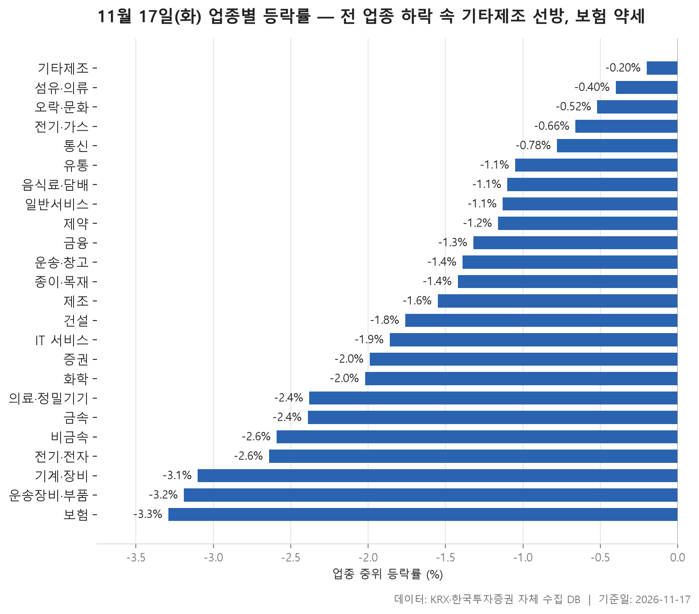
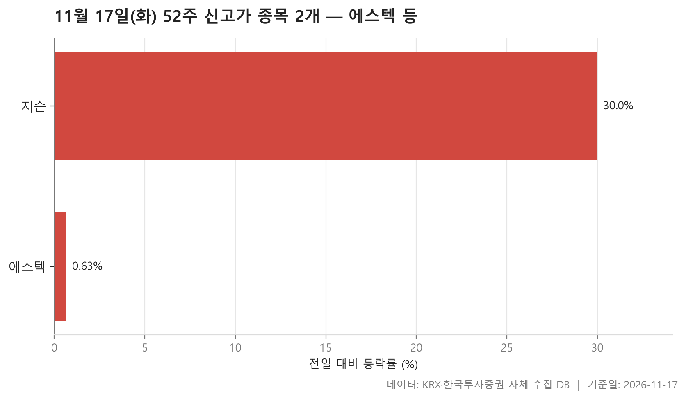
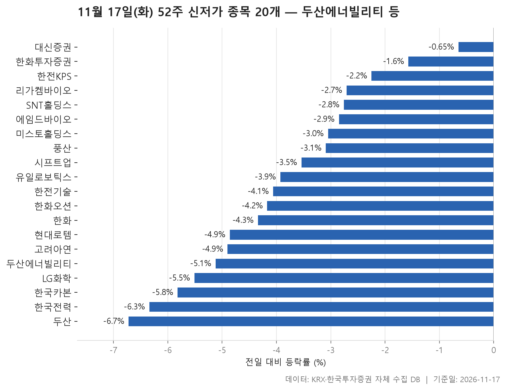
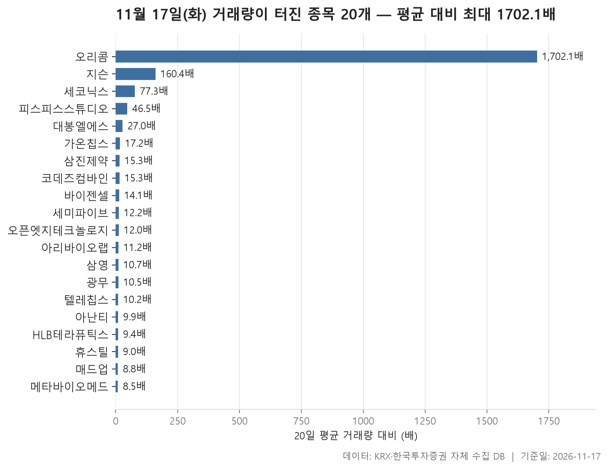

11월 17일 시장은 한쪽으로 기운 하루였습니다. 업종마다 종목 등락률의 중위값을 구해 보면 24개 업종 가운데 플러스로 마친 곳이 하나도 없습니다. 가장 덜 내린 기타제조가 -0.20%, 가장 많이 내린 보험이 -3.29%였습니다. 24개 업종의 값을 줄 세웠을 때 한가운데 놓인 값은 -1.49%입니다.

52주 신고가·신저가 목록도 같은 쪽을 가리킵니다. 52주 신고가를 새로 쓴 종목은 2개뿐이었고 신저가는 20개였습니다. 신저가 쪽은 상당수가 덩치 큰 KOSPI 종목입니다. 반면 거래량이 평소의 다섯 배를 넘긴 종목은 대부분 KOSDAQ 중소형주였고, 크게 오른 종목과 크게 내린 종목이 섞여 있습니다.

업종 흐름부터 차례로 보겠습니다. 평균과 중위값이 엇갈리는 업종, 신저가 목록에 오른 종목들의 크기, 거래량이 터진 종목의 방향을 눈여겨보면 표가 더 잘 읽힙니다.

> 기준일: 2026-11-17 · 집계: 자체 수집 데이터베이스

## 업종 등락률 — 24개 모두 하락

순위표 맨 위의 기타제조와 섬유·의류는 평균만 보면 오른 업종처럼 보입니다. 평균 등락률이 기타제조는 +1.29%, 섬유·의류는 +0.76%입니다. 그런데 중위값은 각각 -0.20%, -0.40%로 0보다 아래입니다. 기타제조에서는 세니젠이 +18.35% 올라 혼자서 업종 평균을 1.22%p 끌어올렸습니다. 섬유·의류에서는 인디에프(+29.89%)가 0.61%p를 보탰습니다. 평균을 플러스로 돌린 것은 사실상 이 종목 하나씩이었습니다. 두 업종 모두 오른 종목은 열 곳 중 네 곳꼴(40.00%, 40.80%)이었으니, '선방'은 덜 내렸다는 뜻 정도로 읽는 편이 맞습니다.

반대로 평균이 중위값보다 아래로 벌어진 업종도 있습니다. 종이·목재는 중위값이 -1.42%로 중간쯤인데 평균은 -2.71%까지 내려갔습니다. 한솔홈데코가 -26.35% 빠지면서 혼자 업종 평균을 0.98%p 깎아낸 영향이 큽니다. 운송·창고는 반대로 평균(-0.67%)이 중위값(-1.39%)보다 높습니다. 오른 종목도 35.70%로, 표 아래쪽 업종치고는 높은 편입니다.

아래쪽에서는 증권이 눈에 띕니다. 18종목 가운데 오른 종목이 하나도 없었습니다(0.00%). 중위값 -1.99%만 보면 낙폭이 아주 크지는 않지만, 빠짐없이 모두 내렸습니다. 보험은 11종목 중 오른 곳이 9.10%에 그쳤습니다. 가장 크게 움직인 흥국화재도 -5.21%여서, 한 종목이 급락했다기보다 업종 전체가 함께 밀린 모습입니다. 8종목뿐인 제조 업종은 절반(50.00%)이 올랐는데도 중위값이 -1.55%였습니다. 종목 수가 적으면 오른 종목의 비중과 중위값이 따로 움직일 수 있습니다.

거래대금은 전기·전자가 98,290.90억원으로 다른 업종을 크게 앞섰습니다. 그런데 이 업종의 중위값은 -2.64%로 하위권이었습니다. 거래가 가장 많았던 업종이 가장 무겁게 내린 쪽에 있었던 하루입니다.

| 업종 | 종목수(개) | 중위등락률(%) | 평균등락률(%) | 상승비율(%) | 주도종목 | 주도종목등락률(%) | 평균기여도(%p) | 거래대금합계(억원) |
|---|---|---|---|---|---|---|---|---|
| 기타제조 | 15 | -0.20 | +1.29 | 40.00 | 세니젠 | +18.35 | 1.22 | 40.00 |
| 섬유·의류 | 49 | -0.40 | +0.76 | 40.80 | 인디에프 | +29.89 | 0.61 | 676.50 |
| 오락·문화 | 60 | -0.52 | -1.14 | 31.70 | M83 | -16.03 | -0.27 | 701.60 |
| 전기·가스 | 10 | -0.66 | -1.47 | 10.00 | 한국전력 | -6.34 | -0.63 | 545.00 |
| 통신 | 13 | -0.78 | -1.25 | 23.10 | 나이스정보통신 | -6.42 | -0.49 | 1,155.60 |
| 유통 | 157 | -1.05 | -0.86 | 26.10 | 윙스풋 | +29.87 | 0.19 | 2,901.50 |
| 음식료·담배 | 84 | -1.10 | -1.84 | 25.00 | 휴럼 | -29.90 | -0.36 | 1,431.00 |
| 일반서비스 | 169 | -1.13 | -1.15 | 24.90 | 아리바이오랩 | -29.95 | -0.18 | 7,238.30 |
| 제약 | 167 | -1.16 | -1.44 | 25.70 | 코아스템켐온 | -25.01 | -0.15 | 4,924.80 |
| 금융 | 111 | -1.32 | -1.67 | 16.20 | 일진홀딩스 | -14.02 | -0.13 | 11,970.30 |
| 운송·창고 | 28 | -1.39 | -0.67 | 35.70 | STX그린로지스 | +4.04 | 0.14 | 1,338.30 |
| 종이·목재 | 27 | -1.42 | -2.71 | 22.20 | 한솔홈데코 | -26.35 | -0.98 | 54.10 |
| 제조 | 8 | -1.55 | -2.63 | 50.00 | 코아스 | -11.77 | -1.47 | 8.10 |
| 건설 | 51 | -1.76 | -1.54 | 23.50 | 아인스팩씨엔에스 | -14.50 | -0.28 | 1,585.80 |
| IT 서비스 | 249 | -1.86 | -1.89 | 25.70 | 바이브컴퍼니 | -16.97 | -0.07 | 7,161.60 |
| 증권 | 18 | -1.99 | -2.03 | 0.00 | SK증권 | -3.73 | -0.21 | 705.90 |
| 화학 | 220 | -2.02 | -2.28 | 16.80 | 나노 | -26.36 | -0.12 | 7,048.30 |
| 의료·정밀기기 | 103 | -2.38 | -2.06 | 17.50 | 지슨 | +29.96 | 0.29 | 2,855.80 |
| 금속 | 129 | -2.39 | -2.79 | 14.00 | 휴스틸 | -20.95 | -0.16 | 3,266.60 |
| 비금속 | 36 | -2.59 | -2.70 | 16.70 | 유니온머티리얼 | -16.67 | -0.46 | 346.50 |
| 전기·전자 | 368 | -2.64 | -2.97 | 16.80 | 지니틱스 | -29.94 | -0.08 | 98,290.90 |
| 기계·장비 | 212 | -3.10 | -2.72 | 13.20 | 계양전기 | +29.87 | 0.14 | 11,037.50 |
| 운송장비·부품 | 132 | -3.19 | -3.13 | 11.40 | 에스엘 | -13.72 | -0.10 | 5,367.90 |
| 보험 | 11 | -3.29 | -3.05 | 9.10 | 흥국화재 | -5.21 | -0.47 | 1,656.00 |

## 52주 신고가 2개 — 최고 지슨 29.96%

신고가 목록에는 두 종목뿐입니다. 둘 다 KOSDAQ 종목이고, 업종은 전기·전자와 의료·정밀기기로 하나씩입니다. 모든 업종이 내린 날이니 목록이 짧은 것도 무리는 아닙니다.

두 종목은 신고가에 오른 방식이 정반대입니다. 에스텍은 +0.63% 오르며 종가 23,900원으로 이전 최고가 23,800원을 근소하게 넘었습니다. 조금 올라 기존 고점을 살짝 넘어선 경우입니다. 지슨은 +29.96%로 하루 가격제한폭에 가깝게 오르며 종가 6,030원을 기록했습니다. 이전 52주 최고가가 4,640원이었으니 기존 고점을 단번에 크게 넘어선 셈입니다.

지슨은 다른 표에도 나옵니다. 의료·정밀기기 업종에서 가장 크게 움직인 종목이었고, 거래량 급증 목록에서도 평소의 160.40배로 두 번째였습니다. 그래도 의료·정밀기기 업종 전체의 중위값은 -2.38%였습니다. 한 종목이 신고가를 썼다고 업종 분위기가 좋았던 것은 아닙니다. 지슨이 왜 이렇게 움직였는지는 이 자료만으로는 알 수 없습니다.

| 종목명 | 종목코드 | 시장 | 업종 | 종가(원) | 등락률(%) | 이전52주최고(원) | 거래대금(억원) | 시가총액(억원) |
|---|---|---|---|---|---|---|---|---|
| 에스텍 | 069510 | KOSDAQ | 전기·전자 | 23,900 | +0.63 | 23,800 | 58.70 | 2,607 |
| 지슨 | 446840 | KOSDAQ | 의료·정밀기기 | 6,030 | +29.96 | 4,640 | 304.70 | 664 |

## 52주 신저가 20개 — 최저 두산 -6.72%

신저가 쪽은 종목 수도, 종목들의 크기도 다릅니다. 20개 가운데 17개가 KOSPI 종목이고, 시가총액 상위권 이름이 여럿 보입니다. 시가총액이 가장 큰 두산에너빌리티(272,879억원)를 비롯해 고려아연, 한국전력, LG화학, 한화오션 같은 대형주가 목록 위쪽에 있습니다. 앞의 신고가 두 종목과 비교하면 크기 차이가 뚜렷합니다.

신저가 종목들의 등락률 중위값은 -4.00%로, 대부분 업종의 중위값보다 훨씬 낮습니다. 두산이 -6.72%, 한국전력이 -6.34%로 가장 많이 내렸고, 가장 덜 내린 대신증권은 -0.65%였습니다. 대신증권처럼 조금만 밀려도 신저가가 되는 종목은 이미 저점 바로 위에 있었던 경우입니다. 크게 밀려 새 저점을 쓴 두산과는 성격이 다릅니다.

업종은 12개로 흩어져 있고, 금속이 3개(고려아연, 풍산, 한국카본)로 가장 많습니다. 증권에서도 대신증권과 한화투자증권 두 곳이 나왔는데, 앞에서 본 증권 업종에 오른 종목이 하나도 없었던 것과 맞아떨어집니다. 한국전력은 전기·가스 업종에서 가장 크게 움직인 종목이기도 합니다. 이 업종은 열 곳 가운데 한 곳만 올랐습니다.

| 종목명 | 종목코드 | 시장 | 업종 | 종가(원) | 등락률(%) | 이전52주최저(원) | 거래대금(억원) | 시가총액(억원) |
|---|---|---|---|---|---|---|---|---|
| 두산에너빌리티 | 034020 | KOSPI | 기계·장비 | 42,600 | -5.12 | 42,700 | 856.70 | 272,879 |
| 고려아연 | 010130 | KOSPI | 금속 | 815,000 | -4.90 | 836,000 | 120.40 | 170,115 |
| 한국전력 | 015760 | KOSPI | 전기·가스 | 25,100 | -6.34 | 26,150 | 471.60 | 161,133 |
| LG화학 | 051910 | KOSPI | 화학 | 214,500 | -5.51 | 219,500 | 324.80 | 151,421 |
| 한화오션 | 042660 | KOSPI | 운송장비·부품 | 44,850 | -4.17 | 45,200 | 276.30 | 137,426 |
| 두산 | 000150 | KOSPI | 전기·전자 | 541,000 | -6.72 | 571,000 | 850.00 | 77,024 |
| 현대로템 | 064350 | KOSPI | 운송장비·부품 | 66,600 | -4.86 | 67,900 | 246.00 | 72,689 |
| 한화 | 000880 | KOSPI | 화학 | 70,500 | -4.34 | 73,000 | 152.50 | 37,597 |
| 한전기술 | 052690 | KOSPI | 일반서비스 | 66,200 | -4.06 | 68,600 | 82.30 | 25,302 |
| 리가켐바이오 | 141080 | KOSDAQ | 일반서비스 | 53,900 | -2.71 | 54,100 | 121.10 | 19,961 |
| 미스토홀딩스 | 081660 | KOSPI | 유통 | 31,750 | -3.05 | 32,700 | 41.40 | 16,857 |
| 한전KPS | 051600 | KOSPI | 건설 | 34,700 | -2.25 | 35,150 | 42.50 | 15,615 |
| 시프트업 | 462870 | KOSPI | IT 서비스 | 24,550 | -3.54 | 25,200 | 13.40 | 14,421 |
| 풍산 | 103140 | KOSPI | 금속 | 50,100 | -3.09 | 50,800 | 30.10 | 14,040 |
| 에임드바이오 | 0009K0 | KOSDAQ | 일반서비스 | 16,030 | -2.85 | 16,310 | 31.30 | 10,442 |
| 대신증권 | 003540 | KOSPI | 증권 | 19,970 | -0.65 | 20,050 | 8.20 | 9,209 |
| 한화투자증권 | 003530 | KOSPI | 증권 | 3,455 | -1.57 | 3,485 | 26.60 | 9,140 |
| 한국카본 | 017960 | KOSPI | 금속 | 13,100 | -5.82 | 13,650 | 23.60 | 6,770 |
| 유일로보틱스 | 388720 | KOSDAQ | 기계·장비 | 51,300 | -3.93 | 51,700 | 8.00 | 6,044 |
| SNT홀딩스 | 036530 | KOSPI | 금융 | 37,000 | -2.76 | 37,400 | 3.50 | 5,512 |

## 거래량 급증 20개 — 최고 오리콤 1,702.10배

거래량 급증 목록은 신저가 목록과 성격이 다릅니다. 20개 중 17개가 KOSDAQ 종목이고, 가장 큰 세미파이브도 시가총액이 4,546억원이어서 대부분 중소형주입니다. 거래량이 평소의 몇 배인지를 보면 중위값이 12.10배인데, 맨 위 오리콤만 1,702.10배로 다른 종목들과 동떨어져 있습니다. 직전 20거래일 평균 거래량이 4,730주에 불과하던 종목에 하루 8,051,942주가 거래됐습니다. 평소 거래가 거의 없던 종목에 하루 사이 거래가 몰린 경우이고, 주가는 +19.01% 올랐습니다.

주가가 움직인 방향은 엇갈립니다. 오리콤과 지슨, 매드업(+21.41%), 세미파이브(+17.30%)처럼 크게 오른 종목이 많습니다. 하지만 아리바이오랩(-29.95%), 삼영(-25.00%), 휴스틸(-20.95%)처럼 거래량이 터지면서 크게 밀린 종목도 섞여 있습니다. 아리바이오랩과 휴스틸은 각각 일반서비스와 금속 업종에서 가장 크게 움직인 종목이기도 합니다. 거래량이 크게 늘었다고 주가가 올랐다는 뜻은 아닙니다.

세코닉스는 거래량이 평소의 77.30배였는데 주가는 +2.46% 오르는 데 그쳤습니다. 거래가 크게 늘어도 가격은 별로 움직이지 않을 수 있습니다. 업종별로는 일반서비스가 6개로 가장 많았습니다.

| 종목명 | 종목코드 | 시장 | 업종 | 종가(원) | 등락률(%) | 거래량(주) | 평균거래량(주) | 배수(배) | 거래대금(억원) | 시가총액(억원) |
|---|---|---|---|---|---|---|---|---|---|---|
| 오리콤 | 010470 | KOSDAQ | 일반서비스 | 5,510 | +19.01 | 8,051,942 | 4,730 | 1,702.10 | 459.40 | 660 |
| 지슨 | 446840 | KOSDAQ | 의료·정밀기기 | 6,030 | +29.96 | 5,271,960 | 32,871 | 160.40 | 304.70 | 664 |
| 세코닉스 | 053450 | KOSDAQ | 의료·정밀기기 | 3,545 | +2.46 | 10,091,210 | 130,515 | 77.30 | 361.40 | 524 |
| 피스피스스튜디오 | 0117P0 | KOSDAQ | 유통 | 3,830 | +12.65 | 1,707,010 | 36,744 | 46.50 | 68.80 | 543 |
| 대봉엘에스 | 078140 | KOSDAQ | 제약 | 6,710 | +6.17 | 335,354 | 12,438 | 27.00 | 23.90 | 744 |
| 가온칩스 | 399720 | KOSDAQ | 전기·전자 | 37,750 | +8.95 | 1,589,611 | 92,163 | 17.20 | 644.30 | 4,477 |
| 삼진제약 | 005500 | KOSPI | 제약 | 16,940 | -15.93 | 904,421 | 59,232 | 15.30 | 163.00 | 2,256 |
| 코데즈컴바인 | 047770 | KOSDAQ | 섬유·의류 | 2,960 | +13.85 | 10,428,505 | 680,779 | 15.30 | 308.50 | 1,120 |
| 바이젠셀 | 308080 | KOSDAQ | 일반서비스 | 4,395 | +2.81 | 1,251,557 | 88,510 | 14.10 | 60.60 | 901 |
| 세미파이브 | 490470 | KOSDAQ | 일반서비스 | 13,360 | +17.30 | 5,533,388 | 451,819 | 12.20 | 744.70 | 4,546 |
| 오픈엣지테크놀로지 | 394280 | KOSDAQ | IT 서비스 | 7,620 | +5.25 | 1,077,784 | 89,596 | 12.00 | 86.10 | 2,008 |
| 아리바이오랩 | 261780 | KOSDAQ | 일반서비스 | 4,070 | -29.95 | 12,251,357 | 1,089,462 | 11.20 | 525.40 | 1,179 |
| 삼영 | 003720 | KOSPI | 화학 | 3,435 | -25.00 | 1,842,090 | 172,303 | 10.70 | 66.40 | 1,168 |
| 광무 | 029480 | KOSDAQ | 전기·전자 | 1,305 | +6.79 | 1,271,312 | 120,715 | 10.50 | 16.90 | 779 |
| 텔레칩스 | 054450 | KOSDAQ | 전기·전자 | 7,690 | +1.05 | 491,797 | 48,200 | 10.20 | 41.80 | 1,165 |
| 아난티 | 025980 | KOSDAQ | 일반서비스 | 4,090 | +5.82 | 9,328,177 | 940,658 | 9.90 | 387.40 | 3,980 |
| HLB테라퓨틱스 | 115450 | KOSDAQ | 유통 | 1,397 | -14.56 | 5,171,822 | 552,082 | 9.40 | 72.80 | 1,323 |
| 휴스틸 | 005010 | KOSPI | 금속 | 2,660 | -20.95 | 1,509,746 | 168,290 | 9.00 | 42.60 | 1,495 |
| 매드업 | 0039P0 | KOSDAQ | 일반서비스 | 7,600 | +21.41 | 8,644,492 | 980,063 | 8.80 | 618.40 | 1,430 |
| 메타바이오메드 | 059210 | KOSDAQ | 제약 | 2,935 | -18.47 | 643,358 | 75,539 | 8.50 | 19.30 | 797 |

## 정리

정리하면 11월 17일은 24개 업종이 모두 중위값 기준으로 내린 날이었습니다. 신저가는 KOSPI 대형주에 몰렸고, 거래량 급증은 KOSDAQ 중소형주에서 오른 종목과 내린 종목이 섞여 나타났습니다. 맨 위 업종들이 덜 내린 것도 한 종목이 평균을 끌어올린 결과에 가까웠습니다.

이 글은 하루치 종가 데이터로 만든 기록입니다. 각 종목이 왜 움직였는지, 이 흐름이 이어질지는 표만으로는 알 수 없습니다. 또 종목 수가 적은 업종은 몇 종목만 달리 움직여도 순위가 바뀔 수 있습니다.

## 집계 기준

**업종 등락률**

- **기준**: 2026-11-16 종가 → 2026-11-17 종가
- **순위**: 업종 내 종목 등락률의 중위값 (평균은 참고용으로 함께 표시)
- **주도종목**: 그 업종에서 등락률 절대값이 가장 큰 종목 (동점이면 거래대금이 큰 쪽)
- **평균기여도**: 그 종목 하나가 업종 평균을 움직인 폭 (등락률 ÷ 종목수). 중위값과 평균의 격차가 이 값에 가까우면 평균을 만든 것이 그 종목이고, 훨씬 크면 다른 종목들도 함께 움직인 것입니다
- **필터**: 업종 내 보통주 5종목 이상
- **전체업종중위등락률(%)**: -1.48

**52주 신고가**

- **기준**: 종가 > 직전 52주 최고가
- **관측구간**: 2025-11-05 ~ 2026-11-16 (252거래일)
- **필터**: 시가총액 500억 이상, 거래대금 3억 이상, 보통주

**52주 신저가**

- **기준**: 종가 < 직전 52주 최저가
- **관측구간**: 2025-11-05 ~ 2026-11-16 (252거래일)
- **필터**: 시가총액 500억 이상, 거래대금 3억 이상, 보통주

**거래량 급증**

- **기준**: 당일 거래량 ≥ 직전 20거래일 평균 × 5
- **관측구간**: 2026-10-20 ~ 2026-11-16 (20거래일)
- **필터**: 시가총액 500억 이상, 거래대금 3억 이상, 보통주

## 데이터 출처 및 유의사항

- **데이터출처**: 한국거래소(KRX) 공시 데이터와 한국투자증권 OpenAPI 를 직접 수집해 구축한 자체 데이터베이스
- **집계방식**: 수집·집계·차트 생성을 직접 구현한 파이프라인에서 자동 산출
- **작성고지**: 본문의 표·통계·차트는 자체 데이터베이스에서 계산된 값이며, 문장 작성 과정에 AI 도구를 활용했습니다.
- **면책**: 본 글은 정보 제공을 목적으로 하며 특정 종목의 매수·매도를 추천하지 않습니다. 제시된 수치는 과거 데이터이고 미래 수익을 보장하지 않습니다. 투자 판단과 그 결과에 대한 책임은 투자자 본인에게 있습니다.

