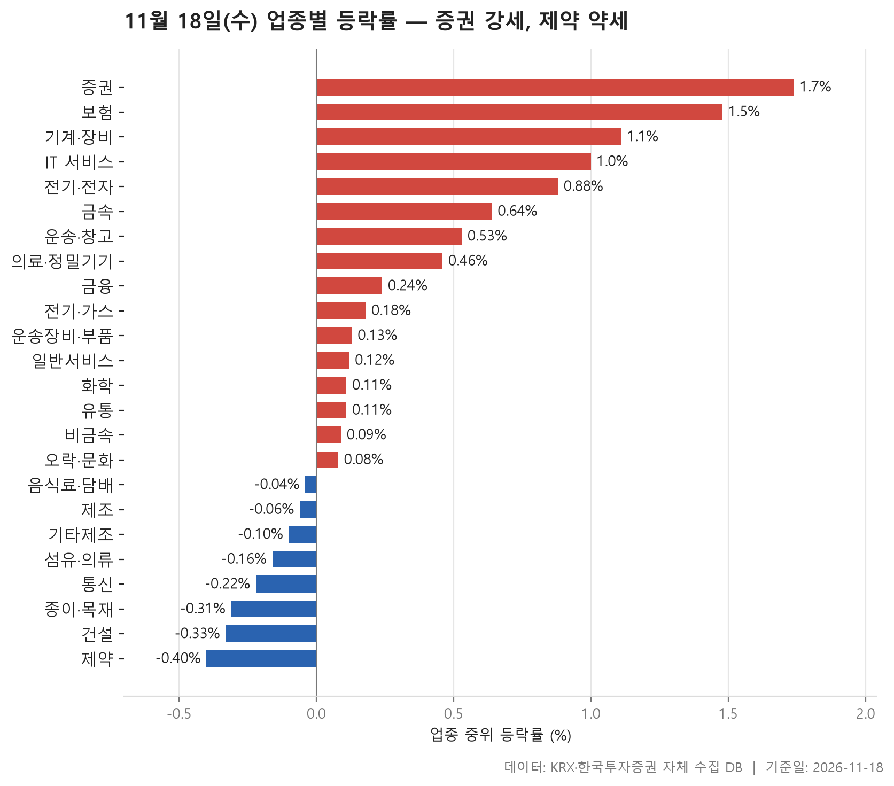
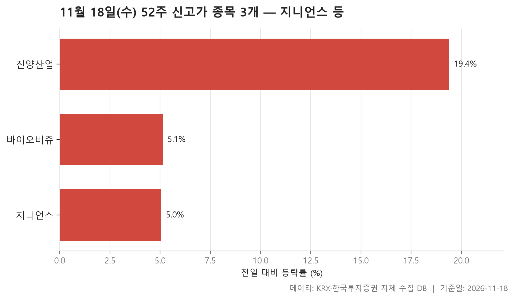
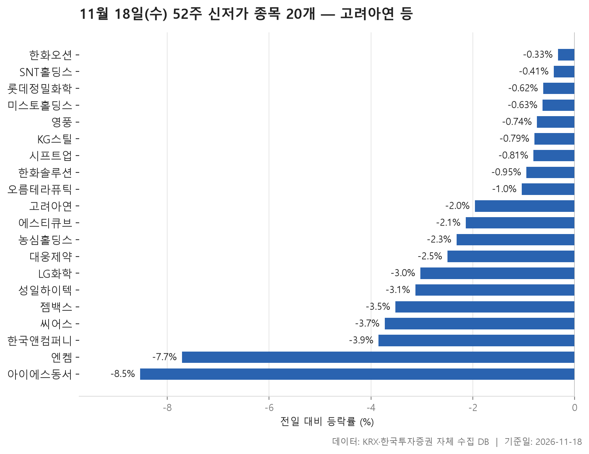
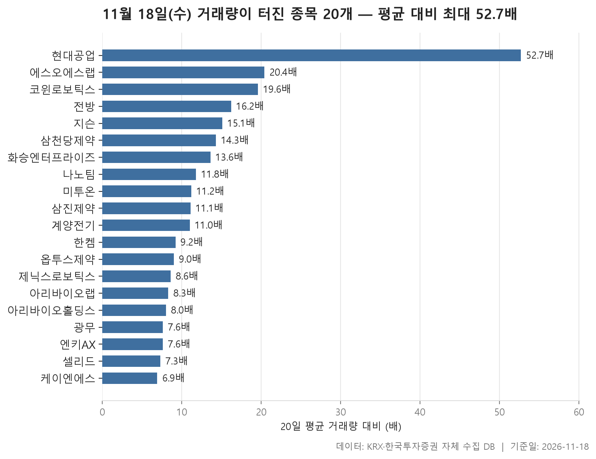

11월 18일 시장은 업종 표만 보면 무난한 하루였습니다. 24개 업종 가운데 16개가 올랐고 8개가 내렸으며, 업종마다 종목 등락률의 한가운데 값을 구해 다시 늘어놓으면 그 중간이 +0.12%입니다. 크게 쏠린 날이라기보다 조금씩 오른 쪽이 더 많았던 날에 가깝습니다.

그런데 표 네 개를 나란히 놓으면 결이 조금 달라집니다. 52주 신고가를 새로 쓴 종목은 3개뿐이었고, 신저가로 내려간 종목은 20개였습니다. 신저가 쪽에는 이름만 들어도 알 만한 대형주도 여럿 들어 있습니다. 업종 전체는 완만하게 올랐지만 일부 대형주는 바닥을 더 낮춘, 겉과 속이 엇갈린 하루였습니다.

아래에서는 업종 흐름, 신고가와 신저가, 거래량이 평소보다 크게 늘어난 종목을 차례로 살펴봅니다. 오늘 오른 이유나 내린 이유는 자료에 없으므로, 표가 보여 주는 모양까지만 짚겠습니다.

> 기준일: 2026-11-18 · 집계: 자체 수집 데이터베이스

## 업종 등락률 — 24개 중 16개 상승

맨 위는 금융 계열이 차지했습니다. 증권은 종목 등락률의 중위값이 +1.74%로 가장 높았고 오른 종목 비중이 88.90%였습니다. 열 종목 중 아홉 종목가량이 올랐다는 뜻입니다. 보험도 +1.48%에 오른 종목이 81.80%로 뒤를 이었습니다. 두 업종 모두 평균과 중위값이 거의 붙어 있어 특정 종목 하나가 끌어올린 상승이 아니라 업종 전체가 함께 오른 것으로 보입니다.

종목 수가 많은 업종에서는 평균과 중위값이 벌어진 곳이 눈에 띕니다. 기계·장비는 중위값이 +1.11%, 평균이 +1.80%입니다. 가장 크게 움직인 다원넥스뷰(+20.59%) 한 종목이 업종 평균을 0.10%p 올렸을 뿐이라, 두 값의 차이는 이 종목 하나만으로 설명되지 않습니다. 크게 오른 종목이 여럿 함께 있었다는 이야기입니다. 거꾸로 전기·전자는 비츠로시스가 -27.61%로 급락했지만 중위값 +0.88%, 오른 종목 64.50%로 업종 전체 분위기는 상승 쪽이었습니다. 거래대금이 104,601.10억원으로 다른 업종보다 훨씬 많았다는 점도 함께 볼 만합니다.

중위값과 평균의 방향이 서로 엇갈린 업종도 있습니다. 유통은 중위값이 +0.11%인데 평균은 -0.11%이고, 통신은 중위값 -0.22%에 평균 +0.11%입니다. 통신은 13개 종목뿐이어서 프리티(+5.92%) 한 종목이 평균을 0.46%p 끌어올렸습니다. 제조는 8개 종목 가운데 코아스(-4.31%)가 평균을 -0.54%p 끌어내려 평균이 -0.86%까지 떨어졌습니다. 종목 수가 적은 업종은 평균만 보면 오해하기 쉽습니다.

가장 약한 업종은 제약으로 중위값 -0.40%, 오른 종목이 38.30%였습니다. 재미있는 점은 이 업종에서 가장 크게 움직인 종목이 삼진제약(+18.65%)으로 오른 쪽이었다는 것입니다. 한 종목이 크게 올라도 업종의 한가운데는 내린 쪽에 머물렀습니다. 오른 종목이 가장 적었던 곳은 종이·목재로, 25.90%에 그쳐 넷 중 하나꼴이었습니다.

| 업종 | 종목수(개) | 중위등락률(%) | 평균등락률(%) | 상승비율(%) | 주도종목 | 주도종목등락률(%) | 평균기여도(%p) | 거래대금합계(억원) |
|---|---|---|---|---|---|---|---|---|
| 증권 | 18 | +1.74 | +1.81 | 88.90 | 신영증권 | +4.38 | 0.24 | 773.80 |
| 보험 | 11 | +1.48 | +1.66 | 81.80 | 미래에셋생명 | +5.45 | 0.50 | 2,009.00 |
| 기계·장비 | 212 | +1.11 | +1.80 | 65.60 | 다원넥스뷰 | +20.59 | 0.10 | 13,612.10 |
| IT 서비스 | 249 | +1.00 | +1.57 | 66.70 | 빅웨이브로보틱스 | +29.96 | 0.12 | 9,563.90 |
| 전기·전자 | 369 | +0.88 | +1.08 | 64.50 | 비츠로시스 | -27.61 | -0.07 | 104,601.10 |
| 금속 | 129 | +0.64 | +0.92 | 59.70 | 그린플러스 | +18.18 | 0.14 | 2,738.30 |
| 운송·창고 | 28 | +0.53 | +0.63 | 60.70 | 대한해운 | +4.14 | 0.15 | 1,464.90 |
| 의료·정밀기기 | 104 | +0.46 | +0.39 | 57.70 | 옵토닉스 | -17.17 | -0.17 | 3,140.90 |
| 금융 | 111 | +0.24 | +0.58 | 55.00 | 스틱인베스트먼트 | -12.16 | -0.11 | 12,722.10 |
| 전기·가스 | 10 | +0.18 | +0.39 | 60.00 | 한진중공업홀딩스 | +5.35 | 0.54 | 486.70 |
| 운송장비·부품 | 132 | +0.13 | +0.57 | 51.50 | 한라캐스트 | +13.74 | 0.10 | 6,359.30 |
| 일반서비스 | 169 | +0.12 | +0.37 | 50.90 | 아리바이오랩 | +29.98 | 0.18 | 7,930.20 |
| 화학 | 220 | +0.11 | +0.43 | 50.90 | 예선테크 | +29.93 | 0.14 | 9,655.40 |
| 유통 | 157 | +0.11 | -0.11 | 51.60 | 피스피스스튜디오 | -10.70 | -0.07 | 2,221.40 |
| 비금속 | 36 | +0.09 | +0.32 | 50.00 | 유니온머티리얼 | +12.45 | 0.35 | 300.20 |
| 오락·문화 | 60 | +0.08 | +0.47 | 50.00 | 스튜디오쏠쏠 | -20.97 | -0.35 | 1,479.00 |
| 음식료·담배 | 84 | -0.04 | +0.11 | 46.40 | 오에스피 | +16.14 | 0.19 | 1,400.80 |
| 제조 | 8 | -0.06 | -0.86 | 37.50 | 코아스 | -4.31 | -0.54 | 9.60 |
| 기타제조 | 15 | -0.10 | -0.33 | 40.00 | 세니젠 | -9.89 | -0.66 | 17.50 |
| 섬유·의류 | 49 | -0.16 | -0.44 | 42.90 | 형지엘리트 | +11.94 | 0.24 | 334.10 |
| 통신 | 13 | -0.22 | +0.11 | 46.20 | 프리티 | +5.92 | 0.46 | 1,098.90 |
| 종이·목재 | 27 | -0.31 | -0.75 | 25.90 | 신대양제지 | -5.50 | -0.20 | 35.10 |
| 건설 | 51 | -0.33 | -0.45 | 41.20 | 우진아이엔에스 | -8.75 | -0.17 | 1,279.50 |
| 제약 | 167 | -0.40 | -0.22 | 38.30 | 삼진제약 | +18.65 | 0.11 | 6,011.90 |

## 52주 신고가 3개 — 최고 진양산업 19.40%

신고가 명단은 짧습니다. 시가총액 500억 이상, 거래대금 3억 이상이라는 조건을 통과한 보통주 가운데 52주 최고가를 넘어선 종목은 3개였고, KOSPI 1개와 KOSDAQ 2개입니다.

세 종목이 넘어선 폭은 제각각입니다. 지니언스는 종가 38,450원으로 이전 최고가 38,400원을 아주 근소하게 넘었습니다. 당일 등락률은 +5.05%로 셋 중 가장 낮았지만 거래대금은 2,079.90억원으로 가장 많았습니다. 진양산업은 +19.40% 급등하며 8,000원에 마감해 이전 최고가 7,400원을 훌쩍 넘었습니다. 바이오비쥬는 +5.13% 올라 신고가를 기록했지만 거래대금이 18.10억원에 그쳐, 같은 신고가라도 거래 규모는 크게 달랐습니다.

업종으로 보면 화학이 2개입니다. 화학 업종의 중위값은 +0.11%로 업종 순위 한가운데쯤이었는데, 아래 신저가 표에서도 화학이 가장 많이 나옵니다. 같은 업종 안에서 양 끝으로 갈라진 셈입니다.

| 종목명 | 종목코드 | 시장 | 업종 | 종가(원) | 등락률(%) | 이전52주최고(원) | 거래대금(억원) | 시가총액(억원) |
|---|---|---|---|---|---|---|---|---|
| 지니언스 | 263860 | KOSDAQ | IT 서비스 | 38,450 | +5.05 | 38,400 | 2,079.90 | 3,491.10 |
| 바이오비쥬 | 489460 | KOSDAQ | 화학 | 15,770 | +5.13 | 15,550 | 18.10 | 2,326.60 |
| 진양산업 | 003780 | KOSPI | 화학 | 8,000 | +19.40 | 7,400 | 259.80 | 1,040.00 |

## 52주 신저가 20개 — 최저 아이에스동서 -8.53%

신저가는 20개로 신고가보다 훨씬 많습니다. KOSPI가 14개로 대부분이고, 무엇보다 이름이 무겁습니다. 시가총액이 가장 큰 고려아연(166,775억원)을 비롯해 LG화학(146,832.10억원), 한화오션(136,966.80억원)까지 대형주 세 곳이 나란히 올라 있습니다. 업종 표에서 상승 쪽이 우세했던 것과 대비됩니다.

하루 낙폭 자체는 크지 않은 종목이 많습니다. 20개 종목의 등락률 중위값은 -2.05%이고, 한화오션은 -0.33%만 내렸는데도 이전 최저가 44,750원 아래인 44,700원에 마감했습니다. 크게 무너졌다기보다 이미 낮은 자리에서 조금 더 밀려 기록을 새로 쓴 종목이 많다는 뜻입니다. 반면 아이에스동서(-8.53%)와 엔켐(-7.71%)은 하루 사이에 크게 밀리며 신저가로 내려갔습니다.

업종은 10개로 흩어져 있지만 화학이 5개로 가장 많습니다. 금속도 고려아연, 영풍, KG스틸 3개가 들어 있는데, 금속 업종 전체는 중위값 +0.64%로 오른 쪽이었습니다. 제약에서는 대웅제약과 오름테라퓨틱이 이름을 올려, 업종 순위 최하위와 같은 방향을 보였습니다.

| 종목명 | 종목코드 | 시장 | 업종 | 종가(원) | 등락률(%) | 이전52주최저(원) | 거래대금(억원) | 시가총액(억원) |
|---|---|---|---|---|---|---|---|---|
| 고려아연 | 010130 | KOSPI | 금속 | 799,000 | -1.96 | 813,000 | 183.20 | 166,775.00 |
| LG화학 | 051910 | KOSPI | 화학 | 208,000 | -3.03 | 214,000 | 508.90 | 146,832.10 |
| 한화오션 | 042660 | KOSPI | 운송장비·부품 | 44,700 | -0.33 | 44,750 | 436.00 | 136,966.80 |
| 한화솔루션 | 009830 | KOSPI | 화학 | 20,950 | -0.95 | 21,000 | 492.00 | 47,115.00 |
| 한국앤컴퍼니 | 000240 | KOSPI | 금융 | 19,470 | -3.85 | 19,750 | 31.90 | 18,483.90 |
| 미스토홀딩스 | 081660 | KOSPI | 유통 | 31,550 | -0.63 | 31,750 | 34.60 | 16,750.50 |
| 시프트업 | 462870 | KOSPI | IT 서비스 | 24,350 | -0.81 | 24,500 | 7.40 | 14,303.70 |
| 대웅제약 | 069620 | KOSPI | 제약 | 97,600 | -2.50 | 98,400 | 26.00 | 11,308.50 |
| 롯데정밀화학 | 004000 | KOSPI | 화학 | 32,150 | -0.62 | 32,200 | 9.00 | 8,294.70 |
| SNT홀딩스 | 036530 | KOSPI | 금융 | 36,850 | -0.41 | 36,950 | 3.90 | 5,489.20 |
| 영풍 | 000670 | KOSPI | 금속 | 26,950 | -0.74 | 27,100 | 21.10 | 4,961.70 |
| 씨어스 | 458870 | KOSDAQ | 의료·정밀기기 | 12,380 | -3.73 | 12,660 | 43.20 | 4,747.20 |
| KG스틸 | 016380 | KOSPI | 금속 | 4,380 | -0.79 | 4,410 | 9.90 | 4,380.40 |
| 에스티큐브 | 052020 | KOSDAQ | 유통 | 5,940 | -2.14 | 6,000 | 7.90 | 4,038.20 |
| 농심홀딩스 | 072710 | KOSPI | 금융 | 79,900 | -2.32 | 81,000 | 4.80 | 3,705.60 |
| 아이에스동서 | 010780 | KOSPI | 비금속 | 12,330 | -8.53 | 13,300 | 29.50 | 3,665.10 |
| 젬백스 | 082270 | KOSDAQ | 기계·장비 | 7,680 | -3.52 | 7,820 | 18.60 | 3,492.90 |
| 성일하이텍 | 365340 | KOSDAQ | 화학 | 23,200 | -3.13 | 23,800 | 8.20 | 2,997.70 |
| 오름테라퓨틱 | 475830 | KOSDAQ | 제약 | 13,280 | -1.04 | 13,320 | 11.10 | 2,888.80 |
| 엔켐 | 348370 | KOSDAQ | 화학 | 13,050 | -7.71 | 14,000 | 38.00 | 2,859.40 |

## 거래량 급증 20개 — 최고 현대공업 52.70배

거래량이 직전 20거래일 평균의 5배를 넘은 종목은 20개였고, KOSDAQ이 16개로 대부분을 차지했습니다. 평소보다 몇 배나 거래가 늘었는지를 보면 중위값이 11.05배이고, 맨 위 현대공업은 52.70배로 다른 종목들보다 크게 앞섭니다. 현대공업의 하루 거래량이 646,114주였는데 평소 거래량이 12,266주에 불과했기 때문입니다. 전방도 평소 961주 수준이던 거래가 15,536주로 늘어 16.20배가 됐지만 거래대금은 4.70억원뿐입니다. 평소 거래가 적은 종목일수록 이 배수가 크게 나온다는 점을 감안하고 봐야 합니다.

거래량이 늘어난 방향은 한쪽으로 쏠리지 않았습니다. 오른 종목과 내린 종목이 엇비슷하게 섞여 있습니다. 가장 큰 종목인 삼천당제약은 -14.56% 내리며 거래대금 1,583.80억원을 기록했고, 같은 제약 업종의 삼진제약은 +18.65% 올랐으며 옵투스제약은 -8.33% 내렸습니다. 업종 순위에서 최하위였던 제약이 거래량 표에서는 양쪽으로 크게 흔들린 모습입니다.

상승 쪽에서는 아리바이오랩(+29.98%)과 아리바이오홀딩스(+21.68%)가 함께 올라 있습니다. 하루 거래량이 각각 13,923,699주와 14,625,859주로 표에서 가장 많았습니다. 업종으로는 기계·장비가 5개로 가장 많은데, 코윈로보틱스, 제닉스로보틱스, 케이엔에스는 오르고 나노팀, 계양전기는 내려 여기서도 방향이 갈렸습니다.

| 종목명 | 종목코드 | 시장 | 업종 | 종가(원) | 등락률(%) | 거래량(주) | 평균거래량(주) | 배수(배) | 거래대금(억원) | 시가총액(억원) |
|---|---|---|---|---|---|---|---|---|---|---|
| 현대공업 | 170030 | KOSDAQ | 운송장비·부품 | 4,280 | -4.04 | 646,114 | 12,266 | 52.70 | 30.60 | 656.60 |
| 에스오에스랩 | 464080 | KOSDAQ | 의료·정밀기기 | 9,000 | +11.80 | 1,069,783 | 52,558 | 20.40 | 99.60 | 1,621.20 |
| 코윈로보틱스 | 282880 | KOSDAQ | 기계·장비 | 8,890 | +3.13 | 582,174 | 29,694 | 19.60 | 54.80 | 1,039.60 |
| 전방 | 000950 | KOSPI | 섬유·의류 | 30,900 | -0.16 | 15,536 | 961 | 16.20 | 4.70 | 519.10 |
| 지슨 | 446840 | KOSDAQ | 의료·정밀기기 | 5,460 | -9.45 | 4,479,518 | 296,023 | 15.10 | 259.90 | 601.50 |
| 삼천당제약 | 000250 | KOSDAQ | 제약 | 137,300 | -14.56 | 1,213,837 | 85,154 | 14.30 | 1,583.80 | 32,207.10 |
| 화승엔터프라이즈 | 241590 | KOSPI | 섬유·의류 | 2,000 | -11.70 | 554,114 | 40,728 | 13.60 | 10.80 | 1,211.80 |
| 나노팀 | 417010 | KOSDAQ | 기계·장비 | 6,270 | -4.57 | 1,183,511 | 100,066 | 11.80 | 76.00 | 1,264.80 |
| 미투온 | 201490 | KOSDAQ | IT 서비스 | 2,525 | +7.91 | 2,854,194 | 253,926 | 11.20 | 73.40 | 826.30 |
| 삼진제약 | 005500 | KOSPI | 제약 | 20,100 | +18.65 | 1,145,596 | 103,264 | 11.10 | 220.90 | 2,677.30 |
| 계양전기 | 012200 | KOSPI | 기계·장비 | 2,760 | -5.96 | 9,296,141 | 842,071 | 11.00 | 283.10 | 977.70 |
| 한켐 | 457370 | KOSDAQ | 화학 | 6,540 | +2.35 | 2,858,195 | 312,329 | 9.20 | 206.40 | 527.60 |
| 옵투스제약 | 131030 | KOSDAQ | 제약 | 5,170 | -8.33 | 189,474 | 21,169 | 9.00 | 10.10 | 912.30 |
| 제닉스로보틱스 | 381620 | KOSDAQ | 기계·장비 | 5,880 | +6.91 | 1,470,338 | 170,412 | 8.60 | 89.10 | 771.30 |
| 아리바이오랩 | 261780 | KOSDAQ | 일반서비스 | 5,290 | +29.98 | 13,923,699 | 1,683,208 | 8.30 | 721.80 | 1,531.80 |
| 아리바이오홀딩스 | 290690 | KOSDAQ | 전기·전자 | 3,115 | +21.68 | 14,625,859 | 1,834,601 | 8.00 | 449.60 | 1,653.20 |
| 광무 | 029480 | KOSDAQ | 전기·전자 | 1,300 | -0.38 | 1,371,592 | 180,895 | 7.60 | 18.10 | 776.30 |
| 엔키AX | 134580 | KOSDAQ | IT 서비스 | 1,623 | +7.41 | 2,455,422 | 322,639 | 7.60 | 42.40 | 800.00 |
| 셀리드 | 299660 | KOSDAQ | 일반서비스 | 1,754 | +4.34 | 1,100,915 | 151,641 | 7.30 | 20.50 | 517.50 |
| 케이엔에스 | 432470 | KOSDAQ | 기계·장비 | 7,820 | +3.03 | 162,209 | 23,606 | 6.90 | 13.50 | 685.90 |

## 정리

정리하면, 11월 18일은 증권과 보험을 앞세워 24개 업종 중 16개가 오른 날이었습니다. 하지만 신고가는 3개, 신저가는 20개였고, 신저가 쪽에 대형주가 몰려 있었습니다. 업종 순위만 보고 시장 분위기를 판단하기 어려운 하루였습니다.

이 글은 하루치 종가 데이터만을 다룹니다. 등락의 원인은 자료에 없어 다루지 않았고, 거래량 배수는 평소 거래가 적은 종목에서 크게 나오는 경향이 있습니다. 업종 분류와 필터 조건에 따라 명단이 달라질 수 있다는 점도 함께 고려해 주시기 바랍니다.

## 집계 기준

**업종 등락률**

- **기준**: 2026-11-17 종가 → 2026-11-18 종가
- **순위**: 업종 내 종목 등락률의 중위값 (평균은 참고용으로 함께 표시)
- **주도종목**: 그 업종에서 등락률 절대값이 가장 큰 종목 (동점이면 거래대금이 큰 쪽)
- **평균기여도**: 그 종목 하나가 업종 평균을 움직인 폭 (등락률 ÷ 종목수). 중위값과 평균의 격차가 이 값에 가까우면 평균을 만든 것이 그 종목이고, 훨씬 크면 다른 종목들도 함께 움직인 것입니다
- **필터**: 업종 내 보통주 5종목 이상
- **전체업종중위등락률(%)**: 0.11

**52주 신고가**

- **기준**: 종가 > 직전 52주 최고가
- **관측구간**: 2025-11-06 ~ 2026-11-17 (252거래일)
- **필터**: 시가총액 500억 이상, 거래대금 3억 이상, 보통주

**52주 신저가**

- **기준**: 종가 < 직전 52주 최저가
- **관측구간**: 2025-11-06 ~ 2026-11-17 (252거래일)
- **필터**: 시가총액 500억 이상, 거래대금 3억 이상, 보통주

**거래량 급증**

- **기준**: 당일 거래량 ≥ 직전 20거래일 평균 × 5
- **관측구간**: 2026-10-21 ~ 2026-11-17 (20거래일)
- **필터**: 시가총액 500억 이상, 거래대금 3억 이상, 보통주

## 데이터 출처 및 유의사항

- **데이터출처**: 한국거래소(KRX) 공시 데이터와 한국투자증권 OpenAPI 를 직접 수집해 구축한 자체 데이터베이스
- **집계방식**: 수집·집계·차트 생성을 직접 구현한 파이프라인에서 자동 산출
- **작성고지**: 본문의 표·통계·차트는 자체 데이터베이스에서 계산된 값이며, 문장 작성 과정에 AI 도구를 활용했습니다.
- **면책**: 본 글은 정보 제공을 목적으로 하며 특정 종목의 매수·매도를 추천하지 않습니다. 제시된 수치는 과거 데이터이고 미래 수익을 보장하지 않습니다. 투자 판단과 그 결과에 대한 책임은 투자자 본인에게 있습니다.

