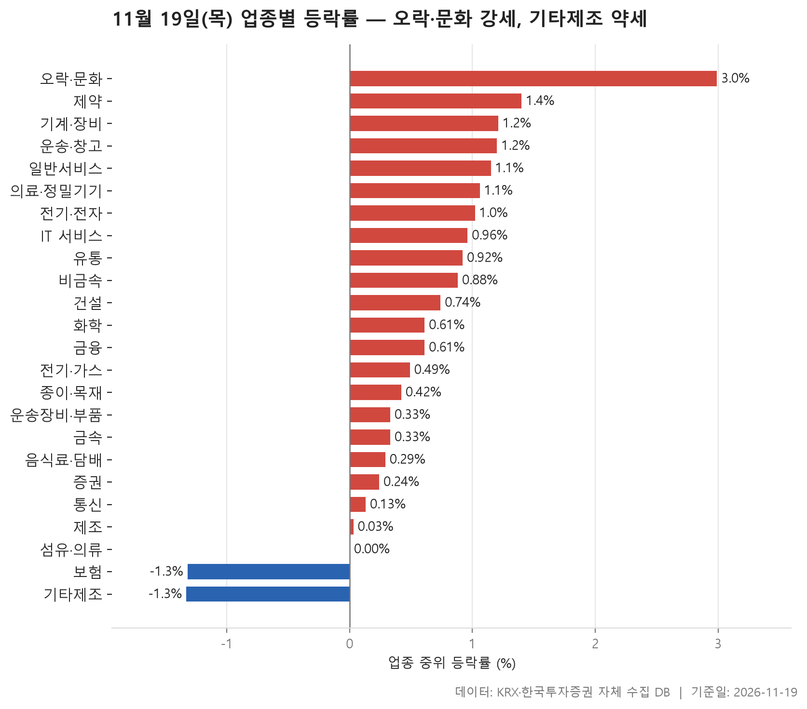
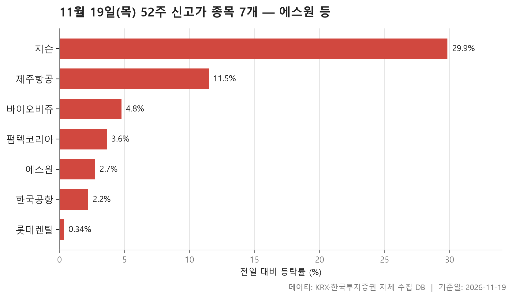
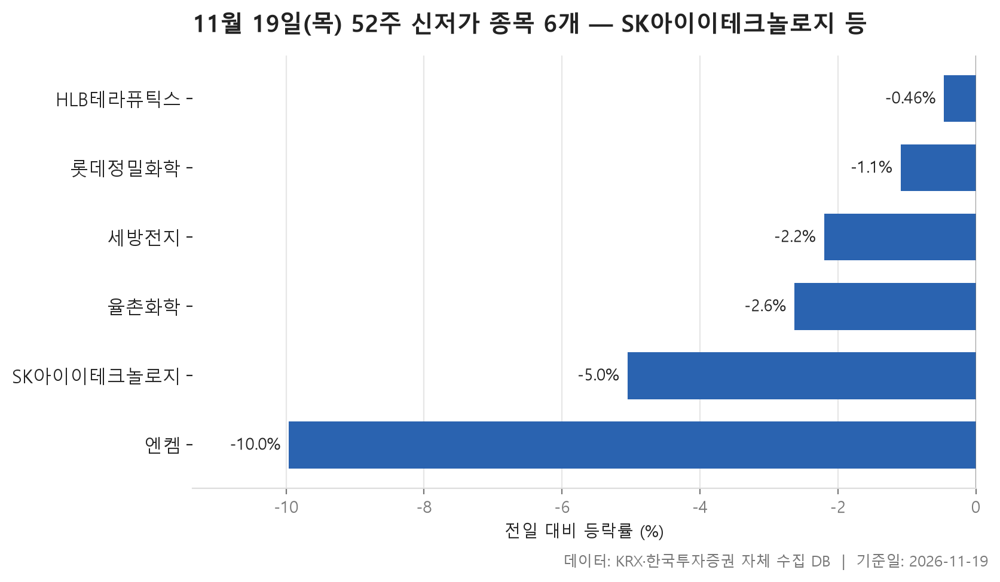
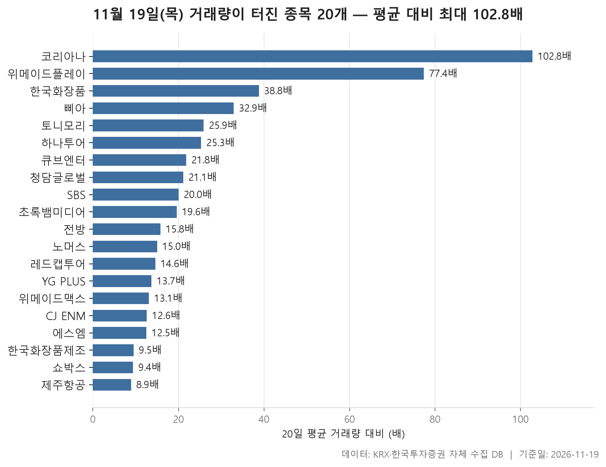

11월 19일 시장은 넓게 오른 하루였습니다. 24개 업종 가운데 21개 업종에서 종목들의 중위 등락률이 플러스였고, 마이너스로 끝난 업종은 2개뿐이었습니다. 업종별 중위 등락률을 한 줄로 세웠을 때 한가운데 놓인 값은 +0.61%. 몇몇 업종만 크게 튄 날이라기보다는 대부분 업종이 조금씩 올라선 모양에 가깝습니다.

가장 앞선 업종은 오락·문화로 중위 등락률이 +2.99%였고, 가장 뒤처진 곳은 기타제조로 -1.33%였습니다. 오늘은 업종 흐름을 먼저 보고, 이어서 52주 신고가·신저가 종목과 거래량이 평소의 몇 배로 불어난 종목을 차례로 살펴봅니다. 세 표를 겹쳐 보면 오락·문화의 강세가 거래량 표에서도 그대로 드러나고, 시장 분위기와 따로 움직인 종목들도 눈에 띕니다.

> 기준일: 2026-11-19 · 집계: 자체 수집 데이터베이스

## 업종 등락률 — 24개 중 21개 상승

맨 위의 오락·문화는 60개 종목 가운데 85.00%가 올랐습니다. 열 곳 중 여덟 곳 넘게 오른 셈이니 업종 전체가 함께 움직였다고 봐도 무리가 없습니다. 눈여겨볼 대목은 평균입니다. 중위값은 +2.99%인데 평균은 +5.53%로 한참 위에 있습니다. 가장 크게 오른 에이스토리(+30.00%)가 업종 평균을 끌어올린 폭은 0.50%p에 그칩니다. 평균과 중위값 사이 간격이 그보다 훨씬 넓으니, 평균을 위로 밀어 올린 것은 한 종목이 아니라 크게 오른 여러 종목이었다고 읽는 편이 맞습니다.

통신은 정반대 경우입니다. 13개 종목의 중위값은 +0.13%로 거의 제자리인데 평균은 +1.34%까지 올라가 있습니다. 프리티 한 종목이 +22.24% 오르면서 업종 평균을 1.71%p 끌어올렸고, 이것만으로 평균과 중위값의 간격이 설명되고도 남습니다. 종목 수가 적은 업종에서 평균만 보면 착시가 생기는 전형적인 모습입니다. 거꾸로 전기·가스(중위 +0.49%, 평균 +0.19%)와 증권(중위 +0.24%, 평균 +0.03%)은 평균이 중위값보다 낮아서, 일부 종목이 업종을 아래로 당겼다는 것을 알 수 있습니다.

덩치가 가장 큰 전기·전자는 368개 종목, 거래대금 81,668.50억원으로 다른 업종을 압도합니다. 중위값은 +1.02%로 상위권인데, 업종에서 가장 크게 움직인 종목은 오히려 -18.31% 떨어진 다보링크였습니다. 다만 종목이 워낙 많아 이 하락이 업종 평균에 미친 영향은 -0.05%p로 미미합니다.

아래쪽에서는 보험(-1.32%)과 기타제조(-1.33%)만 마이너스였습니다. 보험은 11개 종목 중 오른 비율이 18.20%로, 다섯 곳 중 한 곳도 채 오르지 못했습니다. 기타제조는 오른 종목이 셋 중 하나꼴이었고, 엑스플러스(-9.61%) 한 종목이 업종 평균을 0.64%p 끌어내렸습니다. 그 사이의 섬유·의류는 중위값 0.00%로 정확히 제자리였습니다.

| 업종 | 종목수(개) | 중위등락률(%) | 평균등락률(%) | 상승비율(%) | 주도종목 | 주도종목등락률(%) | 평균기여도(%p) | 거래대금합계(억원) |
|---|---|---|---|---|---|---|---|---|
| 오락·문화 | 60 | +2.99 | +5.53 | 85.00 | 에이스토리 | +30.00 | 0.50 | 6,332.30 |
| 제약 | 167 | +1.40 | +1.70 | 76.00 | 셀비온 | +9.31 | 0.06 | 4,382.60 |
| 기계·장비 | 213 | +1.21 | +2.00 | 72.80 | GST | +18.54 | 0.09 | 13,951.20 |
| 운송·창고 | 28 | +1.20 | +1.99 | 75.00 | 트리니티항공 | +12.55 | 0.45 | 2,481.30 |
| 일반서비스 | 169 | +1.15 | +2.20 | 74.00 | 노랑풍선 | +29.98 | 0.18 | 6,731.70 |
| 의료·정밀기기 | 104 | +1.06 | +1.87 | 69.20 | 엘앤케이바이오 | +29.93 | 0.29 | 2,268.50 |
| 전기·전자 | 368 | +1.02 | +1.36 | 68.80 | 다보링크 | -18.31 | -0.05 | 81,668.50 |
| IT 서비스 | 249 | +0.96 | +1.88 | 68.30 | 미스터블루 | +29.99 | 0.12 | 10,621.70 |
| 유통 | 157 | +0.92 | +1.25 | 68.20 | 한국화장품 | +29.98 | 0.19 | 3,121.20 |
| 비금속 | 36 | +0.88 | +1.15 | 61.10 | 원익QnC | +8.82 | 0.24 | 295.00 |
| 건설 | 51 | +0.74 | +0.73 | 66.70 | 일성건설 | +9.46 | 0.19 | 1,210.70 |
| 화학 | 220 | +0.61 | +1.28 | 61.40 | 뷰티스킨 | +29.86 | 0.14 | 8,904.40 |
| 금융 | 111 | +0.61 | +0.72 | 64.00 | AK홀딩스 | +10.15 | 0.09 | 10,103.90 |
| 전기·가스 | 10 | +0.49 | +0.19 | 60.00 | 대성에너지 | +1.92 | 0.19 | 359.70 |
| 종이·목재 | 27 | +0.42 | +0.85 | 70.40 | 리더스코스메틱 | +8.10 | 0.30 | 27.40 |
| 운송장비·부품 | 132 | +0.33 | +0.45 | 59.80 | 삼기 | +9.73 | 0.07 | 5,354.10 |
| 금속 | 129 | +0.33 | +0.98 | 58.10 | 에스와이 | +29.80 | 0.23 | 2,859.70 |
| 음식료·담배 | 84 | +0.29 | +0.37 | 58.30 | 한울앤제주 | +29.96 | 0.36 | 1,369.50 |
| 증권 | 18 | +0.24 | +0.03 | 55.60 | 신영증권 | +2.80 | 0.16 | 704.80 |
| 통신 | 13 | +0.13 | +1.34 | 61.50 | 프리티 | +22.24 | 1.71 | 1,416.00 |
| 제조 | 8 | +0.03 | +0.29 | 50.00 | 지누스 | +2.99 | 0.37 | 4.10 |
| 섬유·의류 | 49 | 0.00 | -0.05 | 44.90 | 뉴키즈온 | +13.45 | 0.27 | 393.80 |
| 보험 | 11 | -1.32 | -1.49 | 18.20 | 미래에셋생명 | -4.48 | -0.41 | 1,613.70 |
| 기타제조 | 15 | -1.33 | -1.28 | 33.30 | 엑스플러스 | -9.61 | -0.64 | 27.40 |

## 52주 신고가 7개 — 최고 지슨 29.85%

종가가 지난 52주 최고가를 넘어선 종목은 7개입니다. 코스피 4개, 코스닥 3개로 시장이 고르게 섞였고, 업종도 4개로 흩어져 있습니다. 일반서비스와 운송·창고, 화학이 각각 2개씩, 의료·정밀기기가 1개입니다. 오른 폭의 한가운데 값은 +3.63%로, 신고가라고 해서 대부분이 크게 뛴 것은 아니었습니다.

몇몇은 아슬아슬하게 선을 넘었습니다. 롯데렌탈은 +0.34% 오른 58,700원으로 이전 최고가 58,600원을 겨우 웃돌았고, 펌텍코리아도 79,900원으로 이전 최고가 79,800원을 한 호가 차이로 넘어섰습니다. 시가총액이 가장 큰 에스원(40,203억원)도 +2.72%로 무난하게 오르면서 신고가를 새로 썼습니다.

가장 크게 오른 곳은 지슨으로 +29.85%였는데, 시가총액은 781억원으로 표에서 가장 작습니다. 등락 폭 순위와 덩치 순위가 정확히 거꾸로 놓여 있는 셈이죠. 제주항공(+11.47%)은 거래대금이 823.10억원으로 이 표에서 압도적으로 많았고, 뒤에 나올 거래량 급증 표에도 다시 이름을 올립니다. 같은 업종의 한국공항은 거래대금이 5.90억원에 불과해, 같은 신고가라도 거래 규모는 크게 달랐습니다.

| 종목명 | 종목코드 | 시장 | 업종 | 종가(원) | 등락률(%) | 이전52주최고(원) | 거래대금(억원) | 시가총액(억원) |
|---|---|---|---|---|---|---|---|---|
| 에스원 | 012750 | KOSPI | 일반서비스 | 105,800 | +2.72 | 103,100 | 88.80 | 40,203 |
| 롯데렌탈 | 089860 | KOSPI | 일반서비스 | 58,700 | +0.34 | 58,600 | 28.30 | 21,314 |
| 펌텍코리아 | 251970 | KOSDAQ | 화학 | 79,900 | +3.63 | 79,800 | 78.80 | 9,908 |
| 제주항공 | 089590 | KOSPI | 운송·창고 | 8,360 | +11.47 | 7,900 | 823.10 | 6,742 |
| 한국공항 | 005430 | KOSPI | 운송·창고 | 112,100 | +2.19 | 110,800 | 5.90 | 3,550 |
| 바이오비쥬 | 489460 | KOSDAQ | 화학 | 16,520 | +4.76 | 15,770 | 29.90 | 2,437 |
| 지슨 | 446840 | KOSDAQ | 의료·정밀기기 | 7,090 | +29.85 | 6,350 | 266.80 | 781 |

## 52주 신저가 6개 — 최저 엔켐 -9.96%

반대로 52주 최저가 아래에서 마감한 종목은 6개였습니다. 업종이 21개나 오른 날인데도 신저가 수가 신고가 7개와 거의 맞먹는다는 점이 눈에 띕니다. 시장 전체가 오른 날에도 흐름에서 벗어난 종목은 따로 있었다는 이야기입니다.

업종을 보면 화학이 3개로 절반을 차지합니다. 화학 업종 전체로는 중위 등락률이 +0.61%로 플러스였고 신고가 표에도 화학 종목이 2개 있었으니, 같은 업종 안에서 방향이 크게 갈린 셈입니다. 전기·전자에서도 SK아이이테크놀로지와 세방전지 2개가 신저가를 기록했는데, 이 업종 역시 전체로는 오른 쪽이었습니다.

하락 폭의 한가운데 값은 -2.42%입니다. 가장 크게 밀린 엔켐은 -9.96%로 이전 최저가 12,720원보다 한참 아래인 11,750원에 마감했습니다. 시가총액이 가장 큰 SK아이이테크놀로지(9,381억원)도 -5.05% 내렸습니다. 반면 HLB테라퓨틱스(-0.46%)는 1,290원으로 이전 최저가 1,295원을 살짝 밑돌았고, 롯데정밀화학(-1.09%)도 31,800원으로 이전 최저가 31,850원과 거의 붙어 있습니다. 신저가 표에서도 큰 폭의 하락과 경계선을 살짝 넘은 하락이 섞여 있습니다.

| 종목명 | 종목코드 | 시장 | 업종 | 종가(원) | 등락률(%) | 이전52주최저(원) | 거래대금(억원) | 시가총액(억원) |
|---|---|---|---|---|---|---|---|---|
| SK아이이테크놀로지 | 361610 | KOSPI | 전기·전자 | 11,470 | -5.05 | 11,770 | 32.30 | 9,381 |
| 롯데정밀화학 | 004000 | KOSPI | 화학 | 31,800 | -1.09 | 31,850 | 19.10 | 8,204 |
| 세방전지 | 004490 | KOSPI | 전기·전자 | 46,600 | -2.20 | 46,900 | 14.50 | 6,459 |
| 엔켐 | 348370 | KOSDAQ | 화학 | 11,750 | -9.96 | 12,720 | 59.80 | 2,575 |
| 율촌화학 | 008730 | KOSPI | 화학 | 9,250 | -2.63 | 9,340 | 9.00 | 2,294 |
| HLB테라퓨틱스 | 115450 | KOSDAQ | 유통 | 1,290 | -0.46 | 1,295 | 13.60 | 1,222 |

## 거래량 급증 20개 — 최고 코리아나 102.80배

거래량이 직전 20거래일 평균의 5배를 넘긴 종목은 20개입니다. 업종 가운데 오락·문화가 7개로 가장 많아, 업종 표에서 본 강세가 거래량에서도 그대로 확인됩니다. 시장별로는 코스닥이 12개로 코스피 8개보다 많았습니다. 그리고 20개 중 내린 종목은 전방(-1.29%) 하나뿐이었습니다. 거래가 몰린 종목 대부분이 오르는 쪽이었다는 뜻입니다.

배수의 한가운데 값은 17.70배입니다. 맨 위의 코리아나는 평소 하루 61,946주 수준이던 거래량이 이날 6,366,690주로 불어나면서 102.80배를 기록했습니다. 시가총액은 557억원으로 필터 기준을 간신히 넘는 크기입니다. 두 번째 위메이드플레이(77.40배)도 시가총액이 567억원이라, 배수가 큰 종목은 평소 거래가 적던 작은 종목이라는 패턴이 보입니다.

거래대금으로 보면 그림이 달라집니다. 시가총액이 가장 큰 에스엠(21,773억원)은 배수가 12.50배로 중간보다 아래지만 거래대금은 1,275.40억원으로 표에서 가장 많았습니다. CJ ENM도 +28.11% 오르며 거래대금이 467.30억원에 달했습니다. 배수가 가장 낮은 제주항공(8.90배)은 평소 거래량이 이미 1,057,452주나 되던 종목이라 배수는 작아 보여도 거래대금은 823.10억원으로 두 번째로 많습니다. 배수와 금액이 따로 노는 만큼, 두 기준을 함께 보는 편이 안전합니다.

| 종목명 | 종목코드 | 시장 | 업종 | 종가(원) | 등락률(%) | 거래량(주) | 평균거래량(주) | 배수(배) | 거래대금(억원) | 시가총액(억원) |
|---|---|---|---|---|---|---|---|---|---|---|
| 코리아나 | 027050 | KOSDAQ | 화학 | 1,392 | +9.78 | 6,366,690 | 61,946 | 102.80 | 95.20 | 557 |
| 위메이드플레이 | 123420 | KOSDAQ | IT 서비스 | 5,450 | +7.07 | 951,365 | 12,292 | 77.40 | 54.20 | 567 |
| 한국화장품 | 123690 | KOSPI | 유통 | 6,460 | +29.98 | 1,498,850 | 38,624 | 38.80 | 95.80 | 1,038 |
| 삐아 | 451250 | KOSDAQ | 화학 | 6,010 | +6.56 | 298,706 | 9,067 | 32.90 | 19.10 | 615 |
| 토니모리 | 214420 | KOSPI | 화학 | 4,600 | +15.87 | 1,114,867 | 43,014 | 25.90 | 51.60 | 1,107 |
| 하나투어 | 039130 | KOSPI | 일반서비스 | 35,900 | +16.75 | 1,013,673 | 40,006 | 25.30 | 374.00 | 5,265 |
| 큐브엔터 | 182360 | KOSDAQ | 오락·문화 | 7,410 | +5.71 | 436,938 | 20,058 | 21.80 | 33.30 | 1,152 |
| 청담글로벌 | 362320 | KOSDAQ | 유통 | 5,650 | +8.65 | 956,630 | 45,276 | 21.10 | 52.70 | 1,170 |
| SBS | 034120 | KOSPI | 오락·문화 | 13,070 | +8.92 | 236,291 | 11,799 | 20.00 | 31.20 | 2,424 |
| 초록뱀미디어 | 047820 | KOSDAQ | 오락·문화 | 2,805 | +7.06 | 247,307 | 12,629 | 19.60 | 7.40 | 686 |
| 전방 | 000950 | KOSPI | 섬유·의류 | 30,500 | -1.29 | 27,115 | 1,715 | 15.80 | 8.30 | 512 |
| 노머스 | 473980 | KOSDAQ | 오락·문화 | 12,070 | +11.97 | 560,031 | 37,442 | 15.00 | 67.90 | 1,313 |
| 레드캡투어 | 038390 | KOSDAQ | 일반서비스 | 10,020 | +0.91 | 156,989 | 10,736 | 14.60 | 16.40 | 1,676 |
| YG PLUS | 037270 | KOSPI | IT 서비스 | 3,425 | +12.66 | 7,664,218 | 560,282 | 13.70 | 271.70 | 2,180 |
| 위메이드맥스 | 101730 | KOSDAQ | IT 서비스 | 4,235 | +29.91 | 1,676,376 | 127,845 | 13.10 | 67.80 | 3,549 |
| CJ ENM | 035760 | KOSDAQ | 오락·문화 | 54,000 | +28.11 | 895,480 | 70,837 | 12.60 | 467.30 | 11,842 |
| 에스엠 | 041510 | KOSDAQ | 오락·문화 | 95,100 | +8.19 | 1,346,485 | 107,345 | 12.50 | 1,275.40 | 21,773 |
| 한국화장품제조 | 003350 | KOSPI | 화학 | 12,700 | +15.66 | 4,340,312 | 458,956 | 9.50 | 567.70 | 2,878 |
| 쇼박스 | 086980 | KOSDAQ | 오락·문화 | 1,579 | +7.86 | 866,556 | 92,456 | 9.40 | 13.90 | 986 |
| 제주항공 | 089590 | KOSPI | 운송·창고 | 8,360 | +11.47 | 9,420,987 | 1,057,452 | 8.90 | 823.10 | 6,742 |

## 정리

정리하면 11월 19일은 대부분 업종이 고르게 오른 가운데 오락·문화가 오른 폭과 거래량 양쪽에서 두드러진 하루였습니다. 다만 같은 날 화학과 전기·전자에서 신저가가 나왔듯, 업종 전체의 방향과 개별 종목의 방향은 얼마든지 엇갈릴 수 있습니다.

이 글은 하루치 종가 데이터를 정리한 것이며, 왜 그렇게 움직였는지는 자료에 담겨 있지 않아 다루지 않았습니다. 신고가·신저가·거래량 표에서는 시가총액 500억원 미만과 거래대금 3억원 미만 종목이 빠져 있다는 점도 함께 감안해 주세요. 특정 종목의 매매를 권하는 글이 아닙니다.

## 집계 기준

**업종 등락률**

- **기준**: 2026-11-18 종가 → 2026-11-19 종가
- **순위**: 업종 내 종목 등락률의 중위값 (평균은 참고용으로 함께 표시)
- **주도종목**: 그 업종에서 등락률 절대값이 가장 큰 종목 (동점이면 거래대금이 큰 쪽)
- **평균기여도**: 그 종목 하나가 업종 평균을 움직인 폭 (등락률 ÷ 종목수). 중위값과 평균의 격차가 이 값에 가까우면 평균을 만든 것이 그 종목이고, 훨씬 크면 다른 종목들도 함께 움직인 것입니다
- **필터**: 업종 내 보통주 5종목 이상
- **전체업종중위등락률(%)**: 0.61

**52주 신고가**

- **기준**: 종가 > 직전 52주 최고가
- **관측구간**: 2025-11-07 ~ 2026-11-18 (252거래일)
- **필터**: 시가총액 500억 이상, 거래대금 3억 이상, 보통주

**52주 신저가**

- **기준**: 종가 < 직전 52주 최저가
- **관측구간**: 2025-11-07 ~ 2026-11-18 (252거래일)
- **필터**: 시가총액 500억 이상, 거래대금 3억 이상, 보통주

**거래량 급증**

- **기준**: 당일 거래량 ≥ 직전 20거래일 평균 × 5
- **관측구간**: 2026-10-22 ~ 2026-11-18 (20거래일)
- **필터**: 시가총액 500억 이상, 거래대금 3억 이상, 보통주

## 데이터 출처 및 유의사항

- **데이터출처**: 한국거래소(KRX) 공시 데이터와 한국투자증권 OpenAPI 를 직접 수집해 구축한 자체 데이터베이스
- **집계방식**: 수집·집계·차트 생성을 직접 구현한 파이프라인에서 자동 산출
- **작성고지**: 본문의 표·통계·차트는 자체 데이터베이스에서 계산된 값이며, 문장 작성 과정에 AI 도구를 활용했습니다.
- **면책**: 본 글은 정보 제공을 목적으로 하며 특정 종목의 매수·매도를 추천하지 않습니다. 제시된 수치는 과거 데이터이고 미래 수익을 보장하지 않습니다. 투자 판단과 그 결과에 대한 책임은 투자자 본인에게 있습니다.

