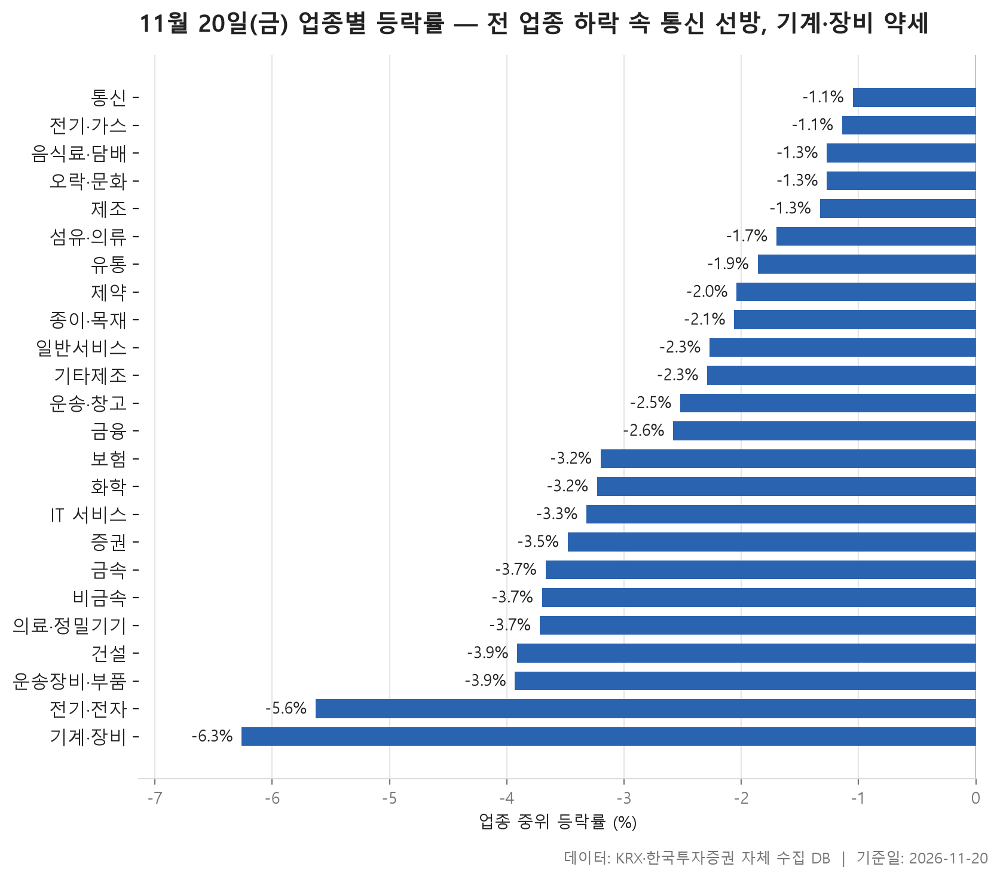
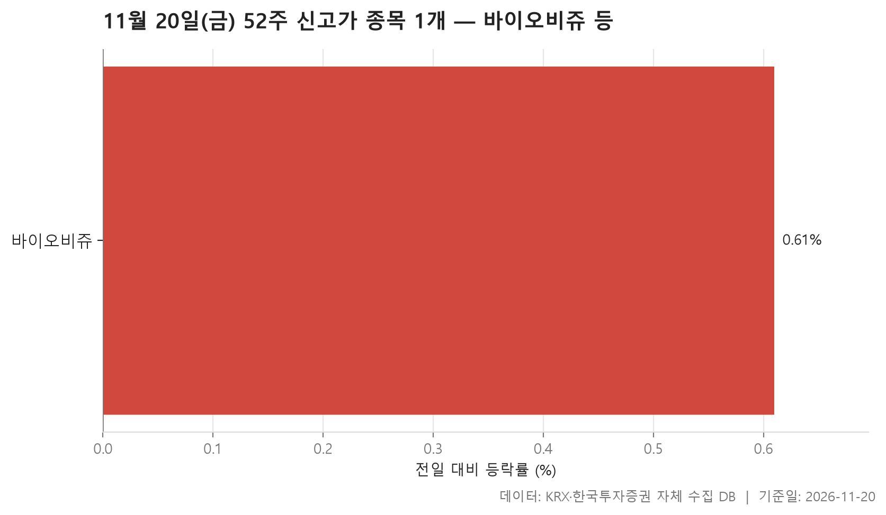
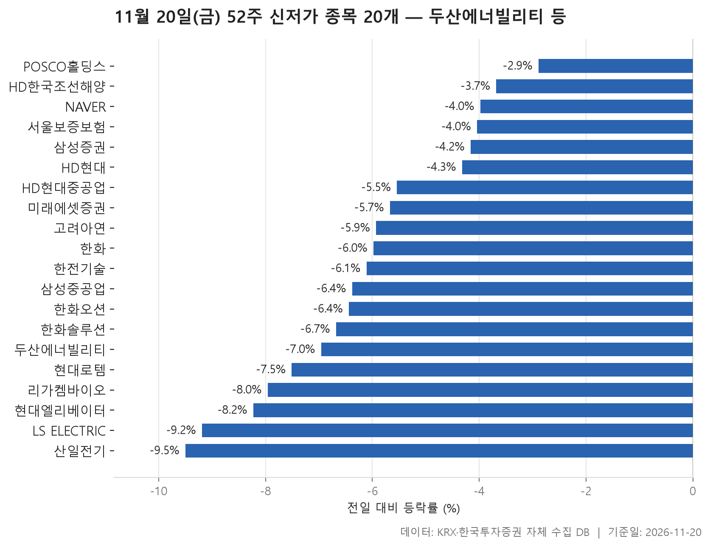
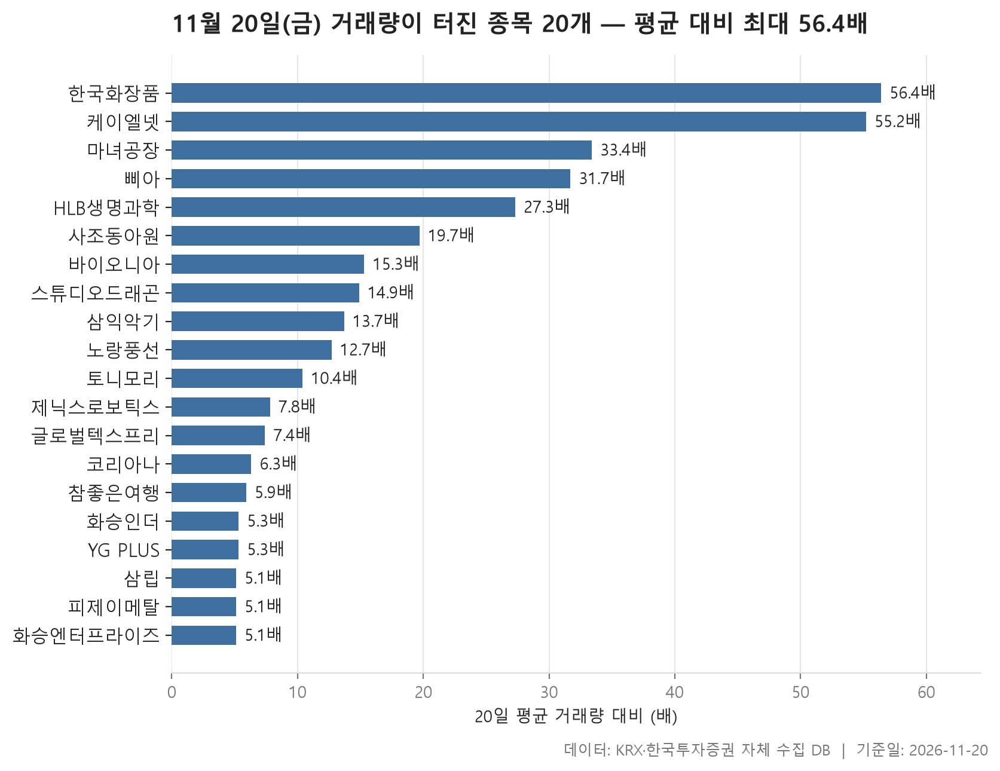

11월 20일 금요일 시장은 한 방향으로 기울었습니다. 24개 업종을 업종 안 종목들의 중위 등락률로 줄 세워 보면 플러스로 끝난 업종이 하나도 없습니다. 가장 덜 내린 통신이 -1.05%, 가장 많이 내린 기계·장비가 -6.26%였습니다. 24개 업종의 중위 등락률을 늘어놓았을 때 한가운데 놓인 값은 -2.55%입니다. 어느 업종을 골라도 손실 구간이었다는 뜻이고, 업종 사이의 차이는 얼마나 덜 내렸느냐의 문제였습니다.

이런 날에는 52주 신고가와 신저가 표가 시장의 기울기를 더 분명하게 보여 줍니다. 신고가를 새로 쓴 종목은 단 하나였고, 신저가 쪽에는 20개가 올라왔습니다. 눈여겨볼 점은 신저가 명단에 시가총액이 큰 종목들이 위쪽에 몰려 있다는 것입니다.

마지막으로 거래량이 직전 20거래일 평균의 5배를 넘긴 종목 20개를 정리했습니다. 시장 전체가 내린 날이었는데도 이 명단에는 크게 오른 종목이 적지 않습니다. 하락장 속에서 개별적으로 움직인 종목이 어디였는지 확인할 수 있는 표입니다.

> 기준일: 2026-11-20 · 집계: 자체 수집 데이터베이스

## 업종 등락률 — 24개 모두 하락

표에서 가장 먼저 눈에 들어오는 건 오른 종목의 비중입니다. 맨 위 통신조차 오른 종목이 7.70%에 그쳤고, 증권은 18개 종목 가운데 오른 곳이 하나도 없었습니다. 덩치가 큰 업종일수록 더 나빴습니다. 369개 종목이 묶인 전기·전자는 중위 등락률이 -5.63%였고, 213개 종목의 기계·장비는 -6.26%로 맨 아래에 놓였습니다. 두 업종 모두 오른 종목이 스무 곳 중 하나꼴에 불과했습니다. 전기·전자의 거래대금은 92,235.90억원으로 다른 업종과 단위가 다를 만큼 컸는데, 그만큼 돈이 몰린 곳이 가장 크게 내린 쪽이었던 셈입니다.

중위값과 평균이 벌어진 업종을 보면 하락의 모양이 조금씩 다릅니다. 통신은 중위값이 -1.05%인데 평균은 -1.69%로 더 낮습니다. SK텔레콤 한 종목이 -13.09% 빠지면서 업종 평균을 -1.01%p 끌어내렸고, 이 한 종목이 둘 사이 간격의 대부분을 만든 것으로 보입니다. 반대로 섬유·의류는 중위값 -1.70%, 평균 -3.78%로 간격이 훨씬 넓은데, 인디에프(-25.51%)가 끌어내린 폭은 -0.53%p에 그칩니다. 한 종목만으로는 설명되지 않는 간격이라 다른 종목들도 크게 미끄러졌다고 읽는 편이 맞습니다. 오락·문화도 비슷해서, 에이스토리(-25.46%) 하나로는 평균이 그만큼 낮아진 이유를 다 설명할 수 없습니다.

방향이 반대인 곳은 제조입니다. 8개 종목뿐인 작은 업종인데 삼익악기가 +5.71% 오르면서 평균을 0.71%p 끌어올렸고, 그 덕에 평균(-0.31%)이 중위값(-1.33%)보다 위에 있습니다. 제약의 바이오니아(+20.09%), 화학의 삐아(+29.95%), 금속의 동일스틸럭스(+25.92%), 금융의 글로벌텍스프리(+13.79%)처럼 업종 안에서 가장 크게 움직인 종목이 오른 경우도 있었지만, 종목 수가 많은 업종이라 평균을 움직인 폭은 모두 0.2%p 안팎에 머물렀습니다. 개별 급등이 업종 전체 분위기를 바꾸지는 못한 하루였습니다.

| 업종 | 종목수(개) | 중위등락률(%) | 평균등락률(%) | 상승비율(%) | 주도종목 | 주도종목등락률(%) | 평균기여도(%p) | 거래대금합계(억원) |
|---|---|---|---|---|---|---|---|---|
| 통신 | 13 | -1.05 | -1.69 | 7.70 | SK텔레콤 | -13.09 | -1.01 | 1,803.50 |
| 전기·가스 | 10 | -1.14 | -1.35 | 10.00 | SGC에너지 | -4.32 | -0.43 | 561.40 |
| 음식료·담배 | 84 | -1.27 | -1.54 | 16.70 | 한울앤제주 | -8.26 | -0.10 | 1,301.60 |
| 오락·문화 | 60 | -1.27 | -2.30 | 23.30 | 에이스토리 | -25.46 | -0.42 | 3,044.20 |
| 제조 | 8 | -1.33 | -0.31 | 25.00 | 삼익악기 | +5.71 | 0.71 | 25.80 |
| 섬유·의류 | 48 | -1.70 | -3.78 | 8.30 | 인디에프 | -25.51 | -0.53 | 206.00 |
| 유통 | 157 | -1.86 | -2.35 | 16.60 | ISC | -13.48 | -0.09 | 3,071.60 |
| 제약 | 167 | -2.04 | -2.03 | 14.40 | 바이오니아 | +20.09 | 0.12 | 5,547.30 |
| 종이·목재 | 27 | -2.06 | -1.82 | 11.10 | 동화기업 | -5.13 | -0.19 | 31.60 |
| 일반서비스 | 169 | -2.27 | -2.85 | 16.00 | 바이오인프라 | -19.32 | -0.11 | 6,824.50 |
| 기타제조 | 15 | -2.29 | -2.69 | 13.30 | 제이에스티나 | -9.58 | -0.64 | 17.50 |
| 운송·창고 | 28 | -2.52 | -2.12 | 14.30 | KCTC | -5.39 | -0.19 | 1,656.80 |
| 금융 | 110 | -2.58 | -2.70 | 10.90 | 글로벌텍스프리 | +13.79 | 0.13 | 12,023.10 |
| 보험 | 11 | -3.20 | -3.44 | 9.10 | 미래에셋생명 | -6.71 | -0.61 | 1,722.70 |
| 화학 | 220 | -3.23 | -3.27 | 9.10 | 삐아 | +29.95 | 0.14 | 7,874.70 |
| IT 서비스 | 249 | -3.32 | -3.52 | 12.90 | 크라우드웍스 | -29.99 | -0.12 | 7,943.50 |
| 증권 | 18 | -3.48 | -3.22 | 0.00 | 한화투자증권 | -5.87 | -0.33 | 902.10 |
| 금속 | 129 | -3.67 | -3.81 | 7.80 | 동일스틸럭스 | +25.92 | 0.20 | 2,388.20 |
| 비금속 | 36 | -3.70 | -4.28 | 5.60 | 부산산업 | -14.65 | -0.41 | 275.40 |
| 의료·정밀기기 | 104 | -3.72 | -4.37 | 9.60 | 옵토닉스 | -27.12 | -0.26 | 1,897.60 |
| 건설 | 50 | -3.91 | -4.19 | 8.00 | CNT85 | -21.27 | -0.43 | 1,301.70 |
| 운송장비·부품 | 132 | -3.93 | -3.93 | 5.30 | SG글로벌 | -15.40 | -0.12 | 5,803.70 |
| 전기·전자 | 369 | -5.63 | -5.49 | 5.40 | 서남 | -23.76 | -0.06 | 92,235.90 |
| 기계·장비 | 213 | -6.26 | -5.87 | 5.20 | 에이엘로봇 | -21.40 | -0.10 | 11,476.60 |

## 52주 신고가 1개 — 바이오비쥬 0.61%

52주 신고가 명단에는 KOSDAQ의 바이오비쥬 한 종목만 이름을 올렸습니다. 화학 업종으로 분류된 종목이고, 종가 16,620원으로 직전 52주 최고가 16,520원을 넘어섰습니다. 이날 등락률은 +0.61%였습니다. 크게 뛰어 신고가를 쓴 것이 아니라 이전 고점 바로 위에서 마감한 쪽에 가깝습니다.

거래대금은 14.70억원, 시가총액은 2,452억원입니다. 시장 전체를 대표할 만한 규모는 아니어서, 이 한 종목만 보고 특정 흐름이 있다고 말하기는 어렵습니다. 오히려 시가총액 500억원 이상, 거래대금 3억원 이상이라는 기준을 통과한 보통주 가운데 신고가가 하나뿐이었다는 사실 자체가 이날 시장의 기울기를 보여 줍니다. 바로 아래 신저가 표와 나란히 놓고 보면 그 대비가 더 뚜렷합니다.

| 종목명 | 종목코드 | 시장 | 업종 | 종가(원) | 등락률(%) | 이전52주최고(원) | 거래대금(억원) | 시가총액(억원) |
|---|---|---|---|---|---|---|---|---|
| 바이오비쥬 | 489460 | KOSDAQ | 화학 | 16,620 | +0.61 | 16,520 | 14.70 | 2,452 |

## 52주 신저가 20개 — 최저 산일전기 -9.50%

신저가 표는 20개 종목이고, 그중 KOSDAQ 종목은 리가켐바이오 하나뿐입니다. 나머지는 모두 KOSPI입니다. 더 눈에 띄는 건 명단의 무게입니다. 시가총액 맨 위의 두산에너빌리티가 261,029억원, 그 뒤를 HD현대중공업과 NAVER가 잇습니다. 보통 신저가 명단은 중소형주로 채워지기 쉬운데, 이날은 시가총액 10조원을 넘는 종목이 위쪽에 줄지어 있었습니다.

업종은 10개로 나뉘는데 운송장비·부품이 4개로 가장 많습니다. HD현대중공업, 삼성중공업, 한화오션, 현대로템이 여기에 해당합니다. HD한국조선해양과 HD현대는 이 데이터의 분류상 금융 업종으로 잡혀 있어서 숫자에는 따로 잡히지만, 이름으로 보면 같은 계열 종목들이 함께 저점을 낮춘 모습입니다. 증권 업종에서는 미래에셋증권과 삼성증권이 들어왔는데, 앞의 업종 표에서 증권이 오른 종목 없이 마감한 것과 같은 흐름입니다. 전기·전자의 LS ELECTRIC(-9.19%)과 산일전기(-9.50%)는 명단 안에서도 낙폭이 가장 큰 축입니다.

등락률의 중위값은 -6.04%이고, 가장 덜 내린 POSCO홀딩스도 -2.89%였습니다. 대부분은 직전 최저가를 조금 밑도는 수준에서 마감했습니다. 두산에너빌리티는 종가 40,750원으로 이전 저점 41,550원을 살짝 밑돌았습니다. 반면 고려아연은 종가 745,000원으로 이전 저점 778,000원보다 꽤 아래에서 끝났습니다. 같은 신저가라도 경계선을 막 넘은 종목과 한 번에 깊이 내려간 종목이 섞여 있다는 점은 구분해서 보는 것이 좋겠습니다.

| 종목명 | 종목코드 | 시장 | 업종 | 종가(원) | 등락률(%) | 이전52주최저(원) | 거래대금(억원) | 시가총액(억원) |
|---|---|---|---|---|---|---|---|---|
| 두산에너빌리티 | 034020 | KOSPI | 기계·장비 | 40,750 | -6.96 | 41,550 | 748.40 | 261,029 |
| HD현대중공업 | 329180 | KOSPI | 운송장비·부품 | 247,000 | -5.54 | 248,500 | 479.60 | 259,254 |
| NAVER | 035420 | KOSPI | IT 서비스 | 161,600 | -3.98 | 166,000 | 1,130.60 | 245,836 |
| POSCO홀딩스 | 005490 | KOSPI | 금속 | 252,000 | -2.89 | 255,000 | 543.70 | 199,689 |
| LS ELECTRIC | 010120 | KOSPI | 전기·전자 | 109,700 | -9.19 | 110,000 | 497.70 | 164,550 |
| HD한국조선해양 | 009540 | KOSPI | 금융 | 222,500 | -3.68 | 224,000 | 249.40 | 157,470 |
| 고려아연 | 010130 | KOSPI | 금속 | 745,000 | -5.93 | 778,000 | 127.60 | 155,504 |
| 삼성중공업 | 010140 | KOSPI | 운송장비·부품 | 15,120 | -6.38 | 15,260 | 403.30 | 133,056 |
| 한화오션 | 042660 | KOSPI | 운송장비·부품 | 42,100 | -6.44 | 43,100 | 304.90 | 129,000 |
| 미래에셋증권 | 006800 | KOSPI | 증권 | 18,960 | -5.67 | 19,580 | 222.60 | 102,957 |
| HD현대 | 267250 | KOSPI | 금융 | 113,000 | -4.32 | 115,300 | 215.80 | 89,262 |
| 현대로템 | 064350 | KOSPI | 운송장비·부품 | 61,600 | -7.51 | 64,200 | 307.70 | 67,232 |
| 삼성증권 | 016360 | KOSPI | 증권 | 69,200 | -4.16 | 70,600 | 238.80 | 61,796 |
| 한화솔루션 | 009830 | KOSPI | 화학 | 19,410 | -6.68 | 20,150 | 511.70 | 43,652 |
| 한화 | 000880 | KOSPI | 화학 | 66,000 | -5.98 | 69,500 | 78.20 | 35,197 |
| 산일전기 | 062040 | KOSPI | 전기·전자 | 104,800 | -9.50 | 107,200 | 218.30 | 32,114 |
| 서울보증보험 | 031210 | KOSPI | 보험 | 38,050 | -4.04 | 39,500 | 31.20 | 26,567 |
| 한전기술 | 052690 | KOSPI | 일반서비스 | 63,000 | -6.11 | 64,300 | 78.70 | 24,079 |
| 현대엘리베이터 | 017800 | KOSPI | 기계·장비 | 61,300 | -8.23 | 61,800 | 135.90 | 22,439 |
| 리가켐바이오 | 141080 | KOSDAQ | 일반서비스 | 52,000 | -7.96 | 52,400 | 119.70 | 19,257 |

## 거래량 급증 20개 — 최고 한국화장품 56.40배

거래량이 평소의 5배를 넘긴 20개 종목은 시장 분위기와 꽤 다르게 움직였습니다. 배수 순으로 늘어놓으면 위쪽 종목들은 대부분 오르거나 보합이고, 코리아나부터 아래로는 모두 내렸습니다. 거래가 크게 터진 종목일수록 가격도 위로 움직인 경우가 많았다는 뜻입니다. 배수의 중위값은 11.55배였습니다.

맨 위는 어긋나 보이는 사례입니다. 한국화장품은 평소의 56.40배가 거래됐는데 등락률은 0.00%였습니다. 거래가 폭발했지만 가격은 전날과 같은 자리에서 끝났습니다. 바로 아래 케이엘넷은 55.20배에 +10.64%로, 비슷한 배수에서도 결과는 전혀 달랐습니다. 화학 업종이 4개로 가장 많았는데, 삐아(+29.95%)와 마녀공장(+18.66%)이 크게 오른 반면 코리아나는 -7.76%로 내려 같은 업종 안에서도 방향이 엇갈렸습니다. 삐아, 바이오니아, 글로벌텍스프리, 삼익악기는 업종 표에서 업종 내 가장 크게 움직인 종목으로 이미 등장한 이름들이기도 합니다.

규모로 보면 시가총액이 가장 큰 종목은 스튜디오드래곤(9,423억원)이고, 등락률은 +1.79%로 조용한 편이었습니다. 거래대금이 가장 많이 몰린 곳은 노랑풍선으로 1,074.20억원이 오갔고 +10.63% 올랐습니다. 시장별로는 KOSDAQ이 12개, KOSPI가 8개입니다. 신저가가 KOSPI 대형주에 몰린 것과 달리, 거래량이 터진 종목은 시가총액이 작은 KOSDAQ 쪽에 더 많았습니다. 다만 거래량이 늘어난 이유는 자료에 없어서, 여기서는 움직임의 크기와 방향을 확인하는 데서 멈춥니다.

| 종목명 | 종목코드 | 시장 | 업종 | 종가(원) | 등락률(%) | 거래량(주) | 평균거래량(주) | 배수(배) | 거래대금(억원) | 시가총액(억원) |
|---|---|---|---|---|---|---|---|---|---|---|
| 한국화장품 | 123690 | KOSPI | 유통 | 6,460 | 0.00 | 6,329,929 | 112,254 | 56.40 | 448.70 | 1,038 |
| 케이엘넷 | 039420 | KOSDAQ | 통신 | 2,600 | +10.64 | 1,034,690 | 18,749 | 55.20 | 26.90 | 597 |
| 마녀공장 | 439090 | KOSDAQ | 화학 | 17,170 | +18.66 | 3,422,486 | 102,431 | 33.40 | 591.00 | 2,815 |
| 삐아 | 451250 | KOSDAQ | 화학 | 7,810 | +29.95 | 749,430 | 23,653 | 31.70 | 57.40 | 799 |
| HLB생명과학 | 067630 | KOSDAQ | 제약 | 2,650 | +15.97 | 6,694,705 | 245,629 | 27.30 | 183.80 | 3,231 |
| 사조동아원 | 008040 | KOSPI | 음식료·담배 | 7,090 | +0.14 | 111,423 | 5,658 | 19.70 | 9.00 | 1,001 |
| 바이오니아 | 064550 | KOSDAQ | 제약 | 7,770 | +20.09 | 3,427,513 | 224,662 | 15.30 | 256.50 | 2,005 |
| 스튜디오드래곤 | 253450 | KOSDAQ | 오락·문화 | 31,350 | +1.79 | 1,145,473 | 76,769 | 14.90 | 364.60 | 9,423 |
| 삼익악기 | 002450 | KOSPI | 제조 | 1,000 | +5.71 | 2,362,326 | 172,374 | 13.70 | 23.50 | 905 |
| 노랑풍선 | 104620 | KOSDAQ | 일반서비스 | 4,580 | +10.63 | 22,847,755 | 1,794,880 | 12.70 | 1,074.20 | 770 |
| 토니모리 | 214420 | KOSPI | 화학 | 4,740 | +3.04 | 1,015,486 | 97,776 | 10.40 | 48.70 | 1,140 |
| 제닉스로보틱스 | 381620 | KOSDAQ | 기계·장비 | 6,100 | +4.63 | 1,953,367 | 251,122 | 7.80 | 126.10 | 800 |
| 글로벌텍스프리 | 204620 | KOSDAQ | 금융 | 6,270 | +13.79 | 4,918,231 | 660,595 | 7.40 | 300.50 | 4,407 |
| 코리아나 | 027050 | KOSDAQ | 화학 | 1,284 | -7.76 | 2,379,906 | 379,425 | 6.30 | 34.40 | 514 |
| 참좋은여행 | 094850 | KOSDAQ | 일반서비스 | 4,035 | -3.93 | 3,133,547 | 529,586 | 5.90 | 139.40 | 565 |
| 화승인더 | 006060 | KOSPI | 유통 | 1,720 | -7.13 | 375,305 | 70,512 | 5.30 | 6.60 | 952 |
| YG PLUS | 037270 | KOSPI | IT 서비스 | 3,270 | -4.53 | 4,979,510 | 938,562 | 5.30 | 172.20 | 2,082 |
| 삼립 | 005610 | KOSPI | 음식료·담배 | 39,350 | -3.79 | 21,714 | 4,260 | 5.10 | 8.90 | 3,396 |
| 피제이메탈 | 128660 | KOSDAQ | 금속 | 2,100 | -7.28 | 445,261 | 87,570 | 5.10 | 9.30 | 521 |
| 화승엔터프라이즈 | 241590 | KOSPI | 섬유·의류 | 1,777 | -11.15 | 361,095 | 70,119 | 5.10 | 6.50 | 1,077 |

## 정리

한 문장으로 묶으면, 11월 20일은 24개 업종이 모두 내린 가운데 통신이 상대적으로 버텼고, 기계·장비와 전기·전자가 가장 크게 밀렸으며, 신저가 명단이 KOSPI 대형주로 채워진 하루였습니다. 거래량이 터진 소수의 종목만 지수와 다른 방향으로 움직였습니다.

이 글은 하루치 종가 데이터로 정리한 것이어서 하락이 하루로 끝날지 이어질지는 알 수 없습니다. 업종 분류는 데이터베이스 기준이라 일반적인 인식과 다를 수 있고, 표에 담긴 숫자만으로는 각 종목이 왜 움직였는지 설명할 수 없다는 점도 함께 밝혀 둡니다.

## 집계 기준

**업종 등락률**

- **기준**: 2026-11-19 종가 → 2026-11-20 종가
- **순위**: 업종 내 종목 등락률의 중위값 (평균은 참고용으로 함께 표시)
- **주도종목**: 그 업종에서 등락률 절대값이 가장 큰 종목 (동점이면 거래대금이 큰 쪽)
- **평균기여도**: 그 종목 하나가 업종 평균을 움직인 폭 (등락률 ÷ 종목수). 중위값과 평균의 격차가 이 값에 가까우면 평균을 만든 것이 그 종목이고, 훨씬 크면 다른 종목들도 함께 움직인 것입니다
- **필터**: 업종 내 보통주 5종목 이상
- **전체업종중위등락률(%)**: -2.55

**52주 신고가**

- **기준**: 종가 > 직전 52주 최고가
- **관측구간**: 2025-11-10 ~ 2026-11-19 (252거래일)
- **필터**: 시가총액 500억 이상, 거래대금 3억 이상, 보통주

**52주 신저가**

- **기준**: 종가 < 직전 52주 최저가
- **관측구간**: 2025-11-10 ~ 2026-11-19 (252거래일)
- **필터**: 시가총액 500억 이상, 거래대금 3억 이상, 보통주

**거래량 급증**

- **기준**: 당일 거래량 ≥ 직전 20거래일 평균 × 5
- **관측구간**: 2026-10-23 ~ 2026-11-19 (20거래일)
- **필터**: 시가총액 500억 이상, 거래대금 3억 이상, 보통주

## 데이터 출처 및 유의사항

- **데이터출처**: 한국거래소(KRX) 공시 데이터와 한국투자증권 OpenAPI 를 직접 수집해 구축한 자체 데이터베이스
- **집계방식**: 수집·집계·차트 생성을 직접 구현한 파이프라인에서 자동 산출
- **작성고지**: 본문의 표·통계·차트는 자체 데이터베이스에서 계산된 값이며, 문장 작성 과정에 AI 도구를 활용했습니다.
- **면책**: 본 글은 정보 제공을 목적으로 하며 특정 종목의 매수·매도를 추천하지 않습니다. 제시된 수치는 과거 데이터이고 미래 수익을 보장하지 않습니다. 투자 판단과 그 결과에 대한 책임은 투자자 본인에게 있습니다.

