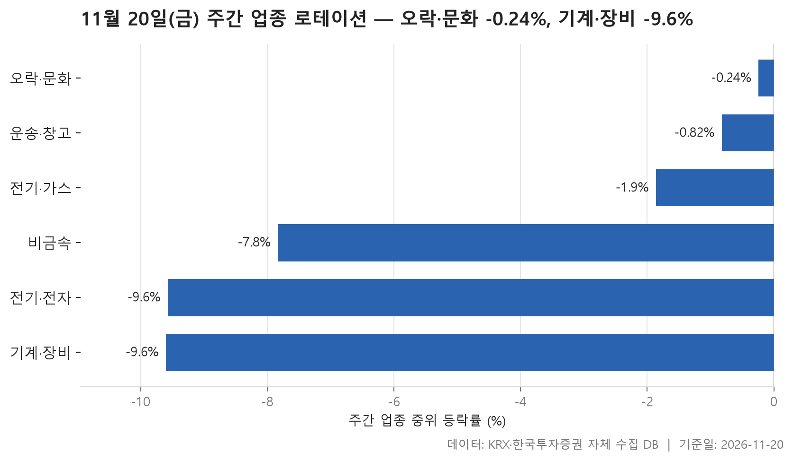
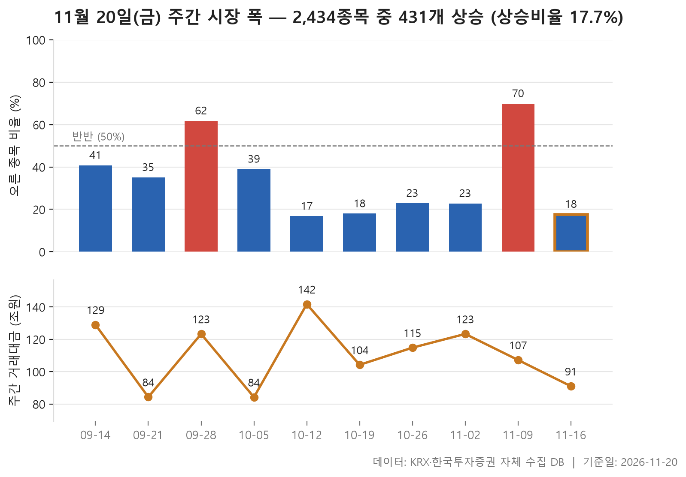
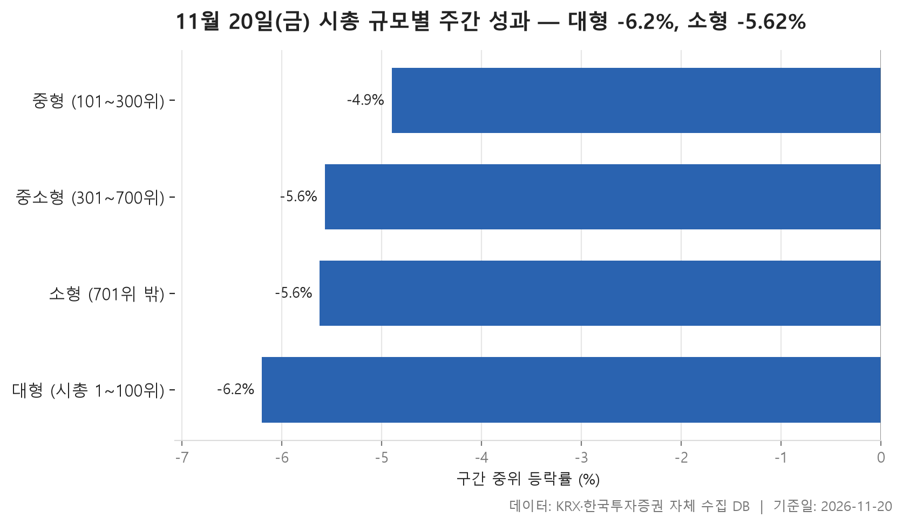

11월 셋째 주(11월 16일~20일) 시장은 넓게 빠진 한 주였습니다. 24개 업종을 업종 안 종목 등락률의 중위값으로 줄 세웠을 때 맨 위에 선 오락·문화도 -0.24%였습니다. 가장 강한 업종에서도 한가운데 놓인 종목이 조금 내렸으니, 그 아래 업종들은 더 말할 것도 없습니다. 맨 아래 기계·장비는 -9.60%까지 밀렸습니다.

오른 종목의 수를 세어 봐도 같은 그림이 나옵니다. 거래가 있었던 보통주 2,434개 가운데 오른 종목은 431개, 내린 종목은 1,983개였습니다. 바로 전 주에는 오른 종목이 내린 종목의 2.43배였으니 한 주 만에 방향이 정반대로 바뀐 셈이죠. 시가총액 규모별로 나눠 봐도 네 구간 모두 중위 등락률이 마이너스였습니다.

오늘은 세 가지를 차례로 봅니다. 어느 업종이 덜 빠지고 어느 업종이 더 빠졌는지, 이번 주 하락이 최근 10주 흐름에서 어디쯤인지, 그리고 큰 종목과 작은 종목 가운데 어느 쪽이 그나마 버텼는지입니다.

> 기준일: 2026-11-20 · 집계: 자체 수집 데이터베이스

## 주간 업종 로테이션 — 6개 모두 하락

상위 세 업종은 '강했다'기보다 '덜 약했다'고 보는 편이 맞습니다. 오락·문화는 중위값이 -0.24%인데 평균은 +1.15%로 플러스에 올라 있습니다. 60개 종목 가운데 오른 종목이 48.30%로 거의 반반이었고, 평균을 위로 끌어올린 건 스튜디오드래곤의 +35.71%였습니다. 이 종목 하나가 업종 평균을 0.60%p 끌어올린 셈입니다. 운송·창고도 구조가 비슷합니다. 제주항공이 +25.11% 오르며 업종 평균을 0.90%p 떠받쳤는데도 평균은 -1.10%로 중위값 -0.82%보다 낮습니다. 오른 종목이 39.30%에 그쳐서 한 종목이 급등해도 업종 전체 분위기는 바뀌지 않았습니다.

전기·가스는 3위에 올랐지만 속을 들여다보면 결이 다릅니다. 10개 종목 가운데 오른 곳은 한 곳(10.00%)뿐이었고, 평균 -3.33%가 중위값 -1.86%보다 한참 아래에 있습니다. SGC에너지가 -15.77% 내리면서 혼자 업종 평균을 -1.58%p 끌어내렸습니다. 종목 수가 적은 업종에서는 한 종목이 평균을 이만큼 흔들 수 있습니다. 이 업종의 순위는 업종 전체가 버틴 결과라기보다 가운데쯤 있는 종목들의 낙폭이 상대적으로 작았던 결과로 읽힙니다.

하위 세 업종 가운데 둘은 규모가 큰 업종입니다. 전기·전자는 367개, 기계·장비는 212개 종목을 거느리고 있고, 중위값이 각각 -9.57%와 -9.60%로 거의 같은 자리에 있습니다. 두 업종 모두 오른 종목이 열 곳에 한 곳꼴입니다. 비츠로시스가 -52.00%나 빠졌는데도 전기·전자 평균에 미친 영향은 -0.14%p에 그쳤습니다. 이 정도 덩치의 업종을 끌어내린 건 특정 종목이라기보다 업종 전반의 동반 하락이었다는 뜻입니다. 35개 종목으로 이뤄진 비금속은 오른 종목이 2.90%로 사실상 거의 없었습니다. 업종들이 왜 이렇게 갈렸는지는 이 자료로는 알 수 없습니다.

| 업종 | 종목수(개) | 주간중위등락률(%) | 주간평균등락률(%) | 상승비율(%) | 주도종목 | 주도종목등락률(%) | 평균기여도(%p) |
|---|---|---|---|---|---|---|---|
| 오락·문화 | 60 | -0.24 | +1.15 | 48.30 | 스튜디오드래곤 | +35.71 | 0.60 |
| 운송·창고 | 28 | -0.82 | -1.10 | 39.30 | 제주항공 | +25.11 | 0.90 |
| 전기·가스 | 10 | -1.86 | -3.33 | 10.00 | SGC에너지 | -15.77 | -1.58 |
| 비금속 | 35 | -7.83 | -8.18 | 2.90 | 서산 | -21.39 | -0.61 |
| 전기·전자 | 367 | -9.57 | -9.80 | 10.40 | 비츠로시스 | -52.00 | -0.14 |
| 기계·장비 | 212 | -9.60 | -9.22 | 11.80 | 이에스티 | -35.53 | -0.17 |

## 주간 시장 폭 — 10주 중 이번 주는 2,434개 중 431개 상승

이번 주에 오른 종목은 17.70%에 그쳤습니다. 오른 종목 수를 내린 종목 수로 나눈 값이 0.22배인데, 오른 종목 하나에 내린 종목이 네댓 개씩 있었다는 뜻입니다. 바로 앞 주인 11월 9일 주에는 1,700개가 오르고 701개가 내려 이 값이 2.43배로 10주 가운데 가장 높았습니다. 그 반등이 한 주 만에 고스란히 뒤집혔습니다.

10주를 통틀어 보면 이번 주가 특별히 예외적인 주는 아닙니다. 오른 종목이 내린 종목보다 많았던 주는 9월 28일 주(1.69배)와 11월 9일 주 두 번뿐이고, 나머지 주는 모두 1을 밑돌았습니다. 열 주 가운데 한가운데 값도 0.43배입니다. 가장 낮았던 주는 10월 12일 주로 0.20배, 오른 종목은 16.80%였습니다. 이번 주 수치는 10월 19일 주(0.22배, 18.00%)와 거의 같은 수준입니다. 약세 주가 이어지다 짧은 반등이 끼어드는 흐름이 다시 나타난 것으로 볼 수 있습니다.

거래대금도 같이 볼 만합니다. 이번 주 거래대금은 91.00조원으로, 거래일이 5일인 주 가운데 가장 적었습니다. 그보다 적었던 84.20조원과 84.30조원은 모두 거래일이 3일뿐인 주였습니다. 반면 하락이 가장 넓게 퍼졌던 10월 12일 주에는 거래대금이 141.70조원으로 10주 중 가장 많았습니다. 같은 약세 주라도 그때는 거래가 몰리면서 내렸고 이번 주는 거래가 줄어든 채로 내렸다는 점이 다릅니다.

| 주 | 거래일수(일) | 종목수(개) | 상승(개) | 보합(개) | 하락(개) | 상승비율(%) | ADR(배) | 총거래대금(조원) |
|---|---|---|---|---|---|---|---|---|
| 2026-11-16 | 5 | 2,434 | 431 | 20 | 1,983 | 17.70 | 0.22 | 91.00 |
| 2026-11-09 | 5 | 2,431 | 1,700 | 30 | 701 | 69.90 | 2.43 | 107.20 |
| 2026-11-02 | 5 | 2,425 | 554 | 18 | 1,853 | 22.80 | 0.30 | 123.30 |
| 2026-10-26 | 5 | 2,415 | 554 | 17 | 1,844 | 22.90 | 0.30 | 114.80 |
| 2026-10-19 | 5 | 2,413 | 434 | 24 | 1,955 | 18.00 | 0.22 | 104.20 |
| 2026-10-12 | 5 | 2,411 | 405 | 18 | 1,988 | 16.80 | 0.20 | 141.70 |
| 2026-10-05 | 3 | 2,414 | 942 | 39 | 1,433 | 39.00 | 0.66 | 84.20 |
| 2026-09-28 | 5 | 2,407 | 1,488 | 41 | 878 | 61.80 | 1.69 | 123.30 |
| 2026-09-21 | 3 | 2,410 | 846 | 47 | 1,517 | 35.10 | 0.56 | 84.30 |
| 2026-09-14 | 5 | 2,404 | 981 | 31 | 1,392 | 40.80 | 0.70 | 129.00 |

## 시총 규모별 주간 성과 — 소형이 0.58%p 앞섬

네 구간이 모두 내렸으니 앞섰다는 말은 덜 내렸다는 뜻입니다. 중위값 기준으로는 시가총액 101~300위 중형 구간이 -4.90%로 가장 덜 빠졌고, 1~100위 대형 구간이 -6.20%로 가장 많이 빠졌습니다. 네 구간의 한가운데 값은 -5.59%입니다. 소형 구간(-5.62%)도 대형 구간보다는 나아서, 대형과 소형의 중위값 차이는 0.58%p만큼 소형 쪽이 앞섰습니다. 그래도 차이가 크지는 않아서, 규모와 상관없이 고르게 내린 한 주라고 정리하는 편이 정확합니다.

대형 구간에서는 어긋나는 대목이 보입니다. 중위값은 -6.20%로 가장 나쁜데 평균은 -5.13%로 네 구간 중 가장 낫습니다. 가운데 놓인 종목은 많이 빠졌지만 일부 종목은 비교적 잘 버텼거나 올랐다는 뜻으로 읽힙니다. 오른 종목도 21.00%로 소형 구간보다 많았습니다. 오른 종목 비율이 가장 높은 곳은 중형 구간(29.00%)이었고, 가장 낮은 곳은 1,734개 종목이 모인 소형 구간(15.60%)이었습니다.

소형 구간에서는 지슨이 +72.83% 오르기도 했지만, 이 구간의 평균은 -6.17%로 중위값보다 낮습니다. 한두 종목이 크게 올랐어도 구간 전체에는 거의 영향이 없었다는 얘기입니다. 거래대금은 대형 구간이 61.30조원으로 압도적으로 많았고, 중형 13.90조원 아래로는 규모가 작아질수록 거래대금도 줄었습니다. 이번 주 하락은 거래가 몰린 대형 구간에서 가장 깊었던 셈입니다.

| 구간 | 종목수(개) | 주간중위등락률(%) | 주간평균등락률(%) | 상승비율(%) | 주도종목 | 주도종목등락률(%) | 주간거래대금(조원) |
|---|---|---|---|---|---|---|---|
| 대형 (시총 1~100위) | 100 | -6.20 | -5.13 | 21.00 | 이수페타시스 | -21.36 | 61.30 |
| 중형 (101~300위) | 200 | -4.90 | -4.75 | 29.00 | 스튜디오드래곤 | +35.71 | 13.90 |
| 중소형 (301~700위) | 400 | -5.57 | -6.19 | 20.50 | 오킨스전자 | -43.53 | 6.90 |
| 소형 (701위 밖) | 1,734 | -5.62 | -6.17 | 15.60 | 지슨 | +72.83 | 6.20 |

## 정리

이번 주를 한 문장으로 줄이면, 바로 전 주의 넓은 반등이 한 주 만에 되돌려졌고 업종과 규모를 가리지 않고 고르게 내렸다는 것입니다. 상위 업종도 몇몇 종목이 평균을 끌어올렸을 뿐 가운데 종목은 대부분 내렸습니다. 낙폭은 종목 수가 많은 전기·전자와 기계·장비에서 가장 깊었습니다.

이 자료에는 한계가 있습니다. 모든 수치는 직전 주 마지막 거래일 종가와 이번 주 마지막 거래일 종가를 비교한 것이라 주중에 오르내린 폭은 담겨 있지 않습니다. 업종이나 종목이 왜 그렇게 움직였는지도 이 데이터로는 알 수 없습니다. 표에 나온 개별 종목은 그 주에 가장 크게 움직인 종목을 기계적으로 고른 결과입니다. 해당 종목을 평가하거나 매매를 권하려는 뜻은 없습니다.

## 집계 기준

**주간 업종 로테이션**

- **기준**: 2026-11-13 종가 → 2026-11-20 종가
- **구간**: 2026-11-16 시작 주 — 직전 주 마지막 거래일 종가를 출발선으로 삼습니다
- **거래일수**: 5
- **순위**: 업종 내 종목 등락률의 중위값 (평균은 참고용으로 함께 표시)
- **선정**: 전체 24개 업종 중 상위 3개 · 하위 3개
- **주도종목**: 그 업종에서 같은 기간 등락률 절대값이 가장 큰 종목 (동점이면 거래대금이 큰 쪽)
- **평균기여도**: 그 종목 하나가 업종 평균을 움직인 폭 (등락률 ÷ 종목수)
- **필터**: 업종 내 보통주 5종목 이상

**주간 시장 폭**

- **기준**: 각 주의 마지막 거래일 종가를 직전 주 마지막 거래일 종가와 비교
- **주**: 그 주의 월요일 (달력 기준). 거래일 수는 연휴에 따라 다릅니다
- **ADR**: 상승 종목 수 ÷ 하락 종목 수. 1 이면 반반, 2 면 오른 종목이 두 배
- **총거래대금**: 그 주 거래일 전체의 거래대금 합계
- **모집단**: 거래가 있었던 보통주 (거래정지·액면 변경 종목 제외)

**시총 규모별 주간 성과**

- **기준**: 2026-11-13 종가 → 2026-11-20 종가
- **구간**: 기준일 시가총액 순위로 자릅니다 (금액으로 자르면 장이 오른 해에 전부 위 구간으로 올라가 해마다 다른 표가 됩니다)
- **순위**: 구간 내 종목 등락률의 중위값 (평균은 참고용으로 함께 표시)
- **주도종목**: 그 구간에서 같은 기간 등락률 절대값이 가장 큰 종목 (동점이면 거래대금이 큰 쪽)
- **대형소형격차**: -0.58
- **모집단**: 거래가 있었던 보통주 (거래정지·액면 변경 종목 제외)

## 데이터 출처 및 유의사항

- **데이터출처**: 한국거래소(KRX) 공시 데이터와 한국투자증권 OpenAPI 를 직접 수집해 구축한 자체 데이터베이스
- **집계방식**: 수집·집계·차트 생성을 직접 구현한 파이프라인에서 자동 산출
- **작성고지**: 본문의 표·통계·차트는 자체 데이터베이스에서 계산된 값이며, 문장 작성 과정에 AI 도구를 활용했습니다.
- **면책**: 본 글은 정보 제공을 목적으로 하며 특정 종목의 매수·매도를 추천하지 않습니다. 제시된 수치는 과거 데이터이고 미래 수익을 보장하지 않습니다. 투자 판단과 그 결과에 대한 책임은 투자자 본인에게 있습니다.

