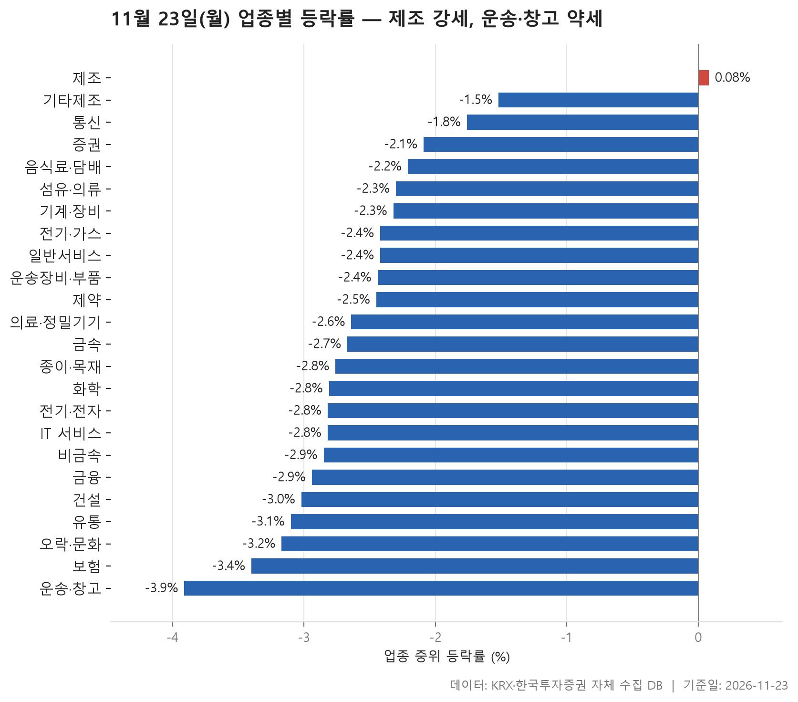
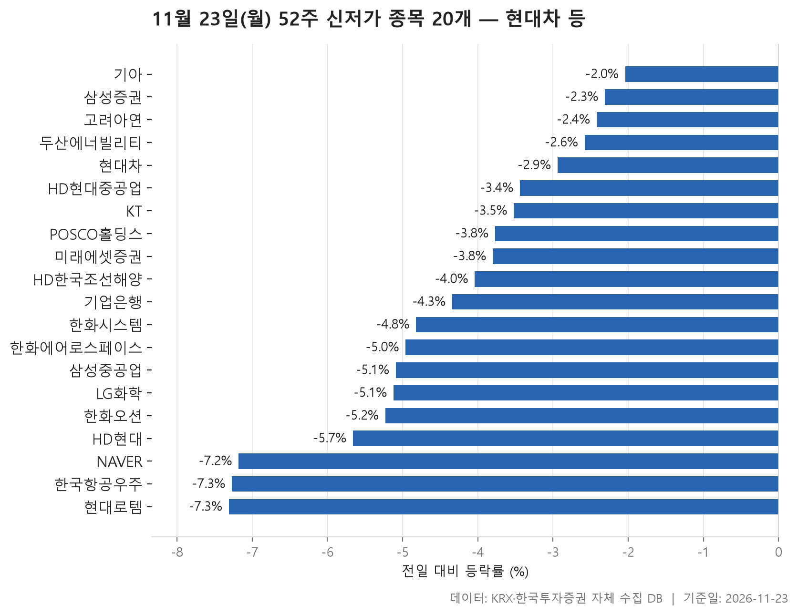
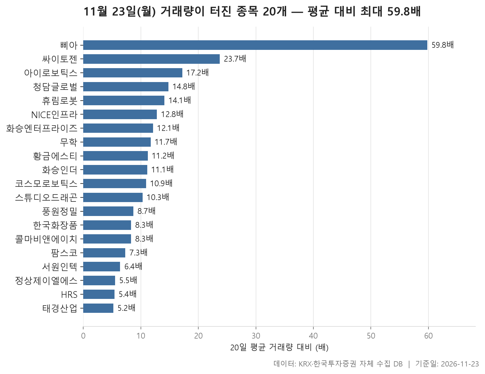

11월 23일 월요일 시장은 표 세 개를 나란히 놓고 보면 한쪽으로 크게 기운 하루였습니다. 24개 업종 가운데 중위 등락률이 플러스로 끝난 곳은 제조 하나뿐이고, 나머지 23개는 모두 마이너스였습니다. 업종별 중위 등락률을 순서대로 늘어놓았을 때 한가운데 놓인 값이 -2.65%입니다. 특정 업종만 무너진 게 아니라 거의 모든 업종이 비슷한 폭으로 밀렸다는 뜻입니다.

오늘은 업종 흐름을 먼저 보고, 이어서 52주 신저가로 내려앉은 종목과 평소보다 거래량이 몇 배로 불어난 종목을 차례로 살핍니다. 두 명단은 성격이 꽤 다릅니다. 신저가 명단은 시가총액 상위의 대형주로 채워져 있고, 거래량 급증 명단은 코스닥 중소형주가 중심입니다. 같은 날 시장의 두 얼굴을 따로 보여 주는 셈이라 함께 읽어 볼 만합니다.

> 기준일: 2026-11-23 · 집계: 자체 수집 데이터베이스

## 업종 등락률 — 24개 중 23개 하락

제목에 '제조 강세'라고 적었지만 실제 내용은 '버텼다'에 가깝습니다. 제조의 중위 등락률은 +0.08%, 평균은 +0.06%로 사실상 제자리였고, 8개 종목 가운데 오른 종목이 꼭 절반(50.00%)이었습니다. 이 업종에서 가장 크게 움직인 현대리바트도 -1.84%에 그쳤고, 거래대금을 모두 합해도 14.10억원에 불과한 작은 업종입니다. 크게 오른 업종이 있었다기보다는 다른 업종이 다 빠질 때 혼자 덜 빠진 업종이 1위에 올랐다고 보는 편이 정확합니다.

그 아래로 기타제조(-1.52%)와 통신(-1.76%)을 지나면 나머지 업종은 증권(-2.09%)부터 오락·문화(-3.17%)까지 좁은 구간에 촘촘히 붙어 있습니다. 맨 아래는 보험(-3.40%)과 운송·창고(-3.91%)입니다. 운송·창고는 중위값과 평균이 똑같이 -3.91%로, 튀는 종목 하나가 만든 숫자가 아니라 업종 전체가 고르게 내려앉은 모양입니다. 오른 종목은 10.70%에 그쳤고, 트리니티항공이 -10.92%로 가장 크게 빠졌습니다.

중위값과 평균이 벌어진 업종에서는 종목 하나가 평균을 끌고 간 흔적이 보입니다. 건설은 중위값이 -3.02%인데 평균은 -2.32%로 한참 위에 있습니다. 금양그린파워가 +30.00% 오르면서 혼자 업종 평균을 0.59%p 끌어올린 셈입니다. 반대 방향 사례는 전기·가스입니다. SGC에너지가 -10.03% 내리며 평균을 1.00%p 끌어내렸고, 그 결과 평균(-2.98%)이 중위값(-2.42%)보다 아래에 놓였습니다. 통신도 SK텔레콤이 -7.32% 빠지면서 평균을 0.61%p 낮췄습니다. 이런 업종은 평균만 보면 분위기를 실제보다 좋게 또는 나쁘게 읽게 됩니다.

상한가 근처까지 오른 종목도 여럿 있었습니다. 큐로셀 +29.95%, 코스모로보틱스 +29.97%, 휴림에이텍 +29.81%, 벡트로보틱스 +29.78% 등이 각 업종에서 가장 크게 움직였습니다. 다만 이 종목들이 속한 업종은 종목 수가 많아서 업종 전체의 방향을 바꾸지는 못했습니다. 전기·전자가 대표적입니다. 거래대금이 101,937.30억원으로 다른 업종과 비교가 안 될 만큼 많고 종목 수도 369개인데, 중위값은 -2.82%였고 오른 종목은 16.80%였습니다. 벡트로보틱스가 업종 평균에 보탠 몫은 0.08%p에 불과했습니다. 26개 종목인 종이·목재는 오른 종목 비율이 3.80%로, 오른 종목이 거의 없었습니다.

| 업종 | 종목수(개) | 중위등락률(%) | 평균등락률(%) | 상승비율(%) | 주도종목 | 주도종목등락률(%) | 평균기여도(%p) | 거래대금합계(억원) |
|---|---|---|---|---|---|---|---|---|
| 제조 | 8 | +0.08 | +0.06 | 50.00 | 현대리바트 | -1.84 | -0.23 | 14.10 |
| 기타제조 | 15 | -1.52 | -2.15 | 26.70 | 삼진엘앤디 | -9.84 | -0.66 | 22.80 |
| 통신 | 12 | -1.76 | -2.32 | 16.70 | SK텔레콤 | -7.32 | -0.61 | 1,486.10 |
| 증권 | 18 | -2.09 | -2.30 | 11.10 | 유진투자증권 | -4.54 | -0.25 | 756.60 |
| 음식료·담배 | 84 | -2.21 | -2.09 | 13.10 | 한울앤제주 | +21.50 | 0.26 | 1,526.00 |
| 섬유·의류 | 47 | -2.30 | -2.47 | 10.60 | 화승엔터프라이즈 | -9.79 | -0.21 | 157.70 |
| 기계·장비 | 213 | -2.32 | -2.08 | 23.90 | 휴림로봇 | +30.00 | 0.14 | 15,363.20 |
| 전기·가스 | 10 | -2.42 | -2.98 | 10.00 | SGC에너지 | -10.03 | -1.00 | 502.50 |
| 일반서비스 | 169 | -2.42 | -2.14 | 14.20 | 큐로셀 | +29.95 | 0.18 | 7,148.60 |
| 운송장비·부품 | 131 | -2.44 | -2.29 | 13.70 | 휴림에이텍 | +29.81 | 0.23 | 6,081.50 |
| 제약 | 168 | -2.45 | -2.41 | 13.10 | 셀레믹스 | -29.81 | -0.18 | 4,582.40 |
| 의료·정밀기기 | 104 | -2.64 | -2.42 | 13.50 | 코스모로보틱스 | +29.97 | 0.29 | 2,373.10 |
| 금속 | 129 | -2.67 | -2.81 | 9.30 | 에이치브이엠 | +16.51 | 0.13 | 2,245.20 |
| 종이·목재 | 26 | -2.76 | -3.37 | 3.80 | 한창제지 | -8.09 | -0.31 | 31.00 |
| 화학 | 220 | -2.81 | -2.79 | 14.50 | 제이케이시냅스 | -28.99 | -0.13 | 8,804.30 |
| 전기·전자 | 369 | -2.82 | -2.42 | 16.80 | 벡트로보틱스 | +29.78 | 0.08 | 101,937.30 |
| IT 서비스 | 248 | -2.82 | -2.96 | 12.50 | 크라우드웍스 | -30.00 | -0.12 | 10,962.50 |
| 비금속 | 36 | -2.85 | -2.87 | 5.60 | 국영지앤엠 | -8.31 | -0.23 | 283.20 |
| 금융 | 110 | -2.94 | -3.12 | 7.30 | 삼성에피스홀딩스 | -10.17 | -0.09 | 14,024.90 |
| 건설 | 51 | -3.02 | -2.32 | 9.80 | 금양그린파워 | +30.00 | 0.59 | 2,490.00 |
| 유통 | 157 | -3.10 | -3.00 | 12.70 | 남성 | -17.97 | -0.11 | 2,936.70 |
| 오락·문화 | 60 | -3.17 | -3.19 | 8.30 | 키이스트 | -12.62 | -0.21 | 2,084.50 |
| 보험 | 11 | -3.40 | -3.44 | 9.10 | 삼성생명 | -5.86 | -0.53 | 1,601.10 |
| 운송·창고 | 28 | -3.91 | -3.91 | 10.70 | 트리니티항공 | -10.92 | -0.39 | 1,521.40 |

## 52주 신저가 20개 — 최저 현대로템 -7.31%

신저가 명단 20개는 모두 코스피 종목이고, 시가총액 순으로 내려 읽으면 국내 대형주 목록을 보는 듯합니다. 맨 위 현대차의 시가총액이 503,580억원이고, 그 아래로도 시가총액 10조원대 이상의 이름이 줄지어 있습니다. 이 명단의 중위 등락률은 -4.19%로, 앞 섹션 업종 중위값들보다 한 단계 깊게 빠졌습니다.

업종으로 보면 운송장비·부품이 8개로 가장 많습니다. 현대차와 기아 같은 자동차, HD현대중공업·삼성중공업·한화오션 같은 조선, 한화에어로스페이스·한국항공우주·현대로템까지 한 업종에 모였습니다. 앞 표에서 운송장비·부품 업종의 중위 등락률은 -2.44%로 24개 업종 중 중간쯤이었습니다. 업종 전체로는 평범한 하락처럼 보였지만, 업종 안 대형주들은 1년 동안의 바닥을 새로 쓰고 있었던 셈입니다. 업종 중위값만 봐서는 보이지 않는 대목입니다. 하락 폭은 현대로템(-7.31%)과 한국항공우주(-7.27%)가 가장 컸습니다.

반대로 기아는 -2.04%로 명단에서 가장 덜 빠졌는데도 신저가에 들었습니다. 종가 86,400원이 직전 52주 최저가 87,100원을 살짝 밑돈 경우로, 이미 바닥 근처에 있던 종목은 크게 빠지지 않아도 이 명단에 오릅니다. NAVER는 -7.18% 내렸고 거래대금이 2,212.30억원으로 명단에서 가장 많았습니다. 그 밖에 은행·증권·통신 종목도 섞여 있습니다. 참고로 HD한국조선해양과 HD현대는 이 자료의 업종 분류상 금융으로 잡혀 있으니, 업종별 개수를 볼 때 이 점을 감안하시면 됩니다.

| 종목명 | 종목코드 | 시장 | 업종 | 종가(원) | 등락률(%) | 이전52주최저(원) | 거래대금(억원) | 시가총액(억원) |
|---|---|---|---|---|---|---|---|---|
| 현대차 | 005380 | KOSPI | 운송장비·부품 | 247,500 | -2.94 | 252,000 | 795.10 | 503,580 |
| 기아 | 000270 | KOSPI | 운송장비·부품 | 86,400 | -2.04 | 87,100 | 789.90 | 337,317 |
| 한화에어로스페이스 | 012450 | KOSPI | 운송장비·부품 | 575,000 | -4.96 | 601,000 | 595.50 | 296,490 |
| 두산에너빌리티 | 034020 | KOSPI | 기계·장비 | 39,700 | -2.58 | 40,200 | 922.80 | 254,303 |
| HD현대중공업 | 329180 | KOSPI | 운송장비·부품 | 238,500 | -3.44 | 243,000 | 413.10 | 250,333 |
| NAVER | 035420 | KOSPI | IT 서비스 | 150,000 | -7.18 | 160,900 | 2,212.30 | 228,190 |
| POSCO홀딩스 | 005490 | KOSPI | 금속 | 242,500 | -3.77 | 250,000 | 520.80 | 192,161 |
| 고려아연 | 010130 | KOSPI | 금속 | 727,000 | -2.42 | 731,000 | 83.60 | 151,746 |
| HD한국조선해양 | 009540 | KOSPI | 금융 | 213,500 | -4.04 | 220,000 | 326.20 | 151,101 |
| 기업은행 | 024110 | KOSPI | 금융 | 18,280 | -4.34 | 18,690 | 138.60 | 145,769 |
| LG화학 | 051910 | KOSPI | 화학 | 192,600 | -5.12 | 200,500 | 519.00 | 135,961 |
| 삼성중공업 | 010140 | KOSPI | 운송장비·부품 | 14,350 | -5.09 | 15,050 | 456.30 | 126,280 |
| 한화오션 | 042660 | KOSPI | 운송장비·부품 | 39,900 | -5.23 | 41,800 | 433.20 | 122,259 |
| KT | 030200 | KOSPI | 통신 | 43,900 | -3.52 | 44,600 | 206.80 | 110,638 |
| 미래에셋증권 | 006800 | KOSPI | 증권 | 18,240 | -3.80 | 18,730 | 195.60 | 99,047 |
| 한국항공우주 | 047810 | KOSPI | 운송장비·부품 | 93,100 | -7.27 | 95,000 | 299.90 | 90,749 |
| HD현대 | 267250 | KOSPI | 금융 | 106,600 | -5.66 | 111,300 | 177.80 | 84,207 |
| 한화시스템 | 272210 | KOSPI | 전기·전자 | 44,400 | -4.82 | 44,750 | 208.50 | 83,880 |
| 현대로템 | 064350 | KOSPI | 운송장비·부품 | 57,100 | -7.31 | 61,000 | 311.00 | 62,320 |
| 삼성증권 | 016360 | KOSPI | 증권 | 67,600 | -2.31 | 68,500 | 173.30 | 60,367 |

## 거래량 급증 20개 — 최고 삐아 59.80배

거래량 급증 명단은 신저가 명단과 거의 정반대 모습입니다. 코스닥이 13개, 코스피가 7개이고, 대부분 시가총액 수백억원에서 천억원대 종목입니다. 가장 큰 스튜디오드래곤도 9,829억원입니다. 맨 위 삐아는 평소 하루 60,818주가 거래되던 종목인데 이날 3,634,741주가 오가며 평균의 59.80배를 기록했습니다. 주가는 +4.61% 올랐습니다. 명단의 중간값은 11배이고, 가장 낮은 태경산업도 5.20배입니다.

주가 방향은 섞여 있습니다. 오른 종목이 절반을 조금 넘고 나머지는 내렸습니다. 오른 쪽에서는 휴림로봇(+30.00%)과 코스모로보틱스(+29.97%)가 눈에 띕니다. 두 종목은 앞 섹션에서 각자 업종 안에서 가장 크게 움직인 종목으로도 이름을 올렸습니다. 휴림로봇은 거래대금도 561.20억원으로 이 명단에서 가장 많습니다. 풍원정밀(+26.60%)과 싸이토젠(+22.05%)도 크게 올랐습니다. 내린 쪽에서는 화승엔터프라이즈(-9.79%), NICE인프라(-8.05%), 무학(-7.57%)이 거래량이 터지면서 함께 밀렸습니다. 거래량이 늘었다고 해서 방향이 한쪽으로 정해지지는 않는다는 점이 이 표에서 그대로 보입니다.

배수를 읽을 때는 거래대금도 함께 봐야 합니다. 서원인텍은 거래대금이 3.20억원, 정상제이엘에스는 4.70억원, NICE인프라는 5.40억원에 그쳤습니다. 평소 거래가 워낙 적은 종목은 크지 않은 주문만으로도 배수가 쉽게 커집니다. 왜 이날 거래가 몰렸는지는 이 자료에 나와 있지 않습니다.

| 종목명 | 종목코드 | 시장 | 업종 | 종가(원) | 등락률(%) | 거래량(주) | 평균거래량(주) | 배수(배) | 거래대금(억원) | 시가총액(억원) |
|---|---|---|---|---|---|---|---|---|---|---|
| 삐아 | 451250 | KOSDAQ | 화학 | 8,170 | +4.61 | 3,634,741 | 60,818 | 59.80 | 312.80 | 835 |
| 싸이토젠 | 217330 | KOSDAQ | 일반서비스 | 2,740 | +22.05 | 890,294 | 37,493 | 23.70 | 23.90 | 634 |
| 아이로보틱스 | 066430 | KOSDAQ | 유통 | 1,585 | +9.31 | 4,356,991 | 254,049 | 17.20 | 72.20 | 621 |
| 청담글로벌 | 362320 | KOSDAQ | 유통 | 5,670 | +2.16 | 1,639,849 | 110,760 | 14.80 | 87.90 | 1,173 |
| 휴림로봇 | 090710 | KOSDAQ | 기계·장비 | 5,720 | +30.00 | 10,283,149 | 731,470 | 14.10 | 561.20 | 6,861 |
| NICE인프라 | 063570 | KOSDAQ | 일반서비스 | 2,570 | -8.05 | 208,339 | 16,227 | 12.80 | 5.40 | 878 |
| 화승엔터프라이즈 | 241590 | KOSPI | 섬유·의류 | 1,603 | -9.79 | 1,055,705 | 86,986 | 12.10 | 15.80 | 971 |
| 무학 | 033920 | KOSPI | 음식료·담배 | 6,840 | -7.57 | 259,235 | 22,096 | 11.70 | 18.10 | 1,949 |
| 황금에스티 | 032560 | KOSPI | 금속 | 5,240 | -1.13 | 322,332 | 28,704 | 11.20 | 16.70 | 891 |
| 화승인더 | 006060 | KOSPI | 유통 | 1,803 | +4.83 | 955,326 | 85,995 | 11.10 | 16.90 | 997 |
| 코스모로보틱스 | 439960 | KOSDAQ | 의료·정밀기기 | 4,640 | +29.97 | 7,393,721 | 679,221 | 10.90 | 320.50 | 1,506 |
| 스튜디오드래곤 | 253450 | KOSDAQ | 오락·문화 | 32,700 | +4.31 | 1,359,199 | 131,830 | 10.30 | 459.30 | 9,829 |
| 풍원정밀 | 371950 | KOSDAQ | 전기·전자 | 2,570 | +26.60 | 603,493 | 69,631 | 8.70 | 14.80 | 709 |
| 한국화장품 | 123690 | KOSPI | 유통 | 6,680 | +3.41 | 3,558,815 | 427,681 | 8.30 | 251.90 | 1,073 |
| 콜마비앤에이치 | 200130 | KOSDAQ | 제약 | 7,620 | +1.46 | 731,969 | 88,069 | 8.30 | 58.10 | 2,193 |
| 팜스코 | 036580 | KOSPI | 음식료·담배 | 2,250 | +2.97 | 469,056 | 64,240 | 7.30 | 10.40 | 826 |
| 서원인텍 | 093920 | KOSDAQ | 전기·전자 | 4,175 | -5.01 | 77,176 | 12,028 | 6.40 | 3.20 | 777 |
| 정상제이엘에스 | 040420 | KOSDAQ | 일반서비스 | 5,640 | -1.57 | 83,623 | 15,135 | 5.50 | 4.70 | 884 |
| HRS | 036640 | KOSDAQ | 화학 | 4,360 | -4.60 | 126,838 | 23,331 | 5.40 | 5.60 | 713 |
| 태경산업 | 015890 | KOSPI | 화학 | 4,295 | -4.02 | 159,358 | 30,463 | 5.20 | 6.90 | 1,255 |

## 정리

정리하면 11월 23일은 거의 모든 업종이 비슷한 폭으로 밀린 가운데, 대형주는 52주 신저가로 내려앉고 거래는 일부 중소형주에 몰린 하루였습니다. 1위 업종인 제조조차 오른 게 아니라 제자리를 지킨 수준이었다는 점이 이날 분위기를 잘 보여 줍니다.

이 글은 하루치 종가만 비교한 결과라서 이 흐름이 이어질지는 알 수 없습니다. 각 종목과 업종이 왜 그렇게 움직였는지도 자료에 담겨 있지 않습니다. 업종 순위는 평균이 아닌 중위값 기준이고, 업종 분류는 자체 데이터베이스 기준이라 일반적으로 쓰는 분류와 다를 수 있습니다.

## 집계 기준

**업종 등락률**

- **기준**: 2026-11-20 종가 → 2026-11-23 종가
- **순위**: 업종 내 종목 등락률의 중위값 (평균은 참고용으로 함께 표시)
- **주도종목**: 그 업종에서 등락률 절대값이 가장 큰 종목 (동점이면 거래대금이 큰 쪽)
- **평균기여도**: 그 종목 하나가 업종 평균을 움직인 폭 (등락률 ÷ 종목수). 중위값과 평균의 격차가 이 값에 가까우면 평균을 만든 것이 그 종목이고, 훨씬 크면 다른 종목들도 함께 움직인 것입니다
- **필터**: 업종 내 보통주 5종목 이상
- **전체업종중위등락률(%)**: -2.66

**52주 신저가**

- **기준**: 종가 < 직전 52주 최저가
- **관측구간**: 2025-11-11 ~ 2026-11-20 (252거래일)
- **필터**: 시가총액 500억 이상, 거래대금 3억 이상, 보통주

**거래량 급증**

- **기준**: 당일 거래량 ≥ 직전 20거래일 평균 × 5
- **관측구간**: 2026-10-26 ~ 2026-11-20 (20거래일)
- **필터**: 시가총액 500억 이상, 거래대금 3억 이상, 보통주

## 데이터 출처 및 유의사항

- **데이터출처**: 한국거래소(KRX) 공시 데이터와 한국투자증권 OpenAPI 를 직접 수집해 구축한 자체 데이터베이스
- **집계방식**: 수집·집계·차트 생성을 직접 구현한 파이프라인에서 자동 산출
- **작성고지**: 본문의 표·통계·차트는 자체 데이터베이스에서 계산된 값이며, 문장 작성 과정에 AI 도구를 활용했습니다.
- **면책**: 본 글은 정보 제공을 목적으로 하며 특정 종목의 매수·매도를 추천하지 않습니다. 제시된 수치는 과거 데이터이고 미래 수익을 보장하지 않습니다. 투자 판단과 그 결과에 대한 책임은 투자자 본인에게 있습니다.

