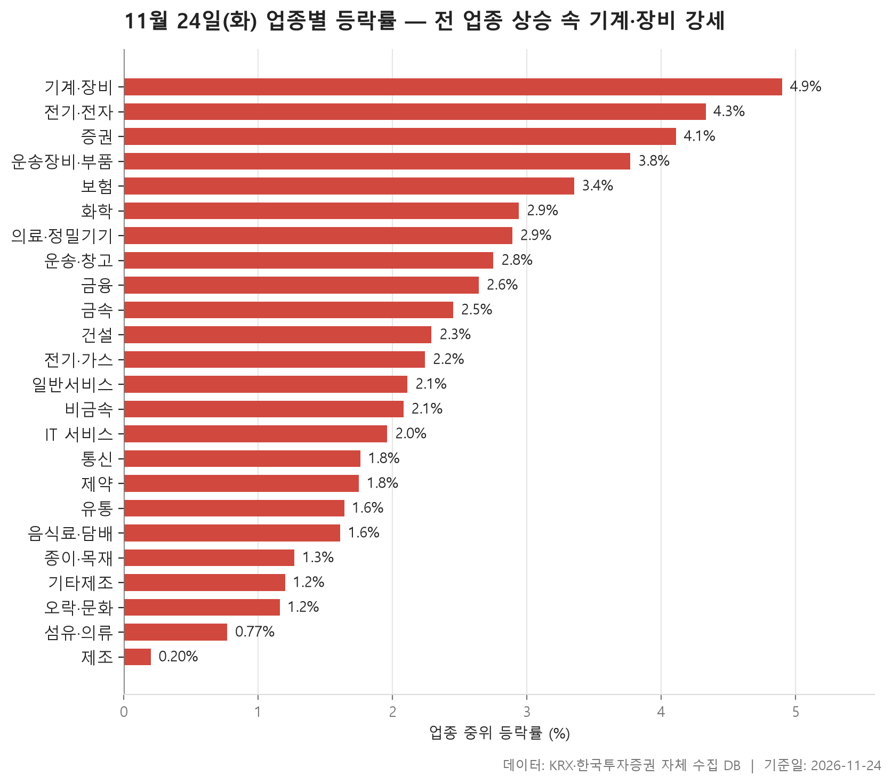
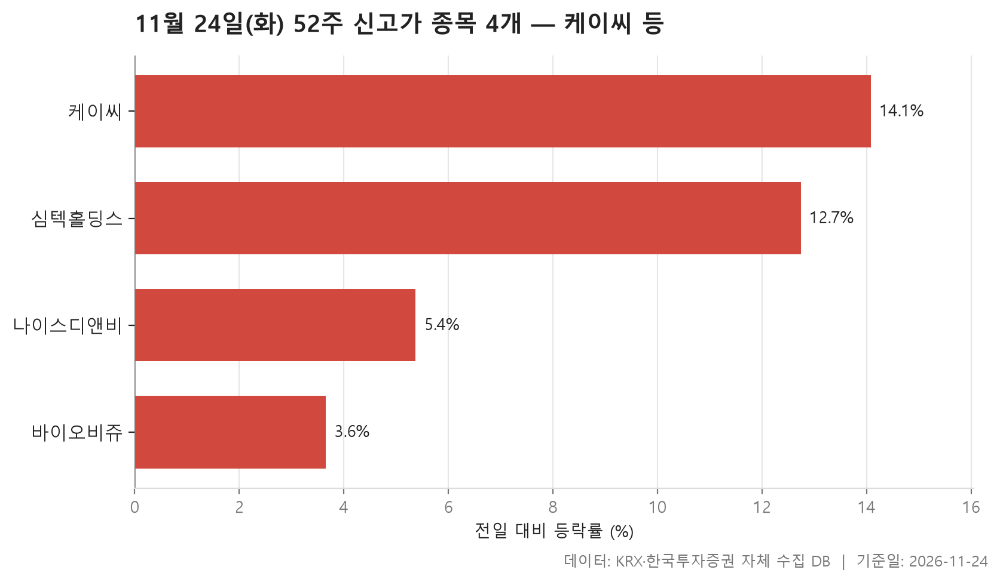
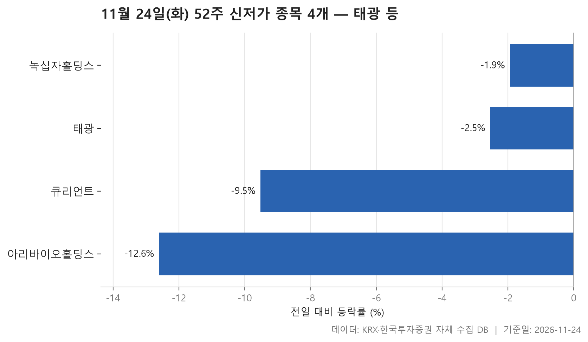
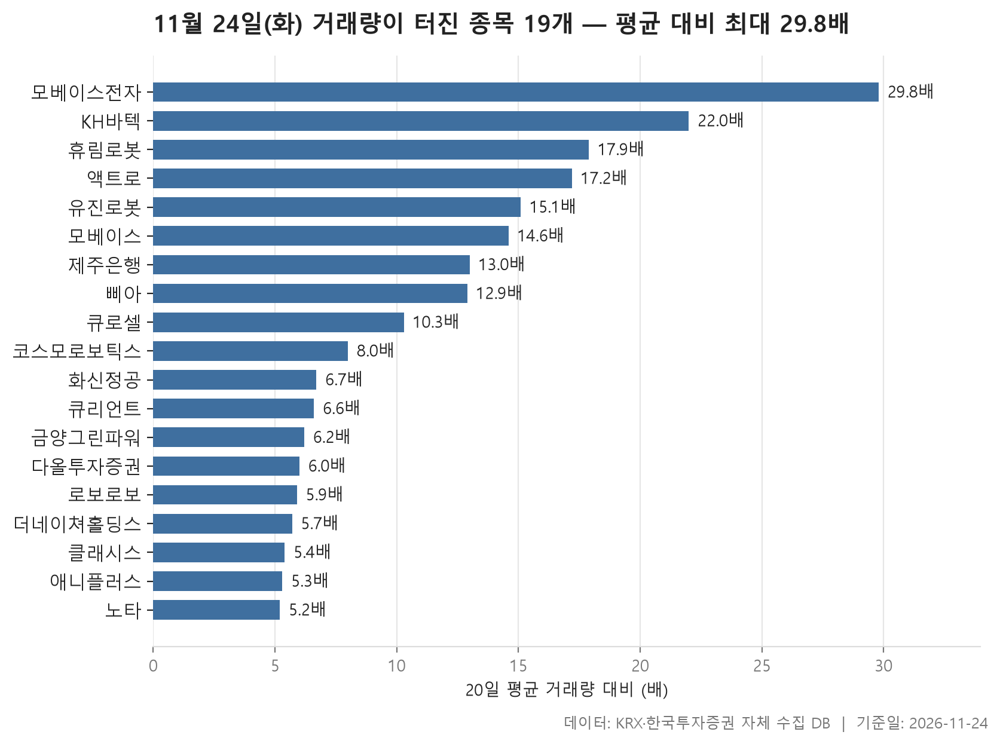

11월 24일 시장은 한쪽으로 기운 하루였습니다. 업종 24개를 하나씩 놓고 각 업종 종목들의 등락률 중위값을 구해 보면, 가장 낮은 업종도 플러스였습니다. 업종 중위값을 줄 세웠을 때 한가운데 놓인 값은 +2.17%입니다. 절반의 업종에서는 종목 절반 이상이 이보다 더 올랐다는 뜻이니, 오늘은 어디가 올랐는지보다 **얼마나 고르게 올랐는지**를 먼저 봐야 하는 날입니다.

맨 위에는 기계·장비가, 맨 아래에는 제조가 있습니다. 다만 순위만 봐서는 보이지 않는 대목이 있습니다. 평균과 중위값이 벌어진 업종도 있고, 업종에서 가장 크게 움직인 종목이 오히려 내린 업종도 하나 끼어 있습니다.

이어서 52주 신고가와 신저가, 그리고 평소보다 거래가 몇 배씩 몰린 종목을 차례로 봅니다. 시장 전체가 오른 날인데도 신고가는 4개뿐이었고, 신저가 역시 4개가 나왔습니다. 거래량이 터진 종목은 19개로 대부분 코스닥이었습니다.

> 기준일: 2026-11-24 · 집계: 자체 수집 데이터베이스

## 업종 등락률 — 24개 모두 상승

1위 기계·장비는 중위값 +4.90%, 평균 +5.48%입니다. 213개 종목 가운데 90.10%가 올랐습니다. 대성하이텍이 +30.00%로 가장 크게 움직였지만 종목 수가 많다 보니 이 종목 하나가 업종 평균을 끌어올린 폭은 0.14%p에 그칩니다. 업종 전체가 함께 오른 결과로 읽는 편이 맞습니다. 2위 전기·전자(+4.33%)도 열에 아홉꼴로 올랐는데, 거래대금이 103,046.90억원으로 나머지 업종들과 단위가 다를 만큼 컸습니다. 오늘 돈이 가장 많이 오간 곳이 이 업종입니다.

종목이 적은 업종에서는 다른 그림이 보입니다. 증권은 18개 종목이 **모두** 올랐고, 중위값 +4.11%와 평균 +4.09%가 거의 겹칩니다. 크게 튄 종목 없이 고르게 올랐다는 뜻입니다. 전기·가스도 10개 종목이 전부 올랐습니다. 반대로 운송장비·부품은 중위값 +3.77%에 평균 +4.69%로 둘의 차이가 꽤 납니다. 모베이스전자(+29.98%) 한 종목이 평균을 0.23%p 끌어올렸는데, 실제로 벌어진 차이는 그보다 큽니다. 다른 종목들도 평균을 위로 밀었다는 얘기입니다.

아래쪽에서 눈에 띄는 업종은 셋입니다. 꼴찌 제조는 중위값이 +0.20%인데 평균은 +0.83%입니다. 8개 종목뿐인 업종이라 현대리바트(+3.95%) 하나가 평균을 0.49%p 밀어 올렸고, 그 몫이 평균과 중위값 차이의 대부분을 차지합니다. 섬유·의류와 오락·문화는 거꾸로 평균이 중위값보다 낮습니다. 특히 섬유·의류에서 가장 크게 움직인 종목은 에스제이그룹(-4.98%)으로, 24개 업종 가운데 유일하게 하락 종목이 그 자리에 섰습니다. 이 세 업종은 오른 종목도 열 곳 중 여섯 곳 남짓에 머물러 오늘 시장에서 열기가 가장 약했던 곳으로 보입니다.

표 곳곳에 가격제한폭 근처까지 오른 종목이 흩어져 있다는 점도 짚어 둡니다. KH바텍(+29.96%), 바이오인프라(+29.97%), 현대오토에버(+29.93%), 애드바이오텍(+29.98%)처럼 서로 다른 업종에서 이런 종목이 나왔습니다. 개별 종목의 강한 움직임이 여러 군데서 동시에 나왔다는 뜻입니다.

| 업종 | 종목수(개) | 중위등락률(%) | 평균등락률(%) | 상승비율(%) | 주도종목 | 주도종목등락률(%) | 평균기여도(%p) | 거래대금합계(억원) |
|---|---|---|---|---|---|---|---|---|
| 기계·장비 | 213 | +4.90 | +5.48 | 90.10 | 대성하이텍 | +30.00 | 0.14 | 19,049.80 |
| 전기·전자 | 368 | +4.33 | +4.78 | 90.20 | KH바텍 | +29.96 | 0.08 | 103,046.90 |
| 증권 | 18 | +4.11 | +4.09 | 100.00 | 유진투자증권 | +6.81 | 0.38 | 704.40 |
| 운송장비·부품 | 131 | +3.77 | +4.69 | 87.80 | 모베이스전자 | +29.98 | 0.23 | 9,328.40 |
| 보험 | 11 | +3.35 | +3.40 | 81.80 | 삼성생명 | +9.78 | 0.89 | 1,428.10 |
| 화학 | 220 | +2.94 | +3.29 | 84.10 | 이수스페셜티케미컬 | +19.83 | 0.09 | 9,964.40 |
| 의료·정밀기기 | 104 | +2.89 | +3.15 | 79.80 | 리브스메드 | +15.14 | 0.15 | 2,601.20 |
| 운송·창고 | 28 | +2.75 | +2.99 | 96.40 | 현대글로비스 | +8.57 | 0.31 | 1,404.20 |
| 금융 | 110 | +2.64 | +3.18 | 90.00 | 미래에셋벤처투자 | +15.45 | 0.14 | 12,659.10 |
| 금속 | 129 | +2.45 | +2.77 | 82.20 | 한선엔지니어링 | +14.56 | 0.11 | 2,272.10 |
| 건설 | 51 | +2.29 | +2.60 | 86.30 | 금양그린파워 | +13.62 | 0.27 | 2,588.00 |
| 전기·가스 | 10 | +2.24 | +2.62 | 100.00 | SGC에너지 | +5.02 | 0.50 | 446.40 |
| 일반서비스 | 169 | +2.11 | +2.03 | 81.10 | 바이오인프라 | +29.97 | 0.18 | 6,648.00 |
| 비금속 | 36 | +2.08 | +2.04 | 80.60 | 아이에스동서 | +6.55 | 0.18 | 286.60 |
| IT 서비스 | 249 | +1.96 | +2.34 | 75.90 | 현대오토에버 | +29.93 | 0.12 | 8,628.90 |
| 통신 | 12 | +1.76 | +2.09 | 66.70 | 더즌 | +8.02 | 0.67 | 1,185.10 |
| 제약 | 168 | +1.75 | +2.21 | 82.70 | 애드바이오텍 | +29.98 | 0.18 | 4,196.20 |
| 유통 | 157 | +1.64 | +2.02 | 79.00 | 에스티큐브 | +9.43 | 0.06 | 2,570.40 |
| 음식료·담배 | 84 | +1.61 | +1.74 | 84.50 | 인산가 | +9.78 | 0.12 | 1,323.20 |
| 종이·목재 | 26 | +1.27 | +1.95 | 84.60 | 무림SP | +9.38 | 0.36 | 26.90 |
| 기타제조 | 15 | +1.20 | +1.50 | 66.70 | 노바텍 | +5.38 | 0.36 | 16.20 |
| 오락·문화 | 60 | +1.16 | +0.91 | 63.30 | 스튜디오미르 | +7.45 | 0.12 | 1,476.60 |
| 섬유·의류 | 47 | +0.77 | +0.32 | 61.70 | 에스제이그룹 | -4.98 | -0.11 | 124.50 |
| 제조 | 8 | +0.20 | +0.83 | 62.50 | 현대리바트 | +3.95 | 0.49 | 10.70 |

## 52주 신고가 4개 — 최고 케이씨 14.08%

전 업종이 오른 날인데도 52주 최고가를 넘어선 종목은 4개뿐입니다. 시장이 넓게 올랐다고 해서 그 상승이 곧바로 1년 고점 돌파로 이어지지는 않았습니다. 신고가 종목들도 직전 고점을 크게 넘어서지는 않았습니다. 심텍홀딩스는 종가 6,550원으로 직전 최고가 6,500원을 살짝 넘었고, 케이씨도 48,600원으로 47,900원을 조금 웃돈 정도입니다.

상승 폭은 위아래로 갈립니다. 케이씨(+14.08%)와 심텍홀딩스(+12.74%)는 하루에 크게 뛰면서 고점을 넘었고, 바이오비쥬(+3.65%)와 나이스디앤비(+5.37%)는 이미 고점 근처에 있다가 비교적 작은 상승으로 선을 넘었습니다. 네 종목의 등락률 중위값은 +9.05%입니다. 시가총액은 케이씨가 5,356억원으로 가장 큽니다.

거래대금 차이도 볼 만합니다. 심텍홀딩스는 212.10억원어치가 거래됐는데, 나이스디앤비는 4.30억원으로 걸러내는 기준을 겨우 넘었습니다. 거래가 얇은 신고가는 다음 날 쉽게 흔들릴 수 있다는 점을 감안하고 보시면 좋겠습니다. 시장별로는 코스닥이 3개, 코스피가 1개입니다.

| 종목명 | 종목코드 | 시장 | 업종 | 종가(원) | 등락률(%) | 이전52주최고(원) | 거래대금(억원) | 시가총액(억원) |
|---|---|---|---|---|---|---|---|---|
| 케이씨 | 029460 | KOSPI | 의료·정밀기기 | 48,600 | +14.08 | 47,900 | 40.50 | 5,356 |
| 심텍홀딩스 | 036710 | KOSDAQ | 일반서비스 | 6,550 | +12.74 | 6,500 | 212.10 | 3,460 |
| 바이오비쥬 | 489460 | KOSDAQ | 화학 | 17,050 | +3.65 | 16,770 | 21.40 | 2,515 |
| 나이스디앤비 | 130580 | KOSDAQ | 일반서비스 | 7,070 | +5.37 | 6,980 | 4.30 | 1,089 |

## 52주 신저가 4개 — 최저 아리바이오홀딩스 -12.60%

모든 업종이 오른 날에도 1년 최저가를 새로 쓴 종목이 4개 나왔습니다. 신고가와 개수가 같다는 점이 흥미롭습니다. 다만 성격은 둘로 나뉩니다.

태광과 녹십자홀딩스는 하락 폭이 작습니다. 태광은 -2.54%, 녹십자홀딩스는 -1.94%였고, 종가도 직전 최저가 바로 밑입니다. 태광은 19,150원으로 19,170원을, 녹십자홀딩스는 8,610원으로 8,630원을 겨우 밑돌았습니다. 바닥을 크게 뚫었다기보다 바닥선에 걸쳐 있다고 보는 편이 가깝습니다. 태광은 시가총액 4,876억원으로 이 표에서 가장 큰 종목입니다.

나머지 두 종목은 내린 폭이 큽니다. 아리바이오홀딩스는 -12.60%로 종가 2,220원까지 밀려 직전 최저가 2,515원을 확실히 깨고 내려갔습니다. 큐리언트(-9.52%)도 12,230원이던 기존 저점을 11,400원으로 낮췄습니다. 큐리언트는 아래 거래량 급증 표에도 이름이 있습니다. 평소의 6.60배에 이르는 거래가 실린 채 신저가를 썼다는 뜻이고, 오늘 오른 시장과는 반대로 움직인 대목입니다. 네 종목 등락률의 중위값은 -6.03%입니다. 왜 내렸는지는 자료로 알 수 없습니다.

| 종목명 | 종목코드 | 시장 | 업종 | 종가(원) | 등락률(%) | 이전52주최저(원) | 거래대금(억원) | 시가총액(억원) |
|---|---|---|---|---|---|---|---|---|
| 태광 | 023160 | KOSDAQ | 금속 | 19,150 | -2.54 | 19,170 | 62.40 | 4,876 |
| 큐리언트 | 115180 | KOSDAQ | 일반서비스 | 11,400 | -9.52 | 12,230 | 141.20 | 4,279 |
| 녹십자홀딩스 | 005250 | KOSPI | 일반서비스 | 8,610 | -1.94 | 8,630 | 10.40 | 4,049 |
| 아리바이오홀딩스 | 290690 | KOSDAQ | 전기·전자 | 2,220 | -12.60 | 2,515 | 63.40 | 1,178 |

## 거래량 급증 19개 — 최고 모베이스전자 29.80배

거래량이 직전 20거래일 평균의 5배를 넘긴 종목은 19개이고, 그중 17개가 코스닥입니다. 배수의 중위값은 8배인데, 위쪽은 훨씬 가파릅니다. 모베이스전자는 평소의 29.80배, KH바텍은 22.00배가 거래됐고, 각각 +29.98%와 +29.96%로 마감했습니다. 상위 몇 종목은 거래 폭발과 가격제한폭 근처 상승이 한꺼번에 나왔습니다.

거래대금 규모로는 휴림로봇이 눈에 띕니다. +29.90% 오르면서 1,515.50억원어치가 거래돼 이 표에서 가장 많은 돈이 오갔고, 금양그린파워(+13.62%)도 1,103.90억원으로 그 뒤를 잇습니다. 이름에 로봇이 들어간 종목이 휴림로봇, 유진로봇, 코스모로보틱스, 로보로보까지 여럿 보이는 점도 눈길을 끕니다. 하지만 이들이 왜 같은 날 움직였는지는 자료에 나와 있지 않습니다. 모베이스전자와 모베이스가 나란히 올라 있다는 점도 마찬가지로 표에서 확인되는 사실까지만 적어 둡니다.

거래가 몰렸다고 해서 모두 오른 것은 아닙니다. 큐리언트(-9.52%), 큐로셀(-3.99%), 더네이쳐홀딩스(-3.27%)는 평소보다 몇 배 많은 거래 속에 내렸습니다. 시가총액이 가장 큰 클래시스(14,091억원)는 5.40배로 기준선을 조금 넘었고, 노타는 5.20배로 표의 마지막 자리에 올랐습니다. 업종은 12개로 흩어져 있는데 전기·전자가 4개로 가장 많아, 오늘 거래대금이 이 업종에 몰렸던 흐름과도 겹칩니다.

| 종목명 | 종목코드 | 시장 | 업종 | 종가(원) | 등락률(%) | 거래량(주) | 평균거래량(주) | 배수(배) | 거래대금(억원) | 시가총액(억원) |
|---|---|---|---|---|---|---|---|---|---|---|
| 모베이스전자 | 012860 | KOSDAQ | 운송장비·부품 | 2,285 | +29.98 | 11,138,225 | 374,248 | 29.80 | 244.00 | 1,673 |
| KH바텍 | 060720 | KOSDAQ | 전기·전자 | 12,190 | +29.96 | 2,734,021 | 124,329 | 22.00 | 325.90 | 2,886 |
| 휴림로봇 | 090710 | KOSDAQ | 기계·장비 | 7,430 | +29.90 | 21,709,729 | 1,211,100 | 17.90 | 1,515.50 | 8,912 |
| 액트로 | 290740 | KOSDAQ | 전기·전자 | 9,640 | +29.92 | 354,595 | 20,614 | 17.20 | 33.50 | 923 |
| 유진로봇 | 056080 | KOSDAQ | 기계·장비 | 9,530 | +20.63 | 3,931,705 | 259,912 | 15.10 | 371.50 | 3,644 |
| 모베이스 | 101330 | KOSDAQ | 전기·전자 | 3,510 | +14.89 | 2,249,430 | 153,772 | 14.60 | 80.10 | 812 |
| 제주은행 | 006220 | KOSPI | 금융 | 8,970 | +7.94 | 739,669 | 56,775 | 13.00 | 67.40 | 3,391 |
| 삐아 | 451250 | KOSDAQ | 화학 | 8,480 | +3.79 | 3,130,535 | 242,150 | 12.90 | 269.90 | 867 |
| 큐로셀 | 372320 | KOSDAQ | 일반서비스 | 26,450 | -3.99 | 294,528 | 28,694 | 10.30 | 76.50 | 4,028 |
| 코스모로보틱스 | 439960 | KOSDAQ | 의료·정밀기기 | 4,830 | +4.09 | 8,170,135 | 1,025,379 | 8.00 | 399.20 | 1,567 |
| 화신정공 | 126640 | KOSDAQ | 운송장비·부품 | 2,580 | +14.41 | 2,147,677 | 318,498 | 6.70 | 56.30 | 904 |
| 큐리언트 | 115180 | KOSDAQ | 일반서비스 | 11,400 | -9.52 | 1,225,861 | 186,379 | 6.60 | 141.20 | 4,279 |
| 금양그린파워 | 282720 | KOSDAQ | 건설 | 10,930 | +13.62 | 10,399,626 | 1,667,861 | 6.20 | 1,103.90 | 1,325 |
| 다올투자증권 | 030210 | KOSPI | 증권 | 3,180 | +2.91 | 246,321 | 40,844 | 6.00 | 8.30 | 1,937 |
| 로보로보 | 215100 | KOSDAQ | 전기·전자 | 3,365 | +11.98 | 293,337 | 49,433 | 5.90 | 9.80 | 685 |
| 더네이쳐홀딩스 | 298540 | KOSDAQ | 섬유·의류 | 5,320 | -3.27 | 81,507 | 14,412 | 5.70 | 4.20 | 771 |
| 클래시스 | 214150 | KOSDAQ | 의료·정밀기기 | 21,600 | +6.40 | 1,414,122 | 262,142 | 5.40 | 293.00 | 14,091 |
| 애니플러스 | 310200 | KOSDAQ | 오락·문화 | 1,897 | +1.28 | 587,669 | 110,325 | 5.30 | 11.20 | 990 |
| 노타 | 486990 | KOSDAQ | IT 서비스 | 12,400 | +14.50 | 701,421 | 136,001 | 5.20 | 87.40 | 2,660 |

## 정리

정리하면 11월 24일은 24개 업종이 모두 오르고 그 맨 앞에 기계·장비와 전기·전자가 선 날입니다. 그런데도 1년 고점을 넘어선 종목은 많지 않았고, 거래가 터진 종목은 코스닥 개별 종목에 몰렸습니다. 넓게 올랐지만 아주 강하게 오른 종목은 일부였다고 요약할 수 있습니다.

이 표는 하루치 종가만 놓고 비교한 결과입니다. 오른 이유나 이 흐름이 이어질지는 담고 있지 않습니다. 업종 순위는 중위값 기준이라 종목 수가 적은 업종에서는 한두 종목에 따라 크게 달라질 수 있고, 신고가·신저가·거래량 표는 시가총액과 거래대금 기준으로 걸러낸 종목만 보여 줍니다.

## 집계 기준

**업종 등락률**

- **기준**: 2026-11-23 종가 → 2026-11-24 종가
- **순위**: 업종 내 종목 등락률의 중위값 (평균은 참고용으로 함께 표시)
- **주도종목**: 그 업종에서 등락률 절대값이 가장 큰 종목 (동점이면 거래대금이 큰 쪽)
- **평균기여도**: 그 종목 하나가 업종 평균을 움직인 폭 (등락률 ÷ 종목수). 중위값과 평균의 격차가 이 값에 가까우면 평균을 만든 것이 그 종목이고, 훨씬 크면 다른 종목들도 함께 움직인 것입니다
- **필터**: 업종 내 보통주 5종목 이상
- **전체업종중위등락률(%)**: 2.17

**52주 신고가**

- **기준**: 종가 > 직전 52주 최고가
- **관측구간**: 2025-11-12 ~ 2026-11-23 (252거래일)
- **필터**: 시가총액 500억 이상, 거래대금 3억 이상, 보통주

**52주 신저가**

- **기준**: 종가 < 직전 52주 최저가
- **관측구간**: 2025-11-12 ~ 2026-11-23 (252거래일)
- **필터**: 시가총액 500억 이상, 거래대금 3억 이상, 보통주

**거래량 급증**

- **기준**: 당일 거래량 ≥ 직전 20거래일 평균 × 5
- **관측구간**: 2026-10-27 ~ 2026-11-23 (20거래일)
- **필터**: 시가총액 500억 이상, 거래대금 3억 이상, 보통주

## 데이터 출처 및 유의사항

- **데이터출처**: 한국거래소(KRX) 공시 데이터와 한국투자증권 OpenAPI 를 직접 수집해 구축한 자체 데이터베이스
- **집계방식**: 수집·집계·차트 생성을 직접 구현한 파이프라인에서 자동 산출
- **작성고지**: 본문의 표·통계·차트는 자체 데이터베이스에서 계산된 값이며, 문장 작성 과정에 AI 도구를 활용했습니다.
- **면책**: 본 글은 정보 제공을 목적으로 하며 특정 종목의 매수·매도를 추천하지 않습니다. 제시된 수치는 과거 데이터이고 미래 수익을 보장하지 않습니다. 투자 판단과 그 결과에 대한 책임은 투자자 본인에게 있습니다.

