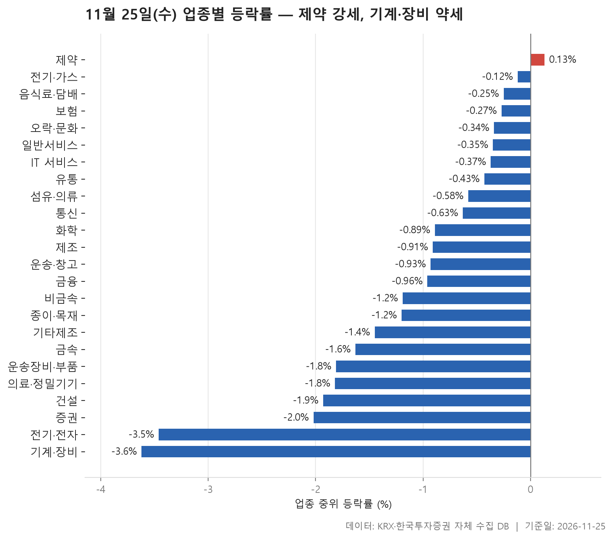
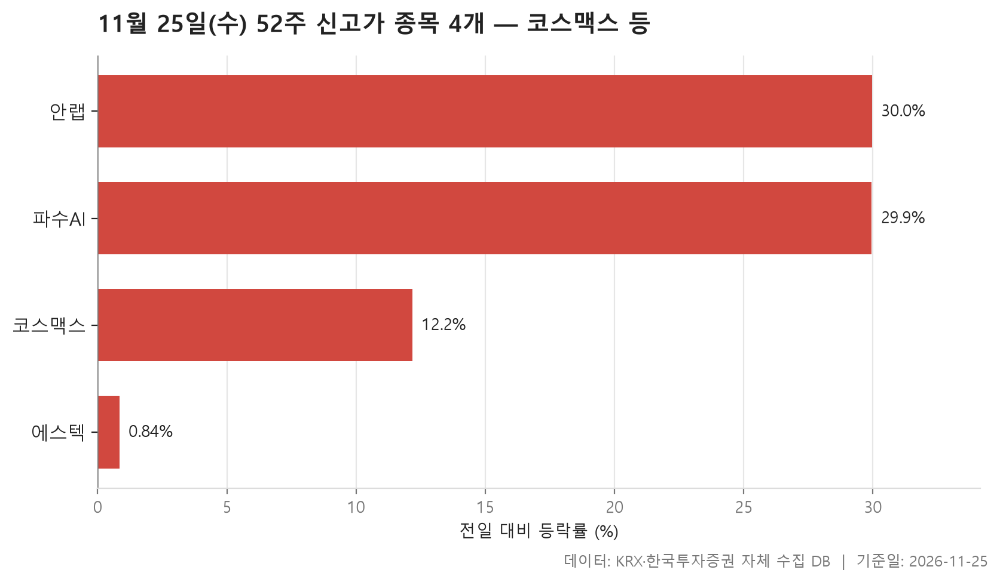
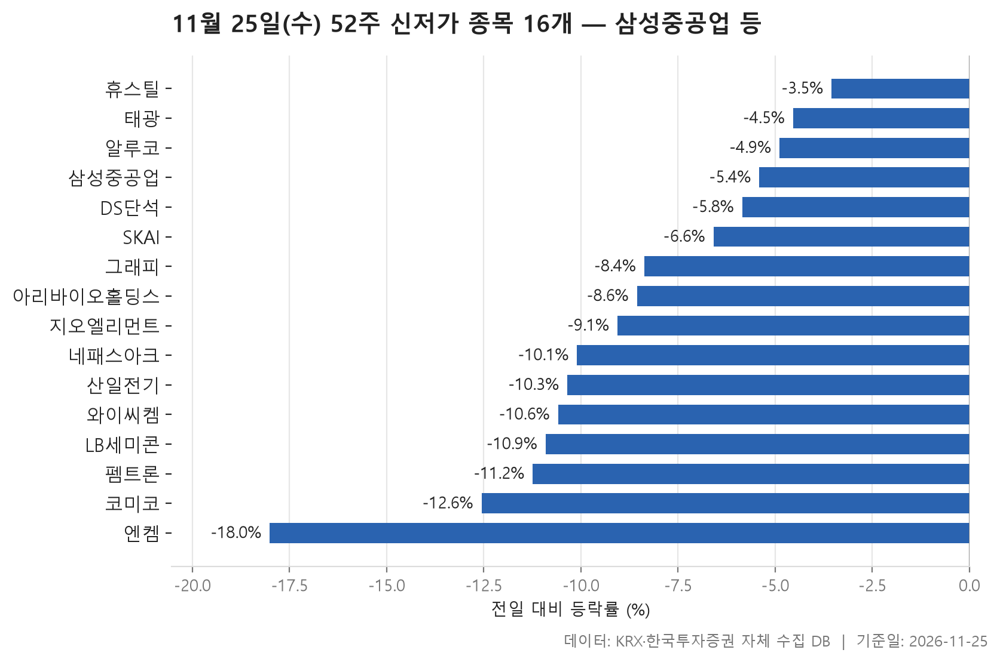
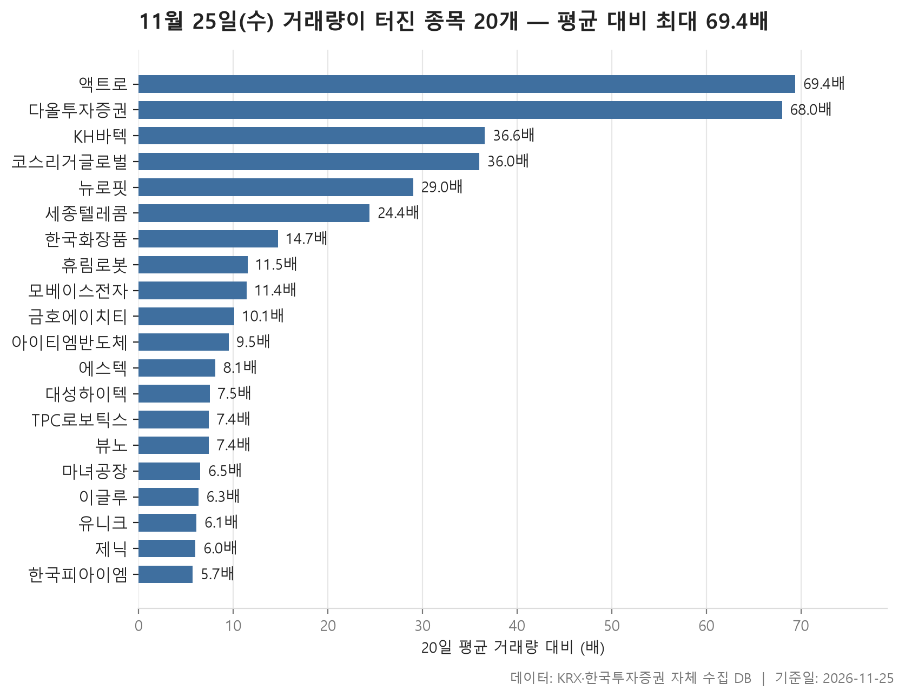

11월 25일 시장은 한쪽으로 크게 기운 하루였습니다. 업종 24개를 놓고 업종마다 종목 등락률의 한가운데 값을 구해 보면, 그 값이 플러스인 곳은 **제약** 하나뿐이고 나머지 23개는 모두 마이너스입니다. 24개 업종의 중위 등락률을 줄 세웠을 때 가운데에 오는 값은 -0.92%였습니다. 특정 업종만 크게 빠진 날이 아니었습니다. 대부분의 업종이 조금씩 밀렸고, 그 가운데 몇몇 업종은 꽤 깊이 내려갔습니다.

이 글에서는 네 가지를 차례로 봅니다. 먼저 업종별 등락으로 하루의 큰 흐름을 잡고, 이어서 52주 신고가와 신저가 종목으로 그 흐름이 가격의 끝자락에서 어떻게 나타났는지 확인합니다. 마지막으로 평소보다 거래량이 몇 배씩 늘어난 종목들을 살펴봅니다. 시장 전체가 약한 날에도 거래가 몰리고 가격이 튄 종목은 있었습니다. 그 종목들이 어디에 모여 있었는지도 함께 보겠습니다.

> 기준일: 2026-11-25 · 집계: 자체 수집 데이터베이스

## 업종 등락률 — 24개 중 23개 하락

맨 위에 오른 **제약**도 중위 등락률이 +0.13%에 그칩니다. 168개 종목 가운데 오른 곳은 50.60%로 딱 절반 정도였습니다. 강했다기보다는 덜 빠진 업종에 가깝습니다. 아래쪽은 분위기가 다릅니다. **기계·장비**가 -3.62%, **전기·전자**가 -3.46%로 바닥을 차지했고, 두 업종 모두 오른 종목이 일곱 곳 중 한 곳꼴에 머물렀습니다. 특히 전기·전자는 하루 거래대금이 97,357.50억원으로 다른 업종을 크게 앞섭니다. 돈이 가장 많이 오간 업종이 가장 많이 밀린 업종 가운데 하나였다는 점이 이날의 무게를 보여 줍니다.

중위값과 평균이 따로 노는 업종을 보면 표가 더 잘 읽힙니다. **보험**은 중위 등락률이 -0.27%로 비교적 선방했지만 평균은 -1.50%까지 내려갑니다. 업종에서 가장 크게 움직인 삼성생명이 -10.93% 하락하면서 혼자 업종 평균을 -0.99%p 끌어내렸습니다. 중위값과 평균의 차이가 대부분 이 한 종목에서 나온 셈입니다. 반대 방향 사례로는 **증권**이 있습니다. 중위값은 -2.02%인데 평균은 -0.64%로 훨씬 높습니다. 다올투자증권이 +25.94% 오르며 평균을 1.44%p 끌어올렸기 때문입니다. 그런데 18개 종목 중 오른 종목 비율은 5.60%에 불과합니다. 평균만 보면 그럭저럭 버틴 업종 같지만, 실제로는 거의 모든 종목이 내렸습니다. **종이·목재**도 같은 구조입니다. 중위값은 -1.20%, 평균은 -0.10%이고, 깨끗한나라 한 종목(+29.92%)이 평균을 1.11%p 올려놓았습니다.

**IT 서비스**는 조금 다르게 읽어야 합니다. 중위값은 -0.37%인데 평균은 +0.18%로 플러스입니다. 이 업종에서 가장 크게 오른 안랩(+29.96%)이 평균을 끌어올린 폭은 0.12%p에 그칩니다. 따라서 평균을 위로 밀어 올린 종목이 안랩 하나만은 아니었다고 봐야 합니다. 한편 8개 종목으로 이뤄진 **제조**는 오른 종목이 하나도 없었습니다(0.00%). **기타제조**는 삼진엘앤디가 -18.26% 내리면서 평균이 -3.04%까지 벌어졌습니다.

| 업종 | 종목수(개) | 중위등락률(%) | 평균등락률(%) | 상승비율(%) | 주도종목 | 주도종목등락률(%) | 평균기여도(%p) | 거래대금합계(억원) |
|---|---|---|---|---|---|---|---|---|
| 제약 | 168 | +0.13 | +0.24 | 50.60 | 셀레믹스 | -15.92 | -0.09 | 6,000.30 |
| 전기·가스 | 10 | -0.12 | -0.20 | 40.00 | SGC에너지 | -2.12 | -0.21 | 396.00 |
| 음식료·담배 | 83 | -0.25 | -0.30 | 38.60 | 한울앤제주 | -11.14 | -0.13 | 2,537.80 |
| 보험 | 11 | -0.27 | -1.50 | 45.50 | 삼성생명 | -10.93 | -0.99 | 1,437.40 |
| 오락·문화 | 60 | -0.34 | -0.05 | 40.00 | 스튜디오미르 | +8.80 | 0.15 | 1,383.80 |
| 일반서비스 | 169 | -0.35 | -0.63 | 37.90 | 지아이이노베이션 | +15.91 | 0.09 | 6,035.50 |
| IT 서비스 | 249 | -0.37 | +0.18 | 41.40 | 안랩 | +29.96 | 0.12 | 16,628.20 |
| 유통 | 157 | -0.43 | -0.65 | 35.70 | 윙스풋 | +29.92 | 0.19 | 3,688.10 |
| 섬유·의류 | 48 | -0.58 | -0.35 | 33.30 | 인디에프 | +8.45 | 0.18 | 105.70 |
| 통신 | 12 | -0.63 | -0.52 | 41.70 | 현대퓨처넷 | -3.99 | -0.33 | 1,018.30 |
| 화학 | 220 | -0.89 | -0.63 | 35.50 | 뷰티스킨 | +29.90 | 0.14 | 10,636.90 |
| 제조 | 8 | -0.91 | -1.19 | 0.00 | 코아스 | -3.25 | -0.41 | 4.70 |
| 운송·창고 | 28 | -0.93 | -0.22 | 32.10 | 진에어 | +4.38 | 0.16 | 1,014.70 |
| 금융 | 110 | -0.96 | -0.77 | 33.60 | SK스퀘어 | -11.19 | -0.10 | 12,342.30 |
| 비금속 | 36 | -1.19 | -1.46 | 11.10 | 원익QnC | -8.24 | -0.23 | 229.70 |
| 종이·목재 | 27 | -1.20 | -0.10 | 18.50 | 깨끗한나라 | +29.92 | 1.11 | 60.50 |
| 기타제조 | 15 | -1.45 | -3.04 | 6.70 | 삼진엘앤디 | -18.26 | -1.22 | 23.20 |
| 금속 | 129 | -1.63 | -2.18 | 17.10 | 영광와이케이엠씨 | -12.48 | -0.10 | 1,854.80 |
| 운송장비·부품 | 132 | -1.81 | -1.96 | 19.70 | 금호에이치티 | +17.99 | 0.14 | 6,905.80 |
| 의료·정밀기기 | 105 | -1.82 | -2.19 | 27.60 | 엠아이텍 | +19.23 | 0.18 | 2,077.00 |
| 건설 | 51 | -1.93 | -1.83 | 21.60 | 금양그린파워 | -11.07 | -0.22 | 1,064.00 |
| 증권 | 18 | -2.02 | -0.64 | 5.60 | 다올투자증권 | +25.94 | 1.44 | 809.80 |
| 전기·전자 | 369 | -3.46 | -3.76 | 15.20 | 케이아이이 | +29.99 | 0.08 | 97,357.50 |
| 기계·장비 | 213 | -3.62 | -3.74 | 13.60 | TPC로보틱스 | +29.99 | 0.14 | 13,730.00 |

## 52주 신고가 4개 — 최고 안랩 29.96%

52주 신고가를 새로 쓴 종목은 4개뿐입니다. 업종 대부분이 내린 날이니 이상한 숫자는 아닙니다. 눈에 띄는 것은 네 종목 가운데 두 곳이 **IT 서비스**라는 점입니다. 안랩은 +29.96%, 파수AI는 +29.95% 올랐습니다. 둘 다 하루 가격제한폭 근처까지 오르며 직전 최고가를 넘어섰습니다. 앞에서 본 것처럼 IT 서비스 업종은 중위값으로는 내렸지만 평균은 플러스였는데, 이 두 종목이 그 차이를 보여 줍니다.

시가총액이 가장 큰 종목은 코스맥스(37,113억원)입니다. +12.18% 오르면서 종가 327,000원으로 직전 52주 최고가 320,000원을 넘어섰습니다. 이 종목이 속한 화학 업종은 중위 등락률이 -0.89%였습니다. 업종 흐름과 반대로 움직인 경우입니다. 에스텍은 성격이 또 다릅니다. 등락률은 +0.84%로 작았지만, 직전 최고가 23,950원을 살짝 넘긴 24,100원에 마감해 목록에 들었습니다. 네 종목의 등락률 중위값은 +21.07%로 높습니다. 그래도 에스텍처럼 조용히 고점을 넘은 종목이 섞여 있으니, 신고가가 꼭 급등을 뜻하지는 않습니다.

| 종목명 | 종목코드 | 시장 | 업종 | 종가(원) | 등락률(%) | 이전52주최고(원) | 거래대금(억원) | 시가총액(억원) |
|---|---|---|---|---|---|---|---|---|
| 코스맥스 | 192820 | KOSPI | 화학 | 327,000 | +12.18 | 320,000 | 580.40 | 37,113 |
| 안랩 | 053800 | KOSDAQ | IT 서비스 | 157,900 | +29.96 | 137,300 | 2,743.00 | 17,569 |
| 에스텍 | 069510 | KOSDAQ | 전기·전자 | 24,100 | +0.84 | 23,950 | 288.30 | 2,629 |
| 파수AI | 150900 | KOSDAQ | IT 서비스 | 7,550 | +29.95 | 6,890 | 455.70 | 884 |

## 52주 신저가 16개 — 최저 엔켐 -18.01%

신저가 쪽은 16개로, 신고가보다 훨씬 많습니다. 시장별로는 KOSDAQ이 11개, 업종별로는 전기·전자가 4개로 가장 많았습니다. 업종 순위 하단에 있던 전기·전자의 약세가 가격의 끝자락에서도 그대로 확인됩니다. 16개 종목의 등락률 중위값은 -8.81%입니다. 대체로 하루에 큰 폭으로 빠지면서 저점을 깼다는 뜻입니다. 가장 크게 내린 엔켐은 -18.01%, 가장 적게 내린 휴스틸도 -3.55%였습니다.

덩치가 가장 큰 종목은 삼성중공업(시가총액 124,608억원)입니다. -5.41% 내려 14,160원에 마감했고, 직전 52주 최저가는 14,270원이었습니다. 산일전기(-10.35%)와 코미코(-12.56%)도 시가총액이 비교적 큰 편인데 하락 폭이 두 자릿수였습니다. 코미코가 속한 기계·장비는 이날 가장 약한 업종이었습니다.

저점을 아슬아슬하게 깬 종목도 여럿 있습니다. SKAI는 직전 최저가 1,079원 바로 아래인 1,078원에 마감했습니다. 네패스아크(14,880원 → 14,860원)와 와이씨켐(6,530원 → 6,500원)도 이전 저점과 거의 붙어 있습니다. 거래대금이 펨트론 3.60억원, 알루코 4.10억원처럼 얇은 종목도 섞여 있습니다. 거래가 적은 상태에서 저점을 깬 경우라 하루치 숫자만으로 의미를 크게 두기는 어렵습니다.

| 종목명 | 종목코드 | 시장 | 업종 | 종가(원) | 등락률(%) | 이전52주최저(원) | 거래대금(억원) | 시가총액(억원) |
|---|---|---|---|---|---|---|---|---|
| 삼성중공업 | 010140 | KOSPI | 운송장비·부품 | 14,160 | -5.41 | 14,270 | 471.70 | 124,608 |
| 산일전기 | 062040 | KOSPI | 전기·전자 | 95,300 | -10.35 | 97,100 | 202.20 | 29,203 |
| 코미코 | 183300 | KOSDAQ | 기계·장비 | 14,900 | -12.56 | 16,190 | 63.60 | 7,653 |
| 태광 | 023160 | KOSDAQ | 금속 | 18,280 | -4.54 | 19,100 | 55.10 | 4,654 |
| 엔켐 | 348370 | KOSDAQ | 화학 | 9,240 | -18.01 | 9,750 | 72.30 | 2,025 |
| 네패스아크 | 330860 | KOSDAQ | 일반서비스 | 14,860 | -10.10 | 14,880 | 18.60 | 1,811 |
| 펨트론 | 168360 | KOSDAQ | 기계·장비 | 6,080 | -11.24 | 6,140 | 3.60 | 1,361 |
| 와이씨켐 | 112290 | KOSDAQ | 화학 | 6,500 | -10.59 | 6,530 | 12.80 | 1,314 |
| DS단석 | 017860 | KOSPI | 화학 | 7,400 | -5.85 | 7,430 | 5.20 | 1,306 |
| 휴스틸 | 005010 | KOSPI | 금속 | 2,310 | -3.55 | 2,360 | 12.50 | 1,298 |
| LB세미콘 | 061970 | KOSDAQ | 전기·전자 | 1,690 | -10.91 | 1,740 | 11.50 | 1,184 |
| 알루코 | 001780 | KOSPI | 금속 | 1,168 | -4.89 | 1,193 | 4.10 | 1,131 |
| 아리바이오홀딩스 | 290690 | KOSDAQ | 전기·전자 | 2,030 | -8.56 | 2,150 | 22.10 | 1,077 |
| 그래피 | 318060 | KOSDAQ | 화학 | 8,650 | -8.37 | 8,680 | 4.20 | 968 |
| SKAI | 357880 | KOSDAQ | IT 서비스 | 1,078 | -6.59 | 1,079 | 7.20 | 609 |
| 지오엘리먼트 | 311320 | KOSDAQ | 전기·전자 | 4,765 | -9.06 | 4,970 | 6.70 | 601 |

## 거래량 급증 20개 — 최고 액트로 69.40배

평소의 5배 넘게 거래된 종목은 20개입니다. 그중 KOSDAQ 종목이 17개입니다. 거래량 배수의 중위값은 9.80배로, 기준선을 넉넉히 넘긴 종목이 많았습니다. 방향은 대부분 위쪽입니다. 20개 가운데 내린 종목은 모베이스전자(-5.03%) 하나뿐이었습니다. 시장 전체가 밀린 날 거래가 몰린 곳은 주로 오른 종목이었던 셈입니다.

배수와 등락률이 어긋나는 대목이 흥미롭습니다. 배수가 가장 높은 액트로는 69.40배였지만 주가는 +2.90% 오르는 데 그쳤습니다. 바로 뒤의 다올투자증권은 68.00배에 +25.94%로, 거래와 가격이 함께 크게 움직였습니다. 증권 업종 평균을 혼자 끌어올린 그 종목입니다. 시가총액이 가장 큰 휴림로봇(8,936억원)은 거래대금이 1,904.90억원으로 표에서 가장 많았지만 등락률은 +0.27%에 머물렀습니다. 거래량이 크게 늘었다고 해서 가격도 그만큼 움직인 것은 아니었습니다.

업종 흐름과 반대로 간 종목도 보입니다. TPC로보틱스는 업종이 -3.62% 밀린 기계·장비에서 +29.99% 올랐고, 거래량도 평소의 7.40배였습니다. 운송장비·부품의 금호에이치티(+17.99%, 10.10배)도 업종 중위값 -1.81%와는 반대 방향입니다. 신고가 목록에 있던 에스텍도 8.10배의 거래량으로 이 표에 다시 나옵니다. 왜 이 종목들에 거래가 몰렸는지는 이 자료만으로는 알 수 없습니다.

| 종목명 | 종목코드 | 시장 | 업종 | 종가(원) | 등락률(%) | 거래량(주) | 평균거래량(주) | 배수(배) | 거래대금(억원) | 시가총액(억원) |
|---|---|---|---|---|---|---|---|---|---|---|
| 액트로 | 290740 | KOSDAQ | 전기·전자 | 9,920 | +2.90 | 2,584,500 | 37,237 | 69.40 | 277.50 | 949 |
| 다올투자증권 | 030210 | KOSPI | 증권 | 4,005 | +25.94 | 3,493,500 | 51,383 | 68.00 | 137.00 | 2,439 |
| KH바텍 | 060720 | KOSDAQ | 전기·전자 | 13,300 | +9.11 | 8,798,647 | 240,607 | 36.60 | 1,137.30 | 3,149 |
| 코스리거글로벌 | 043710 | KOSDAQ | 유통 | 4,755 | +19.77 | 323,308 | 8,972 | 36.00 | 15.40 | 823 |
| 뉴로핏 | 380550 | KOSDAQ | IT 서비스 | 5,600 | +15.23 | 2,857,185 | 98,498 | 29.00 | 170.70 | 683 |
| 세종텔레콤 | 036630 | KOSDAQ | 건설 | 9,040 | +6.35 | 105,231 | 4,319 | 24.40 | 9.70 | 1,266 |
| 한국화장품 | 123690 | KOSPI | 유통 | 7,270 | +6.60 | 9,630,831 | 653,803 | 14.70 | 765.70 | 1,168 |
| 휴림로봇 | 090710 | KOSDAQ | 기계·장비 | 7,450 | +0.27 | 26,016,912 | 2,264,673 | 11.50 | 1,904.90 | 8,936 |
| 모베이스전자 | 012860 | KOSDAQ | 운송장비·부품 | 2,170 | -5.03 | 10,470,190 | 920,207 | 11.40 | 233.30 | 1,589 |
| 금호에이치티 | 214330 | KOSPI | 운송장비·부품 | 6,100 | +17.99 | 310,383 | 30,601 | 10.10 | 19.50 | 638 |
| 아이티엠반도체 | 084850 | KOSDAQ | 전기·전자 | 5,460 | +1.30 | 425,730 | 44,811 | 9.50 | 25.10 | 1,238 |
| 에스텍 | 069510 | KOSDAQ | 전기·전자 | 24,100 | +0.84 | 1,190,289 | 146,861 | 8.10 | 288.30 | 2,629 |
| 대성하이텍 | 129920 | KOSDAQ | 기계·장비 | 5,760 | +3.04 | 2,428,659 | 323,374 | 7.50 | 136.80 | 949 |
| TPC로보틱스 | 048770 | KOSDAQ | 기계·장비 | 4,465 | +29.99 | 874,836 | 118,164 | 7.40 | 36.40 | 701 |
| 뷰노 | 338220 | KOSDAQ | IT 서비스 | 6,250 | +22.07 | 1,050,401 | 141,547 | 7.40 | 66.70 | 875 |
| 마녀공장 | 439090 | KOSDAQ | 화학 | 16,660 | +0.79 | 2,208,073 | 341,244 | 6.50 | 392.00 | 2,731 |
| 이글루 | 067920 | KOSDAQ | IT 서비스 | 7,080 | +13.28 | 2,195,244 | 348,951 | 6.30 | 155.90 | 779 |
| 유니크 | 011320 | KOSDAQ | 운송장비·부품 | 3,600 | +0.28 | 91,890 | 15,165 | 6.10 | 3.20 | 696 |
| 제닉 | 123330 | KOSDAQ | 화학 | 16,840 | +10.86 | 533,123 | 89,065 | 6.00 | 86.70 | 1,342 |
| 한국피아이엠 | 448900 | KOSDAQ | 운송장비·부품 | 54,500 | +6.24 | 368,342 | 65,175 | 5.70 | 200.90 | 3,311 |

## 정리

정리하면 11월 25일은 하락이 업종 전반에 넓게 퍼졌고, 상승은 몇몇 개별 종목에 한정된 하루였습니다. 업종 대부분의 중위값이 마이너스였고 신저가 종목이 신고가보다 훨씬 많았습니다. 그 사이에서 안랩, 다올투자증권, TPC로보틱스처럼 크게 오른 종목은 소속 업종의 평균만 끌어올렸을 뿐 업종 전체 흐름을 바꾸지는 못했습니다.

다만 이 글은 하루치 종가만으로 만든 것입니다. 종목이 왜 오르고 내렸는지는 자료에 없어 다루지 않았습니다. 업종 순위는 중위값 기준이라 종목 수가 적은 업종에서는 한두 종목에 따라 결과가 쉽게 달라질 수 있습니다. 신고가·신저가와 거래량 급증 목록도 시가총액과 거래대금 기준을 넘는 보통주만 담았다는 점을 감안해서 읽어 주시기 바랍니다.

## 집계 기준

**업종 등락률**

- **기준**: 2026-11-24 종가 → 2026-11-25 종가
- **순위**: 업종 내 종목 등락률의 중위값 (평균은 참고용으로 함께 표시)
- **주도종목**: 그 업종에서 등락률 절대값이 가장 큰 종목 (동점이면 거래대금이 큰 쪽)
- **평균기여도**: 그 종목 하나가 업종 평균을 움직인 폭 (등락률 ÷ 종목수). 중위값과 평균의 격차가 이 값에 가까우면 평균을 만든 것이 그 종목이고, 훨씬 크면 다른 종목들도 함께 움직인 것입니다
- **필터**: 업종 내 보통주 5종목 이상
- **전체업종중위등락률(%)**: -0.92

**52주 신고가**

- **기준**: 종가 > 직전 52주 최고가
- **관측구간**: 2025-11-13 ~ 2026-11-24 (252거래일)
- **필터**: 시가총액 500억 이상, 거래대금 3억 이상, 보통주

**52주 신저가**

- **기준**: 종가 < 직전 52주 최저가
- **관측구간**: 2025-11-13 ~ 2026-11-24 (252거래일)
- **필터**: 시가총액 500억 이상, 거래대금 3억 이상, 보통주

**거래량 급증**

- **기준**: 당일 거래량 ≥ 직전 20거래일 평균 × 5
- **관측구간**: 2026-10-28 ~ 2026-11-24 (20거래일)
- **필터**: 시가총액 500억 이상, 거래대금 3억 이상, 보통주

## 데이터 출처 및 유의사항

- **데이터출처**: 한국거래소(KRX) 공시 데이터와 한국투자증권 OpenAPI 를 직접 수집해 구축한 자체 데이터베이스
- **집계방식**: 수집·집계·차트 생성을 직접 구현한 파이프라인에서 자동 산출
- **작성고지**: 본문의 표·통계·차트는 자체 데이터베이스에서 계산된 값이며, 문장 작성 과정에 AI 도구를 활용했습니다.
- **면책**: 본 글은 정보 제공을 목적으로 하며 특정 종목의 매수·매도를 추천하지 않습니다. 제시된 수치는 과거 데이터이고 미래 수익을 보장하지 않습니다. 투자 판단과 그 결과에 대한 책임은 투자자 본인에게 있습니다.

