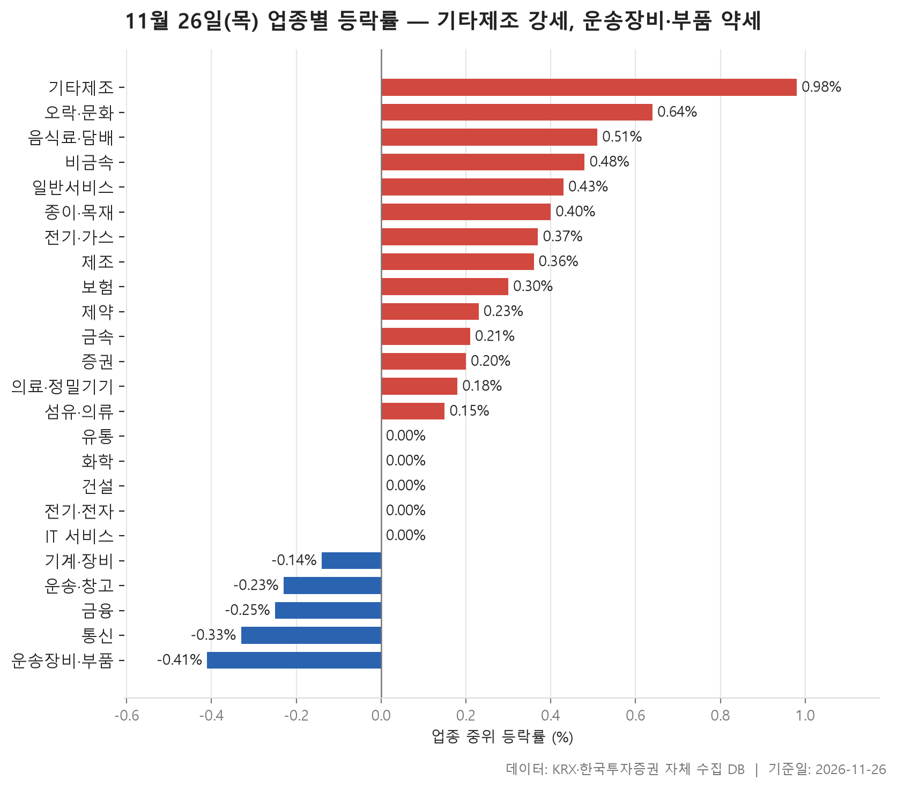
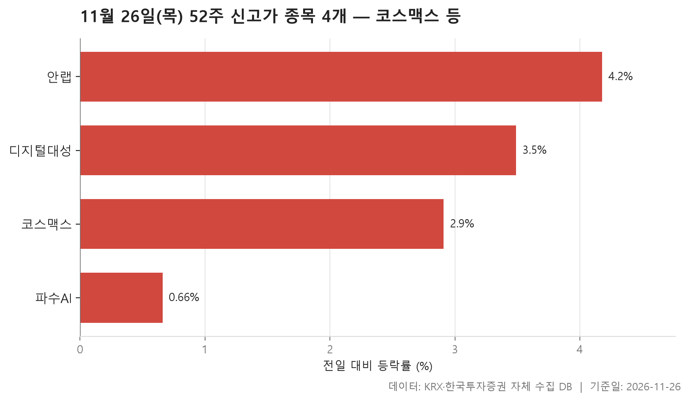
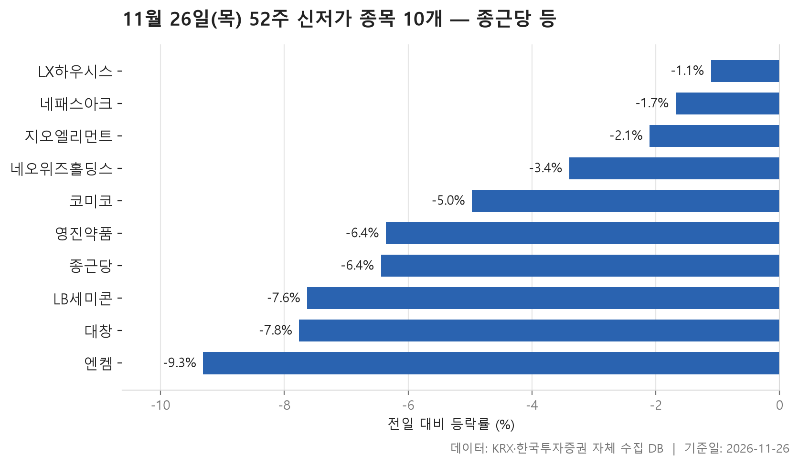
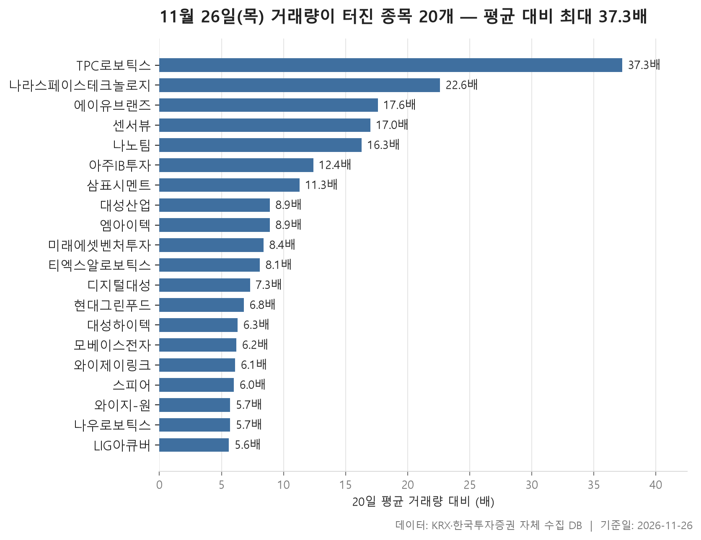

11월 26일 시장은 업종 단위로 보면 잔잔했습니다. 24개 업종의 중위 등락률을 한 줄로 세웠을 때 한가운데 놓인 값이 +0.19%입니다. 가장 강한 기타제조는 +0.98%, 가장 약한 운송장비·부품은 -0.41%였으니 어느 쪽으로도 크게 벗어난 업종이 없었습니다. 24개 가운데 14개가 플러스, 5개가 마이너스였고 나머지는 중위값이 0.00%에 머물렀습니다.

종목 단위로 내려가면 이야기가 달라집니다. 하루 만에 +30.00%까지 오른 종목이 여러 업종에 흩어져 있었고, 그 몇 종목이 업종 평균을 중위값보다 한참 위로 끌어올렸습니다. 52주 신고가는 4개에 그쳤는데 신저가는 10개였습니다. 거래량이 평소의 5배를 넘긴 종목도 20개 나왔습니다.

오늘 글은 업종 흐름, 신고가와 신저가, 거래량 급증 순서로 짚어 봅니다. 특히 **업종 중위값과 평균이 따로 움직인 대목**을 중심으로 읽으면 표만 볼 때보다 하루의 모양이 잘 보입니다.

> 기준일: 2026-11-26 · 집계: 자체 수집 데이터베이스

## 업종 등락률 — 24개 중 14개 상승

맨 위에 놓인 기타제조부터 조금 어긋나 있습니다. 15개 종목 중 오른 종목이 66.70%로 셋 중 둘꼴이었는데, 평균 등락률은 +0.20%로 중위값 +0.98%보다 한참 낮습니다. 이 업종에서 가장 크게 움직인 삼진엘앤디가 -6.00% 내리면서 업종 평균을 -0.40%p만큼 끌어내렸습니다. 거래대금도 15.90억원에 불과한 작은 업종이라 한 종목만으로 평균이 출렁이기 쉽습니다. 2위 오락·문화도 오른 종목 비율이 66.70%로 같지만 이 업종에서 가장 크게 움직인 종목은 -10.45% 내린 포바이포였습니다. 상위 두 업종 모두 넓게 조금씩 올랐고, 가장 크게 움직인 종목은 오히려 내렸습니다.

아래쪽은 반대 방향으로 어긋납니다. 운송·창고는 중위 등락률이 -0.23%인데 평균은 +1.44%로 24개 업종 중 가장 높습니다. 동양고속 한 종목이 +29.96% 오르며 업종 평균을 1.07%p 끌어올렸으니, 평균이 높게 나온 것은 대부분 이 종목 몫으로 볼 수 있습니다. 꼴찌인 운송장비·부품도 중위값 -0.41%, 평균 +0.27%로 방향이 갈렸습니다. 다만 여기서는 +30.00% 오른 하나에어로가 평균을 0.23%p 올린 데 그쳐 중위값과 평균의 간격을 혼자 다 설명하지 못합니다. 다른 종목 몇몇도 함께 크게 올랐다는 뜻입니다. 그래도 오른 종목은 39.40%로 열 곳 가운데 네 곳이 채 안 됐습니다.

종목 수가 많은 업종은 대체로 방향이 없었습니다. 369개 종목에 거래대금 82,640.80억원이 몰린 전기·전자는 중위값이 0.00%, 평균이 +0.32%였고 화학과 IT 서비스도 중위값이 0.00%입니다. 돈이 가장 많이 오간 곳에서 오른 종목과 내린 종목이 엇비슷했던 셈입니다. 대부분 업종이 평균이 중위값보다 높게 나왔는데, 통신은 드물게 반대였습니다. 오른 종목이 25.00%로 넷 중 하나꼴이었고 평균도 -0.65%로 중위값 -0.33%보다 낮아, 큰 폭으로 오른 종목 없이 고르게 약했던 업종입니다.

| 업종 | 종목수(개) | 중위등락률(%) | 평균등락률(%) | 상승비율(%) | 주도종목 | 주도종목등락률(%) | 평균기여도(%p) | 거래대금합계(억원) |
|---|---|---|---|---|---|---|---|---|
| 기타제조 | 15 | +0.98 | +0.20 | 66.70 | 삼진엘앤디 | -6.00 | -0.40 | 15.90 |
| 오락·문화 | 60 | +0.64 | +0.77 | 66.70 | 포바이포 | -10.45 | -0.17 | 1,794.20 |
| 음식료·담배 | 83 | +0.51 | +1.04 | 56.60 | 셀로맥스사이언스 | +29.93 | 0.36 | 1,976.50 |
| 비금속 | 36 | +0.48 | +0.90 | 61.10 | 에스엠씨지 | +6.90 | 0.19 | 433.00 |
| 일반서비스 | 169 | +0.43 | +1.34 | 58.00 | 아리바이오랩 | +29.89 | 0.18 | 6,126.00 |
| 종이·목재 | 27 | +0.40 | +0.99 | 63.00 | 깨끗한나라 | +11.27 | 0.42 | 257.80 |
| 전기·가스 | 10 | +0.37 | +0.35 | 60.00 | 삼천리 | +1.90 | 0.19 | 323.70 |
| 제조 | 8 | +0.36 | +1.16 | 50.00 | 코아스 | +5.64 | 0.70 | 6.90 |
| 보험 | 11 | +0.30 | +0.25 | 54.50 | 미래에셋생명 | +3.22 | 0.29 | 1,126.30 |
| 제약 | 168 | +0.23 | +0.50 | 51.80 | 타임X AI | +18.81 | 0.11 | 4,810.30 |
| 금속 | 129 | +0.21 | +0.70 | 55.00 | 영흥 | +16.98 | 0.13 | 2,265.60 |
| 증권 | 18 | +0.20 | +0.66 | 50.00 | 미래에셋증권 | +6.79 | 0.38 | 1,077.30 |
| 의료·정밀기기 | 105 | +0.18 | +0.72 | 51.40 | LK삼양 | +29.93 | 0.29 | 1,527.40 |
| 섬유·의류 | 48 | +0.15 | +0.98 | 50.00 | 뉴키즈온 | +12.82 | 0.27 | 108.80 |
| 유통 | 157 | 0.00 | +0.58 | 49.70 | 윙스풋 | +29.94 | 0.19 | 2,434.60 |
| 화학 | 220 | 0.00 | +0.48 | 48.20 | 진코스텍 | +30.00 | 0.14 | 7,969.40 |
| 건설 | 51 | 0.00 | +0.36 | 47.10 | 금양그린파워 | +10.29 | 0.20 | 1,833.90 |
| 전기·전자 | 369 | 0.00 | +0.32 | 48.50 | 아리바이오홀딩스 | +18.97 | 0.05 | 82,640.80 |
| IT 서비스 | 249 | 0.00 | +0.28 | 45.80 | 크라우드웍스 | +30.00 | 0.12 | 11,033.00 |
| 기계·장비 | 213 | -0.14 | -0.06 | 46.50 | 나노팀 | +29.90 | 0.14 | 13,049.10 |
| 운송·창고 | 28 | -0.23 | +1.44 | 42.90 | 동양고속 | +29.96 | 1.07 | 1,622.50 |
| 금융 | 110 | -0.25 | +0.07 | 41.80 | 미래에셋벤처투자 | +21.57 | 0.20 | 13,723.50 |
| 통신 | 12 | -0.33 | -0.65 | 25.00 | 더즌 | -4.36 | -0.36 | 910.50 |
| 운송장비·부품 | 132 | -0.41 | +0.27 | 39.40 | 하나에어로 | +30.00 | 0.23 | 7,107.00 |

## 52주 신고가 4개 — 최고 안랩 4.18%

52주 신고가를 쓴 보통주는 4개였습니다. 코스닥이 3개, 코스피가 1개입니다. 네 종목 등락률의 중위값이 +3.20%여서 크게 뛰어오르며 고점을 갈아치운 모습은 아닙니다. 직전 고점을 살짝 넘어선 경우가 많았습니다. 디지털대성은 종가 10,090원으로 직전 최고 10,000원을 겨우 넘었고, 파수AI는 +0.66% 오르며 7,550원이던 고점을 7,600원으로 바꿨습니다.

가장 많이 오른 종목은 안랩으로 +4.18%였고, 거래대금 2,651.10억원으로 넷 가운데 돈도 가장 많이 몰렸습니다. 시가총액이 가장 큰 코스맥스(38,191억원)는 +2.91% 올라 333,000원이던 직전 최고가 위인 336,500원에 마감했습니다. 업종으로는 안랩과 파수AI가 속한 IT 서비스가 두 종목이었습니다.

디지털대성은 뒤에 나오는 거래량 급증 표에도 이름이 있습니다. 평소 거래량의 7.30배가 오가면서 신고가를 썼다는 점은 같은 날 표 두 개에 걸쳐 확인되는 대목입니다.

| 종목명 | 종목코드 | 시장 | 업종 | 종가(원) | 등락률(%) | 이전52주최고(원) | 거래대금(억원) | 시가총액(억원) |
|---|---|---|---|---|---|---|---|---|
| 코스맥스 | 192820 | KOSPI | 화학 | 336,500 | +2.91 | 333,000 | 501.40 | 38,191 |
| 안랩 | 053800 | KOSDAQ | IT 서비스 | 164,500 | +4.18 | 157,900 | 2,651.10 | 18,303 |
| 디지털대성 | 068930 | KOSDAQ | 일반서비스 | 10,090 | +3.49 | 10,000 | 30.70 | 2,729 |
| 파수AI | 150900 | KOSDAQ | IT 서비스 | 7,600 | +0.66 | 7,550 | 532.20 | 889 |

## 52주 신저가 10개 — 최저 엔켐 -9.31%

신저가 쪽이 더 붐볐습니다. 업종 중위값이 대체로 플러스였던 날인데도 52주 최저가를 밑돈 종목이 10개로 신고가보다 훨씬 많았습니다. 코스닥 6개, 코스피 4개입니다. 낙폭도 큽니다. 열 종목 등락률의 중위값이 -5.67%로, 신고가 쪽 중위값 +3.20%보다 움직임이 거셌습니다.

가장 크게 밀린 종목은 엔켐으로 -9.31%였습니다. 시가총액이 가장 큰 종근당(7,826억원)은 -6.44% 내리며 직전 최저가 57,600원 아래인 56,700원에 마감했습니다. 같은 제약 업종의 영진약품도 -6.36% 내려 신저가를 썼습니다. 제약 외에 화학과 전기·전자도 두 종목씩 이 표에 올랐습니다.

반대쪽 끝에는 거래가 얇은 상태에서 조금 밀린 종목들이 있습니다. LX하우시스는 -1.11% 내렸는데 직전 최저 22,400원과 종가 22,350원의 차이가 크지 않고, 거래대금은 3.20억원으로 집계 기준인 3억원을 간신히 넘었습니다. 네오위즈홀딩스도 16,200원이던 저점을 16,190원으로 낮췄고 거래대금은 3.50억원이었습니다. 열 종목 중 거래대금이 가장 많은 코미코도 72.50억원에 그쳐, 신저가가 대규모 매매 속에서 나온 경우는 많지 않았습니다.

| 종목명 | 종목코드 | 시장 | 업종 | 종가(원) | 등락률(%) | 이전52주최저(원) | 거래대금(억원) | 시가총액(억원) |
|---|---|---|---|---|---|---|---|---|
| 종근당 | 185750 | KOSPI | 제약 | 56,700 | -6.44 | 57,600 | 18.70 | 7,826 |
| 코미코 | 183300 | KOSDAQ | 기계·장비 | 14,160 | -4.97 | 14,780 | 72.50 | 7,273 |
| LX하우시스 | 108670 | KOSPI | 화학 | 22,350 | -1.11 | 22,400 | 3.20 | 2,004 |
| 엔켐 | 348370 | KOSDAQ | 화학 | 8,380 | -9.31 | 8,430 | 50.40 | 1,836 |
| 네패스아크 | 330860 | KOSDAQ | 일반서비스 | 14,610 | -1.68 | 14,780 | 13.60 | 1,780 |
| 영진약품 | 003520 | KOSPI | 제약 | 721 | -6.36 | 735 | 4.10 | 1,319 |
| 네오위즈홀딩스 | 042420 | KOSDAQ | IT 서비스 | 16,190 | -3.40 | 16,200 | 3.50 | 1,318 |
| LB세미콘 | 061970 | KOSDAQ | 전기·전자 | 1,561 | -7.63 | 1,658 | 15.10 | 1,094 |
| 대창 | 012800 | KOSPI | 금속 | 701 | -7.76 | 750 | 8.30 | 639 |
| 지오엘리먼트 | 311320 | KOSDAQ | 전기·전자 | 4,665 | -2.10 | 4,715 | 4.90 | 588 |

## 거래량 급증 20개 — 최고 TPC로보틱스 37.30배

거래량이 직전 20거래일 평균의 5배를 넘긴 종목은 20개였습니다. 이 가운데 코스닥이 18개로 대부분을 차지합니다. 평소 대비 배수의 중위값은 8.25배입니다. 업종으로는 기계·장비가 6개로 가장 많았고, 그중에는 이름에 로보틱스가 붙은 종목이 여럿 있습니다. 다만 이 종목들이 왜 함께 움직였는지는 자료로 알 수 없습니다.

배수 1위는 TPC로보틱스로 37.30배였습니다. 평소 146,161주 오가던 종목에서 5,456,787주가 거래됐습니다. 그런데 주가는 -4.82% 내렸습니다. 거래가 폭발했다고 해서 오른 것은 아니라는 점을 보여 주는 사례입니다. 현대그린푸드(-8.03%)와 모베이스전자(-2.30%)도 거래가 크게 늘면서 내렸습니다. 나머지는 대체로 올랐고, 에이유브랜즈(+29.89%)와 나노팀(+29.90%)은 하루 오를 수 있는 폭을 거의 다 채웠습니다. 나노팀은 기계·장비 업종에서 가장 크게 움직인 종목이지만, 그 업종의 중위 등락률은 -0.14%였습니다.

돈의 규모로 보면 미래에셋벤처투자가 두드러집니다. 거래대금 1,754.60억원으로 이 표에서 가장 많았고 주가는 +21.57% 올랐습니다. 금융 업종에서 가장 크게 오른 종목이었지만 업종 중위값은 -0.25%에 머물렀습니다. 시가총액이 가장 큰 스피어(11,702억원)는 +18.41% 올랐고 거래대금은 1,051.80억원이었습니다. 배수가 가장 낮은 LIG아큐버(5.60배)도 +13.87% 올라, 배수 순위와 주가 움직임의 크기는 꼭 맞아떨어지지 않았습니다.

| 종목명 | 종목코드 | 시장 | 업종 | 종가(원) | 등락률(%) | 거래량(주) | 평균거래량(주) | 배수(배) | 거래대금(억원) | 시가총액(억원) |
|---|---|---|---|---|---|---|---|---|---|---|
| TPC로보틱스 | 048770 | KOSDAQ | 기계·장비 | 4,250 | -4.82 | 5,456,787 | 146,161 | 37.30 | 253.20 | 667 |
| 나라스페이스테크놀로지 | 478340 | KOSDAQ | 운송장비·부품 | 7,870 | +9.61 | 1,782,172 | 78,953 | 22.60 | 151.90 | 914 |
| 에이유브랜즈 | 481070 | KOSDAQ | 유통 | 10,950 | +29.89 | 419,288 | 23,766 | 17.60 | 45.30 | 1,573 |
| 센서뷰 | 321370 | KOSDAQ | 전기·전자 | 1,270 | +18.14 | 10,926,851 | 642,952 | 17.00 | 142.40 | 897 |
| 나노팀 | 417010 | KOSDAQ | 기계·장비 | 6,430 | +29.90 | 3,186,310 | 195,388 | 16.30 | 194.40 | 1,297 |
| 아주IB투자 | 027360 | KOSDAQ | 금융 | 2,580 | +5.95 | 15,383,856 | 1,243,165 | 12.40 | 423.60 | 3,126 |
| 삼표시멘트 | 038500 | KOSDAQ | 비금속 | 5,550 | +5.71 | 4,260,143 | 378,108 | 11.30 | 251.20 | 5,989 |
| 대성산업 | 128820 | KOSPI | 유통 | 3,635 | +5.82 | 1,295,596 | 145,018 | 8.90 | 48.90 | 1,644 |
| 엠아이텍 | 179290 | KOSDAQ | 의료·정밀기기 | 3,955 | +10.94 | 1,350,326 | 152,513 | 8.90 | 53.90 | 1,280 |
| 미래에셋벤처투자 | 100790 | KOSDAQ | 금융 | 18,770 | +21.57 | 9,445,772 | 1,128,568 | 8.40 | 1,754.60 | 9,971 |
| 티엑스알로보틱스 | 484810 | KOSDAQ | 기계·장비 | 8,180 | +3.68 | 409,346 | 50,793 | 8.10 | 35.20 | 1,264 |
| 디지털대성 | 068930 | KOSDAQ | 일반서비스 | 10,090 | +3.49 | 307,582 | 41,901 | 7.30 | 30.70 | 2,729 |
| 현대그린푸드 | 453340 | KOSPI | 유통 | 18,670 | -8.03 | 283,123 | 41,786 | 6.80 | 52.50 | 6,062 |
| 대성하이텍 | 129920 | KOSDAQ | 기계·장비 | 6,120 | +6.25 | 2,673,992 | 423,185 | 6.30 | 175.60 | 1,008 |
| 모베이스전자 | 012860 | KOSDAQ | 운송장비·부품 | 2,120 | -2.30 | 8,769,787 | 1,424,793 | 6.20 | 197.30 | 1,553 |
| 와이제이링크 | 209640 | KOSDAQ | 기계·장비 | 3,535 | +7.94 | 5,845,936 | 961,831 | 6.10 | 218.30 | 1,005 |
| 스피어 | 347700 | KOSDAQ | IT 서비스 | 22,700 | +18.41 | 4,711,664 | 783,778 | 6.00 | 1,051.80 | 11,702 |
| 와이지-원 | 019210 | KOSDAQ | 금속 | 8,900 | +4.34 | 1,861,203 | 324,947 | 5.70 | 175.40 | 3,310 |
| 나우로보틱스 | 459510 | KOSDAQ | 기계·장비 | 11,350 | +8.82 | 128,311 | 22,379 | 5.70 | 14.70 | 1,473 |
| LIG아큐버 | 073490 | KOSDAQ | 전기·전자 | 39,400 | +13.87 | 391,188 | 70,367 | 5.60 | 150.40 | 2,996 |

## 정리

11월 26일은 업종 평균으로 보면 고요했지만, 그 아래에서 몇몇 종목이 크게 움직인 하루였습니다. 중위값과 평균이 벌어진 업종, 신고가보다 많았던 신저가, 거래량이 터지고도 내린 종목이 그 흔적입니다.

이 글은 하루치 종가만 비교했기 때문에 움직임의 원인은 담고 있지 않습니다. 시가총액 500억원, 거래대금 3억원에 못 미치는 종목과 우선주는 신고가·신저가·거래량 표에서 빠져 있습니다. 업종 순위도 5종목 이상인 업종만 대상으로 했으니, 표에 나오지 않은 업종과 종목은 흐름이 다를 수 있습니다.

## 집계 기준

**업종 등락률**

- **기준**: 2026-11-25 종가 → 2026-11-26 종가
- **순위**: 업종 내 종목 등락률의 중위값 (평균은 참고용으로 함께 표시)
- **주도종목**: 그 업종에서 등락률 절대값이 가장 큰 종목 (동점이면 거래대금이 큰 쪽)
- **평균기여도**: 그 종목 하나가 업종 평균을 움직인 폭 (등락률 ÷ 종목수). 중위값과 평균의 격차가 이 값에 가까우면 평균을 만든 것이 그 종목이고, 훨씬 크면 다른 종목들도 함께 움직인 것입니다
- **필터**: 업종 내 보통주 5종목 이상
- **전체업종중위등락률(%)**: 0.19

**52주 신고가**

- **기준**: 종가 > 직전 52주 최고가
- **관측구간**: 2025-11-14 ~ 2026-11-25 (252거래일)
- **필터**: 시가총액 500억 이상, 거래대금 3억 이상, 보통주

**52주 신저가**

- **기준**: 종가 < 직전 52주 최저가
- **관측구간**: 2025-11-14 ~ 2026-11-25 (252거래일)
- **필터**: 시가총액 500억 이상, 거래대금 3억 이상, 보통주

**거래량 급증**

- **기준**: 당일 거래량 ≥ 직전 20거래일 평균 × 5
- **관측구간**: 2026-10-29 ~ 2026-11-25 (20거래일)
- **필터**: 시가총액 500억 이상, 거래대금 3억 이상, 보통주

## 데이터 출처 및 유의사항

- **데이터출처**: 한국거래소(KRX) 공시 데이터와 한국투자증권 OpenAPI 를 직접 수집해 구축한 자체 데이터베이스
- **집계방식**: 수집·집계·차트 생성을 직접 구현한 파이프라인에서 자동 산출
- **작성고지**: 본문의 표·통계·차트는 자체 데이터베이스에서 계산된 값이며, 문장 작성 과정에 AI 도구를 활용했습니다.
- **면책**: 본 글은 정보 제공을 목적으로 하며 특정 종목의 매수·매도를 추천하지 않습니다. 제시된 수치는 과거 데이터이고 미래 수익을 보장하지 않습니다. 투자 판단과 그 결과에 대한 책임은 투자자 본인에게 있습니다.

