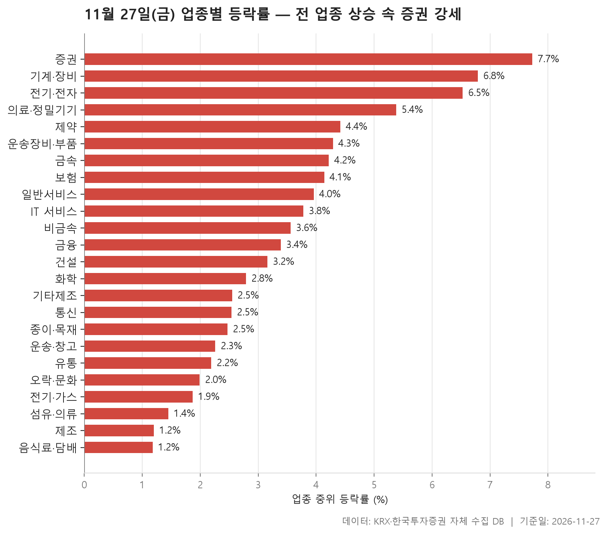
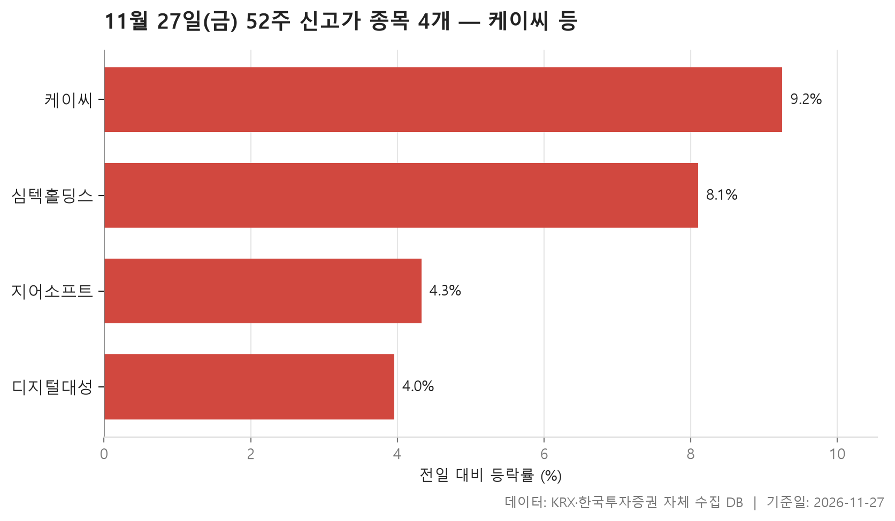
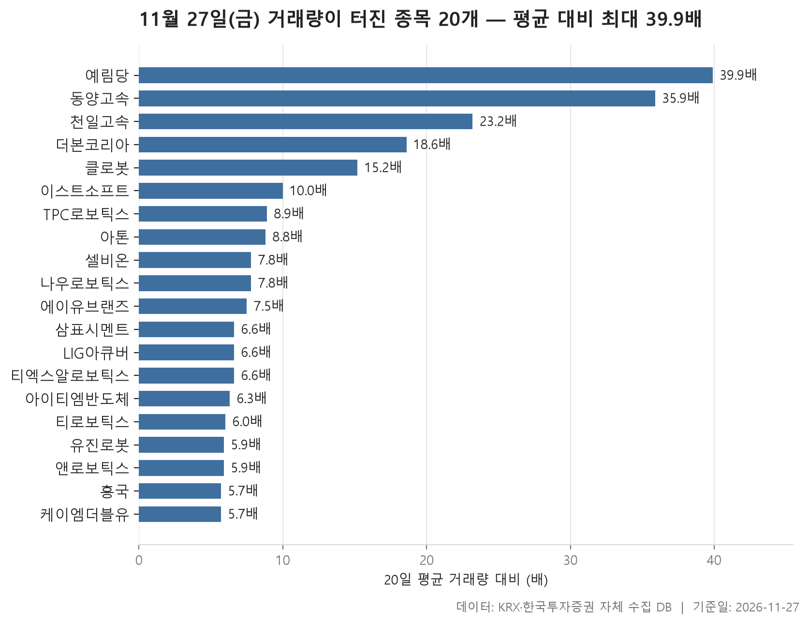

11월 27일 금요일 시장은 한쪽으로 크게 기울었습니다. 24개 업종을 업종 안 종목 등락률의 중위값으로 줄 세워 보면 맨 아래 음식료·담배도 +1.18%였고, 맨 위 증권은 +7.73%까지 올랐습니다. 내린 업종은 하나도 없었습니다. 업종별 중위 등락률을 늘어놓았을 때 한가운데 놓이는 값은 +3.27%입니다.

오늘은 세 가지를 차례로 봅니다. 업종별 흐름, 52주 신고가를 새로 쓴 종목, 그리고 거래량이 평소보다 크게 불어난 종목입니다. 다만 세 표가 똑같은 이야기를 하지는 않습니다. 시장 전체가 올랐는데도 신고가 종목은 4개뿐이었고, 거래량이 가장 크게 늘어난 종목의 주가는 전날과 같았습니다. 이렇게 서로 엇갈리는 대목을 중심으로 읽어 보겠습니다.

> 기준일: 2026-11-27 · 집계: 자체 수집 데이터베이스

## 업종 등락률 — 24개 모두 상승

맨 위는 증권, 기계·장비, 전기·전자 순입니다. 그중 전기·전자가 눈에 띕니다. 368개 종목 가운데 95.90%가 올라 오른 종목 비율이 모든 업종 중 가장 높았고, 거래대금도 86,722.90억원으로 다른 업종과는 규모가 달랐습니다. 1위 증권은 18개 종목뿐이지만 평균 +7.97%, 중위값 +7.73%로 두 값이 거의 같습니다. 가장 크게 오른 미래에셋증권(+15.87%)이 업종 평균을 끌어올린 폭은 0.88%p였습니다. 몇몇 종목이 평균을 끌어올렸다기보다 업종 전체가 고르게 올랐다고 보는 편이 맞습니다.

평균과 중위값이 벌어진 업종도 있습니다. 일반서비스는 중위값이 +3.96%인데 평균은 +5.54%입니다. 이 업종에서 가장 크게 오른 큐리언트(+30.00%)가 평균에 보탠 몫은 0.18%p에 그칩니다. 두 값의 차이가 이보다 훨씬 크니, 큰 폭으로 오른 종목이 여럿이었다는 뜻입니다. 화학(중위 +2.79%, 평균 +3.87%)도 비슷합니다. 엔켐이 +27.33% 올랐지만 평균에 보탠 몫은 0.12%p였습니다. 기타제조는 조금 다릅니다. 중위 +2.55%, 평균 +4.33%로 차이가 나는데, 15개 종목밖에 없는 업종이라 크리에이츠(+15.16%) 한 종목이 평균을 1.01%p 끌어올렸습니다. 이 업종은 평균과 중위값의 차이 가운데 큰 몫을 한 종목이 만든 셈입니다.

반대로 평균이 중위값보다 낮은 업종도 있습니다. 보험은 중위 +4.14%, 평균 +3.37%입니다. 11개 종목 중 90.90%가 올랐지만, 덜 오른 쪽이 평균을 아래로 당긴 모양입니다. 오른 종목 비율이 가장 낮은 곳은 8개 종목으로 이루어진 제조(62.50%)였습니다. 이 업종은 중위값 +1.20%, 평균 +1.08%로 오름폭도 작았습니다.

아래쪽 업종이라고 조용했던 것은 아닙니다. 꼴찌인 음식료·담배에서도 아미코젠이 +15.05% 올랐습니다. 업종마다 가장 크게 움직인 종목을 보면 코스모로보틱스·큐리언트(+30.00%), 제닉스로보틱스(+29.98%), 더코디(+29.97%)처럼 상한가 근처까지 간 종목이 여러 업종에 흩어져 있습니다. 왜 이렇게 올랐는지는 이 자료로는 알 수 없습니다.

| 업종 | 종목수(개) | 중위등락률(%) | 평균등락률(%) | 상승비율(%) | 주도종목 | 주도종목등락률(%) | 평균기여도(%p) | 거래대금합계(억원) |
|---|---|---|---|---|---|---|---|---|
| 증권 | 18 | +7.73 | +7.97 | 94.40 | 미래에셋증권 | +15.87 | 0.88 | 1,901.50 |
| 기계·장비 | 213 | +6.79 | +7.03 | 94.40 | 제닉스로보틱스 | +29.98 | 0.14 | 20,325.90 |
| 전기·전자 | 368 | +6.53 | +6.97 | 95.90 | 더코디 | +29.97 | 0.08 | 86,722.90 |
| 의료·정밀기기 | 105 | +5.38 | +6.06 | 93.30 | 코스모로보틱스 | +30.00 | 0.29 | 2,460.40 |
| 제약 | 168 | +4.42 | +5.20 | 91.70 | 에이비엘바이오 | +26.52 | 0.16 | 7,116.90 |
| 운송장비·부품 | 132 | +4.29 | +4.50 | 93.20 | 휴림에이텍 | +29.94 | 0.23 | 7,787.80 |
| 금속 | 129 | +4.22 | +4.78 | 90.70 | 영흥 | +26.65 | 0.21 | 2,996.60 |
| 보험 | 11 | +4.14 | +3.37 | 90.90 | 미래에셋생명 | +10.79 | 0.98 | 1,431.90 |
| 일반서비스 | 169 | +3.96 | +5.54 | 88.80 | 큐리언트 | +30.00 | 0.18 | 8,955.40 |
| IT 서비스 | 249 | +3.78 | +4.92 | 92.00 | 크라우드웍스 | +29.91 | 0.12 | 12,961.10 |
| 비금속 | 36 | +3.56 | +3.80 | 94.40 | 티씨케이 | +12.03 | 0.33 | 524.20 |
| 금융 | 110 | +3.39 | +3.76 | 88.20 | 에코프로 | +13.91 | 0.13 | 12,249.00 |
| 건설 | 51 | +3.16 | +3.59 | 88.20 | CNT85 | +12.08 | 0.24 | 1,383.50 |
| 화학 | 220 | +2.79 | +3.87 | 85.50 | 엔켐 | +27.33 | 0.12 | 9,900.70 |
| 기타제조 | 15 | +2.55 | +4.33 | 86.70 | 크리에이츠 | +15.16 | 1.01 | 24.40 |
| 통신 | 12 | +2.54 | +2.59 | 75.00 | 더즌 | +7.97 | 0.66 | 877.40 |
| 종이·목재 | 27 | +2.47 | +2.65 | 85.20 | 동화기업 | +8.08 | 0.30 | 93.30 |
| 운송·창고 | 28 | +2.26 | +2.47 | 82.10 | 동양고속 | +9.43 | 0.34 | 2,541.70 |
| 유통 | 156 | +2.19 | +2.95 | 80.10 | 더본코리아 | +15.16 | 0.10 | 2,797.20 |
| 오락·문화 | 60 | +1.99 | +2.50 | 83.30 | SAMG엔터 | +22.09 | 0.37 | 1,596.50 |
| 전기·가스 | 10 | +1.87 | +2.32 | 90.00 | SGC에너지 | +7.86 | 0.79 | 333.80 |
| 섬유·의류 | 48 | +1.45 | +2.01 | 85.40 | 화승엔터프라이즈 | +7.22 | 0.15 | 88.90 |
| 제조 | 8 | +1.20 | +1.08 | 62.50 | 시디즈 | +5.23 | 0.65 | 6.40 |
| 음식료·담배 | 84 | +1.18 | +1.57 | 77.40 | 아미코젠 | +15.05 | 0.18 | 1,480.00 |

## 52주 신고가 4개 — 최고 케이씨 9.25%

전 업종이 오른 날이었는데도 직전 52주 최고가를 종가로 넘어선 보통주는 4개뿐입니다. 시가총액 500억원 이상, 거래대금 3억원 이상이라는 조건을 건 결과입니다. 시장별로는 KOSPI 1개, KOSDAQ 3개입니다. 오름폭도 그날 상위권 업종의 큰 종목들과 비교하면 크지 않았습니다. 가장 많이 오른 케이씨가 +9.25%, 가장 적게 오른 디지털대성이 +3.96%였고, 네 종목의 중위값은 +6.21%입니다.

신고가라는 선을 넘은 폭도 크지 않습니다. 심텍홀딩스는 종가 6,810원으로 이전 최고가 6,800원을 겨우 넘었습니다. 지어소프트(16,380원, 이전 최고 16,190원)와 케이씨(49,600원, 이전 최고 49,150원)도 종전 고점을 살짝 넘어선 정도입니다. 이 가운데 디지털대성이 10,490원으로 이전 최고 10,170원을 상대적으로 넉넉하게 넘었습니다. 거래대금은 심텍홀딩스가 115.90억원으로 가장 많았고, 나머지 세 종목은 29.60억원, 24.80억원, 16.10억원에 그쳤습니다.

업종은 일반서비스가 2개였고, 의료·정밀기기와 IT 서비스가 1개씩이었습니다. 의료·정밀기기는 업종 표에서도 중위값 +5.38%로 상위권이었습니다. 시가총액이 가장 큰 종목은 케이씨(5,466억원)입니다. 시장 전체가 크게 오른 날에도 1년 고점을 넘어선 종목은 이처럼 드물었습니다.

| 종목명 | 종목코드 | 시장 | 업종 | 종가(원) | 등락률(%) | 이전52주최고(원) | 거래대금(억원) | 시가총액(억원) |
|---|---|---|---|---|---|---|---|---|
| 케이씨 | 029460 | KOSPI | 의료·정밀기기 | 49,600 | +9.25 | 49,150 | 29.60 | 5,466 |
| 심텍홀딩스 | 036710 | KOSDAQ | 일반서비스 | 6,810 | +8.10 | 6,800 | 115.90 | 3,598 |
| 디지털대성 | 068930 | KOSDAQ | 일반서비스 | 10,490 | +3.96 | 10,170 | 16.10 | 2,837 |
| 지어소프트 | 051160 | KOSDAQ | IT 서비스 | 16,380 | +4.33 | 16,190 | 24.80 | 2,208 |

## 거래량 급증 20개 — 최고 예림당 39.90배

거래량이 직전 20거래일 평균의 5배를 넘은 보통주는 20개였습니다. 배수의 중위값은 7.65배입니다. 업종으로는 기계·장비가 7개로 가장 많았는데, 흥국을 빼면 모두 이름에 '로봇'이나 '로보틱스'가 들어갑니다. IT 서비스로 분류된 클로봇(+29.87%)까지 더하면 이런 종목이 표의 상당 부분을 차지합니다. 다만 이름이 비슷한 종목들이 같은 날 함께 움직인 이유는 자료에 나와 있지 않습니다.

배수가 가장 높은 종목은 예림당으로 39.90배였는데, 주가 등락률은 0.00%였습니다. 평소 하루 거래량이 8,546주에 불과한 종목이라 배수가 크게 튀었고, 거래대금은 7.90억원에 머물렀습니다. 흥국도 +1.80%에 거래대금 4.00억원으로 비슷한 경우입니다. 배수만 보고 큰돈이 몰렸다고 읽으면 안 되는 이유가 여기 있습니다.

운송·창고에서는 두 종목이 나란히 올라왔습니다. 동양고속은 35.90배에 +9.43% 올랐고, 거래대금 1,023.20억원으로 표에서 가장 많았습니다. 같은 업종의 천일고속도 23.20배로 거래가 크게 늘었지만 주가는 +0.71% 오르는 데 그쳤습니다. 같은 날 거래량이 함께 불었는데도 가격의 반응은 꽤 달랐습니다.

표 맨 아래는 거꾸로 읽어야 합니다. 시가총액이 10,949억원으로 가장 큰 케이엠더블유는 배수가 5.70배로 가장 낮았지만 주가는 +22.99% 올랐습니다. 평소 거래량이 이미 193,559주 수준이라 배수가 덜 커졌을 뿐입니다. 앤로보틱스도 배수는 5.90배였지만, 하루 19,002,521주가 거래되며 +29.97% 올랐습니다. 평소 거래가 많은 종목은 배수 순위로는 아래에 있어도 실제로 오간 물량은 표에서 가장 큰 축에 듭니다.

| 종목명 | 종목코드 | 시장 | 업종 | 종가(원) | 등락률(%) | 거래량(주) | 평균거래량(주) | 배수(배) | 거래대금(억원) | 시가총액(억원) |
|---|---|---|---|---|---|---|---|---|---|---|
| 예림당 | 036000 | KOSDAQ | 오락·문화 | 2,520 | 0.00 | 341,037 | 8,546 | 39.90 | 7.90 | 580 |
| 동양고속 | 084670 | KOSPI | 운송·창고 | 36,550 | +9.43 | 2,789,603 | 77,629 | 35.90 | 1,023.20 | 1,058 |
| 천일고속 | 000650 | KOSPI | 운송·창고 | 199,200 | +0.71 | 165,460 | 7,128 | 23.20 | 352.10 | 2,847 |
| 더본코리아 | 475560 | KOSPI | 유통 | 14,660 | +15.16 | 256,428 | 13,804 | 18.60 | 38.10 | 2,174 |
| 클로봇 | 466100 | KOSDAQ | IT 서비스 | 23,650 | +29.87 | 3,080,351 | 203,080 | 15.20 | 680.20 | 7,374 |
| 이스트소프트 | 047560 | KOSDAQ | IT 서비스 | 7,110 | +21.54 | 343,151 | 34,440 | 10.00 | 23.80 | 836 |
| TPC로보틱스 | 048770 | KOSDAQ | 기계·장비 | 4,350 | +2.35 | 3,662,215 | 413,747 | 8.90 | 161.60 | 683 |
| 아톤 | 158430 | KOSDAQ | IT 서비스 | 5,210 | +21.87 | 5,601,824 | 638,692 | 8.80 | 280.20 | 1,276 |
| 셀비온 | 308430 | KOSDAQ | 제약 | 13,950 | +12.86 | 145,265 | 18,546 | 7.80 | 20.80 | 1,800 |
| 나우로보틱스 | 459510 | KOSDAQ | 기계·장비 | 12,650 | +11.45 | 215,864 | 27,547 | 7.80 | 26.50 | 1,642 |
| 에이유브랜즈 | 481070 | KOSDAQ | 유통 | 11,310 | +3.29 | 325,258 | 43,558 | 7.50 | 36.20 | 1,624 |
| 삼표시멘트 | 038500 | KOSDAQ | 비금속 | 5,750 | +3.60 | 3,700,583 | 562,514 | 6.60 | 212.20 | 6,205 |
| LIG아큐버 | 073490 | KOSDAQ | 전기·전자 | 45,200 | +14.72 | 586,062 | 88,129 | 6.60 | 259.80 | 3,437 |
| 티엑스알로보틱스 | 484810 | KOSDAQ | 기계·장비 | 9,180 | +12.22 | 451,744 | 68,638 | 6.60 | 40.70 | 1,418 |
| 아이티엠반도체 | 084850 | KOSDAQ | 전기·전자 | 6,400 | +15.11 | 433,836 | 68,608 | 6.30 | 26.70 | 1,452 |
| 티로보틱스 | 117730 | KOSDAQ | 기계·장비 | 13,550 | +8.49 | 484,378 | 81,302 | 6.00 | 64.40 | 3,057 |
| 유진로봇 | 056080 | KOSDAQ | 기계·장비 | 10,030 | +13.98 | 3,067,192 | 519,684 | 5.90 | 306.20 | 3,835 |
| 앤로보틱스 | 138360 | KOSDAQ | 기계·장비 | 1,483 | +29.97 | 19,002,521 | 3,202,154 | 5.90 | 268.60 | 1,305 |
| 흥국 | 010240 | KOSDAQ | 기계·장비 | 4,800 | +1.80 | 84,093 | 14,648 | 5.70 | 4.00 | 562 |
| 케이엠더블유 | 032500 | KOSDAQ | 전기·전자 | 25,950 | +22.99 | 1,112,859 | 193,559 | 5.70 | 274.60 | 10,949 |

## 정리

정리하면 이렇습니다. 11월 27일은 24개 업종이 모두 오른 날이었고, 증권·기계·장비·전기·전자가 앞섰습니다. 그런데 1년 고점을 새로 쓴 종목은 4개에 그쳤고, 거래량이 크게 불어난 종목은 이름에 로봇이 들어간 종목들과 운송·창고 일부에 몰렸습니다. 지수가 넓게 오르는 것과 개별 종목이 신고가를 넘거나 거래가 급증하는 것은 서로 다른 이야기라는 점을 보여 준 하루였습니다.

이 글은 하루치 종가 데이터만 다룹니다. 왜 올랐는지에 대한 정보는 자료에 없으며, 신고가와 거래량 표에는 시가총액과 거래대금 조건이 걸려 있어 작은 종목은 빠져 있습니다. 업종 분류도 자체 기준이라 다른 곳의 분류와 다를 수 있습니다. 시장 흐름을 훑어보기 위한 정리일 뿐, 특정 종목의 매매를 권하는 글이 아닙니다.

## 집계 기준

**업종 등락률**

- **기준**: 2026-11-26 종가 → 2026-11-27 종가
- **순위**: 업종 내 종목 등락률의 중위값 (평균은 참고용으로 함께 표시)
- **주도종목**: 그 업종에서 등락률 절대값이 가장 큰 종목 (동점이면 거래대금이 큰 쪽)
- **평균기여도**: 그 종목 하나가 업종 평균을 움직인 폭 (등락률 ÷ 종목수). 중위값과 평균의 격차가 이 값에 가까우면 평균을 만든 것이 그 종목이고, 훨씬 크면 다른 종목들도 함께 움직인 것입니다
- **필터**: 업종 내 보통주 5종목 이상
- **전체업종중위등락률(%)**: 3.28

**52주 신고가**

- **기준**: 종가 > 직전 52주 최고가
- **관측구간**: 2025-11-17 ~ 2026-11-26 (252거래일)
- **필터**: 시가총액 500억 이상, 거래대금 3억 이상, 보통주

**거래량 급증**

- **기준**: 당일 거래량 ≥ 직전 20거래일 평균 × 5
- **관측구간**: 2026-10-30 ~ 2026-11-26 (20거래일)
- **필터**: 시가총액 500억 이상, 거래대금 3억 이상, 보통주

## 데이터 출처 및 유의사항

- **데이터출처**: 한국거래소(KRX) 공시 데이터와 한국투자증권 OpenAPI 를 직접 수집해 구축한 자체 데이터베이스
- **집계방식**: 수집·집계·차트 생성을 직접 구현한 파이프라인에서 자동 산출
- **작성고지**: 본문의 표·통계·차트는 자체 데이터베이스에서 계산된 값이며, 문장 작성 과정에 AI 도구를 활용했습니다.
- **면책**: 본 글은 정보 제공을 목적으로 하며 특정 종목의 매수·매도를 추천하지 않습니다. 제시된 수치는 과거 데이터이고 미래 수익을 보장하지 않습니다. 투자 판단과 그 결과에 대한 책임은 투자자 본인에게 있습니다.

