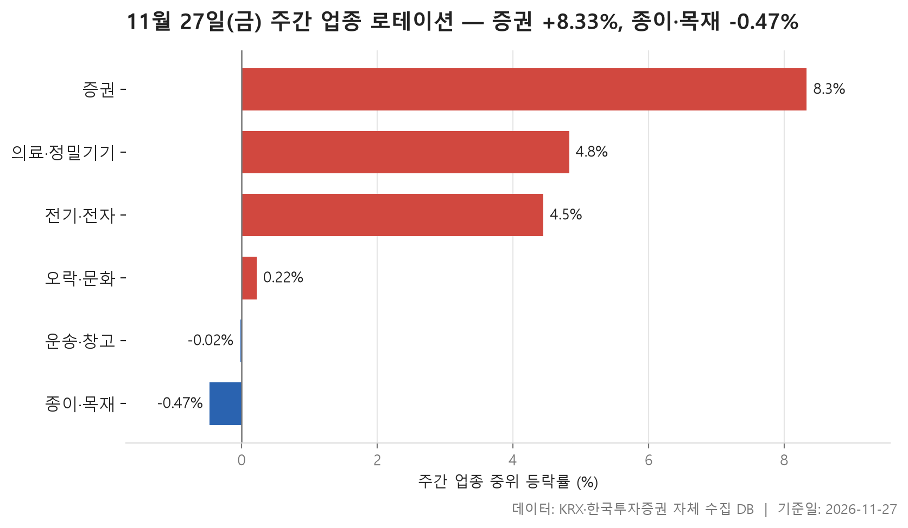
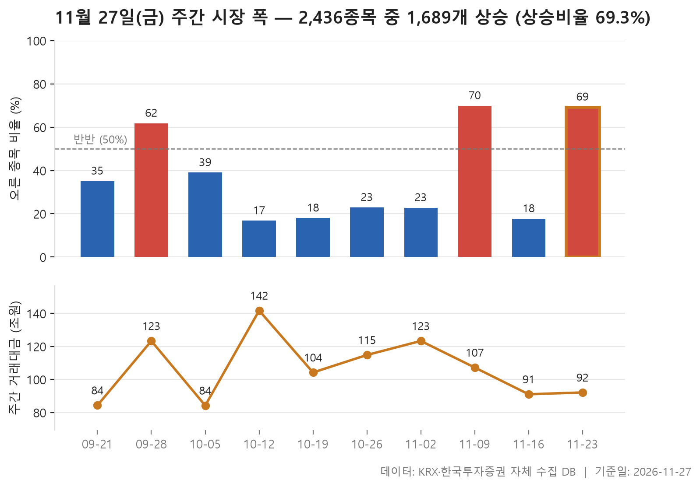
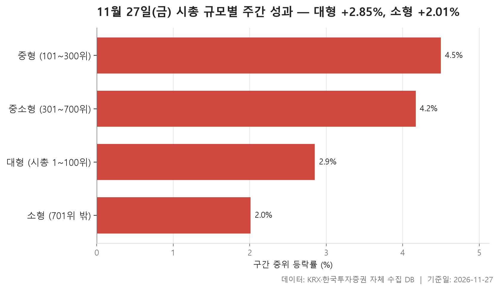

이번 주에는 시장이 넓게 올랐습니다. 2026-11-23부터 2026-11-27까지 다섯 거래일 동안 거래가 있었던 보통주 2,436개 가운데 1,689개가 올랐고, 오른 종목 비율은 69.3%였습니다. 열 종목 중 일곱 종목가량이 오른 셈입니다. 다만 바로 앞 주의 모습은 정반대였습니다. 그래서 이번 상승이 이어지는 흐름인지 한 번의 반등인지 판단하려면 표를 좀 더 들여다봐야 합니다.

오늘은 세 갈래로 봅니다. 먼저 24개 업종 가운데 가장 강했던 곳과 가장 약했던 곳을 비교해 돈이 어느 산업으로 돌았는지 살핍니다. 이어 최근 10주 동안 오른 종목과 내린 종목의 수를 늘어놓고 이번 주가 그 안에서 어디쯤인지 확인합니다. 마지막으로 시가총액 순위로 나눈 네 구간을 비교해 큰 종목과 작은 종목 중 어느 쪽이 앞섰는지 봅니다.

먼저 짚어 둘 것이 있습니다. 업종 표와 규모별 표에 똑같은 모양이 되풀이됩니다. 종목들을 줄 세웠을 때 한가운데 놓인 값보다 평균이 높게 나온다는 점입니다. 몇몇 종목이 크게 올라 평균을 끌어올렸다는 뜻입니다. 이 차이를 따라가면 표만 봐서는 보이지 않는 대목이 드러납니다.

> 기준일: 2026-11-27 · 집계: 자체 수집 데이터베이스

## 주간 업종 로테이션 — 6개 중 4개 상승

업종 순위는 업종 안의 종목 등락률을 줄 세웠을 때 한가운데 놓인 값으로 매겼습니다. 이 기준으로 가장 강했던 업종은 증권으로 +8.33%였습니다. 숫자의 크기보다 눈여겨볼 것은 고르게 올랐다는 점입니다. 18개 종목이 하나도 빠짐없이 올라 오른 종목 비율이 100.00%였습니다. 평균은 +9.66%로 가운데 값보다 조금 높습니다. 가장 크게 움직인 키움증권(+23.61%) 하나가 업종 평균을 1.31%p 끌어올린 몫이 섞여 있기 때문입니다. 그래도 가운데 값 자체가 높고 모든 종목이 올랐으니, 몇몇 종목이 만든 숫자라기보다 업종 전체가 함께 움직인 주에 가깝습니다.

2위 의료·정밀기기(+4.83%)와 3위 전기·전자(+4.45%)는 종목 수가 많은 업종입니다. 특히 전기·전자는 367개 종목이 속한 큰 업종인데도 넷 중 셋꼴(74.1%)이 올랐습니다. 업종이 크면 한 종목이 급등해도 평균이 크게 움직이지 않습니다. 코스모로보틱스가 +60.22%, 풍원정밀이 +51.72% 올랐지만, 각각이 업종 평균을 끌어올린 폭은 0.58%p와 0.14%p에 그쳤습니다. 이 두 업종의 순위는 눈에 띄는 급등주보다 업종 전반이 함께 오른 데서 나왔다고 볼 수 있습니다.

하위 3개 업종은 다르게 읽어야 합니다. 가장 약했던 종이·목재의 가운데 값은 -0.47%였습니다. 운송·창고는 -0.02%로 사실상 제자리였고, 오락·문화는 +0.22%로 오히려 플러스였습니다. 하위권이라도 크게 밀린 업종은 없었습니다. 더 흥미로운 것은 평균입니다. 종이·목재의 평균은 +1.37%, 운송·창고는 +2.72%로, 가운데 값과 방향이 엇갈립니다. 깨끗한나라(+44.66%)와 동양고속(+45.33%)이 각자 업종 평균을 1.65%p, 1.62%p 끌어올렸습니다. 종목이 27개, 28개뿐인 업종이라 한 종목만 크게 올라도 평균이 쉽게 흔들립니다. 두 업종 모두 오른 종목 비율이 절반 언저리(48.1%, 50.0%)여서, 업종 전체로 보면 오르지도 내리지도 않은 한 주였습니다.

| 업종 | 종목수(개) | 주간중위등락률(%) | 주간평균등락률(%) | 상승비율(%) | 주도종목 | 주도종목등락률(%) | 평균기여도(%p) |
|---|---|---|---|---|---|---|---|
| 증권 | 18 | +8.33 | +9.66 | 100.00 | 키움증권 | +23.61 | 1.31 |
| 의료·정밀기기 | 104 | +4.83 | +5.25 | 72.10 | 코스모로보틱스 | +60.22 | 0.58 |
| 전기·전자 | 367 | +4.45 | +5.63 | 74.10 | 풍원정밀 | +51.72 | 0.14 |
| 오락·문화 | 60 | +0.22 | +0.77 | 55.00 | 스튜디오미르 | +17.00 | 0.28 |
| 운송·창고 | 28 | -0.02 | +2.72 | 50.00 | 동양고속 | +45.33 | 1.62 |
| 종이·목재 | 27 | -0.47 | +1.37 | 48.10 | 깨끗한나라 | +44.66 | 1.65 |

## 주간 시장 폭 — 10주 중 이번 주는 2,436개 중 1,689개 상승

최근 10주를 이어서 보면 이번 주의 위치가 분명해집니다. 이번 주에는 상승 종목 수를 하락 종목 수로 나눈 값이 2.32배였습니다. 오른 종목이 내린 종목의 두 배를 넘었다는 뜻입니다. 10주 가운데 이보다 높았던 주는 2026-11-09 주(2.43배) 하나뿐입니다. 10주 값의 중위값이 0.43배이니, 이번 주는 분명히 위쪽에 놓입니다.

그런데 주 순서대로 읽어 보면 한 방향으로 쌓인 흐름은 아닙니다. 2026-11-09 주에는 1,700개 종목이 오르며 크게 반등했습니다. 바로 다음 2026-11-16 주에는 오른 종목이 431개로 줄어 비율이 17.7%까지 내려갔고, 이번 주에 다시 1,689개가 올랐습니다. 강한 주와 약한 주가 번갈아 나온 모양이고, 이번 주는 오른 종목 수까지 2026-11-09 주와 거의 같습니다. 그보다 앞서 2026-10-12 주부터 2026-11-02 주까지는 네 주 내리 이 배수가 0.20배에서 0.30배 사이에 머물렀습니다. 가장 낮았던 2026-10-12 주에는 오른 종목이 16.8%에 불과했습니다.

거래대금을 함께 보면 또 다른 면이 보입니다. 이번 주 거래대금은 92.1조원으로 2026-11-09 주의 107.2조원보다 적었고, 다섯 거래일을 채운 주들 가운데서도 낮은 편입니다. 10주 중 거래대금이 가장 많았던 주는 141.7조원이 오간 2026-10-12 주인데, 공교롭게도 내린 종목이 가장 많았던(1,987개) 주이기도 합니다. 거래가 많은 주에 오른 종목이 많았던 것은 아니었고, 이번 주의 넓은 상승은 거래대금으로 보면 비교적 조용하게 이뤄졌습니다. 참고로 2026-10-05 주와 2026-09-21 주는 거래일이 3일뿐이었습니다. 두 주의 거래대금(84.2조원, 84.3조원)은 그 점을 감안해서 봐야 합니다.

| 주 | 거래일수(일) | 종목수(개) | 상승(개) | 보합(개) | 하락(개) | 상승비율(%) | ADR(배) | 총거래대금(조원) |
|---|---|---|---|---|---|---|---|---|
| 2026-11-23 | 5 | 2,436 | 1,689 | 20 | 727 | 69.30 | 2.32 | 92.10 |
| 2026-11-16 | 5 | 2,434 | 431 | 20 | 1,983 | 17.70 | 0.22 | 91.00 |
| 2026-11-09 | 5 | 2,431 | 1,700 | 30 | 701 | 69.90 | 2.43 | 107.20 |
| 2026-11-02 | 5 | 2,425 | 554 | 18 | 1,853 | 22.80 | 0.30 | 123.30 |
| 2026-10-26 | 5 | 2,415 | 554 | 17 | 1,844 | 22.90 | 0.30 | 114.80 |
| 2026-10-19 | 5 | 2,413 | 434 | 24 | 1,955 | 18.00 | 0.22 | 104.20 |
| 2026-10-12 | 5 | 2,410 | 405 | 18 | 1,987 | 16.80 | 0.20 | 141.70 |
| 2026-10-05 | 3 | 2,413 | 942 | 39 | 1,432 | 39.00 | 0.66 | 84.20 |
| 2026-09-28 | 5 | 2,406 | 1,488 | 41 | 877 | 61.80 | 1.70 | 123.30 |
| 2026-09-21 | 3 | 2,409 | 846 | 47 | 1,516 | 35.10 | 0.56 | 84.30 |

## 시총 규모별 주간 성과 — 대형이 0.84%p 앞섬

시가총액 순위로 나눈 네 구간 모두 가운데 값이 플러스였습니다. 대형주라 부른 시총 상위 100개 종목은 +2.85%, 701위 밖의 소형 구간은 +2.01%였습니다. 대형 구간이 소형 구간보다 0.84%p 앞섰고, '대형주 쪽이 앞섰다'는 말은 이 양 끝의 비교에서 나옵니다. 하지만 가장 강한 곳은 양 끝이 아니라 가운데였습니다. 300위까지의 중형 구간이 +4.50%로 가장 높았고, 700위까지의 중소형 구간도 +4.17%로 대형을 웃돌았습니다. 네 구간 값의 한가운데가 3.51%이니 대형과 소형은 둘 다 아래쪽에 있습니다. 오른 종목 비율도 중소형 78.0%, 중형 73.5%로 대형 69.0%, 소형 66.9%보다 높았습니다.

평균과 가운데 값의 차이는 대형 구간에서 가장 큽니다. 평균은 +4.83%로 가운데 값 +2.85%보다 꽤 높습니다. 삼천당제약(+31.42%)처럼 크게 오른 몇몇 종목이 평균을 끌어올렸다는 신호입니다. 중형과 중소형은 평균이 각각 +6.93%, +6.94%로 거의 같았고, 이 구간에서 가장 크게 움직인 종목은 안랩(+57.07%)과 휴림로봇(+64.77%)이었습니다. 소형 구간에서는 휴림에이텍이 +106.81%로 두 배 넘게 뛰었지만, 1,736개 종목이 모인 구간이어서 평균은 +3.36%에 머물렀습니다.

거래대금은 등락률과 전혀 다른 그림을 그립니다. 대형 구간에만 62.1조원이 몰려 나머지 세 구간을 합한 것보다 많았습니다. 중형은 15.4조원, 중소형은 7.7조원이었고, 종목 수가 가장 많은 소형 구간이 6.6조원으로 가장 적었습니다. 거래가 가장 많이 몰린 곳은 큰 종목들이었지만 많이 오른 곳은 그 아래 두 구간이었습니다.

| 구간 | 종목수(개) | 주간중위등락률(%) | 주간평균등락률(%) | 상승비율(%) | 주도종목 | 주도종목등락률(%) | 주간거래대금(조원) |
|---|---|---|---|---|---|---|---|
| 대형 (시총 1~100위) | 100 | +2.85 | +4.83 | 69.00 | 삼천당제약 | +31.42 | 62.10 |
| 중형 (101~300위) | 200 | +4.50 | +6.93 | 73.50 | 안랩 | +57.07 | 15.40 |
| 중소형 (301~700위) | 400 | +4.17 | +6.94 | 78.00 | 휴림로봇 | +64.77 | 7.70 |
| 소형 (701위 밖) | 1,736 | +2.01 | +3.36 | 66.90 | 휴림에이텍 | +106.81 | 6.60 |

## 정리

이번 주를 한 문장으로 정리하면, 증권을 앞세워 시장이 넓게 올랐지만 그 앞 몇 주는 강한 주와 약한 주가 번갈아 나왔고, 규모별로는 양 끝보다 가운데 구간이 강했던 한 주였습니다. 업종 하위권에서도 크게 밀린 곳은 없었습니다. 대신 종목 수가 적은 업종에서는 한 종목의 급등이 평균을 가운데 값과 반대 방향으로 끌고 간 경우가 있었습니다.

몇 가지 한계를 밝혀 둡니다. 이 글은 한 주의 종가를 앞 주 종가와 비교한 결과이며, 왜 그렇게 움직였는지는 자료에 담겨 있지 않습니다. 순위는 가운데 값으로 매겼기 때문에 평균으로 줄 세우면 순서가 달라질 수 있습니다. 거래일 수가 다른 주끼리는 거래대금을 단순히 비교하기 어렵습니다. 또 보통주만 집계했고 종목이 5개 미만인 업종은 표에서 빠졌습니다.

## 집계 기준

**주간 업종 로테이션**

- **기준**: 2026-11-20 종가 → 2026-11-27 종가
- **구간**: 2026-11-23 시작 주 — 직전 주 마지막 거래일 종가를 출발선으로 삼습니다
- **거래일수**: 5
- **순위**: 업종 내 종목 등락률의 중위값 (평균은 참고용으로 함께 표시)
- **선정**: 전체 24개 업종 중 상위 3개 · 하위 3개
- **주도종목**: 그 업종에서 같은 기간 등락률 절대값이 가장 큰 종목 (동점이면 거래대금이 큰 쪽)
- **평균기여도**: 그 종목 하나가 업종 평균을 움직인 폭 (등락률 ÷ 종목수)
- **필터**: 업종 내 보통주 5종목 이상

**주간 시장 폭**

- **기준**: 각 주의 마지막 거래일 종가를 직전 주 마지막 거래일 종가와 비교
- **주**: 그 주의 월요일 (달력 기준). 거래일 수는 연휴에 따라 다릅니다
- **ADR**: 상승 종목 수 ÷ 하락 종목 수. 1 이면 반반, 2 면 오른 종목이 두 배
- **총거래대금**: 그 주 거래일 전체의 거래대금 합계
- **모집단**: 거래가 있었던 보통주 (거래정지·액면 변경 종목 제외)

**시총 규모별 주간 성과**

- **기준**: 2026-11-20 종가 → 2026-11-27 종가
- **구간**: 기준일 시가총액 순위로 자릅니다 (금액으로 자르면 장이 오른 해에 전부 위 구간으로 올라가 해마다 다른 표가 됩니다)
- **순위**: 구간 내 종목 등락률의 중위값 (평균은 참고용으로 함께 표시)
- **주도종목**: 그 구간에서 같은 기간 등락률 절대값이 가장 큰 종목 (동점이면 거래대금이 큰 쪽)
- **대형소형격차**: 0.84
- **모집단**: 거래가 있었던 보통주 (거래정지·액면 변경 종목 제외)

## 데이터 출처 및 유의사항

- **데이터출처**: 한국거래소(KRX) 공시 데이터와 한국투자증권 OpenAPI 를 직접 수집해 구축한 자체 데이터베이스
- **집계방식**: 수집·집계·차트 생성을 직접 구현한 파이프라인에서 자동 산출
- **작성고지**: 본문의 표·통계·차트는 자체 데이터베이스에서 계산된 값이며, 문장 작성 과정에 AI 도구를 활용했습니다.
- **면책**: 본 글은 정보 제공을 목적으로 하며 특정 종목의 매수·매도를 추천하지 않습니다. 제시된 수치는 과거 데이터이고 미래 수익을 보장하지 않습니다. 투자 판단과 그 결과에 대한 책임은 투자자 본인에게 있습니다.

