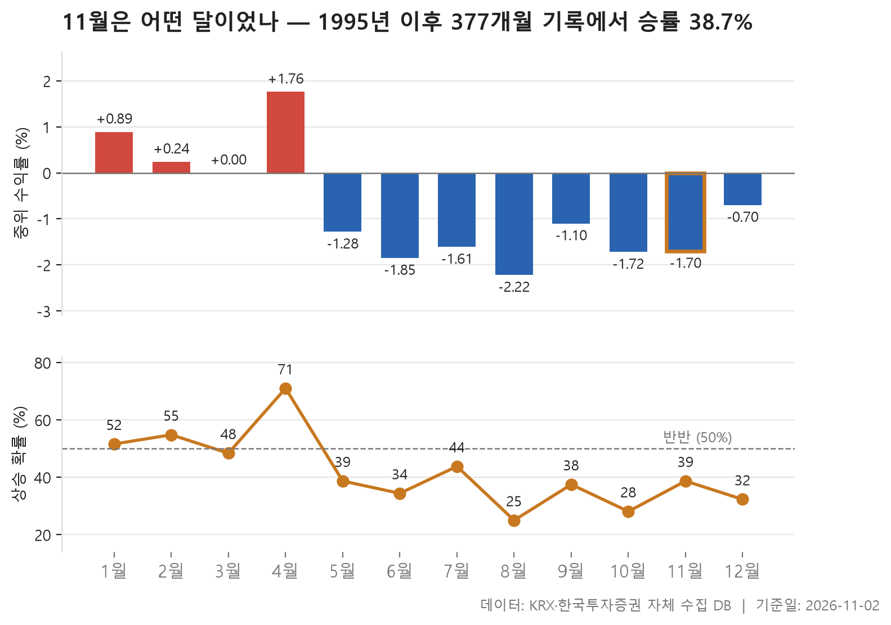

11월 첫 거래일을 맞아, 지난 기록에서 11월이 어떤 달이었는지 꺼내 봅니다. 1995년 6월부터 2026년 10월까지 377개월 동안 매달 말 종가로 KOSPI·KOSDAQ 보통주의 한 달 수익률을 하나하나 구하고, 그 한가운데 값을 그달의 성적으로 삼았습니다. 지수 하나가 얼마나 움직였는지와는 다른 숫자입니다. **평범한 종목 하나가 그달을 어떻게 보냈는지**에 더 가깝다고 보면 됩니다.

결론부터 말하면 11월은 31번 가운데 12번 올랐습니다. 오른 해의 비율은 38.7%, 중위 수익률은 -1.70%입니다. 열두 달을 줄 세우면 9번째로, 아래쪽에 속합니다.

그런데 표를 조금 더 들여다보면 숫자 하나로 정리하기 어려운 달이라는 게 드러납니다. 한가운데 값은 약한데 평균은 0에 거의 붙어 있습니다. 오늘 글에서는 이 차이가 무엇을 뜻하는지, 그리고 11월이 이웃한 달들 사이에서 어디쯤 서 있는지를 차례로 살펴봅니다.

> 기준일: 2026-11-02 · 집계: 자체 수집 데이터베이스

## 11월은 31번 중 12번 올랐습니다 — 승률 38.7%, 중위 -1.7%

먼저 열두 달 전체의 모양부터 보겠습니다. 중위 수익률이 플러스인 달은 1월, 2월, 4월 세 달뿐입니다. 3월은 정확히 0.00%로 오르지도 내리지도 않았고, 나머지 8개월은 모두 마이너스입니다. 열두 달 값을 늘어놓았을 때 한가운데 놓이는 값도 -1.19%입니다. 이 집계 방식에서는 보통 종목이 한 달을 보내고 나면 조금 밀려 있는 경우가 더 흔했다는 뜻입니다. 맨 위는 4월로 중위 수익률이 +1.76%이고, 31번 중 22번 올라 오른 해의 비율이 71.0%에 이릅니다. 맨 아래는 8월로 -2.22%이며, 32번 가운데 8번만 올라 네 해에 한 번꼴이었습니다. 연초와 봄에 강하고 여름부터 가을까지 약한 흐름이 비교적 또렷하게 보입니다.

11월은 이 약한 쪽 무리의 한가운데쯤에 있습니다. 중위 수익률 -1.70%는 바로 아래 10월의 -1.72%와 거의 붙어 있고, 바로 위 7월의 -1.61%와도 차이가 크지 않습니다. 순위는 9번째지만 아래위 이웃과 촘촘하게 붙어 있어서, 순위 하나만 보고 큰 의미를 두기는 어렵습니다. 오른 해의 비율 38.7%는 5월과 똑같습니다. 열 해 가운데 네 해가 채 안 되게 올랐다고 보면 됩니다.

표에서 가장 어긋나 보이는 대목은 평균입니다. 11월의 평균 수익률은 -0.02%로, 중위값 -1.70%보다 꽤 위에 있습니다. 한가운데 종목은 밀렸는데 전체 평균은 거의 제자리였다는 것은, 일부 종목이나 일부 해에 크게 오른 값이 섞여 평균을 끌어올렸을 가능성을 시사합니다. 기록상 최고치를 보면 그렇게 읽을 여지가 있습니다. 11월의 최고 기록은 +17.05%로 1월(+31.15%)과 4월(+19.57%) 다음으로 높습니다. 반대로 최저 기록은 -12.82%여서, 10월의 -31.63%나 12월의 -25.49%에 비하면 아래쪽 꼬리가 짧은 편입니다. 대체로 조금씩 밀리는 해가 많았지만, 크게 무너진 해보다는 크게 오른 해가 더 눈에 띄는 달이었다고 정리할 수 있습니다. 다만 그런 해가 왜 나왔는지는 이 표가 말해 주지 않습니다.

앞뒤 달과 나란히 놓으면 대비가 더 뚜렷해집니다. 10월은 한가운데 값이 11월과 거의 같지만 평균은 -3.46%로 훨씬 낮습니다. 크게 빠진 해가 평균을 끌어내린 모양입니다. 12월은 반대로 중위 수익률이 -0.70%로 11월보다 덜 나쁜데, 평균은 -2.16%이고 오른 해의 비율은 32.3%에 그칩니다. 세 달의 한가운데 값만 보면 연말로 갈수록 나아지는 것처럼 보이지만, 평균과 꼬리까지 함께 보면 11월이 오히려 가장 덜 험한 모양에 가깝습니다. 어느 숫자를 기준으로 삼느냐에 따라 달의 인상이 꽤 달라진다는 점을 기억해 둘 만합니다.

| 월 | 관측연수(년) | 중위수익률(%) | 평균수익률(%) | 상승한해(년) | 승률(%) | 최고 | 최저 |
|---|---|---|---|---|---|---|---|
| 1월 | 31 | +0.89 | +1.97 | 16 | 51.60 | +31.15 | -10.99 |
| 2월 | 31 | +0.24 | +0.23 | 17 | 54.80 | +11.82 | -9.63 |
| 3월 | 31 | 0.00 | -0.22 | 15 | 48.40 | +12.08 | -16.87 |
| 4월 | 31 | +1.76 | +2.00 | 22 | 71.00 | +19.57 | -20.30 |
| 5월 | 31 | -1.28 | -2.09 | 12 | 38.70 | +10.51 | -18.98 |
| 6월 | 32 | -1.85 | -2.77 | 11 | 34.40 | +9.00 | -17.76 |
| 7월 | 32 | -1.61 | -0.48 | 14 | 43.80 | +9.91 | -12.65 |
| 8월 | 32 | -2.22 | -2.04 | 8 | 25.00 | +8.39 | -10.90 |
| 9월 | 32 | -1.10 | -2.73 | 12 | 37.50 | +12.96 | -17.69 |
| 10월 | 32 | -1.72 | -3.46 | 9 | 28.10 | +14.85 | -31.63 |
| 11월 | 31 | -1.70 | -0.02 | 12 | 38.70 | +17.05 | -12.82 |
| 12월 | 31 | -0.70 | -2.16 | 10 | 32.30 | +16.67 | -25.49 |

## 정리

정리하면 11월은 한가운데 종목 기준으로는 약한 쪽(9번째, -1.70%)에 서 있지만, 평균이 -0.02%로 0에 가깝고 위쪽 꼬리가 아래쪽보다 긴, 모양이 비대칭인 달이었습니다.

다만 이 표에는 한계가 분명합니다. 상장폐지된 종목은 종목 마스터에 남지 않아 집계에서 빠지기 때문에 과거 수익률이 실제보다 높게 나왔을 수 있습니다. 한 달 수익률은 극단값을 잘라서 반영했고, 수정주가 적용 여부가 종목마다 달라 개별 수익률에는 오차가 있을 수 있습니다. 무엇보다 11월 하나에 쌓인 기록은 31번뿐이라 몇몇 해의 사정만으로도 숫자가 쉽게 흔들립니다. 지난 기록이 이번 11월의 방향을 알려 주지는 않으며, 이 글은 과거 분포를 설명하는 데서 멈춥니다.

## 집계 기준

- **기준**: 매월 말 거래일 종가 기준, 전 종목 개별 수익률의 중위값
- **관측구간**: 1995-06 ~ 2026-10 (유효 377개월)
- **이번달**: 11월
- **이번달순위**: 9
- **모집단**: 종목 마스터에 등재된 KOSPI·KOSDAQ 보통주 (ETF·ETN·우선주 제외)
- **생존편향**: 상장폐지된 종목은 종목 마스터에 남지 않아 집계에서 빠집니다. 따라서 과거 수익률은 실제보다 높게 나올 수 있습니다. 집계 종목 수는 그달 거래된 전체 종목(ETF·우선주 포함) 대비 1995-06 360/955종목, 2026-10 2,529/4,282종목 입니다.
- **표본제외**: 집계 종목이 300개 미만인 0개월은 제외 (전체 378개월 중)
- **이상치처리**: 월 수익률은 절대값 100% 상한으로 절삭합니다(액면분할·병합 왜곡 완화). 버리지 않고 자르는 이유는, 버리면 하한이 -100%로 막힌 수익률 분포에서 급등만 사라져 통계가 아래로 치우치기 때문입니다.
- **주의**: 종가는 수정주가 여부가 종목별로 다를 수 있어 개별 종목 수익률에는 오차가 있을 수 있습니다. 중위값을 쓰는 이유입니다.

## 데이터 출처 및 유의사항

- **데이터출처**: 한국거래소(KRX) 공시 데이터와 한국투자증권 OpenAPI 를 직접 수집해 구축한 자체 데이터베이스
- **집계방식**: 수집·집계·차트 생성을 직접 구현한 파이프라인에서 자동 산출
- **작성고지**: 본문의 표·통계·차트는 자체 데이터베이스에서 계산된 값이며, 문장 작성 과정에 AI 도구를 활용했습니다.
- **면책**: 본 글은 정보 제공을 목적으로 하며 특정 종목의 매수·매도를 추천하지 않습니다. 제시된 수치는 과거 데이터이고 미래 수익을 보장하지 않습니다. 투자 판단과 그 결과에 대한 책임은 투자자 본인에게 있습니다.
- **갱신주기**: 이 페이지는 날짜별로 새 글을 쌓지 않고 **같은 주소를 갱신**합니다. 매월 첫 거래일에 그달을 기준으로 다시 작성하므로, 본문의 기준일이 곧 마지막으로 갱신된 날입니다.

